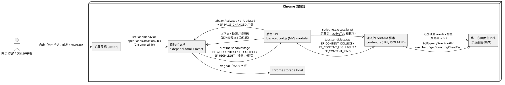
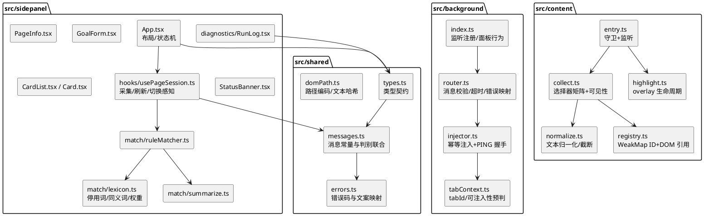
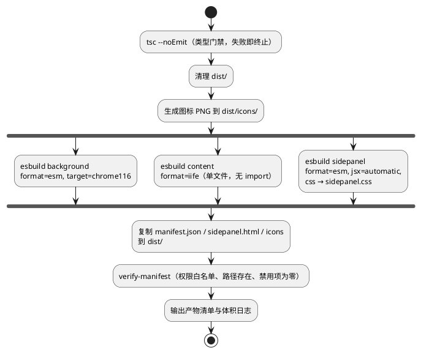
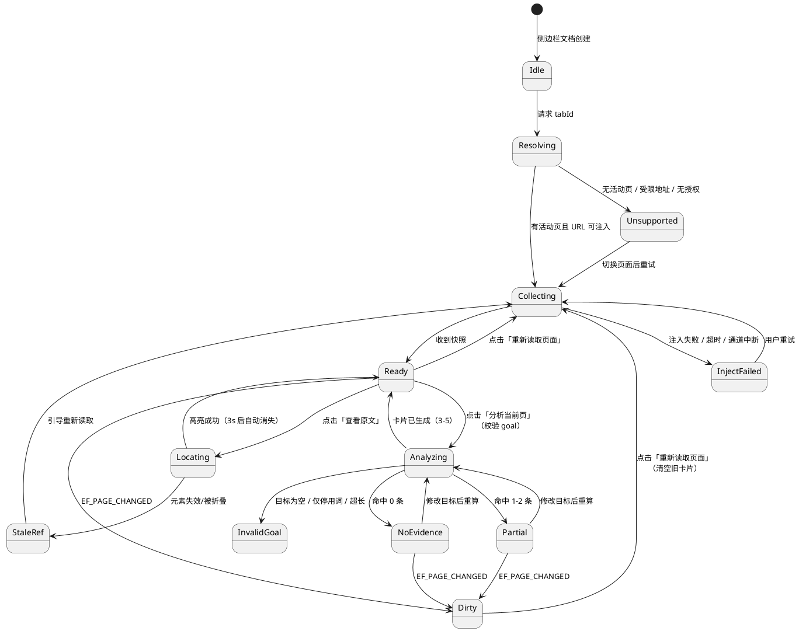
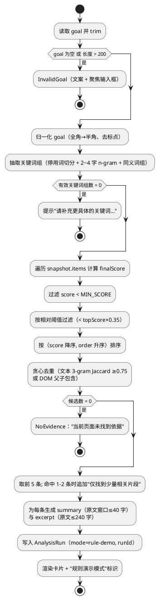
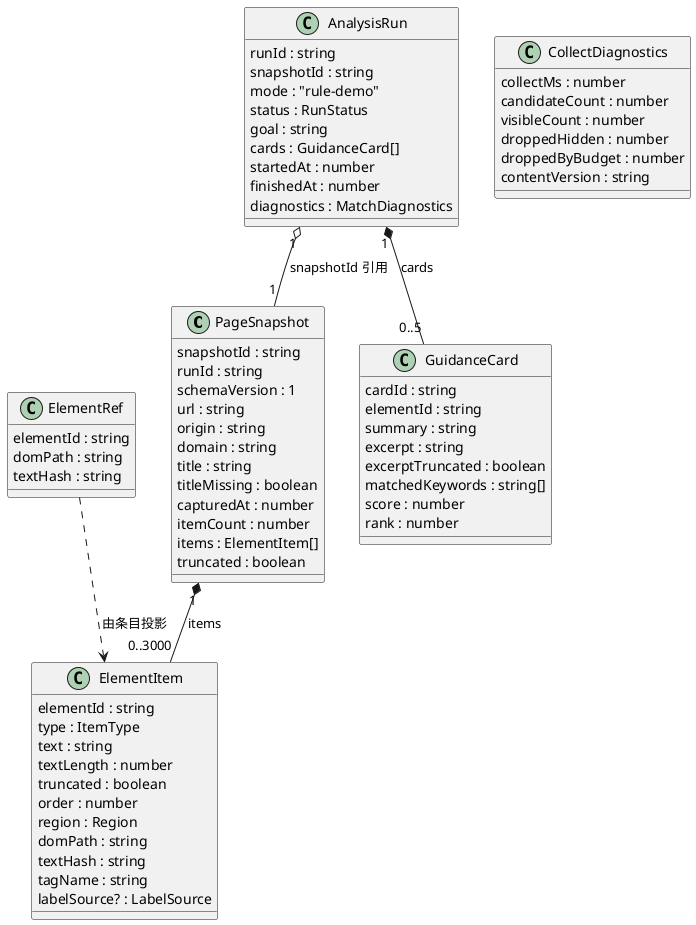
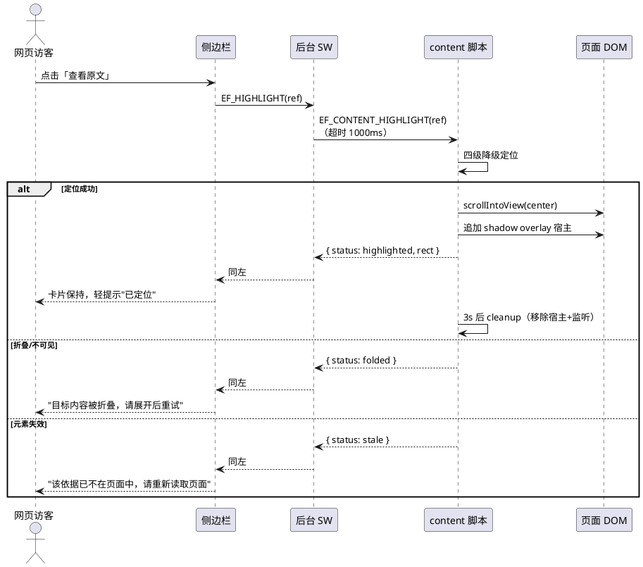

# 一、需求与存量功能关系分析

## 1.0 分析前提

本项目的代码基线为**空目录**：根目录仅有 `.codeartsdoer/`（IDE 元数据）与 `codearts_proof/`（阶段留痕），不存在 `package.json`、`src/`、`public/`、`dist/`，也不存在任何可复用的扩展源码。因此本章的"存量"包含两类：

1. **项目内存量**：无。所有扩展代码、构建配置、界面、算法均为新增。
2. **平台与工具链存量**：Chrome 扩展运行时（Manifest V3、`activeTab`、`scripting`、`sidePanel`、`runtime` 消息、`storage`）与本地 Node.js 20.15.1 / npm 10.7.0。这些能力**可以使用**，但其授权时序、生命周期与调用约束构成设计边界，需要在 1.2 节逐条确认，不能视为"已实现功能"。

结论：本次是**全新增量**，但并非"自由设计"——可落地的形态被 Chrome 平台契约严格约束（授权时机、注入目标、侧边栏手势、Service Worker 生命周期）。

## 1.1 需求功能与存量功能对比

### 1.1.1 已实现功能

| 需求功能 | 存量功能 | 代码位置 | 匹配度 |
|---------|---------|---------|--------|
| 全部需求（侧边栏唤起、页面采集、规则匹配、依据卡片、定位高亮、构建交付） | 无任何实现 | `D:\hwproject\translator`（不存在 `src/`、`package.json`、`vite.config.ts`） | 0% |

判定依据：`Get-ChildItem -Force` 与 `.codeartsdoer/specs/` 检查结果确认项目为初始空状态；`codearts_proof/01-spec-phase.md` 第 5 节亦明确声明"尚未执行 `npm install` 与 `npm run build`"。

### 1.1.2 需要扩展的功能

"存量"为平台能力与前序留痕中的规划，需要在本项目内扩展为可用实现。

| 需求功能 | 存量功能 | 差异说明 | 扩展方向 |
|---------|---------|---------|---------|
| 点击图标打开侧边栏（5.1.1） | Chrome `sidePanel` API + `action.default_icon` | 平台只提供容器，不含任何入口配置与界面；且 `sidePanel.open()` 必须由用户手势触发，Service Worker 冷启动会丢失手势窗口 | 在清单中声明 `side_panel.default_path`，后台注册 `sidePanel.setPanelBehavior({openPanelOnActionClick:true})`，由点击动作直接打开；侧边栏需自包含渲染与状态管理 |
| 读取当前活动标签页（5.1.1、5.5.1） | `chrome.tabs.query` | 未申请 `tabs` 权限时，`tab.url/title` 可能被省略；不能依赖 tabs API 提供页面标题与域名 | 仅用 `tabs.query` 取 `tabId/windowId`；域名、标题、地址一律以 content 快照回传值为准，避免申请 `tabs` 权限 |
| 动态注入采集脚本（5.2.1） | `chrome.scripting.executeScript` + `activeTab` | 平台只提供注入原语；重复注入会重复执行顶层代码，页面刷新会销毁 content 上下文 | 脚本以 IIFE 打包并做注入幂等守卫；注入后走消息通道；对"接收端不存在"做错误映射与重试 |
| 侧边栏界面（5.1、5.3） | React（需引入依赖） | 项目无 React、无构建链 | 新增 React 18 + TypeScript + esbuild 三入口构建 |
| 结构化工单与排障日志（4.4.2、6.5） | `chrome.storage.local` + 控制台 | 平台无运行记录模型；页面内容不允许持久化 | 定义内存态 `AnalysisRun`，仅把用户目标持久化到 `storage.local`；运行诊断随消息回传并在侧边栏折叠区展示 |
| 构建产物可直接加载（4.4.4、5.7.1） | Node 20.15.1 / npm 10.7.0 | 无任何构建配置；前序留痕拟用 `vite.config.ts`，与 content script 需要的 IIFE 形态存在配置成本 | 改为 `scripts/build.mjs` + esbuild 三入口显式控制产物格式（详见 2.12 改进点） |
| 扩展图标（未在 spec 显式要求，但清单加载所需） | 无图形资源 | 清单 `icons` 不支持 SVG，必须提供 PNG | 新增零依赖图标生成脚本，构建期产出 16/32/48/128 PNG |

### 1.1.3 需要新增的功能或接口

按模块分组（输入 → 输出 → 依赖）：

**A. 构建与清单层**
1. 三入口构建脚本：输入 `src/**`，输出 `dist/{background.js, content.js, sidepanel.js, sidepanel.css}`；依赖 esbuild、TypeScript。
2. 静态资源装配：输入 `public/manifest.json`、`public/sidepanel.html`、图标，输出到 `dist/`；依赖 Node 文件系统。
3. 清单自检脚本：输入 `dist/`，输出权限白名单校验结果（禁止出现 `host_permissions`、`content_scripts`、`<all_urls>`）；依赖 Node。
4. 纯函数自测脚本：输入合成快照样例，输出匹配用例通过/失败；依赖 esbuild 打包 + `node:test`。

**B. 采集层（content 世界）**
5. 五类节点选择器矩阵与可见性过滤器：输入 `document`，输出候选节点集合。
6. 文本归一化与截断：输入原始文本，输出规范化文本 + 是否截断。
7. 元素 ID 分配与定位引用：输入 DOM 元素，输出 `ElementId + DomPath + TextHash`。
8. 页面快照组装：输入条目集合与页面元信息，输出 `PageSnapshot`。
9. 高亮叠加层：输入 `ElementRef`，输出定位状态 + 临时高亮 + 自动移除。
10. 幂等注入守卫与消息监听：输入后台消息，输出采集/高亮响应。

**C. 匹配层（侧边栏，纯函数）**
11. 目标归一化与关键词抽取（停用词、n-gram、长度上限）。
12. 规则词库（同义词组、权重、区域权重、阈值）：集中维护、可整体替换。
13. 打分、阈值、去重、排序：输出 `GuidanceCard[]`。
14. 摘要与原文片段生成（原文子串，不生成外部事实）。
15. 结果状态裁决（成功 / 少量命中 / 无依据 / 目标无效），处理 spec 内部数量规则冲突。

**D. 侧边栏 UI 层**
16. 页面信息区、目标输入区、操作按钮、模式标识、卡片列表、空态/错误态、加载态。
17. 页面切换/刷新感知与"重新读取"引导。
18. 运行诊断折叠区（耗时、条目数、命中数、截断标记、运行 ID）。

**E. 后台编排层**
19. 上下文解析：`tabId/windowId` 与可注入性预判（URL scheme 白名单/黑名单）。
20. 注入编排：授权检查 → 幂等注入 → PING 握手 → 转发消息 → 超时控制。
21. 标签页事件广播：`onActivated` / `onUpdated(status=complete)` → 通知侧边栏"页面已变化"。

## 1.2 存量功能详细分析

### 1.2.1 Chrome 平台能力契约与约束

| 能力 | 契约要点 | 对本设计的约束 |
|---|---|---|
| `activeTab` | 仅在用户对扩展图标/快捷键/上下文菜单做出手势后，临时授予**当前标签页**访问权；标签页关闭、跨源导航后失效 | 侧边栏打开后如果用户切换标签页，新标签页**没有**授权；此时读取必须失败并给出"请点击扩展图标"引导，不能静默重试 |
| `scripting.executeScript` | 需要 `scripting` 权限 + 对目标页的访问权（`activeTab` 或主机权限）；Promise 在脚本**执行完成**后 resolve；不能注入 `chrome://`、`chrome-extension://`、Chrome 应用商店、`view-source:` 等受限页面 | 注入后即可安全 `sendMessage`（监听器已在顶层同步注册）；受限页面必须提前拦截并映射为明确错误码 |
| `sidePanel` | `sidePanel.open()` 需要用户手势；`setPanelBehavior({openPanelOnActionClick:true})` 让图标点击直接开面板且不切换标签页；侧边栏是扩展页面，拥有扩展 API 但不继承页面上下文 | 图标点击链路上不要依赖 Service Worker 常驻；侧边栏每次打开都是新文档，必须重新采集，禁止依赖内存残留 |
| `runtime` 消息 | 消息必须是可结构化克隆的纯 JSON；发送到不存在的接收端会 reject（"Receiving end does not exist"） | 快照必须可序列化（无 DOM 引用、无 `Map`/`WeakMap`）；页面刷新后消息失败要映射为 `EF-E007` |
| `storage.local` | 扩展本地存储，异步、有配额；不随网页清空 | 只存 `goal` 与 UI 偏好；禁止存快照、卡片、页面文本 |
| Service Worker 生命周期 | 随时可能被终止，内存态不可靠；事件监听必须在顶层同步注册 | 后台不持有会话状态；`runId` 与快照由侧边栏持有；后台只做无状态路由 |

### 1.2.2 构建工具链约束

1. Node 20.15.1 与 npm 10.7.0 实测可用，无需版本探测。
2. 空项目意味着依赖全新安装，`npm install` 必须联网；离线或镜像不可用时应记录真实错误并给出镜像建议（对应 spec 5.7.3.1）。
3. `dist/` 必须自包含（无 CDN、无远程字体、无外部脚本），否则"加载已解压扩展"后离线不可用。
4. content script 若被打成 ESM，会被注入环境拒绝（content 世界不支持模块导入），必须 IIFE；这是选择 esbuild 显式三入口而非单入口打包的直接原因。

### 1.2.3 术语对齐与规格冲突识别

| 编号 | 位置 | 问题 | 本设计裁决 |
|---|---|---|---|
| K-01 | spec 5.3.3.3 vs 6.3.5 | 前者要求"命中少于 3 条时展示实际命中片段"，后者要求"卡片数量必须为 0 或 3–5" | 采用更具体的 5.3.3：命中 1–2 条时展示实际数量并提示"仅找到少量相关片段"；命中 0 条输出无依据。在验收用例中显式覆盖两种分支 |
| K-02 | spec 5.2.1.6 | "跨框架与动态内容"表述为"应当覆盖主文档可见内容" | 第一轮只采集**主文档**，不进入 iframe；动态内容以采集时刻为准，靠"重新读取"刷新。iframe 列入 2.11 限制 |
| K-03 | spec 4.1.1 vs 5.2.1.2 | 首屏 1.5s 呈现 vs 采集 1s 上限 | 侧边栏先渲染骨架与页面元信息（来自 `tabs.query` 的 `tabId` + 快照异步补全），再填充采集结果；首屏不等采集完成 |
| K-04 | spec 5.2.1.5 vs 6.2.3 | "文本长度上限"未给数值 | 采集单条上限 300 字符；卡片原文片段展示上限 240 字符；摘要上限 40 字符（spec 明示） |
| K-05 | spec 6.4.3 | 目标可持久化，页面内容不可 | 仅 `goal` 字符串入 `storage.local`，上限 200 字符；快照与卡片只存在于侧边栏内存 |

### 1.2.4 约束清单（设计必须满足）

| 编号 | 约束 | 来源 |
|---|---|---|
| C-01 | 清单只含 `activeTab`、`scripting`、`sidePanel`、`storage`；不得出现 `host_permissions`、`<all_urls>`、静态 `content_scripts` | spec 1.4.5、4.3.1 |
| C-02 | 采集与高亮对页面只读：不写节点属性/文本/结构，不改样式表，不触发表单与跳转 | spec 1.4.3、4.3.3、5.4.1.3 |
| C-03 | 卡片摘要与原文必须实时来自当前快照，源码不得硬编码任何目标站政策内容 | spec 1.4.2、5.3.1.4 |
| C-04 | 界面必须始终标注"规则演示模式"，禁止 AI/模型/智能体规划表述 | spec 4.4.1、5.3.1.7 |
| C-05 | 无依据时明确输出"当前页面未找到依据"，卡片数 0 | spec 5.6.1 |
| C-06 | 单次采集 ≤1s（≤3000 条）、匹配 ≤1s、高亮反馈 ≤500ms、无反馈等待 ≤2s | spec 4.1 |
| C-07 | 注入失败、超时、元素失效、标签页关闭均须有明确文案，禁止白屏 | spec 4.2.1、5.1.3 |
| C-08 | 侧边栏关闭重开必须重新采集，禁止陈旧卡片 | spec 4.2.4 |
| C-09 | 不发起任何远程请求，不依赖登录与付费 API | spec 4.3.4、1.4.7 |
| C-10 | 用户输入与页面片段按纯文本渲染，禁止作为可执行内容 | spec 4.3.6 |
| C-11 | 兼容 Chrome ≥116；Manifest V3；TypeScript | spec 4.5.1/4.5.2 |
| C-12 | `dist/` 可直接"加载已解压扩展"；README 覆盖安装/构建/加载/验收/截图位/常见错误 | spec 4.4.4/4.4.5 |
| C-13 | 数据结构新增字段必须向后兼容，新增不得改变既有字段语义 | spec 4.5.4 |
| C-14 | 每次分析有唯一 `runId`，状态属于成功/无依据/注入失败/超时/无效目标之一 | spec 6.5 |
# 二、增量设计方案

## 2.1 实现模型

### 2.1.1 上下文视图

组件由四个运行实体构成：侧边栏页面（扩展页面，React）、后台 Service Worker（无状态编排）、content 采集脚本（注入到第三方页面 ISOLATED world）、第三方页面。全部通信在本机进程内完成，**没有任何出站网络连接**。



调用频率：图标点击 1 次/会话；`EF_COLLECT` 首次打开 + 每次"重新读取"；`EF_HIGHLIGHT` 每次"查看原文"；`EF_PAGE_CHANGED` 由浏览器事件驱动，只携带 `tabId`，不携带页面内容。

### 2.1.2 服务/组件总体架构



**组件职责与依赖规则**

| 组件 | 职责 | 允许依赖 | 禁止 |
|---|---|---|---|
| `background/*` | 权限编排、注入、超时、错误映射、标签页事件广播 | `shared/*`、Chrome API | 持有快照/卡片；访问 DOM |
| `content/*` | 只读采集、ID 分配、定位与高亮 | `shared/*`（类型与常量）、DOM API | 网络请求、读写页面存储、修改页面节点属性 |
| `sidepanel/match/*` | 纯函数匹配与摘要 | `shared/types` | DOM API、Chrome API、网络 |
| `sidepanel/*`（UI） | 渲染、交互、会话状态机 | `shared/*`、`match/*` | 直接调 `scripting`；`dangerouslySetInnerHTML` |
| `shared/*` | 类型契约、消息常量、错误码、通用纯函数 | 无 | 任何副作用 |

**目录结构（编码阶段按此落地）**

```
translator/
├─ package.json
├─ tsconfig.json
├─ README.md
├─ public/
│  ├─ manifest.json
│  └─ sidepanel.html
├─ scripts/
│  ├─ build.mjs              # 三入口 esbuild + 静态资源复制
│  ├─ gen-icons.mjs          # 零依赖 PNG 生成
│  ├─ verify-manifest.mjs    # 权限/路径/禁用项自检
│  └─ selftest.mjs           # 匹配纯函数用例（合成数据）
├─ src/
│  ├─ background/
│  │  ├─ index.ts
│  │  ├─ tabContext.ts
│  │  ├─ injector.ts
│  │  └─ router.ts
│  ├─ content/
│  │  ├─ entry.ts
│  │  ├─ collect.ts
│  │  ├─ normalize.ts
│  │  ├─ registry.ts
│  │  └─ highlight.ts
│  ├─ sidepanel/
│  │  ├─ main.tsx
│  │  ├─ App.tsx
│  │  ├─ components/{PageInfo,GoalForm,CardList,Card,StatusBanner,ModeBadge,RunLog}.tsx
│  │  ├─ hooks/usePageSession.ts
│  │  ├─ match/{ruleMatcher.ts,lexicon.ts,summarize.ts}
│  │  ├─ state/{sessionReducer.ts,initialState.ts}
│  │  └─ styles/sidepanel.css
│  └─ shared/{types.ts,messages.ts,errors.ts,domPath.ts,constants.ts}
└─ dist/                     # 构建产物，可直接"加载已解压扩展"
```

**构建与装配流程**



构建顺序硬性要求：**先类型检查后打包**，避免产出"能加载但类型错误"的产物；任一入口失败则整个命令非零退出，不允许"部分产物 + 成功退出码"。

### 2.1.3 实现设计文档

**（1）会话与运行状态机**

侧边栏每次打开都是新文档，`PageSession` 状态机保证"不展示陈旧卡片"（C-08）。



状态约束：
- 进入 `Collecting` 必须同步清空 `cards` 与 `goalResult`（C-08）；`Dirty` 状态下禁用"分析当前页"。
- `Ready` 是唯一允许发起匹配的状态；`InvalidGoal` 不改变已有卡片，仅展示输入提示并聚焦输入框。
- 所有异步操作以 `runId + snapshotId` 作废过期响应（迟到响应直接丢弃）。

**（2）"分析当前页"主流程（规则演示模式）**



**（3）扩展点设计（为第二轮模型与来源校验预留）**

匹配层以接口隔离，禁止 UI 直接依赖具体实现：

- `MatchStrategy` 接口：输入 `{ goal, snapshot }`，输出 `{ status, cards, diagnostics }`。
- 第一轮实现 `RuleMatcher`（同步纯函数，`mode: "rule-demo"`）。
- 第二轮新增 `ModelMatcher`（异步），通过 `strategy.mode` 决定界面标识文案；本轮不得出现任何模型调用与相关表述（C-04）。
- `MatchResult.status` 已是 spec 6.5 的枚举，新增实现不得改变既有字段语义（C-13）。

**（4）事务与一致性**

无数据库事务。一致性靠三条规则：① 快照与卡片同属一个 `snapshotId`，跨快照的卡片一律丢弃；② 每次采集/分析生成新 `runId`，日志按 `runId` 聚合；③ 页面事件到达即置 `Dirty`，宁可让用户多点一次"重新读取"，也不展示可能错误的卡片。
## 2.2 接口设计

### 2.2.1 总体设计

接口分三层，命名与业务语言一致（采集 / 定位 / 上下文）：

| 层 | 通道 | 接口 | 稳定性 | 版本策略 |
|---|---|---|---|---|
| 侧边栏 → 后台 | `runtime.sendMessage` | `EF_GET_CONTEXT`、`EF_COLLECT`、`EF_HIGHLIGHT`、`EF_SAVE_GOAL`、`EF_LOAD_GOAL` | 稳定 | 消息体带 `v:1`；只增字段不改语义 |
| 后台 → 侧边栏 | `runtime.sendMessage`（广播） | `EF_PAGE_CHANGED` | 稳定 | 仅承载 `tabId` 与事件类型 |
| 后台 → content | `tabs.sendMessage` | `EF_CONTENT_COLLECT`、`EF_CONTENT_HIGHLIGHT`、`EF_CONTENT_PING` | 实验（仅扩展内部） | 与快照 `schemaVersion` 联动 |

设计原则：
1. 所有消息为可结构化克隆的 JSON，**不传 DOM 节点、函数、`Map`/`WeakMap`**。
2. 请求必带 `requestId`（uuid）与 `v:1`；响应回显 `requestId`，用于丢弃迟到响应。
3. 后台对入参做运行时校验（`tabId` 为正整数、`elementId` 匹配白名单格式），非法入参直接返回 `EF-E010`/`EF-E002`，不进入注入流程。
4. 侧边栏**不直接调用** `chrome.scripting`，避免权限调用点分散、错误映射不一致（见 2.12 改进点）。
5. 超时统一由后台负责：采集 3000ms、定位 1000ms、PING 300ms×2 次；超时返回结构化错误而非抛异常。

### 2.2.2 接口清单

**接口 A：`EF_GET_CONTEXT`（侧边栏 → 后台）**

- 签名（类型契约，非实现）：`() => Promise<{ tabId: number; windowId: number } | EfError>`
- 业务说明：侧边栏启动时解析当前活动标签页，用于后续采集与按钮可用性判断。
- 前置条件：侧边栏已打开；当前窗口存在活动标签页。
- 后置条件：无副作用，不读取页面内容。
- 异常映射：无活动页 → `EF-E001`；无 `activeTab` 授权 → `EF-E003`；受限地址 → `EF-E002`。
- 调用时机：侧边栏挂载、`EF_PAGE_CHANGED` 到达、用户点击"重新读取"。

**接口 B：`EF_COLLECT`（侧边栏 → 后台）**

- 签名：`({ tabId, reason: "initial" | "refresh" }) => Promise<{ snapshot: PageSnapshot; diagnostics: CollectDiagnostics } | EfError>`
- 业务说明：完成"授权检查 → 幂等注入 → PING → 采集"，是唯一返回页面快照的入口。
- 前置条件：`activeTab` 对 `tabId` 有效；URL scheme 在可注入白名单内。
- 后置条件：页面 DOM 不发生变化（采集只读；唯一可能的写操作是清理上一个高亮宿主节点）；content 脚本处于已注入状态。
- 异常映射：注入被拒 `EF-E005`；授权失效 `EF-E003`；超时 `EF-E006`；标签页关闭 `EF-E004`；通道中断 `EF-E007`；快照为空由 content 正常返回空 `items`，不报错。
- 幂等性：重复调用安全（注入守卫 + 复用已有 content 实例）。

**接口 C：`EF_HIGHLIGHT`（侧边栏 → 后台）**

- 签名：`({ tabId, ref: ElementRef }) => Promise<{ status: "highlighted" | "stale" | "folded"; rect?: ViewportRect } | EfError>`
- 业务说明：按元素 ID（含降级路径）滚动定位并叠加高亮。
- 前置条件：`ref.snapshotId` 与当前快照一致；页面未刷新。
- 后置条件：页面滚动位置改变；新增 1 个 overlay 宿主节点，≤3s 后自动移除；原有节点属性/文本/结构不变。
- 异常映射：元素失效 → `status: "stale"` + `EF-E008` 文案；折叠/不可见 → `status: "folded"` + `EF-E009`；通道中断 → `EF-E007`。
- 禁止：不 `click()`、不 `focus()`、不触发 `submit`。

**接口 D：`EF_SAVE_GOAL` / `EF_LOAD_GOAL`（侧边栏 → 后台 → `storage.local`）**

- 签名：`({ goal: string }) => Promise<void>` / `() => Promise<{ goal: string | null }>`
- 前置条件：`goal.trim().length ≤ 200`。
- 后置条件：仅写入 `goal` 与 `updatedAt`；`storage` 不可用时降级为内存 Map 并在诊断区标注，不阻塞主流程。
- 隐私：不写入快照、卡片、页面地址、标题。

**接口 E：`EF_PAGE_CHANGED`（后台 → 侧边栏广播）**

- 签名：`({ tabId, kind: "activated" | "navigated" | "reloaded" }) => void`
- 业务说明：只告知"页面可能变了"，不携带 URL/标题（避免申请 `tabs` 权限）。
- 侧边栏行为：若 `tabId` 与当前一致 → 置 `Dirty` 并显示"页面已切换，请重新读取"；若不一致 → 同样提示，禁用分析。

**接口 F：`EF_CONTENT_COLLECT`（后台 → content）**

- 签名：`({ requestId, snapshotId, maxItems, maxTextLength }) => { snapshot: PageSnapshot; diagnostics: CollectDiagnostics }`
- 前置条件：content 已注入且 PING 成功。
- 后置条件：无副作用（只读 + 在内存登记元素引用）。
- 约束：同步执行；单次 ≤1000ms（超出由后台超时兜底）。

**接口 G：`EF_CONTENT_HIGHLIGHT`（后台 → content）**

- 签名：`({ requestId, ref: ElementRef }) => { status, rect? }`
- 定位顺序：`registry` 内存引用 → `domPath` 查询 + `textHash` 校验 → 最近可见祖先 → `stale`。

**接口 H：`EF_CONTENT_PING`（后台 → content）**

- 签名：`() => { ready: true; contentVersion: string }`
- 用途：注入后确认监听器已就绪；版本不一致时强制重新注入（应对扩展更新后残留旧脚本）。

**调用示例（时序说明，非代码）**

1. 用户在验收页点击扩展图标 → 浏览器授予 `activeTab` → 侧边栏打开 → `EF_GET_CONTEXT` 得 `tabId=42`。
2. `EF_COLLECT(42,"initial")` → 后台判断 URL 为 `https:` → `executeScript(files:["content.js"])` → `EF_CONTENT_PING` 成功 → `EF_CONTENT_COLLECT` → 返回 `PageSnapshot(schemaVersion:1)`。
3. 用户输入目标 → 本地 `RuleMatcher` 产出 4 张卡片（`runId` 记录 `collectMs/matchMs`）。
4. 点击卡片"查看原文" → `EF_HIGHLIGHT(42,{elementId:"ef-p-12",domPath:"…",textHash:"…"})` → content 滚动 + overlay → 返回 `highlighted` 与 `rect`。

## 2.3 数据模型

### 2.3.1 设计目标

1. **只读与可定位**：快照必须足以支撑"展示原文 + 回到真实节点"，且不携带任何 DOM 引用。
2. **容量与性能**：单页最多 3000 条；单条文本 ≤300 字符；快照 JSON ≤1.5MB；序列化/传输 ≤200ms。
3. **向后兼容**：`schemaVersion=1`；新增字段必须可选，禁止改变既有字段语义（C-13）。
4. **不持久化页面内容**：快照、卡片只存在侧边栏内存；持久化范围仅 `goal`（C-05/K-05）。
5. **术语一致**：类型名与 spec 领域术语一一对应（PageSnapshot / ElementItem / GuidanceCard / AnalysisRun）。

### 2.3.2 模型实现



**字段约束**

| 类型 | 字段 | 约束 |
|---|---|---|
| `PageSnapshot` | `url/origin/domain` | 由 content 侧 `location` 解析；`domain` 为 host（含端口时去除端口）；非空 |
| | `title` | `document.title` 归一化；空时 = `domain`，并置 `titleMissing=true`（spec 5.1.3.3） |
| | `itemCount` | `items.length`，非负，≤3000 |
| | `truncated` | 条目数或字符预算被截断时为 true（UI 提示） |
| `ElementItem` | `elementId` | 格式 `ef-<type首字母>-<序号>`，会话内唯一；由 content 分配 |
| | `type` | `heading｜paragraph｜link｜button｜inputLabel`（spec 6.2.2 五种，不多不少） |
| | `text` | 归一化可见文本，非空；≤300 字符；超长截断并置 `truncated` |
| | `order` | 文档顺序整数，用于稳定排序与去重 |
| | `region` | `main｜nav｜header｜footer｜aside｜unknown`，用于匹配降权 |
| | `domPath` | `tag:nth-of-type > …` 路径（≤12 层，超出取尾段）；只由 content 生成，侧边栏不得拼入选择器 |
| | `textHash` | 文本 32 位 FNV-1a 十六进制，用于降级定位校验 |
| `GuidanceCard` | `summary` | ≤40 字符；必须是原文子串（窗口切片），不得改写 |
| | `excerpt` | ≤240 字符；原文归一化后的逐字片段 |
| | `elementId` | 必须存在于当前 `PageSnapshot.items` |
| | `score/rank` | score 保留 2 位；rank 从 1 递增，按 score 降序、order 升序 |
| `AnalysisRun` | `mode` | 固定字面量 `"rule-demo"`，界面据此渲染"规则演示模式" |
| | `status` | `success｜partial｜no-evidence｜inject-failed｜timeout｜invalid-goal｜stale`（含 spec 6.5 五类，`partial/stale` 为细化） |
| `ElementRef` | 全字段 | 与快照条目一致，用于跨消息定位；`elementId` 不匹配 `^ef-[hplbi]-\d{1,5}$` 时后台直接拒绝 |

**序列化与版本**
- 全部为 JSON 原生类型；时间用 `Date.now()` 毫秒数；枚举用字符串字面量（禁止数字枚举，便于日志阅读）。
- `schemaVersion` 只增不改；读取方可忽略未知字段；缺失可选字段时使用缺省值（`excerptTruncated=false`）。
- 运行日志 `console.debug("[EF]", { runId, phase, ms, counts })`，**不打印完整页面文本**（仅长度与 hash 前 8 位），避免把第三方内容落盘到日志系统。
## 2.4 DOM 采集算法（content 侧，只读）

### 2.4.1 采集步骤

1. **读取页面元信息**：`location.href`、`location.host`、`document.title`。标题为空时用域名占位并置 `titleMissing`。
2. **按类型分组查询**（每类一次 `querySelectorAll`，避免全量 `*` 遍历）：

| 类型 | 选择器 | 文本来源 | 备注 |
|---|---|---|---|
| heading | `h1,h2,h3,h4,h5,h6,[role=heading]` | `innerText` | 去重：同文本嵌套标题只留最内层 |
| paragraph | `p,li,dd,dt,blockquote,figcaption` | `innerText` | 跳过"仅含块级子节点且自身直接文本 <20 字符"的容器 |
| link | `a[href]` | `innerText` | 跳过纯图标链接（无文本）；不读取 `href` 目标 |
| button | `button,[role=button],input[type=button],input[type=submit],input[type=reset]` | `innerText` 或 `value` | 不点击、不聚焦 |
| inputLabel | `input:not([type=hidden]):not([type=password]),textarea,select` | `labels[]` → `aria-label` → `aria-labelledby` 指向文本 → `placeholder` → 邻近 `label`/`td` 文本 | **只读标签，绝不读取 `value`**；无标签则跳过 |

3. **可见性过滤**（顺序执行，尽早短路以控成本）：
   - 祖先链含 `[hidden]`、`aria-hidden="true"`、`<template>` → 丢弃；
   - `getComputedStyle`：`display:none`、`visibility:hidden|collapse`、`opacity:0` → 丢弃；
   - `checkVisibility({checkOpacity:true,checkVisibilityCSS:true})` 可用时作为首选判断（Chrome 105+），否则用上一条；
   - `getBoundingClientRect()` 宽或高为 0 → 丢弃（`position:fixed` 元素不受影响，因此不以 `offsetParent` 判断）。
   - **注意**：可见 ≠ 在视口内。长页面视口外但未隐藏的内容必须采集，否则会漏掉验收页正文。
4. **文本归一化**：全角转半角标点、`\u00a0` → 空格、连续空白（含换行）→ 单空格、去首尾空白；丢弃归一化后长度 <2 的条目（`button` 允许 1 字符，如"×"除外，纯符号丢弃）。
5. **长度截断**：单条 ≤300 字符；超出按字符截断并追加 `…`，置 `truncated=true`（元素引用不受影响，仍可定位）。
6. **区域判定**：`closest("main,article,nav,header,footer,aside")`，按标签映射 `region`；未命中为 `unknown`。
7. **ID 分配与登记**：`registry` 用 `WeakMap<Element, ElementItem>` 保证同一注入会话内**同一元素 ID 稳定**；新元素按类型序号递增分配（`ef-h-1`、`ef-p-12`）。同一会话内多次采集复用 WeakMap，满足 spec 5.2.1.4。
8. **预算控制**：条目上限 3000、总字符预算 400k。超限时按文档顺序保留前 N 条并置 `truncated=true`；`droppedByBudget` 计入诊断。
9. **性能测量**：`performance.now()` 记录 `collectMs`，随快照回传，用于验收 spec 4.1.2（≤1s）。

### 2.4.2 关键取舍

| 取舍 | 选择 | 理由 |
|---|---|---|
| `innerText` vs `textContent` | `innerText` | 天然排除隐藏文本，符合"只采集可见"；代价是强制重排，用"先样式过滤再取文本"降低调用次数 |
| 是否采集 `td/th` | 第一轮不采集 | 政策页正文以 `p/li` 为主；表格单元格常与父容器重复，噪声高。列入 2.11 限制 |
| 嵌套重复 | 祖先与后代同为 paragraph 时，若后代文本长度 ≥ 祖先的 80% 则丢弃祖先 | 避免外层容器与内部段落各出一张卡（spec 5.5.1.5"不得累积重复卡片"） |
| iframe | 不采集 | spec 5.2.1.6 限定"主文档"；跨源 iframe 无法只读访问，跨源限制下无法保证 |
| 是否读 `input.value` | 绝不读 | 用户可能在第三方表单中输入隐私信息，读取即超出"页面感知"必要范围 |

### 2.4.3 注入幂等与版本

- content 入口以 IIFE 包裹，顶层先检查 `window.__EASYFLOW_CONTENT__`：已存在且 `contentVersion` 相同 → 直接返回，不重复注册监听器；版本不同 → 移除旧监听器并覆盖。
- 注入成功标志：`executeScript` Promise resolve（此时顶层监听器已同步注册）→ 后台再发 `EF_CONTENT_PING` 确认（最多 2 次、间隔 150ms）。
- 页面刷新/导航会清空 content 上下文：后台收到 `onUpdated(status="complete")` 后把注入标记复位为"未注入"，下次采集重新注入。

## 2.5 关键词匹配算法（规则演示模式）

### 2.5.1 目标处理

1. **校验**：`trim` 后长度 1–200；为空 → `InvalidGoal`（"请先输入你想了解的内容"，聚焦输入框）；>200 → 提示"目标过长，请精简到 200 字以内"，禁止提交（spec 6.4.2）。
2. **归一化**：全角转半角、去除标点与空白、英文小写化、去除语气词（"我想知道/请问/帮我看看/怎么/如何"等）。
3. **停用词切分**：内置停用词表（代词、助词、疑问词、通用动词），按最长匹配切出候选片段。
4. **关键词组生成**：对每个候选片段生成 2/3/4 字滑窗 n-gram（丢弃单字），每个 n-gram 查 `lexicon` 得到**同义词组**（如"申请条件"→ 条件/资格/对象/标准/要求；"线下办理"→ 办理/窗口/受理/现场/地点），组内最多取 8 组，超出按目标中出现顺序截断。
5. **词库定位**：`src/sidepanel/match/lexicon.ts` 只包含语言层面的通用词与同义关系，**不包含任何政策条文、办理流程、机构信息**（C-03）。词库可整体替换为 JSON，便于第二轮切换为模型实现。

### 2.5.2 打分公式

对每个 `ElementItem`：

```
base        = Σ(每组最高命中分)      exact=1.0，synonym=0.5，每组只计一次，最多 3 组
titleBonus  = 1.25（type=heading 且命中在标题中），否则 1.0
regionWeight= main/article 1.0 | unknown 0.9 | header 0.8 | nav/aside/footer 0.6
lengthDamp  = len≤120 → 1.0 | 120<len≤300 → 0.9 | >300 → 0.8（采集已截断，实际≤300）
finalScore  = round(base × titleBonus × regionWeight × lengthDamp, 2)
```

- **绝对阈值** `MIN_SCORE = 1.0`（至少 1 个精确词，或 2 个同义词）。
- **相对阈值** `max(MIN_SCORE, topScore × 0.35)`，避免长页面里"弱相关但字数多"的条目挤占卡片。
- 排序：`finalScore` 降序；同分按 `order` 升序（保证同一输入同一快照的结果顺序稳定，spec 6.3.4）。

### 2.5.3 去重与数量裁决

- **去重**：按排序遍历，若与已选卡片满足任一条件则跳过——① 文本 3-gram Jaccard 相似度 ≥0.75；② 两条目 `domPath` 互为前缀（父子/祖孙关系）且文本互相包含。保留分高者。
- **数量**：候选 ≥3 → 取前 5（卡片 3–5 张，spec 6.3.5）；候选 1–2 → 展示实际数量 + "仅找到少量相关片段"（K-01 裁决，spec 5.3.3.3）；候选 0 → `no-evidence`，卡片数 0，界面展示"当前页面未找到依据"+ 更换关键词/重新读取建议。
- **强制约束**：卡片不得包含页面中不存在的办理方式、材料、地点、电话等（C-03）。由于摘要与片段都取自原文子串，此约束由构造方式保证，而非事后过滤。

### 2.5.4 摘要与原文片段生成

| 输出 | 规则 |
|---|---|
| `summary`（≤40 字） | 在原文中定位**首个命中词**的位置，取 `[pos-8, pos+32]` 窗口；左右按标点/空格边界收缩；前后加 `…`；若窗口长度 >40 则硬截断。**必须是原文子串**，因此不存在"改写/补写" |
| `excerpt`（≤240 字） | 取条目归一化全文，超 240 字符截断加 `…`，置 `excerptTruncated` |
| `matchedKeywords` | 命中的词面（来自目标或同义词组），用于 UI 高亮用户可理解的命中原因，也便于评审判断"为什么是这张卡" |

### 2.5.5 复杂度与性能

- 条目数 N≤3000，关键词组 K≤8，每组词数 ≤8：朴素遍历 `O(N×K×8)` 的字符串 `includes` 约 2×10⁵ 次比较，实测应在 100ms 量级，满足 ≤1s（spec 4.1.3）。
- 不做正则动态拼接（避免用户输入进入正则导致灾难回溯与注入），统一用 `String.prototype.includes`（小写化后）。
- 匹配在侧边栏主线程同步执行；若实测 >300ms，降级方案为分片（`requestIdleCallback` 分批）并在诊断区标注，但第一轮优先保证"一次分析结果完整"。

## 2.6 依据定位与高亮实现

### 2.6.1 定位链路（四级降级）

1. **内存引用**：`registry` 的 `WeakMap`/`Map` 用 `elementId` 取元素，`isConnected` 为真且文本 hash 一致 → 命中。
2. **DOM 路径 + 文本校验**：`querySelector(domPath)`，若命中节点的 `textHash` 与条目一致 → 命中（防止页面结构微调后定位到错误元素）。
3. **最近可见祖先**：元素存在但自身不可见（折叠容器/`details` 未展开）→ 向上找可见祖先，返回 `folded`，提示"目标内容被折叠，请展开后重试"（spec 5.4.3.2），**不代替用户展开、不点击**。
4. **失效**：以上均失败 → `stale`，提示"该依据已不在页面中，请点击重新读取页面"，不滚动到任何位置（spec 4.2.3）。

### 2.6.2 高亮叠加层

- **宿主节点**：`<div data-ef-overlay>` 挂到 `document.documentElement`（不挂 `body`，避免页面重排后丢失），`attachShadow({mode:"closed"})`，shadow 内放一个定位盒。宿主自身只有 `position:absolute;top:0;left:0;width:0;height:0;z-index:2147483647;pointer-events:none;` 这几个内联样式，**不修改任何原有节点**。
- **定位坐标**：`rect = el.getBoundingClientRect()`；绝对坐标 = `rect.left + scrollX`、`rect.top + scrollY`；盒尺寸 = `rect.width/height` 外扩 4px。
- **视觉**：2px 描边 + 12% 透明填充 + `border-radius`，shadow 内 `all: initial` 隔离页面样式；页面 CSS 无法影响 shadow 内部（选择器不穿透）。
- **滚动**：`el.scrollIntoView({block:"center", inline:"nearest", behavior:"smooth"})`；`behavior` 为 smooth 时 500ms 内可见（spec 4.1.4），若 `prefers-reduced-motion` 则用 `auto`。
- **跟随**：高亮存活期内监听 `scroll`（passive）与 `resize`，用 `requestAnimationFrame` 合并更新；`IntersectionObserver` 不在方案内（不需要）。
- **生命周期**：3 秒后移除宿主节点与所有监听器；重复点击同一/不同卡片时先 `cleanup()` 再新建，全局最多 1 个 overlay。
- **可逆性**：移除后 `document.documentElement.childNodes` 数量与注入前一致；不新增 `<style>` 标签、不改 `class`/`style` 属性、不改 `href`、不移动节点。

### 2.6.3 高亮时序



### 2.6.4 明确禁止项

- 不调用 `element.click()` / `dispatchEvent` / `form.submit()` / `focus()` / `select()`。
- 不读写 `localStorage`/`sessionStorage`/`cookie`/`clipboard`。
- 不注入 `<style>`/`<link>` 到页面文档；overlay 样式只在 shadow root 内。
- 不修改 `body` 的 `overflow`/`margin` 等布局属性（`scrollIntoView` 已足够）。
## 2.7 错误处理与权限边界

### 2.7.1 错误码与文案映射

| 错误码 | 触发条件 | 界面文案 | 可重试 | 重试动作 |
|---|---|---|---|---|
| `EF-E001` | 无活动标签页 / 当前窗口无网页 | 未检测到活动网页，请先打开目标网页 | 是 | 打开网页后点图标 |
| `EF-E002` | 受限地址：`chrome://`、`chrome-extension://`、`edge://`、`about:`、`view-source:`、Chrome 应用商店、`file://` 未授权 | 当前页面不支持读取，请切换到普通公开网页后重试 | 是 | 切换页面后"重新读取" |
| `EF-E003` | 无 `activeTab` 授权（切换标签页/跨源导航/授权过期） | 未获得当前页面访问授权，请点击扩展图标后重试 | 是 | 点图标重新授权 |
| `EF-E004` | 标签页已关闭 | 当前标签页已关闭，请重新打开目标网页 | 是 | 重开网页 |
| `EF-E005` | `executeScript` 被拒或脚本执行异常 | 页面脚本注入失败（附 `lastError` 摘要），请刷新页面后重试 | 是 | 刷新 + 重试 |
| `EF-E006` | 采集 >3000ms / 定位 >1000ms | 页面读取超时，请点击重新读取页面 | 是 | 重新读取 |
| `EF-E007` | 消息通道断开（页面刷新导致 content 失效） | 页面已刷新或切换，请重新读取页面 | 是 | 重新读取（自动重新注入） |
| `EF-E008` | 元素已移除或路径+文本校验失败 | 该依据已不在页面中，请点击重新读取页面 | 是 | 重新读取 |
| `EF-E009` | 元素在折叠/不可见容器内 | 目标内容被折叠，请展开后重试 | 是 | 展开后再次点击"查看原文" |
| `EF-E010` | 目标为空 / 仅停用词 / >200 字 | 请先输入你想了解的内容 / 请补充更具体的关键词… / 目标过长 | 是 | 修改目标 |
| `EF-E011` | 快照 `items` 为 0 | 当前页面未找到依据（页面可读内容过少，可能未加载完成） | 是 | 重新读取 |
| `EF-E012` | 匹配 0 命中 | 当前页面未找到依据 | 是 | 换关键词/重新读取 |
| `EF-E013` | `storage.local` 不可用 | 目标记忆已停用（不影响分析） | 否 | 自动降级内存 |

错误呈现规则：① 错误必须带"下一步动作"文案，禁止只显示错误码；② 错误不覆盖已有卡片，仅在卡片区上方插入横幅；③ 注入类错误（E002/E003/E005）同时禁用"分析当前页"按钮，避免用户反复点击无效操作；④ 所有错误在诊断区保留 `runId`，便于 4.4.2 排障。

### 2.7.2 权限矩阵

| 权限 | 是否申请 | 使用点 | 不申请的替代/原因 |
|---|---|---|---|
| `activeTab` | 是 | 图标点击后临时读取当前页 | 唯一的页面访问来源；替代 `<all_urls>` 永久权限（C-01） |
| `scripting` | 是 | `executeScript` 注入 content.js | 无替代；仅在 activeTab 授权范围内生效 |
| `sidePanel` | 是 | `side_panel.default_path` + `setPanelBehavior` | 无替代（禁止用 popup/新标签页，spec 5.1.1.1） |
| `storage` | 是 | 仅存 `goal`（≤200 字符）与 UI 偏好 | 不可用时降级为内存 Map 并提示 `EF-E013`，不阻塞主流程 |
| `tabs` | **否** | — | 避免"读取浏览历史"类权限；`tabId` 无需 `tabs` 权限即可获取，URL/标题由快照回传 |
| `host_permissions` | **否** | — | 明确禁止；`content_scripts` 静态声明同样不写 |
| `web_accessible_resources` | **否** | — | content 无需被页面访问；overlay 由脚本自行创建 |
| `<all_urls>` | **否** | — | 与最小权限原则冲突 |

### 2.7.3 授权时序与边界

1. 用户点击图标 → Chrome 授予 `activeTab`（绑定当前 `tabId`）→ `setPanelBehavior({openPanelOnActionClick:true})` 使同一手势直接打开侧边栏（不依赖 Service Worker 常驻）。后台在顶层注册该行为，并**同时**注册 `action.onClicked` 作为兜底：若浏览器未应用面板行为（旧版本/策略限制），则在点击手势内调用 `sidePanel.open({tabId})`；两条路径互斥，不会重复打开。
2. 侧边栏 `EF_GET_CONTEXT` → 后台 `tabs.query({active:true, lastFocusedWindow:true})` 取 `tabId`；**不读 `tab.url`**，URL 由 content 回传。
3. 后台在 `executeScript` 前做双重预判：① URL scheme 白名单（仅 `http:`/`https:`）；② 尝试注入并捕获 `lastError` 映射错误码。预判与捕获都保留，因为 scheme 检查无法覆盖企业策略与页面级限制。
4. 用户切换标签页 → `onActivated` 广播 → 侧边栏置 `Dirty` 并禁用分析；在新标签页点击"重新读取"会因缺授权返回 `EF-E003`，文案引导"点击扩展图标"。
5. 同源导航：`activeTab` 通常保留；跨源导航通常撤销。**不做假设**，统一由注入结果判定，失败即 E003，避免"以为有权限"的静默失败。
6. 侧边栏关闭 → 文档销毁，内存态（快照/卡片）随之丢弃；重开必重新采集（C-08）。

### 2.7.4 超时与并发控制

- 后台维护 `Map<tabId, Promise>` 的单飞锁（in-flight），同一标签页并发 `EF_COLLECT` 合并为一次，避免重复注入与快照错配。
- 超时用 `Promise.race` 实现，超时后不取消已发出的注入（Chrome 无取消原语），但响应标记 `runId` 已作废，迟到结果直接丢弃。
- `EF_HIGHLIGHT` 不排队：新请求先 `cleanup()` 旧的 overlay，保证页面上同时最多一个高亮。

## 2.8 安全与只读约束

### 2.8.1 威胁与对策

| 威胁 | 场景 | 对策 |
|---|---|---|
| 页面内容注入脚本执行 | 页面文本含 `<script>`/HTML | 侧边栏以 React 文本节点渲染，禁用 `dangerouslySetInnerHTML`/`innerHTML`；content 不回传 HTML，只回传纯文本（C-10） |
| 用户输入进入选择器/正则 | 目标含引号、正则元字符 | 目标只作为 `includes` 的普通字符串；侧边栏不构造 CSS 选择器；`domPath` 仅由 content 生成（且经过白名单字符校验后再 `querySelector`） |
| 页面 CSS/脚本干扰高亮 | 页面有全局 `*` 样式或高 z-index 元素 | Shadow DOM + `all: initial` + 最大 `z-index` + `pointer-events:none`；不改页面属性 |
| 越权采集 | 未点击图标即想读页面 | 只有 `activeTab` 授权才能注入；无 host 权限，浏览器层面兜底 |
| 隐私外泄 | 读取输入框已填内容、密码、cookie | 不读 `value`、排除 `password`/`hidden`、不碰 cookie/storage/clipboard；日志不落原文 |
| 供应链风险 | 依赖带 postinstall 脚本 | 固定版本、审阅依赖清单、无 `postinstall`；`npm install` 输出留痕 |
| 远程数据外发 | 误加 fetch/埋点 | 代码审查门禁：`src/` 内禁止 `fetch(`/`XMLHttpRequest`/`navigator.sendBeacon`；`verify-manifest` 与代码检索双重检查 |

### 2.8.2 只读保证（可验证）

1. 采集阶段代码路径只调用：`querySelectorAll`、`getComputedStyle`、`getBoundingClientRect`、`innerText`、`labels`、`closest`、`getAttribute`（只读）。禁止 `setAttribute`/`classList`/`style.`/`appendChild`（采集模块）。
2. 高亮阶段唯一的写操作是"向 `document.documentElement` 追加一个宿主节点"，并在 3s 后 `remove()`；`highlight.ts` 中禁止出现对既有节点的属性写入。
3. 验收对比方法：注入前记录 `document.querySelectorAll("*").length` 与 3 个代表节点的 `outerHTML` 快照，高亮结束后再记录并比对（人工 E2E 用例 E2E-09）。
4. 表单安全：不触发 `click/focus/change/submit`；不使用 `form.requestSubmit()`；`scrollIntoView` 不改变焦点。

### 2.8.3 清单与 CSP

- `content_security_policy.extension_pages = "script-src 'self'; object-src 'self'; base-uri 'self'"`；不引入 CDN、`unsafe-eval`、`unsafe-inline`。
- `manifest.json` 不含 `content_scripts`、`host_permissions`、`externally_connectable`、`web_accessible_resources`。
- 无远程字体/图片：界面图标用内联 SVG 组件或纯 CSS 绘制，`img` 仅 `self`。

## 2.9 构建与交付流程

### 2.9.1 依赖与脚本

| 类别 | 依赖 | 版本策略 |
|---|---|---|
| 运行时 | `react`、`react-dom` | 18.3.x（稳定、类型成熟；不引入路由/UI 库） |
| 构建 | `esbuild` | 最新稳定小版本，锁定 `package-lock.json` |
| 类型 | `typescript`、`@types/chrome`、`@types/react`、`@types/react-dom` | 锁定 |
| 测试 | 无新增依赖（`node:test` + esbuild） | — |

`package.json` scripts：

| 命令 | 内容 | 失败行为 |
|---|---|---|
| `npm run typecheck` | `tsc --noEmit` | 非零退出 |
| `npm run build` | `tsc --noEmit && node scripts/build.mjs && node scripts/verify-manifest.mjs`（`build.mjs` 内部按序：清理 `dist/` → 三入口打包 → 复制静态资源 → 生成图标到 `dist/icons/`） | 任一步失败即终止，不产出半成品成功态 |
| `npm run verify` | `node scripts/verify-manifest.mjs` | 权限/路径不合规即失败 |
| `npm run selftest` | `node scripts/selftest.mjs`（esbuild 打包 matcher → 合成样例用例） | 用例失败即非零 |

### 2.9.2 三入口构建参数

| 入口 | 源文件 | format | 输出 | 关键参数 | 理由 |
|---|---|---|---|---|---|
| 后台 | `src/background/index.ts` | `esm` | `dist/background.js` | `target=chrome116`、`bundle=true`、`splitting=false` | MV3 `service_worker` + `type:"module"` |
| content | `src/content/entry.ts` | `iife` | `dist/content.js` | `target=chrome116`、`bundle=true`、`platform=browser` | content 世界不支持 ESM；IIFE 可直接注入、可幂等守卫 |
| 侧边栏 | `src/sidepanel/main.tsx` | `esm` | `dist/sidepanel.js` + `dist/sidepanel.css` | `jsx=automatic`、`loader:{".css":"css"}`、`minify`（生产） | 扩展页面支持 module；CSS 由 esbuild 抽取 |

`tsconfig.json` 要点：`strict: true`、`noUncheckedIndexedAccess: true`、`noImplicitOverride: true`、`exactOptionalPropertyTypes: true`、`target: "ES2022"`、`module: "ESNext"`、`moduleResolution: "Bundler"`、`jsx: "react-jsx"`、`types: ["chrome"]`、`lib: ["ES2022","DOM","DOM.Iterable"]`。禁 `any`（跨消息边界用运行时校验 + 判别联合收窄）。

### 2.9.3 `dist/` 产物清单

```
dist/
├─ manifest.json
├─ background.js
├─ content.js
├─ sidepanel.html
├─ sidepanel.js
├─ sidepanel.css
└─ icons/{icon16,icon32,icon48,icon128}.png
```

`manifest.json` 关键字段（示意，不含 JS）：`manifest_version:3`、`minimum_chrome_version:"116"`、`permissions:["activeTab","scripting","sidePanel","storage"]`、`background.service_worker:"background.js"` + `type:"module"`、`side_panel.default_path:"sidepanel.html"`、`action.default_icon`、`icons`、`content_security_policy.extension_pages`。**不含** `host_permissions`、`content_scripts`。

### 2.9.4 图标生成

`scripts/gen-icons.mjs` 用 `zlib.deflateSync` + PNG CRC 手工编码，生成 4 个尺寸的纯色圆角底 + 简单几何标记（不依赖 `sharp`/`canvas`），由 `build.mjs` 在静态资源复制后直接写入 `dist/icons/`（不写入 `public/`，避免把生成物混入源码树）。避免"清单引用不存在的图标"导致加载警告（spec 5.7.3.3）。

## 2.10 验收与测试方案

### 2.10.1 自动化用例（本地可重复执行）

| 编号 | 类型 | 输入 | 期望 | 覆盖条款 |
|---|---|---|---|---|
| T-01 | 构建 | `npm run build`（全新 `node_modules`） | 退出码 0；`dist/` 8 类产物齐全 | 5.7.1/5.7.2 |
| T-02 | 清单 | `npm run verify` | 权限集合恰为 4 项；无 `host_permissions`/`content_scripts`；引用文件均存在 | 4.3.1/4.4.4 |
| T-03 | 匹配 | 合成快照（含 3 条与技术目标强相关条目） | 返回 3 张卡片；score 降序；摘要 ≤40 字且为原文子串 | 5.3.1.3/5.3.1.4/5.3.1.5 |
| T-04 | 匹配 | 合成快照 + 无关目标 | `status="no-evidence"`，cards=0 | 5.6.1.1 |
| T-05 | 匹配 | 仅 2 条命中 | 返回 2 张 + `partial` 标记 | K-01（5.3.3.3） |
| T-06 | 匹配 | 目标为空 / 仅停用词 / 201 字 | 分别 `invalid-goal`；不生成卡片 | 5.3.3.1/5.6.3.2/6.4.2 |
| T-07 | 匹配 | 两条文本高度相似（父子容器） | 去重后只保留 1 条 | 4.2.5 |
| T-08 | 归一化 | 含 `\u00a0`、全角标点、连续换行 | 输出单空格、无首尾空白 | 5.2.1.5 |
| T-09 | 快照约束 | 生成 3001 条合成条目 | 截断至 3000 且 `truncated=true` | 6.1.5/4.1.2 |
| T-10 | 类型 | `tsc --noEmit` | 0 error；无 `any` | 4.5.2 |

说明：自动化样例**只使用合成文本**（如"示例条款甲/乙"），不得内置验收页政策原文（C-03）。

### 2.10.2 人工端到端验收（Chrome ≥116）

| 编号 | 步骤 | 期望 | 覆盖条款 |
|---|---|---|---|
| E2E-01 | 加载 `dist/` 到 `chrome://extensions` | 无加载错误；无额外权限警告（除 activeTab 类） | 5.7.1 |
| E2E-02 | 打开主验收页，点击图标 | 侧边栏出现、不切换标签页；距点击 ≤1.5s 见骨架 + 标识 | 5.1.1.1/4.1.1 |
| E2E-03 | 观察页面信息区 | 显示 `www.bjsjs.gov.cn` 与页面真实标题；控件齐全 | 5.1.1.3/5.1.1.4 |
| E2E-04 | 输入"我想知道高龄津贴的申请条件和线下办理方式"，点"分析当前页" | 卡片 3–5 张、按相关性排序、顶部"规则演示模式"、每卡显示摘要/片段/元素 ID | 5.3.1.2–5.3.1.7 |
| E2E-05 | 任取一张卡片核对原文 | 卡片原文片段与页面 DOM 文本逐字一致 | 5.3.1.4/5.6.1.3 |
| E2E-06 | 点击"查看原文" | ≤500ms 元素进入视区并出现高亮；3s 后高亮消失 | 5.4.1.1/5.4.1.2/4.1.4 |
| E2E-07 | 高亮前后对比节点数与代表节点 `outerHTML` | 完全一致；页面 URL 与表单状态不变 | 5.4.1.3/5.2.1.7 |
| E2E-08 | 输入完全无关目标 | 卡片 0 张，显示"当前页面未找到依据" | 5.6.1.1 |
| E2E-09 | 输入无关目标后改回相关目标 | 卡片随目标重算，无重复卡片 | 5.3.1.1/4.2.5 |
| E2E-10 | 同域跳转/刷新后点"重新读取页面" | 标题更新、旧卡片清空、内容为新页面 | 5.5.1.1–5.5.1.3 |
| E2E-11 | 切换标签页后回到侧边栏 | 出现"页面已切换，请重新读取"，分析按钮禁用 | 5.5.1.4 |
| E2E-12 | 在 `chrome://extensions` 点击图标 | 侧边栏保留，显示"当前页面不支持读取…"，不白屏 | 5.1.3.1/4.2.1 |
| E2E-13 | 关闭侧边栏后重开 | 自动重新采集；不显示上次页面卡片 | 4.2.4 |
| E2E-14 | 断网后执行一次分析 | 仍能生成卡片或无依据结论 | 5.3.1.2（无远程依赖） |
| E2E-15 | 打开可选首页 `https://www.bjsjs.gov.cn/` 重复 E2E-02/04/06 | 能力不依赖验收页特有结构 | 5.7.1 |

### 2.10.3 性能度量与留痕

- 侧边栏诊断区展示：`collectMs`、`matchMs`、`items`、`truncated`、`contentVersion`、`runId`；控制台 `console.debug` 同步输出（不含原文）。
- 编码阶段实测值填入 `codearts_proof/03-impl-phase.md`，格式：`场景 | 实测 | 阈值 | 结论`；未达标必须写明降级/优化措施或如实列为剩余问题。
- 留痕要求：`01-spec-phase.md`（已存在）、`02-design-phase.md`（本阶段）、`03-impl-phase.md`（`npm install`/`npm run build` 真实输出、错误与修复记录、文件清单、E2E 结果）。

### 2.10.4 README 必备章节

安装（Node/npm 版本）→ 构建（`npm install`、`npm run build`、`dist/` 位置）→ 加载已解压扩展（`chrome://extensions` 开开发者模式）→ 目标网址（主验收页 + 可选首页）→ 操作步骤（图标→输入目标→分析→查看原文）→ 预期界面与截图位置（`docs/screenshots/` 占位说明）→ 常见错误（E002/E003/E005/E006/E007 的定位方法）→ 权限与隐私声明（无 host 权限、无远程请求、只本地匹配）→ 第一轮范围与第二轮计划。

## 2.11 风险与限制

| 编号 | 风险/限制 | 影响 | 缓解 | 残余风险 |
|---|---|---|---|---|
| R-01 | spec 5.3.3.3 与 6.3.5 数量规则冲突 | 验收口径不一致 | K-01 裁决 + T-05/E2E 覆盖两种分支并写进 README | 评审可能按 6.3.5 判定，需在留痕中说明裁决依据 |
| R-02 | `activeTab` 不覆盖切换后的新标签页；跨源导航会撤销 | 用户在新标签页点"分析"失败 | E003 明确文案 + 禁用按钮 + 引导重新点图标 | 无法完全消除（浏览器安全模型） |
| R-03 | 无中文分词词典，n-gram + 同义词泛化弱 | 换一种问法可能命中不足 | 词库集中可替换；`partial` 状态如实提示；README 给示例目标 | 复述式问法效果差，属第一轮预期 |
| R-04 | `innerText` 触发重排，长页面可能 >1s | 违反 C-06 | 先样式过滤再取文本；3000 条上限；实测不达标则降级 `textContent` + 可见性过滤 | 极端页面仍需截断 |
| R-05 | 懒加载/无限滚动页面，采集时刻内容不全 | 卡片缺失 | "重新读取"即时重采；空快照给明确提示 | 需用户手动刷新/滚动后重试 |
| R-06 | 不采集 iframe（含同源） | 内嵌正文不可见 | 明确列为第一轮限制；README 说明 | 若验收页正文在 iframe 内则失效，需编码阶段实测确认；确认命中后在后续轮次补同源 iframe 只读采集 |
| R-07 | 页面结构与 `domPath` 变化 | 定位漂移 | 路径 + `textHash` 双重校验；失败宁可 `stale` 不误跳 | 极端动态页定位成功率下降 |
| R-08 | 快照体积（3000×300 字符）接近 1MB | 消息传输延迟 | 字符预算 400k + 截断标记；只传纯文本 JSON，不传 HTML 与 DOM 引用 | 极长页面会丢尾部条目 |
| R-09 | MV3 Service Worker 被回收 | 监听丢失 | 监听在顶层同步注册；无内存态；面板行为由 manifest/behavior 持久化 | 首次点击有极小冷启动延迟 |
| R-10 | Chrome <116 无 `sidePanel` | 无法打开 | `minimum_chrome_version:"116"`；README 注明 | 旧版本浏览器不支持 |
| R-11 | 图标为脚本生成的极简图形 | 视觉朴素 | 后续可用自定义 PNG 覆盖 `dist/icons/` 或调整 `gen-icons.mjs` 绘制参数 | 不影响功能 |
| R-12 | `storage` 不可用（企业策略） | 目标不记忆 | 降级内存 + `EF-E013` 轻提示 | 重开侧边栏输入清空 |
| R-13 | 摘要为原文切片，可读性弱于生成式摘要 | 观感 | 同时展示 240 字原文片段与命中词 | 本轮不追求自然语言回答（符合规则演示定位） |
| R-14 | 页面自身滚动容器（`overflow:auto` 局部滚动） | `scrollIntoView` 可能只滚动局部容器 | 允许（仍能把元素带入可视区）；高亮按视口坐标绘制 | 少数嵌套滚动布局需二次定位 |
| R-15 | 规则演示模式被误读为 AI | 定位不符 | 界面常驻"规则演示模式"徽标 + README 声明 + 禁用词审查（C-04） | 需人工复核文案 |

## 2.12 与上一阶段设计的差异与改进点

| 项目 | 上一阶段（`01-spec-phase.md` / 用户摘要） | 本设计 | 理由 |
|---|---|---|---|
| 构建 | `vite.config.ts` | `scripts/build.mjs` + esbuild 三入口 + `tsc --noEmit` | content 必须 IIFE、后台必须 ESM、侧边栏 ESM + CSS 抽取；esbuild 显式控制三类产物，避免 Vite 多入口 HTML 与 IIFE 的插件成本，产物更小、加载更稳 |
| 注入调用方 | 侧边栏 `tabs.query` → `scripting.executeScript` | 侧边栏只发消息；`tabs.query`/注入/超时/错误映射全部收敛到后台 | 权限调用点单一、错误码一致、SW 与侧边栏生命周期解耦；为第二轮模型/来源校验留统一入口 |
| 页面标题/域名来源 | 依赖 `tabs.query` 的 `tab` 字段 | 全部由 content 快照回传 | 不申请 `tabs` 权限（最小权限），且规避不同 Chrome 版本下字段被省略的差异 |
| 元素 ID 稳定性 | 未定义 | `WeakMap` 会话内稳定 ID + `domPath` + `textHash` 双通道定位 | 满足 5.2.1.4（两次采集 ID 一致）与 5.4.3.1（失效可判定） |
| 摘要来源 | 未定义 | 原文窗口切片（≤40 字，必为原文子串） | 从构造上保证"不改写、不引入外部事实"（5.3.1.4/5.3.1.5） |
| 匹配排序与去重 | 未定义 | 打分公式 + 绝对/相对阈值 + Jaccard/父子去重 + 同分按 order | 满足 5.3.1.3 与 4.2.5，结果可复现 |
| 数量规则冲突 | 未识别 | K-01 裁决：1–2 条展示实际数量 + `partial` 提示 | spec 内部条款冲突，需显式裁决并可追溯 |
| 区域噪声 | 未定义 | `region` 权重（nav/footer 0.6） | 政务页导航链接多，避免导航项挤占卡片 |
| 输入框采集 | 未定义 | 只读标签，绝不读 `value`，排除 `password` | 隐私最小化 |
| 高亮实现 | "叠加高亮层" | Shadow DOM 宿主 + 绝对坐标 + 滚动跟随 + 3s 清理 + 四级定位降级 | 页面 CSS 不干扰、可逆、可判定失效/折叠 |
| 错误处理 | 仅列 2 个失败分支（注入被拒、元素失效） | 13 个错误码 + 文案 + 可重试动作 + 单飞锁 + 超时 | 覆盖 spec 4.2 与 5.1.3/5.4.3/5.5.3 全部分支 |
| 图标资源 | 未提及（计划 `public/icons/`） | `scripts/gen-icons.mjs` 构建期生成 PNG | 清单缺图标会告警/加载异常，且无法提交二进制占位 |
| 自测 | 未定义 | `scripts/selftest.mjs` 合成样例用例 T-03–T-09 | 匹配是纯函数，可在无浏览器环境回归；样例禁用真实政策文本 |
| 授权失效场景 | 未提及 | 明确"切换标签/跨源导航后需重新点图标"，并提供 E003 文案 | `activeTab` 的真实行为约束，避免验收时误判为缺陷 |