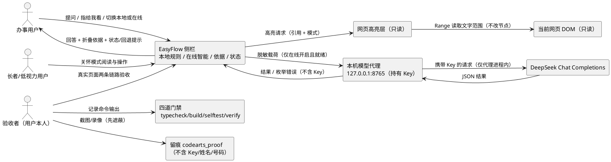
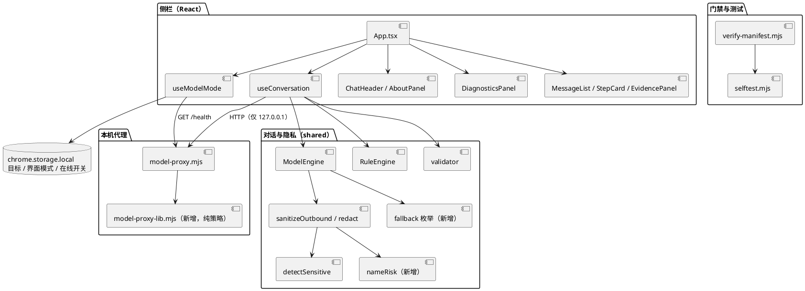
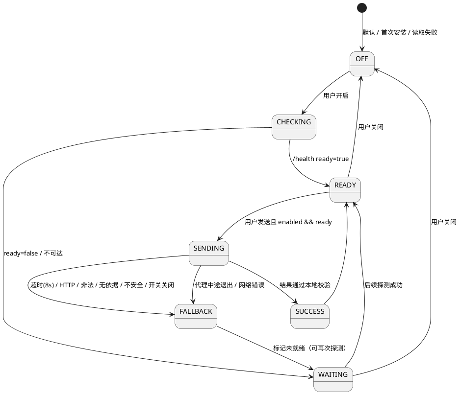
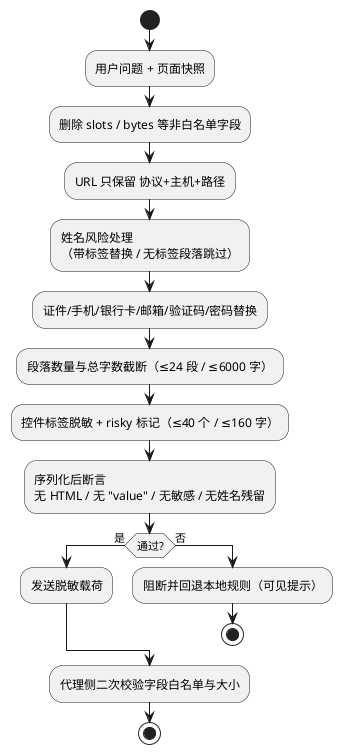
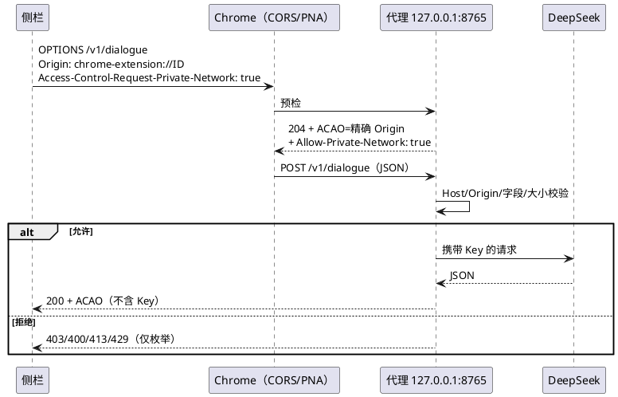
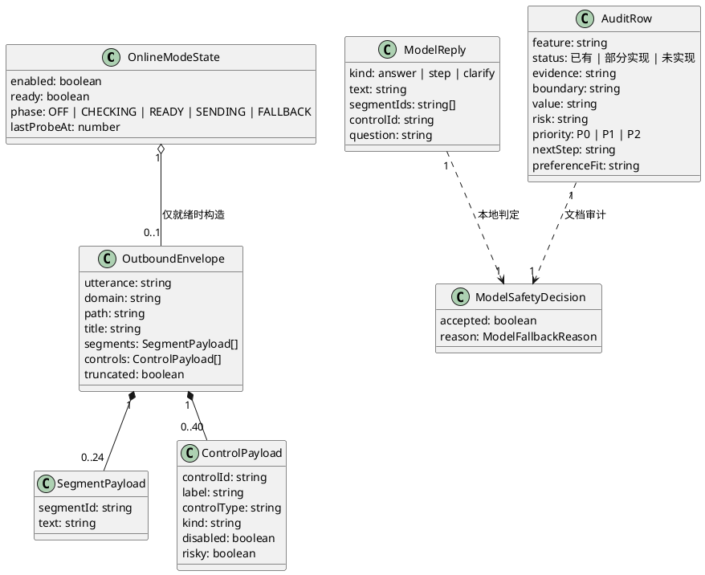
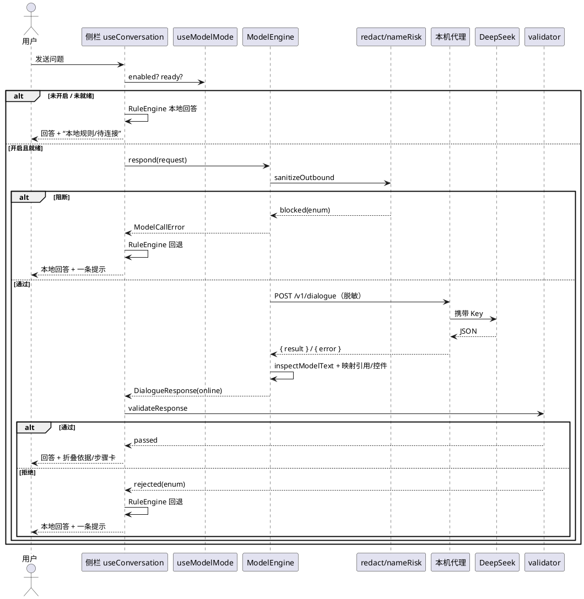
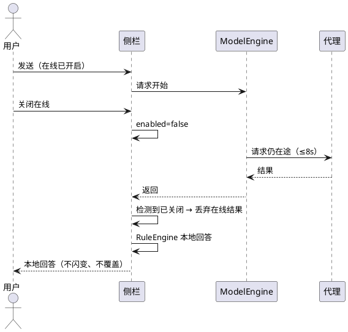
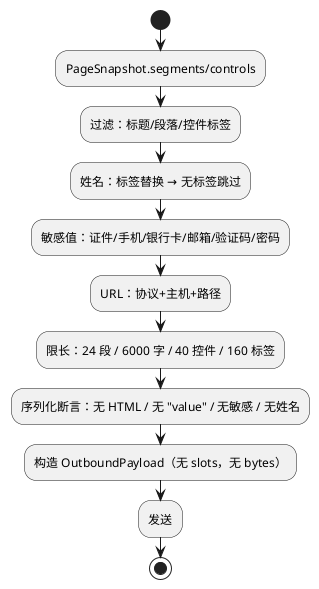

# EasyFlow 配色回流、八项功能审计与 DeepSeek 接入（第十轮）— 实现方案

> **文档性质**：本文件是 `easyflow_page_guide` 第十轮增量设计，依据 `iteration10-spec.md`（R-500—R-563、D10-01—D10-11）编写，不替代 `design.md` 与前九轮设计。
>
> **阶段声明（硬约束）**：本阶段只读核对并产出设计。未修改 `src/`、`public/manifest.json`、`scripts/**`、`dist/` 与前九轮文档；未运行 `npm run typecheck` / `build` / `selftest` / `verify`；未启动本机模型代理；未调用 DeepSeek；未读取、写入或回显 `.env.local`；未提交、未推送；`git` 在本机不可用，**未执行任何 `git diff` / `git status` / `git log`**。
>
> **结论口径**：文中“已观察”“已核实”“待验证”“未验证”严格区分。配色视觉、真实 Chrome 高亮、在线两条链路、CORS 是否放行、真实 Key 是否可用，均**未验证**；本文件不写“已修复”“已通过”“已上线”。

---

# 一、需求与存量功能关系分析

## 1.0 分析前提与只读基线（2026-11-16）

### 1.0.1 版本控制与比对口径

| 核查项 | 实测结果 | 对本设计的约束 |
|---|---|---|
| `git` 可用性 | PowerShell 返回 `CommandNotFoundException` | 无法查看 diff / status / log；不得声称“已保留未提交改动” |
| `.git` 目录 | 根目录存在（隐藏） | 只能说明曾初始化，不能推断提交状态 |
| 比对替代 | 文件清单 + SHA-256 前 16 位 + `LastWriteTime` | 实现阶段改动前后各记录一次；回退以文件副本为准 |
| 旧留痕 | `codearts_proof/` 有大量历史日志 | 旧日志只作历史参考，不得当作本轮结果 |

### 1.0.2 关键文件基线（只读；哈希前缀 16 位）

| 文件 | 字节 | 修改时间 | SHA-256 前 16 位 | 本轮归属 |
|---|---:|---|---|---|
| `src/sidepanel/styles/sidepanel.css` | 21552 | 2026-11-16 20:14:10 | `55824d0e4d2bb6c6` | 可改（仅 token 值） |
| `src/content/highlight.ts` | 19394 | 2026-11-16 19:38:27 | `546fa88d6bf4f668` | **只读，不改** |
| `src/content/highlightRound.ts` | 5478 | 2026-11-16 19:38:27 | `24a445ecfa83b52b` | **只读，不改** |
| `src/content/observe.ts` | 2391 | 2026-11-16 19:38:27 | `e8f2140b24779a73` | **只读，不改** |
| `src/content/entry.ts` | 3322 | 2026-11-16 19:38:27 | `e4423349c48b19c9` | **只读，不改** |
| `src/shared/constants.ts` | 1953 | 2026-11-16 19:38:27 | `38d005b57178df4b` | **只读，不改** |
| `src/sidepanel/dialogue/model/ModelEngine.ts` | 6466 | 2026-11-16 20:18:16 | `4bfbaaaaed95f488` | 可改（审查后收口） |
| `src/shared/privacy/redact.ts` | 5093 | 2026-11-16 19:51:27 | `36107fd0ec1c6796` | 可改 |
| `src/shared/privacy/detect.ts` | 1688 | 2026-11-13 13:22:08 | `32162f511ffb63d8` | 可改 |
| `src/sidepanel/hooks/useModelMode.ts` | 912 | 2026-11-16 20:07:57 | `5c35d1c8e9ada6c0` | 可改 |
| `src/sidepanel/hooks/useConversation.ts` | 41585 | 2026-11-16 20:08:17 | `bb773033dfea3b49` | 可改 |
| `scripts/model-proxy.mjs` | 5609 | 2026-11-16 19:54:27 | `b375485eb5f28a0a` | 可改 |
| `scripts/selftest.mjs` | 160529 | 2026-11-16 20:20:12 | `c96abe2f17576192` | 可改（只增/改名） |
| `scripts/verify-manifest.mjs` | 7931 | 2026-11-16 20:17:18 | `91b7a975c4287f79` | 可改 |
| `public/manifest.json` | 1041 | 2026-11-16 20:14:55 | `da3dd19ec285e3b4` | 可改（移除 host） |
| `package.json` | 848 | 2026-11-16 20:17:18 | `e39f91817f3a8da9` | 默认不改 |
| `.env.example` | 205 | 2026-11-16 20:14:55 | `66f6086ee8895ad6` | 可改（仅占位/默认值） |
| `.gitignore` | 261 | 2026-11-16 18:58:04 | `718802771a115b9b` | 不改（已覆盖） |

> 上述哈希为本次只读重算结果，与 `iteration10-spec.md` 0.2 的基线一致（`detect.ts` 规格未列，本轮补记）。哈希只能判断“是否变化”，不能判断“改了什么”。

### 1.0.3 只读事实核验（与用户口述的差异）

| 核查项 | 当前事实 | 影响 |
|---|---|---|
| `.env.local` | **不存在**（`Test-Path` 为 False）；未读取任何内容 | 真实在线链路只能由用户创建后验证 |
| `.env.example` | 5 行占位；`EASYFLOW_MODEL_SECRET=your_deepseek_api_key_here`；模型名 `deepseek-flash` | 需改模型名与超时默认；不得写真值 |
| `.gitignore` | 含 `.env`、`.env.*`、`!.env.example`、`*.log`、`codearts_proof/*.log` | `.env.local` 已被忽略；日志默认不入库 |
| Key 形态扫描 | `src`、`public`、`dist`、`scripts` 对 `sk-[A-Za-z0-9]{20,}` **0 命中**；`Authorization` 在 `src` 与 `dist` **0 命中** | 仅证明“未发现该形态”，不等于绝对无 Key |
| 测试静态计数 | `test(` **106**：95 个 `AT-` 编号 + 11 个无编号 | 与第九轮文档“105 项”不一致；本轮未运行，通过数未知 |
| CSS 结构 | **985 行、单一 `:root`（第 2 行）**；六层注释；无末尾 `Iteration N` 覆盖块 | 可做“只改 token 值”的收敛 |
| AT-112 锁紫 | `selftest.mjs:3936-3937` 断言必须包含 `linear-gradient(135deg, #4f46e5` 与 `--ef-primary: #5b42ed` | 改这两处会破测试；默认保断言 |
| 清单权限 | `public/manifest.json:7` 四项；`:8` 已有 `host_permissions: ["http://127.0.0.1:8765/*"]` | 与本轮“不得入 manifest 权限”冲突；需移除并改门禁 |
| 门禁断言 | `verify-manifest.mjs:43-48` 要求 `host_permissions` **恰为一条** | 移除权限会让 `verify` 失败；必须同步改为“为空/不存在” |
| 高亮实现 | 单宿主、Range 逐行、600ms×3、4000ms 清理、`pointer-events:none`、closed ShadowRoot | 本轮零改动；颜色与常量不动 |

### 1.0.4 四组矛盾事实（不粉饰）

1. **配色矛盾**：用户口述“已按第九轮改为冷白/靛蓝”，但文件事实是**主色、强调色、用户气泡、焦点、当前步骤色已是紫色**，只有背景 `#f5f6fb`、正文 `#182234`、次要文字 `#4a5876`、成功 `#0f6b4f` 仍是冷白/蓝灰/绿。当前是“冷白底 + 紫主色”的混合态。
2. **设计与测试矛盾**：`iteration9-design.md:917-945` 要求冷白背景、深蓝灰正文、靛蓝主色、青绿成功、头部无渐变；但 `selftest.mjs:3936-3937` 反向锁死紫色主色与紫色渐变起点。
3. **权限矛盾**：用户要求“不入 manifest 权限、不扩 `host_permissions`”，但清单已含本机代理 host，门禁还把它写成“必须恰一条”。
4. **测试计数矛盾**：第九轮文档写 105 项，当前静态计数 106 项；原因未知，不得推断；本轮未运行，不能写“106 项通过”。

## 1.1 需求功能与存量功能对比

### 1.1.1 已实现功能（可直接复用，不改语义）

| 需求功能 | 存量功能 | 代码位置 | 匹配度 |
|---|---|---|---|
| 单一设计变量源、六层结构、无末尾覆盖 | 单一 `:root` + 六层注释 + 断点/reduce 块 | `sidepanel.css:1-50`、`:52-69`、`:875-985` | 100% |
| 高亮单轮、Range 逐行、自动清理 | `highlightRef` / `finish` / `mergeLineBoxes` / `buildTextHighlight` / `startPulse` | `highlight.ts:591-661`、`:539-561`、`:203-242`、`:273-289`、`:409-466` | 100% |
| 高亮不拦截鼠标、不修改网页节点 | closed ShadowRoot + `pointer-events:none` + `scrollIntoView` | `highlight.ts:311`、`:520-523`、`:571-576` | 100% |
| 页面变化过滤高亮自身 DOM | `isHighlightOnlyRecord` | `observe.ts:12-28`、`:56-64` | 100% |
| 内容脚本版本守卫 | `CONTENT_VERSION="0.4.0"` + 单例桥 | `constants.ts:1`、`entry.ts:100-107` | 100% |
| 回答溯源（折叠依据 + 原文匹配 + 数字出处） | `EvidencePanel` + `validateDirectAnswer` + `locateCitation` | `EvidencePanel.tsx:38-50`、`validator.ts:52-93`、`useConversation.ts:1106-1110` | 100% |
| 长者/关怀模式 | `useUiMode` + `data-ui-mode` + token 覆盖 + 18/22/44/48 | `useUiMode.ts:14-78`、`sidepanel.css:52-69`、`App.tsx:17/70` | 100% |
| 不代填/不代提交边界 | `personal-info`/`confirmation` 拒答 + `safety-boundary` | `RuleEngine.ts:150-163`、`:366-373` | 100% |
| 采集只读（无 click/submit/focus） | `collect.ts` 无事件调用；仅按钮 `value` 兜底 | `collect.ts:171-173`、`:308-310`；`click(`/`dispatchEvent`/`focus(` 0 命中 | 100% |
| 本地规则问答、一次一个下一步、1—3 句 | `RuleEngine` + `MAX_ANSWER_CHARS=180` / `MAX_ANSWER_SENTENCES=3` | `RuleEngine.ts:340-529`、`constants.ts:25-26` | 100% |
| 在线模式开关默认关闭 | `useState(false)` + `easyflow.model.enabled` | `useModelMode.ts:4-30` | 75%（缺就绪门控） |
| 本机代理骨架 | 仅 `127.0.0.1:8765`、Origin 白名单、限流、请求体上限 | `model-proxy.mjs:3-10`、`:22-30`、`:83-121` | 75%（缺 CORS/日志/枚举收口） |
| 出站基础脱敏 | 证件/手机/银行卡/邮箱/验证码/密码 + URL 去查询串 + HTML/value 拦截 | `detect.ts:20-49`、`redact.ts:97-171` | 75%（无姓名、含 slots） |
| 模型返回基础校验 | kind/text、引用映射、数字出处、控件安全 | `ModelEngine.ts:85-110`、`validator.ts:52-128` | 75%（无代操作/多步指令拦截） |

### 1.1.2 需要扩展的功能（部分匹配，需在既有基础上改造）

| 需求功能 | 存量功能 | 差异说明 | 扩展方向 |
|---|---|---|---|
| 紫色系作为主视觉（R-500/501） | 主色/强调/气泡/焦点/步骤已紫；背景/正文/次要文字/成功非紫 | 色相混合；背景偏蓝、正文偏蓝灰 | 只改 token 值：`--ef-bg`、`--ef-text`、`--ef-text-soft`、`--ef-muted`、`--ef-success*`、`--ef-step-surface*`、`--ef-step-ink`、`--ef-border*`；不改结构 |
| 紫色面积与 AT-112 一致（R-506/507、D10-11） | 头部三色渐变与 `#5b42ed` 被测试锁死 | 改头部会破 AT-112；不改则三色仍在 | 默认保断言、头部不动；如需降饱和，另立取舍 Q-02 |
| API Key 只在本机（R-520—R-525） | `.env.local` 不存在；`.env.example` 占位；`.gitignore` 已忽略 | 无 Key 就读不到，在线不可用；代理日志可能打印 reason | 用户创建 `.env.local`；代理日志只打枚举/计数；示例改占位与默认值 |
| 只监听本机、拒绝非本地来源（R-526—R-532） | 绑定 `127.0.0.1`；仅 Origin 校验 | 无 Host 校验、无 PNA 预检、`/health` 泄露 model | 代理库增加 Host/Origin/PNA 校验；`/health` 最小字段 |
| `host_permissions` 移除（R-529/530、D10-07） | 清单有 `http://127.0.0.1:8765/*`；门禁要求恰一条 | 移除则 `verify` 失败；Chrome 可能 CORS/PNA 拦截 | 清单删字段；门禁改“为空/不存在”；代理侧精确 CORS；失败只改代理 |
| 在线开关未就绪不发请求（R-542、R10-R7） | `App` 只把 `enabled` 传入会话；`ModelEngine` 不检查 `ready` | 未就绪仍会发一次必然失败的请求 | `useConversation` 增加 `modelReady` 门控；失败/未就绪直接本地 + 状态 |
| 回退必须明确告知（R-543、D10-10） | 失败只写 `priorityHit` 诊断；面板不显示 | 用户不知道答案是本地规则 | 会话层一条不重复系统提示；诊断增加枚举原因 |
| 8 秒上限与不阻断输入（R-544、D10-03） | 扩展 15s+2s；代理 15s；发送按钮“等待中…” | 最长 17s，体验不符 | 契约 8s、代理 10s；`AbortSignal` 用 8s；输入框保持可输入 |
| 姓名缺口（R-534/538、D10-06） | `detectSensitive` 无姓名；`segments.text` 为原文 | 页面出现“张三，身份证…”时姓名可能出站 | 新增姓名风险模块：带标签替换 + 无标签保守跳过；出站前再断言 |
| 出站字段白名单（R-533） | `OutboundPayload` 含 `slots`、`bytes` | slots 可能含用户输入值；`bytes` 非白名单 | 删除 `slots`；发送体不带 `bytes`；代理侧严格字段校验 |
| 模型返回安全指令校验（R-547—R-552） | 校验结构/引用/控件；未拦截“提交/支付/验证码/代填/多步” | 模型文本可能诱导用户代操作或多步 | 在线结果增加指令/多步/HTML 拒绝；拒绝即本地回退 |
| 测试可追踪（R-558、D10-09） | 模型安全用例无编号（`selftest.mjs:581-608`） | 无法按编号追踪 | 只改名补 `AT-115`；新增 `AT-116—AT-123` |

### 1.1.3 需要新增的功能或接口

| 分组 | 新增项 | 输入 | 输出 | 依赖 |
|---|---|---|---|---|
| 隐私 | 姓名风险判定与保守跳过（新模块） | 段落/标题/控件标签文本 | `hasNameRisk` / 替换后文本 / 是否跳过 | 现有 `detectSensitive`、`redactText` |
| 隐私 | 出站白名单收口 | 问题、页面、段落、控件 | 仅白名单字段 + `truncated` | `sanitizeOutbound` |
| 在线 | 回退原因枚举与类型化错误 | 异常/HTTP/校验结果 | `ModelFallbackReason`（封闭集合） | `types.ts`、`ModelEngine` |
| 在线 | 在线就绪门控 | `enabled`、`ready`、代理状态 | 本地/在线二选一 | `useModelMode`、`useConversation` |
| 在线 | 模型文本安全判定 | 模型 `text` / `kind` | 安全/拒绝原因 | `ModelEngine`、`validator` |
| 代理 | 可单测的代理策略库（新文件） | Host/Origin/载荷/状态码 | 允许/拒绝 + 枚举 + CORS 头 | `model-proxy.mjs` |
| 测试 | `AT-115—AT-123` | 夹具/假 fetch/静态读取 | 通过/失败 | `selftest.mjs` |

## 1.2 存量功能详细分析

### 1.2.1 侧栏 CSS：结构与锁定边界

| 维度 | 现状 | 约束 |
|---|---|---|
| 结构 | 985 行；Layer 1 token（`:2-50`）→ Layer 2 关怀覆盖（`:52-69`）→ Layer 3 基础/布局 → Layer 4 步骤/输入 → Layer 5 状态/焦点 → Layer 6 断点/reduce | 不得新增第二个 `:root`；不得末尾覆盖 |
| 颜色 token | 背景 `#f5f6fb`、正文 `#182234`、次要 `#4a5876`、成功 `#0f6b4f`、边框 `#e4e1f0/#c7bff0` | 这些是可改角色；`--ef-primary` 不可改 |
| 已紫 token | `--ef-primary:#5b42ed`、`--ef-primary-strong:#4935cb`、`--ef-primary-soft:#eeebff`、`--ef-accent:#6c3df2`、`--ef-focus:#7153f1`、`--ef-user-bubble:#6340ed`、`--ef-step-accent:#5037d7` | 默认保留；只允许 `--ef-focus` 微调 |
| 头部 | `linear-gradient(135deg,#4f46e5 0%,#7c3aed 62%,#a855f7 100%)` + 紫色重投影 `rgba(79,70,229,0.2)`（`:114-115`） | 字面值被 AT-112 锁定；默认不改 |
| 用户气泡 | token `#6340ed`（`:44`）+ 组件规则字面量 `border-color:#6340ed`（`:261`） | 两者当前一致；本轮不改组件规则 |
| 尺寸契约 | 字号 17/13/15/11；间距 4/6/8/12/16/24；圆角 6/10/14；阴影 soft/raise；tap 28→44；主按钮 32→48；焦点 2px→3px | R-504 要求原样保留；AT-112 断言关怀字号/触控 |
| 断点/动效 | `@media (max-width:420px)`（`:933`）、`(max-width:320px)`（`:956`）、`prefers-reduced-motion: reduce`（`:979`） | 各 1 处；不得新增 |
| 语义色 | `--ef-danger:#9f1d35`、`--ef-warn:#8a5a00`（`#fff5e3`）；`--ef-success` 仅在 `:16-17` 声明，**组件规则中无引用** | 成功色改动视觉风险低；错误/警告必须保留红/棕 |

**已有约束**：颜色字面量只允许出现在 token 区与既有例外（白/黑/透明/`rgba(255,255,255,…)`）；组件规则不得新增紫色字面量。

### 1.2.2 高亮实现：本轮只读

| 契约 | 证据 | 约束 |
|---|---|---|
| 入口与替换 | `highlightRef` 开头 `finish("replaced")`（`highlight.ts:591-596`） | 单宿主、旧轮先清理 |
| 清理 | `finish`（`:539-561`）+ `cleanupHighlight`（`:563-565`） | 幂等；TTL/collect/pagehide 原因可辨 |
| 逐行框 | `mergeLineBoxes`（`:203-229`）、`buildTextHighlight`（`:273-289`） | 只框文字范围；找不到文字才元素兜底（`:291-297`） |
| 脉冲 | `startPulse`（`:409-466`）；常量 600/3/4000/1600（`constants.ts:13-16`） | 本轮不改数值 |
| 不拦截 | box `pointer-events:none`（`:311`）；host（`:520`） | 不改 |
| 定位滚动 | `scrollIntoView({block:"center"})`（`:571-576`） | 只滚动，不点击 |
| 自身变化过滤 | `observe.ts:12-28` | 不改 |
| 版本守卫 | `entry.ts:100-107` + `CONTENT_VERSION` | 不改 |

### 1.2.3 DeepSeek 初稿链路（只读审查）

| 环节 | 现状 | 约束/缺口 |
|---|---|---|
| 代理地址 | `ModelEngine.ts:8` 固定 `http://127.0.0.1:8765` | 扩展不得出现其他模型域名（已核实 `src` 仅 `deepseek-proxy` 文案） |
| 健康探测 | `probeModelProxy` 1.5s 超时，`ready===true`（`:53-60`） | 只探活，不参与发送门控 |
| 发送 | `sanitizeOutbound` → `fetch`（`:65-75`）；超时 `PROXY_CONTRACT.timeoutMs + 2000` | 17s；发送体含 `bytes`/`slots` |
| 回答映射 | `answer` 引用 1—4；`step` 控件安全；`clarify`（`:85-110`） | 未拦截代操作/多步/HTML |
| 代理监听 | `127.0.0.1:8765`（`model-proxy.mjs:3-4`）；`ready`/model 日志（`:120`） | 只绑回环；日志含 model，不含 Key |
| 代理来源 | 仅 `chrome-extension://<ID>` Origin（`:10`、`:90`） | 无 Host 校验、无 PNA；`/health` 无 Origin 也返回 model |
| 代理解析 | `readBody` 32k（`:46-53`）；`validPayload` 逐项（`:22-30`） | 未校验总字数/未知字段；错误可能回显 `reason` |
| 代理调用 | `https://api.deepseek.com/chat/completions`，15s，JSON（`:55-81`） | 模型名默认 `deepseek-flash`；错误体未分类 |
| 开关 | 默认 false；15s 轮询 `/health`（`useModelMode.ts:4-30`） | 读取失败未 catch；未就绪仍可发送 |
| UI 状态 | 三种文案 + `role="switch"` + `aria-checked`（`ChatHeader.tsx:26-29`） | 已满足可见状态；说明面板需补姓名告知 |
| 说明面板 | 在线/回退/不代填（`AboutPanel.tsx:7-8`） | 未提“姓名可能无法识别”与跳过策略 |
| 回退 | `catch` → 本地规则；校验拒绝 → 本地规则；写 `priorityHit`（`useConversation.ts:851-878`） | 无用户可见提示；`priorityHit` 可能含原始错误串 |
| 诊断 | 显示 mode/read/engine/citation/reject（`DiagnosticsPanel.tsx:351-359`） | 不显示回退原因；无正文（已核实） |
| 输入区 | `busy` 只禁发送按钮；textarea 未禁（`ChatComposer.tsx:54-70`） | 可输入；但 17s 等待不符 8s |

### 1.2.4 出站脱敏：现有能力与缺口

| 维度 | 现状 | 缺口 |
|---|---|---|
| 敏感类型 | 证件号、手机号、银行卡、邮箱、验证码（需上下文）、密码（`detect.ts:20-49`） | **无姓名** |
| 替换 | `redactText` 用占位词替换（`redact.ts:53-67`） | 姓名无法替换 |
| 字段 | `utterance`、`slots`、`page{domain,title,url}`、`segments{id,text}`、`controls{...}`、`truncated`、`bytes`（`redact.ts:79-87`） | `slots` 超白名单；`bytes` 非白名单 |
| URL | `redactUrl` 去查询串/片段（`redact.ts:31-38`） | 已满足 |
| HTML/value | 序列化后拦截 `<tag` 与 `"value":`（`redact.ts:164-166`） | 已满足；需配合姓名断言 |
| 限长 | 24 段 / 6000 字 / 40 控件 / 160 标签（`constants.ts:44-46`） | 段落总字数与代理侧上限需一致 |
| 输入值 | `collect.ts` 只在 button/submit/reset 读 `value`；无其他 `.value` 读输入 | 已满足；需静态断言保持 |

### 1.2.5 模型返回校验：现有能力与缺口

| 校验 | 现状 | 缺口 |
|---|---|---|
| 结构 | `kind` 三选一、`text` 非空（`ModelEngine.ts:17-22`） | 未限制所有 kind 的 text ≤180/≤3 句 |
| 引用 | `answer` 1—4 个 `segmentIds`；构造 citation；`validator` 校验条数/原文包含/数字出处（`ModelEngine.ts:85-94`、`validator.ts:52-93`） | 超过 4 个被静默截断；建议拒绝 |
| 控件 | `step` 必须可见、未禁用、非模糊、无风险、非 form（`ModelEngine.ts:96-101`、`validator.ts:112-123`） | 已满足；未拦截文本中的代操作/多步 |
| 代操作 | 无 | 需新增“提交/支付/验证码/密码/代填/勾选/确认”指令拒绝 |
| 多步 | 无 | 需新增“先…再…/第 N 步”拒绝 |
| HTML | 无 | React 纯文本渲染；仍需拒绝 `<tag` |
| 失败处理 | 抛错 → 本地规则；校验拒绝 → 本地规则（`useConversation.ts:851-878`） | 需保证不“半展示”、不拼接 |

### 1.2.6 权限与门禁：现状

| 检查项 | 现状 | 本轮要求 |
|---|---|---|
| `permissions` | 恰四项（`manifest.json:7`；`verify-manifest.mjs:36-41`） | 保持四项 |
| `host_permissions` | 恰一条本机代理（`manifest.json:8`；`verify-manifest.mjs:43-48`） | 移除；门禁改“为空/不存在” |
| 禁止字段 | 无 `content_scripts`/`web_accessible_resources`/`externally_connectable`（`verify:49-51`） | 保持 |
| `fetch(` 例外 | 仅 `ModelEngine.ts` 与 `dist/sidepanel.js`（`verify:134-159`） | 保持；不得扩大 |
| `Authorization`/Key 禁令 | `runtimeForbidden` 含 `Authorization`、`apiKey`、`API_KEY`（`verify:116-132`） | 保持；新增 Key 形态扫描 |
| 语音例外 | `getUserMedia` 2 条精确例外（`verify:134-159`） | 不动 |
| CSP | 无远程、无 unsafe（`verify:83-86`） | 不动 |

### 1.2.7 测试结构：基线

| 项目 | 实测 | 说明 |
|---|---|---|
| `test(` 总数 | 106（95 个 `AT-` + 11 个无编号） | 静态计数；本轮未运行 |
| 在线模型用例 | `AT-21/22`（`selftest.mjs:537-579`） | 假 `fetch`，不联网 |
| 模型安全用例 | 无编号（`:581-608`） | 覆盖安全控件/禁用控件拒绝；候选“最后新增”，不能证明 |
| 高亮用例 | `AT-106—AT-114`（`:3709-3997`） | 本轮不得改断言 |
| CSS 断言 | `AT-112`（`:3925-3946`），锁 `#5b42ed` 与渐变前缀 | 默认保断言 |
| 期望通过数 | **未知** | 只能写“未验证”；不得沿用 `iteration9-selftest.log` |

### 1.2.8 八项审计的存量证据（概览）

| # | 能力 | 判定 | 主要证据 |
|---|---|---|---|
| 1 | 智能聚光灯 | 已有 | `highlight.ts:591-661`、`:273-289`、`:409-466`、`:539-561` |
| 2 | 任务进度 | 部分实现 | `stepPlanner.ts:405-437`、`:599`；`StepCard.tsx:58-68`；`MessageList.tsx` 无 N/M |
| 3 | 错误纠偏 | 部分实现 | `stepCardModel.ts:47-53`；`useConversation.ts:1050-1062`；`RuleEngine.ts:389-464`；`completion.ts:22-107` |
| 4 | 有限代操作 | 部分实现 | `RuleEngine.ts:150-163`、`:366-373`；`collect.ts` 无 click/submit/focus；`highlight.ts:571-576` |
| 5 | 长者模式 | 已有 | `useUiMode.ts:14-78`；`sidepanel.css:52-69`；`App.tsx:17/70` |
| 6 | 办事条件预检查 | 未实现 | `lexicon.ts:36/179-180`、`segmentRetriever.ts:14-17`、`composer.ts:16` 仅检索/回答 |
| 7 | 回答溯源 | 已有 | `EvidencePanel.tsx:38-50`；`validator.ts:52-93`；`useConversation.ts:1106-1110` |
| 8 | 任务收藏 | 未实现 | `favorite|收藏` 0 命中；现有存储键仅目标/界面/在线开关 |

## 1.3 存量约束清单（设计不得违反）

1. **高亮零改动**：`highlight.ts`、`highlightRound.ts`、`observe.ts`、`entry.ts`、`constants.ts` 的哈希与本文件 1.0.2 一致；`HIGHLIGHT_*` 数值与颜色不变。
2. **单一 token 源**：`sidepanel.css` 中 `:root {` 恰 1 处；不得新增第二个 `:root`；不得末尾追加覆盖块。
3. **尺寸契约不变**：圆角、间距、阴影、tap、主按钮高度、焦点宽度、400/420/320 断点、reduce 块均保持。
4. **AT-112 字面值保留**：`--ef-primary: #5b42ed`、`linear-gradient(135deg, #4f46e5` 必须在 CSS 中；AT-112 断言不改。
5. **不代操作**：不得新增 `click`/`focus`/`fill`/`check`/`submit`/`dispatchEvent`；高亮只滚动与绘制。
6. **权限四项**：不得新增 `tabs`、`<all_urls>`、静态 `content_scripts`、`web_accessible_resources`、`externally_connectable`。
7. **Key 不落盘**：不写入源码/产物/日志/留痕/聊天；`.env.local` 只由用户创建；本阶段不读取。
8. **本地规则优先**：在线失败/未就绪/无依据/不安全/超时/格式错，必须回退本地规则，且不锁输入。
9. **文案与依据**：保持“一次一个下一步”、1—3 句、依据折叠、无依据明说“当前页面没有找到这项信息”。
10. **不虚报**：自动测试通过 ≠ 真实链路通过；未执行的截图/链路一律写“未验证”。

---
# 二、增量设计方案

## 2.1 实现模型

### 2.1.1 上下文视图



图中不展示侧栏内部组件、存储结构、接口参数与代理实现。

### 2.1.2 服务/组件总体架构



依赖方向固定：侧栏 → 对话/隐私 → 代理；代理不反向依赖侧栏；测试只读源码/产物或使用假 `fetch`，不联网。

### 2.1.3 实现设计文档

#### （1）紫色 token 映射与 AT-112 保全

1. **只改 Layer 1 token 值与 Layer 2 关怀覆盖值**，不改 Layer 3—6 的任何选择器、属性、布局、圆角、间距、阴影、断点、reduce 块。
2. **AT-112 锁定的两个字面值原样保留**：`--ef-primary: #5b42ed`、头部 `linear-gradient(135deg, #4f46e5`。头部其余色标与阴影**默认不动**，因为“只改 token 值”与“保断言”同时成立；若用户要降饱和，走 Q-02。
3. **用户气泡** token `#6340ed` 与组件规则 `border-color:#6340ed` 均保持，避免出现 token 与规则不一致；本轮不把字面量改成 `var()`（那会改组件规则）。
4. **组件规则零新增颜色字面量**：抽查 10 条组件规则均只引用 `var(--ef-*)`；既有白/黑/透明白例外不动。
5. **验收方式**：AT-112 原断言不改；新增 AT-123 只读断言“紫调 token 值 + 单一 `:root` + 关怀值 + 对比度阈值”；真实取色/截图由用户执行，未执行写“待验”。

#### （2）在线请求状态机（8 秒上限、未就绪不发、可回退）



**关键规则**

1. 发送前同时检查 `enabled` 与 `ready`；任一为假 → 直接用本地规则，不发起请求（R-542）。
2. 在线请求最长 **8000ms**（`AbortSignal.timeout(8000)`），代理侧最长 **10000ms**；超时即回退。
3. 请求期间 **textarea 不禁用**，只禁用发送按钮；“等待中…”最多 8 秒。
4. 请求返回时若用户已关闭在线，**丢弃在线结果**，改用本地规则（不覆盖已展示回答）。
5. 回退后把 `ready` 置为 false，下一次发送直接本地；后台探测成功后恢复 READY。
6. 不自动重试；不在失败后立即重发；迟到的在线结果不得覆盖已展示的本地回答。
7. 回退提示为**一条系统提示**，同一在线会话内不重复；在任意一次在线成功后重置（R-543、D10-10）。

#### （3）出站脱敏流水线（含姓名缺口）



**姓名策略（D10-06 默认）**

1. **带标签可替换**：`姓名/名字/申请人/联系人/持卡人/户名/参保人/患者` + `：` + 2—6 个汉字 → 替换为 `姓名`。
2. **无标签保守跳过**：`2—4 汉字 + 先生/女士/同志`、`2—4 汉字 + 手机号/证件号`、独立成行的 2—4 汉字姓名候选 → **整段不发送**，`truncated=true`。
3. **标题**：标题命中姓名风险且无法替换 → 标题置空（仍发送域名/路径），避免“张三的预约”出站。
4. **控件标签**：可替换则替换；仍有风险 → `risky=true`，模型不能选中该控件。
5. **兜底**：出站序列化后若仍命中姓名风险 → 整体阻断，回退本地规则并提示“页面可能含个人信息，已改用本地规则”。
6. **告知**：说明面板与 README 明确“网页可见文字可能含姓名，开启后会跳过含姓名的段落”；用户可不开在线模式（不新增存储键，不强制二次确认；见 Q-05）。

#### （4）模型返回校验与拒绝矩阵

| 检查 | 触发 | 处理 | 用户可见 |
|---|---|---|---|
| `kind` 非三选一 / `text` 空 | 结构非法 | 回退本地规则 | 一条回退提示 |
| `text` >180 字或 >3 句 | 超长 | 拒绝，不截断展示 | 本地回答 |
| `answer` 引用 0 个或 >4 个 | 引用数量非法 | 拒绝 | 本地回答 |
| 引用 ID 不存在 / 原文不匹配 / 数字无出处 | 无依据 | 拒绝（validator） | 本地回答；不显示模型文本 |
| `step` 控件不存在/不可见/禁用/模糊/风险/form | 不安全控件 | 拒绝 | 本地回答；需本人操作提示 |
| `step` 文本含“先…再…/第 N 步” | 多步指令 | 拒绝 | 本地回答；一次一个下一步 |
| 文本含命令式“提交/支付/付款/验证码/密码/代填/勾选/确认” | 代操作 | 拒绝 | 本地回答 + “需要你本人操作” |
| 文本含 `<tag` / 脚本 | 注入 | 拒绝 | 本地回答 |
| 引用整体有效但部分失效 | 半展示 | 整体拒绝 | 不拼接模型与本地文本 |

**顺序**：结构 → 引用/数字 → 控件 → 指令/多步/HTML → 本地规则回退。任何拒绝都丢弃模型文本、引用与步骤；不得把模型文本直接上屏。

#### （5）权限移除与 CORS/预检时序



1. `public/manifest.json` 删除 `host_permissions`；`verify-manifest.mjs:43-48` 改为“`host_permissions` 不存在或为空数组”。
2. 代理只绑 `127.0.0.1`；校验 `Host` 为 `127.0.0.1:8765`；校验 `Origin` 恰为配置的 `chrome-extension://<ID>`；未配置 ID 时 `/health` `ready=false` 且 POST 403。
3. 预检返回精确 `Access-Control-Allow-Origin`、`Allow-Methods: POST, OPTIONS`、`Allow-Headers: Content-Type`、`Vary: Origin`；当请求带 `Access-Control-Request-Private-Network: true` 时返回 `Access-Control-Allow-Private-Network: true`。
4. `/health` 只返回 `ready` 与 `model`（≤3 字段）；不返回 Key/环境变量/配置。
5. 若移除 host 后浏览器拦截：记录错误类别 + 控制台信息（不含页面数据）；**只在代理侧**修 CORS/PNA；不得改回 host 或 `<all_urls>`（D10-07）。

#### （6）日志与留痕字段

| 位置 | 只允许记录 | 禁止记录 |
|---|---|---|
| 代理启动 | `ready` 布尔、模型名、端口、绑定地址 | Key、环境变量值、请求头 |
| 代理请求 | 请求 ID、耗时、字节数、状态码、错误类别 | 正文、页面文本、完整 URL、Key、Origin 以外的头 |
| 扩展诊断 | 模式、耗时、字节数、引用数、校验状态、回退原因枚举 | 正文、引用原文、姓名、URL 查询串、输入值 |
| `codearts_proof/` | 命令输出、通过/失败/未验证清单、遮蔽后的截图 | Key、姓名、证件号、手机号、验证码、密码、音频、识别原文 |

#### （7）八项审计的交付格式

审计表固定 9 列：**功能 / 状态 / 代码证据（文件:行号+符号） / 能力边界 / 用户价值 / 风险 / 优先级 P0/P1/P2 / 建议下一步（不实现） / 既有偏好符合性**。状态只允许 `已有 | 部分实现 | 未实现`；每行只给一个判定；判定必须同时有“用户可见入口/文案/交互”证据，不能把字段或内部状态当能力。

## 2.2 接口设计

### 2.2.1 总体设计

| # | 接口 | 文件 | 稳定性 | 变更类型 |
|---|---|---|---|---|
| A | 回退原因与类型化错误 | `src/shared/model/fallback.ts`（新增） | 稳定 | 新增 |
| B | 姓名风险判定与替换 | `src/shared/privacy/name.ts`（新增） | 稳定 | 新增 |
| C | 出站载荷契约 | `src/shared/privacy/redact.ts` | 稳定 | 修改 |
| D | 模型文本安全判定 | `src/sidepanel/dialogue/model/ModelEngine.ts` | 稳定 | 修改 |
| E | 在线结果校验扩展 | `src/sidepanel/dialogue/validate/validator.ts` | 稳定 | 修改 |
| F | 在线模式 Hook | `src/sidepanel/hooks/useModelMode.ts` | 实验 | 修改 |
| G | 会话 Hook 就绪门控 | `src/sidepanel/hooks/useConversation.ts` | 实验 | 修改 |
| H | 代理纯策略库 | `scripts/model-proxy-lib.mjs`（新增） | 稳定 | 新增 |
| I | CSS token 契约 | `src/sidepanel/styles/sidepanel.css` | 稳定 | 只改值 |
| J | 诊断视图字段 | `src/shared/types.ts`、`DiagnosticsPanel.tsx` | 稳定 | 扩展 |

### 2.2.2 接口清单

#### 接口 A：回退原因与类型化错误

```ts
export type ModelFallbackReason =
  | "not-enabled"
  | "not-ready"
  | "toggled-off"
  | "timeout"
  | "network-error"
  | "http-error"
  | "rate-limited"
  | "invalid-payload"
  | "invalid-reply"
  | "ungrounded"
  | "citation-mismatch"
  | "fact-unsupported"
  | "unsafe-control"
  | "unsafe-instruction"
  | "multi-step"
  | "html-detected"
  | "outbound-blocked";

export interface ModelCallFailure {
  reason: ModelFallbackReason;
  status?: number;
}
```

- **业务说明**：把代理/网络/校验错误收敛为封闭枚举，供诊断与提示使用；禁止自由文本。
- **前置条件**：仅在在线路径使用；本地规则不产生该错误。
- **后置条件**：`priorityHit` / `fallbackReason` 只写枚举，不写原始错误消息。
- **异常映射**：401/402/429/5xx → 对应 `http-error`/`rate-limited`；超时 → `timeout`；JSON 解析失败 → `invalid-reply`。
- **调用示例**：`throw new ModelCallError("timeout")`（实现阶段按签名落地，不在此展开）。

#### 接口 B：姓名风险判定与替换

```ts
export interface NameRiskResult {
  text: string;
  replaced: boolean;
  residualRisk: boolean;
}

export function inspectNameRisk(text: string): NameRiskResult;
export function hasNameRisk(text: string): boolean;
```

- **业务说明**：带标签姓名替换；无标签姓名候选标记风险；供段落跳过、标题置空、控件 `risky` 使用。
- **前置条件**：输入为已归一化空白的中文文本。
- **后置条件**：`residualRisk=true` 的段落不得进入出站载荷。
- **异常映射**：无异常；纯函数。
- **调用示例**：`const risk = inspectNameRisk(segment.text)`。

#### 接口 C：出站载荷契约（修改）

```ts
export interface OutboundPayload {
  utterance: string;
  page: { domain: string; title: string; url: string };
  segments: Array<{ segmentId: string; text: string }>;
  controls: Array<{
    controlId: string;
    label: string;
    controlType: string;
    kind: string;
    disabled: boolean;
    risky: boolean;
  }>;
  truncated: boolean;
  bytes: number; // 仅本地诊断使用，不进入请求体
}

export type OutboundResult =
  | { status: "pass"; payload: OutboundPayload }
  | { status: "blocked"; reason: "html-or-value-detected" | "sensitive-data-detected" | "name-risk-detected" | "payload-serialization-failed" };
```

- **变更点**：删除 `slots`；`bytes` 不发送；新增 `name-risk-detected` 阻断原因。
- **前置条件**：`source.segments` 已按页面顺序截取；`source.controls` 已做安全标记。
- **后置条件**：`pass` 时序列化不含 HTML、`"value":`、敏感值、姓名残留、查询串。
- **调用示例**：`const result = sanitizeOutbound(source); if (result.status === "blocked") ...`。

#### 接口 D：模型文本安全判定（修改）

```ts
export type ModelTextRejection =
  | "too-long"
  | "html-detected"
  | "unsafe-instruction"
  | "multi-step";

export function inspectModelText(kind: "answer" | "step" | "clarify", text: string): ModelTextRejection | null;
```

- **业务说明**：只做“拒绝/放行”，不改写模型文本；`step` 额外禁止多步表达；`answer` 只拦截命令式代操作。
- **前置条件**：`text` 已 `trim()`。
- **后置条件**：返回非空即抛 `ModelCallError`，由会话层回退本地规则。
- **异常映射**：`too-long`/`html-detected`/`unsafe-instruction`/`multi-step` → 对应 `ModelFallbackReason`。
- **调用示例**：`const rejection = inspectModelText(reply.kind, reply.text)`。

#### 接口 E：在线结果校验扩展（修改）

```ts
export function validateResponse(
  response: DialogueResponse,
  snapshot: PageSnapshot,
  plan: GuidePlan | null,
): ValidationResult;
```

- **变更点**：仅当 `response.diagnostics.mode === "online-model"` 时追加“代操作/多步/HTML”校验；本地规则结果不受影响。
- **前置条件**：`response` 已由引擎构造；`snapshot` 为同一轮快照。
- **后置条件**：`rejected` 时调用方必须整体丢弃模型结果。
- **调用示例**：`const result = validateResponse(response, snapshot, plan)`。

#### 接口 F：在线模式 Hook（修改）

```ts
export interface ModelModeController {
  enabled: boolean;
  ready: boolean;
  toggle: () => void;
  refresh: () => void;
}
export function useModelMode(): ModelModeController;
```

- **变更点**：读取失败保持 `false`；开启/关闭后立即刷新 `/health`；`ready` 供发送门控；不新增存储键。
- **前置条件**：`chrome.storage.local` 可用；代理地址固定 `127.0.0.1:8765`。
- **后置条件**：切换不自动发送消息。
- **调用示例**：`const modelMode = useModelMode()`。

#### 接口 G：会话 Hook 就绪门控（修改）

```ts
export function useConversation(
  uiMode: UiMode,
  modelEnabled?: boolean,
  modelReady?: boolean,
): ConversationController;
```

- **变更点**：新增 `modelReady`；发送前 `enabled && ready` 才用在线引擎；失败写枚举；回退提示只出现一次；关闭在线后丢弃迟到结果。
- **前置条件**：`modelEnabled`/`modelReady` 来自同一 Hook。
- **后置条件**：任何在线失败都产生本地规则回答；`busy` 在 8 秒内恢复。
- **调用示例**：`useConversation(uiMode, modelMode.enabled, modelMode.ready)`。

#### 接口 H：代理纯策略库（新增）

```ts
export function isLocalHost(hostHeader: string): boolean;
export function isAllowedOrigin(origin: string, extensionId: string): boolean;
export function validateProxyPayload(value: unknown):
  | { ok: true }
  | { ok: false; reason: "invalid-payload" | "request-too-large" };
export function buildCorsHeaders(origin: string, extensionId: string, preflight: boolean): Record<string, string>;
export function classifyProviderStatus(status: number): "provider-auth" | "provider-quota" | "provider-rate-limit" | "provider-unavailable";
export function buildLogRecord(input: { id: string; status: number; bytes: number; ms: number; category: string }): string;
```

- **业务说明**：把可单测的允许/拒绝逻辑从 HTTP 服务器中抽出；`model-proxy.mjs` 只做编排与网络调用。
- **前置条件**：无副作用、无环境变量读取；扩展 ID/Host 由调用方传入。
- **后置条件**：拒绝路径只返回枚举，不返回原始错误。
- **调用示例**：`const ok = isAllowedOrigin(origin, process.env.EASYFLOW_EXTENSION_ID ?? "")`。

#### 接口 I：CSS token 契约

- 只允许修改 Layer 1 `:root` 与 Layer 2 关怀覆盖中的**颜色值**；不得新增选择器、不得新增 `:root`、不得末尾覆盖。
- 必须保留：`--ef-primary: #5b42ed`、头部 `linear-gradient(135deg, #4f46e5`、关怀字号/触控/焦点、420/320/reduce 块、`--ef-radius-*`、`--ef-space-*`、`--ef-shadow-*`、`--ef-tap-min`、`--ef-primary-min-h`。
- 具体取值见 2.4。

#### 接口 J：诊断视图字段（扩展）

```ts
export interface EngineDiagnostics {
  // 既有字段...
  fallbackReason?: ModelFallbackReason;
}
export interface ConversationDiagnostics {
  // 既有字段...
  fallbackReason?: ModelFallbackReason;
}
```

- **业务说明**：诊断面板显示“来源 + 回退原因枚举”，不显示正文/Key/URL 查询串。
- **前置条件**：只在在线路径或回退路径写入。
- **后置条件**：序列化长度受限；敏感字段 0 命中。
- **调用示例**：`entry.fallbackReason` 渲染为短标签。

## 2.3 数据模型

### 2.3.1 设计目标

1. 在线模式状态可区分“关闭 / 已开启未就绪 / 已就绪 / 请求中 / 已回退”，且不进入聊天正文（提示语除外）。
2. 出站载荷字段可枚举、可断言、可截断；不包含输入值、完整 HTML、查询串、姓名残留。
3. 模型返回的接受/拒绝原因可追踪，但不保存正文。
4. 审计结论是文档数据，不进入运行时。

### 2.3.2 模型实现



**生命周期**：`OnlineModeState` 由 Hook 内存持有；`OutboundEnvelope` 每轮构造、发送后丢弃；`ModelReply` 只在本轮内存中存在；`AuditRow` 只在文档中存在。

## 2.4 紫色配色恢复设计（R-500—R-507）

### 2.4.1 旧紫色系 token 映射表

| 角色 | 当前值（位置） | 设计值 | 是否修改 | 依据/约束 |
|---|---|---|---|---|
| 背景 `--ef-bg` | `#f5f6fb`（`:3`） | `#faf8ff` | **改** | R-501 紫调白；正文对比 15.78:1 |
| 卡片表面 `--ef-surface` | `#ffffff`（`:4`） | `#ffffff` | 不改 | 纯白表面保持 |
| 次级表面 `--ef-surface-soft` | `#f0edff`（`:5`） | `#f3efff` | 微调 | 与紫调白协调 |
| 正文 `--ef-text` | `#182234`（`:6`） | `#1f1a38` | **改** | R-501 紫墨 |
| 正文软 `--ef-text-soft` | `#2f3d55`（`:7`） | `#383051` | **改** | 紫灰；对比 11.66:1 |
| 次要文字 `--ef-muted` | `#4a5876`（`:8`） | `#5b5378` | **改** | 紫灰；对比 6.75:1 |
| 边框 `--ef-border` | `#e4e1f0`（`:9`） | `#e6e0f2` | 微调 | 紫灰细线；不替代阴影 |
| 强边框 `--ef-border-strong` | `#c7bff0`（`:10`） | `#8f7fd6` | **改** | 输入框/次按钮边界 3.40:1（UI 组件 3:1）；见 Q-03 |
| 主色 `--ef-primary` | `#5b42ed`（`:11`） | **不变** | 不改 | AT-112 锁死 |
| 主色深 `--ef-primary-strong` | `#4935cb`（`:12`） | **不变** | 不改 | hover/active 既有契约 |
| 主色浅底 `--ef-primary-soft` | `#eeebff`（`:13`） | **不变** | 不改 | 选中/提示底 |
| 强调 `--ef-accent` | `#6c3df2`（`:14`） | **不变** | 不改 | 引用左边条 |
| 强调浅底 `--ef-accent-soft` | `#f0ebff`（`:15`） | `#f1ecff` | 微调 | 与主色浅底一致 |
| 成功 `--ef-success` | `#0f6b4f`（`:16`） | `#2f6b74` | **改** | 紫青状态色；对比 6.04:1；当前组件规则未引用 |
| 成功浅底 `--ef-success-soft` | `#e6f5ee`（`:17`） | `#e8f3f4` | **改** | 与成功色配套 |
| 错误 `--ef-danger` | `#9f1d35`（`:18`） | **不变** | 不改 | 红语义必须保留 |
| 错误浅底 `--ef-danger-soft` | `#fbecef`（`:19`） | **不变** | 不改 | 错误可辨 |
| 警告 `--ef-warn` | `#8a5a00`（`:20`） | **不变** | 不改 | 棕语义保留 |
| 警告浅底 `--ef-warn-soft` | `#fff5e3`（`:21`） | **不变** | 不改 | 对比 5.48:1 |
| 焦点 `--ef-focus` | `#7153f1`（`:22`） | `#6d4bf0` | 微调 | 紫；对比 5.36:1；`--ef-focus-width` 不变 |
| 当前步骤底 `--ef-step-surface` | `#f7f4ff`（`:46`） | `#f6f2ff` | 微调 | 紫调浅底 |
| 过期步骤底 `--ef-step-surface-expired` | `#f1f4f8`（`:47`） | `#f0ecf6` | **改** | 由蓝灰改紫灰 |
| 步骤字色 `--ef-step-ink` | `#1b2740`（`:48`） | `#221b3d` | **改** | 紫墨；对比 14.75:1 |
| 步骤强调 `--ef-step-accent` | `#5037d7`（`:49`） | **不变** | 不改 | 已紫；AT-112 间接依赖字体/触控而非该值 |
| 用户气泡 `--ef-user-bubble` | `#6340ed`（`:44`） | **不变** | 不改 | 与组件规则 `:261` 一致；白字 6.02:1 |
| 助手气泡 `--ef-assistant-bubble` | `#ffffff`（`:45`） | **不变** | 不改 | 白底细边框 |
| 头部渐变 | `linear-gradient(135deg,#4f46e5 0%,#7c3aed 62%,#a855f7 100%)`（`:114`）+ 紫投影（`:115`） | **不变（默认）** | 不改 | AT-112 锁前缀；见 Q-02 备选 |

### 2.4.2 可改 / 不可改清单

| 分类 | token / 位置 | 说明 |
|---|---|---|
| **不可改（AT-112 字面断言）** | `--ef-primary: #5b42ed`；`linear-gradient(135deg, #4f46e5`；`:root` 恰 1 处；`html[data-ui-mode="care"]`；`--ef-font-body: 18px`；`--ef-font-current: 22px`；`--ef-primary-min-h: 48px`；`--ef-tap-min: 44px`；420/320/reduce；`:focus-visible`；步骤主按钮/语音按钮 min-height | 改任一都会破 106 项中的 AT-112 |
| **不可改（R-504 尺寸契约）** | `--ef-radius-*`、`--ef-space-*`、`--ef-shadow-*`、`--ef-tap-min`、`--ef-primary-min-h`、`--ef-step-border-width`、`--ef-diag-max-h` | 只改颜色，不改尺寸/阴影 |
| **可改（本轮颜色值）** | `--ef-bg`、`--ef-surface-soft`、`--ef-text`、`--ef-text-soft`、`--ef-muted`、`--ef-border`、`--ef-border-strong`、`--ef-accent-soft`、`--ef-success`、`--ef-success-soft`、`--ef-focus`、`--ef-step-surface`、`--ef-step-surface-expired`、`--ef-step-ink` | 只改值；不改引用方式 |
| **可改（关怀覆盖颜色）** | 关怀 `--ef-muted`、`--ef-step-ink`、`--ef-step-surface-expired` | 不改字号/触控/焦点宽度 |
| **不改（已紫或语义色）** | `--ef-primary`、`--ef-primary-strong`、`--ef-primary-soft`、`--ef-accent`、`--ef-user-bubble`、`--ef-assistant-bubble`、`--ef-step-accent`、`--ef-danger*`、`--ef-warn*` | 避免“全紫”牺牲语义/破测试 |
| **不改（组件规则）** | 头部渐变与投影、用户气泡 `border-color`、所有选择器/布局/断点 | 本轮只改 token 值；如需改头部走 Q-02 |

### 2.4.3 对比度自检（设计值，非浏览器实测）

> 计算口径：WCAG 相对亮度公式；结果为设计期自检。真实取色与截图由用户执行，未执行写“待验”。

| 前景 / 背景 | 对比度 | 目标 |
|---|---:|---|
| `#1f1a38` / `#faf8ff`（正文/背景） | 15.78:1 | ≥4.5:1 |
| `#383051` / `#faf8ff`（正文软） | 11.66:1 | ≥4.5:1 |
| `#5b5378` / `#faf8ff`（次要） | 6.75:1 | ≥4.5:1 |
| `#5b5378` / `#ffffff`（次要/卡片） | 7.11:1 | ≥4.5:1 |
| `#5b5378` / `#f6f2ff`（次要/步骤底） | 6.45:1 | ≥4.5:1 |
| `#ffffff` / `#5b42ed`（主按钮白字） | 6.09:1 | ≥4.5:1 |
| `#ffffff` / `#6340ed`（用户气泡白字） | 6.02:1 | ≥4.5:1 |
| `#ffffff` / `#6c3df2`（头部最亮端） | 5.85:1 | ≥4.5:1 |
| `#221b3d` / `#f6f2ff`（步骤目标） | 14.75:1 | ≥4.5:1 |
| `#5037d7` / `#f6f2ff`（步骤状态） | 6.65:1 | ≥4.5:1 |
| `#6d4bf0` / `#ffffff`（焦点环） | 5.36:1 | ≥3:1 |
| `#9f1d35` / `#fbecef`（错误） | 6.79:1 | ≥4.5:1 |
| `#8a5a00` / `#fff5e3`（警告） | 5.48:1 | ≥4.5:1 |
| `#2f6b74` / `#ffffff`（成功） | 6.04:1 | ≥4.5:1 |
| `#8f7fd6` / `#ffffff`（强边框） | 3.40:1 | ≥3:1（UI 边界） |
| `#4a4068` / `#f1edff`（关怀次要/步骤底） | 8.23:1 | ≥4.5:1 |
| `#4a4068` / `#e9e4f0`（关怀次要/过期底） | 7.56:1 | ≥4.5:1 |
| `#1c1633` / `#f1edff`（关怀步骤字） | 15.10:1 | ≥4.5:1 |

### 2.4.4 关怀模式覆盖值

| token | 当前 | 设计值 | 说明 |
|---|---|---|---|
| `--ef-muted` | `#33415c` | `#4a4068` | 紫灰；对比 8.23:1 |
| `--ef-step-ink` | `#111827` | `#1c1633` | 紫墨 |
| `--ef-step-surface` | `#f1edff` | `#f1edff` | 已紫，保留 |
| `--ef-step-surface-expired` | `#e7ebf2` | `#e9e4f0` | 紫灰 |
| `--ef-step-accent` | `#4935cb` | `#4935cb` | 保留 |
| 字号/触控/焦点/边框宽度/诊断高度 | 18/22/44/48、3px、2px、36vh | **不变** | R-504/AT-112 |

### 2.4.5 错误 / 警告 / 成功语义色

1. **错误 `--ef-danger` 保留红色 `#9f1d35`**：错误与主色同相会降低可辨性；R-502 明确不得为“全紫”牺牲错误语义。
2. **警告 `--ef-warn` 保留棕色 `#8a5a00`**：等待/超时与错误区分；避免与紫色主色混淆。
3. **成功 `--ef-success` 改为紫青 `#2f6b74`**：比原深绿更接近冷紫家族，但色相仍与主色 `#5b42ed` 明显不同；灰度下靠“成功/已完成”文字或对勾形状二次编码。当前组件规则未引用该 token，改动风险低；若未来用于状态点，必须同时有文字/图标（R-502）。
4. **禁用态**：由 `--ef-border`/`--ef-muted` 派生，保持“灰底 + 不可用文字 + `cursor:not-allowed`”，与成功/错误至少两项差异。
5. **不允许**：把错误改成紫色、把成功改成与主色同相且无文字/形状区分、用颜色单独表达状态。

### 2.4.6 实现约束（防止“视觉补丁”）

1. 只编辑 `:root` 与关怀覆盖块内的颜色声明；不得在文件末尾追加 `Iteration 10` 覆盖块。
2. 不得新增第二个 `:root`；不得新增媒体查询。
3. 不得修改组件规则中的颜色字面量（头部、用户气泡边框、白/黑/透明例外）。
4. 不得修改 `--ef-font-*`、`--ef-space-*`、`--ef-radius-*`、`--ef-shadow-*`、`--ef-tap-min`、`--ef-primary-min-h`、断点、reduce。
5. 改色后若对比不足，只回调该 token 明度，不改色相/布局；不得通过加粗/放大来“补偿”。

### 2.4.7 视觉验收（用户执行，未执行标“待验”）

| 场景 | 操作 | 通过标准 | 当前状态 |
|---|---|---|---|
| 普通模式 | 打开侧栏，观察头部/气泡/当前步骤/依据/输入区 | 紫调统一；当前步骤卡与“指给我看”仍是第一眼；文字清晰 | **待验** |
| 关怀模式 | 切换关怀模式 | 字号 18/22、触控 44/48、焦点 3px；颜色紫调；无新增动画 | **待验** |
| 400px 宽 | 侧栏拉到约 400px | 输入框/发送键/当前卡可达；不裁切 | **待验** |
| 200% 缩放 | 浏览器缩放 200% | 可滚动到达；不重叠；焦点可见 | **待验** |
| 减少动态 | 系统开启 reduce | 无闪烁/过渡；静态高亮保留 | **待验** |

> 未执行截图前，本设计不写“视觉已达标”。

## 2.5 八项功能审计（R-510—R-514，只审计不实现）

### 2.5.1 可交付审计表格式

| 列 | 要求 |
|---|---|
| 功能 | 八项原语，不改写 |
| 状态 | `已有 / 部分实现 / 未实现` 三选一 |
| 代码证据 | ≥1 条“文件:行号 + 函数/选择器/常量”；行号偏差 >±5 时以符号名为准 |
| 能力边界 | 明确“能做什么/不能做什么” |
| 用户价值 | 对办事用户的具体价值，不写空话 |
| 风险 | 误操作、隐私、误导、验收缺口 |
| 优先级 | `P0/P1/P2`；P0 仅限“已有且不可回退”或安全红线 |
| 建议下一步 | 只登记，不实现；写“另立轮次/需用户批准” |
| 偏好符合性 | 与“一次一步、1—3 句、依据折叠、不代填、长者模式”的关系 |

### 2.5.2 审计结论表

| # | 功能 | 状态 | 代码证据（文件:行号 + 符号） | 能力边界 | 用户价值 | 风险 | 优先级 | 建议下一步（不实现） | 偏好符合性 |
|---|---|---|---|---|---|---|---|---|---|
| 1 | 智能聚光灯 | **已有** | `highlight.ts:591-661`（`highlightRef`/`finish`）、`:273-289`（`buildTextHighlight`）、`:203-229`（`mergeLineBoxes`）、`:409-466`（`startPulse`）、`:539-561`（`finish`）；`highlightRound.ts`（轮次状态机）；`observe.ts:12-28`（过滤自身变化） | 只读高亮 + 滚动定位；不点击/填写/提交；真实 Chrome 视觉未验证 | 立刻看到“点哪里”，不用在长页面找 | 脉冲观感受页面/缩放影响；真实视觉未验证 | **P0**（已有，保持） | 不改；真实视觉验收另记录 | 符合“一次给一个下一步” |
| 2 | 任务进度 | **部分实现** | `stepPlanner.ts:405-437`（`advancePlan`）、`:599`（`currentStep`）；`types.ts:440-446`（`currentIndex`/`status`）；`stepCardModel.ts:63-66`（当前标签）；`MessageList.tsx` 无“第 N/M 步” | 有内部索引/状态与当前卡；无整体“还剩几步”的用户可见表达 | 用户想知道“现在到哪、还剩几步” | 只有当前卡，用户可能误以为“只有一步”；无总进度 | **P1** | 另立轮次：在步骤卡增加“第 N/M 步”只读标签；不改状态机 | 符合“不把工作流按钮推给用户” |
| 3 | 错误纠偏 | **部分实现** | `stepCardModel.ts:47-53`（5 个动作）；`StepCard.tsx:75-82`（我找不到/我点错了/我已完成）；`useConversation.ts:1050-1062`（重读后 `runTurn`）；`RuleEngine.ts:389-464`（not-found/misclick/done）；`completion.ts:22-107` | 可就地纠偏并重新规划；缺少“为什么错/下次怎么避免”的解释；折叠/多相似入口仍可能不具体 | 卡住时不必重新提问 | 纠偏后解释不足；页面变化时可能给旧入口 | **P1** | 另立轮次：补“纠偏原因 + 复测”文案；不改规则主路径 | 符合“就地纠正、不重开流程” |
| 4 | 有限代操作 | **部分实现** | `RuleEngine.ts:150-163`（个人信息/最终确认不代填）、`:366-373`（safety-boundary）；`collect.ts` 无 `click(`/`submit`/`dispatchEvent`/`focus(`；`highlight.ts:571-576` 仅 `scrollIntoView` | “只读辅助”（指路/滚动/高亮）已具备；“代操作”（展开/聚焦/选择/点击）未实现且不应默认实现 | 降低误操作与越权风险，用户保有最终控制权 | 若产品期望代做低风险动作，当前不满足；扩展代操作会触碰“不代填”红线 | **P0**（边界必须保持） | 不实现；如确需“滚动到目标”之外的动作，另立安全评估 | 符合“不代填/不代提交”；扩展代操作则冲突 |
| 5 | 长者模式 | **已有** | `useUiMode.ts:14-78`（持久化 + `data-ui-mode`）；`sidepanel.css:52-69`（18/22/44/48、3px 焦点）；`App.tsx:17/70`；`ChatHeader` 的 `ModeToggle` | 仅 token 覆盖；未减少信息密度；依据/诊断仍可能多 | 大字、大按钮、高对比，降低阅读/点击负担 | 密度未优化；真实长者可用性未验证 | **P1**（已有，补真实验收） | 另立轮次：评估依据/诊断默认折叠与字号；不改 token 基线 | 符合“长者优先可读可点” |
| 6 | 办事条件预检查 | **未实现** | 仅条件信息检索/回答：`lexicon.ts:36`、`:179-180`；`segmentRetriever.ts:14-17`（章节模式）；`composer.ts:16`（回答组装）；无“逐个条件对照用户情况”的入口/状态/结果 | 能回答“页面写的条件是什么”；不能判断“你是否符合/还缺什么” | 办前知道是否符合，少跑冤枉路 | 资格判断涉及个人信息与政策解释，误判代价高；不应由模型自由发挥 | **P2**（高价值高风险） | 另立规格：确定性清单 + 用户确认属性 + 不代填；禁止模型自由判断 | **部分冲突**：需从“1—3 句回答”升级为清单，需用户确认信息 |
| 7 | 回答溯源 | **已有** | `EvidencePanel.tsx:38-50`（折叠“网页依据 N 处”）；`validator.ts:52-93`（引用命中原文、数字在引用中）；`useConversation.ts:1106-1110`（点依据→高亮）；`constants.ts:25-26`（≤3 句/≤180 字） | 只对当前页面快照内引用；跨段时定位可能只框一处；姓名等原文会进入本地依据面板 | 用户能核对“你是不是编的”，并可一键看原文 | 截图/录屏需遮蔽原文中的个人信息；引用跨段定位不完美 | **P0**（已有，保持） | 不改；验收时记录“依据可点开/可高亮” | 符合“1—3 句 + 折叠依据” |
| 8 | 任务收藏 | **未实现** | 全仓 `favorite`/`收藏` **0 命中**；现有存储键：`GOAL_STORAGE_KEY`、`UI_MODE_STORAGE_KEY`（`constants.ts:50`）、`easyflow.model.enabled`（`useModelMode.ts:4`） | 无入口、无存储结构、无过期/清除策略、无测试 | 常办事项可复用，减少重复输入 | 新增存储会扩大隐私面（保存什么、多久、谁能读）；需单独隐私设计 | **P2**（低风险但需设计） | 另立规格：明确只存标题/URL 路径/时间，不存正文/个人信息；提供清空 | 中性；需遵守“不保存页面正文/输入值” |

### 2.5.3 逐项判定依据（基于当前代码）

**1. 智能聚光灯 — 已有**

- 用户入口：步骤卡“指给我看”（`StepCard.tsx` 主按钮）、依据“在网页中查看”（`EvidencePanel.tsx:44-50`）。
- 交互：`highlightRef` 定位 → `measure` 滚动 → `buildTextHighlight` Range 逐行 → `startPulse` 有限脉冲 → `finish` 自动清理。
- 规则：单宿主、先清理旧轮、`pointer-events:none`、closed ShadowRoot、不改网页节点。
- 判定依据：入口 + 交互 + 规则 + 测试（AT-106—AT-114）齐全；但真实 Chrome 视觉未验证，故只写“已有”，不写“视觉达标”。

**2. 任务进度 — 部分实现**

- 有 `GuidePlan.currentIndex`、`status`、`advancePlan`，当前卡只显示“当前步骤/已结束/已过期”，没有“第 N/M 步”或“还剩几步”。
- `MessageList` 只按 `currentCardMessageId` 滚动，不计算总量。
- 判定依据：内部状态存在，但用户可见的“整体进度表达”缺失 → 部分实现；不能把 `currentIndex` 当作“用户可见进度”。

**3. 错误纠偏 — 部分实现**

- 用户点“我找不到/我点错了/我已完成”后，`useConversation` 重读页面并 `runTurn`；`RuleEngine` 对 `not-found` 重新定位、`misclick` `replan`、`done` `evaluateCompletion` + `advancePlan`。
- 缺少“为什么错/下次怎么避免”的解释；`not-found` 在模糊/折叠时只给澄清或说明。
- 判定依据：主路径可用，异常解释与复测不足 → 部分实现。

**4. 有限代操作 — 部分实现**

- “只读辅助”完整：高亮、滚动到目标、展示依据；`collect.ts` 没有 `click/submit/dispatchEvent/focus`；`highlight.ts` 只 `scrollIntoView`。
- “代操作”未实现：不展开折叠、不聚焦输入、不选择选项、不点击。
- 判定依据：边界是“只读指路”，不是“代做”；因此“有限代操作”只能判部分实现（若产品定义只含只读辅助，则可判已有，需用户确认定义）。

**5. 长者模式 — 已有**

- `useUiMode` 读写 `easyflow.ui.mode`，设置 `data-ui-mode`；CSS 覆盖字号/触控/焦点/边框宽度/诊断高度；`ModeToggle` 可键盘操作。
- 判定依据：用户可见开关 + 实际 token 覆盖 + 测试断言（AT-112 的 18/22/44/48）→ 已有；密度与真实可用性另验。

**6. 办事条件预检查 — 未实现**

- 现有只是“条件关键词检索 + 1—3 句回答”：`lexicon` 条件词、`segmentRetriever` 章节优先、`composer` 组装句子。
- 没有“逐条条件 + 用户情况 + 符合/不符合/缺材料”的入口、状态、结果与测试。
- 判定依据：无入口/无状态/无文案/无测试 → 未实现；不能把“能回答条件”当作“预检查”。

**7. 回答溯源 — 已有**

- `EvidencePanel` 折叠显示“网页依据 N 处”；`validator` 要求引用 1—4 个、原文包含、数字在引用中；`locateCitation` 点击高亮。
- 判定依据：用户可见入口 + 校验规则 + 定位交互 + 测试 → 已有；跨段定位与个人信息遮蔽是验收注意项。

**8. 任务收藏 — 未实现**

- 全仓无 `favorite/收藏`；存储键只有目标、界面模式、在线开关。
- 判定依据：无入口/无存储/无测试 → 未实现；新增存储需先做隐私设计。

### 2.5.4 与既有偏好的符合性

| 偏好 | 审计中的体现 | 结论 |
|---|---|---|
| 一次只给一个下一步 | 第 1/2/3/4 项均不引入多步工作流；进度只加只读标签 | 符合 |
| 1—3 句回答 + 折叠依据 | 第 7 项保持；第 6 项若做预检查需改成清单，属部分冲突 | 第 7 符合；第 6 部分冲突 |
| 不代填/不代提交 | 第 4 项明确边界；不扩展代操作 | 符合 |
| 长者模式可读可点 | 第 5 项已有点击目标基线 | 符合 |
| 不保存页面正文/输入值 | 第 8 项收藏需限制存储字段 | 需在另立规格中约束 |

### 2.5.5 本轮只审计、不实现

1. 不新增“任务进度”“条件预检查”“任务收藏”的组件、接口、存储键或测试。
2. 不扩展“代操作”（展开/聚焦/选择/点击）。
3. 缺失项只登记为后续轮次候选；建议顺序：**任务进度 → 错误纠偏解释 → 办事条件预检查 → 任务收藏**（与 spec 附录 A.3 一致）。
4. 若用户要求“顺手实现”，先更新本轮规格与优先级，再进入设计/任务阶段；不得在审计文档中夹带实现。

### 2.5.6 审计验收（A-01—A-05）

| 编号 | 验收标准 | 本设计落点 | 当前状态 |
|---|---|---|---|
| A-01 | 八项齐全，每项唯一判定 | 2.5.2 八行；状态列三选一 | 文档已满足 |
| A-02 | 每项有“文件:行号 + 符号名”证据 | 2.5.2 证据列 + 2.5.3 逐项依据 | 文档已满足 |
| A-03 | 每项有用户价值、风险、P0/P1/P2 | 2.5.2 对应列 | 文档已满足 |
| A-04 | 明确“本轮不实现缺失项” | 2.5.5 | 文档已满足 |
| A-05 | 与既有偏好符合性已标注 | 2.5.2 末列 + 2.5.4 | 文档已满足（第 6 项标注“部分冲突”） |

---

## 2.6 DeepSeek 接入审查与完成（R-520—R-556）

### 2.6.1 API Key 管理（只允许 `.env.local`）

| 规则 | 设计落点 | 验证方式 |
|---|---|---|
| Key 唯一合法位置 | 用户本机 `.env.local` + 代理进程内存 | 全仓 `sk-[A-Za-z0-9]{20,}` 0 命中；`.env.local` 不入库 |
| `.env.local` 被忽略 | `.gitignore` 已有 `.env`、`.env.*`、`!.env.example`（不改） | 文件规则核对；`git check-ignore` 不可用则写“未验证” |
| 文件不存在时 | README/说明给出“复制 `.env.example` → 填 Key 与扩展 ID → `npm run model:proxy`”；**不代替用户填写** | 文档无真实 Key；用户执行后代理日志 `ready=true`（不含 Key） |
| 不得读取/回显 | 只有 `package.json` 的 `--env-file=.env.local` 让代理进程读取；扩展、构建、自测、文档均不读取 | `src/**`、`scripts/**`（除启动参数）无 `.env.local` 读取 |
| 示例只占位 | `.env.example` 的 secret 值保持 `your_deepseek_api_key_here`；扩展 ID 保持占位 | 不是 `sk-` 开头、长度 <20 的占位文本 |
| 日志/留痕/聊天无 Key | 代理只打印 `ready`/模型名/端口；错误只返回枚举；聊天不展示内部错误栈 | 日志抽查无 `sk-`、无 `Bearer`、无页面片段 |
| 禁止位置 | 禁止 Key 进入 `chrome.storage`、消息、URL、查询串、前端环境变量、`dist` | `dist/sidepanel.js`/`background.js` 无 `sk-` 形态、无 `Authorization: Bearer` |

**`.env.example` 设计值（5 行，保持占位）**

| 键 | 设计值 | 说明 |
|---|---|---|
| `EASYFLOW_MODEL_SECRET` | `your_deepseek_api_key_here` | 占位；用户自行替换 |
| `EASYFLOW_EXTENSION_ID` | `your_chrome_extension_id_here` | 占位；用于 Origin 白名单 |
| `EASYFLOW_MODEL_NAME` | `deepseek-chat` | D10-08；以用户账户可用为准 |
| `EASYFLOW_MODEL_TIMEOUT_MS` | `10000` | 代理侧 10s；扩展侧 8s |
| `EASYFLOW_MODEL_MAX_OUTPUT_TOKENS` | `600` | 与 `PROXY_CONTRACT.maxOutputTokens` 对齐 |

> `npm run model:proxy` 在 `.env.local` 缺失时由 Node 报文件不存在（只含路径，不含 Key）并退出；这是可接受的“未配置”表现，扩展侧仍显示“在线智能待连接”，本地规则可用。

### 2.6.2 本机代理与安全边界

| 维度 | 设计 | 依据 |
|---|---|---|
| 绑定 | 只绑定 `127.0.0.1:8765`；不得 `0.0.0.0`/局域网/公网 | R-526；启动日志打印绑定地址 |
| Host 校验 | 只接受 `Host: 127.0.0.1:8765`；其他 Host 403 | 防 DNS rebinding；R-531 的补充 |
| Origin 校验 | 只接受 `chrome-extension://<EASYFLOW_EXTENSION_ID>`；未配置 ID → `ready=false` 且 POST 403 | R-531 |
| 预检 | `OPTIONS /v1/dialogue` 返回 204 + 精确 `ACAO` + `Allow-Methods: POST, OPTIONS` + `Allow-Headers: Content-Type` + `Vary: Origin`；若请求 `Access-Control-Request-Private-Network: true`，返回 `Access-Control-Allow-Private-Network: true` | R-529/530；PNA |
| 端口 | 固定 8765（与 `ModelEngine` 的 `baseUrl` 一致） | D10-03 |
| 超时 | 代理 10000ms；扩展 8000ms | D10-03；扩展先于代理回退 |
| 请求体上限 | 32KB；超限 413 | 既有 32k 保留 |
| 字段白名单 | 只接受 `utterance`、`page{domain,title,url}`、`segments[{segmentId,text}]`、`controls[{controlId,label,controlType,kind,disabled,risky}]`、`truncated`；未知字段拒绝 | R-533/534 |
| 长度上限 | 问题 ≤500 字；段落 ≤24 段、总字数 ≤6000、每段 ≤6000；控件 ≤40、标签 ≤160 | 与 `constants.ts:44-46` 一致 |
| 限流 | 20 次/分钟；超限 429 | 既有策略保留 |
| `/health` | 只返回 `{ ready, model }`（≤3 字段）；不返回 Key/配置/环境变量 | R-532 |
| 错误返回 | 只返回枚举 `{ error }`；不返回原始异常消息、错误体、请求片段 | R-553/554 |
| 日志 | 启动：`ready`/模型名/端口；请求：请求 ID、耗时、字节数、状态码、类别；不含正文/Key/完整 URL | R-553 |
| 厂商调用 | 只由代理访问 `https://api.deepseek.com/chat/completions`；`stream:false`、JSON；携带 `Authorization`（只在代理） | R-527 |
| 厂商错误分类 | 401→`provider-auth`；402→`provider-quota`；429→`provider-rate-limit`；5xx→`provider-unavailable`；超时→`provider-timeout` | 可区分回退原因 |
| 请求 ID | 每次请求生成短 ID（如 8 位十六进制）；返回给扩展仅用于诊断 | 可在日志中关联，不含正文 |

**拒绝路径**：非本地 Host/Origin/未配置 ID/超大/非法字段/超限/限流/无 Key → 只返回枚举与状态码；不调用厂商；不消耗额度；扩展回退本地规则。

### 2.6.3 权限移除与门禁同步

| 项 | 设计 | 验证 |
|---|---|---|
| `public/manifest.json` | 删除 `host_permissions`；`permissions` 仍为 `["activeTab","scripting","sidePanel","storage"]` | `dist/manifest.json` 无 `host_permissions` 或为空 |
| `scripts/verify-manifest.mjs` | 把 `:43-48` 的“恰一条”改为“`host_permissions` 不存在或长度为 0”；保留四项权限、禁止 `content_scripts`/`web_accessible_resources`/`externally_connectable` 断言 | `npm run verify` 输出对应 OK |
| 新增门禁 | 扫描 `src`/`public`/`dist`：无 `sk-[A-Za-z0-9]{20,}`；`.env.example` 非真值；`.gitignore` 含 `.env.*` 与 `!.env.example` | 0 命中 |
| 代理侧 CORS | 只放行精确扩展 Origin；预检 + PNA；不新增 host 权限 | 真实链路 V-01/V-02 |
| 失败处理 | 若移除 host 后浏览器拦截：记录错误类别 + 控制台信息（不含页面数据）；只在代理侧修 CORS；仍失败标“未验证/失败” | 不出现 `<all_urls>`/`tabs` 回退 |

### 2.6.4 在线开关、状态与回退

| 规则 | 设计 | 验证 |
|---|---|---|
| 默认关闭 | 首次安装/未选择/读取失败均为 `false`；不产生请求 | 全新配置 → `enabled=false` |
| 状态文案 | “本地规则 / 在线智能已开启 / 在线智能待连接”三选一；`role="switch"` + `aria-checked` | 三态不重叠；键盘可操作 |
| 显式开启才出站 | 关闭时 0 请求；开启且就绪才发送；一次提问 1 次请求 | 抓包/代理日志 |
| 未就绪不发 | `enabled && ready` 才用在线；否则 500ms 内本地回答 + “待连接” | V-03 |
| 切换不自动发送 | `toggle` 只改状态并刷新 `/health`；不调用 `send` | 代码路径 + 真实操作 |
| 超时/失败回退 | 8s 内回退；本地回答必须出现；一条不重复提示 | V-04 |
| 不阻断输入 | textarea 始终可输入；只禁发送按钮；“等待中…”≤8s | V-04 |
| 回退原因 | 枚举写诊断；不写正文/Key/查询串 | 诊断抽查 |
| 开关一致性 | 在线只影响回答来源；高亮/依据/长者/语音/不代填不变 | 切换前后对照 |
| 关闭后迟到结果 | 返回时若已关闭，丢弃在线结果，用本地规则 | 代码路径 + 构造测试 |

**回退提示**：使用既有 `ef-system-notice` 系统提示，文案“在线模型未给出可靠结果，已改用本地规则。”；同一在线会话内只出现一次，任意一次在线成功后重置。若原因是“未就绪”，提示改为“在线智能待连接，当前使用本地规则。”；两者不同时出现。

### 2.6.5 出站脱敏（字段白名单 + 姓名缺口）

**允许字段**

| 字段 | 限制 | 处理 |
|---|---|---|
| 问题 `utterance` | ≤500 字 | 敏感值替换；姓名风险替换/阻断 |
| 域名 `page.domain` | 仅主机名 | 原样 |
| 路径 `page.url` | 仅协议+主机+路径 | 去查询串/片段 |
| 标题 `page.title` | ≤200 字 | 脱敏；姓名残留则置空 |
| 段落 `segments[].text` | ≤24 段、总 ≤6000 字、每段 ≤6000 | 脱敏；姓名风险段落跳过 |
| 控件 `controls[]` | ≤40 个、标签 ≤160 字 | 脱敏；`disabled`/`risky` 布尔 |
| 截断标记 `truncated` | 布尔 | 任一段落被跳过/截断即为 true |

**禁止字段/内容**

姓名、证件号、手机号、银行卡号、验证码、密码、邮箱、输入值/选中值、完整 HTML、`document.title + 全段`、URL 查询串/片段、音频、识别原文、`slots`、`bytes`（请求体）。

**姓名缺口的可执行策略（D10-06 默认）**

| 场景 | 处理 | 说明 |
|---|---|---|
| `姓名：张三`、`申请人：李四` 等带标签 | 替换为 `姓名` | 不跳过整段，保留条件/材料语义 |
| `张三先生`、`李四女士` | 整段跳过，`truncated=true` | 无标签，保守不发 |
| `张三 13800138000` / `张三 110101...` | 整段跳过 | 姓名+号码组合风险最高 |
| 独立成行的 2—4 汉字姓名候选 | 整段跳过 | 宁可少发，不冒险 |
| 标题含姓名且无法替换 | 标题置空 | 仍发送域名/路径 |
| 控件标签含姓名 | 替换；残留则 `risky=true` | 模型不能选中该控件 |
| 出站序列化后仍命中姓名 | 整体阻断，回退本地 | 提示“页面可能含个人信息，已改用本地规则” |
| 误杀导致可用段落过少 | 回退本地（不强行发送） | 用户仍可得到本地回答 |

**误杀处理**：姓名规则只做“带标签替换 + 无标签跳过”，不使用“百家姓全表”做泛化命中；若用户反馈误杀，先补充反例，再调整规则；不得为“多发段落”放宽姓名策略。

**URL/HTML/输入值**：`redactUrl` 去查询串；序列化后拦截 `<tag` 与 `"value":`；`collect.ts` 仅在 button/submit/reset 读 `value`，其他输入值不采集。

### 2.6.6 模型返回的本地校验与“不自动操作”

1. **结构白名单**：只接受 `answer/step/clarify`；其他/空/超长 → 回退。
2. **引用逐字匹配**：`answer` 的 `segmentIds` 必须 1—4 个且映射当前快照段落；citation 文本来自段落原文，validator 再校验“快照条目文本包含 citation 文本”。
3. **数字出处**：回答中的每个数字必须在 citation 并集中出现；否则 `fact-unsupported` 回退。
4. **控件安全**：`step` 的 `controlId` 必须映射到可见、未禁用、非模糊、无风险、非 form 的控件；每次只允许 1 个。
5. **代操作/多步/HTML**：`inspectModelText` 拒绝命令式“提交/支付/付款/验证码/密码/代填/勾选/确认”、多步表达、HTML 标签。
6. **不自动操作**：模型返回只影响“回答/步骤卡”；不调用 `click/focus/fill/check/submit/dispatchEvent`；高亮只在用户点击“指给我看/在网页中查看”时发生。
7. **不半展示**：任何校验拒绝都丢弃模型文本、引用、步骤，整体改用 `RuleEngine`；不拼接。
8. **不直接渲染 HTML**：渲染路径为 React 纯文本；`dangerouslySetInnerHTML` 0 命中；控件 ID 必须本地映射。
9. **回退告知**：无依据/不安全/超时/格式错 → 本地回答 + 一条提示；提示可区分“未就绪”和“已回退”。

### 2.6.7 日志、留痕与隐私

| 位置 | 设计 |
|---|---|
| 代理 `console.log/warn` | 只输出 `[EasyFlow proxy] id=… status=… ms=… bytes=… category=…`；不输出请求体、Key、页面文本、完整 URL、错误栈 |
| 扩展 `console.warn` | 只输出 `phase` 与枚举 `reason`；不输出 `String(error)` 原文（避免 JSON 解析消息带片段） |
| 诊断面板 | 显示模式、耗时、字节、引用数、校验状态、回退原因；不显示正文/原文/查询串 |
| `codearts_proof/` | 每轮独立命名；截图先遮蔽；失败日志不覆盖；不写 Key/姓名/号码/验证码 |
| 禁止 | 不上传/同步日志；不写 `chrome.storage`；不在聊天正文展示代理内部错误栈 |

> 现有 `useConversation.ts:855-859` 的 `console.warn("[EF]", { detail: String(error) })` 必须改为只写枚举；这是本轮安全收口点。

## 2.7 测试与真实验收（R-557—R-563）

### 2.7.1 现有基线与“最后新增模型安全测试”

| 项 | 事实 | 本轮处理 |
|---|---|---|
| 静态用例数 | 106（95 个 `AT-` + 11 个无编号） | 作为基线；不写“106 项通过” |
| `AT-21/22` | `selftest.mjs:537-579`，假 `fetch` | 保留断言 |
| 无编号模型安全用例 | `selftest.mjs:581-608`，覆盖安全控件/禁用控件拒绝 | **只改名为 `AT-115`，断言内容不变**（D10-09） |
| 高亮用例 | `AT-106—AT-114`（`:3709-3997`） | 不改 |
| `AT-112` | `:3925-3946` 锁紫/结构 | 不改 |
| 期望通过数 | **未知** | 实现阶段以实际输出为准；不得沿用 `iteration9-selftest.log` |

**重跑方法（实现阶段执行，本阶段不执行）**：在 `npm run selftest` 输出中定位标题“AT-115 在线模型只接受当前页引用与安全控件”，记录 `# tests`、`# pass`、`# fail` 与该用例结果；若失败，保留原始输出，不删改用例。

### 2.7.2 新增/改写测试清单（设计）

| 编号 | 名称 | 类型 | 关键断言 | 覆盖 |
|---|---|---|---|---|
| `AT-115` | 在线模型只接受当前页引用与安全控件 | 既有改名 | 断言不变：安全 answer/step 通过；禁用控件拒绝 | R-548/549 |
| `AT-116` | 在线模式默认关闭且未就绪不发请求 | 纯函数 | `selectEngineMode(false,true)=rule`；`(true,false)=rule`；`(true,true)=online` | R-539/541/542 |
| `AT-117` | Key 不落盘、不回显、示例只占位 | 静态 | `sk-[A-Za-z0-9]{20,}` 0 命中；`.env.example` 非真值；`.gitignore` 规则；代理日志记录函数不含 Key/Bearer | R-520—R-525 |
| `AT-118` | 出站白名单与姓名缺口 | 单元 + 假 fetch | 姓名/手机/证件/验证码/密码/输入值/查询串/HTML 0 命中；`slots` 不在载荷；请求体不含 `bytes` | R-533—R-538 |
| `AT-119` | 无依据/引用不匹配/数字无出处回退 | 假 fetch | 无 `segmentIds` 抛 `ungrounded`；引用缺失 `citation-missing`；数字无出处 `fact-unsupported`；不返回模型文本 | R-547/548/552 |
| `AT-120` | 不安全控件/代操作/多步/HTML 回退 | 假 fetch | 禁用/风险/form 控件拒绝；命令式提交/支付/验证码/代填拒绝；多步拒绝；HTML 拒绝 | R-549—R-552 |
| `AT-121` | 代理仅本地、CORS 与超时 | 纯函数 + 静态 | `isLocalHost` 只认 `127.0.0.1:8765`；Origin 精确；`classifyProviderStatus`；`timeoutMs===8000`；代理默认 10000；模型名 `deepseek-chat` | R-526—R-532、D10-03/08 |
| `AT-122` | 回退提示不重复且输入不锁 | 纯函数 + 静态 | `shouldShowFallbackNotice` 首次 true、同会话 false、成功后重置；textarea 未绑定 `disabled`；发送按钮等待受 8s 限制 | R-543/544、D10-10 |
| `AT-123` | 紫色 token、单一源与对比度 | 静态 + 计算 | `--ef-bg:#faf8ff`、`--ef-text:#1f1a38`、`--ef-muted:#5b5378`、`--ef-step-surface:#f6f2ff`、`--ef-success:#2f6b74`、关怀值；`:root` 1 处；无 `Iteration 10` 块；AT-112 字面值仍在；对比度阈值（正文≥4.5、白字/主色≥4.5、边框≥3） | R-500—R-507 |

**计数预期**：106 + 8 = **114**（改名不增数）。实现阶段只写“以实际输出为准”；若出现失败，记录 `# fail` 与用例名，不得写“114 项通过”。

### 2.7.3 四道门禁与留痕

| 顺序 | 命令 | 期望（以实际输出为准） | 留痕 |
|---|---|---|---|
| G-01 | `npm run typecheck` | 0 错误 | `codearts_proof/iteration10-typecheck.log` |
| G-02 | `npm run build` | 成功；`dist` 更新 | `codearts_proof/iteration10-build.log` |
| G-03 | `npm run selftest` | 记录 `# tests/# pass/# fail`；AT-115 明确 | `codearts_proof/iteration10-selftest.log` |
| G-04 | `npm run verify` | 权限四项；`host_permissions` 为空/不存在；无 `<all_urls>`/`content_scripts`；Key 扫描 0 | `codearts_proof/iteration10-verify.log` |

**失败处理**：保留原始输出与退出码；修复后另存 `iteration10-*-retryN.log`，不覆盖首次失败；不得删改用例/放宽断言；不得用旧轮次日志替代。

### 2.7.4 真实 Key 两条链路（用户执行）

| 编号 | 场景 | 操作 | 通过标准 | 证据 | 当前状态 |
|---|---|---|---|---|---|
| V-01 | 问页面事实 | 政务指南页问“办理条件是什么” | 1—3 句中文；每个数字/条件可在页面找到；下方“网页依据”；点“在网页中查看”能高亮 | 截图/录像 | **待验** |
| V-02 | 安全下一步 | 预约页问“下一步点哪里” | 只给 1 个下一步；控件可见未禁用；无提交/支付/验证码/代填；点“指给我看”能高亮 | 截图/录像 | **待验** |
| V-03 | 无 Key/未就绪 | 不启动代理或 `.env.local` 为空 | 500ms 内本地回答；“在线智能待连接”；无 8 秒等待 | 截图 | **待验** |
| V-04 | 超时/停代理 | 启动后停代理再提问 | 8 秒内回退；输入框可打字；提示只出现一次 | 截图/日志 | **待验** |
| V-05 | 模型无依据 | 构造/使用无引用或引用不匹配响应 | 丢弃模型文本；本地回答 + 提示 | 截图/日志 | **待验** |
| V-06 | 不安全控件 | 构造禁用/风险/form 控件 | 不生成步骤卡；提示需本人操作或回退 | 截图/日志 | **待验** |
| V-07 | 脱敏 | 构造含手机号/证件号/验证码/密码/输入值页面 | 出站 0 命中；URL 无查询串；无完整 HTML | 断言/抓包 | **待验** |
| V-08 | 姓名 | 构造含姓名段落 | 姓名不出站（替换或跳过）；否则阻止开启在线并标“未验证” | 断言/截图 | **待验** |
| V-09 | 紫色配色 | 普通/长者/400px/200% | 紫调统一；布局/圆角/间距/阴影/边框不变；对比达标；焦点可见 | 4 张截图 | **待验** |

**真实 Key 边界**：Key 由用户本人写入 `.env.local`；实现者不读、不代填、不回显；无 Key/Key 失效时，V-01/V-02 只能写“未验证”，不得写“通过”；不得用假 Key 冒充真实 Key。

### 2.7.5 最短重载与复测步骤（≤6 步）

1. 用户复制 `.env.example` 为 `.env.local`，填入真实 Key 与扩展 ID（不截图 Key）。
2. 终端运行 `npm run model:proxy`，确认日志 `ready=true`（不含 Key）。
3. Chrome 重载扩展 → 刷新目标网页 → 重开侧栏。
4. 开启“在线智能”，确认文案“在线智能已开启”；问页面事实（V-01）。
5. 问“下一步点哪里”，点“指给我看”（V-02）。
6. 停代理再提问（V-04）；截图/录像并遮蔽个人信息；记录通过/失败/未验证。

### 2.7.6 不得虚报规则

1. 只对“有真实输出/截图/录像”的项目写“通过”；未执行写“未验证”；失败写“失败 + 原因 + 证据”。
2. 不得把“自动测试通过”写成“真实链路已验证”。
3. 不得把“旧轮次日志”当作本轮结果。
4. 不得声称“已查看 git diff”；只能写“已记录文件哈希基线”。
5. 截图含个人信息时先遮蔽；无法遮蔽则不保存，改用局部截图或文字记录。

## 2.8 逐文件改动清单

### 2.8.1 新增文件（3）

| 文件 | 职责 | 关键约束 |
|---|---|---|
| `src/shared/privacy/name.ts` | 姓名风险判定/替换/跳过 | 纯函数；无 DOM/无存储；标签替换 + 无标签保守 |
| `src/shared/model/fallback.ts` | 回退原因枚举、类型化错误、`selectEngineMode`、提示去重纯函数 | 不读 Key/不联网；枚举封闭 |
| `scripts/model-proxy-lib.mjs` | 代理 Host/Origin/载荷/CORS/错误分类/日志记录纯策略 | 无副作用；可被 selftest 直接导入 |

### 2.8.2 修改文件（17）

| # | 文件 | 改动点 | 风险 | 回滚点 |
|---|---|---|---|---|
| 1 | `src/sidepanel/styles/sidepanel.css` | 仅 Layer 1/2 颜色 token 值（2.4 表）；不动组件规则/尺寸/断点 | 对比度不足、AT-112 破 | 恢复原 token 值；哈希比对 |
| 2 | `src/shared/privacy/detect.ts` | 增加姓名标签命中（调用 `name.ts`）；`SensitiveKind` 增 `name` | 误杀 | 回退新增模式 |
| 3 | `src/shared/privacy/redact.ts` | 删除 `slots`；姓名跳过/标题置空/控件 risky；`name-risk-detected`；超时 8000；maxTokens 600 | 出站过严/误杀 | 回退字段/策略 |
| 4 | `src/sidepanel/dialogue/model/ModelEngine.ts` | 发送体去 `bytes`；`inspectModelText`；类型化错误；引用 >4 拒绝；8s | 误拒正常回答 | 回退校验规则 |
| 5 | `src/sidepanel/dialogue/validate/validator.ts` | 在线结果追加代操作/多步/HTML 校验 | 误拒 | 回退在线附加校验 |
| 6 | `src/shared/types.ts` | `ModelFallbackReason`；`EngineDiagnostics.fallbackReason?`；`ConversationDiagnostics.fallbackReason?` | 类型扩散 | 删除可选字段 |
| 7 | `src/sidepanel/hooks/useModelMode.ts` | 读取失败 catch；`refresh`；toggle 后刷新；不新增存储键 | 状态抖动 | 回退旧 Hook |
| 8 | `src/sidepanel/hooks/useConversation.ts` | `modelReady` 门控；关闭后丢弃；枚举回退；提示一次；`console.warn` 去原文 | 回退提示打扰 | 回退旧逻辑 |
| 9 | `src/sidepanel/App.tsx` | 传 `modelMode.ready` | 参数遗漏 | 回退传参 |
| 10 | `src/sidepanel/components/chat/AboutPanel.tsx` | 姓名告知、在线/回退说明、不代填 | 文案变长 | 回退文案 |
| 11 | `src/sidepanel/components/chat/DiagnosticsPanel.tsx` | 显示回退原因枚举（不显示正文） | 信息过多 | 回退新增行 |
| 12 | `public/manifest.json` | 删除 `host_permissions` | CORS 拦截 | 恢复一行（需用户批准） |
| 13 | `scripts/verify-manifest.mjs` | host 断言改“为空/不存在”；Key 扫描；`.env.example`/`.gitignore` 检查 | 门禁误报 | 回退断言（不能放宽） |
| 14 | `scripts/model-proxy.mjs` | 使用 `model-proxy-lib`；Host/Origin/PNA；枚举错误；最小日志；10s；模型默认 | 403/超时 | 回退单文件版本 |
| 15 | `.env.example` | 模型名 `deepseek-chat`；超时 `10000`；max tokens `600`；保持占位 | 用户配置失败 | 回退默认值 |
| 16 | `scripts/selftest.mjs` | 无编号用例改名 `AT-115`；新增 `AT-116—AT-123`；导入代理库；导出纯函数 | 计数变化、误改断言 | 回退新增用例/改名 |
| 17 | `README.md` | `.env.local` 步骤、PNA/CORS、姓名告知、8s 回退、验收口径 | 文档与实现不一致 | 回退文档 |

### 2.8.3 明确不改文件（本轮零改动）

| 文件/区域 | 原因 |
|---|---|
| `src/content/highlight.ts`、`highlightRound.ts`、`observe.ts`、`entry.ts`、`src/shared/constants.ts` | 高亮修复行为/常量/计数锁定；哈希基线不变 |
| `src/sidepanel/guide/stepPlanner.ts`、`completion.ts`、`bookingSuccess.ts`、动态时段相关 | 问答/预约导办/动态时段业务逻辑不改 |
| `src/sidepanel/dialogue/rule/RuleEngine.ts` | 本地规则主路径不改；只作为回退 |
| `src/sidepanel/components/chat/StepCard.tsx`、`MessageList.tsx`、`EvidencePanel.tsx`、`stepCardModel.ts` | 审计只读；不改进度/纠偏 UI |
| `src/sidepanel/components/chat/ChatComposer.tsx` | textarea 已可输入；`busy` 只禁发送按钮；8s 由超时控制 |
| `src/sidepanel/components/chat/ChatHeader.tsx` | 已有三态文案 + `role="switch"` + `aria-checked` |
| `src/sidepanel/hooks/useUiMode.ts`、`src/shared/uiMode.ts` | 长者模式逻辑不改；只改 CSS 颜色值 |
| `src/sidepanel/state/conversationReducer.ts` | 回退提示用既有 `ef-system-notice` + 会话层引用，不新增状态字段 |
| `src/sidepanel/speech/**`、`src/shared/speech/**`、`src/mic-permission/**` | 麦克风授权/朗读不改 |
| `package.json` | `model:proxy` 启动方式不变；不新增脚本 |
| `.gitignore` | 已覆盖 `.env.*` 与日志；不改 |
| `public/sidepanel.html`、`public/mic-permission.*`、`public/icons/**` | 静态资源不改 |
| `dist/**` | 只由构建生成；本轮不手改 |
| 第三方网页 | 不修改布局/文案/样式/交互 |

## 2.9 数据流与状态机

### 2.9.1 在线成功链路



### 2.9.2 开关中途关闭 / 迟到结果



### 2.9.3 出站脱敏数据流（字段级）



## 2.10 风险与回滚点

| # | 风险 | 影响 | 缓解 | 回滚点 |
|---|---|---|---|---|
| R-01 | 紫调后对比不足 | 小字不可读 | 只回调 token 明度；2.4.3 自检；用户截图 | 恢复原 token 值 |
| R-02 | 改动 AT-112 字面值 | `selftest` 失败 | 默认不动 `#5b42ed`/渐变前缀；新增 AT-123 只加断言 | 恢复字面值；不改测试 |
| R-03 | 移除 `host_permissions` 后 CORS/PNA 拦截 | 在线不可用 | 代理精确 CORS + PNA；未就绪回退；记录错误类别 | 代理侧修正；不恢复 host（需用户批准） |
| R-04 | 姓名规则误杀/漏杀 | 回答缺段或姓名出站 | 标签替换 + 无标签跳过 + 出站断言；误杀回退本地 | 回退姓名规则；在线保持关闭直至 V-08 通过 |
| R-05 | 8s 对真实模型过短 | 多数回退 | 代理 10s、扩展 8s；真实链路观察；如需调整需用户拍板 | 回退 15s（与 D10-03 冲突，需改规格） |
| R-06 | 回退提示重复/打扰 | 用户反感 | 会话级只一次；成功重置 | 回退为仅诊断显示 |
| R-07 | 模型文本仍诱导代操作 | 安全红线 | 指令/多步/HTML 拒绝 + validator 双保险 + 不自动操作 | 直接回退本地；关闭在线 |
| R-08 | 诊断/日志泄露正文 | 隐私 | 只写枚举/计数；`console.warn` 去原文；日志抽查 | 删除泄露字段；轮换 Key（用户） |
| R-09 | Key 误入源码/示例/截图 | 严重泄露 | 全仓扫描；示例占位；截图遮蔽；`.gitignore` | 删除并轮换 Key（用户执行）；留痕不回显 |
| R-10 | 测试计数与文档不一致 | 验收争议 | 以实际输出为准；不写“114 项通过” | 记录实际 `# tests/# pass/# fail` |
| R-11 | 关闭在线后迟到结果覆盖 | 回答闪变 | 返回时检查 `enabled`；丢弃在线结果 | 回退为“只应用同一轮结果” |
| R-12 | 头部紫色仍偏重 | 与“控制紫色面积”不完全一致 | 默认保断言；头部是窄条；Q-02 备选 | 用户拍板后改色标或断言 |

## 2.11 需用户拍板的设计取舍（对齐 D10-01—D10-11）

| 编号 | 取舍点 | 设计默认 | 备选 | 影响/需确认 |
|---|---|---|---|---|
| D10-01 | 紫色范围 | `bg/text/muted/success/step/border` 改紫调；错误红/警告棕保留；主色/强调/气泡保持 | 仅主色紫、底与正文保持冷白（风险最低，但不符合用户原话） | 与旧“冷白/深蓝灰”偏好冲突；需确认 |
| D10-02 | 在线默认 | 默认关闭；读取失败关闭；记住选择 | 默认开启（不建议） | 隐私/出站频率 |
| D10-03 | 端口/超时 | 8765；扩展 8s；代理 10s | 保持 15s/17s | 体验与回退；真实模型可能偏慢 |
| D10-04 | Key 提供 | 用户本人写入 `.env.local`；实现者不读不填不回显 | 实现者协助但用户在场（仍不读 Key） | 无 Key 则在线只能“未验证” |
| D10-05 | 截图/录像 | 用户执行；实现者给步骤与模板 | 实现者协助（需用户确认脱敏） | 无截图则视觉/链路“未验证” |
| D10-06 | 最小字段与姓名 | 只发问题/域名/路径/标题/段落/控件；姓名标签替换 + 无标签跳过；不发 slots | 新增姓名词典后再发（误杀更多） | 回答完整性与隐私 |
| D10-07 | `host_permissions` | 移除；代理精确 CORS + PNA | 保留 `127.0.0.1:8765/*`（违反本轮硬约束） | CORS 失败风险 |
| D10-08 | 模型名 | `deepseek-chat`（以账户可用为准） | 保持 `deepseek-flash` | 名称错误会稳定失败 |
| D10-09 | 无编号测试 | 改名 `AT-115`，断言不变 | 保持无编号 | 可追踪性 |
| D10-10 | 回退提示 | 一条系统提示；同会话不重复；成功重置 | 仅诊断可见 | 用户知情 vs 打扰 |
| D10-11 | AT-112 锁紫 | 保断言；`#5b42ed` 与渐变前缀不动；头部不动 | 允许改断言/改色标（需用户明确授权） | 改断言会改变 106 项回归内容 |
| D10-12 | 关怀模式颜色 | 只更新既有颜色覆盖值为紫调；字号/触控/焦点宽度不变；不新增覆盖机制 | 关怀模式完全独立配色 | 观感一致性 |

**本轮新增需确认点（Q）**

| 编号 | 取舍 | 推荐 | 备选 | 说明 |
|---|---|---|---|---|
| Q-01 | 成功色 | `#2f6b74` 紫青 + 文字/图标二次编码 | `#4b3f9e` 紫罗兰；或保留 `#0f6b4f` 绿 | 紫罗兰与主色同相，语义易混；保留绿最可辨但不够“紫” |
| Q-02 | 头部渐变 | 完全不动（保 AT-112 + 只改 token） | 保留前缀 `#4f46e5`，把中/末改为 `#5b42ed/#6c3df2`，并减弱投影 | 备选仍过 AT-112，但属于“改组件规则”，与“只改 token 值”不完全一致 |
| Q-03 | 强边框 | `#8f7fd6`（3.40:1，UI 边界达标） | 保持 `#c7bff0`（更轻，但输入框边界 <3:1） | 影响输入框/次按钮可辨性 |
| Q-04 | 姓名策略 | 标签替换 + 无标签跳过（不发含姓名段落） | 增加百家姓词典（误杀更多）；或仅标签替换（漏杀风险） | 影响回答完整性与隐私 |
| Q-05 | 开启前告知 | 说明面板常驻告知 + 一键开启；用户可取消 | 首次开启二次确认（不新增存储键，面板会话内记忆） | 二次确认更稳，但打扰 |
| Q-06 | 关怀颜色覆盖 | 只更新既有 muted/step 颜色值，不新增覆盖 | 关怀保持当前蓝灰（与紫调不一致） | 与 D10-12“只覆盖字号/触控/焦点宽度”的字面表述有张力 |
| Q-07 | 回退提示位置 | 既有 `ef-system-notice` 系统提示（聊天流内） | 顶部状态条（`ef-banner-info`） | 系统提示更轻；状态条更醒目 |
| Q-08 | 测试命名 | 无编号用例改名 `AT-115`；新增 `AT-116—AT-123` | 保持无编号，只加新编号 | 影响可追踪性，不影响断言 |

> 默认项在用户确认后生效；若改选备选，需回写 `iteration10-spec.md` 对应 R 条目与验收条件，再进入任务规划。

## 2.12 明确不改

1. **高亮修复**：`highlight.ts`、`highlightRound.ts`、`observe.ts`、`entry.ts`、`src/shared/constants.ts` 的任何 `HIGHLIGHT_*` 值、颜色、单宿主、600ms×3、4000ms 清理、Range 逐行、`pointer-events:none`、closed ShadowRoot、滚动定位行为均不改；哈希须与本文件 1.0.2 一致。
2. **业务逻辑**：问答、预约导办、动态时段、成功页/旧卡降级、本人填写/提交、`RuleEngine` 主路径不改；在线只做可选增强与回退。
3. **麦克风与朗读**：授权页、`getUserMedia` 例外、识别/合成状态机、朗读白名单不改。
4. **清单其他权限**：`permissions` 四项不变；不加 `tabs`、`<all_urls>`、静态 `content_scripts`、`web_accessible_resources`、`externally_connectable`；只删 `host_permissions`。
5. **布局与尺寸**：六层结构、单一 `:root`、圆角/间距/阴影/边框宽度、400px/420px/320px、200%、长者字号/触控/焦点宽度不变。
6. **第三方网页**：不修改布局、文案、样式、站点设置、交互；不自动点击/填写/提交/支付/处理验证码。
7. **存储**：不新增存储键（在线开关沿用 `easyflow.model.enabled`）；不保存页面正文、聊天内容、音频、识别原文、诊断日志。
8. **本轮阶段**：不改源码、不跑门禁、不启动代理、不读写 Key、不提交/推送。

## 2.13 追踪矩阵（R-500—R-563）

| 需求 | 设计落点 | 验证 |
|---|---|---|
| R-500—R-507 紫色配色 | 2.1.3(1)、2.4、2.8.2 | AT-112 不变 + AT-123 + V-09（待验） |
| R-510—R-514 八项审计 | 2.5 | A-01—A-05（审计表/证据/价值/风险/优先级/不实现） |
| R-520—R-525 Key 管理 | 2.6.1 | AT-117 + 全仓扫描 + V-03 |
| R-526—R-532 仅本机与权限 | 2.6.2、2.6.3 | AT-121 + `verify` + V-03 |
| R-533—R-538 出站脱敏 | 2.1.3(3)、2.6.5 | AT-118 + V-07/V-08 |
| R-539—R-546 开关/状态/回退 | 2.1.3(2)、2.6.4 | AT-116/AT-122 + V-03—V-06 |
| R-547—R-552 本地校验与不自动操作 | 2.1.3(4)、2.6.6 | AT-115/AT-119/AT-120 + V-02/V-05/V-06 |
| R-553—R-556 日志与留痕 | 2.1.3(6)、2.6.7 | AT-117 + 日志抽查 + 留痕脱敏检查 |
| R-557—R-563 测试与真实验收 | 2.7 | G-01—G-04 + V-01—V-09 + 失败留痕 |

## 2.14 下一步

1. 本设计需用户确认（尤其 2.11 的 D10 默认项与 Q-01—Q-08）。
2. 确认后由 `spec-task-agent` 产出 `iteration10-tasks.md`（任务分解、依赖顺序、每步可构建、门禁与留痕），再进入实现阶段。
3. 实现阶段才允许：改源码、跑 `typecheck/build/selftest/verify`、启动本机代理、由用户写入 `.env.local`、执行真实链路与截图留痕。
4. 本阶段到 `iteration10-design.md` 为止；不进入编码、不生成 `tasks.md`、不运行任何门禁。

---