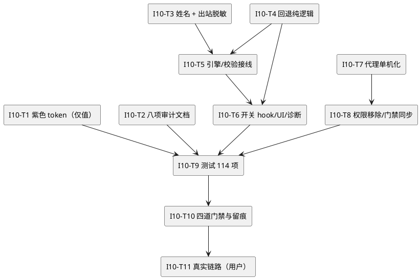

# EasyFlow 配色回流、八项功能审计与 DeepSeek 接入（第十轮）— 编码任务清单

**文档路径**：`.codeartsdoer/specs/easyflow_page_guide/iteration10-tasks.md`

**输入依据**

- `.codeartsdoer/specs/easyflow_page_guide/iteration10-spec.md`（R-500—R-563、V-01—V-09、A-01—A-05、G-01—G-04、D10-01—D10-12）
- `.codeartsdoer/specs/easyflow_page_guide/iteration10-design.md`（重点：2.1.3(1)—(7)、2.2.2 接口 A—J、2.4 紫色映射、2.5 八项审计、2.6 DeepSeek 收口、2.7 测试计划、2.8 逐文件清单、2.10 风险、2.11 取舍、2.12 明确不改）
- `iteration9-spec.md`、`iteration9-design.md`、`iteration9-tasks.md`（单 token 源、AT-112、四道门禁、I9-T1—I9-T11 写法、留痕编号 28）
- `iteration8-spec.md`、`iteration8-design.md`、`iteration8-tasks.md`（96 项回归口径、I8-T1—I8-T13、`codearts_proof/27-iteration8-implementation.md`）
- `iteration7-*`、`iteration6-*`、`iteration5-*`、`iteration4-*`、`iteration3-*`、`iteration2-*`、`spec.md`、`design.md`、`tasks.md`（任务编号、依赖图、追踪矩阵、人工验收口径）
- 2026-11-16 只读核对（**未读取 `.env.local`**）：
  - `src/sidepanel/styles/sidepanel.css`（985 行；`:root` 在 `:2-50`；care 覆盖 `:53-69`；头部渐变 `:114`）
  - `src/sidepanel/dialogue/model/ModelEngine.ts`（115 行；`baseUrl :8`；`probeModelProxy :53-60`；`respond :65-111`；`PROXY_CONTRACT.timeoutMs+2000 :73`）
  - `scripts/model-proxy.mjs`（121 行；`host/port :3-4`；`validPayload :22-30`；`readBody 32000 :50`；`createServer :83-121`；日志 `:116` 打印 `reason`）
  - `package.json`（`model:proxy` 用 `--env-file=.env.local`；无新增脚本）
  - `.env.example`（5 行；模型名 `deepseek-flash`、超时 `15000`）
  - `public/manifest.json`（`permissions` 四项；`host_permissions: ["http://127.0.0.1:8765/*"]`）
  - `scripts/verify-manifest.mjs`（248 行；`host_permissions` 恰一条断言 `:43-48`；运行期禁词 `:116-132`；`fetch(` 例外仅 `ModelEngine.ts`/`dist/sidepanel.js` `:134-159`）
  - `src/sidepanel/hooks/useModelMode.ts`（30 行；键 `easyflow.model.enabled`；无 `refresh`；`get` 无 catch）
  - `src/sidepanel/hooks/useConversation.ts`（1191 行；签名 `:293`；在线分支 `:853`；`console.warn` 带 `String(error)` `:855`；回退标注 `:858`、`:876`；`busy` 收尾 `:946`）
  - `src/sidepanel/App.tsx`（`useConversation(uiMode, modelMode.enabled)` `:31`）
  - `src/sidepanel/components/chat/ChatHeader.tsx`（`role="switch"`、`aria-checked`、三态文案 `:26-29`）
  - `src/sidepanel/components/chat/AboutPanel.tsx`（在线/本地说明 `:7`）
  - `src/sidepanel/components/chat/DiagnosticsPanel.tsx`（11 props；运行记录 `:346-367`）
  - `src/shared/privacy/detect.ts`（`SensitiveKind` 6 类；无 name）
  - `src/shared/privacy/redact.ts`（`slots` `:80`；`bytes :86`；`PROXY_CONTRACT.timeoutMs 15000 :18`；`maxOutputTokens 1200 :20`）
  - `src/sidepanel/dialogue/validate/validator.ts`（`validateDirectAnswer :52-93` 含数字出处；`validateNextStep :95-128`；无在线附加校验）
  - `src/shared/types.ts`（`EngineDiagnostics :510`、`ConversationDiagnostics :527`、`NoticeKind :275-283` 无 `model-fallback`）
  - `src/shared/constants.ts`（`MAX_ANSWER_CHARS 180 :26`；`MAX_OUTBOUND_* :44-46`；存储键 `:50`）
  - `scripts/selftest.mjs`（3997 行；esbuild 导出清单 `:14-70`；无编号模型用例 `:581-608`；`AT-112 :3925-3945`；`AT-113 :3947-3966`；`AT-114 :3968`）
  - `.gitignore`（含 `.env`、`.env.*`、`!.env.example`）
  - `codearts_proof/`（最大编号 `28-iteration9-implementation.md`；`iteration9-*.log` 齐全）

**阶段声明**

- 本文件只是第十轮**编码任务规划**。编写时未修改任何源码、`public/manifest.json`、`scripts/**`、`src/sidepanel/styles/sidepanel.css`、`dist/**`、`.env.example`、`README.md`、`.gitignore`；未修改前九轮规格/设计/任务文档与本轮 `iteration10-spec.md` / `iteration10-design.md`。
- 编写时**未执行** `npm run typecheck` / `npm run build` / `npm run selftest` / `npm run verify`，未启动代理，未创建或覆盖 `codearts_proof/iteration10-*` 日志与 `29-iteration10-implementation.md`，**未读取/写入 `.env.local`**，未访问真实网页、未调用真实麦克风/语音、未访问网络。
- `git` 不可用：本文件不写“已查看 git diff”，只用“文件哈希基线 + 只读核对”口径。
- 自动测试通过**不能**替代真实链路；真实 Key 两条链路、四种回退、姓名脱敏、四张截图一律由用户执行，未执行写“**未验证**”。
- 本文件不写“已修复/已解决/已达标”。

---

## 0. 使用说明与全局约束

### 0.1 基线事实（2026-11-16 只读核对）

| 核查项 | 只读结论（文件:位置） | 对任务的要求 |
|---|---|---|
| CSS token 源 | `sidepanel.css:2-50` 唯一 `:root`；`:53-69` `html[data-ui-mode="care"]`；头部渐变 `:114`、投影 `:115` | T1 只改颜色值；`:root` 仍恰 1 处；care 块仍 1 处 |
| 用户气泡 | token `:44` `#6340ed`；组件规则 `:261` `border-color:#6340ed` | T1 都不动，避免 token/规则不一致 |
| AT-112 锁紫 | `selftest.mjs:3930-3945` 断言 `:root` 1 处、care、`18px`/`22px`/`44px`/`48px`、`linear-gradient(135deg, #4f46e5`、`--ef-primary: #5b42ed`、420/320/reduce、`:focus-visible`、两处 `min-height` | T1/T9 不得改这些字面值与断言 |
| 在线请求 | `ModelEngine.ts:8` `http://127.0.0.1:8765`；`:73` 超时 `PROXY_CONTRACT.timeoutMs + 2000`；`:68-74` 直接发送 `sanitizeOutbound` 结果 | T3/T4/T5 把 8s 上限与请求体去 `bytes` 落在一处 |
| 出站载荷 | `redact.ts:80` 含 `slots`；`:86` 含 `bytes`；`:136-149` 组装 | T3 删 `slots`，`bytes` 只留本地诊断 |
| 出站上限 | `constants.ts:44-46` 24 段 / 6000 字 / 40 控件；`redact.ts:124` 控件 `risky` | T3 复用常量，不新增魔法数 |
| 姓名缺口 | `detect.ts:1-7` 无 `name`；`redact.ts:6-13` 无姓名占位 | T3 新增 `name.ts` 与 `name` 敏感类型 |
| 模型返回校验 | `ModelEngine.ts:17-22` 只校验 kind/text；`:86-92` 引用静默 `slice(0,4)`；`:97-101` 控件本地映射与 `model-control-unsafe`；`validator.ts:52-93` 引用+数字 | T5 补“>4 拒绝、文本安全判定、类型化错误”；validator 只对在线结果追加 |
| 在线开关 | `useModelMode.ts:4` 键、`:12-14` 无 catch、`:23-27` toggle 后不刷新 | T6 补 catch/`refresh`，不加键 |
| 就绪门控 | `useConversation.ts:293` 只接 `modelEnabled`；`:853` 只看 `modelEnabled` | T6 增加 `modelReady`，发送前 `enabled && ready` |
| 失败日志 | `useConversation.ts:855` `detail: String(error)`；`:858`/`:876` 写入自由文本 `model-fallback:<message>` | T5/T6 改为枚举，不写原文 |
| 系统提示 | `types.ts:275-283` `NoticeKind` 9 值，无 `model-fallback`；`MessageList.tsx:198-200` 用 `.ef-system-notice` 渲染 | T6 只加 1 个 `NoticeKind` 值，不改 reducer 逻辑 |
| 开关 UI | `ChatHeader.tsx:26-29` 已有 `role="switch"`、`aria-checked`、三态文案 | T6 **不改** `ChatHeader` |
| 诊断 UI | `DiagnosticsPanel.tsx:346-367` 运行记录含 mode/validation/rejectReason/outboundBytes | T6 只加 `fallbackReason` 一行 |
| 代理绑定 | `model-proxy.mjs:3-4` `127.0.0.1:8765`；`:84-99` Origin 校验 + 预检；无 Host 校验、无 PNA 头 | T7 抽 `model-proxy-lib.mjs` 并补 Host/PNA/枚举/日志 |
| 代理日志 | `model-proxy.mjs:116` 打印 `reason`（可能含 `provider-http-<status>`，也可能含解析错误文本） | T7 只打印类别 + 计数，不打印异常原文 |
| manifest | `public/manifest.json:7` 四项权限；`:8` `host_permissions` | T8 删 `:8`，权限四项不动 |
| 门禁 | `verify-manifest.mjs:43-48` 断言 host 恰一条；`:116-132` 禁词；`:134-159` `fetch(` 例外仅 2 处 | T8 改为“不存在或为空”；T5/T6 不得在别处新增 `fetch(` |
| 测试基线 | `selftest.mjs` 静态 106 项（95 `AT-` + 11 无编号）；`:581` 无编号模型用例；`AT-112` 在 `:3925` | T9 只改名为 `AT-115`，新增 `AT-116—AT-123`；预期 114，**以实际输出为准** |
| 留痕 | `codearts_proof/` 最大编号 28；`iteration9-*.log` 已存在 | T10 用 `29-iteration10-implementation.md` 与 `iteration10-*.log`，不覆盖旧日志 |
| 忽略规则 | `.gitignore` 含 `.env`、`.env.*`、`!.env.example`、`codearts_proof/*.log` | T8 只读断言，不改 `.gitignore` |
| 严格类型 | `tsconfig.json`：`strict`、`noUncheckedIndexedAccess`、`exactOptionalPropertyTypes`、`noImplicitOverride` | 不用 `any`/`@ts-ignore`/`@ts-expect-error`；可选属性用条件展开 |

> 行号仅作定位参考；实现以函数名、常量名、props 名、CSS 选择器为准。行号漂移时以符号名重新定位并在留痕写明。

### 0.2 全局硬约束（每个任务都必须遵守）

1. **只改主工程**：只改 `D:\hwproject\translator` 的现有 Chrome MV3 扩展；不新建网站、不新建独立 Web 应用、不使用 `apps/extension`、不运行 `pnpm dev:web`。
2. **不扩权限**：`permissions` 仍为 `["activeTab","scripting","sidePanel","storage"]`；不新增 `tabs`、`<all_urls>`、静态 `content_scripts`、`web_accessible_resources`、`externally_connectable`；本轮只**删除** `host_permissions`。
3. **不扩存储**：不新增 `chrome.storage` 键（在线开关沿用 `easyflow.model.enabled`）；不保存页面正文、聊天内容、引用原文、音频、识别原文、诊断日志。
4. **不改第三方网页**：只读文字范围与控件；不修改布局/文案/样式/站点设置；不 `click`/`focus`/`fill`/`check`/`submit`/`dispatchEvent`。
5. **不改业务主路径**：问答、导办、预约、动态时段、成功页、完成校验、`RuleEngine` 主路径不改；在线只做可选增强与回退。
6. **不改高亮**：`highlight.ts`、`highlightRound.ts`、`observe.ts`、`entry.ts` 与 `constants.ts` 的 `HIGHLIGHT_*`/`CONTENT_VERSION` 零改动；哈希须与设计 1.0.2 基线一致。
7. **Key 唯一位置**：只允许在用户本机 `.env.local` 与代理进程内存；**不读取、不写入、不回显、不代填**；示例文件只含占位符。
8. **唯一网络目标**：扩展只访问 `http://127.0.0.1:8765`；不得直连 `api.deepseek.com`；`src/**` 不得新增 `fetch(`（`verify-manifest.mjs` 例外清单只有 `ModelEngine.ts` 与 `dist/sidepanel.js`）。
9. **不改测试以放宽**：既有断言不得删除/放宽；`AT-112` 的 `#5b42ed`、`linear-gradient(135deg, #4f46e5` 与 18/22/44/48、断点、reduce 保留。
10. **常量化**：超时、次数、上限、文案、枚举必须命名常量；不写散落魔法数（颜色值仅存在于 token 表）。
11. **隐私口径**：日志/诊断/留痕只写枚举、计数、毫秒、字节、状态码；禁止正文、引用原文、URL 查询串、输入值、姓名、号码、Key、异常原文。
12. **不得虚报**：只对“有真实输出/截图/录像”的项目写“通过”；未执行写“未验证”；失败写“失败 + 原因 + 证据”；不得用旧轮次日志替代本轮结果。

### 0.3 明确“不改文件”清单（改动即视为越界）

- 高亮四文件与常量：`src/content/highlight.ts`、`src/content/highlightRound.ts`、`src/content/observe.ts`、`src/content/entry.ts`、`src/shared/constants.ts`（含全部 `HIGHLIGHT_*`、`CONTENT_VERSION`、`MAX_ANSWER_CHARS`、`MAX_OUTBOUND_*`）
- 业务逻辑：`src/sidepanel/dialogue/rule/RuleEngine.ts`、`src/sidepanel/guide/stepPlanner.ts`、`src/sidepanel/guide/completion.ts`、`src/sidepanel/guide/bookingSuccess.ts`、动态时段相关、预约/成功页/旧卡降级
- 既有聊天 UI：`StepCard.tsx`、`MessageList.tsx`、`EvidencePanel.tsx`、`stepCardModel.ts`、`ChatComposer.tsx`、`ChatHeader.tsx`（开关三态与 `role="switch"` 已满足）
- 状态层：`src/sidepanel/state/conversationReducer.ts`、`sessionReducer.ts`、`initialState.ts`（`system-add` 已通用，只加类型值不加逻辑）
- 麦克风与朗读：`src/sidepanel/speech/**`、`src/shared/speech/**`、`src/mic-permission/**`
- 采集与匹配：`src/content/collect.ts`、`semantic.ts`、`controls.ts`、`normalize.ts`、`registry.ts`、`src/sidepanel/match/**`、`retrieval/**`
- 工程与静态资源：`package.json`、`.gitignore`、`tsconfig.json`、`public/sidepanel.html`、`public/mic-permission.*`、`public/icons/**`
- 第三方网页：不改任何站点布局/文案/样式/交互
- `dist/**`：只由 `npm run build` 生成，不手改

### 0.4 允许新增 / 修改清单

| 类型 | 文件 | 任务 |
|---|---|---|
| 新增 | `src/shared/privacy/name.ts` | T3 |
| 新增 | `src/shared/model/fallback.ts` | T4 |
| 新增 | `scripts/model-proxy-lib.mjs` | T7 |
| 新增 | `docs/iteration10-function-audit.md` | T2 |
| 修改 | `src/sidepanel/styles/sidepanel.css`（仅颜色值） | T1 |
| 修改 | `src/shared/privacy/detect.ts`、`src/shared/privacy/redact.ts` | T3 |
| 修改 | `src/sidepanel/dialogue/model/ModelEngine.ts` | T5 |
| 修改 | `src/sidepanel/dialogue/validate/validator.ts` | T5 |
| 修改 | `src/shared/types.ts`（`fallbackReason?`、`NoticeKind` 加 `model-fallback`） | T5、T6 |
| 修改 | `src/sidepanel/hooks/useModelMode.ts`、`src/sidepanel/hooks/useConversation.ts`、`src/sidepanel/App.tsx` | T6 |
| 修改 | `src/sidepanel/components/chat/AboutPanel.tsx`、`src/sidepanel/components/chat/DiagnosticsPanel.tsx` | T6 |
| 修改 | `scripts/model-proxy.mjs`、`.env.example` | T7 |
| 修改 | `public/manifest.json`、`scripts/verify-manifest.mjs` | T8 |
| 修改 | `scripts/selftest.mjs` | T9 |
| 修改 | `README.md`（仅在线模式步骤/告知/回退口径，不写 Key） | T6（文档型） |
| 生成 | `codearts_proof/iteration10-*.log`、`codearts_proof/29-iteration10-implementation.md` | T10 |

### 0.5 任务编号与追溯约定

- 本轮编码任务编号为 **`I10-T1`—`I10-T11`**（共 11 项，符合 9—13 项要求）。
- 需求编号沿用 `R-500`—`R-563`；设计取舍沿用 `D10-01`—`D10-12` 与 `Q-01`—`Q-08`，本文件不新增编号。
- 测试用例沿用 `AT-xx`：既有 106 项（95 `AT-` + 11 无编号）→ 无编号模型用例改名 `AT-115` → 新增 `AT-116`—`AT-123`（8 项）→ **预期 114**，实现阶段只写“以实际输出为准”。
- “设计 2.x”指 `iteration10-design.md`；“spec 5.x/6.x/7.x”指 `iteration10-spec.md`。
- **A 类改动**（规格硬约束，可直接实施）：紫色 token 值、删 `slots`、8s/10s 超时、去 `bytes`、删 `host_permissions`、`verify` 断言改为“为空”、`AT-115` 改名、新增测试、门禁留痕。
- **B 类改动**（证据驱动，需留痕）：CORS/PNA 实际放行、姓名误杀、回退提示频次、8s 对真实模型是否足够、家长模式颜色覆盖。B 类不得写成“根因已确认”。
- 每个任务的“自验命令”在**实现阶段**执行；本文件编写阶段不执行任何命令。
- 合并/拆分说明：T5（引擎+校验）与 T6（Hook+UI）分开，便于先用假 `fetch` 验证拒绝矩阵，再接 UI；T7（代理）与 T8（权限/门禁）分开，先具备 CORS 能力再删 host 权限。

### 0.6 执行顺序总览

| 顺序 | 编号 | 标题 | 依赖 | 主要产物 | 构建检查点 |
|---|---|---|---|---|---|
| 1 | I10-T1 | 紫色 token 恢复（仅值） | 无 | `sidepanel.css` | `typecheck` + `build` + `AT-112` |
| 2 | I10-T2 | 八项功能审计文档（只审计） | 无 | `docs/iteration10-function-audit.md` | 文档自检 A-01—A-05 |
| 3 | I10-T3 | 隐私姓名模块 + 出站白名单/阻断 | 无 | `privacy/name.ts`、`detect.ts`、`redact.ts` | `typecheck` + `build` |
| 4 | I10-T4 | 回退原因/提示去重/在线本地选择纯逻辑 | 无 | `model/fallback.ts` | `typecheck` |
| 5 | I10-T5 | `ModelEngine`/validator 安全校验与回退接线 | T3、T4 | `ModelEngine.ts`、`validator.ts`、`types.ts` | `typecheck` + `build` + 既有模型用例 |
| 6 | I10-T7 | 代理单机化（Host/Origin/CORS/载荷/超时/日志） | 无（可与 T5 并行） | `model-proxy-lib.mjs`、`model-proxy.mjs`、`.env.example` | `typecheck` + 代理纯函数临时断言 |
| 7 | I10-T8 | 移除 `host_permissions` 并同步 `verify-manifest` | T7 | `public/manifest.json`、`verify-manifest.mjs` | `build` + `verify` |
| 8 | I10-T6 | 在线模式开关 hook/UI/诊断 | T4、T5 | `useModelMode.ts`、`useConversation.ts`、`App.tsx`、`AboutPanel.tsx`、`DiagnosticsPanel.tsx` | `typecheck` + `build` |
| 9 | I10-T9 | 测试：`AT-115` 改名 + `AT-116—AT-123` | T1—T8 | `scripts/selftest.mjs` | `npm run selftest`（以实际输出为准） |
| 10 | I10-T10 | 四道门禁与留痕 | T9 | `codearts_proof/iteration10-*.log`、`29-iteration10-implementation.md` | 四命令顺序执行 |
| 11 | I10-T11 | 真实 Key 两条链路/四种回退/脱敏/四张截图（用户执行） | T10 | `29-iteration10-implementation.md` 人工分栏 | 未执行写“未验证” |

### 0.7 依赖图

```text
I10-T1 ─────────────────────────────┐
I10-T2 ─────────────────────────────┤
I10-T3 ──┬──> I10-T5 ──> I10-T6 ────┤
I10-T4 ──┘                          ├──> I10-T9 ──> I10-T10 ──> I10-T11
I10-T7 ──> I10-T8 ──────────────────┘
```



**硬性顺序**

1. `I10-T1`、`I10-T2`、`I10-T3`、`I10-T4`、`I10-T7` 无相互依赖，可并行；`I10-T1` 不得早于任何“改 CSS 结构”的念头（本轮不允许改结构）。
2. `I10-T5` 必须晚于 `I10-T3`（出站阻断原因）与 `I10-T4`（枚举与超时常量）；`I10-T6` 必须晚于 `I10-T4`、`I10-T5`（诊断字段与门控）。
3. `I10-T8` 必须晚于 `I10-T7`（先有精确 CORS/PNA，再删 `host_permissions`）；删除后若被拦截，只允许改代理侧，不得恢复 host。
4. `I10-T9` 必须晚于 `I10-T1`—`I10-T8` 全部源码改动；`I10-T10` 在 `I10-T9` 之后；`I10-T11` 只在用户真实执行后记录。
5. 每完成 T3/T5/T6/T7/T8 各跑一次 `npm run typecheck` + `npm run build`；T1 额外跑 `AT-112` 单项；T4 只跑 `typecheck` 与纯函数临时断言。

### 0.8 阶段门禁与留痕

| 时点 | 命令/检查 | 通过标准 | 留痕 |
|---|---|---|---|
| T1 | `npm run build` + `AT-112` | 构建 0 错误；`:root` 1 处；`#5b42ed` 与渐变前缀仍在 | 汇总到 `iteration10-build.log` |
| T3/T4/T5 | `npm run typecheck` | 0 error；无 `any`/`@ts-ignore` | 汇总到 `iteration10-typecheck.log` |
| T6/T7/T8 | `npm run typecheck` + `npm run build` | 均 0；`dist` 时间更新 | `iteration10-{typecheck,build}.log` |
| T8 | `npm run verify` | 四项权限；`host_permissions` 不存在或为空；无 `<all_urls>`/`content_scripts`；Key 扫描 0 | `iteration10-verify.log` |
| T9 | `npm run selftest` | 记录 `# tests/# pass/# fail`；`AT-115` 明确；既有 106 项不回退 | `iteration10-selftest.log` |
| T10 | `typecheck` → `build` → `selftest` → `verify` | 四条独立执行、分别留痕；失败另存 `-retryN` | `iteration10-*.log` |
| T10 | 实现留痕 | 文件哈希、改动清单、失败证据、未验证项 | `codearts_proof/29-iteration10-implementation.md` |
| T11 | 真实链路 + 四张截图 | 逐项“通过/失败/未验证” | 同上人工分栏 |

> 留痕文件名：`codearts_proof/29-iteration10-implementation.md`（现有最大编号 28，顺延为 29；若实现时目录出现更高编号，以实际顺延值写并在首段注明原计划值 29）。日志统一 `codearts_proof/iteration10-*.log`，不覆盖旧轮次。

### 0.9 “每步可构建”的精确含义

1. T1（CSS 颜色值）结束：`npm run build` 成功，`dist/sidepanel.css` 更新。
2. T2（纯文档）结束：不影响构建；文档落盘且 A-01—A-05 自检通过。
3. T3 结束：`sanitizeOutbound` 签名与返回类型保持 `OutboundResult`；`ModelEngine` 调用点仍编译（`slots` 删除后无调用者传 `slots`）。
4. T4 结束：`fallback.ts` 不引入 `fetch(`/`Authorization`/`apiKey`，否则 `verify` 的 src 扫描会失败。
5. T5 结束：`ModelDialogueEngine.respond` 仍实现 `DialogueEngine`；既有 `AT-21/22` 与模型安全用例不退。
6. T6 结束：`useConversation` 第三参数默认 `false`，`App.tsx` 传参同步；`DiagnosticsPanel` 新字段可缺省（`exactOptionalPropertyTypes` 用条件展开）。
7. T7 结束：`model-proxy.mjs` 可单独启动；`model-proxy-lib.mjs` 可被 Node 直接 import 做纯函数断言。
8. T8 结束：`npm run build` 内含的 verify 与独立 `npm run verify` 均通过。
9. T9 之前允许“新增用例尚不存在”的中间态，但**不得**出现既有 106 项失败；出现即视为实现缺陷。
10. T10 四道门禁必须按顺序**独立**执行；`build` 内含的 verify 不能替代独立 `verify` 留痕。

### 0.10 可勾选任务总表（两级，执行时逐项勾选）

- [ ] **I10-T1 紫色 token 恢复（仅值）**
  - [ ] `:root` 改 14 个颜色值（bg/text/muted/border/success/focus/step 等），其余 token 不动
  - [ ] care 块只改 3 个颜色值，字号/触控/焦点宽度不变
  - [ ] `#5b42ed`、头部渐变前缀、布局/圆角/间距/阴影/边框宽度/420/320/reduce 原样
  - [ ] `npm run build` + `AT-112` 通过
- [ ] **I10-T2 八项功能审计文档（只审计）**
  - [ ] `docs/iteration10-function-audit.md` 九列八行，唯一判定
  - [ ] 每项 ≥1 条“文件:行号+符号”证据、价值、风险、P0/P1/P2、偏好符合性
  - [ ] 明确“本轮不实现缺失项”；无源码/测试改动
- [ ] **I10-T3 隐私姓名模块 + 出站白名单/阻断**
  - [ ] `name.ts`：标签替换 + 无标签跳过 + 标题置空 + 控件 `risky`
  - [ ] `detect.ts` 增 `name`；`redact.ts` 删 `slots`、`bytes` 不进请求体、新增 `name-risk-detected`
  - [ ] 序列化断言：无 HTML/`"value":`/敏感值/姓名残留/查询串
- [ ] **I10-T4 回退原因/提示去重/在线本地选择纯逻辑**
  - [ ] 17 值封闭枚举 + `ModelCallError` + `selectEngineMode`
  - [ ] `MODEL_TIMEOUT_MS=8000`、`PROXY_TIMEOUT_MS=10000`、默认模型名常量
  - [ ] `shouldShowFallbackNotice` 首次 true、同会话 false、成功后重置
- [ ] **I10-T5 `ModelEngine`/validator 安全校验与回退接线**
  - [ ] 文本安全判定（超长/HTML/代操作/多步）；引用 1—4 不静默截断
  - [ ] 类型化错误 + `fallbackReason` 诊断字段；`bytes` 不发送
  - [ ] validator 仅对 `online-model` 追加检查；不半展示
- [ ] **I10-T7 代理单机化**
  - [ ] `isLocalHost`/`isAllowedOrigin`/`validateProxyPayload`/`buildCorsHeaders`/`classifyProviderStatus`/`buildLogRecord`
  - [ ] 预检 + PNA；10s；错误枚举；日志无 Key/正文
  - [ ] `.env.example`：`deepseek-chat`、`10000`、`600`、占位 Key
- [ ] **I10-T8 移除 `host_permissions` 并同步门禁**
  - [ ] `public/manifest.json` 删 `host_permissions`，权限四项
  - [ ] `verify-manifest.mjs` 断言“不存在或为空”；Key/示例/忽略规则检查
  - [ ] `npm run verify` 通过
- [ ] **I10-T6 在线模式开关 hook/UI/诊断**
  - [ ] `useModelMode` 增 `refresh`、读取失败保持 false、toggle 后刷新
  - [ ] `useConversation` 增 `modelReady`；`enabled && ready` 才在线；关闭丢弃迟到结果
  - [ ] 回退提示一条（`NoticeKind` 加 `model-fallback`）；`console.warn` 只写枚举
  - [ ] 说明面板告知姓名风险；诊断显示回退原因；不锁 textarea
- [ ] **I10-T9 测试：`AT-115` 改名 + `AT-116—AT-123`**
  - [ ] `:581` 只加 `AT-115 ` 前缀，断言逐字不变
  - [ ] 8 项新用例覆盖 R-500—R-563；esbuild 导出清单补新模块
  - [ ] `npm run selftest` 记录实际 `# tests/# pass/# fail`（预期 114，不作结论）
- [ ] **I10-T10 四道门禁与留痕**
  - [ ] `typecheck`→`build`→`selftest`→`verify` 顺序执行、独立日志
  - [ ] 失败另存 `-retryN`；不覆盖旧日志；不删改用例
  - [ ] `29-iteration10-implementation.md` 写改动/证据/未验证项
- [ ] **I10-T11 真实 Key 两条链路/四种回退/脱敏/四张截图（用户执行）**
  - [ ] V-01/V-02 两条链路；V-03—V-06 四种回退
  - [ ] V-07/V-08 脱敏与姓名；V-09 四张截图（普通/长者/400px/200%）
  - [ ] 未执行项写“未验证”，不写“通过”

### 0.11 A/B 类改动与证据门槛

| 分支 | 进入门槛 | 允许动作 | 落点 | 禁止 |
|---|---|---|---|---|
| A1 规格硬约束 | spec 5.1/5.4/5.6/5.7/5.9 明确要求 | 改 token 值、删 `slots`、8s/10s、删 host、测试改名 | T1/T3/T4/T5/T7/T8/T9 | 借机改布局/尺寸/组件规则 |
| A2 安全红线 | Key 不得落盘、不得自动操作 | 枚举化日志、出站阻断、本地校验双保险 | T3/T5/T6/T7 | 放宽断言换“多发段落” |
| B1 CORS/PNA 实际放行 | 删除 host 后出现拦截类错误 | 只改代理侧 Origin 白名单与预检/PNA | T7/T8 | 恢复 `host_permissions`/`<all_urls>` |
| B2 姓名误杀 | 可用段落被跳过导致本地回退频繁 | 补反例、收窄正则；仍保守不发 | T3/T9 | 用百家姓全表泛化命中 |
| B3 8s 不足 | 真实链路稳定超时且代理侧已完成 | 记录证据，向用户提出改超时（需改规格） | T10/T11 | 擅自改回 15s |
| B4 回退提示打扰 | 同轮出现多次提示 | 会话级去重、成功重置 | T4/T6 | 完全静默失败 |
| B5 关怀颜色不一致 | 用户指出紫调不统一 | 只改既有 care 颜色值 | T1 | 新增 care 颜色覆盖机制 |

> 实现阶段第一件事是“按 A 类落硬约束 + 补 B 类证据”，不得先改测试或先放宽校验。

---

## 1. I10-T1 紫色 token 恢复（仅 token 值）

**编号与标题**：I10-T1 / 紫色 token 恢复（仅值；不改布局、尺寸、组件规则）。

**目标**：在唯一 `:root` 与既有 care 覆盖块内，把“冷白偏蓝 + 深蓝灰 + 青绿成功”的配色改回紫调家族（紫调白底、紫墨正文、紫灰次要、紫青成功），同时原样保留 `--ef-primary: #5b42ed`、头部渐变 `linear-gradient(135deg, #4f46e5`（AT-112 锁死）、全部尺寸契约与断点。

**追溯**：R-500—R-507；D10-01、D10-11、D10-12；Q-01、Q-02、Q-03、Q-06；设计 2.1.3(1)、2.2.2-I、2.4.1—2.4.7；spec 5.1、6.1、V-09。

**涉及文件与符号**

- `src/sidepanel/styles/sidepanel.css`
  - Layer 1 `:root`（`:2-50`）：`--ef-bg`、`--ef-surface-soft`、`--ef-text`、`--ef-text-soft`、`--ef-muted`、`--ef-border`、`--ef-border-strong`、`--ef-accent-soft`、`--ef-success`、`--ef-success-soft`、`--ef-focus`、`--ef-step-surface`、`--ef-step-surface-expired`、`--ef-step-ink`
  - Layer 2 `html[data-ui-mode="care"]`（`:53-69`）：`--ef-muted`、`--ef-step-ink`、`--ef-step-surface-expired`
  - 组件规则（`:114-115` 头部、`:261` 用户气泡边框）、`--ef-*` 尺寸/字号/阴影、`@media (max-width: 420px)` / `(max-width: 320px)`、`prefers-reduced-motion: reduce`、`:focus-visible`
- 断言参照：`scripts/selftest.mjs:3925-3945`（AT-112，不改）

**实现要点与前置依赖**

1. 前置：无。可与 T2/T3/T4/T7 并行。
2. 只按设计 2.4.1 表逐项替换颜色值，**不新增**选择器、不新增 `:root`、不在文件末尾追加 `Iteration 10` 覆盖块、不新增媒体查询。
3. 具体取值（设计值）：
   - `--ef-bg: #f5f6fb → #faf8ff`
   - `--ef-surface-soft: #f0edff → #f3efff`
   - `--ef-text: #182234 → #1f1a38`
   - `--ef-text-soft: #2f3d55 → #383051`
   - `--ef-muted: #4a5876 → #5b5378`
   - `--ef-border: #e4e1f0 → #e6e0f2`
   - `--ef-border-strong: #c7bff0 → #8f7fd6`（Q-03 默认；UI 边界 3.40:1）
   - `--ef-accent-soft: #f0ebff → #f1ecff`
   - `--ef-success: #0f6b4f → #2f6b74`（Q-01 默认紫青）
   - `--ef-success-soft: #e6f5ee → #e8f3f4`
   - `--ef-focus: #7153f1 → #6d4bf0`
   - `--ef-step-surface: #f7f4ff → #f6f2ff`
   - `--ef-step-surface-expired: #f1f4f8 → #f0ecf6`
   - `--ef-step-ink: #1b2740 → #221b3d`
   - care：`--ef-muted: #33415c → #4a4068`；`--ef-step-ink: #111827 → #1c1633`；`--ef-step-surface-expired: #e7ebf2 → #e9e4f0`
4. **原样不动**：`--ef-primary: #5b42ed`、`--ef-primary-strong: #4935cb`、`--ef-primary-soft: #eeebff`、`--ef-accent: #6c3df2`、`--ef-user-bubble: #6340ed`、`--ef-assistant-bubble: #ffffff`、`--ef-step-accent: #5037d7`、`--ef-danger*`、`--ef-warn*`、`--ef-surface: #ffffff`。
5. **原样不动（尺寸契约）**：`--ef-font-*`、`--ef-space-*`、`--ef-radius-*`、`--ef-shadow-*`、`--ef-tap-min`、`--ef-primary-min-h`、`--ef-step-border-width`、`--ef-diag-max-h`、care 的 18/22/44/48 与 2px/3px/36vh。
6. **原样不动（组件规则）**：头部渐变三色标与阴影、用户气泡 `border-color`、所有白/黑/`rgba(255,255,255,…)` 例外；不把字面量改成 `var()`（那属于改组件规则）。
7. 控制紫色面积：不改头部与气泡结构；若用户选 Q-02 备选（改中/末色标并减弱投影），须先确认，且断言前缀仍保留。
8. 对比度自检（设计 2.4.3）：正文/背景 15.78:1、次要/背景 6.75:1、白字/主色 6.09:1、白字/气泡 6.02:1、边框/白 3.40:1，均达标（设计期计算，非浏览器实测）。

**明确不做**

- 不改布局、六层结构、圆角/间距/阴影/边框宽度、420/320 断点、reduce 块、`:focus-visible`。
- 不改组件规则颜色字面量与 `--ef-primary` / 头部渐变。
- 不改 `AT-112` 的任何断言；不新增“紫色覆盖块”；不把错误改紫、不把成功与主色同相且无文字/图标区分。
- 不做像素级重设计、不改图标体系、不改信息架构。

**完成标准与自验命令**

- [ ] `:root` 仍恰 1 处；care 块仍 1 处；文件末尾 120 行内无 `Iteration` 覆盖注释。
- [ ] `--ef-primary: #5b42ed` 与 `linear-gradient(135deg, #4f46e5` 仍在 CSS 中。
- [ ] 上述 14 个 Layer 1 值与 3 个 care 值与设计表逐字一致。
- [ ] 抽查 10 条组件规则颜色均引用 `var(--ef-*)`（白/黑/透明例外除外）。
- 自验（实现阶段）：
  - `npm run build`
  - `npm run selftest`（至少确认 `AT-112` 通过；不写“全部通过”）
  - 只读计数：`:root {` 出现 1 次；`html[data-ui-mode="care"]` 出现 1 次；`#4f46e5` 仍在 `linear-gradient` 内
  - 对比度：用临时脚本（系统临时目录，不入库）按 WCAG 公式复算 2.4.3 关键 6 行
- 真实视觉（V-09）由用户执行：普通/长者/400px/200% 四张截图，未执行写“**待验**”。

**风险与回滚**

- 风险：紫调后小字对比不足（缓解：只回调该 token 明度，不改色相/布局）；care 颜色与 D10-12 字面表述有张力（Q-06 需确认）。
- 回滚：按 token 逐项恢复原值（保留原值清单在本任务表内）；**不得**通过“改测试”回滚。

---

## 2. I10-T2 八项功能审计文档（只审计，不实现）

**编号与标题**：I10-T2 / “功能建议翻译官”八项逐项审计文档。

**目标**：产出九列、八行的可核对审计表，对八项能力各给出唯一判定（已有 / 部分实现 / 未实现）、源码证据、能力边界、用户价值、风险、P0/P1/P2 优先级、建议下一步（不实现）与既有偏好符合性；**不新增任何功能实现**。

**追溯**：R-510—R-514；A-01—A-05；设计 2.5.1—2.5.6；spec 5.2、6.5、7.3。

**涉及文件与符号**

- 新增文档：`docs/iteration10-function-audit.md`
- 只读证据来源（不修改）：
  - `src/content/highlight.ts`（`highlightRef`、`buildTextHighlight`、`startPulse`、`finish`）、`highlightRound.ts`、`observe.ts`
  - `src/sidepanel/guide/stepPlanner.ts`（`advancePlan`、`currentStep`）、`src/shared/types.ts`（`currentIndex`/`status`）、`stepCardModel.ts`、`MessageList.tsx`
  - `StepCard.tsx`（我找不到/我点错了/我已完成）、`RuleEngine.ts`（not-found/misclick/done、安全边界）、`completion.ts`、`useConversation.ts`（纠偏后 `runTurn`）
  - `RuleEngine.ts`（个人信息/最终确认不代填、safety-boundary）、`src/content/collect.ts`（无 click/submit/dispatchEvent）、`highlight.ts`（仅 `scrollIntoView`）
  - `src/sidepanel/hooks/useUiMode.ts`、`sidepanel.css`（18/22/44/48、3px）、`App.tsx`、`ChatHeader.tsx`
  - `src/sidepanel/match/lexicon.ts`、`dialogue/retrieval/segmentRetriever.ts`、`dialogue/answer/composer.ts`
  - `EvidencePanel.tsx`、`validator.ts`、`useConversation.ts`（点依据→高亮）、`constants.ts`（≤3 句/≤180 字）
  - 全仓 `favorite`/`收藏` 检索（0 命中）、存储键（目标/界面模式/在线开关）

**实现要点与前置依赖**

1. 前置：无。
2. 固定九列：**功能 / 状态 / 代码证据（文件:行号+符号） / 能力边界 / 用户价值 / 风险 / 优先级 / 建议下一步（不实现） / 偏好符合性**。
3. 判定唯一（按设计 2.5.2）：
   - 已有：智能聚光灯（P0）、长者模式（P1）、回答溯源（P0）
   - 部分实现：任务进度（P1）、错误纠偏（P1）、有限代操作（P0，边界必须保持）
   - 未实现：办事条件预检查（P2）、任务收藏（P2）
4. 证据写法：`文件:行号` + 符号名（函数/选择器/常量）；行号偏差 >±5 时以符号名为准，并在文档写“行号已更新”。
5. P0 只用于“已有且不可回退”或“安全红线”（聚光灯、回答溯源、有限代操作边界）；优先级必须给理由。
6. 偏好符合性：逐项标注与“一次一个下一步 / 1—3 句 + 折叠依据 / 不代填 / 长者可读可点 / 不保存正文”的关系；第 6 项（条件预检查）标“部分冲突”。
7. 建议下一步只登记：任务进度 → 错误纠偏解释 → 办事条件预检查 → 任务收藏；写明“另立轮次/需用户批准”。
8. 文末写“本轮只审计、不实现”，并显式列出“未新增组件/接口/存储键/测试”。

**明确不做**

- 不新增/修改/删除任何功能实现、组件、接口、存储键、测试。
- 不改进度 UI、不补纠偏解释、不扩展代操作（展开/聚焦/选择/点击）、不做条件预检查、不做收藏。
- 不把“内部字段”当“用户可见能力”；不把“能回答条件”当“预检查”。

**完成标准与自验命令**

- [ ] 文档存在且八行齐全；每行状态三选一、只有一个判定。
- [ ] 每行至少 1 条可定位证据（文件+符号）。
- [ ] 每行含用户价值、风险、P0/P1/P2 与理由。
- [ ] A-04：明确“本轮不实现缺失项”；A-05：偏好符合性已标注（第 6 项标“部分冲突”）。
- 自验（实现阶段）：
  - 只读检索：八项关键词各能定位至少 1 条代码证据；
  - 改动核对：除新增该文档外，`src/**`、`scripts/**`、`public/**` 哈希与实现前一致；
  - 不运行门禁也可完成（文档型任务）。

**风险与回滚**

- 风险：证据行号漂移导致“看起来不成立”（缓解：以符号名为准并注明）；被误解为“已实现缺失项”（缓解：文首与文末双声明“只审计”）。
- 回滚：删除 `docs/iteration10-function-audit.md` 即可，无代码影响。

---

## 3. I10-T3 隐私姓名模块 + 出站白名单/阻断

**编号与标题**：I10-T3 / 姓名风险判定与出站载荷白名单/阻断。

**目标**：补齐“姓名不得出站”的可执行策略，并把出站载荷收紧为字段白名单（问题、域名、路径、标题、段落、控件、截断标记）；删除 `slots`，`bytes` 仅本地诊断；任何 HTML/`"value":`/敏感值/姓名残留/查询串都在出站前阻断并回退本地规则。

**追溯**：R-533—R-538、R-524；D10-06；Q-04、Q-05；设计 2.1.3(3)、2.2.2-B/C、2.6.5、2.9.3；spec 5.5、6.3、V-07/V-08。

**涉及文件与符号**

- 新增 `src/shared/privacy/name.ts`：
  - `interface NameRiskResult { text: string; replaced: boolean; residualRisk: boolean }`
  - `inspectNameRisk(text: string): NameRiskResult`
  - `hasNameRisk(text: string): boolean`
  - 常量：`NAME_LABEL_PATTERN`（姓名/名字/申请人/联系人/持卡人/户名/参保人/患者 + `：` + 2—6 汉字）、`NAME_HONORIFIC_PATTERN`（2—4 汉字 + 先生/女士/同志）、`NAME_WITH_CONTACT_PATTERN`（2—4 汉字 + 手机号/证件号）、`NAME_STANDALONE_LINE_PATTERN`（独立成行 2—4 汉字）、`NAME_PLACEHOLDER = "姓名"`
- 修改 `src/shared/privacy/detect.ts`：`SensitiveKind` 增 `"name"`；`SENSITIVE_PATTERNS`/`detectSensitive` 接入姓名标签命中（无标签候选由 `name.ts` 负责）
- 修改 `src/shared/privacy/redact.ts`：
  - `PLACEHOLDER` 增 `name: "姓名"`
  - `OutboundSource` 删 `slots?`；`OutboundPayload` 删 `slots`；`bytes` 标注“仅本地诊断，不进入请求体”
  - `sanitizeOutbound`：标题 `inspectNameRisk` 残留 → 置空且 `truncated=true`；段落 `residualRisk` → 整段跳过且 `truncated=true`；控件标签替换，残留 → `risky=true`
  - `OutboundResult.reason` 增 `"name-risk-detected"`
  - `assertNoSensitive` 增姓名残留检查
  - `PROXY_CONTRACT.timeoutMs: 15000 → 8000`；`maxOutputTokens: 1200 → 600`
- 复用常量：`MAX_OUTBOUND_SEGMENTS`、`MAX_OUTBOUND_CHARS`、`MAX_OUTBOUND_CONTROLS`（`constants.ts`，不改）

**实现要点与前置依赖**

1. 前置：无。T5 依赖本任务的阻断原因与 `name.ts`。
2. 姓名策略（Q-04 默认）：
   - 带标签 → 替换为“姓名”，保留条件/材料语义；
   - 无标签（称谓、姓名+号码、独立成行 2—4 汉字）→ 整段跳过，`truncated=true`；
   - 标题无法替换 → 置空，仍发域名/路径；
   - 控件标签无法替换 → `risky=true`（模型不能选中）；
   - 序列化后仍命中 → 整体阻断，回退本地并提示“页面可能含个人信息，已改用本地规则”。
3. 不做“百家姓全表”泛化命中；误杀优先回退本地，不放宽策略。
4. URL：`redactUrl` 只保留 `protocol//hostname + pathname`（既有行为，验证去查询串/片段）。
5. 顺序：删非白名单字段 → URL 去查询串 → 姓名处理 → 证件/手机/银行卡/邮箱/验证码/密码替换 → 限长/截断 → 控件 `risky` → 序列化断言。
6. 输入值：`collect.ts` 已在 button/submit/reset 之外不采集 `value`（本轮不改，T3 只做静态复核）。
7. 不新增存储键；告知文案属 T6（说明面板/README），T3 只保证“默认不发含姓名段落”。

**明确不做**

- 不改 `collect.ts`、`semantic.ts`、`controls.ts`；不新增 DOM 读取。
- 不新增姓名词典全表；不新增“用户画像/资格判断”。
- 不改 `constants.ts` 上限；不新增请求字段；不再发送 `slots`。
- 不把 `bytes` 放进请求体（只在诊断中使用）。

**完成标准与自验命令**

- [ ] `sanitizeOutbound` 返回 `pass` 时，`JSON.stringify(payload)` 不含 `<tag`、`"value":`、敏感值、姓名残留、`?`/`#` 查询串。
- [ ] 构造页面（含手机号、证件号、验证码、密码、输入值、含姓名段落、HTML 片段）→ 出站 0 命中。
- [ ] 姓名带标签 → 替换；无标签 → 段落跳过且 `truncated=true`。
- [ ] `payload` 键集合恰为 `utterance/page/segments/controls/truncated`（`bytes` 不进入请求体）。
- 自验（实现阶段）：
  - `npm run typecheck` + `npm run build`
  - 纯函数断言（系统临时目录，esbuild 打包后 Node 运行）：姓名/号码/HTML/查询串/`slots` 各 1 条
  - 只读检索：`sanitizeOutbound(` 的调用点（应为 `ModelEngine.ts` 与测试），确认无遗漏 `slots`
- V-07/V-08 由用户执行（断言/抓包/截图），未执行写“**未验证**”。

**风险与回滚**

- 风险：姓名正则误杀导致可用段落过少（缓解：保守回退本地，收集反例后收窄，不放宽）；`slots` 删除导致旧测试报错（T9 同步）。
- 回滚：删除 `name.ts`、恢复 `detect.ts`/`redact.ts` 原字段与 `PROXY_CONTRACT` 原值；恢复后仍需保持“姓名不出站”的关闭状态（在线可保持默认关闭）。

---

## 4. I10-T4 回退原因/提示去重/在线本地选择纯逻辑

**编号与标题**：I10-T4 / 回退原因枚举、类型化错误、在线/本地纯逻辑选择与提示去重。

**目标**：把“代理/网络/校验失败”收敛为封闭枚举与 `ModelCallError`，提供 `selectEngineMode` 与“回退提示是否展示”的纯函数，并集中定义扩展侧 8s、代理侧 10s 与默认模型名常量；不联网、不读 Key、不依赖 DOM。

**追溯**：R-539—R-546、R-545；D10-02、D10-03、D10-08、D10-10；Q-07、Q-08；设计 2.1.3(2)、2.2.2-A/F/G/J、2.6.4；spec 5.6、6.2。

**涉及文件与符号**

- 新增 `src/shared/model/fallback.ts`：
  - `type ModelFallbackReason = "not-enabled" | "not-ready" | "toggled-off" | "timeout" | "network-error" | "http-error" | "rate-limited" | "invalid-payload" | "invalid-reply" | "ungrounded" | "citation-mismatch" | "fact-unsupported" | "unsafe-control" | "unsafe-instruction" | "multi-step" | "html-detected" | "outbound-blocked"`
  - `interface ModelCallFailure { reason: ModelFallbackReason; status?: number }`
  - `class ModelCallError extends Error`（`reason`、可选 `status`；`message` 只允许枚举值，不含正文/Key）
  - `selectEngineMode(enabled: boolean, ready: boolean): "rule" | "online"`
  - `MODEL_TIMEOUT_MS = 8000`、`PROXY_TIMEOUT_MS = 10000`、`DEFAULT_MODEL_NAME = "deepseek-chat"`、`FALLBACK_NOTICE_TEXT`、`NOT_READY_NOTICE_TEXT`
  - `createFallbackNoticeState()`、`shouldShowFallbackNotice(state, reason): boolean`、`resetFallbackNotice(state)`
- 参照调用点（T5/T6 接线）：`ModelEngine.ts`、`useConversation.ts`

**实现要点与前置依赖**

1. 前置：无。T5/T6 依赖本任务的枚举与常理。
2. 枚举封闭：不得用自由文本；`ModelCallError.message` 直接用枚举值，便于 `console.warn` 只写枚举。
3. 错误映射：401/403→`http-error`（含 status）；402/429→`rate-limited`；超时→`timeout`；JSON 解析失败→`invalid-reply`；出站阻断→`outbound-blocked`；无引用→`ungrounded`；引用缺失/不匹配→`citation-mismatch`；数字无出处→`fact-unsupported`；控件不安全→`unsafe-control`；代操作→`unsafe-instruction`；多步→`multi-step`；HTML→`html-detected`。
4. `selectEngineMode`：`enabled === true && ready === true` → `"online"`，否则 `"rule"`（AT-116 断言三点）。
5. 提示去重：首次失败 `true`；同一在线会话内后续失败 `false`；任意一次在线成功调用 `resetFallbackNotice`。
6. 文案（Q-07 默认，`ef-system-notice` 系统提示）：
   - 已回退：“在线模型未给出可靠结果，已改用本地规则。”
   - 未就绪：“在线智能待连接，当前使用本地规则。”
   - 两者不同时出现。
7. 纯函数不得引用 `chrome.*`、`fetch`、`window`、`document`、`process.env`。

**明确不做**

- 不新增 `fetch(`（`verify-manifest` 的 `fetch(` 例外只有 `ModelEngine.ts` 与 `dist/sidepanel.js`）。
- 不写 `Authorization`、`apiKey`、`API_KEY`（src 扫描禁词）。
- 不读 `.env.local`、不读 Key、不联网。
- 不改 `conversationReducer.ts`（T6 用既有 `system-add`）。
- 不新增存储键。

**完成标准与自验命令**

- [ ] 枚举 17 值、`ModelCallFailure`、`ModelCallError` 与设计接口 A 一致。
- [ ] `selectEngineMode(false,true)==="rule"`、`(true,false)==="rule"`、`(true,true)==="online"`。
- [ ] `MODEL_TIMEOUT_MS===8000`、`PROXY_TIMEOUT_MS===10000`、`DEFAULT_MODEL_NAME==="deepseek-chat"`。
- [ ] 提示状态：首次 true → 同会话 false → 成功重置后再失败 true。
- 自验（实现阶段）：
  - `npm run typecheck`
  - 纯函数临时断言（系统临时目录打包运行）：上述 4 组
  - `npm run verify` 的 src 禁词扫描不因新文件报错

**风险与回滚**

- 风险：枚举与 T5/T6 使用不一致导致类型扩散（缓解：枚举只在 `fallback.ts` 定义，其他处只 import）；`Teacher` 式自由文本残留（缓解：`message` 只允许枚举）。
- 回滚：删除 `fallback.ts`，T5/T6 回到字符串错误；但会导致提示去重与诊断枚举缺失（需同步回退）。

---

## 5. I10-T5 `ModelEngine`/validator 安全校验与回退接线

**编号与标题**：I10-T5 / 模型返回本地安全校验、类型化回退与诊断字段接线。

**目标**：让在线返回只接受结构白名单与可溯源结果；对超长/HTML/代操作/多步/不安全控件/无依据一律整体拒绝并回退本地规则；`bytes` 不进入请求体；扩展侧超时 8s；诊断写枚举而非自由文本。

**追溯**：R-547—R-552、R-543、R-545；D10-03、D10-10；Q-07；设计 2.1.3(2)(4)、2.2.2-D/E/J、2.6.6、2.9.1；spec 5.7、6.4、V-02/V-05/V-06。

**涉及文件与符号**

- `src/sidepanel/dialogue/model/ModelEngine.ts`
  - `type ModelTextRejection = "too-long" | "html-detected" | "unsafe-instruction" | "multi-step"`
  - `inspectModelText(kind, text): ModelTextRejection | null`（新增并导出）
  - `respond`：`sanitizeOutbound` 阻断 → `ModelCallError("outbound-blocked")`；请求体显式挑选 `utterance/page/segments/controls/truncated`（去 `bytes`）；`AbortSignal.timeout(MODEL_TIMEOUT_MS)`
  - `answer`：`segmentIds` 长度 0 或 >4 → `ungrounded`；引用映射失败 → `citation-mismatch`；`text` 超 180/3 句 → `too-long`
  - `step`：控件不存在/不可见/禁用/模糊/风险/form → `unsafe-control`；多步文本 → `multi-step`
  - 视觉：`clarify` 也要过 `inspectModelText`
  - `diagnostics.fallbackReason` 只在失败路径由会话层写入（引擎不吞错）
- `src/sidepanel/dialogue/validate/validator.ts`
  - `validateResponse`：仅当 `response.diagnostics.mode === "online-model"` 时，按 `responseType` 追加 `inspectModelText` 检查（`direct-answer` 只拦代操作/HTML/超长；`next-step` 额外拦多步）
  - 本地规则结果路径零行为变化
- `src/shared/types.ts`
  - `EngineDiagnostics` 增 `fallbackReason?: ModelFallbackReason`
  - `ConversationDiagnostics` 增 `fallbackReason?: ModelFallbackReason`
- 复用：`MAX_ANSWER_CHARS`、`MAX_ANSWER_SENTENCES`（`constants.ts`，不改）

**实现要点与前置依赖**

1. 前置：T3（`outbound-blocked`、姓名阻断）、T4（枚举、`ModelCallError`、8s 常量）。
2. 检查顺序固定：结构 → 引用/数字 → 控件 → 指令/多步/HTML → 回退。任何拒绝都丢弃模型文本、引用与步骤，**不拼接**。
3. 引用数量：先校验 1—4，再映射；禁止用 `slice(0,4)` 静默截断（现状 `:86`）。
4. 数字出处：由 `validator.validateDirectAnswer` 的 `fact-unsupported` 覆盖；引擎侧不重复实现，但不得提前把数字改写。
5. 不做任何自动操作：不新增 `click/focus/fill/check/submit/dispatchEvent`；高亮仍只在用户点击时发生。
6. 渲染路径保持 React 纯文本；不引入 `dangerouslySetInnerHTML`。
7. 错误抛出统一 `ModelCallError`；`message` 只写枚举，不写 `String(error)`。

**明确不做**

- 不改 `RuleEngine.ts`（只作为回退）；不改 `MAX_ANSWER_CHARS`（180 保持）。
- 不改 `stepPlanner.ts`/`completion.ts`/`bookingSuccess.ts`；不改预约/动态时段/成功页。
- 不改 `StepCard.tsx`/`MessageList.tsx`/`EvidencePanel.tsx`；不改 `ChatComposer`。
- 不自动执行页面动作；不信任模型给的控件 ID（必须本地映射）。
- 不新增权限/存储/网络目标（仍只有 `127.0.0.1:8765`）。

**完成标准与自验命令**

- [ ] 构造未知 `kind`/空 `text`/超长 `text` → 回退，不展示模型文本。
- [ ] `answer` 无 `segmentIds`、引用 ID 不存在、引用文本不匹配、数字无出处 → 全部回退。
- [ ] `step` 禁用/风险/表单/不可见控件、含“先…再…/第 N 步”、含“提交/支付/验证码/密码/代填/勾选/确认” → 拒绝。
- [ ] 请求体不含 `bytes`；扩展侧超时 `8000`；诊断只写枚举。
- [ ] 既有模型安全用例（T9 后为 `AT-115`）断言不变且通过。
- 自验（实现阶段）：
  - `npm run typecheck` + `npm run build`
  - `npm run selftest`：确认 `:581` 用例（改名前后）与 `AT-21/22` 通过；若有失败，保留原始输出
  - 只读检索：`dangerouslySetInnerHTML` 0 命中；`click(`/`submit(`/`dispatchEvent` 未在新增代码出现

**风险与回滚**

- 风险：校验过严误拒正常回答（缓解：拒绝矩阵逐条对设计 2.1.3(4)；先跑假 `fetch` 用例）；`fallbackReason` 类型扩散（缓解：可选字段+条件展开）。
- 回滚：回退 `ModelEngine.ts`/`validator.ts` 到改动前，保留 T3/T4（出站与枚举仍安全）；诊断字段可保留（可选）。

---

## 6. I10-T7 代理单机化（Host/Origin/CORS/载荷/超时/日志）

**编号与标题**：I10-T7 / 本机代理安全边界与可单测纯策略库。

**目标**：把代理的允许/拒绝逻辑抽成可单测的纯函数库，只绑定 `127.0.0.1:8765`，校验 `Host` 与精确 `Origin`，支持预检与 Private Network Access，限制请求体与字段白名单，把厂商错误收敛为枚举，日志只写 ID/耗时/字节/状态/类别；同步 `.env.example` 默认值。

**追溯**：R-520—R-532、R-553；D10-03、D10-04、D10-08；设计 2.1.3(5)(6)、2.2.2-H、2.6.1—2.6.3、2.6.7；spec 5.3、5.4、5.8、V-03。

**涉及文件与符号**

- 新增 `scripts/model-proxy-lib.mjs`：
  - `isLocalHost(hostHeader: string): boolean`（只认 `127.0.0.1:8765`/`localhost:8765`）
  - `isAllowedOrigin(origin, extensionId): boolean`（恰为 `chrome-extension://<ID>`）
  - `validateProxyPayload(value): { ok: true } | { ok: false; reason: "invalid-payload" | "request-too-large" }`（字段白名单 + 24 段/6000 字/40 控件/160 标签/500 问题；拒绝未知字段）
  - `buildCorsHeaders(origin, extensionId, preflight): Record<string,string>`（`ACAO` 精确、`Allow-Methods: POST, OPTIONS`、`Allow-Headers: Content-Type`、`Vary: Origin`、PNA 头）
  - `classifyProviderStatus(status): "provider-auth" | "provider-quota" | "provider-rate-limit" | "provider-unavailable" | "provider-timeout"`
  - `buildLogRecord({ id, status, bytes, ms, category }): string`
- 修改 `scripts/model-proxy.mjs`：
  - 使用上述纯函数；`Host` 非本地 → 403；`Origin` 不匹配 → 403；未配置扩展 ID → `/health ready=false` 且 POST 403
  - `OPTIONS` → 204 + 精确 CORS + `Access-Control-Allow-Private-Network: true`（当请求带 `Access-Control-Request-Private-Network: true`）
  - 超时默认 `10000`；模型默认 `deepseek-chat`；`/health` 只返回 `{ ready, model }`
  - 错误只返回 `{ error: <枚举> }`；日志只写 `buildLogRecord`，不打印 `reason`/异常原文
  - 保留 32KB 上限、20 次/分钟限流
- 修改 `.env.example`：`EASYFLOW_MODEL_SECRET=your_deepseek_api_key_here`、`EASYFLOW_EXTENSION_ID=your_chrome_extension_id_here`、`EASYFLOW_MODEL_NAME=deepseek-chat`、`EASYFLOW_MODEL_TIMEOUT_MS=10000`、`EASYFLOW_MODEL_MAX_OUTPUT_TOKENS=600`

**实现要点与前置依赖**

1. 前置：无（可与 T5 并行）；T8 依赖本任务的 CORS/PNA 能力。
2. 纯函数库不得读 `process.env`、不得有副作用、不得联网；扩展 ID/Host 由调用方传入。
3. `Host` 校验防 DNS rebinding；`Origin` 校验防本机其他程序滥用额度。
4. 预检必须返回精确 `ACAO`（不用 `*`）；PNA 头只在请求声明时返回。
5. 拒绝路径不调用厂商、不消耗额度；错误体不回显配置/Key/请求片段。
6. 日志格式固定：`[EasyFlow proxy] id=… status=… ms=… bytes=… category=…`；启动日志只 `ready`/模型名/端口/绑定地址。
7. `.env.example` 只占位：secret 不是 `sk-` 开头且长度 <20；不写真实扩展 ID。
8. 不新增 `package.json` 脚本（`model:proxy` 不变）。

**明确不做**

- 不绑定 `0.0.0.0`/局域网/公网；不改端口 8765。
- 不新增 `externally_connectable`/`web_accessible_resources`/`content_scripts`。
- 不读取/打印 `.env.local` 内容；不在日志写请求体、页面文本、完整 URL、`Authorization`、`Bearer`。
- 不改 `maxTokens` 之外的上限语义（600 与 `PROXY_CONTRACT` 对齐）。
- 不新增流式、不做自动重试循环。

**完成标准与自验命令**

- [ ] `isLocalHost("127.0.0.1:8765")===true`；`isLocalHost("evil:8765")===false`。
- [ ] `isAllowedOrigin("chrome-extension://<ID>", "<ID>")===true`；其他 Origin false。
- [ ] 未知字段/超长 → `invalid-payload`/`request-too-large`；无 Key/未配置 ID → `ready=false`。
- [ ] 预检含 `Vary: Origin` 与 PNA 头；`/health` 字段 ≤3 且无 secret。
- [ ] 日志无 `sk-`、无 `Bearer`、无中文页面片段。
- 自验（实现阶段）：
  - `node --check scripts/model-proxy.mjs`、`node --check scripts/model-proxy-lib.mjs`
  - 纯函数临时断言（`node -e "import(...)"` 形式，系统临时脚本，不入库）
  - 启动代理仅用于确认绑定地址（若实现阶段允许；日志留痕，不写 Key）
  - `netstat -ano | findstr 8765` 只出现 `127.0.0.1`（未执行写“未验证”）

**风险与回滚**

- 风险：CORS/PNA 配置错误导致在线不可用（缓解：只改代理侧，保留未就绪回退）；`Host` 校验过严（缓解：同时接受 `localhost:8765`）。
- 回滚：恢复 `model-proxy.mjs` 单文件版本与 `.env.example` 原值（`deepseek-flash`/`15000`）；但需保留“只绑本机”的最低要求。

---

## 7. I10-T8 移除 manifest `host_permissions` 并同步 `verify-manifest`

**编号与标题**：I10-T8 / 删除 `host_permissions`、门禁改为“为空/不存在”，补 Key 与示例扫描。

**目标**：让扩展不声明任何 host 权限，仅依赖代理侧精确 CORS 放行扩展 Origin；同步 `verify-manifest.mjs` 使“`host_permissions` 不存在或为空数组”成为必须通过的断言，并增加 Key/示例/忽略规则检查；权限四项不变。

**追溯**：R-526—R-532、R-520—R-525；D10-07；设计 2.1.3(5)、2.6.2、2.6.3；spec 5.4、7.1 G-04。

**涉及文件与符号**

- `public/manifest.json`：删除第 8 行 `"host_permissions": ["http://127.0.0.1:8765/*"]`；`permissions` 四项保持
- `scripts/verify-manifest.mjs`：
  - `:43-48` 断言改为 `!Array.isArray(manifest.host_permissions) || manifest.host_permissions.length === 0`
  - 保留四项权限、禁止 `content_scripts`/`web_accessible_resources`/`externally_connectable`
  - 新增：扫描 `src`/`public`/`dist` 无 `sk-[A-Za-z0-9]{20,}`；`.env.example` 的 secret 非真值且 <20/非 `sk-` 开头；`.gitignore` 含 `.env.*` 与 `!.env.example`
  - 不新增 `fetch(` 例外；`getUserMedia` 仍 2 条例外

**实现要点与前置依赖**

1. 前置：T7（先具备精确 CORS/PNA）。
2. 删除后若浏览器拦截：只允许在代理侧修 CORS/PNA；**不得**恢复 `host_permissions`、不得加 `<all_urls>`/`tabs`，除非用户明确拍板（D10-07 备选）。
3. Key 扫描只扫 `src/public/dist`，不扫 `scripts`（避免命中断言自身文本）。
4. `.env.example` 检查为“文件规则核对”；`git check-ignore` 不可用（git 不可用），写“未验证”，不得声称已验证。
5. 门禁输出保留 `OK/FAIL` 明细，便于留痕。

**明确不做**

- 不新增任何权限；不改 `permissions` 顺序与内容。
- 不用 `externally_connectable`/`web_accessible_resources`/`content_scripts` 绕过 CORS。
- 不改 `.gitignore`（已满足）；不把 `.env.local` 加入版本控制。
- 不放宽既有禁用词断言（`<all_urls>`、`content_scripts`、`innerHTML`、`dangerouslySetInnerHTML`）。

**完成标准与自验命令**

- [ ] `public/manifest.json` 无 `host_permissions`；`dist/manifest.json` 同样无。
- [ ] `npm run verify` 输出“`host_permissions` 不存在或为空”OK；权限四项 OK。
- [ ] Key 扫描 0 命中；`.env.example` 占位 OK；`.gitignore` 规则 OK。
- 自验（实现阶段）：
  - `npm run build`（内含 verify）
  - `npm run verify`（独立执行并留痕）
  - 只读检索：`public/manifest.json` 与 `dist/manifest.json` 均无 `host_permissions` 键
- CORS 真实放行由 T11/V-01/V-02 验证，未执行写“**未验证**”。

**风险与回滚**

- 风险：移除 host 后 Chrome 拦截回环请求（缓解：精确 ACAO + PNA；回退本地并显示“待连接”；记录错误类别）；门禁误报（缓解：断言只在 `dist/manifest.json` 判空）。
- 回滚：恢复 `host_permissions` 一行（**需用户批准**，违反本轮硬约束）；同时回退 verify 断言为“恰一条”（不得其他放宽）。回滚必须写留痕。

---

## 8. I10-T6 在线模式开关 hook/UI/诊断

**编号与标题**：I10-T6 / 在线模式默认关闭、就绪门控、8s 回退、提示不重复、不锁输入、诊断与告知。

**目标**：让在线模式默认关闭且只在用户显式开启且代理就绪时出站；未就绪 500ms 内本地回答；请求最长 8s，超时/失败回退本地并只出现一条提示；请求期间 `textarea` 始终可输入；关闭在线后迟到结果不得覆盖；说明面板告知姓名风险，诊断面板显示回退原因枚举。

**追溯**：R-539—R-546、R-534/R-538（告知）；D10-02、D10-03、D10-05、D10-10；Q-05、Q-07；设计 2.1.3(2)(6)、2.2.2-F/G/J、2.6.4、2.6.7；spec 5.6、6.2、V-03—V-06。

**涉及文件与符号**

- `src/sidepanel/hooks/useModelMode.ts`
  - 读失败 `catch` → `enabled=false`；`refresh()` 抽 `check()`；`toggle` 后立即 `refresh()`；返回 `{ enabled, ready, toggle, refresh }`；不新增存储键
- `src/sidepanel/hooks/useConversation.ts`
  - 签名 `useConversation(uiMode, modelEnabled = false, modelReady = false)`；`modelReadyRef`
  - 发送前 `selectEngineMode(modelEnabledRef.current, modelReadyRef.current) === "online"` 才用 `modelEngine`，否则 `ruleEngine` 且**不发请求**
  - 请求返回后若 `modelEnabledRef.current === false` → 丢弃在线结果，用本地规则
  - `catch`：只 `console.warn("[EF]", { phase, reason })`；`response.diagnostics.fallbackReason = reason`；写一条 `system-add`（`NoticeKind` 新值 `model-fallback`）且 `shouldShowFallbackNotice` 去重
  - 在线成功后 `resetFallbackNotice`
  - `busy` 在 8s 内恢复（由超时保证）
- `src/sidepanel/App.tsx`：`useConversation(uiMode, modelMode.enabled, modelMode.ready)`
- `src/sidepanel/components/chat/AboutPanel.tsx`：常驻告知“页面可见文字可能含姓名，开启后会跳过含姓名的段落；可不开在线模式”；保留“不代填/不代提交”
- `src/sidepanel/components/chat/DiagnosticsPanel.tsx`：运行记录增“回退 `<枚举>`”一行；不显示正文/原文/查询串
- `src/shared/types.ts`：`NoticeKind` 增 `"model-fallback"`（只加类型值，不改 reducer 逻辑）
- `README.md`：补 `.env.local` 步骤、PNA/CORS 说明、姓名告知、8s 回退、验收口径（不写 Key）

**实现要点与前置依赖**

1. 前置：T4（枚举/`selectEngineMode`/提示去重/常量）、T5（`fallbackReason` 诊断与类型化错误）。
2. 三态文案沿用 `ChatHeader.tsx:28`（“本地规则 / 在线智能已开启 / 在线智能待连接”），**不改 ChatHeader**。
3. 默认关闭：全新配置 → `enabled=false`；不产生网络请求；`probeModelProxy` 是唯一探测入口（不新增 `fetch(`）。
4. 未就绪：`ready=false` 时直接本地规则，不等待 8s；提示用“在线智能待连接，当前使用本地规则。”
5. 超时/失败：8s 内回退；提示“在线模型未给出可靠结果，已改用本地规则。”同会话不重复；成功重置。
6. 不锁输入：`ChatComposer.tsx` 不改；`textarea` 不受 `busy` 影响，只有发送按钮显示“等待中…”且 ≤8s。
7. 关闭在线后迟到结果丢弃：返回时读 `modelEnabledRef.current`；不覆盖已展示回答。
8. 诊断只写枚举/耗时/字节/引用数/校验状态；`console.warn` 不写 `String(error)`。
9. 开关切换不自动发送消息：`toggle` 只改状态并 `refresh`。
10. 姓名告知（Q-05 默认）：说明面板常驻告知，不新增存储键、不做二次确认；用户可不开在线。

**明确不做**

- 不改 `ChatHeader.tsx`（已具备 `role="switch"`、`aria-checked`、三态文案）。
- 不改 `ChatComposer.tsx`、`MessageList.tsx`、`StepCard.tsx`、`EvidencePanel.tsx`。
- 不改 `conversationReducer.ts`（`system-add` 已通用）。
- 不新增存储键、不新增消息类型、不新增 `fetch(`。
- 不做自动重试；不把在线失败显示为“页面没有信息”；不在聊天正文展示代理内部错误栈。

**完成标准与自验命令**

- [ ] 全新配置 `enabled=false`；关闭状态抓包 0 请求（真实抓包由用户执行）。
- [ ] `enabled=true && ready=false` → 不发请求，500ms 内本地回答 + “待连接”。
- [ ] `enabled && ready` → 一次提问 1 次请求；失败 8s 内回退 + 一条提示；连续 3 次失败不出现 3 条相同提示。
- [ ] 请求期间 `textarea` 可输入；8s 后可再次发送。
- [ ] 关闭在线后迟到结果不覆盖；诊断显示枚举且无正文。
- 自验（实现阶段）：
  - `npm run typecheck` + `npm run build`
  - `npm run selftest`（`AT-116`/`AT-122` 由 T9 加入；此前先手工核对纯函数）
  - 只读检索：`useModelMode.ts` 无 `fetch(`；`useConversation.ts` 的 `console.warn` 不含 `String(error)`
- V-03—V-06 由用户执行，未执行写“**未验证**”。

**风险与回滚**

- 风险：提示打扰（缓解：会话级去重 + 成功重置；备选 Q-07 顶部状态条）；`ready` 状态抖动（缓解：`refresh` 只在 toggle 与定时探测时调用）；迟到结果覆盖（缓解：返回时检查 `enabled`）。
- 回滚：恢复 `useModelMode.ts`/`useConversation.ts`/`App.tsx` 原逻辑，保留 T4/T5 的枚举与校验（不影响本地规则）；`NoticeKind` 新值可保留（未使用不会报错）。

---

## 9. I10-T9 测试：`AT-115` 改名 + `AT-116`—`AT-123`

**编号与标题**：I10-T9 / 模型安全用例编号化与 8 项新用例（既有 106 项回归）。

**目标**：把 `selftest.mjs:581` 的无编号模型安全用例**只改名**为 `AT-115`（断言逐字不变），新增 `AT-116`—`AT-123` 覆盖默认关闭/未就绪、Key 不落盘、出站脱敏、无依据回退、不安全控件/代操作/多步/HTML、代理本机/CORS/超时、提示不重复/输入不锁、紫色 token；既有 106 项不回退。预期 114，**以实际输出为准**。

**追溯**：R-557—R-563、R-547—R-552、R-500—R-507、R-520—R-546；D10-09、D10-11、D10-03、D10-08；Q-08；设计 2.7.1—2.7.6。

**涉及文件与符号**

- `scripts/selftest.mjs`
  - `:581` 标题改为 `"AT-115 在线模型只接受当前页引用与安全控件"`；`assert` 内容不改（安全 answer/step 通过、禁用控件 `model-control-unsafe`）
  - esbuild 导出清单（`:14-70`）补：`name.ts`、`fallback.ts` 的导出；`ModelEngine` 的 `inspectModelText`；`redact` 的 `PROXY_CONTRACT`
  - 新增用例：
    - `AT-116` 在线模式默认关闭且未就绪不发请求（`selectEngineMode` 三点）
    - `AT-117` Key 不落盘、不回显、示例只占位（静态扫描 `src/public/dist`；`.env.example`；`.gitignore`；`buildLogRecord` 源码不含 Key/Bearer）
    - `AT-118` 出站白名单与姓名缺口（`sanitizeOutbound` + 假 `fetch`：姓名/手机/证件/验证码/密码/输入值/查询串/HTML 0 命中；无 `slots`；请求体无 `bytes`）
    - `AT-119` 无依据/引用不匹配/数字无出处回退（假 `fetch`：`ungrounded`/`citation-missing`/`fact-unsupported`；不返回模型文本）
    - `AT-120` 不安全控件/代操作/多步/HTML 回退（假 `fetch`）
    - `AT-121` 代理仅本地、CORS 与超时（导入 `model-proxy-lib.mjs`：`isLocalHost`/`isAllowedOrigin`/`classifyProviderStatus`；`MODEL_TIMEOUT_MS===8000`；代理默认 10000；模型名 `deepseek-chat`）
    - `AT-122` 回退提示不重复且输入不锁（`shouldShowFallbackNotice`；`ChatComposer.tsx` 源码 `textarea` 无 `disabled`；`busy` 只作用发送按钮）
    - `AT-123` 紫色 token、单一源与对比度（静态：`:root` 1 处、14 个值、care 3 个值、无 `Iteration 10` 块、`#5b42ed`/渐变前缀仍在；对比度阈值）
- 参照断言：`AT-112`（不改）、`AT-113`（不改）、`AT-114`（不改）

**实现要点与前置依赖**

1. 前置：T1—T8 全部完成（测试只反映已实现行为）。
2. 只改名不改断言：`AT-115` 的 `assert.equal`/`assert.rejects` 与假 `fetch` 结构保持原样；不得顺手加/删断言。
3. 新增用例只用虚构数据；禁止写真实 URL、真实姓名、真实号码（测试样本用构造值）。
4. 静态断言只读源码/产物；不得联网、不得读 `.env.local`。
5. 计数口径：`# tests` 为实际值；预期 114（106 + 8，改名不增数）。**不得**写“114 项通过”；失败时记录 `# fail` 与用例名。
6. 若新增用例失败，先修实现或修用例中的错误假设，不得放宽既有断言；失败输出另存 `iteration10-selftest-retryN.log`。
7. `AT-121` 直接 `import` `scripts/model-proxy-lib.mjs`（ESM），不经过 esbuild。

**明确不做**

- 不改 `AT-106`—`AT-114` 的任何断言；不改 `AT-112` 的锁紫字面值。
- 不放宽 `AT-50/63/80` 相关断言；不删除既有 11 个无编号用例中的其他 10 个。
- 不新增测试框架/依赖；不写网络测试（除假 `fetch`）；不写真实 Key/真实页面文本。
- 不把测试通过写成“真实链路已验证”。

**完成标准与自验命令**

- [ ] `:581` 标题含 `AT-115`，断言与改动前逐字一致。
- [ ] `AT-116`—`AT-123` 均存在且能独立定位。
- [ ] 既有 106 项无失败；`# tests` 记录实际值（预期 114）。
- 自验（实现阶段）：
  - `npm run selftest` → 保存 `codearts_proof/iteration10-selftest.log`
  - 输出中检索 `AT-115` 与 `AT-116`—`AT-123` 标题
  - 若失败：保留原始输出，另起 `-retry1`，记录失败用例名与 `# fail`

**风险与回滚**

- 风险：计数与文档不一致（缓解：以实际输出为准）；新增用例误改既有断言（缓解：改名只加前缀，diff 逐行核对）；`AT-121` 导入 `.mjs` 路径在 Windows 下大小写/分隔符问题（缓解：用 `pathToFileURL`）。
- 回滚：删除新增 8 项、把 `:581` 标题恢复为无编号；既有 106 项基线不变。

---

## 10. I10-T10 四道门禁与留痕

**编号与标题**：I10-T10 / `typecheck → build → selftest → verify` 顺序门禁与实现留痕。

**目标**：在全部源码改动完成后，按固定顺序独立执行四道门禁，分别保存日志（不覆盖旧日志、失败另存 retry），并生成 `codearts_proof/29-iteration10-implementation.md`，写明改动清单、文件哈希、命令结果、失败证据与“未验证”项。

**追溯**：R-557—R-563、R-553—R-556；设计 2.7.3—2.7.6、2.10；spec 7.1、7.4、7.5。

**涉及文件与符号**

- 生成 `codearts_proof/iteration10-typecheck.log`、`iteration10-build.log`、`iteration10-selftest.log`、`iteration10-verify.log`
- 生成 `codearts_proof/29-iteration10-implementation.md`（现有最大编号 28，顺延；若目录已出现更高编号，用实际顺延值并在首段注明“原计划 29”）
- 只读：`package.json` 脚本（不改）、`dist/manifest.json`、`src/sidepanel/styles/sidepanel.css`

**实现要点与前置依赖**

1. 前置：T9 完成。
2. 顺序固定：`npm run typecheck` → `npm run build` → `npm run selftest` → `npm run verify`；每条独立执行、独立日志，**不得**用 `build` 内含的 verify 替代独立 `verify` 留痕。
3. 日志记录：命令、退出码、`# tests/# pass/# fail`、关键行（`AT-115`、`host_permissions` 断言、权限四项）。
4. 失败处理：保留原始输出；修复后另存 `iteration10-*-retryN.log`；不覆盖首次失败；不删改用例/不放宽断言。
5. 留痕内容：改动文件清单（新增 3 + 修改 17 的实际子集）、文件哈希（改动前后）、门禁结果、未验证项（真实链路/截图/CORS 实测）、回滚点。
6. 隐私：留痕不含 Key、姓名、证件号、手机号、验证码、密码、完整 URL 查询串、音频、识别原文；截图先遮蔽。
7. 不得声称“已查看 git diff”；只能写“已记录文件哈希基线 + 只读核对”。

**明确不做**

- 不改源码（本任务只跑命令与写留痕）；不新增脚本；不启动代理；不读 `.env.local`。
- 不覆盖 `iteration9-*` 日志；不把旧日志复制为本轮结果。
- 不把自动测试通过写成真实链路通过。

**完成标准与自验命令**

- [ ] 四个日志存在且时间递增；`typecheck` 0 error；`build` 成功；`selftest` 记录实际计数；`verify` 通过。
- [ ] `verify` 输出含“`host_permissions` 不存在或为空”、权限四项、Key 扫描 0。
- [ ] `29-iteration10-implementation.md` 含改动清单/哈希/门禁结果/失败证据/未验证项/回滚点。
- 自验（实现阶段）：按序执行四条命令并保存输出；用 `-retry` 规则处理失败。

**风险与回滚**

- 风险：门禁顺序被打乱导致归因困难（缓解：逐条留痕）；失败被“修测试”掩盖（缓解：禁止改断言，必须修实现）；留痕编号冲突（缓解：按实际顺延并注明）。
- 回滚：按任务回滚到 T9 前状态；保留失败日志；回滚后重新执行四道门禁并另存日志。

---

## 11. I10-T11 真实 Key 两条链路/四种回退/脱敏/四张截图（用户执行）

**编号与标题**：I10-T11 / 真实链路与视觉验收（用户本人执行；未执行写“未验证”）。

**目标**：在用户本机真实 Key、真实 Chrome、真实目标页上验证两条在线链路（问事实、问安全下一步）、四种回退（无 Key/未就绪、超时/停代理、模型无依据、不安全控件）、脱敏与姓名策略，以及普通/长者/400px/200% 四张截图；全部状态只能写“通过/失败/未验证”。

**追溯**：R-559—R-563、R-534/R-538；D10-04、D10-05、D10-06、D10-07；设计 2.7.4—2.7.6、2.4.7；spec 7.2、V-01—V-09、7.4。

**涉及文件与符号**

- 留痕：`codearts_proof/29-iteration10-implementation.md` 人工验收分栏
- 证据：截图/录像（先遮蔽个人信息）；脱敏抓包或断言输出；代理日志（不含 Key/正文）
- 只读参照：`.env.example`（步骤模板）、`README.md`（最短步骤）、`src/sidepanel/components/chat/AboutPanel.tsx`（告知）

**实现要点与前置依赖**

1. 前置：T10 四道门禁通过。
2. Key 由用户本人写入 `.env.local`；实现者**不读、不代填、不回显**；步骤不截图 Key。
3. 最短步骤（≤6 步）：
   1) 复制 `.env.example` 为 `.env.local`，填 Key 与扩展 ID；
   2) `npm run model:proxy`，确认日志 `ready=true`（不含 Key）；
   3) 重载扩展 → 刷新目标页 → 重开侧栏；
   4) 开启“在线智能”，确认“在线智能已开启”；问页面事实（V-01）；
   5) 问“下一步点哪里”，点“指给我看”（V-02）；
   6) 停代理再提问（V-04）；截图并遮蔽，记录通过/失败/未验证。
4. 四种回退：V-03（无 Key/未就绪）、V-04（超时/停代理）、V-05（模型无依据）、V-06（不安全控件）；每种都要有“本地回答 + 一条提示”。
5. 脱敏：V-07 用构造页面或抓包证明手机号/证件号/验证码/密码/输入值/查询串/HTML 不出站；V-08 姓名按 Q-04（替换或跳过）；未执行写“未验证”。
6. V-09 四张截图：普通/长者/400px/200%，检查紫调统一、布局/圆角/间距/阴影/边框不变、对比达标、焦点可见。
7. 截图含个人信息时先遮蔽；无法遮蔽则改局部截图或文字记录，不保存。

**明确不做**

- 不使用假 Key 冒充真实 Key；不在 `.env.local` 之外保存 Key。
- 不把“自动测试通过”写成“真实链路通过”；不把旧轮次日志当本轮结果。
- 不修改第三方网页；不自动点击/提交；不代填。
- 不把未执行的截图写成“已执行”。

**完成标准与自验命令**

- [ ] V-01/V-02 各有“提问 → 回答 → 依据/下一步 → 高亮/定位”证据；回答可在页面原文找到。
- [ ] V-03—V-06 四种回退均出现本地回答 + 一条提示；无自动点击/提交。
- [ ] V-07/V-08 有断言或抓包/截图证据；姓名项写“已验证/未验证”。
- [ ] V-09 四张截图齐全且已遮蔽个人信息。
- [ ] 验收矩阵每行状态 ∈ {通过, 失败, 未验证}。
- 自验：用户按上述步骤执行并回填留痕；任一项未执行即写“未验证 + 原因”。

**风险与回滚**

- 风险：Key 泄露（缓解：不截图 Key、不在日志/留痕回显；泄露则删除并轮换，由用户执行）；CORS 拦截（缓解：只改代理侧；仍失败标“未验证/失败”）；截图含个人信息（缓解：先遮蔽或改局部）；8s 对真实模型偏短（缓解：记录现象，向用户提出调整，需改规格）。
- 回滚：本任务不改变代码；若真实链路失败，回滚由 T5/T6/T7/T8 的各自回滚点承担；在线可保持关闭，本地规则仍可用。

---

## 12. 风险汇总与回滚点

### 12.1 风险汇总

| # | 风险 | 影响 | 缓解 | 覆盖用例/步骤 | 回滚点 |
|---|---|---|---|---|---|
| R10-01 | 紫调后对比不足 | 小字不可读 | 只回调 token 明度；2.4.3 自检；用户截图 | AT-123、V-09 | 恢复原 token 值 |
| R10-02 | 改动 AT-112 锁紫字面值 | `selftest` 失败 | 默认不动 `#5b42ed`/渐变前缀；新增 AT-123 只加断言 | AT-112、AT-123 | 恢复字面值，不改测试 |
| R10-03 | 删 `host_permissions` 后 CORS/PNA 拦截 | 在线不可用 | 代理精确 CORS + PNA；未就绪回退；记录错误类别 | AT-121、V-01/V-02/V-03 | 代理侧修正；不恢复 host（需批准） |
| R10-04 | 姓名规则误杀 | 回答缺段/频繁回退 | 标签替换 + 无标签跳过 + 出站断言；误杀回退本地 | AT-118、V-07/V-08 | 回退姓名规则；在线保持关闭直至 V-08 通过 |
| R10-05 | 8s 对真实模型过短 | 多数回退 | 代理 10s、扩展 8s；真实链路观察；如需调整需拍板 | AT-121、V-04 | 回退 15s（与 D10-03 冲突，需改规格） |
| R10-06 | 回退提示重复/打扰 | 用户反感 | 会话级只一次；成功重置 | AT-122、V-04 | 回退为仅诊断显示（Q-07 备选） |
| R10-07 | 模型文本诱导代操作 | 安全红线 | 指令/多步/HTML 拒绝 + validator 双保险 + 不自动操作 | AT-120、V-02/V-06 | 直接回退本地；关闭在线 |
| R10-08 | 日志/诊断泄露正文 | 隐私 | 只写枚举/计数；`console.warn` 去原文；日志抽查 | AT-117、T10 抽查 | 删除泄露字段；轮换 Key（用户） |
| R10-09 | Key 误入源码/示例/截图 | 严重泄露 | 全仓扫描；示例占位；截图遮蔽；`.gitignore` | AT-117、V-08 | 删除并轮换 Key（用户执行）；留痕不回显 |
| R10-10 | 测试计数与文档不一致 | 验收争议 | 以实际输出为准；不写“114 项通过” | AT-115—AT-123 | 记录实际 `# tests/# pass/# fail` |
| R10-11 | 关闭在线后迟到结果覆盖 | 回答闪变 | 返回时检查 `enabled`；丢弃在线结果 | AT-122、V-04 | 回退为“只应用同一轮结果” |
| R10-12 | 头部紫色仍偏重 | 与“控制面积”不完全一致 | 默认保断言；头部是窄条；Q-02 备选 | V-09 | 用户拍板后改色标或断言 |
| R10-13 | `bytes` 仍进入请求体 | 违反白名单/AT-118 失败 | 显式挑选字段构造请求体；断言请求体无 `bytes` | AT-118 | 回退为“显式字段序列化”前先修实现 |
| R10-14 | `fetch(` 误加到其他 src 文件 | `verify` src 扫描失败 | 只复用 `ModelEngine.probeModelProxy`；T6 不新增网络调用 | AT-117、G-04 | 移除新增 `fetch(`，改走 `probeModelProxy` |
| R10-15 | 留痕编号冲突 | 审查歧义 | 按目录实际顺延并在首段注明原计划 29 | T10 | 改用实际编号并保留旧文件 |
| R10-16 | 姓名/号码出现在测试样本 | 隐私违规 | 只用构造值、非真实姓名；不写真实 URL | AT-117、AT-118 | 删除并重写样本 |

### 12.2 回滚点

1. **按任务回滚**：T1 CSS → T3 隐私 → T4 枚举 → T5 引擎/校验 → T7 代理 → T8 权限/门禁 → T6 Hook/UI → T9 测试。每个任务文件边界独立，可单独回退。
2. **CSS 按 token 回滚**：先恢复 `:root` 14 个值，再恢复 care 3 个值；不得只回滚一半导致颜色引用不一致。
3. **权限回滚**：恢复 `host_permissions` 必须获用户明确批准，并同步回退 verify 断言为“恰一条”；不得用 `<all_urls>` 替代。
4. **测试回滚**：删除新增 8 项、`AT-115` 标题恢复无编号；既有 106 项基线不变；不得删除既有断言。
5. **保留证据**：回滚不删除 `iteration10-*.log` 与失败输出；留痕写“回滚原因 + 复测结果”。
6. **不得回滚到违规状态**：不得以“恢复 host 权限”“放宽姓名策略”“把 8s 改回 15s 但不改规格”“关闭出站阻断”作为回滚手段。

---

## 13. 需用户拍板的取舍（D10-01—D10-12、Q-01—Q-08）

> 默认项在用户确认后生效；若改选备选，需先修订 `iteration10-spec.md` / `iteration10-design.md` 对应条目，再执行任务。本文件不擅自改规格。

### 13.1 D10-01—D10-12

| 编号 | 取舍点 | 本清单默认 | 备选 | 落点/影响 | 需确认 |
|---|---|---|---|---|---|
| D10-01 | 紫色范围 | 按用户原话：`bg/text/muted/success/step/border` 改紫调；错误红/警告棕保留；主色/强调/气泡保持 | 仅主色紫、底与正文保持冷白（风险最低，但与用户原话不符） | T1；与旧“冷白/深蓝灰”偏好冲突 | **是** |
| D10-02 | 在线开关默认 | 默认关闭；记住选择；读取失败关闭 | 默认开启（不建议） | T6；隐私与出站频率 | 默认即可 |
| D10-03 | 端口/超时 | 8765；扩展 8s；代理 10s | 保持 15s/17s | T4/T5/T7；真实模型可能偏慢 | **是**（8s 是否够） |
| D10-04 | 真实 Key 提供 | 用户本人写入 `.env.local`；实现者不读不填不回显 | 实现者协助但用户在场（仍不读 Key） | T11；无 Key 则只能“未验证” | 默认即可 |
| D10-05 | 截图/录像 | 用户执行；实现者给步骤与模板 | 实现者协助（需用户确认脱敏） | T11；无截图则视觉/链路“未验证” | 默认即可 |
| D10-06 | 最小字段与姓名 | 只发问题/域名/路径/标题/段落/控件；姓名标签替换 + 无标签跳过；不发 `slots` | 新增姓名词典后再发（误杀更多） | T3；回答完整性与隐私 | **是**（Q-04） |
| D10-07 | `host_permissions` | 移除；代理精确 CORS + PNA | 保留 `127.0.0.1:8765/*`（违反本轮硬约束） | T7/T8；CORS 失败风险 | **是** |
| D10-08 | 模型名 | `deepseek-chat`（以账户可用为准） | 保持 `deepseek-flash` | T7；名称错误会稳定失败 | **是** |
| D10-09 | 无编号测试 | 改名 `AT-115`，断言不变 | 保持无编号 | T9；可追踪性 | 默认即可 |
| D10-10 | 回退提示 | 一条系统提示；同会话不重复；成功重置 | 仅诊断可见 | T4/T6；知情 vs 打扰 | **是**（Q-07） |
| D10-11 | AT-112 锁紫 | 保断言；`#5b42ed` 与渐变前缀不动；头部不动 | 允许改断言/改色标（需明确授权） | T1/T9；改断言会改变 106 项回归内容 | 默认即可 |
| D10-12 | 关怀模式颜色 | 只更新既有颜色覆盖值为紫调；字号/触控/焦点宽度不变；不新增覆盖机制 | 关怀完全独立配色；或保持蓝灰 | T1；与 D10-12 字面表述有张力 | **是**（Q-06） |

### 13.2 Q-01—Q-08

| 编号 | 取舍 | 推荐 | 备选 | 落点 | 需确认 |
|---|---|---|---|---|---|
| Q-01 | 成功色 | `#2f6b74` 紫青 + 文字/图标二次编码 | `#4b3f9e` 紫罗兰（与主色同相易混）；保留 `#0f6b4f` 绿 | T1 | 默认即可 |
| Q-02 | 头部渐变 | 完全不动（保 AT-112 + 只改 token） | 保留前缀，把中/末改为 `#5b42ed/#6c3df2` 并减弱投影（属改组件规则） | T1 | **是**（如要降饱和） |
| Q-03 | 强边框 | `#8f7fd6`（3.40:1，UI 边界达标） | 保持 `#c7bff0`（输入框边界 <3:1） | T1 | 默认即可 |
| Q-04 | 姓名策略 | 标签替换 + 无标签跳过（不发含姓名段落） | 增加姓氏词典（误杀更多）；仅标签替换（漏杀风险） | T3 | **是** |
| Q-05 | 开启前告知 | 说明面板常驻告知 + 一键开启；用户可取消 | 首次开启二次确认（不新增存储键，面板会话内记忆） | T6 | **是** |
| Q-06 | 关怀颜色覆盖 | 只更新既有 `muted`/`step` 颜色值，不新增覆盖 | 关怀保持当前蓝灰（与紫调不一致） | T1 | **是** |
| Q-07 | 回退提示位置 | 既有 `ef-system-notice` 系统提示（聊天流内） | 顶部状态条（`ef-banner-info`） | T4/T6 | **是** |
| Q-08 | 测试命名 | 无编号改 `AT-115`；新增 `AT-116—AT-123` | 保持无编号，只加新编号 | T9 | 默认即可 |

> 另有一项**非编号**确定项：审计文档落点为 `docs/iteration10-function-audit.md`；若用户希望放入 `.codeartsdoer/specs/easyflow_page_guide/`，在不改编号的前提下调整路径即可。

---

## 14. 需求—任务—用例追踪

### 14.1 任务—需求—用例矩阵

| 需求 | 任务 | 自动用例 | 人工步骤 |
|---|---|---|---|
| R-500—R-507 紫色配色 | I10-T1、I10-T9 | AT-112（不改）、AT-123 | V-09（四张截图） |
| R-510—R-514 八项审计 | I10-T2 | A-01—A-05（文档自检） | 用户评审审计文档 |
| R-520—R-525 Key 管理 | I10-T7、I10-T8、I10-T9 | AT-117 | V-03 |
| R-526—R-532 本机与权限 | I10-T7、I10-T8、I10-T9 | AT-121 | `verify` + `netstat` + V-03 |
| R-533—R-538 出站脱敏 | I10-T3、I10-T6、I10-T9 | AT-118 | V-07、V-08 |
| R-539—R-546 开关/状态/回退 | I10-T4、I10-T6、I10-T9 | AT-116、AT-122 | V-03—V-06 |
| R-547—R-552 本地校验/不自动操作 | I10-T5、I10-T9 | AT-115、AT-119、AT-120 | V-02、V-05、V-06 |
| R-553—R-556 日志与留痕 | I10-T7、I10-T8、I10-T10 | AT-117 | 日志抽查 + 留痕脱敏检查 |
| R-557—R-563 测试与真实验收 | I10-T9、I10-T10、I10-T11 | AT-115—AT-123 | G-01—G-04 + V-01—V-09 |

### 14.2 关键验收点（本轮必须同时成立）

1. **紫色单一源**：`:root` 1 处；14 个 Layer 1 颜色值与 3 个 care 值按设计落位；无末尾覆盖块。
2. **锁紫不变**：`--ef-primary: #5b42ed` 与 `linear-gradient(135deg, #4f46e5` 仍在；AT-112 断言未改。
3. **尺寸契约不变**：圆角/间距/阴影/边框宽度/`--ef-tap-min`/`--ef-primary-min-h`/18·22·44·48/420·320/reduce 全部原值。
4. **审计可核对**：八行、唯一判定、每行 ≥1 条符号级证据、价值/风险/P0-P2、偏好符合性、明确不实现。
5. **出站白名单**：请求体键为 `utterance/page/segments/controls/truncated`；无 `slots`、无 `bytes`、无 HTML/`"value":`/查询串。
6. **姓名不出站**：带标签替换、无标签整段跳过、标题置空、控件 `risky`、序列化残留则整体阻断。
7. **默认关闭 + 未就绪不发**：`enabled=false` 0 请求；`ready=false` 500ms 内本地回答。
8. **8s 回退且不锁输入**：超时/失败 8s 内回退；`textarea` 始终可输入；发送按钮等待 ≤8s。
9. **提示一条**：同会话只一条“已改用本地规则”；成功重置；未就绪与已回退文案不同时出现。
10. **本地校验双保险**：结构/引用 1—4/数字出处/控件安全/代操作/多步/HTML 全部拒绝并整体回退，不半展示。
11. **不自动操作**：无 `click/focus/fill/check/submit/dispatchEvent`；高亮只在用户点击时发生。
12. **代理单机化**：只绑 `127.0.0.1:8765`；Host/Origin 精确；预检 + PNA；10s；错误枚举；日志无 Key/正文。
13. **权限移除**：`manifest` 无 `host_permissions`；`verify` 断言“不存在或为空”；权限仍四项。
14. **测试与留痕**：既有 106 项不回退；`AT-115` 改名、`AT-116—AT-123` 新增；`# tests/# pass/# fail` 以实际输出为准；`iteration10-*.log` + `29-iteration10-implementation.md` 齐全；真实链路未执行写“未验证”。

### 14.3 必须保持不变的既有口径

1. 一次只给一个下一步；1—3 句回答（≤180 字、≤3 句）；依据折叠“网页依据 N 处”。
2. Range 逐行高亮、单宿主、有限脉冲、约 4s 自动清除、`pointer-events:none`、不改网页节点、`prefers-reduced-motion` 静态高亮。
3. 不代填、不代勾选、不代提交、不处理验证码/密码；个人信息与最终确认由本人操作。
4. 长者模式 18/22/44/48、3px 焦点、400px/200% 可达。
5. 四项 manifest 权限；无 `<all_urls>`、无静态 `content_scripts`、无 `tabs`、无录音、无日志落盘。
6. 语音输入/朗读与 13 键诊断不改；文字输入始终可用。

---

## 15. 下一步

1. **用户评审本任务清单**：重点确认 13.1/13.2 中标注“**是**”的取舍（D10-01、D10-03、D10-06/Q-04、D10-07、D10-08、D10-10/Q-07、D10-12/Q-06、Q-02、Q-05），以及审计文档落点。
2. 确认后进入**实现阶段**：按 0.6 顺序执行 T1→T2→T3→T4→T5/T7→T8→T6→T9→T10，每步完成即跑对应检查点并保留证据。
3. 实现阶段硬约束：不改高亮四文件/常量、不改 `RuleEngine`/`stepPlanner`/`completion`、不改既有聊天 UI 与语音链路、不改 `package.json`/`.gitignore`、不读 `.env.local`、不恢复 `host_permissions`、不放宽测试断言。
4. 真实 Key 两条链路、四种回退、脱敏姓名、四张截图由用户本人执行；未执行一律写“**未验证**”，不得写“通过”或“已修复”。
5. 本文件到此为止：只做任务规划，不写代码、不跑门禁、不启动代理、不做 git 操作。