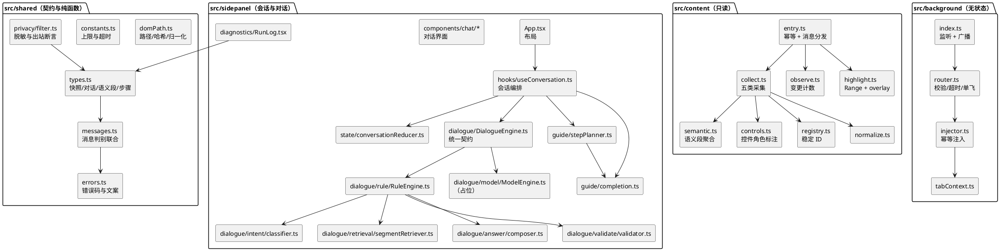
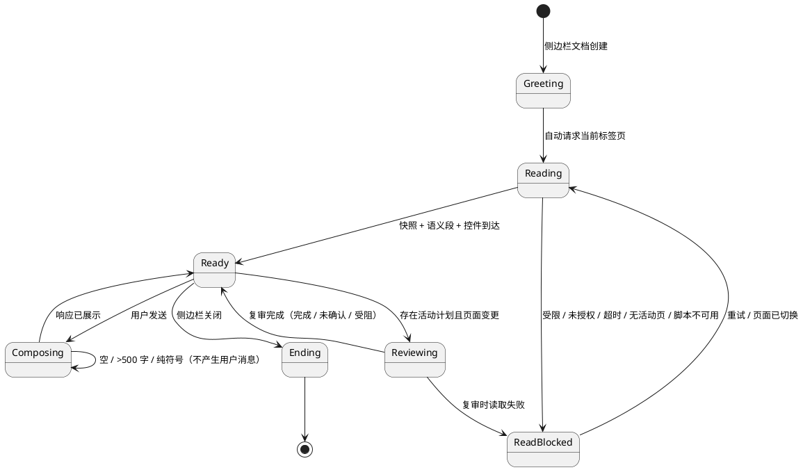
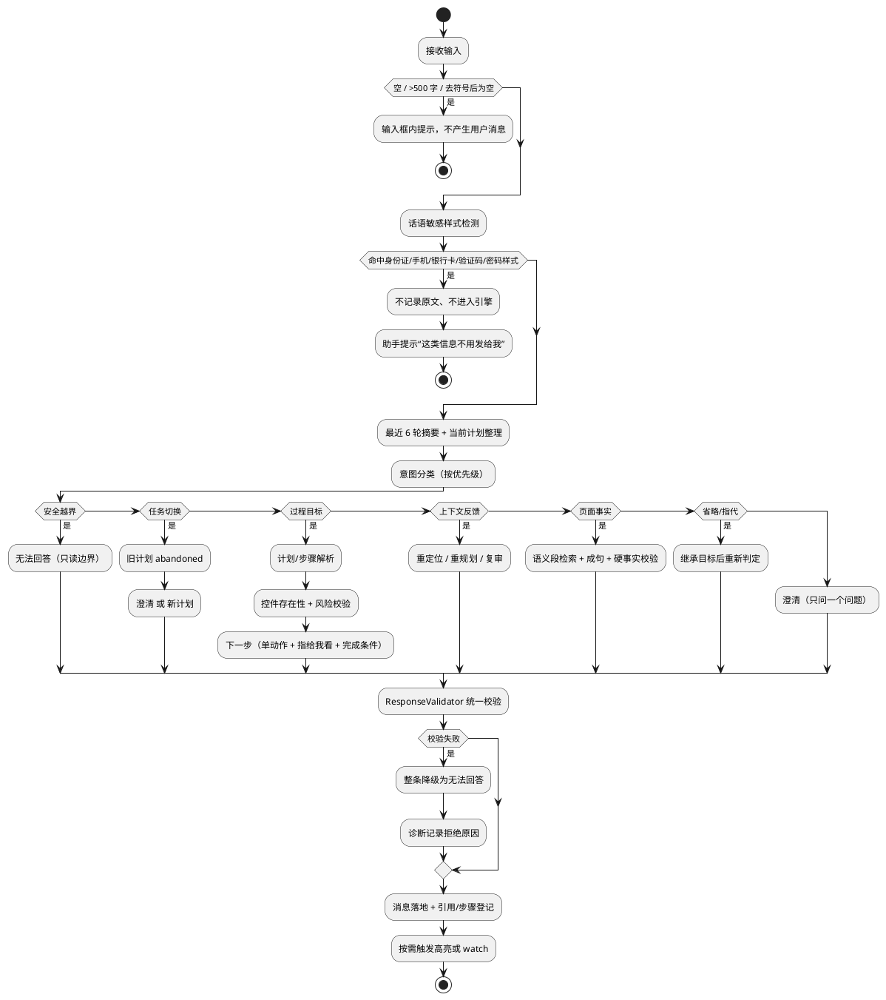
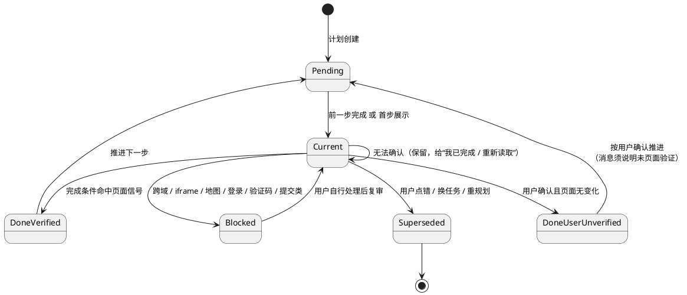
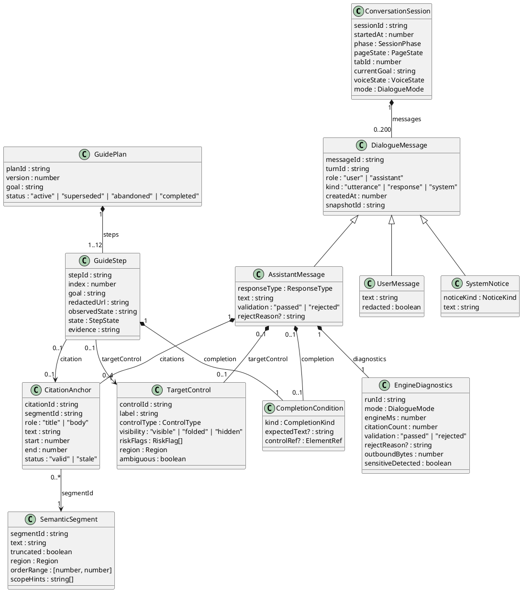
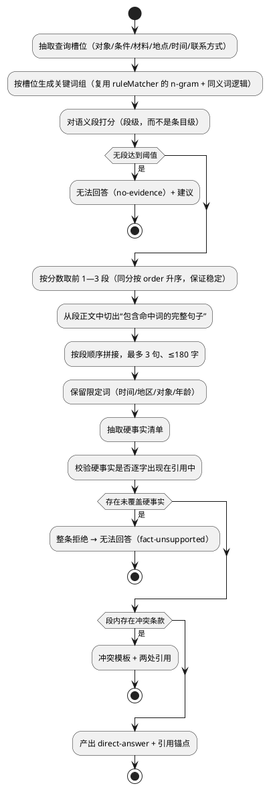
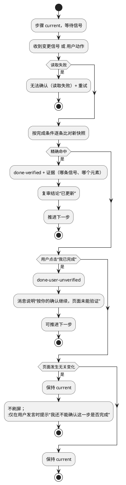
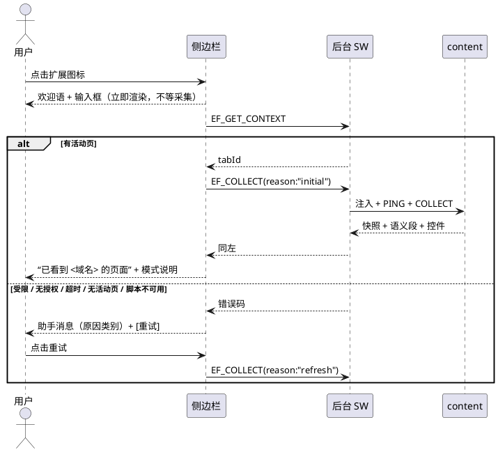
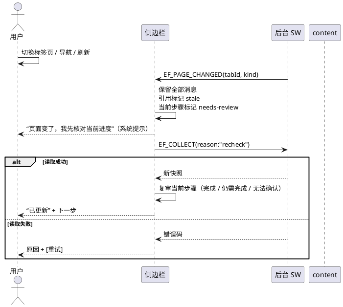

# 一、需求与存量功能关系分析

> 本文件是 `easyflow_page_guide` 第二轮（对话式陪办）的实现方案，输入依据为 `iteration2-spec.md`（1148 行）与 `codearts_proof/08-iteration2-spec-phase.md`。本轮只做增量改造，不重建项目。

## 1.0 分析前提（基线纠正）

第一轮 `design.md` 第 1.0 节把基线描述为"空目录、无 `src/`、无 `package.json`"。该描述在第二轮已失效。本轮真实基线如下：

| 核查项 | 实际结果 | 依据 |
|---|---|---|
| 源文件规模 | `src/` 共 29 个 `.ts/.tsx`，`scripts/` 共 4 个 `.mjs`，合计约 1890 行 | `Get-ChildItem -Recurse -File src,scripts,public` |
| 构建链 | `scripts/build.mjs` 三入口（后台 ESM、content IIFE、侧边栏 ESM+CSS）+ `tsc --noEmit` + `verify-manifest.mjs` | `package.json:10-15`、`build.mjs:16-67` |
| 采集链 | 主文档五类条目 + 可见性过滤 + 稳定元素 ID + 预算截断 | `src/content/collect.ts:229-356`、`registry.ts:33-52`、`normalize.ts:11-18` |
| 定位高亮链 | `elementId` 内存引用 → `domPath`+`textHash` → `folded` → `stale`，Range 行框 + Shadow DOM，4 秒清理 | `highlight.ts:82-107`、`198-214`、`355-378`、`401-437`；`constants.ts:13` |
| 后台编排 | 幂等注入 + PING 握手 + 单飞锁 + 超时 + 页面事件广播 | `injector.ts:64-93`、`router.ts:97-191`、`index.ts:40-60` |
| 侧边栏 | 目标输入 + 分析当前页 + 重新读取 + 卡片墙 + 折叠诊断 | `App.tsx:10-88`、`GoalForm.tsx:32-74`、`CardList.tsx:27-86` |
| 运行时模型请求 | `src/**/*.{ts,tsx}` 检索 `fetch(`、`XMLHttpRequest`、`WebSocket`、`sendBeacon`、`apiKey`、`API_KEY`、`Authorization` 无命中 | 本轮实测 `grep`：No files found |
| 密钥配置 | 根目录无 `.env*`（`Test-Path .env` 为 False） | 本轮实测 |
| 清单权限 | `["activeTab","scripting","sidePanel","storage"]`，无 `host_permissions`、无静态 `content_scripts` | `public/manifest.json:7` |
| Git | 不可用、非仓库 | `08-iteration2-spec-phase.md` 第 3.1 节 |

由此确定本轮设计口径：

1. **增量而非重建**：构建、注入、采集、定位高亮、错误码、诊断、权限矩阵全部沿用；只对"采集输出结构""匹配语义""界面与状态机"做扩展或替换。
2. **替换的是交互模型与响应逻辑**，不是底层能力。卡片墙 → 对话；片段列表 → 1—3 句有依据回答；`page-dirty` 清空卡片 → 保留会话 + 步骤待复核。
3. **规则演示是唯一可启用模式**；模型适配层只做接口、契约与校验位置预留，本轮不发起任何出站请求。
4. **语音不在核心闭环前实施**：只保留数据模型字段与入口占位（禁用态），不引入 `getUserMedia`、不引入麦克风权限。

## 1.1 需求功能与存量功能对比

### 1.1.1 已实现功能

判定依据统一为三条：① 需求要求的输入输出与存量实现一致；② 存量实现的行号可指向具体函数；③ 不需新增消息通道或权限即可满足。

| 需求功能 | 存量功能 | 代码位置 | 匹配度 |
|---|---|---|---|
| 只读采集当前活动页可见标题/段落/链接/按钮/输入框标签 | `collectPage` 按五类选择器分组采集并归一化 | `src/content/collect.ts:229-356` | 100% |
| 不读取 `input.value`、排除密码与隐藏字段 | `inputLabel` 只走 `labels/aria-label/aria-labelledby/placeholder/邻近标签` | `src/content/collect.ts:73-131`、`40-50` | 100% |
| 隐藏/零尺寸节点不进入快照 | 祖先隐藏、`getComputedStyle`、`getBoundingClientRect` 三重过滤 | `src/content/collect.ts:55-71` | 100% |
| 元素 ID 会话内稳定、可复现 | `WeakMap<Element, Registration>` + 类型前缀序号 | `src/content/registry.ts:33-52` | 100% |
| 按元素 ID 定位并滚动 + 临时高亮，不改页面 | 四级降级定位 + Shadow DOM overlay + 4s TTL | `src/content/highlight.ts:82-107`、`355-378`、`380-399`、`401-437` | 100% |
| 文字逐行框选而非整块高亮 | `Range.getClientRects` + 行框合并 | `src/content/highlight.ts:128-167`、`198-214` | 100% |
| 页面脚本幂等注入与通道握手 | `window.__EASYFLOW_CONTENT__` 版本守卫 + 2 次 PING | `src/content/entry.ts:92-99`、`src/background/injector.ts:64-93` | 100% |
| 点击图标打开侧边栏且不切换标签页 | `sidePanel.open({tabId})` + `primeInjection` | `src/background/index.ts:18-31` | 100% |
| 标签页切换/导航完成时通知侧边栏"页面变了" | `onActivated`/`onUpdated` 广播 `EF_PAGE_CHANGED` | `src/background/index.ts:40-60` | 100% |
| 采集/定位超时与错误码文案 | 采集 3000ms、定位 1000ms、`EF-E001`—`EF-E013` 文案与重试动作 | `router.ts:97-133`、`errors.ts:32-98` | 100% |
| 折叠运行诊断（耗时/条目数/版本） | `RunLog` 折叠区，仅打印计数与耗时，不打印正文 | `src/sidepanel/diagnostics/RunLog.tsx:12-58`、`collect.ts:344-353` | 100% |
| 用户目标文本持久化（≤200 字） | `EF_SAVE_GOAL`/`EF_LOAD_GOAL` + `storage.local` | `router.ts:231-254`、`constants.ts:18` | 100% |
| 构建、清单校验、纯函数自测可执行 | 三入口构建 + 权限白名单 + `node:test` | `build.mjs:16-67`、`verify-manifest.mjs:28-45`、`selftest.mjs:76-207` | 100% |

### 1.1.2 需要扩展的功能

差异均来自"交互模型改变导致的响应逻辑改变"，不是能力缺失。

| 需求功能 | 存量功能 | 差异说明 | 扩展方向 |
|---|---|---|---|
| 语义段（标题+紧随正文）作为可回答单元（spec 5.3.1.6/6.3） | 采集只产出扁平 `ElementItem`，无标题-正文归属关系 | 输入差异：现有条目无 `titleCandidate`/`segmentId`；业务差异：现有匹配以单条为粒度，会把"办理条件："标题单独选中；边界差异：无 500 字段落上限与"不跨区块"规则 | 在 content 侧新增 `semantic.ts`，基于现有 `order`+`domPath`+`region` 序列聚合语义段；`PageSnapshot` 新增可选 `segments` 字段（不改既有字段语义） |
| 1—3 句完整回答 + 逐事实引用（spec 5.3.1.1/5.3.1.2） | 规则匹配输出 0—5 条 `GuidanceCard` 片段 | 输出差异：片段列表 → 通顺句子；校验差异：现存无"硬事实必须出现在引用中"校验；形态差异：现有 `summary` ≤40 字切片不足以成句 | 将 `ruleMatcher` 的打分与去重下沉为"语义段检索器"，新增 `answerComposer` + `responseValidator`；`GuidanceCard` 保留但不再直接上屏 |
| 对话会话、最近 6 轮上下文、四类响应（spec 5.2/6.1/6.2） | `SessionState` 只有 goal/cards/status，无消息与轮次 | 状态差异：现有 status 是"采集/分析"阶段，不是对话阶段；上下文差异：现有无轮次历史；封闭性差异：现有无响应类型概念 | `sessionReducer` 重构为 `conversationReducer`（新增 `messages`、`turn`、`plan`、`pageState`），保留 `snapshot`/`tabId`/`error` 字段语义 |
| 自动读取 + 读取失败在对话中说明 + 内联重试（spec 5.1.1.3/5.1.1.4） | 挂载即 `EF_GET_CONTEXT`+`EF_COLLECT`，失败写 `error` 横幅 | 输入差异：现有需用户点"重新读取"；展示差异：现有把错误放在 `StatusBanner`；归类差异：现有错误码非对话原因类别 | 复用 `loadPage`，把失败映射为五种对话原因（受限/未授权/超时/无活动页/脚本不可用），以助手消息 + 内联"重试"渲染；状态横幅降级为诊断 |
| 页面切换后保留会话、步骤待复核（spec 5.1.1.7/5.1.1.8） | `page-dirty` 直接清空 `snapshot` 与 `cards` | 行为差异：现有"清空即安全"，本轮要求"保留历史 + 引用失效 + 复审后才可下一步" | 新增 `Reviewing` 阶段与 `invalidateCitations()`；`page-dirty` 只把引用标记 `stale`、步骤标记 `needs-review`，不清消息 |
| 多步陪办一次一步、指给我看（spec 5.4） | 无计划/步骤概念；`EF_HIGHLIGHT` 只按引用定位 | 输入差异：现有只接受 `ElementRef`；新增需求需"控件"语义（类型/可见性/是否提交类/歧义）；输出差异：需步骤记录与完成条件 | 新增 `stepPlanner`/`stepResolver`/`completionEvaluator`；采集输出新增可选 `controls`；复用 `EF_HIGHLIGHT` 指向控件，禁止 `click/focus` |
| 完成判定只看页面信号或用户确认（spec 5.4.1.5/5.4.1.6） | 无完成判定；`EF_PAGE_CHANGED` 只表示"可能变了" | 语义差异：现有事件粒度是"标签页/导航"，不足以判定"某步完成"；无关变化无法区分 | 新增 `EF_CONTENT_WATCH`（仅回传变更计数与时间戳，不含文本）+ 复审时用 `EF_COLLECT(reason:"recheck")` 对比完成条件 |
| 主对话区隐藏技术术语，诊断折叠（spec 4.4.1） | 卡片直接显示 `elementId`、`score`、`matchedKeywords` | 展示差异：现有元素 ID 是硬性展示项（第一轮 spec 5.3.1.6 要求）；本轮要求从主对话区移除 | `Card` 组件下线；`elementId/score/domPath` 只进折叠诊断；回答区不渲染技术字段 |
| 输入上限 500 字、空/纯符号不发（spec 5.1.1.10） | 输入框 `maxLength=200`，`MAX_GOAL_LENGTH=200` | 上限差异：200 → 500；校验差异：现有空值提示"请先输入"，无纯符号判定 | `ChatComposer` 用 500 上限；发送前 `isSendable()` 校验；持久化仍截断至 200（见 K2-02） |
| 诊断扩展为引擎/校验/隐私维度（spec 6.9） | 诊断仅采集耗时、匹配耗时、条目数、卡片数 | 字段差异：缺 `responseType`、引用数、校验结论、拒绝原因、出站字节数、敏感值检测 | `EngineDiagnostics` 新增字段；`RunLog` 扩展但保持默认折叠 |
| 自测覆盖对话引擎（spec 5.9.1 AT-01—AT-26） | 自测 10 个用例，覆盖匹配/归一化/预算/高亮合并 | 覆盖差异：无对话、语义段、完成判定、隐私过滤用例 | `selftest.mjs` 增加导出入口与用例，仍只使用合成文本 |

### 1.1.3 需要新增的功能或接口

**A. 对话编排层（`src/sidepanel/dialogue/`，纯逻辑，无 Chrome API）**

| 功能点 | 输入 | 输出 | 依赖 |
|---|---|---|---|
| `DialogueEngine` 统一契约 | `DialogueRequest`（话语/会话摘要/页面上下文/语义段/控件/能力开关） | `DialogueResponse`（四类之一 + 引用/控件/完成条件/澄清/限制） | `shared/types` |
| `RuleDialogueEngine` | 同上 | 同上，确定性 | `intent/`、`retrieval/`、`answer/` |
| `IntentClassifier` | 话语 + 上下文槽位 + 页面信号 | `IntentKind`（安全越界/任务切换/过程目标/上下文反馈/页面事实/省略指代/兜底） | `lexicon` |
| `SemanticSegmentRetriever` | 语义段集合 + 查询关键词组 | 候选段 + 命中证据（复用现有打分） | `ruleMatcher` 的打分函数 |
| `AnswerComposer` | 选中段 + 命中证据 | 1—3 句文本 + 硬事实列表 | `summarize` |
| `ResponseValidator` | 引擎输出 + 当前快照 | `ValidationResult`（通过/拒绝 + 原因） | `shared/types` |
| `ContextResolver` | 最近 6 轮 + 当前计划 | 继承目标/槽位/指代解析 | `conversationReducer` |
| `ModelDialogueEngine`（可选，默认关闭） | `DialogueRequest` | 同契约 | `modelProxy`（占位） |
| `ModelProxyClient`（占位，不发起请求） | 脱敏载荷 | `{ status: "not-configured" }` | 无 |

**B. 页面语义与观测层（`src/content/`，只读）**

| 功能点 | 输入 | 输出 | 依赖 |
|---|---|---|---|
| `buildSemanticSegments` | `ElementItem[]`（含 `order`/`domPath`/`region`） | `SemanticSegment[]`（标题引用 + 正文引用 + 文本 + 边界） | `collect.ts` 现有输出 |
| `annotateControls` | 采集候选元素（只读属性） | `PageControl[]`（标签/类型/可见/提交类/区域/歧义） | 现有选择器矩阵 |
| `classifyControlRisk` | 控件标签与 `type` | `submitLike/payment/captcha/password` 标记 | `lexicon` 语言规则 |
| `watchDomChanges` / `stopWatching` | 步骤激活/结束 | 变更计数 + 时间戳（不含文本） | `MutationObserver`（只读） |

**C. 陪办层（`src/sidepanel/guide/`）**

| 功能点 | 输入 | 输出 | 依赖 |
|---|---|---|---|
| `StepPlanner.createPlan` | 过程目标 + 当前页控件 | `GuidePlan`（版本、总目标、步骤序列） | `controls` |
| `StepResolver.relocate` | 当前步骤 + 新快照 | 同语义控件或"找不到"原因 | `controls` |
| `StepResolver.replan` | 当前页 + 计划版本 | 新计划（版本 +1，旧步骤 `superseded`） | `StepPlanner` |
| `CompletionEvaluator.evaluate` | 当前步骤 + 新快照 + 用户反馈 | `completed-verified / unconfirmed / blocked` + 证据 | `snapshot` |
| `CompletionCondition` 构造 | 控件/文本/地址信号 | 五类可观察条件之一 | `shared/types` |

**D. 隐私与模型边界层（`src/shared/privacy/`）**

| 功能点 | 输入 | 输出 | 依赖 |
|---|---|---|---|
| `sanitizeSnapshot` | 原始采集结果 | 过滤后的语义段/控件（去个人敏感值、去查询串） | 正则与类型占位 |
| `redactUrl` | `location.href` | 协议+域名+路径 | 纯函数 |
| `detectSensitive` | 用户话语/页面文本 | `SensitiveHit[]`（类型 + 位置，不保留原文） | 正则 |
| `assertNoSensitive` | 出站载荷 | 通过 / `blocked` | 上述 |
| `PROXY_CONTRACT` | — | 代理侧接口约定（端点、环境变量名、上限、审计） | 文档常量，不含密钥 |

**E. 界面层（`src/sidepanel/components/chat/`）**

`ChatHeader`、`ModeNotice`、`PageStatusLine`、`MessageList`、`UserBubble`、`AssistantMessage`、`EvidencePanel`、`InlineActions`、`StepCard`、`ChatComposer`、`RetryNotice`、`DiagnosticsPanel`（原 `RunLog` 扩展）。全部为新增；`GoalForm`、`CardList`、`Card` 在本轮由这些组件替换。

**F. 测试与门禁**

`selftest.mjs` 新增导出（`dialogue`、`segments`、`completion`、`privacy`、`validator`）与 AT-01—AT-26 对应用例；`verify-manifest.mjs` 增加"禁止新增权限/禁止密钥字样"检查；新增"无远程请求"检索门禁（保持现有做法）。

## 1.2 存量功能详细分析

### 1.2.1 现有接口契约（必须保持不变的部分）

| 接口 | 契约要点 | 本轮约束 |
|---|---|---|
| `EF_GET_CONTEXT` | 入参仅 `v/requestId`，出参 `tabId/windowId`；不读 `tab.url/title` | 不改；对话层不得新增 URL 读取依赖 |
| `EF_COLLECT` | 入参 `tabId/reason`，出参 `snapshot+diagnostics`；单飞锁合并并发；3000ms 超时 | `reason` 枚举扩展 `"recheck"`（新增成员，向后兼容），返回体新增可选字段 |
| `EF_HIGHLIGHT` | 入参 `ref`，出参 `highlighted/folded/stale`；1000ms 超时；`elementId` 正则校验 | 不改；"指给我看"直接复用；禁止在 content 侧增加 `focus()` |
| `EF_SAVE_GOAL`/`EF_LOAD_GOAL` | 只写 `goal`（截断 200 字）与 `updatedAt`；`storage` 失败降级内存 | 不改；会话消息、引用、语义段一律不入 storage |
| `EF_PAGE_CHANGED` | 广播 `tabId/kind`，不含 URL 与标题 | 不改；侧边栏改为"保留会话 + 失效引用 + 待复核" |
| `EF_CONTENT_*` | 请求必带 `v:1`/`requestId`，响应回显 `requestId` | 新增 `EF_CONTENT_WATCH`/`EF_CONTENT_UNWATCH` 必须沿用同一包装 |
| `ElementRef` | `elementId + domPath + textHash` 三元组，`elementId` 不匹配 `^ef-[hplbi]-\d{1,5}$` 即拒绝 | **继续作为唯一页面定位凭据**；语义段引用与控件引用都由它投影 |
| 错误码 | `EF-E001`—`EF-E013` 语义与文案 | 不新增错误码；对话层把错误码映射为五种"读取原因类别"，见 2.7 |

### 1.2.2 平台约束（与第一轮一致，本轮不得突破）

1. `activeTab` 只在用户手势后绑定当前标签页；切换标签页或跨源导航后失效 → 读取必须失败并引导重新点图标（`EF-E003`），不得静默重试。
2. Service Worker 可被回收 → 会话状态只能由侧边栏文档持有；后台保持无状态路由。
3. content 世界不支持 ESM → 新增的 content 模块必须继续被打进同一个 IIFE 入口。
4. 侧边栏每次打开都是新文档 → 关闭即结束会话；不得从 storage 恢复页面正文、引用或聊天。
5. 清单无 `host_permissions` → 本轮**不可能**直接请求远程模型端点；模型适配层只能停留在接口与代理契约层。

### 1.2.3 可复用与不可复用判定

| 存量能力 | 判定 | 理由 |
|---|---|---|
| 五类选择器矩阵与可见性过滤 | 复用 | 语义段与控件标注都以 `ElementItem` 为输入，选型成本低、只读保证已成立 |
| `WeakMap` 稳定 ID | 复用 | 对话、引用、步骤、高亮必须共用同一套 ID，否则引用无法精确 |
| `domPath + textHash` 降级定位 | 复用 | 页面微调后仍可校验；失效时返回 `stale` 而不是误跳 |
| Range 行框 + Shadow overlay | 复用 | 直接满足"指给我看/在网页中查看"的视觉与只读要求 |
| 幂等注入 + PING | 复用 | 新增 watch 消息仍走同一通道 |
| 单飞锁与超时 | 复用 | 复审会提高 `EF_COLLECT` 频率，锁与超时更关键 |
| `ruleMatcher` 打分/去重/阈值 | **部分复用** | 打分公式与同义词典可复用；输出粒度、数量规则、摘要用途必须替换（本轮是段级检索与成句，不是卡片） |
| `summarize.buildSummary` | **替换** | 40 字窗口切片用于"片段"，不能直接充当 1—3 句回答；改为"句子级合成 + 硬事实保留" |
| `GuidanceCard` | **保留类型，不再上屏** | 用于检索中间结果与诊断统计；`CardList/Card` 组件下线 |
| `SessionStatus` | **替换** | 现有状态是工具流程（resolving/analyzing/partial），对话需要 session/page/step 三套状态 |
| `StatusBanner` | 降级为诊断 | 主对话区不允许横幅式技术错误；改为助手消息 |
| `ModeBadge` | 文案替换 | 由"规则演示模式"改为常驻一句"本地规则演示，未接入在线模型"，并保留短徽标 |
| 输入框 `maxLength=200` | 替换 | 对话输入上限 500；持久化仍 200 |

### 1.2.4 存量实现的缺陷与本轮应对

| 编号 | 现象 | 代码位置 | 根因 | 本轮应对 |
|---|---|---|---|---|
| D-01 | 问"谁能申请"只摘到"办理条件："标题 | `ruleMatcher.ts:294-316` 以单条 `ElementItem` 为单位选卡 | 采集无"标题-正文"归属，标题因 `titleBonus=1.25` 反而更容易被选中 | 语义段聚合（2.4）；标题单独命中时不得成答（2.5.5） |
| D-02 | 回答形态是片段列表，不是回答 | `CardList.tsx:60-85` 直接渲染 3—5 张卡 | 第一轮设计目标就是"卡片"，无成句层 | 新增 `AnswerComposer` + 硬事实校验（2.5.4） |
| D-03 | 页面一切换就清空，无法继续陪办 | `sessionReducer.ts:149-159` | "陈旧即清空"策略 | 改为"保留消息 + 引用失效 + 步骤待复核"（2.1.3） |
| D-04 | 用户操作后无法判定"这步是否完成" | 无完成判定逻辑 | 只有 `EF_PAGE_CHANGED` 的粗粒度事件 | 完成条件模型 + watch + recheck（2.6.4） |
| D-05 | 主对话区暴露 `elementId`/`score` | `Card.tsx:18-21` | 第一轮 spec 要求展示元素 ID | 技术字段移入折叠诊断；引用只展示原文与"在网页中查看" |
| D-06 | 输入 200 字上限，长问题被截断 | `GoalForm.tsx:49`、`constants.ts:7` | 第一轮目标上限 | 输入 500、持久化 200（K2-02） |
| D-07 | 错误以横幅呈现，含错误码 | `StatusBanner.tsx` + `RunLog.tsx:17-21` | 第一轮是工具界面 | 对话内用原因类别；错误码只进诊断 |
| D-08 | 无任何"标题+正文"可定位引用，高亮只能框一段 | `highlight.ts:401-437` 单 `ElementRef` | 引用模型只有单元素 | 引用锚点支持"标题引用 + 正文引用"数组，逐条高亮（2.3.2） |

### 1.2.5 规格与实现的冲突裁决（本轮新增）

| 编号 | 冲突/歧义 | 位置 | 裁决 |
|---|---|---|---|
| K2-01 | 四类响应封闭 vs 需要"页面变了/正在复核"系统提示 | spec 5.2.1.1 vs 5.1.1.7 | **系统提示使用独立的 `SystemNotice` 消息**（role=assistant，但 `kind:"system"`，不参与响应类型统计）；"响应消息"仍严格四类。用户可见文本上两者都是纯文本助手气泡，但系统提示不携带引用/控件/完成条件 |
| K2-02 | 输入 ≤500 字 vs 目标持久化 ≤200 字 | spec 5.1.1.10 vs 5.5.1.10、6.1.6 | 输入与本章节内 `currentGoal` 允许 500；写入 `storage.local` 时截断 200；恢复时只恢复 200，不提示截断 |
| K2-03 | "1—3 句"与"≤180 字"双约束 | spec 5.3.1.1、6.2.4 | 同时满足：句末标点计数 ≤3 **且** 字符数 ≤180；超出时优先删去解释性分句，保留事实分句；无法压缩则降级澄清 |
| K2-04 | 语义段 ≤500 字 vs 单条采集 ≤300 字 | spec 6.3.4 vs `MAX_TEXT_LENGTH=300` | 语义段可合并多个正文元素至 500 字；单元素超 300 字被截断时，段标记 `truncated=true` 且不跨段补齐 |
| K2-05 | 标题候选含"以冒号结尾的短段落" | spec 5.3.1.8 | 采集侧新增 `titleCandidate` 标记（heading 恒为候选；`paragraph` 满足"≤30 字 + 以 `：`/`:` 结尾"为候选）；不改 `ItemType` 枚举 |
| K2-06 | 高亮"约 4 秒" | spec 5.3.1.11 | 沿用现有 `HIGHLIGHT_TTL_MS=4000`，不新增常量 |
| K2-07 | 模型模式要求"可启用条件" | spec 5.6.1.7 | 本轮五条件均不满足（无端点/密钥/模型名/代理/通道），`ModelDialogueEngine` 固定为 `not-configured`；不发起请求、不新增权限 |
| K2-08 | 语音"可选" | spec 5.7.1.6 | 本轮不实现真实识别；界面不显示可用麦克风（仅文本输入），数据模型保留 `voiceState:"disabled"` |
| K2-09 | 诊断是否允许展示错误码 | spec 4.4.1 vs 6.9 | 主对话区禁止错误码；折叠"运行诊断"允许 `EF-E0xx` 与拒绝原因 |
| K2-10 | 跨域链接是否可点 | 附录 A-06 | 本轮**不渲染可点击链接**，只给站点名与文字指引，避免"自动跳转"歧义 |
# 二、增量设计方案

## 2.1 实现模型

### 2.1.1 上下文视图

本轮运行实体与第一轮相同，**不新增进程、不新增权限、不新增网络端点**。新增的只有侧边栏内的对话编排逻辑，以及 content 内两个只读扩展（语义段聚合、变更计数）。

```plantuml
@startuml
skinparam componentStyle rectangle
left to right direction

actor "办事用户 / 演示评审者" as User
node "Chrome 浏览器（本机）" {
  component "扩展图标 (action)" as Action
  component "侧边栏文档\nsidepanel.js (React)\n会话状态 + 对话编排" as Panel
  component "后台 SW\nbackground.js\n无状态路由" as SW
  component "chrome.storage.local\n仅 goal ≤200 字" as Store
  component "真实网页主文档" as PageDOM
  component "content.js (IIFE, ISOLATED)\n采集 + 语义段 + 控件标注\n+ 变更计数 + 高亮" as Content
}

User --> Action : 点击（唯一手势入口）
Action --> Panel : sidePanel.open(tabId)
Panel --> SW : runtime.sendMessage\nEF_GET_CONTEXT / EF_COLLECT /\nEF_HIGHLIGHT / EF_SAVE_GOAL / EF_LOAD_GOAL
SW --> Panel : 快照 / 语义段 / 控件 / 高亮结果 / 错误码
SW --> Content : tabs.sendMessage\nEF_CONTENT_COLLECT / HIGHLIGHT /\nPING / WATCH / UNWATCH
Content --> PageDOM : 只读 querySelectorAll / innerText /\ngetBoundingClientRect / labels
Content --> PageDOM : 唯一写入：临时 overlay 宿主（4s 移除）
Content --> SW : 快照（含 segments/controls）/\n变更计数（仅计数与时间戳）
Panel --> Store : 仅 goal
SW --> Panel : EF_PAGE_CHANGED（仅 tabId + kind）
Panel ..> "本地模型代理（可选）\n本轮未配置、未启用" as Proxy : 契约预留\n（本轮零请求）
@enduml
```

调用频率与边界：

| 交互 | 触发 | 频率 | 载荷约束 |
|---|---|---|---|
| `EF_COLLECT(initial/refresh)` | 侧边栏打开 / 用户点"重试" | 每会话 1 次 + 按需 | 完整快照（≤3000 条，≤400k 字符） |
| `EF_COLLECT(recheck)` | 步骤激活后页面出现变更信号、用户发言、点击"重新读取" | 每个步骤最多自动 3 次，间隔 ≥1200ms | 同完整快照；响应只用于完成判定与引用复核 |
| `EF_HIGHLIGHT` | "指给我看"/"在网页中查看" | 每次点击 1 次 | 单个 `ElementRef` |
| `EF_CONTENT_WATCH`/`UNWATCH` | 步骤进入 `current` / 步骤离开 `current` | 每步骤 1 对 | 仅计数与时间戳；**不含任何页面文本** |
| `EF_PAGE_CHANGED` | 标签页激活 / 导航完成 | 浏览器事件驱动 | 仅 `tabId` + `kind` |
| 模型请求 | — | **本轮恒为 0** | — |

### 2.1.2 服务/组件总体架构



**职责与依赖规则**

| 层 | 职责 | 允许依赖 | 禁止 |
|---|---|---|---|
| `shared/*` | 类型契约、消息常量、错误码、纯函数、脱敏规则 | 无 | 任何副作用；引用 Chrome API |
| `content/*` | 只读采集、语义段、控件标注、变更计数、定位高亮 | `shared/*`、DOM 只读 API | 网络、存储、写页面节点属性；读 `input.value`；`click/focus` |
| `background/*` | 授权编排、注入、超时、消息路由、页面事件 | `shared/*`、Chrome API | 持有会话/快照/对话；访问 DOM |
| `sidepanel/dialogue/*` | 意图判定、语义段检索、回答合成、响应校验 | `shared/*`、纯函数 | Chrome API、DOM、网络；随机数/时间参与判定 |
| `sidepanel/guide/*` | 计划、步骤定位、完成判定 | `shared/*`、`dialogue/validate` | 直接调 `scripting`；改写页面 |
| `sidepanel/components/*` | 渲染与交互 | `shared/*`、hooks | `dangerouslySetInnerHTML`；直连 Chrome 页面 API |
| `sidepanel/hooks/*` | 会话编排、消息收发、状态派发 | `shared/*`、`dialogue/*`、`guide/*` | 直接读页面；持久化页面正文 |

**目标目录结构（只列新增与替换项）**

```text
src/
├─ shared/
│  ├─ types.ts                    # 追加语义段/控件/对话/步骤类型（既有类型不改语义）
│  ├─ messages.ts                 # 追加 WATCH/UNWATCH 与 recheck reason
│  ├─ constants.ts                # 追加对话上限与复审节奏
│  └─ privacy/
│     ├─ redact.ts                # 地址脱敏、敏感值替换为类型占位
│     └─ detect.ts                # 敏感样式检测（身份证/手机/银行卡/邮箱/验证码样式）
├─ content/
│  ├─ semantic.ts                 # 新增：标题候选 + 紧随正文聚合
│  ├─ controls.ts                 # 新增：控件角色与风险标注
│  ├─ observe.ts                  # 新增：MutationObserver 变更计数
│  ├─ collect.ts                  # 扩展：输出 segments/controls（可选字段）
│  └─ entry.ts                    # 扩展：WATCH/UNWATCH 分支
├─ sidepanel/
│  ├─ App.tsx                     # 替换：对话布局
│  ├─ components/chat/            # 新增：ChatHeader/MessageList/AssistantMessage/
│  │                              #      EvidencePanel/StepCard/ChatComposer/InlineActions
│  ├─ components/{GoalForm,CardList,Card}.tsx   # 本轮下线（保留文件到迁移完成）
│  ├─ hooks/useConversation.ts    # 新增：替代 usePageSession（复用其 loadPage 逻辑）
│  ├─ state/conversationReducer.ts# 新增：替代 sessionReducer（保留其错误映射）
│  ├─ dialogue/                   # 新增：引擎契约、规则实现、意图、检索、合成、校验
│  └─ guide/                      # 新增：计划、步骤、完成判定
└─ background/
   ├─ router.ts                   # 扩展：recheck reason 透传
   └─ injector.ts                 # 不变
```

**关键取舍：为什么不新增"对话后台服务"**

对话编排必须持有会话状态（消息、计划、引用），而 MV3 Service Worker 随时可能被回收；把对话放后台会导致"回答到一半状态丢失"。因此对话编排放在侧边栏文档内、与 UI 同生命周期，这也天然满足"关闭侧边栏即结束会话"（spec 5.1.1.9）。

### 2.1.3 实现设计文档

#### （1）会话状态机

会话阶段（`SessionPhase`）与页面状态（`PageState`）分离，避免"页面受限"与"对话进行中"互相覆盖。



页面状态取值与含义：

| `PageState` | 含义 | 允许的对话行为 |
|---|---|---|
| `readable` | 当前快照有效，`snapshotId` 与当前页一致 | 直接回答、澄清、下一步、无法回答 |
| `rechecking` | 正在重新读取 | 只允许"正在核对"系统提示；不产出新事实 |
| `changed` | 收到变更信号但尚未复审 | 旧引用标记 `stale`；回答前必须先复审 |
| `unsupported` | 受限页面 / 无授权 | 只能"无法回答（读取原因）" |
| `restricted` | 读取超时或脚本不可用 | 只能"无法回答（读取原因）"+ 重试 |

#### （2）单轮对话处理流水线



顺序硬性要求：**先越界/安全，再意图，再检索，最后校验**。任何一步拒绝都不得"部分展示"。

#### （3）陪办步骤状态机



步骤状态与 spec 6.6.11 的映射：`pending`=待开始、`current`=当前、`done-verified`=已完成（页面验证）、`done-user-unverified`=已完成（用户确认未页面校验）、`unconfirmed`=无法确认（实现为 `current` + `uncertainty` 证据）、`blocked`=受阻、`superseded`=已被替换。

#### （4）一致性、并发与作废规则

1. **三代版本**：`turnId`（每轮对话）、`snapshotId`（每次读取）、`planVersion`（每次重规划）。任何异步结果必须携带三者中的至少两个，版本不匹配即丢弃。
2. **迟到快照**：`EF_COLLECT` 返回时若 `snapshotId` 不是"最近一次发起"，直接丢弃，不覆盖 `currentSnapshot`（spec 4.2.7）。
3. **同一页面重复读取**：以 `snapshotId` 判重；对同一 `turnId` 不重复追加消息；语义段按 `segmentId` 去重（spec 4.2.5）。
4. **自动复审节流**：每步骤自动复审最多 3 次、最小间隔 1200ms；超过后只在用户发言/点击时复审，避免"页面动画导致刷屏"。
5. **消息不可变**：已落地的消息不原地改写；状态变化以新 `SystemNotice` 表达（例如"这条依据已经变了"），避免历史被篡改。
6. **无数据库事务**：所有一致性靠版本号与"先失效再回答"两条规则保证。

## 2.2 接口设计

### 2.2.1 总体设计

| 层 | 通道/位置 | 接口 | 稳定性 | 版本策略 |
|---|---|---|---|---|
| UI → 会话编排 | 同文档函数调用 | `send(text)`、`retry()`、`locate(ref)`、`markDone()`、`notFound()`、`misclicked()`、`switchTask()`、`askForEvidence(messageId)` | 稳定 | 内部契约，随 UI 重构 |
| 会话编排 → 引擎 | 同文档函数调用 | `DialogueEngine.respond(request)` | 稳定（本轮核心契约） | `DialogueRequest.schemaVersion` |
| 会话编排 → 页面 | 现有消息 | `EF_GET_CONTEXT`/`EF_COLLECT`/`EF_HIGHLIGHT` | 稳定 | `v:1` + 只增可选字段 |
| 会话编排 → 页面观测 | 新增消息 | `EF_CONTENT_WATCH`/`EF_CONTENT_UNWATCH` | 实验（扩展内部） | 与 `CONTENT_VERSION` 联动 |
| 会话编排 → 代理 | 预留，本轮不调用 | `ModelProxyClient.respond(request)` | 实验（未启用） | `proxyContractVersion: 1` |
| 持久化 | `storage.local` | `EF_SAVE_GOAL`/`EF_LOAD_GOAL` | 稳定 | 键名不变 |

设计原则：

1. 引擎只依赖纯数据，不依赖 Chrome API 与 DOM，便于在 `node:test` 中直接跑 AT 用例。
2. 引用与控件一律以 `ElementRef` 表达，**不新增第二套定位体系**；语义段、步骤、消息都只是 `ElementRef` 的组合。
3. 引擎输出必须经过 `ResponseValidator` 才能上屏；校验器与引擎解耦，规则实现与模型实现共用。
4. 所有新增字段可选，旧代码路径（无 `segments`/`controls` 的快照）必须可用降级方式工作。

### 2.2.2 接口清单

#### 接口 A：`DialogueEngine`（本轮核心契约）

```ts
interface DialogueEngine {
  readonly mode: DialogueMode;                 // "rule-demo" | "online-model"
  respond(request: DialogueRequest): Promise<DialogueResponse>;
}

interface DialogueRequest {
  schemaVersion: 1;
  turnId: string;
  utterance: string;                            // 已过滤的用户话语
  context: ConversationContext;                 // 最近 6 轮摘要 + 当前目标 + 当前步骤
  page: PageContext;                            // 脱敏地址/域名/标题/读取标识/采集时刻
  segments: SemanticSegment[];                  // 只含当前页、已过滤、可定位的段
  controls: PageControl[];                      // 只含标签/类型/可见性/风险标记
  capabilities: { modelConfigured: boolean; voiceEnabled: boolean };
}
```

字段形状（用于校验器判定，不是实现）：

```ts
type ResponseType = "direct-answer" | "clarify" | "next-step" | "cannot-answer";

interface DialogueResponse {
  responseType: ResponseType;
  text: string;
  citations: CitationAnchor[];                  // 直接回答 ≥1
  targetControl?: TargetControl;                // 下一步必填，且仅 1 个
  completionCondition?: CompletionCondition;    // 下一步必填，且仅 1 个
  clarify?: { question: string; options?: string[] };  // 澄清必填，选项 ≤3
  limitation?: { reason: LimitationReason; advice: string }; // 无法回答必填
  planPatch?: PlanPatch;                        // 新建/推进/终止计划
  diagnostics: EngineDiagnostics;
}
```

- **业务说明**：把"一句话"变成四类结构化响应之一，供 UI 渲染、供校验器验证、供诊断统计。
- **前置条件**：`page` 与 `segments` 属于同一 `snapshotId`；`utterance` 已通过敏感检测。
- **后置条件**：无副作用（纯计算）；不写 storage；不发网络请求（规则模式）。
- **异常映射**：引擎内部异常 → `EF-E005` 由调用方记录，用户侧显示"我暂时不能可靠回答"+ 建议。
- **确定性要求**：同一 `DialogueRequest`（含相同 `turnId`/`snapshotId`/输入）必须得到相同 `responseType` 与相同 `citations` 顺序；禁止 `Math.random()`、`Date.now()` 参与分支。

#### 接口 B：`RuleDialogueEngine`

- **签名**：实现 `DialogueEngine`，`mode = "rule-demo"`，`respond` 为同步计算包在 `Promise` 中（满足 1s 首响）。
- **内部组成**：`IntentClassifier` → `SemanticSegmentRetriever` → `AnswerComposer` / `StepPlanner` → `ResponseValidator`（由编排层调用）。
- **前置/后置**：同接口 A；额外要求 `segments.length > 0` 才能产出 `direct-answer`，否则只能 `cannot-answer`。
- **诊断**：`engineMs`、`retrievedSegments`、`citationCount`、`intentKind`、`priorityHit`。

#### 接口 C：`ModelDialogueEngine`（本轮占位）

```ts
interface ModelProxyClient {
  readonly status: "not-configured" | "ready";
  respond(payload: ProxyRequest): Promise<ProxyResponse>;
}
```

- **业务说明**：未来通过本地代理调用模型；扩展只与代理通信，不持有密钥、不直连厂商。
- **本轮状态**：`status` 恒为 `"not-configured"`；`respond` 不发起任何 `fetch`，直接返回 `{ status: "unavailable", reason: "not-configured" }`。
- **不启用原因**：无端点、无密钥、无模型名、无代理、无扩展侧访问通道（清单无 `host_permissions`）。
- **未来启用条件（全部满足才可打开）**：① 代理运行且健康检查通过；② 扩展侧具备最小访问通道（最小主机权限或 Native Messaging，需单独评审）；③ 用户在设置中显式启用；④ 有授权与测试记录。
- **代理侧契约（写入文档、不写实现）**：

| 契约项 | 约定 |
|---|---|
| 端点 | `POST {PROXY_BASE_URL}/v1/dialogue`，`PROXY_BASE_URL` 只允许本机地址（`http://127.0.0.1:<port>`） |
| 环境变量（仅代理进程） | `EASYFLOW_MODEL_API_KEY`、`EASYFLOW_MODEL_NAME`、`EASYFLOW_MODEL_TIMEOUT_MS`（默认 8000）、`EASYFLOW_MODEL_MAX_OUTPUT_TOKENS`（默认 1200）、`EASYFLOW_PROXY_ALLOWLIST` |
| 鉴权 | 密钥由代理注入；扩展请求头不含密钥；代理拒绝无本地令牌的请求 |
| 请求体 | 只含 `DialogueRequest` 的 allowlist 子集：`utterance`、`contextDigest`、`page`（脱敏）、`segments`（≤24 段、≤6000 字符）、`controls`（≤40 个标签） |
| 禁止字段 | 原始 HTML、`input.value`、Cookie、存储、剪贴板、文件、音频、截图、iframe 内容、完整页面文本 |
| 超时与限流 | 代理 8s 超时、每分钟 ≤20 次、单次输出 ≤1200 tokens |
| 审计 | 只记录请求 ID、耗时、字节数、拒绝原因；**不记录正文与用户话语** |
| 响应 | 结构必须与 `DialogueResponse` 一致；扩展侧仍执行同一 `ResponseValidator` |

- **扩展侧环境变量说明**：Chrome 扩展无进程环境变量，因此"环境变量配置"只存在于代理侧；扩展侧仅有一个编译期常量 `MODEL_MODE_DEFAULT = "rule-demo"` 与 `storage.local` 的 `modelEnabled`（默认不存在）。

#### 接口 D：`ResponseValidator`

```ts
interface ResponseValidator {
  validate(response: DialogueResponse, snapshot: PageSnapshot, plan: GuidePlan | null): ValidationResult;
}
```

| 校验项 | 规则 | 失败处理 |
|---|---|---|
| 响应类型 | 必须为四类之一 | 整条拒绝 |
| 文本形态 | 直接回答 ≤3 句且 ≤180 字；澄清仅 1 问；下一步仅 1 动作；无法回答含原因 + 1 建议 | 整条拒绝（不做局部修剪） |
| 引用存在性 | 每条 `elementRef.elementId` 必须存在于当前快照；禁止指向整页容器 | 整条拒绝，原因 `citation-missing` |
| 引用原文 | `text` 必须是元素文本归一化后的精确子串；标题/正文分别保留 | 整条拒绝，原因 `citation-mismatch` |
| 硬事实覆盖 | 回答中的数字、日期、机构名、材料名、地点必须出现在引用文本中 | 整条拒绝，原因 `fact-unsupported` |
| 控件存在性 | 控件必须存在、可见、类型允许、非提交/支付/删除/验证码/密码类 | 整条拒绝，原因 `control-invalid` |
| 控件唯一性 | 下一步只能 1 个目标控件；存在同名歧义时必须转澄清 | 整条拒绝或降级澄清 |
| 完成条件 | 必须是五类可观察信号之一；禁止"等待 N 秒" | 整条拒绝，原因 `completion-invalid` |
| 计划一致性 | `planPatch` 的 `planVersion` 必须 ≥ 当前版本；不得把旧步骤套到新目标 | 整条拒绝 |
| 模式一致性 | `mode` 与 `capabilities.modelConfigured` 必须匹配 | 整条拒绝，原因 `mode-mismatch` |

拒绝语义：**拒绝即整条不展示**，用户只看到"我暂时不能可靠回答，页面内容可能刚变过"+ 建议；诊断记录原因与计数。

#### 接口 E：`SemanticSegmentBuilder`（content 侧）

```ts
interface SemanticSegmentBuilder {
  build(items: ElementItem[], maxSegmentChars: number): SemanticSegment[];
}
```

- **输入**：现有 `collectPage` 产出的 `ElementItem[]`（已含 `order/domPath/region/type/text`）。
- **输出**：语义段数组，每段含 `titleRef`、`bodyRefs[]`、`text`、`truncated`、`orderRange`。
- **前置**：items 已按文档顺序排序、已做可见性过滤与长度截断。
- **后置**：不修改 `items`，不访问 DOM（纯函数，便于自测）。
- **约束**：段数 ≤ 600；单段 ≤500 字；不跨标题候选；不包含未采集区域。
- **诊断**：`segmentCount`、`titleCandidates`、`orphanTitles`（有标题无正文）、`segmentsMs`。

#### 接口 F：`StepPlanner` / `StepResolver` / `CompletionEvaluator`

```ts
interface StepPlanner {
  create(goal: string, snapshot: PageSnapshot): PlanResult;
}
interface StepResolver {
  relocate(step: GuideStep, snapshot: PageSnapshot): RelocateResult;   // found | missing | ambiguous | restricted
  replan(goal: string, snapshot: PageSnapshot, current: GuidePlan): PlanResult;
}
interface CompletionEvaluator {
  evaluate(step: GuideStep, snapshot: PageSnapshot, userConfirmed: boolean): CompletionResult;
}
```

| 接口 | 前置 | 后置 | 异常/降级 |
|---|---|---|---|
| `StepPlanner.create` | 过程目标明确；快照可读；存在至少 1 个允许控件 | 返回计划（版本 1）或 `cannot-plan` 原因 | 无允许控件 → 无法回答（说明当前页没有可执行入口） |
| `StepResolver.relocate` | 当前步骤有 `targetControl` | 同语义控件新高亮凭据 / `missing` / `ambiguous` / `restricted` | `missing` 说明"这个页面现在没有这个控件"；`restricted` 说明 iframe/地图 |
| `StepResolver.replan` | 用户"我点错了"/"换一个任务" | 新计划（版本 +1），旧步骤 `superseded` | 无可用控件 → 澄清或无法回答 |
| `CompletionEvaluator.evaluate` | 新快照与步骤同域（或同 `origin`） | `completed-verified` / `unconfirmed` / `blocked` + 证据 | `userConfirmed=true` 且无信号 → `done-user-unverified` |

#### 接口 G：`PageWatch`（content 侧变更计数）

```ts
interface PageWatch {
  start(): void;
  stop(): void;
  snapshotSignal(): { changeCount: number; lastChangeAt: number; watchedMs: number };
}
```

- **只读保证**：`MutationObserver` 只统计 `childList`/`attributes` 次数与时间戳，**不读取节点文本、不复制节点**。
- **隐私**：信号回传只有三个数字，不含任何页面内容。
- **禁止**：不使用 `setInterval` 轮询页面文本；不监听键盘输入；不监听表单值变化（`input`/`change` 事件不挂）。

#### 接口 H：新增消息协议

| 消息 | 方向 | 请求字段 | 响应字段 | 说明 |
|---|---|---|---|---|
| `EF_CONTENT_WATCH` | 后台 → content | `v/requestId/type` | `{ started: true }` | 步骤进入 `current` 时启动 |
| `EF_CONTENT_UNWATCH` | 后台 → content | `v/requestId/type` | `{ stopped: true, changeCount, lastChangeAt, watchedMs }` | 步骤离开 `current` 时停止并返回信号 |
| `EF_WATCH_TICK` | content → 后台 → 侧边栏 | `type/v/tabId/changeCount/lastChangeAt` | 无 | 变更计数到达阈值（≥1）时发送一次，600ms 防抖 |

兼容性：全部沿用 `v:1` + `requestId` + `EfResponse` 包装；侧边栏对未知消息类型静默忽略，保证旧后台/新侧边栏或反之不崩。

### 2.2.3 现有接口的必要扩展

| 现有接口 | 扩展内容 | 兼容性 |
|---|---|---|
| `EF_COLLECT` | `reason` 增加 `"recheck"`；响应 `PageSnapshot` 增加可选 `segments`、`controls`；`CollectDiagnostics` 增加 `segmentsMs`、`controlCount` | 旧字段不变；新增字段可选；旧侧边栏忽略未知字段 |
| `EF_HIGHLIGHT` | 无字段变化；语义从"查看原文"扩展为"指给我看/在网页中查看" | 完全兼容 |
| `EF_PAGE_CHANGED` | 无字段变化；侧边栏处理逻辑改变 | 完全兼容 |
| `EF_SAVE_GOAL` | 无字段变化；调用时机从"输入变化"改为"用户显式发送后" | 兼容（写入更少） |

## 2.3 数据模型

### 2.3.1 设计目标

1. **术语对齐**：类型名与 spec 第 2 章术语一一对应（对话消息、响应类型、语义段、引用锚点、目标控件、完成条件、陪办计划、步骤复审）。
2. **引用可定位**：所有引用与控件最终都投影为 `ElementRef`，复用现有定位链路；不允许出现"只有文字、无法定位"的引用。
3. **不持久化页面内容**：消息、语义段、引用、步骤只存在侧边栏内存；`storage.local` 只存 `goal`（≤200 字）。
4. **向后兼容**：`PageSnapshot.schemaVersion` 保持 `1`；新增字段全部可选；既有字段语义不变。
5. **上限明确**：避免长页面导致消息过大或渲染卡顿。

### 2.3.2 模型实现



**枚举定义**

| 类型 | 取值 |
|---|---|
| `SessionPhase` | `greeting｜reading｜ready｜composing｜reviewing｜read-blocked｜ended` |
| `PageState` | `readable｜rechecking｜changed｜unsupported｜restricted` |
| `DialogueMode` | `rule-demo｜online-model`（本轮只允许前者） |
| `ResponseType` | `direct-answer｜clarify｜next-step｜cannot-answer` |
| `NoticeKind` | `page-changed｜rechecking｜recheck-done｜citation-stale｜read-failed｜goal-restored｜voice-disabled` |
| `ControlType` | `button｜link｜input-label｜option｜tab` |
| `RiskFlag` | `submit｜payment｜delete｜captcha｜password｜personal-info` |
| `CompletionKind` | `text-appears｜element-appears｜element-disappears｜url-changed｜control-state-changed｜user-confirmed` |
| `StepState` | `pending｜current｜done-verified｜done-user-unverified｜blocked｜superseded｜abandoned` |
| `LimitationReason` | `no-evidence｜read-only-boundary｜cross-origin｜iframe-or-map｜login-or-captcha｜read-failed｜low-confidence` |
| `IntentKind` | `safety-boundary｜task-switch｜process-goal｜context-feedback｜page-fact｜ellipsis-reference｜fallback-clarify` |
| `VoiceState` | `disabled｜available｜unsupported｜denied`（本轮恒为 `disabled`） |

**字段约束**

| 类型 | 字段 | 约束 |
|---|---|---|
| `ConversationSession` | `currentGoal` | ≤500 字；仅内存；持久化副本截断 200 |
| | `messages` | ≤200 条（超出丢弃最早的 system 消息，保留用户消息与最后 20 条响应） |
| `DialogueMessage` | `snapshotId` | 必须为消息落地时的快照；页面切换后旧消息保留但引用 `stale` |
| `AssistantMessage` | `responseType` | 四类之一，不可为空 |
| | `text` | 非空；直接回答 ≤3 句且 ≤180 字；澄清仅 1 问；下一步仅 1 动作；无法回答含原因 + 建议 |
| | `validation` | `passed` 才允许渲染事实与步骤；`rejected` 只渲染无法回答文案 |
| `SemanticSegment` | `segmentId` | 形如 `seg-<snapshotId 后缀>-<序号>`，会话内唯一 |
| | `titleRef` | 必须为当前快照元素；`titleCandidate=true` |
| | `bodyRefs` | 有正文时 ≥1；无正文时为空且 `truncated=false`、标记 `orphanTitle` |
| | `text` | 标题 + 正文合并；≤500 字；必须由原文子串拼接（标题 + 分隔 + 正文） |
| | `scopeHints` | 只能摘录原文中出现的时间/地区/对象词，不得推断 |
| `CitationAnchor` | `text` | 必须为对应元素文本归一化后的精确子串；长度 ≤240 |
| | `start/end` | 相对于段文本的偏移，用于截断说明与高亮顺序 |
| | `role` | `title`/`body` 分别保留，保证标题与正文可分别高亮 |
| `TargetControl` | `label` | 来自按钮文本/链接文本/输入框标签/占位符，非空；≤80 字 |
| | `riskFlags` | 含 `submit/payment/delete/captcha/password` 任一者不得作为目标控件 |
| | `ambiguous` | 同名同类型控件 >1 时必须为 `true`，并转澄清 |
| `CompletionCondition` | `kind` | 六类之一；`user-confirmed` 只能由用户显式点击产生 |
| | `expectedText` | `text-appears` 必填；必须是页面可读文本，≤40 字 |
| `GuidePlan` | `version` | 从 1 开始；每次重规划 +1 |
| | `steps` | 1—12 步；每步必须六要素齐全（总目标/步骤目标/地址/已观察状态/目标控件/完成条件） |
| `GuideStep` | `redactedUrl` | 只保留协议+域名+路径，不含查询串与片段 |
| | `observedState` | 生成该步时看到的页面信号，非空；不得由模板编造 |
| `EngineDiagnostics` | 全部数字字段 | ≥0；`outboundBytes` 本轮恒为 0 |
| | `sensitiveDetected` | 正常为 `false`；为 `true` 时本次不得产出事实 |

**序列化与版本**

- 全部为可结构化克隆的 JSON 原生类型；时间用 `Date.now()` 毫秒；枚举用字符串字面量。
- `PageSnapshot.schemaVersion` 保持 `1`：`segments`/`controls` 为可选字段，缺失时侧边栏即时从 `items` 聚合（降级路径，慢但可用）。
- 消息协议 `v:1` 不变；新增消息类型对旧版本不可见，旧侧边栏会忽略。
- 日志只写：`runId/turnId/phase/ms/counts/code/rejectReason`，**不写正文、不写用户话语、不写引用原文**。哈希只取前 8 位。
## 2.4 语义段提取算法（content 侧，只读纯函数）

目标：修复"只摘到'办理条件：'标题"的缺陷，把"标题 + 紧随正文"作为最小可回答单元，同时保持标题与正文各自可精确定位。

### 2.4.1 标题候选判定

输入是 `collectPage` 已产出的 `ElementItem[]`（`order` 升序、已过滤隐藏、单条 ≤300 字）。候选判定不访问 DOM。

| 判定对象 | 条件 | 结果 | 依据 |
|---|---|---|---|
| `type === "heading"` | 任意长度，归一化后非空 | 候选 | spec 5.3.1.8 |
| `type === "paragraph"` | 归一化长度 ≤30 **且** 以 `：` 或 `:` 结尾 | 候选（`titleCandidate=true`） | spec 5.3.1.8 |
| `type === "paragraph"` | 长度 >30 | 非候选 | spec 5.3.1.8 明确"普通长段落不得被当作标题" |
| `type === "paragraph"` | 长度 ≤30 但不以冒号结尾 | 非候选 | 避免把"温馨提示"这类短句当标题 |
| `type` 为 `link/button/inputLabel` | — | 非候选 | 控件不是标题，另由 2.6 处理 |
| 任意类型 | 归一化后仅为符号/数字 | 非候选 | 无回答价值 |

候选标记作为**新增可选字段** `titleCandidate?: boolean` 写入 `ElementItem`，不改变 `ItemType` 枚举（满足 K2-05）。

导航/页脚区域的 heading（`region` 为 `nav/header/footer/aside`）仍是候选，但在检索打分中沿用现有 `REGION_WEIGHTS` 降权（`lexicon.ts:45-52`），不参与"正文主体"优先。

### 2.4.2 正文归属与边界

```plantuml
@startuml
start
:取第 i 个标题候选 T;
:bodyRefs = []; cursor = i + 1; chars = 0;
while (cursor < items.length 且 bodyRefs.length < 8) is (还有条目)
  :取 item[cursor];
  if (item 是标题候选) then (是)
    :边界：开新段;
    stop
  endif
  if (item.region != T.region 且 T.region != unknown) then (是)
    :边界：跨区域（正文→导航/页脚）;
    stop
  endif
  if (不与 T 共享正文容器前缀) then (是)
    :边界：跨语义块;
    stop
  endif
  if (item 是 link/button/inputLabel) then (是)
    :跳过（不把控件文本当正文）;
    :cursor += 1;
    continue
  endif
  if (chars + item.textLength > 500) then (是)
    :截断并置 truncated = true;
    stop
  endif
  :bodyRefs.push(item); chars += item.textLength;
  :cursor += 1;
endwhile
if (bodyRefs 为空) then (是)
  :orphanTitle = true（只有标题没有正文）;
endif
:生成 segment：title=T，body=bodyRefs,\ntext = 标题 + " " + 正文拼接;
stop
@enduml
```

**共享正文容器前缀的判定**（不需要新增 DOM 查询，全部基于已采集的 `domPath`）：

1. 取标题 `domPath` 与正文候选 `domPath` 的**公共前缀段数** `common`。
2. 若 `common >= 1` 且 `common >= (标题路径段数 - 1)`，视为同一容器（同级或同一父容器内的标题-正文）。
3. 若 `common < (标题路径段数 - 1)`，视为跨区块（例如标题在 `main > section:nth-of-type(2)`，正文在 `main > section:nth-of-type(3)` 的另一块）。
4. 连续列表：若标题后第一项与后续项同为 `li`，且共享同一 `ul/ol` 前缀，则合并为同一段（spec 5.3.1.7"同一列表的连续条目可合并"）。

**边界补充规则**

- 正文截止到下一个标题候选、区域切换、容器切换或列表结束，**不跨段补齐**。
- 语义段文本必须是"标题原文 + 单个空格 + 正文原文"的拼接，**不得改写**；`text` 长度 ≤500。
- 单条正文若在采集阶段已被截断（`item.truncated=true`），段标记 `truncated=true`，回答只使用截断范围内可验证的事实。
- 不包含 iframe、表格 `td/th`、附件内容（当前采集范围外），并把该限制作为数据模型事实记录，不推断缺席内容。

### 2.4.3 引用锚点生成与 `elementId` 保精度

每条语义段生成 1 条标题锚点 + N 条正文锚点，**不合并成一个引用**：

| 锚点 | 来源 | `role` | `text` | 定位凭据 |
|---|---|---|---|---|
| 标题锚点 | `titleRef.elementId` | `title` | 标题全文 | 现有 `ElementRef`（`elementId + domPath + textHash`） |
| 正文锚点 1..N | 对应 `bodyRef.elementId` | `body` | 该元素全文 | 同上 |

- `start/end` 计算：标题锚点为 `[0, 标题长度)`；第 k 条正文锚点的起点 = 标题长度 + 1 + 前面所有正文长度 + 分隔空格累计，终点 = 起点 + 本文长度。仅用于展示顺序与截断说明，不参与页面定位。
- 引用原文必须是元素文本归一化（`normalizeWhitespace`）后的精确子串；校验在侧边栏 `ResponseValidator` 中执行，**不信任 content 侧的自述**。
- **高亮保精度的关键**：一条回答可能含 2—3 个引用，而现有 `highlight.ts` 全局仅允许 1 个 overlay（`highlightRef` 进入即 `cleanupHighlight()`，见 `highlight.ts:401-403`）。因此需要扩展为**批量高亮**：

| 扩展点 | 设计 |
|---|---|
| 消息字段 | `EF_HIGHLIGHT` 增加可选 `refs?: ElementRef[]`（1—3 个），`ref` 保留兼容 |
| content 处理 | 批量模式为每个 ref 独立定位；全部 `stale` → 返回 `stale`；部分 `stale` → 返回 `partial` + 成功列表（新增状态值） |
| overlay | 从"单目标"改为"多目标数组"，每个目标维护自己的 `Range` 与 box 组；共用同一个 4s TTL 与同一套 scroll/resize 跟随 |
| 兼容 | 只传 `ref` 时走原单目标路径，行为与第一轮完全一致 |
| 禁止 | 批量模式同样不 `click/focus`，不修改页面节点属性 |

- **标题单独高亮**的语义：若回答只引用了标题（例如"页面只写了这个标题"），高亮只落在标题元素，不扩大到整段容器（禁止引用 `body/html`，spec 5.3.1.5）。

### 2.4.4 典型失败与降级

| 情形 | 处理 | 用户可见结果 |
|---|---|---|
| 标题后无正文（`orphanTitle`） | 段保留但标记 `hasBody=false`；不得作为事实依据 | "页面只写了'办理条件：'，后面没有具体说明。" + 一个建议 |
| 正文超 500 字 | 截断并标记；回答只用截断范围内可校验事实 | 依据区显示"原文较长，已截断"，仍可定位 |
| 段内出现两个不同年份/地区条款 | 标记 `scopeConflict=true`，两条各生成引用 | 回答说明"页面同时出现两种说法"，并给出两处依据 |
| 段文本与元素文本不一致（页面已变） | 不生成段（视为过期读取） | 走"重新读取"路径，不展示 |
| 页面无任何标题候选 | 只按段落做"单段可回答单元"（无标题角色），回答必须引用正文原文 | 直接回答仍可用，但不出现"标题式答案" |

### 2.4.5 性能与复杂度

- 段聚合是 `O(N)` 单次线性扫描 + 每段最多 8 个后续项 → 最坏 `O(8N)`；`N ≤ 3000`，纯字符串与数组操作，设计目标 ≤50ms（spec 4.1.3 给语义段聚合与控件标注合计 ≤300ms 的预算）。
- 不新增 DOM 查询（复用已采集条目），不触发重排；`textHash` 在采集阶段已算好，段聚合不重复计算。
- 段数上限 600，超出时按 `order` 保留前 600 段并标记快照 `truncated`。

### 2.4.6 关键取舍

| 取舍 | 选择 | 理由 | 代价 |
|---|---|---|---|
| 用 DOM 树遍历 vs 用已采集 `items` 序列 | 用 `items` 序列 | 保持"只读一次采集"的既有模型，避免二次遍历导致采集耗时翻倍；且纯函数可在 `node:test` 中直接验证 | 依赖 `domPath` 的容器前缀推断，极端 DOM 结构可能误判（列入限制） |
| 标题候选是否包含短段落 | 包含（≤30 字 + 冒号结尾） | 政务页大量使用"办理条件："这类伪标题段落，不纳入就无法修复 D-01 | 少数"问：……"式问答段落会被当标题，需靠"必须有正文"与检索打分兜底 |
| 段文本是否加连接词 | 不加，仅空格拼接 | 段文本用于引用原文与校验，任何连接词都会导致"原文不等于元素文本" | 段文本可读性略弱，由 `AnswerComposer` 负责成句 |
| 是否合并整个列表为一段 | 只合并同父列表的连续 `li` | 满足 spec 5.3.1.7，同时避免把无关列表并入 | 长列表可能接近 500 字上限 |

## 2.5 意图分类与规则判定

### 2.5.1 判定优先级（硬顺序）

| 优先级 | `IntentKind` | 触发条件（摘要） | 输出形态 |
|---|---|---|---|
| 1 | `safety-boundary` | 代填/代选/代勾选/代提交/支付/删除/验证码/密码/虚构身份/索取个人敏感信息 | 无法回答（只读边界） |
| 2 | `task-switch` | 换一个任务/重新开始/不办这个了/另外问 | 终止旧计划 → 澄清或新下一步 |
| 3 | `process-goal` | 我要办/我想办/第一次办/准备办/怎么申请/如何办理/帮我找/带我去/下一步/继续/先做什么 | 下一步（或仅缺一个槽位时澄清） |
| 4 | `context-feedback` | 我找不到/没看到/在哪里点/我点错了/点错/不是这个/我已完成/好了/完成了 | 重定位 / 重规划 / 复审 |
| 5 | `page-fact` | 谁/什么/哪些/哪里/在哪/多少/多久/几点/需要带/要不要/是否/能不能/条件/材料/时间/地点/电话 | 直接回答（有依据）或无法回答（无依据） |
| 6 | `ellipsis-reference` | 那……/这个呢/然后呢/还要什么/上面说的 | 先继承上下文，再按 1—5 重判 |
| 7 | `fallback-clarify` | 以上均未命中 / 无上文可继承 | 澄清（只问一个问题） |

裁决规则：

1. **同轮多信号取最高优先级**，不并列输出两种形态（spec 5.2.1.7）。例："帮我提交，顺便谁能申请" → 优先级 1，只输出无法回答。
2. **`safety-boundary` 先于一切**：即使同句含事实询问，也不先回答事实。
3. **`task-switch` 先于 `process-goal`**：避免把"换一个任务，我想办居住证"当成对旧计划的继续。
4. **`context-feedback` 先于 `page-fact`**：用户说"我找不到办理条件"时不得把它当事实问题重新回答。
5. **`ellipsis-reference` 不直接产出响应**，必须先解析上下文，再回到 1—5 判定一次；解析失败 → 澄清。

### 2.5.2 信号词典与槽位（只含语言层规则）

| 词典 | 内容 | 边界 |
|---|---|---|
| `SAFETY_VERBS` | 帮我填、帮我选、帮我勾、帮我提交、帮我支付、帮我删、代填、代选、代提交、输入验证码、告诉验证码、帮我登录 | 只描述"代操作"意图，不含站点业务词 |
| `TASK_SWITCH` | 换一个任务、换个任务、重新开始、不办这个了、另外问、换个事 | — |
| `PROCESS_VERBS` | 我要办、我想办、第一次办、准备办、怎么申请、如何办理、帮我找、带我去、下一步、继续、先做什么 | — |
| `FEEDBACK` | 我找不到、没看到、在哪里点、我点错了、点错、不是这个、我已完成、好了、完成了 | 需区分"找不到"与"点错了"与"已完成"三种子类 |
| `FACT_WH` | 谁、什么、哪些、哪里、在哪、多少、多久、几点、需要带、要不要、是否、能不能、条件、材料、时间、地点、电话 | 与现有 `STOP_PHRASES`/`SYNONYM_GROUPS` 分离，避免污染匹配停用词 |
| `ELLIPSIS` | 那、这个呢、然后呢、还要什么、上面说的 | 无上文时直接澄清 |
| `SENSITIVE_PATTERNS` | 身份证 18 位样式、手机号 11 位样式、银行卡 16—19 位、验证码 4—6 位数字、密码提示词、邮箱 | 仅用于"检测与提醒"，**不保留原文** |

槽位（`GoalSlot`）：`object`（对象）、`condition`（条件）、`material`（材料）、`location`（地点）、`time`（时间）、`contact`（电话）、`amount`（金额）、`action`（动作）。槽位只由话语与页面命中共同填充，不凭空生成。

### 2.5.3 四类响应的构造规则

| 响应类型 | 构造条件 | 必备字段 | 禁止 |
|---|---|---|---|
| 直接回答 | `page-fact` 或 `ellipsis-reference` 继承到事实问题；检索到 ≥1 条可校验语义段 | ≥1 条引用；1—3 句、≤180 字；保留原文限定词 | 片段列表；页面外事实；整页引用；只引标题 |
| 澄清 | 目标不清、缺关键槽位、步骤完成情况无法判断、控件歧义 | 恰好 1 个问题；选项 ≤3 | 连续多问；猜测意图后给事实 |
| 下一步 | `process-goal` 或 `context-feedback` 需要动作；当前步已完成/可推进 | 1 个目标控件 + 1 个完成条件 + 内联"指给我看" | 一次列多步；指向提交类控件；承诺代操作 |
| 无法回答 | 无依据、越界、跨域、iframe/地图、未登录/验证码、读取失败、低置信 | 1 个原因类别 + 1 个建议 | 任何具体事实；用"已完成"掩盖失败 |

### 2.5.4 直接回答生成



**成句规则**（不写实现，只定规则）：

1. 只在选中段的正文中取句，**不跨段编句**；句子边界为 `。！？；` 与换行。
2. 优先包含命中关键词的句子；其次包含槽位对应名词的句子。
3. 限定词强制保留：年份、地区（区/县/街道）、户籍/年龄/对象限定、时间窗口。若原文有而回答缺，视为无效回答。
4. 句子合并时最多用一个连接词（"另外"/"同时"），连接词不承载事实。
5. 超过 3 句或 180 字时，优先删解释性分句，保留事实分句；若仍超限 → 降级为"页面信息较多，我先说最关键的一条"+ 1 句 + 依据入口。
6. 段只有标题无正文时，输出"页面只写了'X'，后面没有具体说明"，**不构成事实回答**，同时给出该标题的定位入口。

### 2.5.5 依据校验（与引擎实现无关的统一规则）

| 校验 | 规则 | 拒绝原因码（诊断内部） |
|---|---|---|
| 引用元素存在 | 每条引用的 `elementId` 在当前 `snapshotId` 中可查 | `citation-missing` |
| 原文精确 | `citation.text` 是对应元素文本归一化后的子串（允许前后空白差异，不允许改字） | `citation-mismatch` |
| 非整页 | 引用不得投影到 `body/html/main` 等整页容器 | `citation-too-broad` |
| 标题/正文分离 | 标题锚点与正文锚点分别存在，`role` 正确 | `citation-role-invalid` |
| 硬事实覆盖 | 回答中的数字、日期、机构名、材料名、地点必须逐字出现在引用文本中 | `fact-unsupported` |
| 适用范围保留 | 引用含时间/地区/户籍/年龄限定时，回答必须含同一限定 | `scope-dropped` |
| 冲突不裁决 | 两个不同值的同类条款必须双引用并说明冲突 | `conflict-adjudicated` |
| 长度 | 直接回答 ≤3 句且 ≤180 字 | `answer-too-long` |
| 引用数量 | 直接回答 ≥1；下一步 0—1；澄清/无法回答 0 | `citation-count-invalid` |

**硬事实抽取口径**（只用于校验，不用于生成）：

| 类型 | 识别口径 | 例（合成） |
|---|---|---|
| 年龄/数量 | 数字 + 周岁/岁/元/个/次/份 | "示例年满 60 周岁" |
| 时间 | `YYYY年M月D日`、`M月D日`、`HH:MM`、上午/下午 + 数字 | "示例 9:00" |
| 地区 | 数字 + 区/县/街道/镇/村 或已知地名后缀 | "示例区" |
| 机构 | 以 局/中心/银行/支行/办事处/窗口/委员会/医院/学校 结尾的名词短语（≤20 字） | "示例服务中心" |
| 材料 | 以 证/卡/材料/复印件/照片/证明/申请 结尾的名词短语（≤20 字） | "示例证件" |
| 电话 | 3—4 位区号 + 号码，或 5 位以上连续数字 | "示例 12345" |

校验实现必须"引用文本并集包含该事实"为通过；数字与单位之间允许空格差异，但数字本身必须一致。

### 2.5.6 上下文继承与断裂

| 场景 | 规则 | 结果 |
|---|---|---|
| "那需要带什么" 继承 | 从最近 `page-fact` 轮次取 `object` 槽位；若为空则取 `currentGoal`；再为空 → 澄清 | 直接回答材料 |
| "这个呢/然后呢" | 优先继承当前步骤目标；无计划时继承最近一轮对象 | 下一步或直接回答 |
| 页面已切换后追问旧页面细节 | 旧引用已 `stale`，不得作为依据；只能说明"这是之前页面上的信息，当前页没有" | 无法回答（no-evidence）+ 建议重新读取 |
| 无上文"那个东西" | 不猜测 | 澄清 1 问 |
| 最近 6 轮窗口外 | 只允许以"不含正文的摘要"参与（仅保留 `responseType` 与槽位标签） | 不影响当前事实来源判定 |

### 2.5.7 确定性与禁止项

- 禁止 `Math.random()`、`Date.now()`、`crypto.randomUUID()` 参与**判定分支**；`runId`/`messageId` 可以用随机值，但不得影响结果。
- 同一 `utterance + snapshotId + contextDigest` 必须得到同一 `responseType` 与同一引用顺序（spec 5.6.1.4）。
- 禁止"根据我的知识"补充页面外事实；禁止把标题当完整答案；禁止把"匹配到 N 个片段"作为回答；禁止在一条消息里给两个下一步。
- 规则词典只含语言层通用词，**不包含任何站点政策正文、网点名称、地址、电话、DOM 选择器**（spec 5.4.1.3）。

## 2.6 多步陪办

### 2.6.1 计划与步骤模型

一次"过程目标"生成一个 `GuidePlan`（`version=1`）；每步必须六要素齐全（spec 6.6）：

| 要素 | 来源 | 缺失处理 |
|---|---|---|
| 总目标 | 用户明确表达（≤500 字），不由系统臆造 | 缺失 → 澄清 |
| 步骤目标 | 一句可执行动作，只含 1 个动作 | 无法成句 → 不生成该步 |
| 当前页面地址（脱敏） | `redactUrl(location.href)` | 读取失败 → 无法回答 |
| 已观察页面状态 | 生成该步时看到的可见信号（如"页面有地区选择控件"） | 不得由模板编造 |
| 目标控件 | 1 个 `TargetControl`（可见、类型允许、非提交类） | 缺失 → 该步不展示 |
| 依据引用 | 0—1 条有效引用 | 有引用但 `stale` → 不展示 |
| 完成条件 | 六类之一 | 缺失 → 该步不展示 |

### 2.6.2 步骤生成（通用流程模板）

模板只使用通用词，按"找入口 → 选择条件 → 触发搜索 → 读取结果"排列，**按当前页面已有控件裁剪**，不硬套：

| 阶段 | 识别信号（通用） | 步骤目标模板 | 目标控件类型 | 完成条件 |
|---|---|---|---|---|
| 1 选择地区 | 控件标签含 地区/城市/省/市/区/县（option/input-label/tab） | "先选择所在城市" | `option｜input-label｜tab` | `control-state-changed` |
| 2 选择类型 | 控件标签含 类型/网点类型/业务类型 | "选择网点类型" | `option｜input-label｜tab` | `control-state-changed` |
| 3 触发查询 | 按钮标签含 查询/搜索/查找 | "由你点击查询按钮" | `button` | `element-appears`（结果容器）或 `text-appears` |
| 4 读取结果 | 页面出现结果列表/条目文本 | "查看查询结果" | 结果区最近可见条目（`link`/`button` 以外的文本控件） | `text-appears` |

规则：

1. **起点由当前页决定**：若当前页已出现结果文本，直接从"读取结果"开始，不重复要求选择地区。
2. **一次只生成一步**：其余步骤以 `pending` 保存在计划中，不展示。
3. **控件必须"可指向"**：`riskFlags` 含 `submit/payment/delete/captcha/password` 的控件永不作为目标（spec 5.4.1.14）。
4. **不生成索取个人信息的步骤**：标签含"身份证号/手机号/银行卡号/验证码/密码"的控件只能作为"只读解释对象"，不能成为"下一步"的目标（建行申请页适用）。
5. **跨域判断**：若页面只有"去办理/在线申请"这类外站入口文本，而没有同域可执行控件 → 说明"这一步可能在另一个网站完成，我不能替你跳转"，不给下一步。

### 2.6.3 控件定位、歧义与"指给我看"

- 定位顺序：① `pageSnapshot.controls` 中 `elementId` 精确命中；② 标签归一化后同义匹配（去空白/标点、全角半角统一）；③ 同类控件 + 同 `region` 最近邻；④ 失败 → `missing`。
- 同名控件（标签归一化后相同）>1 → `ambiguous=true`，必须转澄清（"页面上有两个'查询'，你是想用网点查询那个吗？"），不得擅自选择。
- "指给我看"点击 → `EF_HIGHLIGHT(refs:[controlRef])`：只滚动 + 高亮，**不 click、不 focus、不输入**。
- 输入框类控件：`highlight.ts:169-196` 的 `resolveTextElement` 会把 `input/textarea/select` 解析到其 `label`/`aria-labelledby` 目标并高亮标签文本。**复用该行为**即可满足"建行申请页只高亮字段标签，不聚焦输入框"（A-03）。
- 高亮失败：`stale` → "这个控件现在不在页面上了，我重新看一下"；`folded` → "这段内容被折叠了，展开后我再指给你看"。

### 2.6.4 完成条件与判定

**允许的六类条件**（spec 5.4.1.5）：

| `CompletionKind` | 判据 | 反例（不得判定完成） |
|---|---|---|
| `text-appears` | 新快照中存在包含 `expectedText` 的语义段或控件标签 | 文本只在 `title`/不可见节点中出现 |
| `element-appears` | 指定控件 `elementId` 从无到有，或结果容器出现 | 只是 DOM 节点被替换但不可见 |
| `element-disappears` | 指定控件 `elementId` 从有到无 | 节点被隐藏但仍在（应归 `control-state-changed`） |
| `url-changed` | `redactUrl` 或 `origin+pathname` 发生变化且符合预期路径模式 | 仅 hash/查询串变化 |
| `control-state-changed` | 控件标签文本变化、`aria-selected/aria-expanded/aria-checked` 变化、可见性变化 | 输入框有内容（**不读 value**）、仅获得焦点 |
| `user-confirmed` | 用户点击"我已完成" | 定时器、滚动位置、页面加载完成 |

**判定流程**：



判定禁令：不得以"等待 N 秒""页面加载完成""滚动到目标""输入框有内容""焦点变化"作为完成证据；不读 `input.value`，因此永远不能以"已输入"判定完成。

### 2.6.5 DOM 观测与复审节流

| 环节 | 设计 |
|---|---|
| 观测启动 | 步骤进入 `current` → `EF_CONTENT_WATCH`；只观察 `document.documentElement` 的 `childList/subtree/attributes` |
| 变更信号 | content 侧累计 `changeCount` 与 `lastChangeAt`；变化后 600ms 防抖发一次 `EF_WATCH_TICK`（只含两个数字） |
| 复审触发 | `EF_WATCH_TICK` → 侧边栏 `EF_COLLECT(reason:"recheck")`（最小间隔 1200ms） |
| 节流上限 | 每步骤自动复审 ≤3 次；超过后仅用户发言/点击时复审 |
| 停止观测 | 步骤离开 `current` → `EF_CONTENT_UNWATCH`，返回最终计数；页面切换 → 全部停止 |
| 无关变化 | 广告/轮播/时钟导致 `changeCount>0` 但不命中条件 → 只记诊断，不推进、不刷屏 |
| 性能 | 观测本身不读文本、不做快照；快照仍走既有 `collectPage`（≤1s） |

**为什么不用 `setInterval` 轮询**：轮询会在用户长时不操作时持续消耗 CPU 并可能误判"页面已加载完成"，违背"不得仅以时间流逝判定完成"。变更驱动 + 用户动作双触发既满足 3s 复审目标，也避免空转。

### 2.6.6 用户反馈分支

| 反馈 | 处理 | 消息 | 禁止 |
|---|---|---|---|
| 我找不到 | 重新读取 → `StepResolver.relocate`：标签变化但同类控件仍在 → 新高亮 + "我重新找到了"；控件不存在 → 说明原因（控件不存在/可能改版/可能在内嵌框架内/未登录） | 说明 + 一个替代 | 重复旧指令；编造位置；假装高亮 |
| 我点错了 | `StepResolver.replan`：基于**当前页**生成新计划，`version+1`，旧步骤 `superseded`；若已在其他域名 → 只给文字返回指引 | 新下一步或"你现在在另一个网站上"说明 | 自动导航；重复旧步骤 |
| 换一个任务 | 旧计划 `abandoned`（保留历史）；新目标明确 → 新计划；不明确 → 澄清 | 澄清 1 问或新下一步 | 把旧步骤套到新任务 |
| 我已完成 | 强制 `recheck` → 命中则 `done-verified`；未命中 → `done-user-unverified` | "按你的确认继续，页面未能验证" | 声称"页面已验证" |
| 重新读取 | `EF_COLLECT(reason:"refresh")` | "已看到 <域名> 的页面" 或读取原因 | 清空会话 |

### 2.6.7 跨域、iframe/地图、登录与验证码

| 情形 | 判断依据 | 处理 |
|---|---|---|
| 跨域下一步 | 当前页只有外站入口文本，或用户手动导航后 `origin` 变化 | 说明"这一步要在另一个网站完成，我不能替你跳过去"；给站点名与动作文字；等待用户打开后复审；**不渲染可点击链接**（K2-10） |
| iframe/地图 | 主文档可见文本缺少目标标签，但页面存在 `iframe`/地图容器（由采集诊断记录 `iframeCount`，不进入 iframe） | 说明"这部分可能在内嵌框架或地图里，我读不到"；不出现"已定位/已完成" |
| 登录/实名 | 页面出现"登录/注册/实名认证"文本或 `password` 控件 | 停止推进，说明需本人完成 |
| 验证码 | 页面出现"验证码/短信验证/获取验证码"文本或 `captcha` 风险控件 | 说明"验证码需要你自己输入，我不能代填或索取" |
| 支付/提交 | `riskFlags` 命中 | 不作为目标控件；若用户要求代操作 → 无法回答 |

### 2.6.8 结果读取

- 复审后若结果文本可见：引用 1—2 条真实结果（名称/地址/营业时间等原文片段），回答保留原文限定。
- 结果区域为空或"暂无结果"：如实说明，建议调整地区/类型，不编造网点。
- 结果在 iframe/地图内：说明不可读，不把地图截图或推测当作结果。
- 结果分页：以当前可见页为准，提示"翻页后告诉我，我再读一次"。

### 2.6.9 建行借记卡申请页的只读边界

| 用户请求 | 允许 | 禁止 |
|---|---|---|
| "这个页面要填什么" | 引用字段标签与页面解释文字；高亮标签 | 读取 `input.value`；读出已填姓名/证件号；索取个人信息 |
| "指给我看手机号那一栏" | 滚动并高亮该字段的 label 文本（复用 `resolveTextElement`） | `focus()` 输入框；触发软键盘；输入内容 |
| "帮我填身份证号" | 无法回答（只读边界）+ 建议本人填写 | 给填写步骤；索取证件号 |
| "帮我勾选协议并提交" | 无法回答（只读边界） | 勾选；`form.submit()`；`requestSubmit()` |
| "验证码是多少" | 无法回答 | 索取/猜测验证码 |

页面层面不新增任何选择器特判：上述行为由"控件风险标注 + 只读边界规则"通用产生，因此换一个同类申请页同样成立（满足 spec 5.4.1.3"禁止内置站点专属选择器"）。
## 2.7 侧边栏聊天界面

### 2.7.1 界面结构（替换第一轮卡片式界面）

```text
┌──────────────────────────────────────────┐
│ EasyFlow            [本地规则演示]        │  ChatHeader + ModeNotice
│ 本地规则演示，未接入在线模型             │
├──────────────────────────────────────────┤
│ 已看到 example.gov.cn 的页面 · 可读      │  PageStatusLine（一行，不含条目数等术语）
├──────────────────────────────────────────┤
│ 你好，我可以回答这个页面上的问题，        │  欢迎消息（≤2 句）
│ 也可以一步一步陪你办。                    │
│                                          │
│ [用户] 高龄津贴谁能申请                   │  UserBubble
│ [助手] 页面写明的申请对象是……（1—3 句）   │  AssistantMessage
│        ▸ 网页依据（2 处）                 │  EvidencePanel（默认折叠）
│        [指给我看]                         │  InlineActions
│                                          │
│ [系统] 页面变了，我先核对当前进度          │  SystemNotice
│ [助手] 先选择所在城市                     │  StepCard
│        完成条件：页面出现已选城市         │
│        [指给我看] [我找不到] [我已完成]    │
│                                          │
├──────────────────────────────────────────┤
│ [ 输入框：你想了解什么，或想完成什么事？ ] │  ChatComposer
│                              [发送]      │
├──────────────────────────────────────────┤
│ ▸ 运行诊断                                │  DiagnosticsPanel（默认折叠）
└──────────────────────────────────────────┘
```

**主界面禁止项**（对应 spec 5.1.1.12、4.4.1）：

1. 不出现"分析当前页""重新读取页面""选择模式""任务面板"等常驻工作流按钮；"重试/读取当前页/指给我看/我找不到/我点错了/我已完成"只作为**内联操作**出现在相关消息内。
2. 不出现卡片墙；不出现 `elementId`、`domPath`、`score`、`hash`、`EF-E0xx`、匹配片段数。
3. 不出现模式选择器；不出现"AI 已理解/智能体已规划"等表述。
4. 用户未提问时不自动输出页面摘要长文；读页成功只给一行"已看到 <域名> 的页面"。

### 2.7.2 组件职责

| 组件 | 职责 | 关键约束 |
|---|---|---|
| `ChatHeader` | 标识 + 模式短徽标 | 文案固定"本地规则演示"；不出现"AI/模型已接入" |
| `ModeNotice` | 一句能力说明 | 常驻："本地规则演示，未接入在线模型"；模型真实通过校验后才可改为服务名（本轮不会发生） |
| `PageStatusLine` | 页面读取状态（一行） | 只显示"已看到 <域名> 的页面 / 正在读取 / 无法读取（原因）"；不显示条目数、快照 ID |
| `MessageList` | 按时间渲染消息 | 纯文本；不解析 HTML；自动滚到底部但不打断用户向上阅读 |
| `UserBubble` | 用户消息 | 右对齐；超长文本折行；不显示敏感值高亮（避免二次暴露） |
| `AssistantMessage` | 助手消息（四类之一） | 直接回答最多 3 句；澄清只 1 问；下一步内嵌 `StepCard`；无法回答含原因 + 建议 |
| `EvidencePanel` | 折叠"网页依据" | 默认 `closed`；展开瞬时（不重新读取）；按引用顺序展示原文片段 + "在网页中查看" |
| `StepCard` | 当前步骤 | 显示步骤目标、完成条件（用户语言）、内联"指给我看/我找不到/我已完成" |
| `InlineActions` | 消息内联操作 | 每个操作只做一件事；不出现通用"下一步"大按钮 |
| `ChatComposer` | 输入与发送 | `maxLength=500`；空/纯符号不发；Enter 发送、Shift+Enter 换行；语音入口禁用态 |
| `DiagnosticsPanel` | 折叠诊断 | 默认折叠；只含运行标识、模式、耗时、条数、引用数、校验结论、拒绝原因；**无正文/无用户话语/无敏感值** |

### 2.7.3 自动读取与失败重试



失败原因类别映射（用户语言，不暴露错误码）：

| 错误码 | 对话原因类别 | 用户可见文案（示例） |
|---|---|---|
| `EF-E001` | 无活动页 | "先打开你想问的那个网页，我再接着看。" |
| `EF-E002` | 受限页面 | "这个页面我不能读取，因为浏览器不允许扩展访问。换到普通公开网页后点重试。" |
| `EF-E003` | 未获授权 | "我还没拿到这个页面的访问许可。点一下扩展图标，我再试。" |
| `EF-E004` | 页面已关闭 | "这个页面已经关掉了，重新打开后告诉我。" |
| `EF-E005` | 页面脚本不可用 | "页面里的脚本没能启动。刷新一下页面再点重试。" |
| `EF-E006` | 读取超时 | "页面还没读完，可能加载较慢。" + 重试 |
| `EF-E007` | 通道中断 | "页面刚刚刷新过，我重新读一次。" + 重试 |

规则：重试**更新同一条状态消息**，不追加重复消息，不重复欢迎语（spec 5.1.1.4）。

### 2.7.4 网页依据展开与"指给我看"

| 操作 | 行为 | 性能要求 |
|---|---|---|
| 展开"网页依据" | 从内存消息读取引用，直接渲染原文片段 | 即时，不发起 `EF_COLLECT`（spec 4.1.7） |
| "在网页中查看"（单条引用） | `EF_HIGHLIGHT({ref})` | 500ms 内滚动 + 高亮（spec 4.1.5） |
| "指给我看"（步骤） | `EF_HIGHLIGHT({ref: controlRef})`，输入框类控件由 `resolveTextElement` 落到 label | 500ms 内；不聚焦、不输入 |
| 标题+正文一起看 | `EF_HIGHLIGHT({refs:[titleRef, bodyRef]})` 批量高亮，共用 4s TTL | 同上；最多 3 个目标 |
| 引用已失效 | `stale` → 消息提示"这条依据已经变了，我重新看一下页面" + "重试读取" | 不高亮错误位置 |

高亮结束后的可逆性沿用第一轮保证：移除 overlay 宿主与监听器，页面节点数量、属性、文本与高亮前一致。

### 2.7.5 页面切换与步骤复审



规则：

1. 页面变化**不清空** `messages`；只把引用 `status` 置 `stale`、当前步骤置 `needs-review`。
2. 复审完成前不得给出"下一步"（spec 5.1.1.8）。
3. 旧 `elementId` 不复用于新页面回答；新快照的 `elementId` 独立分配。
4. 同域页面切换同样触发复审（不因"同域"跳过）。

### 2.7.6 输入、语音与无障碍

| 项 | 设计 |
|---|---|
| 输入上限 | 500 字（`maxLength=500`）；超过时不发送并提示"能精简成一句吗？" |
| 空/纯符号 | 不产生用户消息；输入框内容保留 |
| 发送方式 | Enter 发送，Shift+Enter 换行；发送中禁用重复发送 |
| 首响状态 | 超过 500ms 显示"我正在看这个页面"轻量状态（spec 4.1.4） |
| 语音 | `voiceState="disabled"`：**不渲染可用麦克风**；仅当未来启用时才出现入口（本轮不实现） |
| 无障碍 | 消息区 `aria-live="polite"`；按钮有可读名称；折叠区用原生 `<details>`；焦点顺序为 输入框 → 发送 → 最新消息操作 |
| 纯文本 | 所有消息用 React 文本节点；禁止 `dangerouslySetInnerHTML`；URL 不自动变成可点击链接（K2-10） |

## 2.8 隐私与安全设计

### 2.8.1 三层过滤

| 层 | 时机 | 过滤内容 | 失败处理 |
|---|---|---|---|
| 采集层 | content 生成 `ElementItem/segment/control` 时 | 不读 `value`；排除 `password/hidden`；控件标签只取可访问名称；不进入 iframe | 无法确认 → 跳过该条目，计入诊断 |
| 展示层 | 侧边栏渲染前 | 页面文本、用户话语、引用原文一律纯文本；不解析 HTML | 无法确认 → 不渲染该消息 |
| 出站层 | 未来模型请求前（本轮零请求） | allowlist 字段 + 敏感值检测 + 地址脱敏 + 数量/字符上限 | 检测到或过滤器异常 → **不出站**，降级规则模式 |

### 2.8.2 允许 / 禁止清单

| 数据 | 进入快照 | 进入日志/诊断 | 可出站（未来） |
|---|---|---|---|
| 可见标题/段落/链接文本/按钮文本 | 允许 | 禁止正文（只记长度/哈希前 8 位） | 允许（筛选后、限额内） |
| 输入框标签/占位符/可访问名称 | 允许 | 禁止正文 | 允许（仅标签） |
| `input.value`/`textarea.value`/下拉选中值/可编辑区内容 | **禁止** | **禁止** | **禁止** |
| 姓名/证件号/手机号/银行卡号/验证码/密码 | **禁止** | **禁止** | **禁止** |
| Cookie/`localStorage`/`sessionStorage`/剪贴板/文件/截图/音频 | **禁止** | **禁止** | **禁止** |
| 地址查询串与片段 | 快照保留原始 URL 供定位校验，但**日志与出站只用协议+域名+路径** | 禁止查询串 | 禁止查询串 |
| 页面标题中的个人信息 | 展示前脱敏（手机号/证件号/邮箱替换为类型占位） | 禁止 | 禁止 |
| 公开机构地址/电话 | 允许（作为事实引用） | 禁止正文 | 允许（作为引用片段） |

### 2.8.3 脱敏规则

1. 地址：`redactUrl(href)` → `${protocol}//${hostname}${pathname}`，去掉 `search` 与 `hash`。
2. 手机号：`1[3-9]\d{9}` → `手机号`；证件号：18 位（含 X）→ `证件号`；银行卡：16—19 位 → `银行卡号`；邮箱：`\S+@\S+` → `邮箱`。
3. 用户话语命中以上样式：**不写入任何消息、日志、诊断**；助手提示"这类信息不用发给我，我不会读取或转交"，并且不基于该信息执行任何操作（spec 5.2.3.4）。
4. 日志与诊断只记录计数、耗时、长度、哈希前 8 位、拒绝原因，不记录正文与话语。

### 2.8.4 只读保证（可验证）

1. 采集与语义段：只调用 `querySelectorAll/getComputedStyle/getBoundingClientRect/innerText/labels/closest/getAttribute`，不写任何属性。
2. 观测：`MutationObserver` 只读回调，不读取节点文本，不在回调中写入 DOM。
3. 高亮：唯一写入是向 `document.documentElement` 追加 overlay 宿主，4s 后 `remove()`；不修改既有节点。
4. 禁止调用：`click()`、`focus()`、`select()`、`dispatchEvent()`、`form.submit()`、`requestSubmit()`、`setAttribute()`（overlay 自身内联样式除外）。
5. 禁止读写：`localStorage/sessionStorage/document.cookie/navigator.clipboard/FileReader`。

### 2.8.5 权限矩阵（本轮不变）

| 权限 | 是否申请 | 用途 | 本轮变化 |
|---|---|---|---|
| `activeTab` | 是 | 图标手势后读取当前页 | 不变 |
| `scripting` | 是 | 注入 `content.js` | 不变 |
| `sidePanel` | 是 | 打开侧边栏 | 不变 |
| `storage` | 是 | 只存 `goal` | 不变 |
| `tabs` | **否** | — | 不变（仍不读 `tab.url/title`） |
| `host_permissions` / `<all_urls>` | **否** | — | **明确不新增** |
| 麦克风/`getUserMedia` | **否** | — | 语音不实施，不申请 |
| 模型端点主机权限 | **否** | — | 未来启用需单独评审（附录 A-07） |

### 2.8.6 门禁检索项（扩展第一轮）

| 检索 | 期望 |
|---|---|
| `src/**`：`fetch(`、`XMLHttpRequest`、`sendBeacon`、`WebSocket` | 0 命中（本轮模型适配层不得引入 fetch） |
| `src/**`：`apiKey`、`API_KEY`、`Authorization`、`sk-` | 0 命中 |
| `src/**`：`getUserMedia`、`MediaRecorder`、`SpeechRecognition` | 0 命中 |
| `src/**`：`dangerouslySetInnerHTML`、`innerHTML` | 0 命中 |
| `src/content/**`：`\.value\b`（读取赋值） | 仅允许 button 的 `value` 文本兜底（`collect.ts:144-149` 既有用例），其余需逐处说明 |
| `public/manifest.json`：`host_permissions`、`content_scripts`、`<all_urls>` | 0 命中 |
| `src/**` 与测试样例：验收站政策词、网点名、专属选择器 | 0 命中 |

## 2.9 三站点验收矩阵与已知限制

### 2.9.1 验收矩阵（设计侧如何满足）

> 本节只说明"设计上由哪个能力满足"，不代表已在真实站点执行。步骤、控件名称、结果内容一律以运行时实际可见 DOM 为准。

| 编号 | 站点/场景 | 触发路径（设计） | 预期行为 | 设计落点 |
|---|---|---|---|---|
| BJ-01 | 高龄津贴指南：申请对象 | 自动读取 → 语义段聚合 → `page-fact` → 段检索 | 1—3 句回答，含对象/条件；标题与正文合并，不出现"只引标题" | 2.4.2、2.5.4、2.5.5 |
| BJ-02 | 线下办理地点 | `page-fact`（地点槽位） | 有地点/窗口/时间则回答并保留限定；无则明说 | 2.5.4、2.5.5（scope-dropped） |
| BJ-03 | 连续追问材料 | `ellipsis-reference` 继承 `object` 槽位 | 直接回答材料，不反问目标 | 2.5.6 |
| BJ-04 | 我找不到办理条件 | `context-feedback` → `relocate` | 重新定位标题+正文；找不到则说明 | 2.6.6、2.4.3 |
| BJ-05 | 无依据问金额 | `page-fact` + 检索无段 | 无法回答"当前页面没有找到这项信息"+ 建议；不出现金额 | 2.5.3、2.5.5 |
| BJ-06 | 来源定位 | 展开依据 → 在网页中查看 | 原文片段可见；真实文字逐行高亮；4s 移除；页面无写入 | 2.4.3、2.7.4、2.8.4 |
| CCB-01 | 网点查询：过程启动 | `process-goal` → `StepPlanner.create` | 只给一个动作（如"先选择所在城市"）+ 指给我看 + 完成条件 | 2.5.1、2.6.2 |
| CCB-02 | 第一步完成复核 | watch tick → `recheck` → `CompletionEvaluator` | 条件命中 → 下一步；否则"我还不能确认" | 2.6.4、2.6.5 |
| CCB-03 | 我找不到网点类型 | `relocate` | 同类控件新高亮；不存在则说明原因 | 2.6.6 |
| CCB-04 | 我点错了 | `replan`（version+1） | 新步骤基于当前页；旧步骤 `superseded`；无自动导航 | 2.6.6 |
| CCB-05 | 搜索与结果 | 用户操作 → 变更 → `recheck` | 结果可见则引用真实结果；不可见则说明 | 2.6.8 |
| CCB-06 | iframe/地图 | 主文档无目标控件且有 iframe | 说明不可读；不出现"已定位/已完成" | 2.6.7 |
| CCB-07 | 跨域下一步 | 只有外站入口文本 | 说明跨域；给站点与动作；不跳转、不渲染链接 | 2.6.7、K2-10 |
| CCB-08 | 申请页解释 | `page-fact`（字段/解释） | 引用字段标签与解释文字；不读 `value` | 2.6.9 |
| CCB-09 | 帮我填身份证号 | `safety-boundary` | 无法回答；不索取证件号；不给填写步骤 | 2.5.1、2.6.9 |
| CCB-10 | 代勾选/代提交/验证码 | `safety-boundary` | 无法回答；不代操作、不索取验证码 | 2.5.1、2.6.7 |
| CCB-11 | 指给我看手机号栏 | `EF_HIGHLIGHT` + `resolveTextElement` | 只高亮字段标签；不聚焦、不输入、不读值 | 2.6.3、2.6.9 |

### 2.9.2 已知限制（本轮设计承认）

1. 规则演示的语义泛化有限：换一种问法可能命中不足；系统必须"无依据就说没有"，不得用常识补齐。
2. 语义段依赖 `domPath` 的容器前缀推断，极端布局（标题与正文跨多层嵌套、卡片式网格）可能误判边界，表现为"段过短"或"只有一个标题"。
3. 表格 `td/th` 不在采集范围，表格中的政策内容可能读不到，只能如实说明。
4. iframe（含同源）、地图、附件正文不可读；`iframe` 内目标一律按限制说明处理。
5. `activeTab` 在切换标签页或跨源导航后通常失效，需要用户重新点击扩展图标；失败必须明说而不是静默重试。
6. 动态加载、懒加载、无限滚动、分页以读取时刻为准；用户需滚动/展开/翻页后再说一句或点重试。
7. 站点改版会导致控件与标题结构变化；系统只说明"找不到"，不编造步骤。
8. 建行页面可能存在反自动化、地区限制、地图加载差异或登录要求；不可读时如实说明。
9. 观测只能知道"页面有变化"，不能知道"用户做了什么"；无关变化不会推进步骤，但会让用户看到一次"正在核对"。
10. 语音本轮未实施；界面不显示可用麦克风。
11. 在线模型本轮未接入、未启用、未验证；界面固定"本地规则演示，未接入在线模型"。
## 2.10 自动化测试与人工验收方案

### 2.10.1 自动化测试的组织方式

沿用第一轮"esbuild 打包 + `node:test`"的做法（`selftest.mjs:14-41`），新增导出入口，**只使用合成文本**（如"示例条款甲"），不得内置验收站政策原文或网点数据。

新增导出模块（在 `selftest.mjs` 的 `stdin.contents` 中追加）：

| 导出 | 用于 |
|---|---|
| `buildSegments`（`content/semantic.ts`） | 语义段聚合用例 |
| `classifyIntent`（`dialogue/intent/classifier.ts`） | 意图优先级用例 |
| `ruleEngine.respond`（`dialogue/rule/RuleEngine.ts`） | 四类响应与引用用例 |
| `validateResponse`（`dialogue/validate/validator.ts`） | 引用/事实/控件/完成条件拒绝用例 |
| `composeAnswer`（`dialogue/answer/composer.ts`） | 句数与字数用例 |
| `createPlan`/`replan`（`guide/stepPlanner.ts`） | 步骤与重规划用例 |
| `evaluateCompletion`（`guide/completion.ts`） | 变化不误判完成用例 |
| `sanitizeOutbound`/`detectSensitive`（`shared/privacy/*`） | 敏感值与出站载荷用例 |

### 2.10.2 自动化用例（AT-01—AT-26 落点）

| 编号 | 断言（设计口径） | 依赖模块 |
|---|---|---|
| AT-01 | 回答 ≤3 句且 ≤180 字；每引用元素在快照中；原文为精确子串；回答中的数字/日期/地名/材料名出现在引用中 | `segmentRetriever` + `composer` + `validator` |
| AT-02 | 无关快照 → `cannot-answer`；不含金额/地址/电话；文案含"当前页面没有找到这项信息" | `ruleEngine` |
| AT-03 | 仅标题无正文 → 回答说明只有标题，不当作完整条件 | `semantic` + `composer` |
| AT-04 | 标题 A+正文 A+标题 B+正文 B → 两段，ID 均保留，不跨段拼接 | `semantic` |
| AT-05 | 第二轮"那需要带什么" → 直接回答材料，不反问 | `classifier` + `contextResolver` |
| AT-06 | 无上文"那个东西" → 只 1 个澄清问题，无事实 | `classifier` |
| AT-07 | "帮我提交，谁能申请" → `cannot-answer`（安全优先） | `classifier` |
| AT-08 | 遍历输出 → 类型仅四类；`next-step` 只 1 动作；`clarify` 只 1 问 | `validator` |
| AT-09 | 不存在 ID / 改一字 / 整页引用 → 全部拒绝；用户见无法回答 | `validator` |
| AT-10 | 仅时间流逝、无关 DOM 变化、输入值变化 → 不推进；"我还不能确认" | `completion` |
| AT-11 | 目标结果文本出现 / 地址变化 → `done-verified` + 证据 | `completion` |
| AT-12 | 用户确认但无变化 → `done-user-unverified`；不称页面已验证 | `completion` |
| AT-13 | 标签变化但同类控件在 → 重新定位；控件移除 → `missing` | `stepPlanner.relocate` |
| AT-14 | 点错 → `planVersion+1`；旧步骤 `superseded`；无导航 | `stepPlanner.replan` |
| AT-15 | 换任务 → 旧计划 `abandoned`；新目标清晰则新计划，否则澄清 | `replan` |
| AT-16 | 页面切换 → 消息保留；步骤 `needs-review`；复审前无下一步；旧 ID 不复用 | `conversationReducer` + `completion` |
| AT-17 | 输入框 `value="张三 110101199001011234"` → 快照不含该值，只含标签/占位符 | `collect` 规则 + `sanitize` |
| AT-18 | 诊断不含正文/表单值/姓名/证件号/手机号/验证码/密码 | `diagnostics` |
| AT-19 | 模拟出站载荷不含 HTML、`input.value`、个人信息、URL 查询参数 | `sanitizeOutbound` |
| AT-20 | `?token=...&phone=...` → 只保留协议+域名+路径 | `redactUrl` |
| AT-21 | 无端点/密钥/模型名 → 不发请求；模式 `rule-demo`；文案正确 | `ModelEngine` + `ModeNotice` |
| AT-22 | 编造事实/无效 ID/多步/提交动作/仅超时条件 → 整条拒绝；无任何事实展示 | `validator` |
| AT-23 | 语音不支持/拒绝/为空 → 文字可用；识别文本只入框不发送（本轮为禁用态用例） | `ChatComposer` 状态 + `voiceState` |
| AT-24 | 目标仅在 iframe / 下一步需其他域名 → 说明限制；无"已定位/已完成"；无导航 | `stepPlanner` + `limitation` |
| AT-25 | `npm run build`、`npm run selftest`、`npm run verify` 退出码 0；清单四项权限 | 构建与校验脚本 |
| AT-26 | 构建产物无远程模型请求、无密钥 | 门禁检索 |

测试编写约束：

1. 快照与语义段用**合成 DOM 结构描述**构造，不依赖 jsdom；`buildSegments` 只吃 `ElementItem[]`，可在 Node 中直接跑。
2. 涉及 DOM 的（`collect` 读取 value、`highlight`）只做"规则静态断言 + 人工 E2E"，不在 Node 中伪造 DOM 结果。
3. 每条用例必须能在 `npm run selftest` 的输出中看到用例名与通过/失败；未执行即不写入通过记录。

### 2.10.3 人工验收（Chrome ≥116，真实站点）

按 `iteration2-spec.md` 5.9.2 的 E2E-01—E2E-15 执行，本轮设计补充三条操作要点：

1. **E2E-01 无需学习按钮**：打开侧边栏后，主界面只应有欢迎语、对话、输入框、发送；确认不存在"分析当前页/重新读取页面/选择模式"。
2. **E2E-03/E2E-06 来源定位**：展开"网页依据"后点击"在网页中查看"，除高亮外还需核对：URL 不变、表单值不变、焦点不变、4s 后节点数恢复。
3. **E2E-12 换页复审**：在做第 2 步时切换标签页，确认聊天保留、出现"页面变了，我先核对当前进度"、复审完成前没有新的下一步。

留痕要求（写入实现阶段留痕）：

- 每条 E2E 记录：站点、时间、页面状态（是否登录/是否有地图/是否 iframe）、实际响应类型、是否命中预期、失败原因、截图路径（若有）。
- 未执行项单列"未执行事项"，不得用"已验证"概括。
- 性能实测表格式：`场景 | 实测 | 阈值 | 结论`。

### 2.10.4 性能验证点

| 场景 | 阈值 | 观测点 |
|---|---|---|
| 侧边栏首屏（欢迎语 + 输入框） | ≤1.5s | 不等采集完成，先渲染 |
| 自动读取当前页 | ≤3s；失败 ≤3.5s 说明 | `collectMs` + 后台超时 |
| 单次采集（≤3000 条） | ≤1s | `CollectDiagnostics.collectMs` |
| 语义段 + 控件标注 | ≤300ms | `segmentsMs` + `controlsMs` |
| 规则首响 | ≤1s；>500ms 显示状态 | `engineMs` |
| 指给我看/在网页中查看 | ≤500ms | 点击到 overlay 出现 |
| 页面变化后复审 | ≤3s | `EF_PAGE_CHANGED` 到复审结论 |
| 展开网页依据 | 即时 | 不发起新读取 |

## 2.11 迁移与兼容策略

### 2.11.1 迁移顺序（保证每一步都可构建、可回退）

| 步骤 | 内容 | 可验证点 | 回退方式 |
|---|---|---|---|
| M1 | 扩展 `shared/types.ts` 可选字段与 `constants.ts` 上限；新增 `privacy/` | `tsc --noEmit` 0 error；旧桌面路径不受影响 | 删除新增字段（不影响旧代码） |
| M2 | content 新增 `semantic.ts`/`controls.ts`/`observe.ts`，`collect.ts` 输出可选字段，`entry.ts` 增加 WATCH 分支 | `selftest` 语义段用例；旧 `EF_CONTENT_COLLECT` 仍可用 | 移除 `entry.ts` 新分支即恢复 |
| M3 | `dialogue/`（契约 + 规则实现 + 校验）纯逻辑落地 | AT-01—AT-22 可在 Node 跑 | 模块未被 UI 引用，可整体移除 |
| M4 | `guide/`（计划/定位/完成判定）落地 | AT-10—AT-16 | 同上 |
| M5 | `conversationReducer` + `useConversation` 落地，接管 `loadPage` | 单元驱动状态迁移；页面读取行为不变 | 保留 `usePageSession` 文件，必要时切回 |
| M6 | `components/chat/*` 落地，`App.tsx` 切换布局 | 首屏渲染、自动读取、重试、证据展开 | 切回旧 `App.tsx`（文件保留） |
| M7 | `RunLog` 扩展为诊断面板；README 更新；`selftest` 补齐用例 | `npm run build/selftest/verify` | 文档与用例可独立回退 |

硬性顺序：**M3/M4 必须先于 M5/M6**，否则 UI 会依赖未校验的引擎输出。

### 2.11.2 兼容策略

| 兼容点 | 策略 |
|---|---|
| `PageSnapshot.schemaVersion` | 保持 `1`；`segments`/`controls` 为可选；缺失时侧边栏即时从 `items` 聚合（降级） |
| `ElementItem` | 新增可选 `titleCandidate?: boolean`；既有字段语义不变 |
| `CollectDiagnostics` | 新增可选 `segmentsMs`、`controlCount`、`iframeCount` |
| `EF_COLLECT.reason` | 增加 `"recheck"`；后台对未知 reason 回退为 `"refresh"` 行为 |
| `EF_HIGHLIGHT` | 增加可选 `refs`；旧 `ref` 路径行为不变 |
| 消息包装 | `EfResponse<T>` 不变；旧侧边栏忽略新增消息类型 |
| `storage` | 键名 `easyflow.goal` 不变；值仍 ≤200 字；不新增任何页面内容键 |
| 清单/构建 | `manifest.json` 权限不变；`build.mjs` 三入口不变；不新增依赖 |
| 既有组件 | `GoalForm`/`CardList`/`Card` 保留文件但不再被 `App.tsx` 引用，待迁移完成后再决定是否删除 |

### 2.11.3 文件改动预估

| 类型 | 文件 | 预估规模 |
|---|---|---|
| 新增 | `src/shared/privacy/redact.ts`、`detect.ts` | 约 80 行 |
| 新增 | `src/content/semantic.ts` | 约 180 行 |
| 新增 | `src/content/controls.ts` | 约 140 行 |
| 新增 | `src/content/observe.ts` | 约 70 行 |
| 新增 | `src/sidepanel/dialogue/DialogueEngine.ts`（契约） | 约 60 行 |
| 新增 | `src/sidepanel/dialogue/intent/classifier.ts` | 约 190 行 |
| 新增 | `src/sidepanel/dialogue/retrieval/segmentRetriever.ts` | 约 150 行 |
| 新增 | `src/sidepanel/dialogue/answer/composer.ts` | 约 170 行 |
| 新增 | `src/sidepanel/dialogue/validate/validator.ts` | 约 220 行 |
| 新增 | `src/sidepanel/dialogue/rule/RuleEngine.ts` | 约 160 行 |
| 新增 | `src/sidepanel/dialogue/model/ModelEngine.ts`（占位） | 约 50 行 |
| 新增 | `src/sidepanel/guide/stepPlanner.ts` | 约 200 行 |
| 新增 | `src/sidepanel/guide/completion.ts` | 约 170 行 |
| 新增 | `src/sidepanel/state/conversationReducer.ts` | 约 220 行 |
| 新增 | `src/sidepanel/hooks/useConversation.ts` | 约 240 行 |
| 新增 | `src/sidepanel/components/chat/*`（8 个组件） | 合计约 520 行 |
| 修改 | `src/shared/types.ts` | +140 行 |
| 修改 | `src/shared/messages.ts` | +40 行 |
| 修改 | `src/shared/constants.ts` | +15 行 |
| 修改 | `src/content/collect.ts` | +40 行（输出段/控件） |
| 修改 | `src/content/entry.ts` | +30 行 |
| 修改 | `src/content/highlight.ts` | +90 行（批量高亮） |
| 修改 | `src/background/router.ts` | +20 行（recheck 透传） |
| 修改 | `src/sidepanel/App.tsx` | 重写，约 140 行 |
| 修改 | `src/sidepanel/diagnostics/RunLog.tsx` | +60 行 |
| 修改 | `scripts/selftest.mjs` | +320 行（新用例） |
| 修改 | `scripts/verify-manifest.mjs` | +25 行（禁用项/密钥检索） |
| 修改 | `README.md` | 重写使用与限制章节，约 +120 行 |
| 下线 | `GoalForm.tsx`、`CardList.tsx`、`Card.tsx`、`StatusBanner.tsx`、`usePageSession.ts`、`sessionReducer.ts`、`initialState.ts` | 保留文件至迁移完成，后续可删除（约 -650 行） |

净规模预估：新增约 2700 行，修改约 +1000 行，下线约 -650 行，整体约 +3000 行；均在现有 1890 行基础上增量，不新建工程。

### 2.11.4 明确不改动的部分

| 项 | 说明 |
|---|---|
| `public/manifest.json` 权限 | 仍为 `activeTab/scripting/sidePanel/storage` 四项；不新增 `host_permissions`、`<all_urls>`、麦克风、模型主机权限 |
| `scripts/build.mjs` 入口 | 三入口不变；不新增打包目标 |
| 依赖 | 不新增 React 之外的运行时依赖；不引入模型 SDK、语音 SDK、UI 库 |
| `input.value` | 任何路径都不读取、不传输、不记录 |
| 页面写操作 | 仅 overlay 宿主 1 个节点，4s 移除；不代填、不勾选、不提交、不聚焦 |
| 会话恢复 | 关闭侧边栏即结束；不持久化页面正文、引用、对话、语义段；仅 `goal` |
| 语音 | 本轮不实现真实识别；不申请麦克风；不渲染可用入口 |
| 在线模型 | 本轮不接入、不发请求、不硬编码密钥；界面固定"本地规则演示，未接入在线模型" |

## 2.12 风险与限制

| 编号 | 风险 | 影响 | 缓解 | 残余风险 |
|---|---|---|---|---|
| R2-01 | 语义段边界靠 `domPath` 前缀推断 | 复杂布局可能段过短或只有标题 | 先用"标题候选 + 紧随正文"最小规则；段文本与引用可校验；失败降级为无依据而不是编造 | 少数卡片式/网格布局仍可能漏读 |
| R2-02 | 规则演示泛化弱 | 换问法答不上 | 词典可替换；"无依据明说"；README 给示例问法 | 复述式问法效果差，属预期 |
| R2-03 | 硬事实抽取用后缀规则 | 机构名/材料名识别不全 | 数字/日期/电话用强规则；名词短语用后缀 + 长度上限；未识别即不做额外断言 | 可能漏检某些专有名词 |
| R2-04 | 观测到"页面变了"不等于"用户完成了" | 误判完成风险 | 只有完成条件精确命中才推进；无关变化只提示"正在核对"；用户确认单独标记未页面验证 | 页面出现同文案但位置不同可能误命中，需完成条件带元素/区域约束 |
| R2-05 | 自动复审增加读取频率 | 长页面可能卡顿 | 每步最多 3 次、最小间隔 1200ms、变化防抖 600ms | 极长页面（>3000 条）仍可能超 1s |
| R2-06 | `activeTab` 切换/跨源失效 | 新页读取失败 | 明确原因 + 重试 + 引导点图标；不静默重试 | 浏览器安全模型无法绕过 |
| R2-07 | 批量高亮改变现有 overlay 单例假设 | 可能引入回归 | 单 `ref` 路径保持不变；批量模式最多 3 目标；高亮结束统一清理；自测覆盖 `mergeLineBoxes` 与 TTL | 页面局部滚动容器内多目标可能定位偏移 |
| R2-08 | 页面变化后旧引用仍在消息里 | 用户可能误以为仍有效 | 引用 `status` 置 `stale`，展开时显示"已失效"；点击不滚动 | 用户可能未展开就依赖旧消息 |
| R2-09 | 规则回答偶发"句子过长" | 超 180 字 | 合成时截断到事实分句；仍超限则降级为 1 句 + 依据入口 | 可读性略降 |
| R2-10 | 建行页面反自动化/地图/登录 | 无法完成流程 | 如实说明限制，不编造网点 | 站点侧不可控 |
| R2-11 | 模型适配层只存在于契约 | 被误认为已接入 | 界面固定文案；`ModelEngine.status` 恒 `not-configured`；门禁检索禁止 `fetch` | 评审需核对文案 |
| R2-12 | 语音只留数据字段 | 被误认为可用 | 不渲染麦克风；`voiceState` 恒 `disabled` | — |
| R2-13 | 诊断可能被误当作正文来源 | 隐私风险 | 诊断只记录计数/耗时/原因/哈希前 8 位 | 人工抽查仍需执行 |

## 2.13 与第一轮设计的差异

| 项目 | 第一轮 `design.md` | 本轮 `iteration2-design.md` | 原因 |
|---|---|---|---|
| 交互模型 | 目标输入 → 分析 → 卡片 → 查看原文 | 一句话 → 四类响应 → 依据/步骤 | 用户要求"像陪同办事人员一样" |
| 匹配粒度 | `ElementItem` 单条 | `SemanticSegment` 段级（标题+正文） | 修复只摘标题的缺陷 |
| 回答形态 | 3—5 张卡片片段 | 1—3 句、≤180 字 + 折叠依据 | 回答而非片段堆砌 |
| 引用模型 | 单 `ElementRef` | 标题锚点 + 正文锚点数组；批量高亮 | 引用可分别定位 |
| 状态模型 | `SessionStatus` 单一枚举 | `SessionPhase` + `PageState` + `StepState` + `PlanStatus` | 会话、页面、步骤是三个维度 |
| 页面变化 | 清空快照与卡片 | 保留消息 + 失效引用 + 待复核 | 陪办需要连续性 |
| 完成判定 | 无 | 六类可观察条件 + 观测/复审 | 多步陪办必需 |
| 引擎 | `MatchStrategy`（同步匹配） | `DialogueEngine`（四类响应 + 校验器） | 规则/模型共用契约 |
| 诊断 | 采集/匹配耗时 | 追加引擎/引用/校验/拒绝/出站/敏感检测 | 可审计 |
| 隐私 | 不读 `value`、不落正文 | 三层过滤 + 地址脱敏 + 出站 allowlist + 敏感样式检测 | 对话与未来模型边界 |
| 语音 | 未涉及 | 字段与禁用入口占位 | 用户要求可选、后置 |
| 权限 | 四项 | 四项（不变） | 明确不扩大 |

## 2.14 本轮明确不做

1. 不接在线模型：不发请求、不读环境变量中的密钥、不新增模型主机权限、不硬编码任何密钥或端点。
2. 不做真实语音识别：不申请麦克风、不持续监听、不保存音频、不自动发送。
3. 不读 `input.value`／下拉选中值／可编辑区域内容；不读取姓名、证件号、手机号、银行卡号、验证码、密码。
4. 不代填、不代选、不代勾选、不提交、不支付、不删除、不处理验证码、不使用虚构身份。
5. 不自动跨域导航、不自动新开标签页、不自动打开/下载附件、不自动点击页面链接。
6. 不修改 `<all_urls>` 与任何永久主机权限；不新增静态 `content_scripts`。
7. 不读取 iframe（含同源）、地图、其他标签页、其他域名页面、附件正文。
8. 不持久化页面正文、语义段、引用、聊天消息、步骤；只保留用户目标文本（≤200 字）。
9. 不重建项目：构建链、注入链、采集链、定位高亮链、错误码、诊断区继续沿用。
10. 不把"规则演示"表述为"AI 理解/智能体规划/已接入模型"。