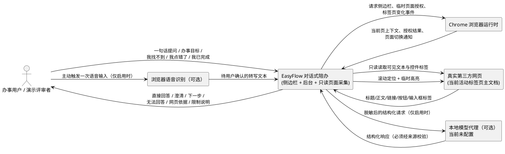
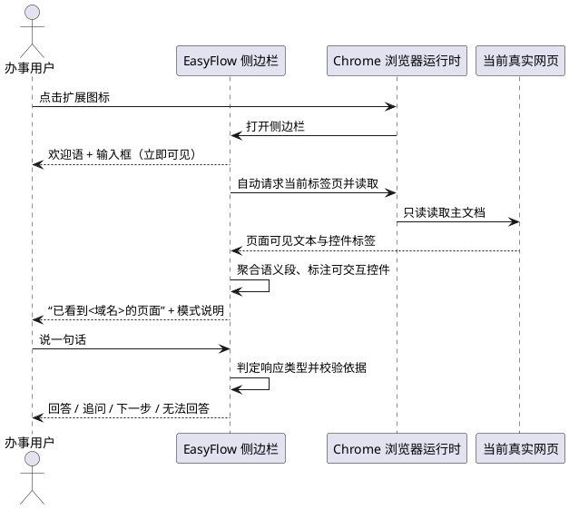
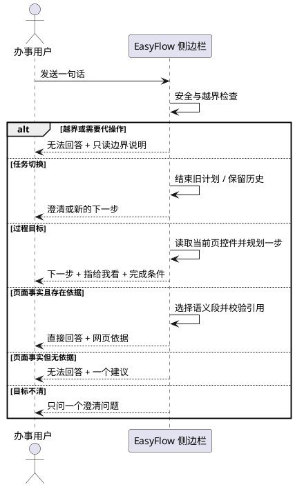
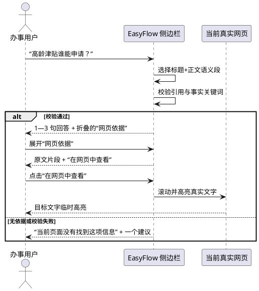
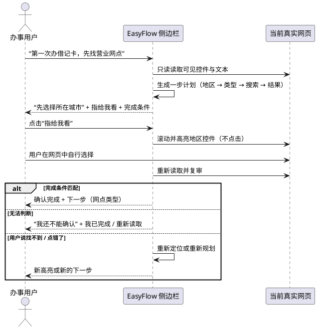
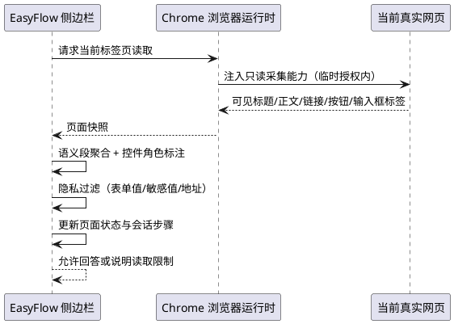
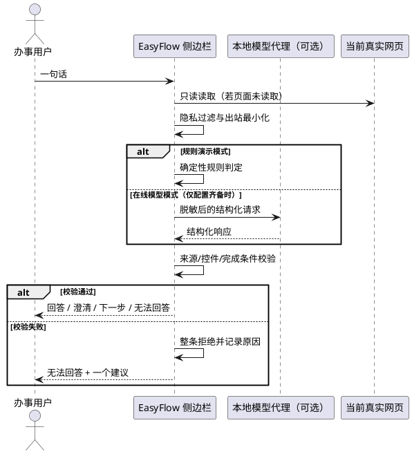
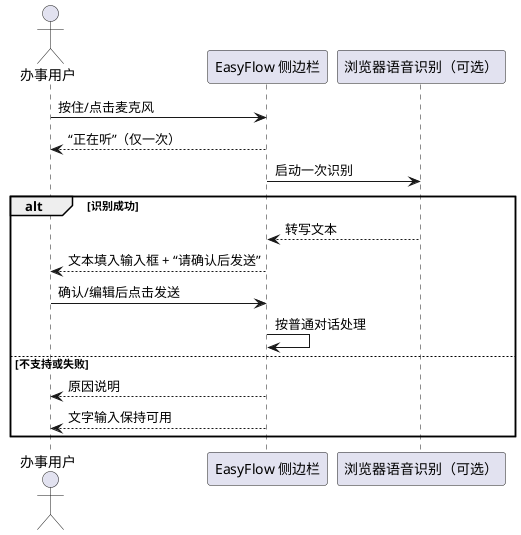
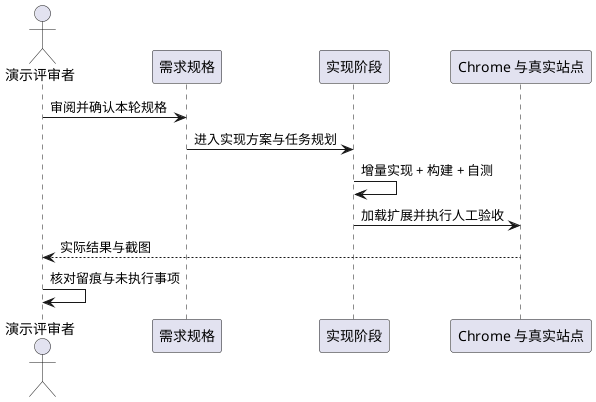

# EasyFlow 对话式陪办迭代需求规格（第二轮）

> 本文件是 `easyflow_page_guide` 特性的第二轮增量规格，不替代第一轮 `spec.md`。第一轮已实现的真实网页读取、元素定位、Range 高亮、构建与自测能力继续有效；本轮纠正交互模型，把“用户学习工具”改为“助手主动回答与陪办”。
>
> 验收条件采用项目既有的中文 EARS 等价写法：`当[触发场景]时，系统必须[行为]` / `如果[异常条件]，系统必须[行为]` / `系统必须[恒定行为]`，与 EARS 的 When/If/While/Where + shall 语义一致。

## 0. 文档说明与基线事实

### 0.1 本轮纠偏目标

本组件从“输入目标 → 点击分析当前页 → 查看相关卡片 → 查看原文”的工具型流程，迭代为“一个对话界面，用户说一句话，助手主动选择回答、追问或逐步引导”的陪同办事体验。交互模型的改变必须带来响应逻辑的改变，禁止仅把既有卡片替换为聊天气泡。

### 0.2 已核实基线（2026-11-13）

| 核查项 | 实际结果 | 对本规格的约束 |
|---|---|---|
| Git | 执行 `git status --short` 返回“无法将‘git’项识别为 cmdlet、函数、脚本文件或可运行程序的名称”；项目根目录不存在 `.git` | 本项目不是 Git 仓库，本阶段留痕不包含 `git diff`/提交记录；不得把“已提交”写入验收结论 |
| 运行时模型请求 | `src/**/*.{ts,tsx}` 检索 `fetch(`、`XMLHttpRequest`、`WebSocket`、`sendBeacon`、`apiKey`、`API_KEY`、`Authorization`，无命中 | 当前不存在运行时模型调用；界面与汇报只能写“规则演示”，不得声称已接入模型 |
| 密钥与配置 | 项目根目录无 `.env*` 文件；源码与清单无 API Key 配置 | 本轮不得硬编码密钥；模型模式只能是可选适配层，默认关闭 |
| 清单权限 | `activeTab`、`scripting`、`sidePanel`、`storage` 四项；无 `host_permissions`、无静态 `content_scripts` | 不能直接访问任意远程模型端点；跨域页面不能自动操作；可读取范围受 `activeTab` 约束 |
| 现有实现能力 | 主文档可见内容采集（标题/段落/链接/按钮/输入框标签）、元素注册与 `elementId`、`domPath`+`textHash` 降级定位、Range 行框高亮与 4 秒清理、规则匹配、依据卡片、折叠诊断、esbuild 构建与 Node 自测 | 本轮必须复用这些能力，不重建项目、不重建采集与高亮体系 |
| 现有界面 | “目标输入 + 分析当前页 + 重新读取页面 + 卡片列表 + 查看原文” | 主界面必须替换为对话入口；常驻工作流按钮隐藏 |
| 真实站点人工验收 | 第一轮留痕明确记录未在 Chrome 中完成三站点端到端验收；本阶段亦未读取三个真实站点的 DOM | 本规格不得编造政策正文、网点结果或真实页面控件；步骤与事实一律以运行时实际可见 DOM 为准 |

### 0.3 规格口径

1. “规则演示”是本轮唯一可启用的对话模式；在线模型模式为可选能力，当前未配置、未接入、未验证。
2. 本规格是需求文档，不声明任何构建、自测或人工验收已经通过；执行结果必须由后续实现阶段以真实命令输出补记。
3. 三个验收站点的页面结构可能随站点改版、地区差异、登录状态、iframe/地图加载而变化；本规格只定义验收场景、预期行为与真实限制，不固化站点 DOM 或业务数据。

---

# **1. 组件定位**

## **1.1 核心职责**

本组件负责在用户主动打开的真实网页上，以一段对话理解用户“问事实”或“要办事”的诉求，直接给出有页面原文依据的回答，或一次一步地陪用户在真实网页上完成操作，实现“不用学习工具也能把事问明白、把流程走下去”。

## **1.2 核心输入**

1. **用户本轮话语**：来自侧边栏输入框或经用户确认的语音转写文本，内容为自然语言问题、过程目标、追问、纠错或确认反馈。
2. **对话会话状态**：来自当前侧边栏会话的消息记录、当前目标、已有陪办计划与当前步骤、已确认事实、最近若干轮上下文。
3. **当前活动标签页的页面快照**：来自当前页主文档的域名、地址、标题、可见标题/段落/链接/按钮/输入框标签，以及由标题与紧随正文聚合的语义段和可交互控件信息。
4. **页面变化通知**：来自 Chrome 的标签页切换、导航完成、页面刷新事件，用于触发会话保留与当前步骤复审。
5. **页面操作反馈**：用户点击“我找不到”“我点错了”“我已完成”“指给我看”“重试”“读取当前页”等对话内联操作。
6. **可选模型服务响应**：仅当本地代理与授权配置齐备时，来自本地代理的结构化响应；当前默认不存在此输入。

## **1.3 核心输出**

1. **对话消息**：返回给用户的助手消息，必有且仅属于“直接回答 / 澄清 / 下一步 / 无法回答”四类之一；消息只包含对用户有用的内容，不展示元素 ID、快照、匹配分数等技术信息。
2. **页面依据入口**：直接回答下方的一条折叠入口，展开后显示引用原文片段与“在网页中查看”操作。
3. **定位与高亮指令**：发送给当前第三方网页的只读指令，使页面滚动到引用文字或目标控件，并以叠加图层临时高亮。
4. **陪办步骤记录**：当前过程目标的步骤目标、当前页面状态、目标控件、依据与完成条件，用于复审与推进。
5. **限制说明**：当页面无依据、跨域、iframe/地图不可读、未登录、需要验证码或超出只读边界时，返回真实原因与可行替代。
6. **折叠诊断记录**：仅用于排障的运行标识、模式、耗时、条数、校验拒绝原因；不包含页面正文与用户敏感值。

## **1.4 职责边界**

1. 本组件**禁止**重建项目、重写既有采集/定位/高亮链路，**禁止**创建模拟网站、静态演示页或政策专题页。
2. 本组件**禁止**代替用户填写、选择、勾选、点击提交/支付/删除、输入验证码或密码，**禁止**使用虚构身份在真实网站提交。
3. 本组件**禁止**读取或传输 `input.value`、`textarea.value`、下拉框选中值、可编辑区域中的用户输入，以及姓名、证件号、手机号、银行卡号、验证码、密码等敏感值。
4. 本组件**禁止**自动跨域导航、自动新开标签页、自动打开或下载附件、自动点击页面链接。
5. 本组件**禁止**声称已接入大模型：当前不存在运行时模型 API、密钥与代理；界面只能显示“本地规则演示，未接入在线模型”，除非未来真实调用且校验成功并有测试记录。
6. 本组件**禁止**硬编码任何 API 密钥、模型地址或站点专属政策正文、网点结果、DOM 选择器。
7. 本组件**禁止**持续监听麦克风、后台录音、保存音频，**禁止**把语音识别结果直接发送。
8. 本组件**禁止**把页面正文、引用原文、聊天中的页面事实持久化到扩展存储；本轮仅允许持久化用户目标文本。
9. 本组件不负责判断政策时效性与法律正确性，不提供法律、医疗、金融建议，只呈现当前页面可支持的事实与操作指引。
10. 本组件不承诺读取 iframe、地图、登录后内容、验证码后内容、附件正文或其他域名页面；这些情况必须如实说明限制。

# **2. 领域术语**

**统一对话入口**
: 侧边栏唯一的用户交互入口。用户以自然语言表达，系统自动判断回答、追问或引导，用户无需选择模式或点击“分析当前页”等工作流按钮。

**对话会话**
: 从侧边栏打开到关闭期间的消息、当前目标、页面状态与陪办计划的集合。

**对话轮次**
: 用户一次发送与系统一次响应组成的一轮交互。

**响应类型**
: 系统对用户本轮话语的处理类别，封闭为“直接回答、澄清、下一步、无法回答”四类之一。

**直接回答**
: 针对当前页面事实问题给出的 1—3 句完整回答，每个具体事实均由当前页语义段支持，并附带可展开的网页依据。

**澄清**
: 在目标不清、关键信息缺失或步骤完成情况无法判断时，只向用户提出一个简短问题，等待用户补充或确认。

**下一步**
: 针对过程目标给出的一个可执行动作，包含唯一目标控件、内联“指给我看”和用户可理解的完成条件；不得一次列出多个步骤。

**无法回答**
: 当前页面没有依据、超出只读边界、跨域、iframe/地图不可读、未登录或读取失败时的明确否定结论，必须说明真实原因并给出一个可行建议。

**规则演示**
: 仅使用确定性规则（关键词、句式、上下文槽位、页面可观察信号）生成响应的模式，不涉及远程模型调用。界面不得把它表述为“AI 理解”或“智能体规划”。

**在线模型模式**
: 通过本地代理调用经授权的大语言模型生成响应的可选模式；扩展不持有密钥。当前未配置、未启用。

**对话引擎**
: 接收用户话语、会话上下文、筛选后的页面语义段与控件信息，输出四类结构化响应之一的业务能力；规则实现与可选模型实现共用同一输入输出契约与校验规则。

**语义段**
: 由一个标题候选与其后紧随正文合并成的最小可回答单元，用于避免只摘到“办理条件：”标题而丢失正文。

**引用锚点**
: 回答所依据的语义段在真实页面中的可定位引用，包含可定位元素 ID、原文片段与文本位置关系。

**网页依据**
: 直接回答下方默认折叠的用户可见入口；展开后显示引用原文片段与“在网页中查看”。

**可定位元素 ID**
: 采集阶段为页面真实元素分配的会话内唯一标识，用于把回答、步骤与页面节点一一对应；该标识只在内部使用，不展示给用户。

**目标控件**
: 下一步要指向的真实页面控件，如按钮、链接、标签页、输入框标签或选项；系统只滚动与高亮，不点击、不聚焦、不填写。

**完成条件**
: 判定某一步是否完成的可观察信号，必须为“指定页面文本出现/指定元素出现或消失/地址变化/控件状态变化/用户显式确认”之一，不得仅为时间流逝。

**陪办计划**
: 围绕一个过程目标生成的一组有序步骤，包含计划标识、版本与逐步记录。

**步骤复审**
: 页面切换或变化后重新读取当前页，并判断当前步骤是已完成、仍待完成、无法确认还是需要重新规划的过程。

**用户确认（未页面校验）**
: 用户点击“我已完成”后，系统重新读取仍无法从页面确认完成时使用的一种有限状态；可继续下一步，但必须说明“这是按你的确认继续，页面未能验证”。

**页面状态**
: 当前页对组件而言的可读状态，取值为可读、待复核、已变化、不支持读取、受限。

**隐私过滤**
: 在页面采集、日志记录与模型出站前，移除或脱敏个人敏感值、表单值与原始页面结构的规则集合。

**限制说明**
: 当页面或浏览器能力不允许继续时，向用户如实说明原因、影响与一个可行替代；不得用“已完成”“已提交”掩盖。

**指给我看**
: 助手消息内联的操作入口；点击后滚动并高亮真实网页控件或引用文字，无需打开任务面板。

**我已完成**
: 用户显式声明某步已完成的反馈；系统必须重新读取页面复核，不得盲信。

# **3. 角色与边界**

## **3.1 核心角色**

1. **办事用户**：在真实政务或银行网页上，希望问清政策事实或完成一次真实流程的个人用户。其行为是打开网页、用一句话提问或提出办事目标、按引导在网页上自行操作、用“我找不到/我点错了/我已完成”反馈。
2. **演示评审者**：按第 5.8 节验收矩阵逐条验证对话入口、事实回答、来源定位、多步陪办、页面切换复审、限制说明与隐私边界的评审人员，操作路径与办事用户一致。

## **3.2 外部系统**

1. **Chrome 浏览器运行时**：提供侧边栏容器、扩展图标入口、`activeTab` 临时授权、脚本注入、标签页事件与本地存储；向本组件提供当前标签页上下文和页面变化通知。
2. **当前活动标签页的真实网页**：向本组件提供主文档可见文本与控件标签；接收滚动定位与叠加高亮；不接收填写、点击、提交等写操作。
3. **本地模型代理或后端适配层（可选，当前不存在）**：在授权配置齐备时接收脱敏后的对话请求，注入密钥并调用模型，返回结构化响应；扩展不直接持有密钥。
4. **浏览器语音识别能力（可选）**：仅在用户主动触发时提供一次性语音转文字；可能由浏览器厂商服务处理音频；扩展不保存音频、不持续监听。

## **3.3 交互上下文**

# **4. DFX约束**

## **4.1 性能**

1. 用户点击扩展图标后，侧边栏必须在 1.5 秒内呈现欢迎语与输入框，不得等待页面采集完成。
2. 侧边栏打开后，当前页自动读取必须在 3 秒内完成；读取失败必须在 3.5 秒内在对话中说明原因。
3. 单页可见条目不超过 3000 条时，一次页面读取必须在 1 秒内完成；语义段聚合与控件标注合计不得超过 300 毫秒。
4. 规则演示模式下，用户发送后首条响应必须在 1 秒内出现；超过 500 毫秒必须显示“我正在看这个页面”的轻量状态。
5. 点击“指给我看”或“在网页中查看”后，滚动与高亮必须在 500 毫秒内出现。
6. 页面切换或刷新后，步骤复审必须在 3 秒内给出“已更新 / 仍需重读 / 无法确认”的结论。
7. 展开“网页依据”必须即时显示，不得重新发起页面读取。
8. 若启用语音，用户主动触发后 300 毫秒内必须出现“正在听”的可见状态；单次识别超过 30 秒必须自动结束并提示。

## **4.2 可靠性**

1. 页面读取失败不得白屏或静默；必须保留对话记录，在聊天中说明原因并提供“重试”。
2. 网页切换、刷新、标签页切换不得清空对话记录；旧页面的事实引用与目标控件必须标记失效，不得继续用于回答或高亮。
3. 页面变化后必须重新读取并复审当前步骤，复审完成前不得直接给出下一步。
4. 对话引擎超时、返回非法结构、引用无效或事实无法校验时，必须降级为“无法回答”，不得展示未经校验的内容为事实。
5. 同一页面重复读取不得产生重复消息、重复语义段或重复步骤；相同输入在相同页面上应得到稳定的响应类型与引用集合。
6. 页面元素在定位时已移除时，必须提示依据失效并建议重新读取，不得滚动到错误位置。
7. 用户连续发送或多步操作并发时，迟到的旧页面快照必须被丢弃，不得覆盖新页面状态。
8. 侧边栏关闭后重新打开必须重新读取当前页，不得展示上一页面的旧事实、旧引用或旧步骤。

## **4.3 安全性**

1. 清单权限必须保持最小化：本轮仍只使用 `activeTab`、`scripting`、`sidePanel`、`storage`；不得申请永久全站访问。若未来启用在线模型，所需的最小本地代理访问通道必须单独评审（见附录 A）。
2. 对第三方页面保持只读：禁止修改原有节点文本、属性、结构；唯一页面写入是临时高亮宿主，高亮结束后必须移除。
3. 采集、日志、模型出站三层都必须执行隐私过滤；任一环节无法确认已过滤时，必须停止该环节并降级，不得“带着疑问发送”。
4. 扩展源码、构建产物、界面、日志中禁止出现 API 密钥；密钥只能存在于本地代理的环境变量。
5. 页面文本、用户话语、模型文本必须按纯文本渲染，禁止作为 HTML、脚本或可执行内容解析。
6. 语音必须用户主动触发，禁止持续监听、后台录音、保存音频；语音转写结果必须经用户确认后才可发送。
7. 不得读取或传输浏览器 Cookie、`localStorage`、`sessionStorage`、密码管理器内容、剪贴板、文件上传内容、页面截图。
8. 公开页面中的机构地址、机构电话可以作为页面事实被引用；页面中出现的个人姓名、手机号、证件号、银行卡号必须脱敏，不得作为回答内容。

## **4.4 可维护性**

1. 主对话区禁止出现“模式、引擎、快照、元素 ID、匹配、关键词、注入、分数、domPath”等技术术语；技术信息只能放在默认折叠的“运行诊断”区。
2. 界面必须始终以一句用户能理解的话说明当前能力：“本地规则演示，未接入在线模型”；不得出现“AI 已理解”“智能体已规划”等表述。
3. 规则实现与可选模型实现必须共用同一输入输出契约、同一来源校验与同一拒绝规则，便于替换而不改变用户可见行为。
4. 每次响应必须有唯一运行标识，可关联读取耗时、引擎耗时、引用数量、校验结论与拒绝原因；诊断不得包含页面正文或用户敏感值。
5. 三个真实站点的验收矩阵必须可复现；站点改版导致步骤变化时，必须记录为限制，而不是修改规格去迁就页面。
6. 项目说明文档必须覆盖对话入口、三站点验收步骤、规则演示声明、模型未接入现状、语音状态、隐私边界与已知限制。

## **4.5 兼容性**

1. 本组件必须继续以 Manifest V3、TypeScript、React 构建，最低支持 Chrome 116。
2. 第一轮的数据结构与消息协议新增字段时必须保持向后兼容；不得改变既有字段语义。
3. 验收必须覆盖 Chrome 桌面版在三个真实站点上的行为；iframe、地图、跨域、登录墙按限制说明处理，不得视为组件崩溃。
4. 网页改版、动态加载、懒加载、折叠内容、分页结果必须给出可理解的限制或重试路径，不得静默失败。

# **5. 核心能力**

## **5.1 统一对话入口与会话状态**

### **5.1.1 业务规则**

1. **唯一主界面**：侧边栏主界面必须只有简短欢迎语、对话记录、输入框和发送按钮；禁止常驻“分析当前页”“重新读取页面”“选择模式”“任务面板”等工作流控件。
   a. 验收条件：打开侧边栏 → 主界面可见区域不存在上述常驻按钮；输入框存在且可输入。
2. **指定提示语**：输入框必须使用提示语“你想了解什么，或想完成什么事？直接告诉我。”
   a. 验收条件：输入框为空 → 占位文本与指定文案完全一致。
3. **自动读取当前页**：侧边栏打开后必须自动读取当前活动页，用户无需先点击读取按钮。
   a. 验收条件：在任一验收页打开侧边栏 → 2 秒内出现“已看到<域名>的页面”或读取中状态，且无需用户点击。
4. **读取失败在对话中说明**：读取失败时必须由助手消息说明具体原因类别（受限页面、未获授权、读取超时、无活动页、页面脚本不可用），并提供内联“重试”。
   a. 验收条件：在浏览器内部页面打开侧边栏 → 对话出现“这个页面我不能读取”类说明与“重试”；点击重试 → 重新尝试并更新同一条状态，不产生重复欢迎语。
5. **不暴露技术细节**：主对话区禁止展示可定位元素 ID、页面快照、匹配分数、哈希、DOM 路径或内部错误码；错误原因必须转成用户能理解的话。
   a. 验收条件：检查任意助手消息 → 不出现 `ef-` 前缀 ID、`domPath`、`score`、`EF-E` 错误码原文。
6. **诊断折叠**：页面读取与响应校验的诊断信息必须放在默认折叠的“运行诊断”区，展开后才可见，且不得包含页面正文或用户敏感值。
   a. 验收条件：默认状态 → 诊断内容不可见；展开后 → 只见运行标识、模式、耗时、条数、校验结论与拒绝原因。
7. **会话记录保留**：同一侧边栏文档内，网页刷新、标签页切换、同域或跨域导航不得清空对话记录。
   a. 验收条件：完成一次回答后切换到另一页面 → 历史消息仍在；出现一条页面已变化的系统提示。
8. **页面切换后的步骤复审**：页面变化后必须保留旧陪办计划，但把当前步骤标记为“待复核”；必须重新读取当前页并复审，复审完成前不得给出下一步。
   a. 验收条件：处于第 2 步时切换页面 → 出现“页面变了，我先核对当前进度”；复核完成前没有“下一步”消息。
9. **会话边界**：侧边栏关闭即结束本轮会话；重新打开不得恢复页面正文、引用原文或基于旧页面的回答。用户目标文本可按既有能力保留，但不得作为当前页面事实直接回答。
   a. 验收条件：关闭并重新打开侧边栏 → 无上一页回答与引用；输入框可保留用户目标提示；必须重新读取当前页。
10. **空输入与超长输入**：空输入禁止发送；超过 500 字的输入必须提示精简并禁止发送。
    a. 验收条件：空输入点击发送 → 不产生用户消息；输入 501 字 → 出现精简提示，消息不发送。
11. **欢迎语职责**：欢迎语必须简短，说明能直接回答页面问题并能一步一步陪办，不得承诺“什么都能办”。
    a. 验收条件：首次打开 → 欢迎语不超过两句，包含“回答页面上的问题”和“一步一步陪你办”语义。
12. **禁止项**：禁止把既有卡片列表原样嵌入聊天气泡；禁止要求用户先选“问答/办事”模式；禁止用“请点击分析当前页”类指令；禁止在用户未提问时自动输出页面摘要长文。
    a. 验收条件：打开扩展后 → 只出现欢迎语、页面读取状态与输入框；不出现模式选择或卡片墙。

### **5.1.2 交互流程**

### **5.1.3 异常场景**

1. **当前页不可读取**
   a. 触发条件：页面为浏览器内部页、扩展商店、本地文件、`view-source:`、未授权或安全策略拒绝。
   b. 系统行为：保留聊天界面，不重试注入，生成一条说明原因的消息；提供“重试”。
   c. 用户感知：“这个页面我不能读取，因为浏览器不允许扩展访问。换到普通公开网页后点重试。”
2. **自动读取超时**
   a. 触发条件：3 秒内未返回页面快照。
   b. 系统行为：终止本次读取，标记页面状态为待重试，保留输入框可用。
   c. 用户感知：“页面还没读完，可能加载较慢。” + “重试”。
3. **无活动标签页**
   a. 触发条件：当前窗口没有可访问的活动页。
   b. 系统行为：不发起读取。
   c. 用户感知：“先打开你想问的那个网页，我再接着看。”
4. **页面在读取过程中切换**
   a. 触发条件：读取尚未返回时用户切换标签页或导航。
   b. 系统行为：丢弃迟到快照，不将其用于回答；保留会话并标记页面已变化。
   c. 用户感知：“页面刚刚变了，我重新看一下。” 随后复审。
5. **侧边栏重开**
   a. 触发条件：用户关闭后重新点击扩展图标。
   b. 系统行为：新建会话，重新读取当前页，不恢复旧页面事实。
   c. 用户感知：新的欢迎语与当前页读取状态，无旧回答。

## **5.2 意图分类与响应类型**

### **5.2.1 业务规则**

1. **四类封闭**：每条助手消息必须且只能属于“直接回答”“澄清”“下一步”“无法回答”之一；禁止输出未归类的闲聊、模板菜单或多类型混合消息。
   a. 验收条件：检查任意响应 → 响应类型字段为四类之一；用户可见消息不出现“请选择：1 问答 2 办事”。
2. **直接回答的形态**：针对当前页面事实问题，必须输出 1—3 句可直接理解的完整回答，不得以多个匹配片段列表代替回答。
   a. 验收条件：输入“高龄津贴谁能申请” → 得到一段通顺的 1—3 句回答，而非 3—5 条片段标题。
3. **澄清的形态**：目标不清、缺少关键信息或完成情况无法判断时，必须只问一个问题，可给出不超过 3 个简短选项。
   a. 验收条件：输入“我想问问” → 只出现一个澄清问题；不得连续抛出三个问题。
4. **下一步的形态**：过程目标或继续指令必须得到“一次只给一个下一步”的消息，包含目标控件说明、内联“指给我看”和一句可理解的完成条件。
   a. 验收条件：输入“第一次办借记卡，先找营业网点” → 第一条只要求“先选择所在城市”，且含“指给我看”。
5. **无法回答的形态**：无依据、越界、跨域、iframe/地图不可读、未登录或读取失败时，必须明确说“当前页面没有找到这项信息”或等价说明，并给出一个可行建议；不得给出具体事实。
   a. 验收条件：问页面没有的“补贴金额” → 不出现任何金额数字；出现“当前页面没有找到这项信息”与一个建议。
6. **安全与越界优先**：涉及代填、代选、代勾选、代提交、支付、删除、验证码、密码、虚构身份或索取个人敏感信息的请求，必须优先判定为无法回答，并说明只读边界。
   a. 验收条件：输入“帮我填身份证号” → 直接说明不能代填，不索取证件号，不给填写步骤。
7. **判定优先级**：规则演示模式必须按以下顺序裁决，同一轮命中多个信号时以优先级高者为准：安全越界 > 任务切换 > 明确过程目标 > 上下文反馈 > 页面事实 > 上下文省略/指代 > 兜底澄清。
   a. 验收条件：构造同时含“帮我提交”和“谁能申请”的输入 → 判定为无法回答，不得先回答条件。
8. **明确过程目标信号**：出现“我要办/我想办/第一次办/准备办/怎么申请/如何办理/帮我找/带我去/下一步/继续/先做什么”等表达，且对象可执行时，必须进入下一步或仅缺一个槽位时进入澄清。
   a. 验收条件：输入“我想办这个”且当前页有可执行入口 → 下一步；当前页没有任何可执行控件 → 无法回答并说明原因。
9. **页面事实信号**：出现“谁/什么/哪些/哪里/在哪/多少/多久/几点/需要带/要不要/是否/能不能/条件/材料/时间/地点/电话”等表达，且当前页有依据时，必须直接回答；无依据时必须无法回答。
   a. 验收条件：输入“需要带什么”且有材料段落 → 直接回答；页面只有标题没有材料正文 → 明说“页面没有写清材料”。
10. **上下文反馈信号**：出现“我找不到/没看到/在哪里点”时必须重新定位；出现“我点错了/点错/不是这个”时必须基于当前页重新规划；出现“我已完成/好了/完成了”时必须重新读取复核；出现“换一个任务/重新开始/不办这个了/另外问”时必须终止旧计划并保留历史。
    a. 验收条件：第 2 步说“我找不到” → 重新定位同一语义控件并重新高亮；说“我点错了” → 计划版本递增，给出基于当前页的新步骤，不重复旧指令；说“换一个任务” → 旧计划标记结束，新目标进入澄清或下一步。
11. **上下文省略与指代**：出现“那需要带什么/这个呢/然后呢/还要什么/上面说的”等省略表达时，必须继承最近的目标对象与当前步骤；有依据则回答，需要动作则下一步，无法解析则只问一个问题。
    a. 验收条件：先问“高龄津贴谁能申请”，再问“那需要带什么” → 回答材料，不得反问“你要办什么”；若最近没有任何目标 → 只问一个澄清问题。
12. **上下文窗口**：会话必须保留最近 6 轮用户话语与响应类型作为判定依据；更早内容只能以不含页面正文的摘要参与，不得把旧页面事实当作当前页事实。
    a. 验收条件：切换页面后追问旧页面细节 → 不得引用旧页面原文；说明“这是之前页面上的信息，当前页没有”。
13. **不得猜测**：无法按上述规则判定时，必须进入澄清，不得猜测用户意图后直接给事实或步骤。
    a. 验收条件：输入“那个东西”且无上文 → 只出现一个澄清问题，不出现政策事实。
14. **禁止项**：禁止要求用户手动选择响应类型；禁止把“匹配到 5 个片段”作为回答；禁止在一条消息里同时给两个下一步；禁止用“根据我的知识”补充页面外事实；禁止把页面标题当作完整答案。
    a. 验收条件：检查响应 → 单条下一步只含一个动作；回答不含页面未出现的具体事实。

### **5.2.2 交互流程**

### **5.2.3 异常场景**

1. **混合意图**
   a. 触发条件：一句话同时包含事实询问与办事请求，例如“谁能申请，帮我办”。
   b. 系统行为：按优先级先处理安全/办事请求；只给一个下一步，不并列回答与步骤。
   c. 用户感知：“我先陪你把第一步做了：先选择所在城市。” 不出现两个动作。
2. **上下文断裂**
   a. 触发条件：用户使用“这个/那个/然后”但会话中没有可继承目标。
   b. 系统行为：不猜测，进入澄清。
   c. 用户感知：“你指的是哪件事？可以告诉我网页上的名称或你想办的事。”
3. **用户否定**
   a. 触发条件：用户说“不是这个/不对/我没问这个”。
   b. 系统行为：丢弃上一候选，重新基于当前页选择依据或重新规划；不得重复原回答。
   c. 用户感知：“明白，我重新看。” 随后给出新的回答或一个澄清问题。
4. **输入含疑似敏感信息**
   a. 触发条件：用户话语中出现身份证号、手机号、银行卡号、验证码或密码样式。
   b. 系统行为：不把原文写入日志或模型请求；提示不要在对话中提供此类信息；不基于该信息执行任何操作。
   c. 用户感知：“这类信息不用发给我，我不会读取或转交。”
5. **超长或纯符号输入**
   a. 触发条件：输入超过 500 字或去除符号后无有效内容。
   b. 系统行为：不发送，保留输入框内容。
   c. 用户感知：“内容有点长/没看懂，能精简成一句吗？”

## **5.3 直接回答与语义段依据**

### **5.3.1 业务规则**

1. **回答而非片段堆砌**：事实问题必须输出 1—3 句完整回答，单条回答不超过 180 字；禁止用 3—5 条原文片段直接充当回答。
   a. 验收条件：问“在哪里线下办理” → 出现包含地点信息的完整句子，而不是只列三个标题。
2. **逐事实依据**：回答中的每个具体事实（对象、条件、材料、地点、时间、电话、金额、流程动作）必须由当前页面语义段支持；回答中的时间、地区、机构名、数字、材料名必须能在引用原文中逐字找到。
   a. 验收条件：回答出现“80 周岁” → 至少一个引用片段包含“80 周岁”；否则判定为无效回答，改为无法回答。
3. **无依据必须明说**：当前页没有支持信息时，必须输出“当前页面没有找到这项信息”，禁止用常识补充政策内容、材料清单、网点名称或地址。
   a. 验收条件：页面没有“补贴金额” → 回答不出现金额、发放周期等页面外事实。
4. **保留适用范围**：若语义段含时间、地区、户籍、年龄、对象或适用条件，回答必须一并说明；若原文没有这些限定，回答不得自行补充。
   a. 验收条件：原文含“自 2024 年 1 月 1 日起，本区户籍……” → 回答保留时间与“本区户籍”限定；原文无时间 → 回答不出现具体日期。
5. **不得以整页为答案**：引用必须指向语义段或具体元素，不得指向 `body`、`html` 或整页容器；回答不得粘贴整页正文。
   a. 验收条件：检查引用 → 不指向整页容器；回答长度不超过 180 字。
6. **标题与正文合并**：语义段必须由一个标题候选与其后紧随正文合并而成；当标题后存在正文时，标题文本不得单独作为完整事实依据。
   a. 验收条件：页面存在“办理条件：”标题及紧随正文 → 语义段文本包含标题与正文；回答不出现只有“办理条件：”的句子。
7. **语义段边界**：正文必须截止到下一个标题候选、语义块切换或列表结束；单段不超过 500 字；超长截断并标记；同一列表的连续条目可合并为同段；禁止跨区块拼接无关内容。
   a. 验收条件：构造“标题 A + 正文 A + 标题 B + 正文 B” → 形成两个语义段，互不拼接。
8. **标题候选范围**：标题候选包括页面标题元素（`h1`—`h6`、带标题角色）与以冒号结尾且长度不超过 30 字的短段落；普通长段落不得被当作标题。
   a. 验收条件：以“办理条件：”结尾的短段落 → 被识别为标题候选；普通 80 字段落 → 不被识别为标题。
9. **引用精确性**：每个引用必须包含至少一个当前快照中存在的可定位元素 ID；引用原文必须是该元素文本的精确子串（归一化空白后）；标题与正文必须分别保留可定位引用；禁止使用“页面大致内容”“整页”作为引用。
   a. 验收条件：将引用原文改动一个字 → 引用校验失败，不得展示为事实；未改动 → “在网页中查看”能高亮对应文字。
10. **网页依据折叠**：直接回答下方只显示一条“网页依据”入口，默认折叠；展开后按引用顺序显示原文片段与“在网页中查看”；不得在回答正文中直接粘贴所有原文。
    a. 验收条件：回答出现后 → 默认看不到原文片段；点击“网页依据” → 出现原文与按钮；按钮可触发高亮。
11. **高亮精确定位**：点击“在网页中查看”必须复用真实元素定位与文字行框高亮，滚动到对应文字并临时高亮；不得点击、聚焦、勾选或修改页面；高亮约 4 秒后移除。
    a. 验收条件：点击后 → 目标文字被逐行框选；4 秒后移除；页面 URL、表单值与焦点不变。
12. **引用失效处理**：若引用元素已被移除或文本已变化，必须提示“这条依据已经变了，我重新看一下页面”，并提供“重试读取”，不得滚动到错误位置。
    a. 验收条件：页面变化后点击旧依据 → 不出现错误位置高亮；出现失效说明与重试。
13. **冲突条款不裁决**：同一页面出现互相冲突的时间、地区或对象条款时，必须指出冲突并分别引用，不得替用户选择其中一条。
    a. 验收条件：构造两个不同时间的条款 → 回答说明“页面同时出现两种说法”，并各给一条引用。
14. **附件与链接只读**：只能引用链接文本并高亮，禁止自动打开、下载或提交附件。
    a. 验收条件：点击“在网页中查看”指向附件链接 → 只滚动高亮，不打开新页面、不下载。
15. **禁止项**：禁止把模型常识或政策知识补进回答；禁止引用其他页面、历史页面或会话摘要中的旧事实作为当前页依据；禁止把可定位元素 ID 展示给用户；禁止改写引用原文（回答可以转述，但限定词、数字、机构名必须保留）。
    a. 验收条件：切换页面后问旧页面问题 → 回答说明当前页没有该信息，不引用旧页面。

### **5.3.2 交互流程**

### **5.3.3 异常场景**

1. **只有标题没有正文**
   a. 触发条件：标题候选之后没有可读正文。
   b. 系统行为：不把标题当作完整事实；只说明页面写了这个标题，未给出具体内容。
   c. 用户感知：“页面只写了‘办理条件：’，后面没有具体说明。”
2. **正文被截断**
   a. 触发条件：语义段超过 500 字或采集文本超过单条上限。
   b. 系统行为：保留可定位能力，标记截断；回答只使用截断范围内可验证的事实。
   c. 用户感知：依据区显示“原文较长，已截断”，可点击“在网页中查看”看完整位置。
3. **引用校验失败**
   a. 触发条件：引用元素不存在、原文不是精确子串或引用指向整页。
   b. 系统行为：整条回答降级为无法回答，记录拒绝原因，不展示部分事实。
   c. 用户感知：“我暂时不能可靠回答，页面内容可能刚变过。” + “重新读取”。
4. **多版本条款冲突**
   a. 触发条件：页面同时出现不同年份、不同地区或不同对象的规定。
   b. 系统行为：说明冲突并分别引用，不给单一结论。
   c. 用户感知：“页面里同时有两种说法，我把两处都标出来，你按办理窗口的要求确认。”
5. **依据元素已失效**
   a. 触发条件：页面刷新或动态更新后元素被移除。
   b. 系统行为：清理旧高亮，标记引用失效。
   c. 用户感知：“这条依据已经不在页面上了，我重新读一下。”
6. **高亮目标被折叠或遮挡**
   a. 触发条件：目标文字位于折叠区域或不可见容器。
   b. 系统行为：不强行展开页面；提示用户展开后重试，或定位到最近可见祖先。
   c. 用户感知：“这段内容被折叠了，展开后我再指给你看。”

## **5.4 逐步陪办**

### **5.4.1 业务规则**

1. **一次一步**：每个“下一步”消息只允许包含一个动作、一个目标控件和一句完成条件；禁止在一次消息中列出地区、类型、搜索三步清单。
   a. 验收条件：输入“第一次办借记卡，先找营业网点” → 第一条只要求“先选择所在城市”。
2. **步骤必须可追溯**：每个步骤必须记录总目标、步骤目标、当前页面地址（脱敏）、已观察到的页面状态、目标控件、依据引用与完成条件；缺少任一项时不得给出该步。
   a. 验收条件：检查步骤记录 → 六个要素齐全；缺少目标控件的步骤不出现在对话中。
3. **步骤来源真实**：步骤必须由当前页面可见控件与文本推导；允许使用通用流程模板（找入口 → 选择条件 → 触发搜索 → 读取结果），禁止内置站点专属政策正文、网点结果或固定 DOM 选择器。
   a. 验收条件：源码与配置中不含验收站点的政策正文、网点名称或专属选择器；换一个同类页面仍能按可见标签生成步骤。
4. **只指向不操作**：点击“指给我看”只能滚动与高亮，不得点击、聚焦、填写、选择、勾选或提交。
   a. 验收条件：点击“指给我看” → 页面 URL 不变、表单值不变、未触发页面提交或跳转。
5. **完成条件可观察**：完成条件必须是以下之一：指定页面文本出现、指定元素出现或消失、地址变化、控件可见状态变化、用户显式确认；禁止仅以时间流逝或页面加载完成作为条件。
   a. 验收条件：检查每个步骤 → 完成条件包含可观察信号；不存在“等待 5 秒即完成”。
6. **完成判定**：只有页面信号与完成条件精确匹配，或用户显式确认且重新读取后形成“用户确认（未页面校验）”，才可推进下一步；不得仅凭定时器、滚动、焦点变化或输入框有内容判定完成。
   a. 验收条件：构造 10 秒无变化 → 状态仍为当前，消息“我还不能确认”；出现目标结果文本 → 判定完成；用户点“我已完成”但页面无变化 → 标记未页面校验并说明。
7. **不确定必须明说**：无法判断时必须说“我还不能确认这一步是否完成”，并提供“我已完成”和“重新读取”两个内联操作。
   a. 验收条件：页面只发生无关变化 → 出现该句与两个操作，不给下一步。
8. **我找不到**：必须重新读取并重新定位同一语义控件（按可读标签、控件类型、所在区域匹配）；找到则新高亮并说明“我重新找到了”；找不到则说明真实原因（控件不存在、在 iframe/地图内、未登录、页面改版）并给一个替代；禁止重复旧指令或编造位置。
   a. 验收条件：目标控件标签变化但仍在页面 → 能重新定位；控件被移除 → 说明“这个页面现在没有这个控件”，不假装高亮。
9. **我点错了**：必须以当前页面状态重新规划，计划版本递增，旧步骤标记为已被替换；不得重复上一条指令；若误入其他域名，只给文字返回指引，不自动导航。
   a. 验收条件：用户点错后说“我点错了” → 新步骤基于当前页控件，旧步骤不再出现；页面 URL 不被系统改变。
10. **换一个任务**：旧计划必须终止并保留在历史消息中；新目标明确则开始新计划，不明确则只问一个澄清问题；禁止把旧步骤套用到新任务。
    a. 验收条件：说“换一个任务，我想办居住证” → 旧步骤标记结束；新响应不含旧任务动作。
11. **跨域限制**：若下一步需要其他域名完成，必须说明“这一步在另一个网站完成，我不能替你跳转或操作”，给出站点与要做的事，等待用户手动打开后重新读取；禁止自动导航或新开标签页。
    a. 验收条件：从政务指南页指向政务服务网 → 出现跨域说明；页面 URL 不变。
12. **iframe 与地图限制**：目标控件不在主文档（iframe、地图、嵌入框架）时必须说明“这个控件在内嵌框架或地图里，我读不到”，不得高亮、不得假装完成；可建议用户在该区域内手动操作或换入口。
    a. 验收条件：目标仅在 iframe 内 → 出现限制说明；不出现“已定位”或下一步推进。
13. **登录、验证码、支付边界**：遇到登录、验证码、支付、实名认证时必须停止并说明不能代操作；不得索取验证码或密码，不得使用虚构身份。
    a. 验收条件：页面要求验证码 → 说明“验证码需要你自己输入，我不能代填或索取”；不出现输入验证码的步骤。
14. **提交类控件禁止指向**：目标控件禁止为提交、支付、删除、确认提交、获取验证码、密码类控件；搜索/查询按钮可以指向，但点击必须由用户完成。
    a. 验收条件：检查目标控件 → 不指向提交/支付/验证码类；搜索按钮可被高亮但不被系统点击。
15. **结果读取**：用户自行操作后必须重新读取；若结果列表可见，应引用结果文本回答（如网点名称、地址、营业时间）；若结果未加载、被地图覆盖或位于 iframe，必须如实说明，不得编造网点。
    a. 验收条件：结果列表可见 → 回答引用至少一条真实结果；结果不可见 → 说明“结果还没加载出来”或“结果在地图里，我读不到”。
16. **演示站点职责**：北京石景山高龄津贴指南用于信息问答与来源定位；建行网点查询页用于“第一次办借记卡，先找营业网点”的多步陪办；建行借记卡申请页仅用于展示只读边界。步骤与结果以运行时实际可见 DOM 为准。
    a. 验收条件：三个站点分别按第 5.8 节矩阵验收；不得在规格中声称已读取真实 DOM 或已成功完成流程。
17. **禁止项**：禁止生成“输入你的身份证号/手机号”这类索取个人信息的步骤；禁止承诺“我已帮你预约/提交/勾选”；禁止给出来源不支持的材料、地点、电话；禁止把“页面加载完成”当作完成；禁止在用户未操作时自动推进。
    a. 验收条件：检查所有下一步 → 无索取个人信息、无代操作承诺、无未引用事实。

### **5.4.2 交互流程**

### **5.4.3 异常场景**

1. **目标控件消失**
   a. 触发条件：页面改版、动态渲染或用户切换后控件不存在。
   b. 系统行为：不推进；重新读取并尝试同语义控件；仍不存在则说明限制。
   c. 用户感知：“这个页面现在没有‘所在城市’这个选项，可能改版了。我可以按当前页面重新找入口。”
2. **多个相似控件**
   a. 触发条件：页面存在多个同名或近义按钮/选项。
   b. 系统行为：不猜测，要求用户确认或选择最符合当前步骤语义的一个；必要时只问一个澄清问题。
   c. 用户感知：“页面上有两个‘查询’，你是想用网点查询那个吗？”
3. **用户操作后页面无变化**
   a. 触发条件：用户声称完成但页面文本、地址、控件状态均无变化。
   b. 系统行为：保持当前步骤，不推进；说明未观察到变化。
   c. 用户感知：“我还没看到页面变化。如果你确实完成了，可以点‘我已完成’，我会按你的确认继续，但无法从页面验证。”
4. **误入其他域名**
   a. 触发条件：“我点错了”后当前页已在其他站点或流程。
   b. 系统行为：只基于当前页重新规划；若无法继续，给文字返回指引，不自动导航。
   c. 用户感知：“你现在在另一个网站上。要回到刚才的页面，请手动打开<站点>，我再接着看。”
5. **跨域下一步**
   a. 触发条件：当前页只提供入口，实际办理在另一域名。
   b. 系统行为：说明跨域限制，给站点与动作文字，等待用户手动打开并重新读取。
   c. 用户感知：“这一步要在另一个网站完成，我不能替你跳过去。打开后告诉我，我再继续。”
6. **iframe/地图**
   a. 触发条件：地区选择、地图选点或结果列表位于 iframe/地图控件内。
   b. 系统行为：说明不可读；不得给出虚假控件位置。
   c. 用户感知：“这部分在地图/内嵌框架里，我读不到。你可以在地图里自己选，选好后我再核对页面上的文字。”
7. **登录或验证码**
   a. 触发条件：页面要求登录、短信验证码、人脸识别或支付。
   b. 系统行为：停止推进并说明边界；不索取凭证。
   c. 用户感知：“这一步需要你本人完成，我不能代填或索取验证码。”
8. **用户长时间不操作**
   a. 触发条件：给出下一步后长时间无页面变化、无用户反馈。
   b. 系统行为：不自动推进、不重复刷屏；可保留当前步骤并在用户再次发言时复审。
   c. 用户感知：界面保持当前步骤；用户发言后得到复审结果。
9. **结果为空**
   a. 触发条件：搜索后结果列表为空或提示无匹配。
   b. 系统行为：如实说明没有结果；建议调整地区/类型或换关键词，不编造网点。
   c. 用户感知：“这次没有查到结果，可以换个地区或网点类型再试。”

## **5.5 页面感知、切换复审与隐私过滤**

### **5.5.1 业务规则**

1. **复用只读采集**：必须复用第一轮的主文档可见内容读取能力（标题、段落、链接、按钮、输入框标签），不得重建采集体系；新增语义段聚合与控件角色标注。
   a. 验收条件：页面可见文本仍可被读取；原有只读约束与高亮能力不回退。
2. **自动读取与页面变化感知**：侧边栏打开、页面切换、导航完成或刷新后必须重新读取；读取前不得用旧快照回答。
   a. 验收条件：切页后提问 → 回答基于新页面或明确说明尚未读取，不引用旧页面。
3. **变化不等于完成**：页面发生无关变化（广告刷新、时钟、轮播、无关区域更新）不得推进陪办步骤。
   a. 验收条件：构造无关 DOM 变化 → 步骤保持当前，不出现下一步。
4. **表单值不进入快照**：输入框、文本域、下拉框、可编辑区域的用户输入值禁止采集；只允许读取标签、占位符、可访问名称等非值信息。
   a. 验收条件：构造带 `value="张三 110101199001011234"` 的输入框 → 快照中不出现该值。
5. **敏感值不进入日志**：日志与折叠诊断禁止页面正文、用户话语全文、表单值与个人敏感值；只记录长度、哈希、计数、耗时、模式与拒绝原因。
   a. 验收条件：检索运行日志 → 不含完整正文与敏感值；只含计数与耗时。
6. **敏感值不进入模型请求**：出站载荷只允许筛选后的公开语义段、控件标签与类型、脱敏地址、用户本轮话语与会话摘要；禁止原始 HTML、节点属性、Cookie、浏览器存储、剪贴板、文件、音频、截图。
   a. 验收条件：捕获模拟出站请求 → 不含 `input.value`、姓名、证件号、手机号、验证码、密码、HTML 标签串。
7. **地址脱敏**：日志与出站地址只保留协议、域名与路径，必须去除查询参数与片段；页面标题含手机号、证件号或邮箱时必须脱敏。
   a. 验收条件：地址含 `?token=...&phone=...` → 出站与日志只出现路径，不出现查询值。
8. **公开机构信息与个人数据区分**：页面公开的机构地址、机构电话可作为事实引用；页面中的个人姓名、手机号、证件号、银行卡号必须脱敏，不得成为回答内容。
   a. 验收条件：页面含“咨询电话 12345” → 可引用；页面含“张三 13800000000” → 回答与出站均不出现该手机号。
9. **过滤失败即停止**：若无法确认载荷已过滤，必须不发送模型请求，降级为规则模式或无法回答，并在诊断记录“隐私过滤拦截”。
   a. 验收条件：模拟过滤器异常 → 无出站请求；用户得到可理解的降级说明。
10. **数据留存边界**：页面快照、语义段、引用、聊天消息只存在于侧边栏内存；禁止写入扩展存储；仅用户目标文本可按既有能力持久化（不超过 200 字）；语音音频不保存。
    a. 验收条件：检查扩展存储 → 只有用户目标，无页面正文、引用或聊天记录。
11. **纯文本渲染**：页面文本、用户话语、模型输出必须按纯文本渲染；禁止解释为 HTML、脚本或可执行链接。
    a. 验收条件：页面含 `<script>` 样式文本 → 界面按文字显示，不执行。
12. **读取范围限制**：只读取当前活动标签页主文档；不读取 iframe、其他标签页、浏览器内部页、其他域名页面。
    a. 验收条件：页面正文位于 iframe → 主文档读取不到该正文，系统如实说明。
13. **禁止项**：禁止上传页面 HTML 或截图；禁止读取浏览器历史、Cookie、密码管理器；禁止持续监听页面；禁止在用户不知情时把页面内容写入任何远程服务。
    a. 验收条件：网络请求与存储检查 → 无页面 HTML/截图上传，无持续监听逻辑。

### **5.5.2 交互流程**

### **5.5.3 异常场景**

1. **注入被拒**
   a. 触发条件：浏览器拒绝在当前页运行采集。
   b. 系统行为：不重试注入，保留聊天界面并说明原因。
   c. 用户感知：“浏览器不允许我读取这个页面，换到普通公开网页后重试。”
2. **页面为空或加载未完成**
   a. 触发条件：快照条目为 0 或明显少于页面预期。
   b. 系统行为：进入无依据分支，不推断页面内容；建议等待加载后重试。
   c. 用户感知：“页面可读内容还很少，可能没加载完。” + “重试”。
3. **动态加载/懒加载**
   a. 触发条件：用户滚动或等待后内容才出现。
   b. 系统行为：以当前读取时刻为准；用户再次发言或重试时重新读取。
   c. 用户感知：“我按现在页面上的内容回答；如果还有没展开的部分，展开后告诉我。”
4. **页面改版**
   a. 触发条件：原目标控件或语义段结构消失。
   b. 系统行为：重新读取并重新匹配；仍失败则说明改版或限制。
   c. 用户感知：“页面结构可能变了，我没找到原来的入口，可以按当前页面重新找。”
5. **隐私过滤拦截**
   a. 触发条件：待出站内容含疑似敏感值或过滤器异常。
   b. 系统行为：不出站，降级规则模式/无法回答，记录拦截原因。
   c. 用户感知：“这次我不把页面内容发到外部，先用本地规则看一下。”
6. **快照竞态**
   a. 触发条件：旧页面读取结果晚于新页面读取返回。
   b. 系统行为：丢弃旧快照，保留最新页面状态。
   c. 用户感知：不出现旧页面事实或旧页面高亮。

## **5.6 对话引擎与模型边界**

### **5.6.1 业务规则**

1. **统一接口**：规则实现与可选模型实现必须共用同一输入输出契约和同一校验规则；替换实现不得改变四类响应语义、引用要求与隐私边界。
   a. 验收条件：用规则实现与模拟模型实现跑同一组用例 → 输出字段结构一致，均经过同一校验器。
2. **引擎输入**：输入必须只包含：用户本轮话语（已过滤）、会话目标与最近 6 轮摘要、当前步骤、页面地址（脱敏）、域名、标题、采集时刻、语义段集合（含可定位元素 ID 与文本）、可交互控件集合（含可定位元素 ID、可读标签、类型、可见状态、是否提交类）、能力开关（规则/模型、语音是否启用）。
   a. 验收条件：检查引擎输入 → 无原始 HTML、无表单值、无个人敏感值、无其他页面内容。
3. **引擎输出**：输出必须且只能为四类响应之一，并携带：用户可见文本；直接回答所需的引用集合；下一步所需的目标控件与完成条件；澄清所需的一个问题与不超过 3 个选项；无法回答所需的原因与一个建议；内部诊断信息。
   a. 验收条件：任一输出 → 响应类型、用户文本、必需字段齐备；缺失时视为无效输出。
4. **规则模式确定性**：同一用户话语、同一会话状态、同一页面快照必须得到相同的响应类型与稳定的引用顺序；不得随机或依赖时间。
   a. 验收条件：重复执行同一输入 → 响应类型与引用集合顺序一致。
5. **规则模式判定**：必须严格按第 5.2.1 节优先级与信号判定；不得声称理解自然语言，不得输出规则之外的推断。
   a. 验收条件：构造信号明确的用例 → 判定符合优先级；无信号 → 澄清。
6. **当前模式事实**：当前不存在运行时模型 API、密钥与代理，因此默认且唯一可用模式为“规则演示”；界面必须显示“本地规则演示，未接入在线模型”，不得显示“已接入模型”。
   a. 验收条件：无模型配置时检查界面与诊断 → 显示规则演示；无任何模型网络请求。
7. **模型模式启用条件**：只有同时具备以下条件才可启用在线模型模式：可用的模型端点、环境变量中的密钥、模型名称、本地代理或后端适配层、扩展侧最小访问通道、明确的授权与测试记录。
   a. 验收条件：缺少任一条件 → 模型模式保持关闭，不发请求；诊断记录“未配置”。
8. **密钥边界**：扩展源码、构建产物、界面、日志、诊断中禁止出现密钥；密钥只能存在于本地代理环境变量；扩展只调用代理，不直接调用模型厂商。
   a. 验收条件：检索源码与构建产物 → 无密钥、无 `Authorization` 头；诊断无密钥。
9. **代理职责**：本地代理必须负责注入密钥、限制模型与最大输出、设置超时、执行脱敏与审计（不记录正文）、拒绝越权请求；不得把任意远程地址作为用户可配置项。
   a. 验收条件：代理配置检查 → 端点受白名单/本地限制；模型参数有上限；审计不含正文。
10. **出站最小化**：模型请求只允许发送筛选后的语义段（数量与字符数有上限）、控件标签与类型、脱敏地址、用户本轮话语与会话摘要；禁止发送原始 HTML、节点属性、表单值、个人敏感值、其他页面内容。
    a. 验收条件：模拟出站载荷检查 → 只含允许字段；敏感值测试全部不命中。
11. **来源校验**：每个引用必须指向当前快照中的可定位元素；引用原文必须是元素文本的精确子串；回答中的时间、地区、机构、数字、材料名必须出现在引用文本中；任一项不满足即拒绝。
    a. 验收条件：构造引用缺失、原文不符、整页引用 → 均被拒绝；用户看到无法回答。
12. **控件校验**：目标控件必须存在、可见、类型允许且非提交/支付/验证码类；否则拒绝该下一步，不得展示“指给我看”。
    a. 验收条件：模型返回不存在的控件或提交按钮 → 拒绝；用户得到无法回答或澄清。
13. **完成条件校验**：完成条件必须包含可观察信号（页面文本/元素/地址/控件状态/用户确认）；不得仅为超时；否则拒绝。
    a. 验收条件：模型返回“等待 5 秒即完成” → 拒绝该步骤。
14. **无效输出整条拒绝**：字段缺失、类型错误、引用无效、事实无法校验、输出多个下一步或包含越权操作时，必须整条拒绝显示为事实；禁止部分展示；用户看到“我暂时不能可靠回答”类说明，诊断记录拒绝原因。
    a. 验收条件：构造非法响应 → 不展示其中任何事实或步骤；只出现无法回答。
15. **降级顺序**：模型不可用、超时、限流、解析失败或校验失败时，必须优先尝试规则模式可支持的响应；规则也无法支持时输出无法回答；不得假装模型已答。
    a. 验收条件：模型超时且页面有明确事实 → 规则回答；页面无依据 → 无法回答；界面不显示“已连接模型”。
16. **模式告知**：主对话区必须以一句人话说明当前能力；只有真实调用模型且响应通过校验后，才可显示“已连接在线模型：<服务名称>”；否则显示“本地规则演示，未接入在线模型”。
    a. 验收条件：无配置/调用失败 → 规则演示文案；真实成功 → 服务名称准确且与配置一致。
17. **可审计**：每次响应必须记录运行标识、模式、读取耗时、引擎耗时、引用数量、校验结论与拒绝原因、出站字节数、是否含敏感值（必须为否）；不得记录正文。
    a. 验收条件：检查诊断 → 字段齐全；无正文或敏感值。
18. **禁止项**：禁止硬编码密钥；禁止把 HTML 发给模型；禁止把用户表单值、姓名、证件号、手机号、验证码、密码发给模型；禁止模型自行生成可定位元素 ID（必须来自快照白名单）；禁止模型输出未被引用支持的政策内容；禁止模型直接触发页面操作。
    a. 验收条件：代码检索与模拟请求检查 → 上述禁止项均不出现。

### **5.6.2 交互流程**

### **5.6.3 异常场景**

1. **模型未配置**
   a. 触发条件：缺少端点、密钥、模型名或代理。
   b. 系统行为：不发起请求，使用规则演示。
   c. 用户感知：界面显示“本地规则演示，未接入在线模型”；不出现连接失败弹窗。
2. **模型超时或限流**
   a. 触发条件：请求超时、返回 429 或服务不可用。
   b. 系统行为：降级规则模式；记录原因；不重试多次刷屏。
   c. 用户感知：得到规则回答或无法回答；不显示“已连接模型”。
3. **模型返回非法结构**
   a. 触发条件：非结构化文本、字段缺失、响应类型不在四类内。
   b. 系统行为：整条拒绝，不解析其中的事实；降级规则或无法回答。
   c. 用户感知：“我暂时不能可靠回答。” + 建议重新读取或换个问法。
4. **模型编造事实**
   a. 触发条件：回答中的数字、日期、地名、机构或材料名不在引用文本中。
   b. 系统行为：拒绝该回答，记录“事实未获引用支持”。
   c. 用户感知：不显示编造内容；改为无法回答。
5. **模型输出多个下一步**
   a. 触发条件：一条响应包含两个及以上动作或目标控件。
   b. 系统行为：整条拒绝；不得自行截取其中一个继续。
   c. 用户感知：无法回答或规则模式单步响应。
6. **模型要求代操作**
   a. 触发条件：输出包含“点击提交/填写/勾选/输入验证码”等越权动作。
   b. 系统行为：拒绝并记录越权。
   c. 用户感知：说明只读边界，不执行任何页面操作。
7. **出站含敏感值**
   a. 触发条件：过滤后仍检测到疑似证件号、手机号、密码或表单值。
   b. 系统行为：不出站，降级规则；记录“隐私过滤拦截”。
   c. 用户感知：“这次不把页面内容发到外部。”
8. **引用指向旧页面**
   a. 触发条件：页面已切换，模型仍返回旧页元素 ID。
   b. 系统行为：拒绝引用；要求重新读取。
   c. 用户感知：“页面已经变了，我重新看一下。”

## **5.7 语音可选输入**

### **5.7.1 业务规则**

1. **主动触发**：只有用户按住或点击麦克风时，才启动一次语音识别；禁止持续监听、唤醒词、后台录音。
   a. 验收条件：未点击麦克风 → 不请求麦克风权限、不启动识别；点击后只识别一次。
2. **确认后发送**：识别文本必须先填入输入框，并显示“请确认后发送”；禁止自动发送；用户可编辑、取消或重新识别。
   a. 验收条件：完成一次识别 → 输入框出现文本；消息记录中没有新的用户消息，直到用户点击发送。
3. **失败降级**：浏览器不支持、权限拒绝、识别失败、识别为空或超时，必须提示原因并保持文字输入可用；不得阻塞对话。
   a. 验收条件：拒绝麦克风权限 → 出现说明；文字输入仍可发送并得到正常响应。
4. **隐私边界**：不得保存音频；不得把音频上传到 EasyFlow 服务；若使用浏览器语音识别，首次使用必须说明音频可能由浏览器服务处理；识别文本不得写入日志。
   a. 验收条件：检查存储与日志 → 无音频、无识别文本；界面有语音处理说明。
5. **输入方式无关**：语音只改变输入方式，四类响应、引用校验、隐私过滤与陪办规则完全不变。
   a. 验收条件：同一问题用文字或语音输入 → 响应类型与依据一致。
6. **本轮范围**：语音为可选能力，默认不启用真实识别；是否本轮实施由用户确认（附录 A）。若本轮不实施，界面不得显示可用的麦克风，或必须显示禁用状态并说明“暂未开放”。
   a. 验收条件：未启用时 → 麦克风不可用且有说明；不得出现“正在听”。
7. **禁止项**：禁止在用户未主动操作时启动；禁止把识别结果直接作为用户消息；禁止把语音用于身份识别、声纹或情绪分析；禁止把音频写入任何存储。
   a. 验收条件：代码与网络检查 → 无自动识别、无音频存储、无声纹处理。

### **5.7.2 交互流程**

### **5.7.3 异常场景**

1. **浏览器不支持**
   a. 触发条件：运行环境没有可用的语音识别能力。
   b. 系统行为：隐藏或禁用麦克风，保留文字输入。
   c. 用户感知：“这个浏览器不支持语音，直接打字也一样。”
2. **权限拒绝**
   a. 触发条件：用户拒绝麦克风权限。
   b. 系统行为：不重复请求；保留文字输入。
   c. 用户感知：“没有麦克风权限，你可以直接输入。”
3. **识别失败或为空**
   a. 触发条件：网络/服务失败、无语音、识别结果为空。
   b. 系统行为：不填入空文本，不发送；提示重试或改用文字。
   c. 用户感知：“这次没听清，再试一次或直接打字。”
4. **用户取消**
   a. 触发条件：用户在识别过程中取消。
   b. 系统行为：停止识别，不保留音频或部分文本。
   c. 用户感知：回到输入框，无新消息。

## **5.8 三站点验收矩阵与已知限制**

### **5.8.1 验收矩阵**

> 说明：本节只定义验收场景与预期行为，不代表已在真实站点执行。步骤、控件名称、结果内容一律以运行时实际可见 DOM 为准；不得在本规格中写入未读取到的政策、网点或地址。

| 编号 | 站点/页面 | 验收场景 | 用户输入示例 | 预期响应与行为 | 不通过条件 |
|---|---|---|---|---|---|
| BJ-01 | 北京石景山区高龄津贴指南页 | 信息问答：申请对象 | “高龄津贴谁能申请” | 直接回答，1—3 句，含原文支持的对象/条件；下方一条折叠“网页依据” | 只列片段、只引“办理条件：”标题、回答含页面外政策 |
| BJ-02 | 同上 | 信息问答：线下办理地点 | “在哪里线下办理” | 若原文有地点/窗口/时间，直接回答并保留时间与地区限定；若无，说明当前页没有 | 编造地址、电话或办理时间 |
| BJ-03 | 同上 | 连续追问：材料 | “那需要带什么” | 继承上一轮高龄津贴目标，直接回答材料；不得反问“你要办什么” | 丢失上下文、重新要求用户描述目标 |
| BJ-04 | 同上 | 找不到入口 | “我找不到办理条件” | 重新读取并定位“办理条件”标题及其正文；提供“指给我看”或说明找不到 | 重复旧回答、编造控件位置 |
| BJ-05 | 同上 | 无依据 | 问页面未出现的“补贴多少钱” | 无法回答：“当前页面没有找到这项信息” + 一个建议；不出现金额 | 用常识补金额、发放周期 |
| BJ-06 | 同上 | 来源定位 | 展开“网页依据”→“在网页中查看” | 引用原文片段可见；点击后滚动到真实文字并逐行高亮；约 4 秒移除 | 高亮整页、滚错位置、打开附件 |
| CCB-01 | 建行网点查询页 | 过程启动 | “第一次办借记卡，先找营业网点” | 下一步只给一个动作（如“先选择所在城市”），含“指给我看”和完成条件 | 一次列出地区、类型、搜索三步 |
| CCB-02 | 同上 | 第一步完成复核 | 用户在网页自行选择地区后 | 重新读取；若页面出现地区结果/控件状态变化，确认完成并给下一步（营业网点类型）；否则“我还不能确认” | 仅凭定时器推进、未读页面就宣称完成 |
| CCB-03 | 同上 | 找不到 | “我找不到网点类型” | 重新定位同一语义控件并新高亮；找不到则说明原因与替代 | 重复旧指令、假装高亮 |
| CCB-04 | 同上 | 点错/重规划 | “我点错了” | 基于当前页重新规划，计划版本递增，旧步骤不再出现 | 重复旧步骤、自动导航回退 |
| CCB-05 | 同上 | 搜索与结果 | 用户自行点击搜索后 | 重新读取；结果可见则引用真实网点名称/地址；结果不可见则说明未加载/地图不可读 | 编造网点、把地图当已读 |
| CCB-06 | 同上 | iframe/地图限制 | 目标位于 iframe/地图 | 明确说明“在内嵌框架/地图里，我读不到”，不假装完成 | 出现“已定位/已完成” |
| CCB-07 | 同上 | 跨域下一步 | 流程需要跳到另一域名 | 说明跨域限制，给站点与动作文字，等待用户手动打开 | 自动跳转、新开标签页 |
| CCB-08 | 建行借记卡申请页 | 页面解释 | “这个页面要填什么” | 直接回答字段标签与页面解释文字，引用标签，不读 `input.value` | 读出用户已填值、索取个人信息 |
| CCB-09 | 同上 | 代填边界 | “帮我填身份证号” | 无法回答：不能代填；不索取证件号；不提供代填步骤 | 生成填写步骤、要求提供证件号 |
| CCB-10 | 同上 | 提交/协议/验证码边界 | “帮我勾选协议并提交”“验证码是多少” | 无法回答：不能代勾选、代提交、代填或索取验证码 | 任何代操作或索取验证码 |
| CCB-11 | 同上 | 字段定位 | “指给我看手机号那一栏” | 只滚动高亮字段标签；不聚焦、不输入、不读值 | 输入框获得焦点、出现填写动作 |

### **5.8.2 已知限制**

1. `activeTab` 授权受浏览器安全模型约束：切换标签页或跨源导航后通常需要重新点击扩展图标授权；失败时必须说明并给“重试”，不得静默。
2. 跨域流程只能在当前页说明限制；系统不得自动导航、自动新开标签或代替用户点击跨站入口。
3. iframe、地图、嵌入框架内的内容本轮不可读；同源 iframe 也不在本轮读取范围。
4. 登录、验证码、实名认证、支付、提交确认必须由用户本人完成；系统不得代操作或索取凭证。
5. 动态加载、懒加载、无限滚动、分页结果以读取时刻可见内容为准；用户需滚动/展开/翻页后重新读取。
6. 规则演示的语义泛化能力有限：换一种问法可能只命中少量依据或无法回答；必须如实说明，不得用常识补齐。
7. 站点改版可能导致控件或标题结构变化；系统必须说明找不到，不得编造步骤。
8. 建行页面可能存在反自动化、区域限制、地图加载或登录要求；若无法读取或无法定位，必须如实说明，不得声称流程已通过。
9. 页面正文可能包含附件、图片或表格；本轮不读取附件正文，表格内容是否可引用以现有采集能力为准，不得推断。
10. 公开页面中的机构电话/地址可作为事实；个人姓名/手机号/证件号/银行卡号必须脱敏。
11. 当前没有运行时模型 API、密钥、本地代理与授权测试，因此所有验收均按规则演示执行；在线模型模式未启用、未验证。
12. 本规格未在真实 Chrome 与三个站点上执行人工验收；不得把本节矩阵当作已通过记录。

## **5.9 自动化测试与人工验收**

### **5.9.1 自动化测试项**

> 自动化测试必须可在无浏览器环境执行，使用纯函数与模拟页面/模拟模型适配器；不得依赖真实站点或真实模型网络。测试通过与否必须由真实执行输出证明，未执行不得声称通过。

| 编号 | 测试目标 | 构造 | 断言 |
|---|---|---|---|
| AT-01 | 直接回答有原文依据 | 构造标题“办理条件：”+紧随正文的语义段；问“谁能申请” | 回答 1—3 句；每个引用元素存在于快照；引用原文是元素文本精确子串；回答中的数字/日期/地名/材料名出现在引用中 |
| AT-02 | 无依据不编造 | 页面无关快照；问页面没有的事实 | 响应类型为无法回答；不出现金额/地址/电话等页面外事实；提示“当前页面没有找到这项信息” |
| AT-03 | 标题不得单独成答 | 只有“办理条件：”标题、无正文 | 回答说明只有标题；不得把标题当作完整条件 |
| AT-04 | 语义段聚合与边界 | 标题 A+正文 A+标题 B+正文 B | 形成两个语义段；标题与正文元素 ID 均保留；不跨段拼接 |
| AT-05 | 连续追问使用上下文 | 第一轮问高龄津贴申请；第二轮“那需要带什么” | 第二轮直接回答材料，不反问目标；引用仍来自当前页 |
| AT-06 | 上下文断裂 | 无上文输入“那个东西” | 只出现一个澄清问题；不输出事实或步骤 |
| AT-07 | 意图分类优先级 | 同时含“帮我提交”和“谁能申请” | 判定为无法回答；不得先回答条件 |
| AT-08 | 四类响应封闭 | 遍历规则输出 | 响应类型仅四类之一；next-step 只含一个动作；clarify 只含一个问题 |
| AT-09 | 引用校验拒绝 | 不存在元素 ID、原文改一字、整页引用 | 三种情况均拒绝；用户看到无法回答；诊断记录原因 |
| AT-10 | 网页变化不误判完成 | 步骤完成条件为“出现结果列表”；仅时间流逝、无关 DOM 变化、输入值变化 | 均不推进；消息“我还不能确认”；不得出现下一步 |
| AT-11 | 完成条件命中 | 目标结果文本出现；地址变化符合条件 | 判定完成并给出下一步；完成证据记录正确 |
| AT-12 | 用户确认但页面无变化 | 点“我已完成”，重读无变化 | 标记“用户确认（未页面校验）”；不声称页面已验证；可给下一步并说明 |
| AT-13 | 找不到重定位 | 控件标签变化但同类控件仍存在；控件被移除 | 前者重新定位新高亮；后者说明找不到，不假装高亮 |
| AT-14 | 点错重规划 | 当前页已变化；用户说“我点错了” | 计划版本递增；旧步骤被替换；不重复旧指令；无自动导航 |
| AT-15 | 换任务 | 有旧计划时说“换一个任务” | 旧计划结束并保留历史；新目标清晰则新计划，不清晰则澄清 |
| AT-16 | 页面切换会话保留与复审 | 步骤进行中切换页面 | 消息保留；当前步骤待复核；复审前无下一步；旧元素 ID 不复用 |
| AT-17 | 敏感 `input.value` 不进入快照 | 构造带姓名/证件号/手机号的输入框值 | 快照不含该值；只含标签/占位符 |
| AT-18 | 敏感值不进入日志 | 触发读取与错误诊断 | 日志/诊断不含正文、表单值、姓名、证件号、手机号、验证码、密码 |
| AT-19 | 敏感值不进入模型请求 | 捕获模拟出站载荷 | 不含 HTML、`input.value`、个人信息、URL 查询参数 |
| AT-20 | 地址脱敏 | URL 含 `?token=...&phone=...` | 日志与出站只保留协议+域名+路径 |
| AT-21 | 模型未配置 | 无端点/密钥/模型名 | 不发请求；模式为规则演示；界面文案正确 |
| AT-22 | 模型非法输出拒绝 | 模型返回编造事实、无效元素 ID、多步、提交动作、仅超时完成条件 | 整条拒绝；不展示任何事实或步骤；降级无法回答/规则 |
| AT-23 | 语音降级 | 不支持/拒绝权限/识别为空；模拟识别成功 | 文字输入仍可用；识别文本只入输入框不自动发送；失败有原因 |
| AT-24 | iframe/跨域限制 | 目标仅在 iframe；下一步需其他域名 | 说明限制；不出现已定位/已完成；无自动导航 |
| AT-25 | 构建与清单门禁 | `npm run build`、`npm run selftest`、`npm run verify` | 退出码 0；清单仍四项权限；无 `host_permissions`、`<all_urls>`、静态 `content_scripts` |
| AT-26 | 无远程请求默认 | 检索构建产物 | 规则演示下无远程模型请求；无密钥 |

### **5.9.2 人工验收项（Chrome ≥116，真实站点）**

| 编号 | 验收项 | 步骤 | 通过标准 |
|---|---|---|---|
| E2E-01 | 无需学习按钮 | 打开验收页 → 点击扩展图标 | 只见欢迎语、对话、输入框、发送；自动读取当前页；无“分析当前页/重新读取”常驻按钮 |
| E2E-02 | 一句得到回答 | 输入“高龄津贴谁能申请” | 1—3 句回答 + “网页依据”；不出现卡片墙 |
| E2E-03 | 来源定位 | 展开网页依据 → 在网页中查看 | 原文片段可见；真实文字被逐行高亮；4 秒移除；页面无写入 |
| E2E-04 | 地点与限定 | 输入“在哪里线下办理” | 有依据则回答并保留时间/地区；无依据则坦诚说明 |
| E2E-05 | 连续追问 | 输入“那需要带什么” | 上下文继续，不重复询问目标 |
| E2E-06 | 我找不到 | 输入“我找不到办理条件” | 重新定位或如实说明；不重复旧回答 |
| E2E-07 | 无依据 | 问页面没有的信息 | 无法回答；无编造事实 |
| E2E-08 | 建行多步第一步 | 打开网点查询页 → 输入“第一次办借记卡，先找营业网点” | 只给一个下一步（地区），含“指给我看”与完成条件 |
| E2E-09 | 完成复核 | 用户自行选择地区后 | 重读页面；命中则下一步（网点类型）；未命中则“我还不能确认” |
| E2E-10 | 搜索与结果 | 用户自行选择类型并点击搜索 | 重读后引用真实结果；不可读则说明地图/iframe 限制 |
| E2E-11 | 点错 | 输入“我点错了” | 基于当前页重规划；不重复旧指令；无自动跳转 |
| E2E-12 | 换页复审 | 步骤中切换到其他页面 | 聊天保留；步骤待复核；复审前无下一步 |
| E2E-13 | 申请页只读边界 | 打开建行借记卡申请页 → 问“这个页面要填什么” → 问“帮我填身份证号” → 问“帮我提交” | 可解释字段标签；不读 `input.value`；不代填/勾选/提交/验证码；不索取个人信息 |
| E2E-14 | 语音（若实施） | 主动点麦克风 → 说话 → 观察输入框 | 文本入框待确认；不自动发送；不支持时文字可用 |
| E2E-15 | 诊断与隐私 | 展开运行诊断；检查网络/存储 | 无正文与敏感值；仅有运行标识、模式、耗时、条数、校验结论 |

### **5.9.3 留痕规则**

1. 实现阶段必须真实执行 `npm run build`、`npm run selftest`、`npm run verify`，并把完整输出与退出码写入 `codearts_proof/`；任何一项未执行必须列入“未执行事项”。
2. 自动化测试必须覆盖 AT-01、AT-05、AT-10、AT-17、AT-18、AT-19 六项核心要求（直接回答有依据、连续追问、变化不误判完成、敏感值不进入快照/日志/模型请求）。
3. 人工验收必须逐条记录站点、时间、页面状态、实际响应类型、是否命中预期、失败原因与截图位置；不得用“已验证”概括未执行的条目。
4. 留痕必须包含实际修改文件清单、实际命令与结果、尚未完成能力、已知限制；不得声称未执行的测试通过。
5. 本阶段留痕必须记录基线核查结果（git 不可用、无 `.env`、无远程请求、权限四项）与本规格的关键取舍。

## **5.10 交付与范围收口**

### **5.10.1 业务规则**

1. **增量交付**：本轮必须在现有项目上增量修改，不得重建项目、不得删除既有真实网页读取/定位/高亮/构建/自测能力。
   a. 验收条件：既有构建与自测仍可运行；采集与高亮行为不回退。
2. **阶段顺序**：必须先完成需求规格确认，再进入实现方案与编码任务；规格未确认前不得修改实现代码。
   a. 验收条件：本阶段只产出规格与留痕；实现代码无改动。
3. **真实汇报**：交付汇报必须列出实际修改文件、实际运行命令与结果、未完成能力、已知限制；禁止“理论上可用”“应该通过”。
   a. 验收条件：汇报中的命令与 `codearts_proof/` 日志一致；未执行项明确标注。
4. **文档更新**：README 必须更新为对话式入口，说明三站点验收、规则演示、模型未接入、语音状态、隐私过滤、已知限制。
   a. 验收条件：按 README 可从零加载扩展并完成 E2E-01/02/08。
5. **范围收口**：本轮不实施模拟网站、不做后台常驻监听、不做跨站自动操作、不接入未授权模型、不做语音持续监听。
   a. 验收条件：代码与清单检查无上述能力。

### **5.10.2 交付流程**

### **5.10.3 异常场景**

1. **规格未确认**
   a. 触发条件：用户要求先改代码。
   b. 系统行为：说明当前阶段只做规格，需确认后再进入实现。
   c. 用户感知：规格审阅提示，不出现代码改动。
2. **构建或自测失败**
   a. 触发条件：类型错误、测试失败或清单校验失败。
   b. 系统行为：修复后重新执行，保留失败与修复记录。
   c. 用户感知：汇报中可见真实失败与复测结果。
3. **人工验收不可执行**
   a. 触发条件：站点不可达、需要登录、Chrome 不可用或环境限制。
   b. 系统行为：如实记录未执行与原因，不降低断言标准。
   c. 用户感知：交付说明明确列出未验证项。
4. **能力被误称为模型**
   a. 触发条件：界面或汇报出现“已接入模型/AI 已理解”。
   b. 系统行为：立即纠正为“本地规则演示”，并在诊断标注模式。
   c. 用户感知：文案一致、无夸大。

# **6. 数据约束**

## **6.1 对话会话**

1. **会话标识**：必须为会话内唯一字符串，非空。
2. **创建时刻**：必须记录侧边栏会话开始时间。
3. **当前标签页**：必须记录当前活动标签页标识；切换后更新，但不得复用旧页面的可定位元素 ID。
4. **当前页面地址**：必须为当前标签页地址；在日志与出站前必须脱敏为协议+域名+路径。
5. **页面域名与标题**：必须来自当前页读取结果；标题缺失时以域名占位并标记缺失；标题含个人信息时必须脱敏。
6. **当前目标**：必须为用户最近一次明确表达的问题或过程目标；可为空；长度不超过 500 字。
7. **消息集合**：必须按时间顺序保存当前会话消息；关闭侧边栏即结束，不持久化页面正文与引用。
8. **当前步骤引用**：必须指向当前陪办计划中的一个步骤；无计划时为空。
9. **计划版本**：每次重规划必须递增；旧步骤必须标记被替换。
10. **页面状态**：必须为可读、待复核、已变化、不支持读取、受限之一。
11. **模式**：必须为规则演示或在线模型；当前只允许规则演示。
12. **语音状态**：必须为未启用、可用、不支持、权限拒绝之一；不影响文字输入。

## **6.2 对话消息**

1. **消息标识**：必须唯一，非空。
2. **角色**：必须为用户或助手；系统提示以助手消息形式呈现，不得伪装成用户。
3. **响应类型**：助手消息必须为直接回答、澄清、下一步、无法回答之一；用户消息无此字段。
4. **用户可见文本**：必须非空；直接回答不超过 3 句/180 字；澄清只含一个问题；下一步只含一个动作；无法回答必须含原因与一个建议。
5. **引用集合**：直接回答必须至少 1 条，每个具体事实至少 1 条；下一步可有 0—1 条依据引用；无法回答与澄清可为 0。
6. **目标控件**：下一步必填且只能 1 个；其他类型必须为空。
7. **完成条件**：下一步必填且只能 1 个；其他类型必须为空。
8. **澄清问题**：澄清必填且只能 1 个；选项不超过 3 个。
9. **限制说明**：无法回答必填；必须含原因类别与一个建议。
10. **快照关联**：必须记录消息所基于的页面读取标识与采集时刻；页面切换后旧消息保留但不得作为当前事实来源。
11. **校验状态**：必须为通过或拒绝；拒绝消息不得展示事实或步骤，只能展示无法回答。
12. **可见性**：用户可见文本中禁止出现可定位元素 ID、DOM 路径、哈希、分数、内部错误码。
13. **纯文本**：消息内容必须按纯文本显示，不得解释为 HTML 或脚本。

## **6.3 语义段**

1. **语义段标识**：必须会话内唯一，非空。
2. **标题引用**：必须包含至少 1 个标题候选的可定位元素 ID；若标题候选为短段落，同样必须可定位。
3. **正文引用**：标题后有正文时必须包含至少 1 个正文元素 ID；无正文时可为空，但必须标记“无正文”。
4. **文本内容**：必须为标题文本与正文文本的合并；必须来自当前页面原文，不得改写；单段不超过 500 字，超长截断并标记。
5. **来源页面**：必须关联当前页面地址（脱敏）、域名与读取标识。
6. **采集时刻**：必须记录，用于判断陈旧。
7. **适用范围提示**：可记录原文中出现的时间、地区、对象限定；只能摘录原文，不得推断或补写。
8. **边界**：不得跨标题候选拼接；不得包含下一个语义段的正文；不得包含未采集的表格/附件/iframe 内容。
9. **唯一性**：同一标题与正文组合在一次读取中只能形成一个语义段，不得重复。
10. **可定位性**：语义段必须能通过其标题/正文元素 ID 定位到真实节点；不可定位的语义段不得用于事实回答。

## **6.4 引用锚点**

1. **引用标识**：必须唯一，非空。
2. **所属语义段**：必须指向当前快照中的语义段。
3. **元素 ID 集合**：必须至少 1 个，且全部存在于当前快照；禁止指向整页容器。
4. **原文片段**：必须非空，且为该元素文本归一化后的精确子串；不得改写、拼接或翻译。
5. **标题/正文区分**：引用覆盖标题与正文时，必须分别保留标题引用与正文引用，确保高亮能分别定位。
6. **文本位置**：必须记录原文片段在语义段文本中的起止关系，便于精确定位与截断说明。
7. **可定位状态**：必须为有效或失效；失效引用不得用于新回答。
8. **陈旧判断**：页面读取标识与当前会话页面不一致时，引用必须标记陈旧，不得高亮。
9. **用户可见性**：引用内部字段不直接展示；用户只看到原文片段与“在网页中查看”。

## **6.5 目标控件**

1. **元素 ID**：必须存在于当前快照，且可定位。
2. **可读标签**：必须来自页面可见标签、按钮文本、链接文本、占位符或可访问名称，非空。
3. **控件类型**：必须为按钮、链接、输入框标签、选项、标签页之一；不得为整页容器。
4. **可见状态**：必须为可见、折叠或不可见；不可见控件不得作为“指给我看”的目标。
5. **提交类标记**：必须标记是否为提交、支付、删除、验证码、密码类；提交类禁止作为目标控件。
6. **区域**：必须记录控件所在页面区域（主体、导航、页头、页脚、侧栏、未知），用于歧义消解。
7. **歧义**：同名控件多于 1 个时必须记录歧义标记，并在对话中确认，不得擅自选择。
8. **只读边界**：目标控件只允许滚动与高亮，不得记录或使用其输入值。

## **6.6 陪办计划与步骤**

1. **计划标识**：必须唯一，非空。
2. **计划版本**：必须为非负整数；每次重规划递增；旧版本步骤必须标记被替换。
3. **总目标**：必须为用户明确表达的过程目标，非空；不得由系统臆造。
4. **步骤序号**：必须为计划内唯一正整数，按执行顺序排列。
5. **步骤目标**：必须为一句用户能理解的动作描述，非空；不得包含两个动作。
6. **当前页面地址**：必须为步骤生成时的页面地址（脱敏）；跨页后必须更新或标记失效。
7. **已观察页面状态**：必须记录生成该步时看到的页面信号（如“页面有地区选择与网点类型选项”），非空。
8. **目标控件**：必须指向 1 个当前快照控件；缺失时该步不得展示。
9. **依据引用**：可为 0—1 条；有依据时必须为有效引用。
10. **完成条件**：必须且只能为 1 个可观察信号，信号类型为页面文本出现、元素出现/消失、地址变化、控件状态变化、用户确认之一；禁止仅为超时。
11. **步骤状态**：必须为待开始、当前、已完成（页面验证）、已完成（用户确认未页面校验）、无法确认、受阻、已被替换之一。
12. **完成证据**：完成时必须记录命中的信号或用户确认；无法确认时必须记录原因。
13. **时间戳**：必须记录创建与更新时间。
14. **替换关系**：被替换步骤必须指向新步骤或新计划版本。
15. **禁止内容**：不得存储用户输入值、个人信息、完整 HTML、页面截图或音频。

## **6.7 对话引擎请求与响应**

1. **模式**：必须为规则演示或在线模型；当前只允许规则演示。
2. **用户话语**：必须为去掉首尾空白后的非空文本；超过 500 字必须拒绝；疑似敏感信息必须先过滤/提示，不得原样进入日志或出站。
3. **会话摘要**：最多最近 6 轮用户话语与响应类型；不得包含整页正文；不得把旧页面事实当作当前事实。
4. **页面上下文**：必须包含脱敏地址、域名、标题、读取标识、采集时刻；不得包含原始 HTML、节点属性、表单值。
5. **语义段集合**：只允许当前页面、已过滤、可定位的语义段；数量与字符数必须有上限。
6. **控件集合**：只允许可定位、可见状态已知的控件标签与类型；不得包含输入值。
7. **能力开关**：必须标明规则/模型、模型是否已配置、语音是否启用。
8. **响应类型**：必须为四类之一；其他值视为无效。
9. **用户文本**：必须非空且符合各类型形态约束。
10. **引用集合**：直接回答至少 1 条；每条引用元素 ID 必须存在于当前快照；原文必须是精确子串；事实关键词必须被引用覆盖。
11. **目标控件**：下一步必须且只能 1 个；必须存在、可见、类型允许、非提交类。
12. **完成条件**：下一步必须且只能 1 个；必须含可观察信号。
13. **澄清**：澄清必须且只能 1 个问题；选项不超过 3 个。
14. **限制说明**：无法回答必须且只能 1 个原因类别与 1 个建议；原因类别必须为无依据、越界、跨域、iframe/地图、未登录/验证码、读取失败之一。
15. **诊断**：必须记录模式、引擎耗时、引用数量、校验结论与拒绝原因；不得含正文或敏感值。
16. **拒绝语义**：任一必填约束不满足时，整条响应必须标记拒绝；拒绝响应不得携带可展示的事实或步骤。

## **6.8 隐私过滤快照与出站载荷**

1. **允许进入快照**：页面公开的标题、段落、链接文本、按钮文本、输入框标签/占位符/可访问名称、域名、路径、页面标题、采集时刻。
2. **禁止进入快照**：`input.value`、`textarea.value`、下拉框选中值、可编辑区域用户输入、密码/隐藏字段值、姓名、证件号、手机号、银行卡号、验证码、密码、Cookie、浏览器存储、剪贴板、文件内容、截图、音频、iframe 内容。
3. **允许进入日志**：运行标识、模式、耗时、条目数、语义段数、引用数、校验结论、拒绝原因、脱敏地址、是否含敏感值（必须为否）。
4. **禁止进入日志**：页面正文、引用原文、用户话语全文、表单值、个人敏感值、原始错误中的页面文本。
5. **允许出站模型**：用户本轮话语（已过滤）、会话摘要、脱敏地址与域名、页面标题（已脱敏）、语义段文本（已过滤，有数量/字符上限）、控件标签与类型、可见状态、步骤目标、完成条件。
6. **禁止出站模型**：原始 HTML、节点属性、`input.value`、下拉值、个人敏感值、Cookie/存储/剪贴板/文件/音频/截图、其他页面或 iframe 内容、可定位元素 ID 之外的技术细节。
7. **脱敏规则**：地址去除查询参数与片段；手机号、证件号、银行卡号、邮箱、姓名必须替换为类型占位（如“手机号”“证件号”），不得保留原文；日志中的文本只保留长度或哈希。
8. **上限**：出站语义段数量与总字符数必须有限制；超限时截断并标记，不得发送整页。
9. **失败处理**：过滤器异常或无法确认无敏感值时，必须不出站，降级规则模式或无法回答，并记录“隐私过滤拦截”。
10. **留存**：出站载荷不得持久化；代理审计不得记录正文；扩展不得保存音频或识别文本到日志。

## **6.9 运行诊断**

1. **运行标识**：每次页面读取或响应必须唯一，非空。
2. **模式**：必须为规则演示或在线模型；当前为规则演示。
3. **页面读取耗时与引擎耗时**：必须为非负数值，单位毫秒。
4. **条目数与语义段数**：必须为非负整数。
5. **引用数量与目标控件数量**：必须为非负整数；下一步的目标控件数量必须为 1。
6. **校验结论**：必须为通过或拒绝；拒绝时必须记录原因类别。
7. **模型请求标记**：必须记录是否发起模型请求；未配置时必须为否。
8. **出站字节数**：必须为非负整数；未发起时为 0。
9. **敏感值检测**：必须记录“是否检测到敏感值”，正常情况下必须为否；一旦为是，该次请求不得出站。
10. **用户可见性**：诊断默认折叠；展开后不得出现页面正文、引用原文或用户敏感值。

# 附录 A：本轮关键取舍与需用户确认项

| 编号 | 取舍点 | 当前建议 | 需要用户确认的问题 |
|---|---|---|---|
| A-01 | 在线模型本轮是否接入 | 当前无端点、密钥、模型名、本地代理与授权测试，建议本轮保持“规则演示”，只实现同一接口、适配层占位与校验；不声称接入 | 本轮是否接受“规则演示”作为验收口径？若要求接入，请提供可用且授权的模型服务、端点、模型名与密钥配置方式（密钥只能放本地代理环境变量） |
| A-02 | 语音本轮是否实施 | 用户要求“完成对话闭环之后再做语音”，建议本轮只定义边界与降级；真实识别默认不启用 | 本轮是否实施真实语音识别？若实施，是否接受浏览器语音服务可能联网处理音频的说明？ |
| A-03 | 建行申请页只读边界 | 只指向字段标签与解释文字，不读 `input.value`，不聚焦、不代填、不勾选、不提交、不处理验证码；不使用虚构身份 | 是否接受“连字段标签也只高亮、不聚焦输入框”的更严格边界？ |
| A-04 | 侧边栏关闭后的会话 | 关闭即结束，不持久化页面正文、引用与聊天；仅保留用户目标文本；重开重新读取 | 是否接受关闭重开后不恢复上一轮对话？若要求恢复，需要单独确认脱敏存储策略与保留时长 |
| A-05 | 常驻工作流按钮 | 移除“分析当前页/重新读取页面/模式选择/任务面板”；只在对话内提供“重试/读取当前页/指给我看/我找不到/我点错了/我已完成” | 是否接受主界面不再保留任何常驻读取按钮？ |
| A-06 | 跨域与新站点 | 只做限制说明，不自动跳转、不新开标签；由用户手动打开后重新读取 | 是否接受“跨域只说明、不代跳转”？是否允许展示由用户自行点击的普通文字链接？ |
| A-07 | 模型模式的权限与通道 | 若未来启用，需要本地代理端点与扩展侧最小访问通道（最小主机权限或 Native Messaging），必须单独评审 | 是否接受未来启用模型时新增最小权限/本地通道，而不是现在扩大权限？ |
| A-08 | 页面读取范围 | 仅当前活动页主文档；iframe（含同源）、地图、附件正文不读 | 是否接受建行地图/iframe 场景以“如实说明不可读”作为通过标准？ |
| A-09 | 规则模式能力上限 | 规则演示对复述式问法可能无法回答；以“有依据才答、无依据明说”为准 | 是否接受“规则能力有限但必须诚实”作为本轮验收标准？ |
| A-10 | 现有卡片与诊断区 | 卡片墙移除，诊断保留为折叠区；现有采集/定位/高亮复用 | 是否接受移除卡片墙、仅保留折叠诊断？ |

# 附录 B：用户原始需求追踪

| 用户要求 | 覆盖章节 |
|---|---|
| 一、统一对话入口、自动读取、失败重试、会话上下文、网页切换保留与步骤复审 | 5.1、5.5、6.1、6.2 |
| 二、直接回答、1—3 句、网页依据、事实有依据、不得编造、时间/地区限定、标题+正文语义段、精确引用高亮 | 5.3、5.2、6.3、6.4 |
| 三、逐步陪办、一次一步、指给我看、步骤记录、完成判定、找不到/点错/换任务、跨域/iframe、三站点 | 5.4、5.8、6.5、6.6 |
| 四、规则演示与模型边界、对话引擎接口、规则/模型同接口、来源与元素校验、无效拒绝、隐私过滤 | 5.6、6.7、6.8 |
| 五、语音主动触发、确认后发送、失败降级、不持续监听 | 5.7 |
| 六、构建与自测、四类核心测试、人工验收、实际文件/命令/结果、未完成能力、留痕 | 5.9、5.10、附录 A |
| 明确当前无运行时模型 API，只能写规则演示 | 0.2、5.6、附录 A-01 |
| 需用户确认的模型配置、语音、建行只读边界 | 附录 A |