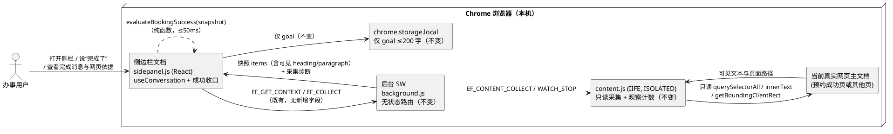
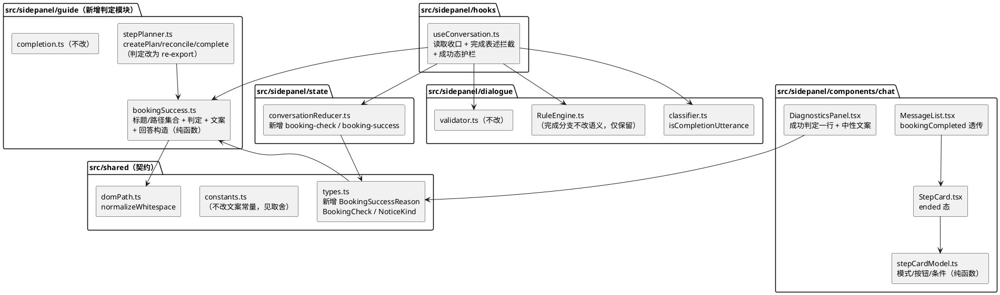
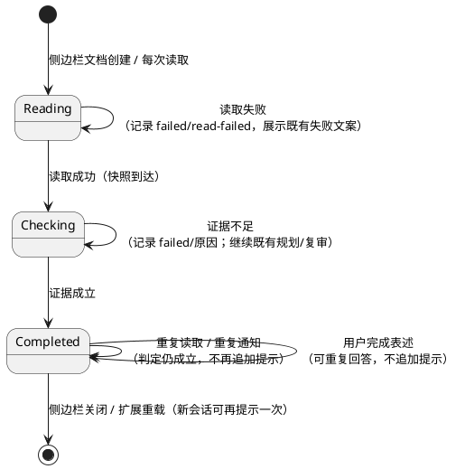
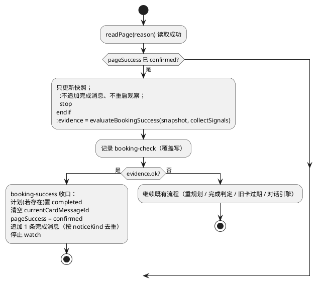
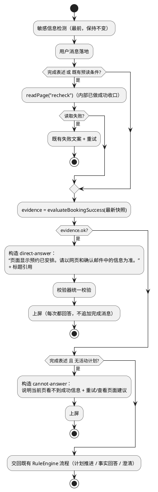
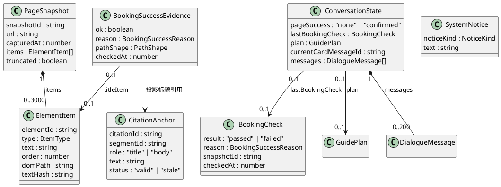

# 一、需求与存量功能关系分析

> 本文件是 `easyflow_page_guide` 第三轮（预约成功页识别与完成回答）的增量实现方案，输入依据为 `iteration3-spec.md`（739 行，F-01—F-10）与 `iteration2-design.md`、`iteration2-tasks.md` 的既有约束。本轮只做最小增量：**成功识别与计划解耦、完成提示与完成回答口径统一、成功后旧卡失效**，不新增预约流程、不新增权限、不新增站点专用逻辑。

## 1.0 分析前提（基线核实）

本章结论来自本轮只读核查（2026-11-14），不沿用文档旧口径。

| 核查项 | 实测结果 | 对本设计的约束 |
|---|---|---|
| 源码规模 | `src/` 53 个 `.ts/.tsx` 约 4655 行；`scripts/` 7 个 `.mjs` 约 1595 行 | 增量改造，不重建工程 |
| 成功判定实现 | `src/sidepanel/guide/stepPlanner.ts:620-638`，签名 `isBookingSuccessPage(snapshot, plan)` | 判定耦合计划，必须拆分 |
| 成功判定调用点 | `src/sidepanel/hooks/useConversation.ts:483`、`643`、`972`（共 3 处） | 3 处调用需统一改为计划无关判定 |
| 读取入口 | `readPage(reason)` 单点封装 `EF_GET_CONTEXT` + `EF_COLLECT`（`useConversation.ts:336-373`） | 成功判定应收口在 `readPage` 成功分支，覆盖全部入口 |
| 初始读取 | `useConversation.ts:810-829`：`readPage("initial")` 后不判定成功 | 重载后无计划成功页当前无任何提示 |
| 读取后处理 | `handleRecheck(snapshot)`（`useConversation.ts:477-577`）在 `plan === null` 时直接返回（479-482） | 无计划成功页不提示；且成功后再次调用时 484-486 早退，导致用户"完成了"零回复 |
| 完成回答 | `RuleEngine.ts:442-444`：`plan === null || step === null` → 澄清"我还没有正在陪办的步骤。" | 与页面可见成功事实矛盾 |
| 完成表述词表 | `src/sidepanel/match/lexicon.ts:133-139`（我已完成/已完成/完成了/弄好了/好了）；分类在 `classifier.ts:111-121` | 可复用词典判定完成表述，不新增第二套词表 |
| 旧卡渲染 | `MessageList.tsx:45、78-89`；`StepCard.tsx:44-49` 过期态显示"这一步已过期"+ 完成条件 + 提示语，不显示按钮 | 缺少"成功已结束"语义；成功后必须无完成条件、无按钮 |
| 当前卡指向 | `conversationReducer.ts:146-165`：`assistant-add` 设置 `currentCardMessageId`，`plan-set` 非 active 时清空 | 可复用"非 active 清空"，但 `plan === null` 时不会清空 |
| 完成提示去重 | `useConversation.ts:303-313`：`appendSystemOnce` 只比较最后一条系统消息 | 会话内幂等不足，需按消息种类去重 |
| 完成提示文案 | `useConversation.ts:489`："页面显示预约已安排；详情请以网页/确认邮件为准。" | 与 F-01 要求的固定文案不一致 |
| 诊断面板清洁 | `DiagnosticsPanel.tsx:87-91` 含"若左侧已滚到 02:00 时段" | 违反 R-45，需中性化 |
| 既有测试 | `scripts/selftest.mjs:1041-1076`（AT-36）、`1123-1238`（AT-37）、`1240-1279`（AT-38）；成功 fixture 使用既有真实站点域名（非虚构） | AT-36 需调整断言与域名；AT-37/38 必须保持 |
| 上一轮留痕 | `codearts_proof/20-booking-success.md` 明确"真实侧边栏完成状态待验"、并要求"活动计划" | 本轮需在文档中继续标注真实页待验，不得写"已通过" |
| 权限 | `public/manifest.json` 仍为 `activeTab/scripting/sidePanel/storage`，无 `host_permissions`、无静态 `content_scripts` | 本轮零权限变更 |
| 门禁命令 | `npm run typecheck`、`npm run build`、`npm run selftest`（另含 `npm run verify`） | 实现阶段真实执行并留痕，本阶段不执行 |

## 1.1 需求功能与存量功能对比

### 1.1.1 已实现功能

判定依据：需求描述的输入输出与存量实现一致，且存量行号可指向具体函数、无需新增消息通道或权限。

| 需求功能 | 存量功能 | 代码位置 | 匹配度 |
|---|---|---|---|
| 仅从路径部分识别成功形态，不读查询串/片段/域名 | `new URL(snapshot.url).pathname` + `BOOKING_SUCCESS_PATH` 独立段正则 | `src/sidepanel/guide/stepPlanner.ts:39、43-50、624-631` | 100% |
| 可见精确成功标题（中英四条、允许末尾标点与大小写） | `BOOKING_SUCCESS_TITLE` 整句正则 + `normalizeWhitespace` | `src/sidepanel/guide/stepPlanner.ts:40-41、633-637` | 100% |
| 只使用主文档可见标题/段落，隐藏节点与 iframe 不进入证据 | 采集期可见性过滤 + iframe 不采集 + `items[].type` 区分 | `src/content/collect.ts:47、60-62、81-97`；`design.md` 2.4.2 | 100% |
| 成功后停止自动观察与复审 | `stopWatch()` + watch tick 前置检查 | `src/sidepanel/hooks/useConversation.ts:375-386、853-857` | 100% |
| 阅读失败不判定成功、保留既有失败文案 | `readPage` 失败分支 → `appendFailure` | `src/sidepanel/hooks/useConversation.ts:344-360、213-232` | 100% |
| 用户完成表述识别（完成了/我已完成/好了/弄好了） | `FEEDBACK_DONE` 词典 + `classifyIntent` 的 `context-feedback/done` | `src/sidepanel/match/lexicon.ts:133-139`、`src/sidepanel/dialogue/intent/classifier.ts:111-121` | 100% |
| 引用可定位、展开"网页依据" | `ElementRef` 三元组 + `EvidencePanel` + `EF_HIGHLIGHT` | `src/sidepanel/components/chat/EvidencePanel.tsx`、`src/shared/types.ts:168-177` | 100% |
| 直接回答的引用/长度/事实校验 | `validateResponse` 的 `validateDirectAnswer` | `src/sidepanel/dialogue/validate/validator.ts:52-93` | 100% |
| 计划结束后当前卡指向清空 | `plan-set` 非 active 时 `currentCardMessageId = null` | `src/sidepanel/state/conversationReducer.ts:157-165` | 100% |
| 折叠诊断（默认折叠、无正文） | `DiagnosticsPanel` 原生 `<details>`，只渲染计数与耗时 | `src/sidepanel/components/chat/DiagnosticsPanel.tsx:26-28、147-172` | 100% |
| 权限最小化与只读边界 | 清单四项；采集不读 `value`、不点击/focus | `public/manifest.json:7`、`src/content/collect.ts:40-50` | 100% |
| 构建、清单校验、纯函数自测可执行 | esbuild 三入口 + `verify-manifest` + `node:test` | `scripts/build.mjs`、`scripts/verify-manifest.mjs`、`scripts/selftest.mjs:14-53` | 100% |
| 页面读取单点封装（上下文、tabId、超时、单飞） | `readPage` + 后台 `EF_COLLECT` | `src/sidepanel/hooks/useConversation.ts:336-373`、`src/background/router.ts` | 100% |

### 1.1.2 需要扩展的功能

差异均来自"判定门槛与回答口径"，不是能力缺失。

| 需求功能 | 存量功能 | 差异说明 | 扩展方向 |
|---|---|---|---|
| R-02 成功识别与计划状态解耦 | 判定要求 `plan !== null && plan.status === "active" && isBookingPlan(plan)`（`stepPlanner.ts:620-623`） | 输入差异：多了一个计划前置条件；业务差异：计划完成/缺失即不识别；边界差异：重载后无计划必然漏判 | 新增计划无关的 `evaluateBookingSuccess(snapshot, signals?)`，`isBookingSuccessPage` 收敛为单参薄封装；判定与提示副作用分离 |
| R-03 读取时机全覆盖 | 仅 `handleRecheck`、`runTurn`、`locateControl` 三处判定；初始读取不判定（`useConversation.ts:810-829`） | 时序差异：入口遗漏；顺序差异：`plan === null` 早退；并发差异：`ref` 早退导致零回复 | 成功判定收口到 `readPage` 成功分支；`handleRecheck` 只消费结果；`runTurn` 独立构造完成回答 |
| R-09/R-10 固定文案 + 会话内一次 | 文案"页面显示预约已安排；详情请以网页/确认邮件为准。"；去重只比较最后一条（`303-313`） | 文案差异：与验收文本不一致；去重差异：中间插入消息后可重复；状态差异：`plan === null` 无收口 | 文案单点常量；reducer 新增 `booking-success`，按 `noticeKind` 与 `pageSuccess` 双重幂等 |
| R-15—R-22 无活动计划的客观回答 | `RuleEngine.ts:442-444` 返回澄清"我还没有正在陪办的步骤。" | 响应类型差异：澄清 → 直接回答；前提差异：计划 → 页面证据；引用差异：需逐字来自快照并可定位 | 在 `useConversation` 拦截完成表述（先成功判定、再决定回答），新增纯函数构造 direct-answer 与"未确认"响应；不修改 `RuleEngine` 完成分支语义 |
| R-20 证据不足时诚实 | 无计划 + 完成表述 → 澄清（无"无法确认"说明） | 语义差异：澄清反问 → 明确无法确认 + 可行建议 | 同上的"未确认"响应（`cannot-answer`，`no-evidence`） |
| R-23—R-29 旧步骤卡成功态 | `StepCard` 仅有 `expired` 态：显示"这一步已过期"+ 完成条件（`StepCard.tsx:44-49`） | 状态差异：缺"已结束"；展示差异：仍显示完成条件；联动差异：`plan === null` 时不清空当前卡 | 新增 `ended` 态；将渲染决策抽成纯函数便于断言；reducer 收口时同时清空 `currentCardMessageId` |
| 6.6 诊断记录成功判定结果 | 诊断无成功判定维度 | 字段差异：缺结果与原因类别 | `ConversationState` 新增覆盖式 `lastBookingCheck`，面板展示一行；不记录 URL/正文 |
| 7.2 自动化覆盖 F-01—F-10 | AT-36 断言"完成后 false"、成功 fixture 使用真实域名（`selftest.mjs:1053-1060`） | 断言冲突：与 R-02 相反；数据差异：真实域名与真实预约编号 | 调整 AT-36（保留误报部分），新增 AT-39—AT-45 与虚构 fixture |
| R-45 生产源码清洁 | `DiagnosticsPanel.tsx:90` 含"02:00" | 清洁差异：测试时刻字面量 | 改中性文案；新增 `src/` 扫描断言 |

### 1.1.3 需要新增的功能或接口

**A. 成功判定与文案（新增 `src/sidepanel/guide/bookingSuccess.ts`，纯函数）**

| 功能点 | 输入 | 输出 | 依赖 |
|---|---|---|---|
| 成功证据判定 | 页面快照（可为 `null`）+ 采集信号（隐藏数/iframe/截断） | `BookingSuccessEvidence`（`ok`/`reason`/`titleItem`/`pathShape`/`checkedAt`） | `shared/types`、`shared/domPath` |
| 允许标题集合与路径段集合 | — | 常量（集中维护、可独立审查） | 无 |
| 完成提示文案、完成回答文案、未确认文案 | — | 常量（各一处来源） | 无 |
| 成功标题引用 | 命中条目 | `CitationAnchor`（逐字原文 + `ElementRef`） | `shared/types` |
| 客观完成回答构造 | 证据 | `DialogueResponse`（`direct-answer`） | `shared/types` |
| 证据不足回答构造 | 原因 | `DialogueResponse`（`cannot-answer`） | `shared/types` |
| 成功态后续输入说明 | 证据 | `DialogueResponse`（`direct-answer`，引用成功标题） | 同上 |

**B. 会话编排与状态（扩展既有模块）**

| 功能点 | 输入 | 输出 | 依赖 |
|---|---|---|---|
| 读取后统一收口 | 新快照 / 读取失败 | 成功收口一次或记录未通过原因 | `bookingSuccess`、reducer |
| 完成表述拦截 | 话语 + 最新快照 + 当前计划 | 完成回答 / 未确认回答 / 交回既有引擎 | `classifier.isCompletionUtterance` |
| 成功收口 action | 计划 + 系统消息 | 计划置 `completed`、清空当前卡、`pageSuccess=confirmed`、消息去重 | reducer |
| 成功判定诊断 | 结果 + 原因 + 快照 ID | 覆盖式 `lastBookingCheck` | reducer |

**C. 旧卡渲染（扩展既有组件 + 新增纯函数模型）**

| 功能点 | 输入 | 输出 | 依赖 |
|---|---|---|---|
| 卡片模式判定 | `ended`/`expired` | `"current" \| "expired" \| "ended"` | 无 |
| 按钮集合 | 模式 | 动作标识数组（数量可断言） | 无 |
| 完成条件可见性 | 模式 | 布尔 | 无 |
| 卡片标签 | 模式 | 文案（"现在这一步"/"这一步已过期"/"这一步已结束"） | 无 |

**D. 测试与 fixture（扩展 `scripts/`）**

| 功能点 | 输入 | 输出 | 依赖 |
|---|---|---|---|
| 6 类虚构 fixture（HTML 结构声明） | — | `scripts/fixtures/booking-*.html` | 无 |
| 新增导出（判定/模型/构造/词表） | — | esbuild stdin 导出列表 | 既有 `selftest.mjs` 打包方式 |
| 新用例 AT-39—AT-45 | 合成快照 | 断言通过/失败 + 场景编号 | `node:test` |
| 源码清洁断言 | `src/` 文本 | 0 命中 | `node:fs/promises` |

## 1.2 存量功能详细分析

### 1.2.1 成功判定（`stepPlanner.ts`）

**接口契约**

- 入参：`snapshot: PageSnapshot`、`plan: GuidePlan | null`。
- 出参：布尔值（判定通过/未通过），**不返回原因**。
- 副作用：无（纯函数）。
- 异常：`new URL` 抛错时直接返回 `false`（不区分"地址不可解析"与"路径不符"）。

**业务规则（现状顺序）**

1. 计划门槛：`plan === null` 或 `plan.status !== "active"` 或 `!isBookingPlan(plan)` → `false`（`620-623`）。
2. 路径门槛：`pathname` 不匹配 `/(?:^|\/)(?:booking|bookings|confirmation|confirmed|success)(?:\/|$)/i` → `false`（`630-632`）。
3. 标题门槛：`items` 中不存在 `type` 为 `heading`/`paragraph` 且归一化后整句匹配允许集合 → `false`（`633-637`）。

**约束与依赖**

- 依赖采集期可见性过滤：隐藏节点、零尺寸节点、iframe 文本不会进入 `items`，因此"标题可见"由采集保证。
- 依赖 `normalizeWhitespace`：合并空白、全角转半角，保证跨行标题可匹配。
- 被 `isBookingPlan` 间接约束：非预约计划页（如网点查询）即使出现同名标题也不识别，属于既有防误报设计的一部分。

**扩展点缺失**

- 无法表达"未通过原因"，导致诊断、误报防护与验收（F-05/F-06）无法逐类断言。
- 判定与"是否已提示"共用一个布尔语义，导致"计划完成后不再识别"的旧断言。

### 1.2.2 读取与判定入口（`useConversation.ts`）

**统一入口现状**

| 入口 | 代码位置 | 读取后行为 | 是否成功判定 |
|---|---|---|---|
| 侧边栏首次读取 | `810-829` | `readPage("initial")` → `handleRecheck` 未被调用 | **否** |
| 页面变化通知 | `831-852` | `readPage("recheck")` → `handleRecheck` | 是（但要求计划 active） |
| 观察 tick | `853-872` | `plan.status === "active"` 才复审 → `handleRecheck` | 同上 |
| 重试 | `880-885` | `readPage("refresh")` → `handleRecheck` | 同上 |
| 用户"完成了"（步骤按钮） | `894-899` | 预读 → `runTurn("我已完成", snapshot)` → 643 判定 → `handleRecheck` | 是 |
| "我找不到/我点错了" | `901-915` | 预读 → `runTurn` | 是（643） |
| "指给我看" | `959-1018` | 预读 → 972 判定 → `handleRecheck` | 是 |
| 普通发言需预读 | `630-646` | `wantsFreshRead` 命中 → 预读 → 643 判定 | 是 |

**关键缺陷（复核确认）**

1. `handleRecheck` 在 `plan === null` 时直接返回（`479-482`）：无计划成功页无任何提示。
2. `handleRecheck` 判为成功且 `bookingSuccessHandled.current === true` 时直接返回（`484-486`）：**已提示成功后用户再说"完成了"没有任何回答**。这是 spec 0.1.3 现象的直接成因之一，本轮必须修正。
3. `runTurn` 在 643 命中后只调用 `handleRecheck` 就 return，不产出响应：用户完成表述在成功页会被"静默吞掉"。
4. 成功后 `stopWatch()` 已调用（`490`），但 `readPage("refresh")` 仍可由用户/诊断面板触发，成功后再次读取会更新快照，且不追加任何消息（无提示，用户无法判断状态）。

### 1.2.3 完成回答分支（`RuleEngine.ts` + `classifier.ts`）

- `classifyIntent` 对 `FEEDBACK_DONE` 命中返回 `intentKind = "context-feedback"`、`feedbackKind = "done"`（`classifier.ts:111-121`），词表来自 `lexicon.ts:133-139`，**可直接复用**。
- `RuleEngine.answer` 在 `context-feedback` 分支中：
  - `not-found` 与 `misclick` 需要计划步骤（`388-395`、`421-424`）。
  - `done` 在 `plan === null || step === null` 时返回 `clarify("我还没有正在陪办的步骤。", "你想先了解页面上的什么？")`（`442-444`）。
  - 有计划时走 `evaluateCompletion` 推进步骤（`446-477`），与本轮"整体完成"口径不同。
- 引擎依赖 `request.snapshotId / page / segments / controls / plan`，**不持有原始 `items`**（`syntheticSnapshot` 从 `segments` 重建，`RuleEngine.ts:44-60`），因此"逐字来自快照的成功标题引用"在引擎内无法可靠构造；这是选择"编排层拦截"的技术依据之一。

### 1.2.4 旧卡渲染与当前卡指向（`MessageList.tsx` / `StepCard.tsx` / `conversationReducer.ts`）

- `MessageList` 的 `cardActive = planActive && message.messageId === currentCardMessageId`（`45`）；不活跃的卡传 `expired = true`（`82`）。
- `StepCard` 的 `expired` 态：标签"这一步已过期"、仍显示目标与**完成条件**、追加"页面已经变化，请按上方最新指引操作。"，**不渲染按钮**（`44-49`）。
- 尚无"成功已结束"语义：成功后旧卡仍是"已过期"（误导为"页面又变了"），且完成条件仍在。
- `plan-set` 只在计划非 active 时清空 `currentCardMessageId`（`157-165`）；若 `plan === null`，该 action 不会清空任何东西。因此成功收口必须显式清空。

### 1.2.5 测试与留痕现状

- `selftest.mjs` 用 esbuild 打包 `stdin.contents` 指定的导出（`14-47`），再 `node:test` 断言；不依赖 DOM（`makePageSnapshot`/`makeItem`/`makeControl` 构造纯数据）。
- AT-36（`1041-1076`）当前断言：活动计划 + `/booking/TEST-ID` + 精确标题 → true；`completeBookingPlan` 后同一页 → **false**；普通路径 → false；仅"已安排" → false；英文标题 → true。
- AT-37（`1123-1238`）断言时段消失后的重规划与偏好选择，并静态断言 `stepPlanner.ts`、`useConversation.ts` 不含"02:00/02:15/03:00"。
- AT-38（`1240-1279`）断言 `currentCardMessageId` 流转、`plan-set` 非 active 清空，并静态断言 `MessageList` 含 `currentCardMessageId`/`planActive`、`StepCard` 含"已过期"/`expired`、`App.tsx` 含 `planActive`。
- 上一轮留痕 `codearts_proof/20-booking-success.md`：记录"代码/fixture 通过；真实侧边栏完成状态**待验**"，并说明"不触发成功完成"在当时是预期行为。本轮以该留痕为基线，真实页仍未验收。

### 1.2.6 缺陷复核结论（需求阶段根因逐条验证）

| 编号 | 需求阶段描述 | 复核结果 | 证据 |
|---|---|---|---|
| D3-01 | `isBookingSuccessPage` 要求计划非空 + active + isBookingPlan | **成立** | `stepPlanner.ts:620-623` |
| D3-02 | `handleRecheck` 在 `plan === null` 时直接 return | **成立** | `useConversation.ts:479-482` |
| D3-03 | 初始读取 `readPage("initial")` 后未调用成功判定 | **成立** | `useConversation.ts:810-829` 与 `336-373` 均无成功判定 |
| D3-04 | `RuleEngine` 的 `context-feedback/done` 在无计划/无步骤时返回澄清 | **成立** | `RuleEngine.ts:442-444` |
| D3-05 | 旧卡在非当前时仅"这一步已过期"，仍显示完成条件 | **成立**（按钮已不显示，但完成条件与目标仍显示，且语义是"过期"而非"结束"） | `StepCard.tsx:44-49` |
| D3-06 | AT-36 断言"计划完成后同一成功页返回 false" | **成立**，且成功 fixture 使用真实站点域名 `cal.com` | `selftest.mjs:1053-1060` |
| D3-07 | 诊断面板含测试时刻"02:00" | **成立** | `DiagnosticsPanel.tsx:87-91` |
| D3-08 | （本轮补充）已提示成功后用户说"完成了"无任何回答 | **成立**：`runTurn` 643 → `handleRecheck` → 484-486 早退且无返回消息 | `useConversation.ts:643-646、483-486` |
| D3-09 | （本轮补充）`appendSystemOnce` 只与最后一条系统消息比较，无法保证会话内一次 | **成立** | `useConversation.ts:303-313` |
| D3-10 | （本轮补充）`bookingUrlShape` 的返回值被当作步骤的 `redactedUrl` 传入 | **成立**，属既有简化，本轮不改，列入风险 | `stepPlanner.ts:322、176-187` |

### 1.2.7 规格与实现的冲突裁决（K3）

| 编号 | 冲突/歧义 | 裁决 | 理由 |
|---|---|---|---|
| K3-01 | "判定"与"提示一次"是否需要同一布尔 | 分离：判定为纯函数且恒可重算；提示由会话状态 `pageSuccess` 幂等 | 同时满足 R-02（计划完成后仍识别）与 R-10（只提示一次） |
| K3-02 | `isBookingSuccessPage` 是否保留 `plan` 形参 | **收敛为单参**，调用点与 AT-36 同步调整 | 保留无用形参会诱导再次耦合，且与 R-02 直接冲突 |
| K3-03 | 完成提示载体（系统消息 / 助手消息） | 系统消息（`noticeKind: "booking-complete"`），文案固定 | 最小改动，沿用既有消息体系；用户提问时另给助手回答，不构成重复 |
| K3-04 | `plan === null` 时是否虚构计划 | 不虚构；仅当存在计划时置 `completed` | 成功识别必须与计划解耦（R-02） |
| K3-05 | 无活动计划 + 完成表述 + 证据不足 | 由澄清改为"无法确认"（`cannot-answer`，`no-evidence`） | R-20 明确要求；仅限完成表述，其他无计划话语仍走既有澄清 |
| K3-06 | "标题不可见"如何表达 | 用采集信号（`droppedHidden`/`iframeCount`/`openShadowRoots`/快照截断）作为原因类别，不推测具体节点 | 不可直接观测，避免编造 |
| K3-07 | 成功后历史旧填写提示是否隐藏 | 保留历史文本，只把步骤卡降级为"已结束"，不新增折叠组件 | T3-03 默认；避免破坏会话连续性与大改 UI |
| K3-08 | 成功后诊断面板"重新读取页面"是否可用 | 置为禁用，并标注"已完成" | 避免无效读取与"点了没反应"的困惑；不影响非成功路径 |
| K3-09 | AT-36 的调整边界 | 保留普通路径、仅"已安排"、英文标题等误报断言；删除"完成后 false"；新增无计划与原因类别断言；域名改虚构 | spec 附录 B-5 |
| K3-10 | 成功后用户继续问"然后呢/还要做什么" | 成功态下返回固定说明并引用成功标题，不生成新步骤 | spec 5.2.3.2；避免"成功后仍生成预约步骤"（R-28） |
# 二、增量设计方案

## 2.1 实现模型

### 2.1.1 上下文视图

本轮**不新增运行实体、不新增消息通道、不新增权限、不新增网络端点**。变化只发生在侧边栏文档内：新增一个纯函数判定模块，成功判定收口到既有 `readPage`，提示与回答由既有消息体系承载。



调用频率与载荷边界：

| 交互 | 触发 | 频率 | 载荷约束 |
|---|---|---|---|
| `evaluateBookingSuccess` | 每次 `readPage` 成功返回前 | 每次读取 1 次（会话首读 1 次 + 事件驱动） | 只读快照内存，不发消息 |
| 完成提示 | 首次判定成功 | 会话内 1 次 | 单条系统消息，固定文案 |
| 完成回答 | 每次用户完成表述 | 每次 1 次 | `direct-answer`，≤3 句、≤180 字、1 条标题引用 |
| `WATCH_STOP` | 成功收口 | 成功后 1 次 | 既有消息，无字段变化 |
| 成功判定诊断 | 每次判定 | 覆盖写，不追加消息 | 仅结果 + 原因类别 + 快照 ID |

### 2.1.2 服务/组件总体架构



**职责与依赖规则**

| 层 | 本轮职责 | 允许依赖 | 禁止 |
|---|---|---|---|
| `guide/bookingSuccess.ts` | 路径形态、精确标题、原因类别、固定文案、回答构造 | `shared/types`、`shared/domPath` | Chrome API、DOM、读表单值、读查询串、随机/时间参与分支 |
| `guide/stepPlanner.ts` | 计划/步骤/重规划/完成（既有） | `guide/bookingSuccess`（仅路径段判定） | 新增成功判定逻辑（必须集中在 `bookingSuccess`） |
| `hooks/useConversation.ts` | 读取收口、完成表述编排、状态派发 | `guide/*`、`state/*`、`dialogue/*` | 直接判定 DOM；重复实现词表 |
| `state/conversationReducer.ts` | 成功后状态收口（计划、当前卡、页面成功态、完成消息去重） | `shared/types` | 发消息、读页面 |
| `components/chat/stepCardModel.ts` | 卡片模式与可见元素决策 | 无 | 读全局状态、读 DOM |

### 2.1.3 实现设计文档

#### （1）成功收口状态机（会话级）



状态约束：

1. `Completed` 由 `pageSuccess = "confirmed"` 表达，**不持久化**（不写 `storage.local`），重载即回到 `Reading`。
2. `Completed` 一旦进入，后续任何读取都不能回退为"可操作步骤"（spec 5.7.3.2）。
3. `Checking` 是每次读取后的短暂状态，不产生额外的用户可见提示，仅覆盖写诊断。

#### （2）读取后统一处理顺序



顺序硬性要求：**先成功判定，再普通规划/重规划**。原因：成功页上若先跑 `reconcileBookingPlan`，会因控件消失而把计划置 `superseded` 并追加"原来的步骤不在页面上"提示，与"预约已完成"冲突（spec 5.4.3.1 要求以成功状态优先）。

#### （3）完成表述处理顺序（`runTurn` 内）



"无活动计划"判定口径与 spec 术语一致：`plan === null || plan.status !== "active" || currentStep(plan) === null`。存在活动计划且证据不足时**保持**既有"这一步完成/未验证"语义（不回退第二轮 AT-10—AT-12 行为）。

#### （4）成功后的一次性提示与幂等

| 幂等层 | 机制 | 覆盖场景 |
|---|---|---|
| 编排层 | `bookingSuccessHandled` ref（既有，保留） | 同一会话内重复读取、重复 tick、重复 page-changed |
| 状态层 | `pageSuccess === "confirmed"` | 重复读取后 `readPage` 直接跳过收口 |
| 消息层 | reducer 的 `booking-success` 检查 `messages` 中是否已存在 `noticeKind === "booking-complete"` | 极端并发下两个收口同时到达（同一 tick 内 dispatch 顺序） |
| 诊断层 | `lastBookingCheck` 覆盖写 | 不产生重复可见信息 |

**同轮读取的时序约束**：`stateRef` 由 `useEffect` 同步（`useConversation.ts:291-293`），同一轮 `runTurn` 内刚收口时 `stateRef.current.pageSuccess` 可能尚未更新为 `"confirmed"`。因此编排层的"是否已收口/是否进入成功态"判定一律读同步 ref（`bookingSuccessHandled`），`pageSuccess` 只用于渲染与诊断展示；完成回答本身以"当前快照 `evaluateBookingSuccess(...).ok`"为准，不依赖 `pageSuccess`。

重载语义：`ref`、reducer state 都随侧边栏文档销毁而归零，因此新会话首读成功页会再提示一次（R-12）。

#### （5）并发与失效规则

1. 成功判定只依赖"最近一次成功读取的快照"；迟到快照沿用既有 `snapshotId`/单飞锁规则丢弃（不改后台）。
2. 成功收口与旧计划清理在**同一次 dispatch** 内完成（`booking-success` 同时携带计划与消息），避免"完成消息已出现、旧卡仍可点击"的中间态（spec 4.2.4）。
3. 成功后 `stopWatch()` 与"watch tick 的 plan.status 检查"双重保证不再自动复审。
4. 成功后 `readPage("refresh")` 仍可被用户触发（本轮将按钮置禁用）；即使触发，也只更新快照，不追加提示、不回退状态。

## 2.2 接口设计

### 2.2.1 总体设计

| 类别 | 名称 | 稳定性 | 变更方式 |
|---|---|---|---|
| 新增判定 | `evaluateBookingSuccess` | 稳定（纯函数契约） | 新模块，新增字段只增不改 |
| 变更判定 | `isBookingSuccessPage` | 内部（实验） | 形参从 `(snapshot, plan)` 收敛为 `(snapshot)`；`stepPlanner` 保留 re-export 以缩小调用面改动 |
| 新增构造 | `buildBookingDoneResponse`、`buildBookingUnconfirmedResponse`、`buildBookingAfterSuccessResponse`、`buildSuccessCitation` | 稳定（纯函数契约） | 新增 |
| 新增词表辅助 | `isCompletionUtterance` | 稳定 | 复用 `FEEDBACK_DONE` |
| 新增卡片模型 | `resolveStepCardMode`、`stepCardActions`、`shouldShowCompletion`、`stepCardLabel` | 稳定 | 新增 |
| 变更 reducer | `booking-check`、`booking-success` | 稳定 | 新增 action，既有 action 语义不变 |
| 变更消息种类 | `NoticeKind` 增加 `"booking-complete"` | 稳定 | 只增成员 |
| 消息协议 | `EF_GET_CONTEXT`/`EF_COLLECT`/`EF_HIGHLIGHT`/`EF_CONTENT_*` | 不变 | 无字段变化 |

设计原则：

1. **判定与副作用分离**：判定可反复调用且结果一致；"提示一次"只由状态层保证。
2. **引用只来自当前快照**：回答的引用由 `items` 中实际命中的标题条目投影，不接受外部传入文本。
3. **文案各一处**：完成提示、完成回答、未确认说明、成功后续说明各只有一个常量来源。
4. **不新增第二套定位体系**：引用仍为 `ElementRef` 三元组，复用 `EF_HIGHLIGHT`。

### 2.2.2 接口清单

#### 接口 A：`evaluateBookingSuccess`（新增，核心）

```ts
type BookingSuccessReason =
  | "read-failed"
  | "path-mismatch"
  | "title-mismatch"
  | "title-not-visible";

interface BookingSuccessSignals {
  droppedHidden?: number;
  iframeCount?: number;
  openShadowRoots?: number;
  snapshotTruncated?: boolean;
}

interface BookingSuccessEvidence {
  ok: boolean;
  reason: BookingSuccessReason | null;
  titleItem: ElementItem | null;
  pathShape: "success" | "other" | "unavailable";
  checkedAt: number;
}

function evaluateBookingSuccess(
  snapshot: PageSnapshot | null,
  signals?: BookingSuccessSignals,
): BookingSuccessEvidence;
```

- **业务说明**：只依据"路径形态 + 主文档可见精确标题"判定成功证据，与计划状态完全无关；返回原因类别供诊断与验收断言。
- **前置条件**：`snapshot` 为当前标签页最近一次成功采集结果；`signals` 来自同一次采集的诊断。
- **后置条件**：无副作用；不读取 `controls`（避免读取控件标签）；不读取查询串、片段、域名；不写任何存储。
- **异常映射**：`snapshot === null`、`url` 不可解析、`items.length === 0` → `reason: "read-failed"`，`ok: false`（不抛错）。
- **确定性**：同一 `snapshot` 与 `signals` 必须得到同一 `ok`/`reason`/`titleItem`；`checkedAt` 只取 `snapshot.capturedAt`，不参与分支。
- **性能**：路径不符时立即返回，不遍历 `items`；路径符合时单次线性扫描（≤3000 条），目标 ≤50ms。

#### 接口 B：`isBookingSuccessPage`（兼容封装）

```ts
function isBookingSuccessPage(snapshot: PageSnapshot | null): boolean;
```

- **业务说明**：`evaluateBookingSuccess(snapshot).ok` 的布尔投影，供既有调用点与自测使用。
- **变更说明**：删除 `plan` 形参；`stepPlanner.ts` 保留 `export { isBookingSuccessPage }`，但实现来自 `bookingSuccess.ts`。
- **后置条件**：无副作用；不改变既有"普通路径 / 仅'已安排' / 英文标题"判定结果。

#### 接口 C：完成回答与未确认回答构造（新增，纯函数）

```ts
function buildSuccessCitation(titleItem: ElementItem, snapshotId: string): CitationAnchor;

function buildBookingDoneResponse(evidence: BookingSuccessEvidence): DialogueResponse;

function buildBookingUnconfirmedResponse(reason: BookingSuccessReason | null): DialogueResponse;

function buildBookingAfterSuccessResponse(evidence: BookingSuccessEvidence): DialogueResponse;
```

| 接口 | 输出形态 | 必备内容 | 禁止 |
|---|---|---|---|
| `buildSuccessCitation` | `CitationAnchor` | `ref` 来自 `titleItem`（`elementId/domPath/textHash`）；`text` = 归一化后的标题原文；`role: "title"`；`status: "valid"` | 改写、截断、拼接其他文本 |
| `buildBookingDoneResponse` | `direct-answer` | 正文以"页面显示预约已安排"开头；≤2 句；1 条引用 | 下一步、控件、完成条件、第一人称完成承诺 |
| `buildBookingUnconfirmedResponse` | `cannot-answer` | 原因 `no-evidence`（或 `read-failed`）+ 1 条建议；正文不含"预约已安排/预约已完成" | 任何完成结论、推测 |
| `buildBookingAfterSuccessResponse` | `direct-answer` | 说明任务已结束、以网页与确认邮件为准；引用成功标题 | 生成新步骤、索取页面外信息 |

- **引用可定位**：`CitationAnchor.segmentId` 使用 `seg-<snapshotId>-booking-title` 形式（成功页可能没有语义段，校验器不依赖段存在，只校验元素存在与原文包含关系）。
- **未确认口径**：`buildBookingUnconfirmedResponse` 的 `reason` 只用于选择"页面看不到成功信息（`no-evidence`）"或"读取失败（`read-failed`）"两类文案；读取失败通常已由 `readPage` 的既有失败分支拦截，该函数主要服务"读取成功但证据不足"。
- **引擎诊断字段填充（契约要求，不留空）**：完成回答与成功后续说明的 `diagnostics` 固定为 `mode: "rule-demo"`、`engineMs: 0`、`retrievedSegments: 0`、`citationCount: 1`、`intentKind: "context-feedback"`、`priorityHit: "booking-success"`、`outboundBytes: 0`、`sensitiveDetected: false`；未确认回答的 `citationCount: 0`、`priorityHit: "booking-unconfirmed"`。
- **前提约束**：两个完成类构造只在"当前快照仍满足成功证据"时生成 `direct-answer`；若当前快照已不成立（标题消失/页面已切换），只能生成 `cannot-answer`，不得用旧引用冒充当前页依据（避免 `citation-missing` 与误导）。
- **校验**：四个构造结果在上屏前仍统一经过 `validateResponse`；被拒绝时按既有规则降级为"我暂时不能可靠回答"，并记录拒绝原因（不得绕过校验直接上屏）。
- **文案来源**：完成回答正文、未确认正文、成功后续说明各自只来自 `bookingSuccess.ts` 中的一个常量。

#### 接口 D：`isCompletionUtterance`（新增，复用词表）

```ts
function isCompletionUtterance(utterance: string): boolean;
```

- **业务说明**：判定用户话语是否包含既有 `FEEDBACK_DONE` 词条（我已完成/已完成/完成了/弄好了/好了）。
- **约束**：不得新增第二套完成词表；实现必须复用 `lexicon.FEEDBACK_DONE`，与 `classifyIntent` 的 `context-feedback/done` 判定保持一致。
- **前置/后置**：纯函数，无副作用。

#### 接口 E：卡片模型（新增，纯函数）

```ts
type StepCardMode = "current" | "expired" | "ended";
type StepCardAction = "locate" | "not-found" | "misclicked" | "done" | "switch-task";

function resolveStepCardMode(input: { ended: boolean; expired: boolean }): StepCardMode;
function stepCardActions(mode: StepCardMode): StepCardAction[];
function shouldShowCompletion(mode: StepCardMode): boolean;
function stepCardLabel(mode: StepCardMode): string;
```

| 模式 | 优先级 | 标签 | 动作数量 | 完成条件 |
|---|---|---|---|---|
| `ended` | 最高（成功后） | "这一步已结束" | 0 | 不显示 |
| `expired` | 次之（既有，计划不可用） | "这一步已过期" | 0 | 沿用既有（显示） |
| `current` | 最低 | "现在这一步" | 5 | 显示 |

说明：`expired` 的完成条件行为**保持既有**（AT-38 不回退）；仅 `ended` 隐藏完成条件（R-25）。

#### 接口 F：reducer 新增 action

```ts
type ConversationAction =
  | { type: "booking-check"; check: BookingCheck }
  | { type: "booking-success"; plan: GuidePlan | null; message: SystemNotice };

interface BookingCheck {
  result: "passed" | "failed";
  reason: BookingSuccessReason | null;
  snapshotId: string;
  checkedAt: number;
}
```

`booking-success` 的契约：

1. **入参**：`plan`（可为 `null`；调用方传"当前计划"，非计划构造）+ `message`（由调用方用固定常量构造的系统消息）。
2. **后置条件**：
   - `plan !== null` 时置为 `completed`（保留 `steps` 与历史）；
   - `currentCardMessageId = null`（无论 `plan` 是否为 `null`）；
   - `pageSuccess = "confirmed"`；
   - `phase = "ready"`、`busy = false`、`slowHint = false`、`canRetry = false`；
   - 追加消息，但若已存在 `noticeKind === "booking-complete"` 则不追加。
3. **幂等**：连续调用 3 次 → 消息计数 1、计划状态 `completed`、`currentCardMessageId` 为 `null`。
4. **不回退**：后续 `read-ok`、`page-changed` 不清除 `pageSuccess`。

`booking-check` 的契约：覆盖写 `lastBookingCheck`，不追加消息、不改变忙碌状态；仅用于诊断展示。

#### 接口 G：既有接口的必要扩展

| 既有接口 | 扩展内容 | 兼容性 |
|---|---|---|
| `readPage(reason)` | 成功分支内部追加"成功判定 + 收口"；返回类型不变（`PageSnapshot \| null`） | 调用点无需改签名；行为增强 |
| `handleRecheck(snapshot)` | 开头增加 `pageSuccess`/ref 早退守卫，避免重复处理 | 行为更保守 |
| `MessageList` props | 新增 `bookingCompleted: boolean`，保留 `planActive`/`currentCardMessageId` | 旧 prop 语义不变（AT-38 断言保持） |
| `StepCard` props | 新增 `ended?: boolean`，保留 `expired` | 旧 prop 缺省行为不变 |
| `DiagnosticsPanel` props | 新增 `lastBookingCheck`、`bookingCompleted` | 面板默认折叠，新增一行 |

## 2.3 数据模型

### 2.3.1 设计目标

1. **术语对齐**：成功证据、允许标题集合、成功路径形态、一次性完成消息、客观完成回答与 `iteration3-spec.md` 第 2 章一致。
2. **计划解耦**：成功证据不引用 `GuidePlan`；计划只作为"收口时是否需要置 completed"的输入。
3. **可断言**：证据带原因类别，提示次数与按钮数量都能在纯数据层断言。
4. **不持久化**：成功状态、证据、提示只存在侧边栏内存；`storage.local` 仍只有 `goal`。
5. **向后兼容**：`PageSnapshot.schemaVersion` 保持 `1`；`ElementItem`、`ElementRef`、`GuidePlan`、`GuideStep`、`DialogueResponse` 字段语义不变；新增字段可选。

### 2.3.2 模型实现



**字段约束**

| 类型 | 字段 | 约束 |
|---|---|---|
| `BookingSuccessEvidence` | `reason` | `ok = true` 时必须为 `null`；`ok = false` 时必为四类之一 |
| | `pathShape` | 只表达"路径有/无成功段/地址不可用"，不含域名、查询串、编号 |
| | `checkedAt` | 取 `snapshot.capturedAt`（证据时刻），不取当前时间 |
| | `titleItem` | `ok = true` 时必为 `heading` 或 `paragraph` 条目；不得是 `link`/`button`/`inputLabel` |
| `BookingCheck` | `snapshotId` | 必填；只用于关联"这是对哪次读取的判定"，不展示完整地址 |
| | `reason` | 与 `evidence.reason` 一致，不新增自由文本 |
| `ConversationState.pageSuccess` | 取值 | `"none"`（默认）/`"confirmed"`；不持久化；成功后不回退 |
| `ConversationState.lastBookingCheck` | 数量 | 单条覆盖写，不累积（避免诊断刷屏） |
| `SystemNotice.noticeKind` | 新增成员 | `"booking-complete"` 仅用于完成提示，重复判定不得追加第二条 |
| 文案常量 | 数量 | 完成提示 1 条、完成回答 1 条、未确认 1 条、成功后续 1 条；各自只在一处定义 |

**序列化与版本**

- 新增字段全部为 JSON 原生类型（字符串字面量枚举、布尔、数字），可结构化克隆。
- 不新增 `storage.local` 键；不缓存 `items`/`evidence`/提示到持久化层。
- 日志只允许 `result/reason/snapshotId 后缀/耗时`；**不打印标题原文、URL、查询串**。
## 2.4 成功证据判定算法（纯函数）

### 2.4.1 路径形态（只读 `pathname`）

| 规则 | 说明 |
|---|---|
| 输入 | `snapshot.url` → `new URL(url).pathname`；不读 `search`、`hash`、`host`、`hostname` |
| 成功段集合 | `booking`、`bookings`、`confirmation`、`confirmed`、`success`（大小写不敏感），必须为**独立路径段** |
| 匹配方式 | `/(?:^|\/)(?:booking|bookings|confirmation|confirmed|success)(?:\/|$)/i` |
| 判定示例 | `/booking`、`/bookings/`、`/confirmation`、`/x/confirmed`、`/success/step` → 命中；`/book`、`/mybookings`、`/successful` → 不命中 |
| 禁止 | 不使用域名白名单、预约编号正则、页面标题含品牌词、图标判断 |
| 失败原因 | 路径无成功段 → `path-mismatch`；`new URL` 抛错 → `read-failed` |

保留 `stepPlanner.ts` 既有的 `bookingUrlShape()` 行为（返回 `"booking-success-path"` 或 `"booking-path"`），仅把正则实现迁到 `bookingSuccess.ts` 并由其导入，避免两处路径规则漂移。

### 2.4.2 精确标题（整句相等）

| 规则 | 说明 |
|---|---|
| 候选来源 | `snapshot.items` 中 `type === "heading"` 或 `type === "paragraph"` 的条目 |
| 允许标题集合（唯一来源） | 该会议已安排 / 会议已安排 / This meeting is scheduled / Meeting is scheduled |
| 归一化 | 复用 `normalizeWhitespace`（合并空白、全角转半角）；英文统一小写；去掉末尾一个 `。`/`.`/`！`/`!` |
| 比较 | **归一化后整串相等（`===`）**，禁止 `includes`、禁止分词、禁止去标点后模糊比较 |
| 排除 | `link`、`button`、`inputLabel` 类型条目一律不可作为标题证据（避免"加入会议""已安排"按钮文本误报） |
| 正面示例 | "该会议已安排。"（末尾句号）→ 通过；"This meeting is scheduled!" → 通过 |
| 反例 | "该会议已安排，请查收邮件"、"已安排"、"会议已安排，请准时参加"、"This meeting is scheduled for Nov 17" → 不通过 |

### 2.4.3 可见性证据链

标题"可见"不是由判定模块再次查询 DOM，而是由采集链保证，判定模块只信任快照：

1. 采集期只收录可见条目：`[hidden]`/`aria-hidden`/`template` 祖先、`display:none`、`visibility:hidden|collapse`、`opacity:0`、零尺寸节点均被丢弃（`src/content/collect.ts:81-97`；嵌套标题去重见 `201-210`）。
2. iframe 内容不在采集范围，且 `iframeCount` 记录在采集诊断中（`collect.ts:658`）。
3. 单条文本截断上限 300 字，标题普遍远低于上限；若快照级 `truncated` 为真，说明条目/字符预算被裁剪，判定必须按"证据不足"处理。
4. 因此判定模块的输入是"可见标题的唯一可信来源"；原因类别 `title-not-visible` 由采集信号表达，**不推测被隐藏的具体节点**。

### 2.4.4 原因类别判定顺序（互斥）

| 顺序 | 条件 | `reason` | `ok` |
|---|---|---|---|
| 1 | `snapshot === null` / `url` 不可解析 / `items.length === 0` / `signals.snapshotTruncated === true` | `read-failed` | false |
| 2 | 路径不含独立成功段 | `path-mismatch` | false |
| 3 | 存在归一化后整句等于允许集合的 `heading`/`paragraph` | `null` | true |
| 4 | 无精确标题，但存在包含允许标题文本的 `heading`/`paragraph`（带额外词/被改写/被截断） | `title-mismatch` | false |
| 5 | 无精确标题，且存在隐藏/iframe/开放 shadow root 信号（`droppedHidden > 0`、`iframeCount > 0`、`openShadowRoots > 0`） | `title-not-visible` | false |
| 6 | 其余（页面上根本没有该标题文本） | `title-mismatch` | false |

说明：第 4/5 顺序把"页面有相近文本但不可用"与"可能存在但不可见"区分开；第 6 作为兜底，不把"没有标题"说成"标题被隐藏"。`signals.snapshotTruncated` 由调用方按"快照 `truncated` 为真或采集诊断显示条目/字符预算被裁剪"填充，判定模块不自行推断。

### 2.4.5 性能与成本

- 路径不符是绝大多数场景，**常数时间返回**，不触碰 `items`（满足 spec 4.1.1 ≤50ms）。
- 路径符合时单次线性扫描，每个条目做一次 `normalizeWhitespace` + 最多 4 次整串比较；`N ≤ 3000` 时预计 <10ms。
- 不新增 DOM 查询、不触发重排、不读 `controls`、不读表单值。
- 判定在每次读取返回前执行 1 次；成功后由 `pageSuccess` 提前跳过，不产生额外成本。

### 2.4.6 关键取舍

| 取舍 | 选择 | 理由 | 代价 |
|---|---|---|---|
| 判定是否吃 `plan` | 不吃 | R-02 要求与计划解耦；重载后无计划必须可判定 | 失去"只在预约计划下才判定"的旧兜底，改由精确标题 + 路径段兜底（默认 T3-01/T3-11） |
| 是否增加"预约语境"门槛 | 不加 | 与用户明确要求一致；加门槛会牺牲重载场景 | 极端情况下普通页面偶然双命中（标题与路径同时精确），列入风险 R3-01 |
| 标题匹配是否允许包含 | 不允许 | R-05 明确禁止包含/近似 | 真实页若标题带后缀会漏判，需按 T3-06 由用户拍板是否扩集合 |
| 是否用 `document.title` 作为证据 | 不用 | `document.title` 可能来自 `title` 属性/模板，不是主文档可见标题 | 可能漏判只把标题放在 `<title>` 的页面（符合 R-04） |
| 原因类别是否细分更多 | 不细分 | spec 6.1.5 只要求四类，便于集中审查 | 诊断信息粒度有限 |

## 2.5 统一判定入口与处理顺序

### 2.5.1 入口矩阵（全部读取入口）

| 入口 | 代码位置（现状） | 本轮处理 |
|---|---|---|
| 侧边栏首读 | `useConversation.ts:810-829` | `readPage` 内部收口 → 成功即提示一次（新增覆盖） |
| 页面变化通知 | `831-852` | `readPage` 收口；`bookingSuccessHandled` 早退保留 |
| 观察 tick | `853-872` | `readPage` 收口；成功后 watch 已停止 + `plan.status` 检查兜底 |
| 重试 | `880-885` | `readPage` 收口；成功后诊断按钮禁用 |
| "我已完成" | `894-899` | `readPage` 收口 → `runTurn` 构造完成回答 |
| "我找不到/我点错了" | `901-915` | 同上；成功后旧卡已无按钮（历史点击按完成口径回答） |
| "指给我看" | `959-1018` | `readPage` 收口；若已成功，提示"这一步已经结束"并不再高亮旧控件 |
| 普通发言预读 | `630-646` | 预读条件新增"完成表述"；收口后由 `runTurn` 决定回答 |
| 诊断面板"重新读取页面" | `DiagnosticsPanel onRefresh → retry` | 成功态禁用按钮（`bookingCompleted`） |

### 2.5.2 处理顺序（硬约束）

1. 读取成功 → 先派发既有 `read-ok`（快照就位）→ `evaluateBookingSuccess` → 覆盖写 `lastBookingCheck`。
2. 若成功且本会话未收口 → `booking-success`（计划置 completed、清当前卡、`pageSuccess=confirmed`、1 条完成消息、停 watch）。
3. 若成功且已收口 → 只更新快照，不追加任何系统提示，不重启观察。
4. 若未成功 → 继续既有顺序：预约计划重规划 → 完成条件判定 → 对话引擎。
5. 任何情况下，**不得在成功页上给出"下一步"**（`next-step` 响应或 StepCard 的当前态）。

### 2.5.3 幂等、并发与作废

| 场景 | 设计 |
|---|---|
| 同一成功页被读 3 次（变化/观察/重试） | 判定每次都 `ok = true`；提示由 `pageSuccess`/消息种类去重，计数 1 |
| 完成判定与 page-changed 并发 | 两个收口都走 `booking-success`，reducer 去重；计划只置 completed 一次（幂等赋值） |
| 成功后页面标题消失（动态刷新） | `pageSuccess` 不回退；不重复提示；不恢复计划 |
| 迟到快照 | 沿用既有单飞锁与 `snapshotId` 规则丢弃；收口只对最新快照执行 |
| 用户连续说"完成了" | 每次都回答（一致文案），不追加完成消息、不生成步骤 |

## 2.6 一次性完成消息

### 2.6.1 触发与文案

- 触发点：`readPage` 成功分支（所有入口共用）。
- 载体：`SystemNotice`，`noticeKind: "booking-complete"`。
- 文案（唯一来源，位于 `bookingSuccess.ts`）：`预约已完成。请以网页和确认邮件中的信息为准。`
- 不携带：引用、目标控件、完成条件、下一步、旧计划操作（R-11）。

### 2.6.2 状态变化（同一 dispatch 内完成）

| 状态 | 变化 | 目的 |
|---|---|---|
| `plan` | 非空 → `status: "completed"`（`steps` 保留） | R-23；历史可追溯 |
| `currentCardMessageId` | → `null` | 取消"当前步骤"指向，旧卡不可操作 |
| `pageSuccess` | → `"confirmed"` | UI 旧卡"已结束"、防止状态回退 |
| `messages` | 追加 1 条完成消息（按种类去重） | R-09/R-10 |
| `phase`/`busy`/`slowHint` | → `ready`/`false`/`false` | 界面立即稳定 |
| watch | `stopWatch()`（编排层副作用） | R-13；`plan.status !== "active"` 亦阻止 tick |

### 2.6.3 去重与重载

1. 编排层 ref（`bookingSuccessHandled`）防止同一会话重复收口。
2. reducer 检查 `messages` 中是否已有 `noticeKind === "booking-complete"`；已有则不追加。
3. 侧边栏关闭/扩展重载 → 状态归零 → 新会话首读成功页可再提示一次（R-12）。
4. 旧会话消息不恢复（无持久化）。

### 2.6.4 停止复审与后续输入

- 成功收口后 `stopWatch()`；`watch tick` 因 `plan.status !== "active"` 与 `pageSuccess` 双重跳过。
- 用户继续问"然后呢/还要做什么/下一步/继续" → 成功态护栏返回 `direct-answer`：说明预约已完成、以网页与确认邮件为准，引用成功标题；不生成新步骤（R-28）。
- 用户继续问页面事实（"确认邮件多久到"）→ 若页面无依据，走既有 `no-evidence` 文案；不编造（R-36）。

## 2.7 客观完成回答

### 2.7.1 方案对比与选择

| 方案 | 改动面 | 优点 | 缺点 | 结论 |
|---|---|---|---|---|
| A. `RuleEngine` 新增"成功证据"分支 | 需扩展 `DialogueRequest`（新增证据与标题条目）、扩展 `syntheticSnapshot`、修改 `done` 分支语义、同步 3 处契约校验 | 引擎内语义完整 | 契约扩散、回归面大；引擎内无法保证引用逐字来自 `items` | 不采用 |
| B. `useConversation` 拦截 | 只在编排层新增 1 个判定 + 2 个纯函数构造；`RuleEngine` 完全不动 | 最小；引用直接来自快照；与收口同一条数据流 | 编排层承担少量问答分支 | **采用（默认）** |

选择 B 的依据：R-22 要求"响应类型为直接回答、不是澄清"，而 `RuleEngine` 的 `done` 分支在无计划时必然返回澄清；在编排层拦截可在**不改动引擎完成分支**的前提下同时满足"有/无计划一致"（R-19），并保留引擎对其他话语的既有行为。

### 2.7.2 生成规则

| 项 | 规则 |
|---|---|
| 触发 | `isCompletionUtterance(utterance)` 为真，且最新快照 `evaluateBookingSuccess(...).ok = true` |
| 响应类型 | `direct-answer`（R-16、R-22） |
| 正文 | `页面显示预约已安排。请以网页和确认邮件中的信息为准。`（2 句、≤180 字） |
| 引用 | 1 条，`role: "title"`，文本为命中标题的**归一化原文**（逐字来自快照） |
| 校验 | 上屏前经 `validateResponse`；拒绝则降级为 `cannot-answer` 并记录原因 |
| 禁止 | "我帮你完成了预约""已替你提交""已发送确认邮件"；预约时间/地点/参会人/会议链接/编号等页面未明确支持的具体信息（R-36） |
| 频次 | 每次完成表述都可回答；不追加完成提示；不推进计划 |

### 2.7.3 证据不足与读取失败

| 情形 | 响应 | 文案要点 | 禁止 |
|---|---|---|---|
| 无活动计划 + 完成表述 + 页面无成功证据 | `cannot-answer`（`no-evidence`） | 明确"我在当前页面没看到预约已安排/预约完成的信息"+ 建议"确认页面已显示预约完成，或点重试再读一次" | 声称已完成；反问"你想先了解页面上的什么" |
| 无活动计划 + 完成表述 + 读取失败 | 既有失败文案 + 重试（`runTurn` 在 `readPage` 返回 `null` 时直接结束） | 说明读取失败原因 | 以用户表述代替页面证据 |
| 有活动计划 + 完成表述 + 无成功证据 | 既有 RuleEngine 流程（这一步完成/未页面验证） | 保持第二轮口径 | 不得改写为"整体完成" |
| 成功页标题刚渲染、快照仍旧 | 本次未确认；`wantsFreshRead` 已预读一次 | 说明"我还没在当前页面看到预约已安排，请确认页面已加载完成" | 重试循环；编造成功 |

### 2.7.4 成功态输入护栏

在 `runTurn` 中，`pageSuccess === "confirmed"` 时：

| 用户输入 | 处理 |
|---|---|
| 完成表述 | 客观完成回答（每次） |
| "然后呢/还要做什么/下一步/继续/还要" | 成功后续说明 + 标题引用（不生成步骤） |
| 其他页面事实问题 | 交回既有 `RuleEngine`（只用当前页证据；无依据则明说） |
| 代填/代提交类 | 交回既有 `safety-boundary`（只读边界） |

护栏不得改变"完成后不生成预约步骤"这一点（R-28）。护栏与完成回答都要求**当前快照仍判定成功**并提供当前引用；若标题已消失，则返回 `cannot-answer`（说明当前页已看不到成功信息，本会话此前确认过），不引用旧条目。

## 2.8 旧步骤卡成功态

### 2.8.1 模式判定

`resolveStepCardMode({ ended, expired })` 的优先级：`ended` > `expired` > `current`。

| 场景 | `ended` | `expired` | 模式 | 标签 | 动作 | 完成条件 |
|---|---|---|---|---|---|---|
| 本会话已确认成功页 | true | （任意） | `ended` | 这一步已结束 | 0 | 不显示 |
| 计划被替换/不可用（既有 AT-38） | false | true | `expired` | 这一步已过期 | 0 | 显示（既有） |
| 当前步骤 | false | false | `current` | 现在这一步 | 5 | 显示 |

### 2.8.2 渲染约束

1. `ended` 态：只保留"这一步已结束"+ 目标标签（历史可追溯），不显示完成条件、不显示任何按钮（含"换一个任务"）。
2. `ended` 态优先级高于 `cardActive`：即使 `planActive` 与 `currentCardMessageId` 因时序未及时清空，也不得渲染可操作卡（spec 4.2.4）。
3. `MessageList` 对所有带 `targetControl` 的历史消息统一传 `ended={bookingCompleted}`，而不是只处理最新一条（R-27：所有旧卡全部失效）。
4. 成功后 `message.text` 历史文本保留（T3-03 默认），但不再出现"当前步骤"语义；不新增折叠组件、不新增"已完成"大按钮。

### 2.8.3 不回退既有"已过期"语义

- `expired` 分支的文案、完成条件、无按钮行为保持不变（AT-38 断言 `StepCard` 含"已过期"/`expired`、`MessageList` 含 `planActive`、`App.tsx` 含 `planActive`）。
- 仅在 `ended` 分支新增"已结束"文案与隐藏完成条件。

## 2.9 误报防护与隐私

### 2.9.1 双重门槛与反例

| 反例（对应 F-03—F-07） | 结果 | 原因类别 |
|---|---|---|
| 普通路径 + 精确标题 | 不判定 | `path-mismatch` |
| 成功路径 + 正文仅"已安排" | 不判定 | `title-mismatch` |
| 成功路径 + 标题缺失 | 不判定 | `title-mismatch` |
| 成功路径 + 标题在 `hidden` 容器 | 不判定 | `title-not-visible`（需 `droppedHidden > 0` 信号；无信号时为 `title-mismatch`） |
| 普通路径 + `?status=success` + 精确标题 | 不判定 | `path-mismatch`（不读查询串） |
| 成功路径 + 标题在链接/按钮文本 | 不判定 | `title-mismatch`（类型排除） |
| 精确标题仅在 iframe 内 | 不判定 | `title-not-visible`（`iframeCount > 0`） |
| 页面读取失败 + URL 像成功页 | 不判定 | `read-failed` |
| 计划目标含"预约"或用户说"完成了" | 不判定 | 不参与判定 |

### 2.9.2 禁止读取的输入（可检索）

| 禁止项 | 约束方式 |
|---|---|
| `input.value`/`textarea.value`/下拉选中值/可编辑区域 | 判定模块不接收 `controls`；只读 `items` 与 `url`；不新增 `.value` 读取 |
| 链接地址、会议链接、预约编号 | 只使用 `items[].text` 与 `pathname`；不读 `href` |
| 完整查询串与片段 | 只取 `pathname`；诊断只存 `snapshotId` 与原因类别 |
| 姓名/邮箱/证件号 | 不读取表单；页面正文中的邮箱只可能出现在标题集合之外的文本中，判定不使用 |
| `document.title` | 不使用（避免模板/属性文本） |

### 2.9.3 诊断与脱敏

- `BookingCheck` 只含：`result`、`reason`、`snapshotId`、`checkedAt`。
- 面板展示一行：`成功判定 通过` / `成功判定 未通过（标题不符）`；不展示标题原文、不展示完整 URL、不展示查询串。
- 完成消息与完成回答不含标题以外的页面内容；标题引用只在用户展开"网页依据"时展示（与既有证据面板一致）。
- 不写 `storage.local`；不写日志正文（只写 `result`/`reason`/耗时）。

### 2.9.4 生产源码清洁

1. `DiagnosticsPanel.tsx` 的"若左侧已滚到 02:00 时段"改为"若左侧已滚到时段区域"（中性、不绑定具体时刻）。
2. 允许标题集合中不含测试时刻、真实邮箱、真实预约号。
3. 新增自测断言：`src/**/*.{ts,tsx}` 不含 `02:00|02:15|03:00`、不含真实邮箱样式、不含真实站点域名（`.test` 除外）、不含真实查询串样例。
4. `manifest.json` 权限保持四项（既有 `verify-manifest.mjs` 已覆盖）。

## 2.10 Fixture 与自测设计

### 2.10.1 新增 fixture（虚构数据，结构声明 + 人工可查）

| 文件 | 场景 | 关键结构标记 |
|---|---|---|
| `scripts/fixtures/booking-success-with-plan.html` | 有活动计划成功页 | `data-testid="booking-success"`、`<h1>该会议已安排</h1>`、虚构 `fixture-booking-0001` |
| `scripts/fixtures/booking-success-no-plan.html` | 无活动计划成功页 | 同上（用于模拟重载） |
| `scripts/fixtures/booking-arranged-only.html` | 成功路径 + 正文仅"已安排" | `<p>已安排</p>`，无精确标题 |
| `scripts/fixtures/booking-fake-url.html` | 伪成功 URL（`?status=success&ref=fixture-booking-0001`）+ 精确标题 | 注释说明路径为 `/schedule` |
| `scripts/fixtures/booking-normal-path-precise-title.html` | 普通路径 + 精确标题 | 路径注释为 `/page` |
| `scripts/fixtures/booking-success-hidden-title.html` | 成功路径 + 隐藏精确标题 | `<h1 hidden>该会议已安排</h1>`、`<div aria-hidden="true">…</div>` |
| `scripts/fixtures/booking-success-repeat.html` | 重复通知场景 | 同"无计划成功页"结构 + 两个近似标题变体 |

约束：全部使用 `.test` 虚构域名说明（HTML 内不写域名，域名只在自测快照里出现）；编号统一 `fixture-booking-0001`；如出现邮箱只能是 `fixture@example.test`；不含真实站点域名（`cal.com` 等）。

### 2.10.2 新增导出（`selftest.mjs` 的 `stdin.contents`）

| 导出 | 来源 |
|---|---|
| `evaluateBookingSuccess`、`isBookingSuccessPage`、`buildBookingDoneResponse`、`buildBookingUnconfirmedResponse`、`buildBookingAfterSuccessResponse`、`buildSuccessCitation`、`BOOKING_SUCCESS_TITLES`、`BOOKING_COMPLETE_NOTICE`、`normalizeSuccessTitle` | `src/sidepanel/guide/bookingSuccess.ts` |
| `isCompletionUtterance` | `src/sidepanel/dialogue/intent/classifier.ts` |
| `resolveStepCardMode`、`stepCardActions`、`shouldShowCompletion`、`stepCardLabel` | `src/sidepanel/components/chat/stepCardModel.ts` |
| 既有：`conversationReducer`、`createConversationState`、`ruleEngine`、`validateResponse`、`createPlan`、`completeBookingPlan` 等 | 保持不变 |

### 2.10.3 用例矩阵（新增 AT-39—AT-45）

| 编号 | 对应 | 断言（设计口径） |
|---|---|---|
| AT-39 | F-01/R-01—R-02 | 有活动计划 + 成功路径 + 精确标题 → `ok = true`；计划置 `completed` 后同页仍 `ok = true`；`plan = null` 时仍 `ok = true`；`titleItem.elementId` 存在于快照 |
| AT-40 | F-02 | 无计划成功页：`conversationReducer` 连续 3 次 `booking-success` → 完成消息计数 1、`pageSuccess = "confirmed"`、`currentCardMessageId = null`、`plan` 仍为 `null` |
| AT-41 | F-02/R-16—R-19 | `buildBookingDoneResponse` → `direct-answer`；文本以"页面显示预约已安排"开头；句数 ≤3、字数 ≤180；`citations.length = 1`；`citation.text` 等于快照标题原文；`validateResponse(...).status = "passed"`；文本不含"我还没有正在陪办的步骤" |
| AT-42 | F-03—F-06 | 普通路径 / 仅"已安排" / 伪 URL / 隐藏标题（带 `droppedHidden`）/ 读取失败 5 个快照 → `ok = false`，`reason` 分别为 `path-mismatch`/`title-mismatch`/`path-mismatch`/`title-not-visible`/`read-failed`；"误报计数"为 0 |
| AT-43 | F-05/R-20 | `buildBookingUnconfirmedResponse` → `cannot-answer`（`no-evidence`）；文本不含"预约已安排""预约已完成"；含"没看到"与建议；`validateResponse` 通过 |
| AT-44 | F-01/R-24—R-27 | `stepCardActions("ended").length === 0`、`shouldShowCompletion("ended") === false`、`stepCardLabel("ended")` 含"已结束"；`stepCardActions("current").length === 5`；`stepCardActions("expired")` 长度 0 且 `shouldShowCompletion("expired") === true`（既有语义保持） |
| AT-45 | F-08/F-10 | 含姓名/邮箱/会议链接/查询串的快照 → 判定通过但 `JSON.stringify(evidence)` 不含敏感值；`src/` 扫描：无 `02:00|02:15|03:00`、无真实邮箱、无真实站点域名（现有 AT-36 fixture 中的域名在实现阶段改为 `.test`）；`DiagnosticsPanel` 不含"02:00"；fixture 扫描不含真实域名；`manifest` 权限仍四项 |

补充：AT-36 调整为"预约成功页由路径形态 + 精确标题确认（与计划解耦）"：新增"`plan = null` 时同一成功页仍为 `true`""`completeBookingPlan` 后同一成功页仍为 `true`"两条断言；保留普通路径/仅"已安排"/英文标题断言；删除"完成后 false"；域名与编号改为 `.test` 与 `fixture-booking-0001`。

### 2.10.4 测试组织方式

1. 纯数据构造：新用例全部使用 `makeItem`/`makePageSnapshot` 构造快照，不依赖 jsdom（与 AT-33 一致）。
2. HTML fixture 用于断言"结构声明与用例场景一致"（关键标记存在），不用于运行时 DOM 解析。
3. 每条用例名带场景编号；失败输出期望/实际与原因类别。
4. 统计口径：AT-39—AT-45 每条独立 `test()`，可在 `npm run selftest` 输出中逐条看到通过/失败。

## 2.11 兼容与回归

| 兼容点 | 策略 | 必须保持的既有断言 |
|---|---|---|
| `isBookingSuccessPage` 签名 | 收敛为单参；`stepPlanner` re-export；调用点 3 处调整 | AT-36 保留误报部分（调整"完成后 false"） |
| 动态时段更新/重规划 | `createPlan`/`reconcileBookingPlan`/`timePreferenceOf` 不改 | AT-37 全段保持 |
| 旧卡"已过期"语义 | `expired` 分支行为与文案不变，仅新增 `ended` | AT-38 保持（含源码字符串断言） |
| 完成条件判定 | `evaluateCompletion` 不改；有活动计划 + 证据不足仍走既有分支 | AT-10—AT-12 保持 |
| 读取失败/受限/iframe 说明 | 不改 | AT-24 等保持 |
| 只读与用户本人边界 | 不新增写操作、不读 `value`、不点击/focus | 门禁检索保持 |
| 消息协议与快照结构 | 不变（仅 `NoticeKind` 增成员） | `schemaVersion: 1` |
| 持久化 | 仍仅 `easyflow.goal` | 存储键不变 |
| 权限 | 四项不变 | `verify-manifest` 通过 |

新增回归风险点：成功后 `readPage("refresh")` 不再追加任何提示，若用户期望"点了有反馈"，由诊断面板按钮禁用（K3-08）缓解。

## 2.12 改动文件清单（逐文件、逐函数）

### 2.12.1 新增文件

| 文件 | 新增内容 | 说明 |
|---|---|---|
| `src/sidepanel/guide/bookingSuccess.ts` | `BOOKING_SUCCESS_TITLES`、`BOOKING_SUCCESS_PATH_SEGMENTS`、`BOOKING_SUCCESS_PATH` 正则、`BOOKING_COMPLETE_NOTICE`、`BOOKING_DONE_ANSWER`、`BOOKING_UNCONFIRMED_TEXT`、`BOOKING_UNCONFIRMED_ADVICE`、`BOOKING_AFTER_SUCCESS_TEXT`、`normalizeSuccessTitle`、`hasBookingSuccessPath`、`evaluateBookingSuccess`、`isBookingSuccessPage`、`buildSuccessCitation`、`buildBookingDoneResponse`、`buildBookingUnconfirmedResponse`、`buildBookingAfterSuccessResponse` | 判定、文案、构造的唯一来源；纯函数 |
| `src/sidepanel/components/chat/stepCardModel.ts` | `StepCardMode`、`StepCardAction`、`resolveStepCardMode`、`stepCardActions`、`shouldShowCompletion`、`stepCardLabel` | 渲染决策单一来源，便于断言 |
| `scripts/fixtures/booking-success-with-plan.html` | 结构声明 | F-01 |
| `scripts/fixtures/booking-success-no-plan.html` | 结构声明 | F-02 |
| `scripts/fixtures/booking-arranged-only.html` | 结构声明 | F-04 |
| `scripts/fixtures/booking-fake-url.html` | 结构声明 | F-06 |
| `scripts/fixtures/booking-normal-path-precise-title.html` | 结构声明 | F-03 |
| `scripts/fixtures/booking-success-hidden-title.html` | 结构声明 | F-05 |
| `scripts/fixtures/booking-success-repeat.html` | 结构声明 | F-07 |

### 2.12.2 修改文件（逐函数）

| 文件 | 函数/位置 | 改动 |
|---|---|---|
| `src/sidepanel/guide/stepPlanner.ts` | 文件头常量 | 删除 `BOOKING_SUCCESS_TITLE`；`BOOKING_SUCCESS_PATH` 改为从 `bookingSuccess` 导入（或调用 `hasBookingSuccessPath`） |
| 同上 | `bookingUrlShape`（43-50） | 改为调用 `hasBookingSuccessPath(pathname)`，行为不变 |
| 同上 | `isBookingSuccessPage`（620-638） | 删除实现，改为 `export { isBookingSuccessPage } from "./bookingSuccess"` |
| 同上 | `completeBookingPlan`（616-618） | 不变 |
| `src/sidepanel/hooks/useConversation.ts` | import（42-52） | 引入 `evaluateBookingSuccess`、`buildBookingDoneResponse`、`buildBookingUnconfirmedResponse`、`buildBookingAfterSuccessResponse`、`BOOKING_COMPLETE_NOTICE`；移除对 `isBookingSuccessPage` 的直接依赖（或经 `stepPlanner` re-export） |
| 同上 | 新增 `finalizeBookingSuccess` | 幂等收口：检查 `bookingSuccessHandled`/`pageSuccess` → 置 ref → 复用既有 `makeSystemMessage(BOOKING_COMPLETE_NOTICE, "booking-complete", snapshotId)` 构造消息 → 派发 `booking-success` → `stopWatch()` |
| 同上 | 新增 `recordBookingCheck` | 派发 `booking-check` 覆盖写 |
| 同上 | 新增分支的位置约束 | 完成回答/未确认回答/成功态护栏分支放在 `busy`/`slow-hint` 设置之前（`useConversation.ts:682` 之前），因此提前返回不产生悬挂计时器，不新增清理函数 |
| 同上 | `readPage`（336-373） | 成功分支末尾调用 `evaluateBookingSuccess` + `recordBookingCheck` + `finalizeBookingSuccess`；失败分支记录 `read-failed` |
| 同上 | `handleRecheck`（477-577） | 开头新增守卫：`bookingSuccessHandled` 为真（同步 ref，优先）或 `pageSuccess === "confirmed"`（补充判据）时直接返回；删除 483-491 的旧成功分支（已由 `readPage` 承担） |
| 同上 | `runTurn`（579-808） | `wantsFreshRead` 增加 `isCompletionUtterance(trimmed)`；在重规划前插入"成功证据 → 完成回答"与"无活动计划 + 完成表述 → 未确认回答"两个分支；成功态护栏（然后呢/下一步）；新增分支均位于 `busy`/`slow-hint` 设置之前，提前返回不产生悬挂计时器 |
| 同上 | `locateControl`（959-1018） | 读取后若 `pageSuccess === "confirmed"` → 提示"这一步已经结束"并 return（不高亮旧控件）；删除旧成功判定分支 |
| 同上 | `retry`（880-885） | 成功态下直接返回（按钮已禁用，防御式处理） |
| 同上 | 页面变化/观察 listener（831-878） | 保留 `bookingSuccessHandled` 早退；`readPage` 已收口，删除 `handleRecheck` 的前置成功判定依赖 |
| `src/sidepanel/state/conversationReducer.ts` | `ConversationState`（16-37） | 新增 `pageSuccess: "none" \| "confirmed"`、`lastBookingCheck: BookingCheck \| null` |
| 同上 | `createConversationState`（87-108） | 初始化上述字段 |
| 同上 | `ConversationAction`（39-61） | 新增 `booking-check`、`booking-success` |
| 同上 | `conversationReducer`（110-207） | 新增两个 case：`booking-check` 覆盖写；`booking-success` 完成收口与消息按 `noticeKind` 去重 |
| `src/sidepanel/components/chat/StepCard.tsx` | props（3-12） | 新增 `ended?: boolean`；保留 `expired` 与既有 5 个回调 |
| 同上 | 渲染（43-78） | 改用 `stepCardModel` 的 `resolveStepCardMode`/`stepCardActions`/`shouldShowCompletion`/`stepCardLabel`；`ended` 不渲染完成条件与按钮 |
| `src/sidepanel/components/chat/MessageList.tsx` | props（6-18、20-44） | 新增 `bookingCompleted: boolean`；保留 `planActive`/`currentCardMessageId`（AT-38） |
| 同上 | `AssistantBubble`（45、78-89） | `ended={bookingCompleted}`；`cardActive` 逻辑不变 |
| 同上 | `MessageList`（95-156） | 透传 `bookingCompleted` |
| `src/sidepanel/App.tsx` | `MessageList`（28-44） | 传 `bookingCompleted={state.pageSuccess === "confirmed"}`；保留 `planActive` |
| 同上 | `DiagnosticsPanel`（47-53） | 传 `lastBookingCheck` 与 `bookingCompleted` |
| `src/sidepanel/components/chat/DiagnosticsPanel.tsx` | props（3-7） | 新增 `lastBookingCheck`、`bookingCompleted` |
| 同上 | 中性文案（87-91） | 删除"02:00"示例，改为"时段区域" |
| 同上 | 新增一行（147 附近或采集诊断块内） | 展示"成功判定 通过/未通过（原因类别）"；成功后"重新读取页面"按钮 `disabled` |
| `src/sidepanel/dialogue/intent/classifier.ts` | 文件末尾 | 新增并导出 `isCompletionUtterance`（复用 `findTerm(utterance, FEEDBACK_DONE)`） |
| `src/shared/types.ts` | `NoticeKind`（235-242） | 新增 `"booking-complete"` |
| 同上 | 新增类型 | `BookingSuccessReason`、`BookingSuccessSignals`、`BookingCheck` |
| `scripts/selftest.mjs` | stdin 导出（16-36） | 新增导出（见 2.10.2） |
| 同上 | AT-36（1041-1076） | 调整断言与虚构域名（见 2.10.3 补充） |
| 同上 | 新增 AT-39—AT-45 | 见 2.10.3 |
| 同上 | AT-37（1123-1238）、AT-38（1240-1279） | 不改断言；确认源码字符串仍存在 |

### 2.12.3 明确不修改

- `src/content/**`（采集、语义段、控件、观察、高亮、registry）：成功判定复用既有可见标题与诊断，不新增 DOM 读取。
- `src/background/**`、`src/shared/messages.ts`：无新增消息、无字段变化。
- `public/manifest.json`、`scripts/build.mjs`、`scripts/verify-manifest.mjs`：权限与构建形态不变。
- `src/sidepanel/dialogue/rule/RuleEngine.ts`：完成分支不改；仅由编排层拦截。
- `src/sidepanel/guide/completion.ts`、`src/sidepanel/dialogue/validate/validator.ts`：不改。

## 2.13 风险与回滚点

| 编号 | 风险 | 影响 | 缓解 | 回滚点 |
|---|---|---|---|---|
| R3-01 | 普通页面偶然同时满足路径段与精确标题 | 误报完成 | 精确整句 + 独立路径段 + 不读查询串；默认不加语境门槛（T3-11） | 删除 `bookingSuccess.ts` 的判定调用即可回到旧行为 |
| R3-02 | 真实成功页标题与四条不一致 | 漏判 | 记录真实标题原文（人工验收）；按 T3-06 由用户决定是否扩集合 | 只改常量集合，不影响其他逻辑 |
| R3-03 | 成功后历史消息仍含"填写姓名、邮箱" | 用户误以为仍需操作 | 旧卡"已结束"+ 无按钮 + 完成消息置顶；T3-03 默认保留历史 | 若要完全折叠，需新增 UI 折叠（本轮不做） |
| R3-04 | `readPage` 内收口使首屏直接出现完成消息 | 交互变化（符合新需求） | 仅当成功证据成立时出现，文案固定 | 移除 `readPage` 收口，改回 `handleRecheck`（但会重新引入 D3-03） |
| R3-05 | `isBookingSuccessPage` 签名变化 | 编译期错误 / 自测失败 | 3 处调用点 + AT-36 同步调整；`stepPlanner` re-export | 恢复双参签名并忽略 `plan`（不推荐） |
| R3-06 | 成功收口与旧计划清理不同步 | "完成消息已出现、旧卡仍可点" | 单一 `booking-success` action 同时改计划与当前卡；`ended` 优先于 `cardActive` | 单独回滚 `booking-success` 的卡清除逻辑（会破坏 R-24） |
| R3-07 | 成功态下用户点"重新读取"无反馈 | 困惑 | 按钮禁用 + 诊断标注"已完成" | 恢复按钮并追加固定说明（会增加提示条数） |
| R3-08 | 成功判定被误当作"扩展完成了预约" | 合规/表述风险 | 文案只陈述"页面显示"；禁止第一人称完成承诺；诊断与消息分开 | 文案常量单点修改 |
| R3-09 | `bookingUrlShape` 既有简化（步骤 `redactedUrl` 实为形态字符串） | 诊断语义不精确 | 本轮不改，记录为既有问题 | 后续单独任务修复 |
| R3-10 | 真实页验收未执行 | 结论不可下 | 留痕明确"真实页待验"；不得写"已通过" | — |

## 2.14 验证命令与留痕计划

实现阶段（非本阶段）按以下顺序真实执行，逐条留存：

| 步骤 | 命令 | 通过标准 | 留痕文件（建议） |
|---|---|---|---|
| 1 | `npm run typecheck` | 退出码 0，0 error，无 `any` 绕过 | `codearts_proof/iteration3-typecheck.log` |
| 2 | `npm run selftest` | 退出码 0，AT-36—AT-45 全部可见且通过 | `codearts_proof/iteration3-selftest.log` |
| 3 | `npm run build` | 退出码 0，`dist/` 产物与图标齐全 | `codearts_proof/iteration3-build.log` |
| 4 | `npm run verify` | 退出码 0，权限仍四项 | `codearts_proof/iteration3-verify.log` |
| 5 | 源码清洁检索（`src/**` 无 `02:00`/`02:15`/`03:00`、无真实邮箱、无真实域名） | 0 命中或逐处说明 | 同上日志内附命令与输出 |
| 6 | 人工真实页只读验收（用户已有成功页） | 完成消息 1 次、旧卡 0 按钮、回答"页面显示预约已安排。"、未新建预约 | `codearts_proof/22-iteration3-implementation.md` |

留痕要求：

1. 每条命令粘贴实际输出（含失败与修复过程），不只写"已检查"。
2. 真实页未执行或未获用户确认时，文档与回复必须写"真实页待验"，不得写"已通过"。
3. 人工验收记录：可见成功标题原文、路径形态类别（不记录完整 URL 与查询串）、完成消息计数、回答文本、旧卡状态、是否新建预约（必须为否）。
4. 若真实页标题与允许集合不一致，记录差异并回到取舍点 T3-06，不擅自扩集合。

## 2.15 设计阶段仍需用户拍板的取舍与默认选择

| 编号 | 取舍点 | 默认选择 | 影响 | 需要用户确认的问题 |
|---|---|---|---|---|
| D3-01 | 无计划/计划完成后是否仍识别成功页 | 是（判定与计划完全解耦） | 修复重载场景；普通页双命中风险由精确标题兜底 | 是否接受？ |
| D3-02 | 完成提示载体 | 系统消息（固定文案），用户提问时用助手直接回答 | 最小改动；提示与回答文案不同，不构成重复 | 是否要求首条提示也改为助手气泡？ |
| D3-03 | 成功后旧消息处理 | 保留历史文本，旧卡统一"已结束"、无按钮、无完成条件 | 满足旧卡失效且不破坏会话连续性 | 是否要求完全隐藏旧填写提示文本？ |
| D3-04 | 成功后诊断面板"重新读取页面" | 禁用并标注"已完成" | 避免无效读取与无反馈 | 是否保留可用？ |
| D3-05 | 无活动计划 + "完成了" + 证据不足 | 明确"没看到成功信息"+ 建议（不再用澄清"我还没有正在陪办的步骤"） | 符合 R-20；改变无计划完成表述的既有澄清行为 | 是否接受？ |
| D3-06 | 允许标题集合 | 仅四条（该会议已安排/会议已安排/This meeting is scheduled/Meeting is scheduled） | 防误报；真实页标题不同会漏判 | 真实页标题若不同，是否新增？（需真实页证据） |
| D3-07 | 成功后"然后呢/下一步" | 固定说明"预约已完成，以网页与确认邮件为准"+ 标题引用 | 不生成新步骤（R-28） | 是否接受？ |
| D3-08 | 成功态下普通事实问题 | 仍走既有引擎（只用当前页证据） | 保留问答能力 | 是否要求成功后一律只回"已完成"？ |
| D3-09 | 判定原因类别口径 | 四类：读取失败/路径不符/标题不符/标题不可见 | 可审计；"标题不可见"依赖采集信号 | 是否接受该口径？ |
| D3-10 | 诊断记录范围 | 只记结果 + 原因类别 + 快照 ID | 隐私安全；定位粒度有限 | 是否接受？ |
| D3-11 | 成功后是否停止自动复审 | 停止；用户可主动重试（按钮禁用后仅程序路径） | 避免空转与重复提示 | 是否接受？ |

> 与需求阶段取舍点的对应关系：D3-01 ↔ T3-01/T3-11；D3-02 ↔ T3-02；D3-03 ↔ T3-03；D3-04 ↔ T3-09（补充"按钮禁用"）；D3-05 ↔ T3-05；D3-06 ↔ T3-06；D3-07/D3-08 ↔ T3-04 的延伸；D3-09/D3-10 ↔ 6.6 诊断约束；D3-11 ↔ T3-09。实现阶段按本表默认选择推进，用户若改选只需调整对应设计点，不影响其余结构。

# 三、附录

## 附录 A：用户验收目标追踪

| 用户验收目标 | 对应需求 | 设计落点 | 对应 fixture / 用例 |
|---|---|---|---|
| 1. 有可靠成功证据时侧栏只显示一次完成消息，旧步骤卡失效 | R-01—R-14、R-23—R-29 | 2.4、2.5、2.6、2.8 | F-01、F-07；AT-39、AT-40、AT-44 |
| 2. 用户说"完成了"回答"页面显示预约已安排"；重载后无计划也客观回答；不声称 EasyFlow 完成全程 | R-15—R-22 | 2.7、2.6 | F-02、F-07；AT-41、AT-43 |
| 3. 仅"已安排"或伪成功 URL 不误报；不读取记录姓名/邮箱/会议链接/完整查询串 | R-30—R-45 | 2.4、2.9 | F-03—F-06、F-10；AT-42、AT-45 |
| 范围约束：最小改动、保留动态时段与用户本人边界、不新增权限、不写死域名/ID、源码与 fixture 清洁、门禁留痕 | R-42—R-49、7.2 | 2.11、2.12、2.14 | F-08、F-09；AT-44、AT-45 |

## 附录 B：明确不做

1. 不实现或优化真实预约流程，不新增预约入口、时段选择或提交动作。
2. 不新增站点专用逻辑、域名白名单、预约编号规则或页面选择器特判。
3. 不重写采集、语义段、控件标注、Range 高亮、对话引擎、校验器与聊天界面。
4. 不新增权限、不接入模型、不实现语音。
5. 不持久化成功状态、完成证据、完成消息或页面正文；不跨会话恢复计划。
6. 不修改 `iteration3-spec.md` 与第一、二轮文档。
7. 不新增 `GuidePlan` 字段、不改变 `GuideStep` 六要素语义、不改变四类响应语义。
8. 不为测试创建真实预约；真实页验收只用用户已有成功页且只读。