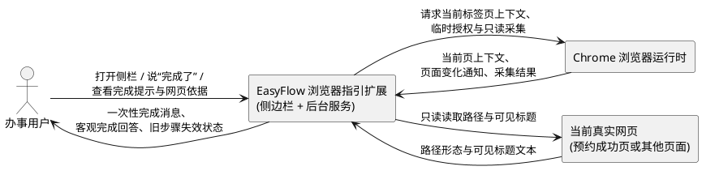
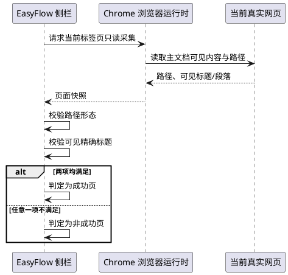
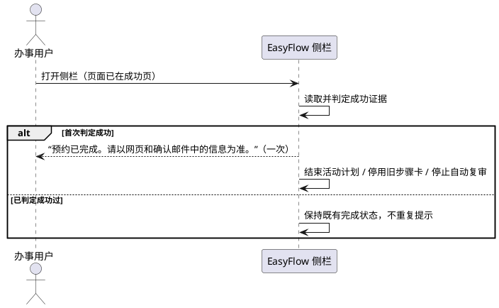
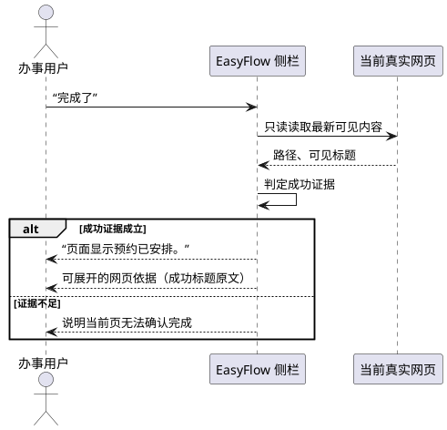
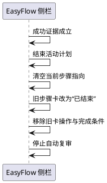
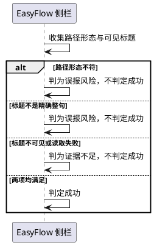
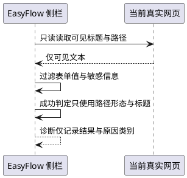
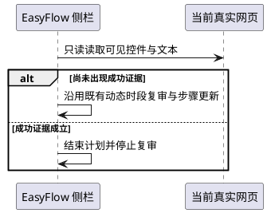

# EasyFlow 预约成功页识别与完成回答缺陷修复需求规格（第三轮增量）

> 本文件是 `easyflow_page_guide` 特性的第三轮增量规格，不替代第一轮 `spec.md` 与第二轮 `iteration2-spec.md`。本轮只修复“用户已到达预约成功页，但侧栏仍显示旧步骤、用户说‘完成了’却答非所问”的缺陷，要求最小改动、不新增流程。
>
> 验收条件采用 EARS 标准英文触发词 + 中文变量的写法（When / If / While / Where + the system shall），与第二轮文档的中文等价写法语义一致。本文件只描述“要什么”，不描述“怎么改”。

---

## 0. 背景与现有实现约束

### 0.1 缺陷现象与用户影响

1. 用户已在真实预约网站看到“该会议已安排”成功页，对用户而言预约任务已经结束。
2. EasyFlow 侧栏仍显示旧计划中的“填写姓名、邮箱”类步骤提示，并要求继续核对，用户无法判断任务是否结束。
3. 用户说“完成了”时，侧栏回答“我还没有正在陪办的步骤”，与当前页可见的成功事实矛盾。
4. 该缺陷同时包含两个问题：成功页识别被“是否存在活动计划”限制；完成回答只覆盖“有计划且在陪办”的分支。
5. 本轮不得为了复现或验证再创建真实预约，必须使用用户已有的成功页与虚构 fixture。

### 0.2 已核实基线（2026-11-14 只读核查）

| 核查项 | 实际结果 | 对本轮规格的约束 |
|---|---|---|
| 成功页判定入口 | `src/sidepanel/guide/stepPlanner.ts` 中的成功页判定要求“计划非空、计划进行中、且为预约类计划”才继续比较路径形态与精确标题；计划被标记完成后同一成功页返回 false | 成功识别必须与“是否存在活动计划”解耦，否则扩展重载后无法识别 |
| 成功提示入口 | `src/sidepanel/hooks/useConversation.ts` 的复审处理在 `plan === null` 时直接返回；初始读取不进入成功判定；成功提示作为系统通知追加，文案为“页面显示预约已安排；详情请以网页/确认邮件为准。” | 无计划成功页当前既无完成提示，也无客观回答；完成文案与本轮验收文案不一致 |
| 一次性控制 | 成功处理标志只在当前侧栏会话内存中生效；去重函数只比较“最后一条系统消息是否完全相同” | 重复通知、重复读取、重复“完成了”必须做到会话内幂等 |
| 完成回答分支 | `src/sidepanel/dialogue/rule/RuleEngine.ts` 在“用户表示完成 + 无计划或无当前步骤”时返回澄清“我还没有正在陪办的步骤” | 必须新增“基于当前页成功证据的客观回答”分支 |
| 旧步骤卡渲染 | `src/sidepanel/components/chat/MessageList.tsx`、`StepCard.tsx` 从历史助手消息渲染步骤卡；计划不活动时卡片仅标记“这一步已过期”，仍展示步骤目标与完成条件 | 成功后旧卡必须进入“已结束/失效”态，且不再提供任何操作 |
| 诊断文案清洁 | `src/sidepanel/components/chat/DiagnosticsPanel.tsx` 第 90 行含诊断示例时刻“02:00” | 生产源码（`src/`）不得出现测试用时刻字面量 |
| 权限 | `public/manifest.json` 权限为 `activeTab`、`scripting`、`sidePanel`、`storage`，无 `host_permissions`、无静态 `content_scripts` | 本轮不得新增权限，不得引入 `<all_urls>` 或麦克风权限 |
| 既有自动化 | `scripts/selftest.mjs` 已含 AT-36（成功页判定）、AT-37（动态时段复审）、AT-38（旧步骤卡过期）；AT-36 明确断言“计划完成后同一成功页返回 false”，且成功 fixture 使用真实站点域名 | 本轮需新增无活动计划成功页与非成功页 fixture，并调整“完成后即不识别”的旧断言 |
| 既有能力 | 动态时段更新与复核、用户本人填写/提交边界、只读采集、Range 高亮、四类响应与校验、规则演示模式均已在第二轮实现 | 本轮不得回退这些能力，不得重写采集/高亮/对话引擎 |
| 运行环境与门禁 | Node 20.15.1、npm 10.7.0；`npm run typecheck`、`npm run build`、`npm run selftest` 为既有门禁 | 实现阶段必须真实执行并留痕，本阶段不运行、不修改源码 |

### 0.3 本轮修复边界（一句话）

只调整“成功页识别条件、成功提示与完成回答文案、成功后旧步骤卡状态”三处必要行为，并补充对应 fixture 与源码清洁门禁；不新增预约流程、不新增权限、不新增站点专用逻辑。

---

## 1. 组件定位

### 1.1 核心职责

本组件负责在用户已到达的预约成功页上，以页面可见证据确认“预约已安排”，停止旧陪办步骤，并对用户的完成表述给出客观回答。

### 1.2 核心输入

1. **用户本轮话语**：来自侧边栏输入框，包含“完成了”“我已完成”“好了”等完成表述。
2. **当前标签页页面快照**：来自当前页主文档的只读可见内容，本轮只使用：页面路径、可见标题/段落条目、读取是否成功、采集时刻。
3. **当前陪办计划状态**：来自当前侧栏会话的陪办计划是否存在、是否进行中、当前步骤与历史消息中的步骤卡。
4. **页面变化与观察通知**：来自 Chrome 的标签页切换、导航完成、刷新与页面变更计数，用于触发重新读取与复审。

### 1.3 核心输出

1. **一次性完成消息**：满足成功证据时，侧栏向用户显示一次“预约已完成。请以网页和确认邮件中的信息为准。”，不重复、不附带下一条步骤。
2. **完成回答**：用户说“完成了”时，基于当前页成功证据回答“页面显示预约已安排。”，并可展开引用成功标题原文作为网页依据。
3. **旧步骤结束状态**：历史步骤卡进入“已结束/已失效”呈现，不再提供“指给我看 / 我找不到 / 我点错了 / 我已完成 / 换一个任务”等操作，不再显示旧的完成条件。
4. **折叠诊断记录**：记录成功判定的结果与原因类别（如路径形态不符、标题不符、标题不可见、读取失败），不包含真实地址查询串、姓名、邮箱、会议链接或预约编号。

### 1.4 职责边界

1. 本组件**禁止**创建预约、选择时段、填写表单、点击提交或代替用户完成任何预约动作。
2. 本组件**禁止**自动导航、自动新开标签页、自动滚动到提交区域或触发页面自身动作。
3. 本组件**禁止**读取输入框值、姓名、邮箱、验证码、密码、银行卡号等个人信息。
4. 本组件**禁止**读取、保存、展示或传输完整查询串、会议链接、预约编号。
5. 本组件**禁止**声称“EasyFlow 帮用户完成了预约”“已替用户提交”“已发送确认邮件”。
6. 本组件**禁止**在页面证据不足时推测预约成功，包括仅出现“已安排”字样、仅 URL 看起来像成功页、仅存在隐藏标题等情形。
7. 本组件不负责解析确认邮件、不负责管理预约、不负责发送通知、不负责跨会话恢复陪办计划。
8. 本组件不负责修改网站成功页样式、不负责向页面写入任何标识。

---

## 2. 领域术语

**成功证据**
: 同时满足“成功路径形态”与“可见精确成功标题”两个条件的一组页面事实，用于判定当前页为预约成功页，缺一不可。

**成功路径形态**
: 当前页路径中存在一个独立的成功语义段（`booking`、`bookings`、`confirmation`、`confirmed`、`success` 之一，大小写不敏感），判定只读取路径部分，不读取查询串、片段、域名与预约编号。

**可见精确成功标题**
: 当前页主文档中实际可见、归一化空白后整条等于允许标题集合之一的标题文本；允许末尾句号或感叹号，允许英文大小写差异，不允许“包含关系”或近似改写。

**允许标题集合**
: 本轮仅包含“该会议已安排”“会议已安排”“This meeting is scheduled”“Meeting is scheduled”四条精确标题，不扩展到“预约成功”“已预约”“完成”等宽泛词。

**活动陪办计划**
: 当前侧栏会话中存在、状态为进行中、且还有当前步骤的陪办计划；不存在或已结束的计划统称“无活动计划”。

**一次性完成消息**
: 成功证据成立时侧栏显示的固定完成提示，文案为“预约已完成。请以网页和确认邮件中的信息为准。”；在同一页面会话内最多出现一次。

**客观完成回答**
: 用户表达“完成了”时，系统基于当前页成功证据给出的直接回答“页面显示预约已安排。”，并说明以网页与确认邮件为准，不声称是本扩展完成了预约。

**旧步骤卡**
: 历史助手消息中展示步骤目标、完成条件与操作按钮的区域；包括“填写姓名、邮箱”类步骤、时段步骤与最终确认步骤。

**误报成功**
: 页面不具备完整成功证据，却被系统判定为预约成功页并显示完成消息或完成回答的情形。

**页面会话**
: 侧边栏从打开到关闭（或扩展重新加载）之间的一次会话；页面会话内状态不持久化。

---

## 3. 角色与边界

### 3.1 核心角色

1. **办事用户**：已在真实预约网站完成预约、当前停留在成功页的个人用户；其操作包括打开侧栏、查看侧栏提示、输入“完成了”。
2. **验收者**：按本轮 fixture 场景与真实成功页只读检查完成消息、回答、旧卡状态与隐私边界的验证人员。

### 3.2 外部系统

1. **Chrome 浏览器运行时**：提供侧边栏、当前标签页上下文、临时页面授权、脚本注入与页面变化通知。
2. **当前真实网页**：提供只读可见标题/段落与页面路径；接收本组件的只读高亮请求；不接收任何写入或提交动作。
3. **本地构建与自测工具链**：Node.js 与 npm，执行 `typecheck`、`build`、`selftest` 并把输出写入 `codearts_proof/`。

### 3.3 交互上下文

---

## 4. DFX 约束

### 4.1 性能

1. 对单次页面快照执行成功证据判定必须在 50 毫秒内完成，不得使既有“采集 ≤1 秒、首响 ≤1 秒”指标回退。
2. 成功证据成立后必须停止该页的自动复审与观察，不得继续以定时或变更驱动方式反复读取页面。
3. 完成消息与旧步骤卡失效状态必须在同一次界面更新中呈现，用户可见延迟不超过 100 毫秒。
4. 用户说“完成了”后，若需要重新读取当前页，从提交到回答的耗时必须符合第二轮“单次采集 ≤1 秒、规则首响 ≤1 秒”的既有上限。

### 4.2 可靠性

1. 页面读取失败或采集结果不完整时，系统必须不判定成功，也不得显示完成消息或完成回答。
2. 同一页面会话内，重复的页面变化通知、观察通知、重复读取与重复“完成了”不得造成完成消息重复、步骤推进或矛盾回答。
3. 扩展重新加载后即使没有活动计划，系统也必须能够仅凭当前页证据识别成功并客观回答；不得依赖上一会话内存状态。
4. 若成功判定与旧计划清理之间发生并发时序差异，系统必须保证旧步骤卡不早于成功证据呈现为“可操作”状态；不允许出现“完成消息已出现、旧卡仍可点击”的组合。
5. 成功判定所需的标题被截断、标题不可见或页面尚未加载完成时，系统必须按“证据不足”处理，不得以部分字样判定成功。

### 4.3 安全性

1. 本轮不得新增任何浏览器权限；清单权限必须保持 `activeTab`、`scripting`、`sidePanel`、`storage` 四项，且不存在 `host_permissions`、`<all_urls>`、静态内容脚本或麦克风权限。
2. 成功判定禁止读取 `input.value`、`textarea.value`、下拉选中值、可编辑区域输入与任何表单值。
3. 成功判定禁止读取或记录姓名、邮箱、确认邮件地址、会议链接、预约编号、完整查询串与片段。
4. 页面与成功标题必须保持只读：不得修改节点、不得聚焦、不得点击、不得提交、不得导航。
5. 完成消息、回答、诊断、日志与持久化内容不得包含完整 URL、查询串、页面正文、引用原文或用户敏感值。
6. 测试 fixture 必须使用虚构域名、虚构路径编号与虚构个人信息；生产源码不得出现测试用时刻字面量、真实邮箱或真实预约查询串。

### 4.4 可维护性

1. 允许标题集合与成功路径段集合必须集中维护、可独立审查，禁止散落在多个业务分支中。
2. 完成消息与客观完成回答必须各只有一处固定文案来源，禁止在不同分支复制近似文案。
3. 成功判定结果必须可在折叠诊断中以“通过/未通过 + 原因类别”区分，原因类别至少覆盖：路径形态不符、标题不符、标题不可见、读取失败。
4. 既有“规则演示、未接入在线模型”标识必须保持，不得出现“AI 已确认预约”等表述。
5. 本轮修复不得引入新的常驻按钮、新的工作流入口或新的站点专用分支。

### 4.5 兼容性

1. 必须继续兼容 Chrome 116 及以上版本的 Manifest V3 扩展形态。
2. 既有 `GuidePlan`、`GuideStep`、`DialogueResponse` 与四类响应的语义必须保持向后兼容；新增成功判定结果不得改变既有字段含义。
3. 既有成功标题的中英文四条必须继续可用；不得因本轮改动导致英文成功页被漏判。
4. 既有动态时段更新、完成条件判定、用户确认未页面校验、读取失败重试与 iframe 限制说明必须保持可用。
5. 既有无活动计划会话的普通问答、澄清与无法回答行为不得因本轮修复而回退。

---

## 5. 核心能力

## **5.1 成功页识别**

### **5.1.1 业务规则**

1. **R-01 成功证据的双重门槛**：When 当前页同时满足“成功路径形态”与“可见精确成功标题”时，the system shall 判定该页为预约成功页。
   a. 验收条件：成功路径形态 + 可见标题“该会议已安排” → 判定为成功页；缺少任意一项 → 不判定为成功页。
2. **R-02 识别与计划状态解耦**：While 当前页具备完整成功证据，the system shall 无论是否存在活动陪办计划、无论计划是否已被标记结束，都判定该页为预约成功页。
   a. 验收条件：无活动计划 + 完整成功证据 → 判定为成功页；计划已完成 + 同一成功页再次读取 → 仍判定为成功页。
3. **R-03 读取时机覆盖**：When 发生以下任一情形时，the system shall 对最新页面快照执行成功证据判定：侧栏首次读取完成、页面变化后重新读取完成、观察通知触发的重新读取完成、用户点击“重试”后的读取完成、用户发送“完成了”后的读取完成。
   a. 验收条件：扩展重载后首次读取即停留在成功页 → 判定成功；页面在用户操作后变为成功页 → 下一次读取判定成功。
4. **R-04 仅主文档可见标题**：The system shall 只使用当前页主文档中可见的标题或段落条目作为标题证据，不得使用隐藏节点、`title` 属性、iframe 内文本、图片替代文本或页面源码注释。
   a. 验收条件：精确标题仅存在于隐藏节点或 iframe → 不判定成功。
5. **R-05 精确整句匹配**：The system shall 将候选标题归一化空白后与允许标题集合做整句匹配，允许末尾句号/感叹号与英文大小写差异，禁止包含匹配、近似匹配或分词改写。
   a. 验收条件：标题为“该会议已安排，请查收邮件” → 不判定成功；标题为“已安排” → 不判定成功。
6. **R-06 路径只读判定**：The system shall 仅从路径部分识别成功形态，不读取、不比较、不记录查询串、片段、域名或预约编号。
   a. 验收条件：同一路径但查询串不同 → 判定结果一致；查询串中出现 `booking`、`success`、`confirmed` 而路径不符 → 不判定成功。
7. **R-07 禁止站点绑定**：The system shall 不将成功判定绑定到任何特定域名、站点名称、预约编号格式或具体页面 ID。
   a. 验收条件：在虚构域名与不同路径编号上判定行为一致；源码中不存在站点域名常量或预约编号样例。
8. **R-08 禁止项**：The system shall 不因计划目标包含“预约”字样、页面出现“预约”控件或用户说“完成了”而单独判定成功。
   a. 验收条件：仅有预约计划与用户完成表述、页面无成功证据 → 不判定成功。

### **5.1.2 交互流程**

### **5.1.3 异常场景**

1. **页面读取失败**
   a. 触发条件：注入被拒、标签页关闭、采集超时或快照为空。
   b. 系统行为：不执行成功判定，保留既有读取失败提示。
   c. 用户感知：“我还没读到当前页面”或既有失败文案，不出现完成消息。
2. **标题被截断**
   a. 触发条件：精确标题因长度上限被截断或归一化后不等于允许集合。
   b. 系统行为：按证据不足处理，不判定成功。
   c. 用户感知：不出现完成消息；用户说“完成了”时只说明未能从页面确认。
3. **成功页标题延迟渲染**
   a. 触发条件：路径已符合成功形态，但标题尚未出现在可见快照中。
   b. 系统行为：本次不判定成功；后续页面变化或用户主动读取时重新判定。
   c. 用户感知：不出现完成消息；稍后页面变化时自动出现一次。
4. **重复读取同一成功页**
   a. 触发条件：观察通知、页面变化通知或用户重试导致同一成功页被多次读取。
   b. 系统行为：判定结果保持一致；完成消息只在首次判定成功时显示一次。
   c. 用户感知：完成消息不重复堆叠。

## **5.2 一次性完成消息**

### **5.2.1 业务规则**

1. **R-09 固定文案**：When 成功证据成立时，the system shall 显示完成消息，且用户可见正文必须完全等于“预约已完成。请以网页和确认邮件中的信息为准。”。
   a. 验收条件：成功页首次识别 → 出现该句，标点与文字完全一致。
2. **R-10 会话内仅一次**：While 同一页面会话内成功证据持续成立，the system shall 最多显示一次完成消息。
   a. 验收条件：连续触发 3 次成功页读取或页面变化 → 完成消息计数为 1。
3. **R-11 成功后不推进**：When 完成消息出现时，the system shall 不附带任何下一步、不显示目标控件、不显示完成条件、不要求用户再次核对。
   a. 验收条件：完成消息出现后 → 界面无“下一步”“指给我看”“完成后点我已完成”等当前步骤内容。
4. **R-12 重载后可重建**：While 扩展重新加载形成新的页面会话，the system shall 允许在新会话中重新判定并重新显示一次完成消息，但不得堆叠两条相同消息。
   a. 验收条件：重载后首次读取成功页 → 新会话出现 1 条完成消息；旧会话消息不恢复。
5. **R-13 成功后停止复审**：When 成功证据成立且完成消息已显示，the system shall 停止该页的自动观察与自动重新读取。
   a. 验收条件：成功后等待 5 秒且页面无变化 → 不出现新的系统提示或重复完成消息。
6. **R-14 禁止项**：The system shall 禁止在成功页继续显示“填写姓名、邮箱”“还需要你本人处理”“我还不能确认这一步”等旧计划当前指令。
   a. 验收条件：成功页上完成消息出现后 → 当前可见区域不再出现上述旧指令。

### **5.2.2 交互流程**

### **5.2.3 异常场景**

1. **成功消息与页面变化通知同时到达**
   a. 触发条件：完成判定与页面变化复审并发触发。
   b. 系统行为：完成消息只保留一条；页面变化不得将其覆盖或再次追加；不得重新生成下一步。
   c. 用户感知：仍只见一条完成消息。
2. **成功消息后用户继续输入**
   a. 触发条件：用户在完成消息后输入“然后呢”“还要做什么”。
   b. 系统行为：说明任务已结束，以网页与确认邮件为准；不生成新的预约步骤。
   c. 用户感知：“预约已经完成，接下来以网页和确认邮件为准。”
3. **重复完成通知**
   a. 触发条件：页面观察计数持续变化或用户连续点击“我已完成”。
   b. 系统行为：不再追加完成消息，不再推进计划。
   c. 用户感知：界面保持稳定。

## **5.3 无活动计划时的客观回答**

### **5.3.1 业务规则**

1. **R-15 完成表述识别**：When 用户发送“完成了”“我已完成”“好了”“弄好了”等完成表述时，the system shall 以当前页最新可见快照为判断依据，而不是以是否存在活动计划为前提。
   a. 验收条件：无活动计划 + 用户发送“完成了” → 触发当前页成功证据判定，不直接回复“我还没有正在陪办的步骤”。
2. **R-16 客观回答**：When 当前页成功证据成立且用户发送完成表述时，the system shall 直接回答“页面显示预约已安排。”。
   a. 验收条件：无活动计划成功页 + 用户发送“完成了” → 回答正文以“页面显示预约已安排”开头，允许末尾句号。
3. **R-17 回答附网页依据**：When 给出客观完成回答时，the system shall 引用当前页实际可见的成功标题作为可展开的网页依据，引用文本必须逐字来自页面快照。
   a. 验收条件：展开网页依据 → 可见“该会议已安排”或对应英文成功标题原文，并可定位到页面。
4. **R-18 不冒充完成者**：The system shall 不声称 EasyFlow 带用户完成了整个预约过程，不得使用“我帮你完成了预约”“已替你提交”“已发送确认邮件”等表述。
   a. 验收条件：检查回答与完成消息 → 不存在第一人称完成承诺。
5. **R-19 有活动计划时一致**：When 存在活动计划且成功证据成立时，the system shall 采用与无活动计划相同的客观回答口径，不以“这一步完成了，下一步”替代整体完成结论。
   a. 验收条件：有活动计划成功页 + 用户说“完成了” → 回答“页面显示预约已安排。”，不出现下一步。
6. **R-20 证据不足时诚实**：If 用户发送完成表述但当前页成功证据不成立，the system shall 不声称预约已完成，并清楚说明无法从当前页面确认，同时给出“查看网页”或“重新读取”的可行建议。
   a. 验收条件：普通页 + 用户说“完成了” → 不出现“预约已安排/预约已完成”；出现未能确认说明。
7. **R-21 读取失败时诚实**：If 用户发送完成表述且当前页无法读取，the system shall 说明读取失败，不得以用户表述代替页面证据。
   a. 验收条件：读取失败 + 用户说“完成了” → 回答读取失败原因，不出现完成结论。
8. **R-22 禁止项**：The system shall 禁止在无活动计划且成功证据成立时使用澄清问题代替回答，禁止反问“你想先了解页面上的什么”。
   a. 验收条件：无计划成功页 + “完成了” → 响应类型为直接回答，不是澄清。

### **5.3.2 交互流程**

### **5.3.3 异常场景**

1. **用户重复说“完成了”**
   a. 触发条件：用户在成功页连续发送多次完成表述。
   b. 系统行为：每次均可给出客观回答，但不得追加第二条完成消息、不得生成步骤、不得声称由扩展完成。
   c. 用户感知：回答一致，界面稳定。
2. **用户话语包含个人信息**
   a. 触发条件：完成表述中混入邮箱、姓名、证件号等敏感内容。
   b. 系统行为：按既有隐私规则过滤/提示，不写入日志，不基于该信息执行任何操作。
   c. 用户感知：“这类信息不用发给我，请以网页和确认邮件为准。”
3. **成功页刚完成导航、标题尚未出现**
   a. 触发条件：用户发送“完成了”时快照仍为旧页面或标题未渲染。
   b. 系统行为：重新读取一次；仍无成功证据则说明当前页尚未显示成功信息。
   c. 用户感知：“我还没在当前页面看到预约已安排，请确认页面已加载完成。”

## **5.4 旧步骤卡失效**

### **5.4.1 业务规则**

1. **R-23 计划结束**：When 成功证据成立时，the system shall 将当前活动陪办计划标记为已结束，并清空“当前卡片”指向。
   a. 验收条件：成功页识别后 → 不存在进行中的当前步骤。
2. **R-24 旧卡不可操作**：While 页面处于成功状态，the system shall 使所有旧步骤卡进入不可操作状态，不渲染“指给我看 / 我找不到 / 我点错了 / 我已完成 / 换一个任务”。
   a. 验收条件：成功页上检查任一步骤卡 → 不存在上述按钮。
3. **R-25 旧完成条件不再展示**：While 页面处于成功状态，the system shall 不再展示旧步骤的完成条件（包括“完成后点我已完成”“页面上出现指定文本”等）。
   a. 验收条件：成功页上 → 旧卡不显示“完成条件：”行。
4. **R-26 旧填写提示退出当前指令**：When 成功消息出现时，the system shall 不再将“填写姓名、邮箱”“接下来需要你本人处理”类历史提示作为当前步骤或当前建议展示。
   a. 验收条件：成功页当前可见区域 → 不出现“填写姓名、邮箱”作为待办指令；历史消息仅以“已结束”语义呈现或折叠。
5. **R-27 历史可追溯但不误导**：The system shall 保留必要的会话历史，但历史步骤卡必须以“已结束/已失效”标识呈现，禁止让用户误以为仍需继续操作。
   a. 验收条件：查看历史步骤卡 → 可见“已结束”或等价标识，无操作按钮。
6. **R-28 禁止后续步骤再生**：While 页面处于成功状态，the system shall 不因页面变化、完成判定或用户反馈生成新的预约步骤。
   a. 验收条件：成功后触发观察通知或说“我点错了” → 不出现新步骤、不出现“下一步”。
7. **R-29 禁止项**：The system shall 禁止在成功页上把旧步骤卡标记为“现在这一步”，也禁止把旧步骤状态显示为“待开始/进行中”。

### **5.4.2 交互流程**

### **5.4.3 异常场景**

1. **旧计划状态未及时更新**
   a. 触发条件：成功消息已显示但计划状态仍为进行中。
   b. 系统行为：以成功状态优先，立即将旧卡置为不可操作；不得允许用户继续点击旧卡。
   c. 用户感知：旧卡显示“已结束”，按钮不可用或不显示。
2. **多条历史步骤卡**
   a. 触发条件：会话中已存在多个历史步骤卡。
   b. 系统行为：全部进入已结束态，不保留任何一个可操作卡片。
   c. 用户感知：所有旧卡均为历史记录，当前无待办。
3. **用户点击旧卡残留区域**
   a. 触发条件：用户在成功页点击旧卡所在区域。
   b. 系统行为：不执行定位、不推进计划、不产生误导性提示。
   c. 用户感知：无动作或提示“这一步已经结束”。

## **5.5 误报道防护**

### **5.5.1 业务规则**

1. **R-30 仅“已安排”不识别**：If 页面仅在正文、按钮或链接中出现“已安排”字样，而可见标题不等于允许标题集合，the system shall 不判定成功。
   a. 验收条件：成功路径 + 正文“已安排” → 不出现完成消息。
2. **R-31 伪成功 URL 不识别**：If 路径不满足成功形态，仅查询串或片段中出现 `booking`、`confirmation`、`success`、`confirmed`，the system shall 不判定成功。
   a. 验收条件：普通路径 + `?status=success` + 精确标题 → 不判定成功。
3. **R-32 无标题不识别**：If 路径满足成功形态但快照中不存在可见的精确成功标题，the system shall 不判定成功。
   a. 验收条件：成功路径 + 无标题/标题为空/标题被隐藏 → 不出现完成消息。
4. **R-33 普通路径不识别**：If 可见标题精确但路径形态不符，the system shall 不判定成功。
   a. 验收条件：普通路径 + 标题“该会议已安排” → 不判定成功。
5. **R-34 近似标题不识别**：If 标题包含额外词语、缺少标点以外的差异、或被截断，the system shall 不判定成功。
   a. 验收条件：标题“会议已安排，请准时参加” → 不判定成功。
6. **R-35 读取不完整不识别**：If 页面读取失败、快照条目为空或页面仍处于加载状态，the system shall 不判定成功。
   a. 验收条件：读取失败 + URL 看似成功 → 不出现完成消息或完成回答。
7. **R-36 禁止推断预约细节**：While 成功证据成立，the system shall 只陈述“预约已完成”与“页面显示预约已安排”，不得推断或补充预约时间、地点、参会人、会议链接、确认邮件内容或预约编号。
   a. 验收条件：成功页完成消息与回答 → 不出现上述页面未明确支持的具体信息（是否增加额外语境门槛见 T3-11）。
8. **R-37 禁止项**：The system shall 禁止通过域名白名单、预约编号正则、页面标题包含“Cal”或站点图标来推断成功。

### **5.5.2 交互流程**

### **5.5.3 异常场景**

1. **成功标题出现在导航或页脚**
   a. 触发条件：精确标题仅出现在导航、页脚或辅助区域，而非主内容。
   b. 系统行为：若该条目为可见标题/段落且整句精确，仍可作为证据；若仅为链接/按钮文本，不得作为标题证据。
   c. 用户感知：按实际可见证据判定，不因区域误报。
2. **页面同时存在多个相近标题**
   a. 触发条件：页面同时出现“该会议已安排”和其他“已安排”变体。
   b. 系统行为：只有在允许集合中的精确标题才算证据，其余忽略。
   c. 用户感知：不出现重复或加倍的完成提示。

## **5.6 隐私与只读边界**

### **5.6.1 业务规则**

1. **R-38 不读表单值**：The system shall 不读取任何输入框、文本域、下拉框、可编辑区域、密码或隐藏字段的值。
   a. 验收条件：成功页包含已填姓名/邮箱 → 快照、消息与诊断中均不出现这些值。
2. **R-39 不读取会议链接**：The system shall 不读取、不保存、不展示、不比较会议链接、预约编号或确认邮件内容。
   a. 验收条件：成功页存在会议链接或预约编号 → 完成消息、回答、诊断与存储均不含该内容。
3. **R-40 不记录完整查询串**：The system shall 在成功判定、消息、日志、诊断与持久化中不出现完整查询串或片段。
   a. 验收条件：成功页 URL 带查询串 → 诊断只记录脱敏域名/路径形态或原因类别，不记录查询串。
4. **R-41 仅内存使用**：The system shall 不把成功状态、完成消息或页面证据持久化到扩展存储；扩展重载后重新从当前页判定。
   a. 验收条件：检查扩展存储 → 仅保留既有用户目标文本，无完成消息/页面证据/成功状态。
5. **R-42 权限不变**：The system shall 保持清单权限为 `activeTab`、`scripting`、`sidePanel`、`storage`，不新增主机权限、全站权限或麦克风权限。
   a. 验收条件：构建产物清单检查 → 权限集合不变，无 `host_permissions`、无 `<all_urls>`。
6. **R-43 只读行为不变**：The system shall 不点击、不聚焦、不填写、不勾选、不提交、不导航、不新开标签页。
   a. 验收条件：成功识别与完成回答前后 → 页面 URL、表单值与焦点状态不变。
7. **R-44 测试数据虚构**：The system shall 使用虚构域名、虚构路径编号与虚构个人信息进行测试，不复制真实预约链接、确认邮件或用户数据。
   a. 验收条件：检查 fixture 与 selftest → 不含真实邮箱、真实预约 ID、真实查询串与真实站点域名。
8. **R-45 生产源码清洁**：The system shall 保证生产源码 `src/` 中不出现测试用时刻字面量“02:00”“02:15”“03:00”、真实邮箱地址或真实预约查询串。
   a. 验收条件：检索 `src/` → 上述字面量与邮箱格式均为 0 命中；现有诊断示例时刻已被中性文案替代。

### **5.6.2 交互流程**

### **5.6.3 异常场景**

1. **成功页要求输入邮箱以查看信息**
   a. 触发条件：页面在成功标题之外还显示邮箱输入框或“输入邮箱查看预约”。
   b. 系统行为：不读取、不聚焦、不填写；仅依据已可见成功标题判定。
   c. 用户感知：完成消息出现；不出现填写提示。
2. **页面 URL 含个人信息**
   a. 触发条件：查询串或片段包含邮箱、姓名或预约编号。
   b. 系统行为：成功判定忽略查询串与片段；诊断与消息不展示完整地址。
   c. 用户感知：不暴露敏感 URL 内容。
3. **页面包含会议链接按钮**
   a. 触发条件：成功页提供“加入会议”链接。
   b. 系统行为：不读取链接地址、不点击、不复制。
   c. 用户感知：完成消息建议以网页与确认邮件为准。

## **5.7 既有能力保留**

### **5.7.1 业务规则**

1. **R-46 动态时段不回退**：While 页面尚未出现成功证据，the system shall 保留既有的动态时段更新、可选时段变化重规划与最新快照核对能力。
   a. 验收条件：既有 AT-37 场景仍通过；时段变化后仍指向当前真实可选时段。
2. **R-47 用户操作边界不回退**：The system shall 继续由用户本人填写、选择与提交；系统只高亮、只说明、不代操作。
   a. 验收条件：任何路径均不出现自动填写、自动点击或自动提交。
3. **R-48 既有失败分支不回退**：The system shall 保留读取失败、无依据、iframe/地图不可读、跨域、登录/验证码等既有说明方式。
   a. 验收条件：非成功页上的既有场景行为与第二轮一致。
4. **R-49 旧卡过期语义不回退**：While 页面未成功且计划已被替换或不可用，the system shall 继续标记旧卡为已过期。
   a. 验收条件：既有 AT-38 场景仍通过。

### **5.7.2 交互流程**

### **5.7.3 异常场景**

1. **成功页与时段列表同页**
   a. 触发条件：页面同时残留时段控件与成功标题。
   b. 系统行为：成功证据优先，结束计划，不再提示选择时段。
   c. 用户感知：只见完成消息，不见时段步骤。
2. **成功标题出现后又消失**
   a. 触发条件：页面动态刷新导致成功标题暂不可见。
   b. 系统行为：已完成状态不被回退为进行中；不重复显示完成消息。
   c. 用户感知：完成结论保持稳定。

---

## 6. 数据约束

### 6.1 成功证据

1. **路径形态**：必须为 `booking`、`bookings`、`confirmation`、`confirmed`、`success` 之一的独立路径段；不得包含查询串、片段、域名或预约编号。
2. **标题文本**：必须为归一化后的可见标题/段落整句，且等于允许标题集合之一；允许末尾句号/感叹号与英文大小写差异。
3. **可见性**：必须为当前页主文档实际可见的标题或段落；隐藏节点、iframe、`title` 属性与链接/按钮文本不得作为标题证据。
4. **判定时间**：必须记录判定所依据的采集时刻，用于判断证据是否陈旧。
5. **判定结果**：必须为“成功证据成立”或“不成立”，不成立时必须附带原因类别（路径形态不符、标题不符、标题不可见、读取失败）。
6. **禁止字段**：不得包含完整 URL、查询串、片段、姓名、邮箱、会议链接、预约编号或页面正文。

### 6.2 完成提示状态

1. **文案**：必须完全等于“预约已完成。请以网页和确认邮件中的信息为准。”。
2. **出现次数**：同一页面会话内必须为 0 或 1。
3. **绑定范围**：必须绑定当前页面会话与当前成功证据，不跨会话持久化。
4. **后续内容**：不得携带领取下一步、目标控件、完成条件或旧计划操作。
5. **重复判定**：重复读取、重复通知、重复完成表述均不得增加出现次数。

### 6.3 旧步骤卡状态

1. **状态值**：成功页上必须为“已结束/已失效”，不得为“当前/待开始/进行中”。
2. **操作集合**：成功页上必须为空集，不渲染任何步骤操作按钮。
3. **完成条件**：成功页上必须不展示旧完成条件。
4. **历史文本**：可保留在历史消息中，但必须带“已结束”语义，不得作为当前待办。
5. **禁止内容**：不得在成功页上展示“填写姓名、邮箱”类当前指令。

### 6.4 客观完成回答

1. **正文**：必须以“页面显示预约已安排”开头，允许末尾句号；不得包含“我帮你完成了”等完成承诺。
2. **响应类型**：必须为直接回答，不得为澄清或下一步。
3. **引用**：必须至少包含 1 条当前页可见成功标题原文，引用必须逐字来自快照并可定位。
4. **建议**：可包含“请以网页和确认邮件为准”的说明，不得包含页面之外的事实。
5. **长度**：必须符合既有回答长度上限（1—3 句）。

### 6.5 测试 fixture

1. **域名**：必须使用 `.test` 等虚构域名，不得使用真实站点域名。
2. **路径编号**：必须使用虚构编号（如 `fixture-booking-0001`），不得使用真实预约 ID。
3. **个人信息**：fixture 如出现邮箱/姓名，必须为 `fixture@example.test` 等明显虚构值，且不得被成功判定读取。
4. **标题**：必须使用允许标题集合中的精确文本。
5. **时刻**：fixture 中的日期/时段必须为虚构数据，且不得进入生产源码。
6. **场景覆盖**：必须至少覆盖有活动计划成功页、无活动计划成功页、仅“已安排”的非成功页、伪成功路径无标题、普通路径精确标题、重复通知六类。

### 6.6 诊断记录

1. **成功判定结果**：必须为“通过/未通过”。
2. **原因类别**：未通过时必须为路径形态不符、标题不符、标题不可见、读取失败之一。
3. **页面标识**：只允许脱敏域名或路径形态摘要，不得记录完整 URL、查询串或预约编号。
4. **重复提示计数**：可记录完成提示已显示次数，但不得记录页面正文或完成消息全文。
5. **用户可见性**：诊断默认折叠，展开后不得出现姓名、邮箱、会议链接或查询串。

---

## 7. 验收标准

### 7.1 Fixture 场景

| 编号 | 场景构造 | 预期结果 | 关键断言 |
|---|---|---|---|
| F-01 | 有活动计划 + 虚构成功路径 + 可见精确标题 | 完成消息 1 次；计划结束；旧卡不可操作；停止自动复审 | 完成消息计数 = 1；无当前步骤；旧卡按钮数 = 0；5 秒内无新提示 |
| F-02 | 无活动计划（模拟重载）+ 虚构成功路径 + 可见精确标题 | 首读显示完成消息 1 次；用户说“完成了”回答“页面显示预约已安排。”并附成功标题引用 | 不出现“我还没有正在陪办的步骤”；响应为直接回答；引用原文 = 成功标题 |
| F-03 | 普通路径 + 可见精确标题 | 不判定成功 | 无完成消息；无“预约已安排”回答 |
| F-04 | 成功路径 + 正文仅“已安排” | 不判定成功 | 无完成消息 |
| F-05 | 成功路径 + 无可见精确标题（标题缺失/隐藏） | 不判定成功 | 无完成消息；用户说“完成了”时说明无法确认 |
| F-06 | 普通路径 + 查询串含成功关键词 + 可见精确标题 | 不判定成功 | 无完成消息；诊断不含查询串 |
| F-07 | 成功页上连续触发 3 次页面变化/观察通知/重复读取/重复“完成了” | 完成消息仍 1 次；回答一致；无下一步；无重复核对提示 | 完成消息计数 = 1；步骤卡新增数 = 0；无“下一步” |
| F-08 | 生产源码与 fixture 扫描 | 生产源码无测试时刻、真实邮箱、真实查询串；fixture 全部虚构 | `src/` 检索 0 命中；manifest 权限不变 |
| F-09 | 既有动态时段场景回归 | 动态时段更新、重规划与旧卡过期行为保持 | AT-37、AT-38 仍通过；无自动点击/代填 |
| F-10 | 成功页包含已填姓名/邮箱/会议链接/带查询串 URL | 读取与展示不泄露这些内容 | 快照、消息、诊断、存储均无敏感值 |

**F-01 验收条件（EARS）**

1. When 有活动计划且当前页成功证据成立时，the system shall 显示且仅显示一次完成消息“预约已完成。请以网页和确认邮件中的信息为准。”。
2. When 完成消息出现时，the system shall 将活动计划标记为已结束并清空当前步骤。
3. While 页面处于成功状态，the system shall 不渲染旧步骤卡的任何操作按钮与完成条件。
4. When 成功后再触发页面变化通知或观察通知，the system shall 不追加完成消息、不生成下一步。

**F-02 验收条件（EARS）**

1. When 无活动计划且当前页成功证据成立时，the system shall 在首次读取后显示一次完成消息。
2. When 无活动计划且用户发送“完成了”时，the system shall 直接回答“页面显示预约已安排。”，不得回复“我还没有正在陪办的步骤”。
3. When 给出该回答时，the system shall 提供成功标题原文作为网页依据。
4. While 页面处于成功状态，the system shall 不声称 EasyFlow 完成了整个预约过程。

**F-03 至 F-06 验收条件（EARS）**

1. If 仅路径形态满足而可见精确标题不满足，the system shall 不判定成功。
2. If 仅可见精确标题满足而路径形态不满足，the system shall 不判定成功。
3. If 成功形态仅存在于查询串或片段中，the system shall 不判定成功。
4. If 精确标题仅存在于隐藏节点、iframe 或非标题/段落文本中，the system shall 不判定成功。

**F-07 验收条件（EARS）**

1. While 同一页面会话内成功证据持续成立，the system shall 最多显示一次完成消息。
2. When 用户重复发送完成表述时，the system shall 保持回答一致，且不追加完成消息或步骤。
3. When 成功后收到重复页面变化或观察通知时，the system shall 不重新启动自动复审。

**F-08 验收条件（EARS）**

1. The system shall 保持生产源码中无“02:00”“02:15”“03:00”字面量、无真实邮箱地址、无真实预约查询串。
2. The system shall 保持清单权限集合不变，不新增 `host_permissions`、`<all_urls>` 或麦克风权限。
3. The system shall 使用虚构 fixture 数据完成 F-01—F-07，不创建真实预约。

**F-09 验收条件（EARS）**

1. While 页面尚未出现成功证据，the system shall 保留既有动态时段更新、重规划与最新快照核对。
2. While 页面处于成功状态，the system shall 不提示选择时段、不提示继续核对。
3. The system shall 不自动点击、不代填、不提交任何表单。

**F-10 验收条件（EARS）**

1. The system shall 不读取或展示输入框中的姓名、邮箱。
2. The system shall 不读取、保存或展示会议链接、预约编号、完整查询串。
3. The system shall 在诊断与存储中不留下上述敏感值。

### 7.2 自动化门禁与留痕

1. 实现阶段必须真实执行 `npm run typecheck`、`npm run build`、`npm run selftest`，退出码必须为 0。
2. 三条命令的完整输出（含失败与修复过程）必须写入 `codearts_proof/`，文件名由任务阶段确定并包含“iteration3”标识。
3. `selftest` 必须包含 F-01—F-10 对应的可重复 fixture 用例，断言失败时必须输出场景编号与期望/实际。
4. 源码清洁与权限门禁的检索命令与实际输出必须写入留痕；不得只写“已检查”。
5. 本阶段（需求规格阶段）不执行任何命令、不修改源码；文档中不得声称构建或自测已通过。

### 7.3 真实页人工验收

1. 使用用户已有的真实成功页进行只读验收，禁止为测试创建新的真实预约。
2. 验收步骤：打开成功页 → 打开侧栏 → 观察完成消息出现次数与文案 → 检查旧步骤卡是否不可操作 → 输入“完成了” → 检查回答是否为“页面显示预约已安排。”。
3. 验收记录必须包含：页面可见成功标题原文、路径形态类别（不记录完整 URL 与查询串）、完成消息出现次数、回答文本、旧卡状态、是否新建预约（必须为否）。
4. 未在真实页执行或未获用户确认时，必须标注“真实页待验”，不得写“已通过”。
5. 若真实页的可见标题与允许标题集合不一致，必须记录差异并回到取舍点 T3-06 由用户拍板，不得擅自扩大标题集合。

### 7.4 通过/不通过判定

1. 通过必须同时满足：F-01—F-10 全部通过；`typecheck`、`build`、`selftest` 退出码 0；权限与源码清洁门禁通过；真实页只读验收记录完整。
2. 出现以下任一情形即判不通过：完成消息重复；旧卡仍可操作；无计划成功页回答“我还没有正在陪办的步骤”；误报成功；读取或记录姓名、邮箱、查询串、会议链接；新增权限；为测试创建真实预约。
3. 未执行项必须单列声明，不得混入“通过”统计。

---

## 8. 非目标

1. 不实现或优化真实预约流程，不新增预约入口、时段选择或提交动作。
2. 不新增站点专用逻辑、域名白名单、预约编号规则或页面选择器特判。
3. 不重写既有采集、语义段、控件标注、Range 高亮、对话引擎、校验器与聊天界面。
4. 不新增权限、不接入模型、不实现语音。
5. 不持久化成功状态、完成消息或页面证据；不跨会话恢复陪办计划。
6. 不改变既有四类响应体系与完成条件判定语义（成功页例外路径除外）。
7. 不修改第一轮 `spec.md`、第二轮 `iteration2-*.md`；本轮只新增 `iteration3-spec.md` 及后续设计/任务文档。
8. 不提供“确认邮件解析”“日历同步”“预约修改/取消”等能力。

---

## 9. 需用户拍板的取舍点与默认选择

| 编号 | 取舍点 | 默认选择 | 理由与影响 | 需要用户确认的问题 |
|---|---|---|---|---|
| T3-01 | 成功识别是否依赖活动计划 | 不依赖；仅以“路径形态 + 可见精确标题”判定 | 修复重载后无计划场景；风险是普通页面偶然双命中（由精确标题限制） | 是否接受“无计划也能识别成功页”？ |
| T3-02 | 完成消息载体 | 沿用系统完成提示，文案精确；用户提问时用助手直接回答 | 最小改动；不改变既有消息体系；完成提示与回答文案不同，不构成重复 | 是否要求把首次完成提示也改为助手消息？ |
| T3-03 | 成功后旧消息处理 | 保留历史文本，但所有步骤卡折叠为“已结束”，不再显示完成条件与操作；旧填写提示不作为当前指令 | 满足“旧卡失效”且不破坏会话连续性；比清空历史更安全 | 是否接受“历史仍可见但已结束”，还是要求完全隐藏旧填写文本？ |
| T3-04 | 完成消息出现范围 | 所有读取（首读/重读/页面变化/用户完成）都判定；首次成功即提示一次；重载视为新会话可再提示一次 | 避免漏掉用户已停留的成功页；会话内幂等 | 是否接受“重载后允许重新出现一次完成消息”？ |
| T3-05 | 无计划“完成了”的响应类型 | 直接回答“页面显示预约已安排。”并附网页依据；证据不足时说明无法确认 | 符合“客观描述当前页显示的成功”；不使用澄清反问 | 是否接受回答附“网页依据”折叠入口？ |
| T3-06 | 精确标题集合 | 仅保留“该会议已安排”“会议已安排”“This meeting is scheduled”“Meeting is scheduled”，允许末尾标点与大小写差异 | 避免扩大误报；真实页若显示其他标题需单独确认 | 是否接受当前四条？真实页标题若不同，是否新增？ |
| T3-07 | 成功路径形态集合 | `booking`、`bookings`、`confirmation`、`confirmed`、`success` 作为独立路径段；不绑定域名与编号 | 与现有实现一致、站点无关；仍需精确标题兜底 | 是否要求更严格（如必须 `booking` + 后续段）？ |
| T3-08 | 原始 URL 是否可留在内存快照 | 允许内存快照保留原始 URL 以支持既有能力；成功判定只取路径；日志/消息/持久化/出站一律脱敏 | 避免大改既有快照结构；隐私风险由使用边界控制 | 是否接受“内存保留、任何展示与记录均脱敏”？若要求连内存也不保留，需要更大改造 |
| T3-09 | 成功后是否停止自动复审 | 停止；用户再次提问时按需重新读取 | 避免重复提示与 CPU 空转 | 是否接受成功后不再自动观察页面？ |
| T3-10 | 真实页验收方式 | 只读用户已有成功页，不创建新预约；记录标题原文与路径形态类别，不记录完整 URL | 符合用户明确要求；避免产生真实预约副作用 | 是否确认使用已有成功页作为最终验收依据？ |
| T3-11 | 是否增加“预约语境”门槛 | 不增加；严格按用户要求只比较路径形态 + 可见精确标题，文案只陈述页面显示事实 | 若增加语境门槛会牺牲“重载后无计划”场景；双门槛已足够保守 | 是否接受不加语境门槛？若某普通页面偶然双命中，是否要求改为更严格规则？ |

---

## 附录 A：用户验收目标追踪

| 用户验收目标 | 对应需求 | 对应 fixture |
|---|---|---|
| 1. 有可靠成功证据时侧栏只显示一次完成消息，旧步骤卡失效 | R-01—R-14、R-23—R-29 | F-01、F-07 |
| 2. 用户说“完成了”回答“页面显示预约已安排”，重载后无计划也客观回答，不声称 EasyFlow 完成全程 | R-15—R-22 | F-02、F-07 |
| 3. 普通页仅“已安排”或伪成功 URL 无标题不误报；不读取记录姓名/邮箱/会议链接/完整查询串 | R-30—R-45 | F-03—F-06、F-10 |
| 范围约束：最小改动、保留动态时段与用户本人边界、不新增权限、不写死域名/ID、源码与 fixture 清洁、门禁留痕 | R-42—R-49、第 7.2 节 | F-08、F-09 |

---

## 附录 B：与既有规格/实现的一致性说明

1. 第二轮规格 5.2.1.10 要求“我已完成/好了/完成了”必须重新读取复核；本轮在此基础上补充“无活动计划时也以当前页证据回答”，不改变该规则优先级。
2. 第二轮规格 5.4.1.6 允许“用户显式确认且重新读取后形成未页面校验”；本轮成功页场景不使用该分支，必须以页面成功证据为准。
3. 第二轮规格 5.4.1.17 禁止承诺“我已帮你预约/提交/勾选”；本轮完成文案与回答必须继续遵守。
4. 第二轮规格 6.8 的隐私过滤与脱敏规则继续有效；本轮额外限定成功判定只使用路径与可见标题。
5. 现有 AT-36 断言“计划完成后同一成功页返回 false”与本轮 R-02 冲突，属于预期变更：实现阶段必须更新该断言，并新增无计划成功页用例；不得删除 AT-36 的误报防护部分（普通路径、仅“已安排”）。
6. 现有 fixture 使用真实站点域名，本轮 F-08 要求改为虚构域名；该变更只影响测试代码，不改变生产行为。
7. 现有诊断面板中的“02:00”示例必须替换为不绑定具体时刻的中性文案，以满足 R-45；该修改属于本轮最小范围。