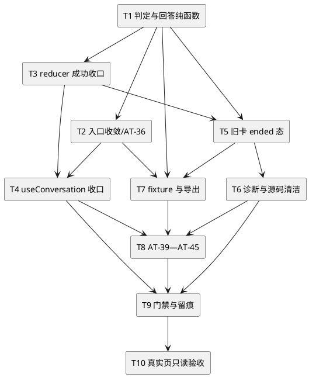

# EasyFlow 预约成功页识别与完成回答修复（第三轮）— 编码任务清单

**输入依据**

- `.codeartsdoer/specs/easyflow_page_guide/iteration3-spec.md`（EARS，R-01—R-49，F-01—F-10）
- `.codeartsdoer/specs/easyflow_page_guide/iteration3-design.md`（重点：2.4 判定算法、2.5 统一入口、2.6 一次性完成消息、2.7 客观完成回答、2.8 旧卡成功态、2.10 fixture 与自测、2.12 逐文件改动、2.13 风险、2.14 验证与留痕、2.15 取舍点）
- `.codeartsdoer/specs/easyflow_page_guide/spec.md`、`design.md`、`tasks.md`（第一轮基线）
- `.codeartsdoer/specs/easyflow_page_guide/iteration2-spec.md`、`iteration2-design.md`、`iteration2-tasks.md`（第二轮能力与任务编号约定）
- 现有实现：`src/background/**`、`src/content/**`、`src/sidepanel/**`、`src/shared/**`、`scripts/build.mjs`、`scripts/selftest.mjs`、`scripts/verify-manifest.mjs`、`public/manifest.json`、`package.json`

**阶段声明**

- 本文件只是第三轮**编码任务规划**，不包含任何实现。
- 编写本文件时**未修改源码**，**未执行** `npm run typecheck`、`npm run selftest`、`npm run build`、`npm run verify`。
- 实现阶段必须真实执行门禁并把输出写入 `codearts_proof/iteration3-*.log`；真实页未验收时一律写“真实页待验”，不得写“已通过”。

---

## 0. 使用说明与全局约束

### 0.1 基线事实（2026-11-14 只读核查）

| 核查项 | 实测结果 | 对任务的要求 |
|---|---|---|
| 成功判定 | `src/sidepanel/guide/stepPlanner.ts:620-638` 的 `isBookingSuccessPage(snapshot, plan)` 要求计划非空、active、预约类 | 判定必须拆为计划无关的纯函数；调用点同步收口 |
| 成功判定调用点 | `useConversation.ts:483`、`643`、`972` 共 3 处 | 本轮到 `readPage` 收口后，这 3 处不应再各自判定 |
| 读取入口 | `readPage(reason)`（`useConversation.ts:336-373`）单点封装 `EF_GET_CONTEXT` + `EF_COLLECT` | 成功判定与一次性收口放在 `readPage` 成功分支 |
| 初始读取 | `useConversation.ts:810-829` 首读后不判定成功 | 重载后无计划成功页必须首读即识别 |
| 无计划早退 | `handleRecheck` 在 `plan === null` 时直接返回（479-482） | 成功识别不得依赖计划；`handleRecheck` 只消费非成功结果 |
| 完成回答 | `RuleEngine.ts:442-444` 无计划/无步骤时返回澄清“我还没有正在陪办的步骤。” | 完成表述在编排层拦截；`RuleEngine` 不改 |
| 完成词表 | `src/sidepanel/match/lexicon.ts:133-139` 的 `FEEDBACK_DONE`；`classifier.ts:111-121` 分类为 `context-feedback/done` | 新增 `isCompletionUtterance` 复用同一词表，禁止第二套词表 |
| 旧卡渲染 | `MessageList.tsx:45、78-89`；`StepCard.tsx:44-49` 仅“已过期”态，仍显示完成条件 | 新增 `ended` 态；`expired` 语义保持（AT-38） |
| 当前卡指向 | `conversationReducer.ts:146-165`；`plan === null` 时不会清空 | 成功收口必须显式清空 `currentCardMessageId` |
| 完成提示去重 | `useConversation.ts:303-313` 只比较最后一条系统消息 | reducer 按 `noticeKind === "booking-complete"` 去重 |
| 诊断时刻 | `DiagnosticsPanel.tsx:90` 含“02:00” | 改为中性文案；`src/` 扫描 0 命中 |
| 既有自测 | `scripts/selftest.mjs` AT-36（1041-1076）、AT-37（1123-1238）、AT-38（1240-1279）；AT-36 使用真实域名 `cal.com` 且断言“完成后 false” | 调整 AT-36，保留误报断言；AT-37/38 不得回退 |
| 权限 | `public/manifest.json` 为 `activeTab`、`scripting`、`sidePanel`、`storage` | 零权限变更 |
| 门禁 | `npm run typecheck`、`npm run selftest`、`npm run build`、`npm run verify` | 实现阶段按顺序真实执行并留痕 |

### 0.2 全局硬约束（每个任务都必须遵守）

1. **权限不变**：不得新增 `host_permissions`、`<all_urls>`、静态 `content_scripts`、`tabs`、麦克风权限。
2. **只读边界**：不得读取 `input.value`、`textarea.value`、下拉选中值、可编辑区域、密码/隐藏字段；不得点击、聚焦、填写、勾选、提交、导航、新开标签页。
3. **成功判定输入最小化**：只使用快照的 `pathname` 与 `items` 中的 `heading`/`paragraph` 文本；不读 `search`、`hash`、`hostname`、`href`、`document.title`、iframe 文本、隐藏节点。
4. **隐私与脱敏**：完成消息、回答、诊断、日志不得包含完整 URL、查询串、片段、姓名、邮箱、会议链接、预约编号、页面正文。
5. **不站点绑定**：不得出现 `cal.com` 等真实站点域名常量、预约编号正则、站点专用选择器。
6. **不持久化**：成功状态、完成证据、完成消息只存在侧边栏内存；`chrome.storage.local` 仍只有 `easyflow.goal`。
7. **文案单点**：完成提示、完成回答、未确认说明、成功后续说明各只有一个常量来源。
8. **用户本人操作**：动态时段更新、用户本人填写/提交、Range 高亮、四类响应、规则演示标识均不得回退。
9. **测试数据虚构**：fixture 使用 `.test` 域名、`fixture-booking-0001` 一类虚构编号、`fixture@example.test` 一类虚构邮箱。
10. **如实留痕**：未执行的命令/人工验收必须单列，不得写“已通过”“理论上通过”。

### 0.3 明确“不改文件”清单

以下文件本轮**不得修改**（除非任务 10 发现真实页证据要求回到取舍点，由用户另行拍板）：

- `src/content/**`：采集、语义段、控件标注、观察、Range 高亮、registry 全部复用。
- `src/background/**`：无新增消息、无字段变化。
- `src/shared/messages.ts`：消息协议不变。
- `src/sidepanel/dialogue/rule/RuleEngine.ts`：完成分支不改语义，仅由编排层拦截。
- `src/sidepanel/guide/completion.ts`：完成条件判定不改。
- `src/sidepanel/dialogue/validate/validator.ts`：校验规则不改；新回答必须通过既有校验。
- `public/manifest.json`、`scripts/build.mjs`、`scripts/verify-manifest.mjs`：权限与构建形态不变。
- `src/sidepanel/styles/sidepanel.css`：复用既有卡片样式，不新增视觉体系。
- `src/shared/privacy/**`、`src/sidepanel/match/**`、`src/sidepanel/dialogue/model/**`：不改。
- 第一轮 `spec.md`、`design.md`、`tasks.md` 与第二轮 `iteration2-*.md`：不改。

**允许修改/新增**：`src/shared/types.ts`、`src/sidepanel/guide/bookingSuccess.ts`（新增）、`src/sidepanel/guide/stepPlanner.ts`、`src/sidepanel/dialogue/intent/classifier.ts`、`src/sidepanel/state/conversationReducer.ts`、`src/sidepanel/hooks/useConversation.ts`、`src/sidepanel/components/chat/stepCardModel.ts`（新增）、`StepCard.tsx`、`MessageList.tsx`、`App.tsx`、`DiagnosticsPanel.tsx`、`scripts/fixtures/booking-*.html`（新增）、`scripts/selftest.mjs`、`codearts_proof/iteration3-*.log`、`codearts_proof/22-iteration3-implementation.md`。

### 0.4 执行顺序总览

| 顺序 | 任务 | 标题 | 依赖 | 主要产物 |
|---|---|---|---|---|
| 1 | T1 | 成功证据判定与回答纯函数 | 无 | `src/shared/types.ts`、`src/sidepanel/guide/bookingSuccess.ts` |
| 2 | T2 | 判定入口收敛、完成表述识别与 AT-36 最小同步 | T1 | `stepPlanner.ts`、`classifier.ts`、`selftest.mjs`（AT-36） |
| 3 | T3 | 会话状态与一次性成功收口 reducer | T1 | `conversationReducer.ts` |
| 4 | T4 | `useConversation` 读取统一收口、完成回答与成功态护栏 | T1、T2、T3 | `useConversation.ts` |
| 5 | T5 | 旧步骤卡 `ended` 态与消息列表透传 | T1、T3 | `stepCardModel.ts`、`StepCard.tsx`、`MessageList.tsx`、`App.tsx` |
| 6 | T6 | 诊断面板成功判定、按钮禁用与源码清洁 | T1、T3、T5 | `DiagnosticsPanel.tsx`、`App.tsx` |
| 7 | T7 | 虚构 fixture 与 selftest 导出 | T1、T2、T5 | `scripts/fixtures/booking-*.html`、`selftest.mjs` 导出 |
| 8 | T8 | AT-39—AT-45 新用例与 AT-36/37/38 回归加固 | T1—T7 | `scripts/selftest.mjs` |
| 9 | T9 | 门禁执行、清洁检索与实现留痕 | T4、T5、T6、T8 | `codearts_proof/iteration3-*.log`、`22-iteration3-implementation.md` |
| 10 | T10 | 真实页只读验收（条件执行） | T9 | 人工验收记录（未执行则“真实页待验”） |

### 0.5 关键依赖图

```text
T1 ──> T2 ──┐
 │          ├──> T4 ──┐
 ├──> T3 ───┘         │
 │     │              ├──> T9 ──> T10
 │     └──> T5 ──> T6 ─┤
 │           │         │
 └───────────┴──> T7 ──┴──> T8 ──> T9
```



**硬性顺序**

1. T1 必须先于 T2—T8：所有文案、判定、回答构造只有一处来源。
2. T3 必须先于 T4、T5：`pageSuccess`、`lastBookingCheck`、`booking-success` 是收口与 UI 的状态基础。
3. T4 必须先于 T8/T9：读取收口与完成回答是 F-01/F-02 的运行时路径。
4. T5 必须先于 T6：诊断面板需要 `pageSuccess` 与旧卡成功态的实际存在。
5. T7 必须先于 T8：新增导出与 fixture 未落地时，新用例无法运行。
6. T9 必须先于 T10：先有可构建产物与自测结果，再做真实页只读验收。

### 0.6 阶段门禁与留痕

| 时点 | 命令 | 通过标准 | 留痕 |
|---|---|---|---|
| 每个任务结束 | `npm run typecheck` | 退出码 0，0 error | 可汇总到 `iteration3-typecheck.log` |
| T2、T3、T5、T7、T8 后 | `npm run selftest` | 退出码 0，既有用例不回退 | 可汇总到 `iteration3-selftest.log` |
| T5、T9 后 | `npm run build` | 退出码 0，`dist/` 产物齐全 | `codearts_proof/iteration3-build.log` |
| T9 | `npm run verify` | 退出码 0，权限仍四项 | `codearts_proof/iteration3-verify.log` |
| T9 | 源码/ fixture 清洁检索 | 0 命中或逐处说明 | 日志内附命令与输出 |

> 本文件不执行上述命令。实现阶段必须按 `typecheck → selftest → build → verify` 顺序真实执行；`npm run build` 内部虽包含 typecheck 与 verify，仍要求单独留存四条命令输出。

---

## 1. T1 成功证据判定与回答纯函数（新增契约与唯一文案来源）

### 1.1 目标与追溯

- 目标：新增一个不依赖计划、不读查询串/域名、只依据“路径形态 + 主文档可见精确标题”的成功证据判定模块，并集中提供固定文案、标题引用与三类回答构造函数。
- 追溯：R-01、R-04—R-08、R-09、R-16—R-20、R-30—R-37、R-38—R-45；F-03—F-06、F-10；设计 2.2.2 接口 A/C、2.3、2.4、2.6.1、2.7.2、2.7.3、2.9、2.12.1。

### 1.2 涉及文件与函数

| 文件 | 改动 |
|---|---|
| `src/shared/types.ts` | `NoticeKind` 增加 `"booking-complete"`；新增 `BookingSuccessReason`、`BookingSuccessSignals`、`BookingCheck` |
| `src/sidepanel/guide/bookingSuccess.ts`（新增） | `BOOKING_SUCCESS_TITLES`、`BOOKING_SUCCESS_PATH_SEGMENTS`、`BOOKING_SUCCESS_PATH`、`BOOKING_COMPLETE_NOTICE`、`BOOKING_DONE_ANSWER`、`BOOKING_UNCONFIRMED_TEXT`、`BOOKING_UNCONFIRMED_ADVICE`、`BOOKING_AFTER_SUCCESS_TEXT`、`normalizeSuccessTitle`、`hasBookingSuccessPath`、`evaluateBookingSuccess`、`isBookingSuccessPage`、`buildSuccessCitation`、`buildBookingDoneResponse`、`buildBookingUnconfirmedResponse`、`buildBookingAfterSuccessResponse` |

### 1.3 实现要点

- [ ] 在 `src/shared/types.ts` 新增 `BookingSuccessReason = "read-failed" | "path-mismatch" | "title-mismatch" | "title-not-visible"`。
- [ ] 新增 `BookingSuccessSignals`：`droppedHidden?: number`、`iframeCount?: number`、`openShadowRoots?: number`、`snapshotTruncated?: boolean`。
- [ ] 新增 `BookingCheck`：`result: "passed" | "failed"`、`reason: BookingSuccessReason | null`、`snapshotId: string`、`checkedAt: number`。
- [ ] `NoticeKind` 只增加 `"booking-complete"`，不改既有成员。
- [ ] 在 `bookingSuccess.ts` 定义并导出 `BookingSuccessEvidence`：`ok`、`reason`、`titleItem: ElementItem | null`、`pathShape: "success" | "other" | "unavailable"`、`checkedAt`。
- [ ] 允许标题集合 `BOOKING_SUCCESS_TITLES` 只含四条：`该会议已安排`、`会议已安排`、`This meeting is scheduled`、`Meeting is scheduled`；不得扩展“预约成功”“已预约”“完成”等宽泛词。
- [ ] 成功路径段集合只含 `booking`、`bookings`、`confirmation`、`confirmed`、`success`；`BOOKING_SUCCESS_PATH` 使用独立段正则 `/(?:^|\/)(?:booking|bookings|confirmation|confirmed|success)(?:\/|$)/i`。
- [ ] `hasBookingSuccessPath(pathname)` 只接收 `pathname`，不接收完整 URL，不读查询串、片段、域名。
- [ ] `normalizeSuccessTitle(text)`：先 `normalizeWhitespace`，英文转小写，去掉末尾一个 `。`/`.`/`！`/`!`；只用于比较，不用于展示。
- [ ] `evaluateBookingSuccess(snapshot, signals?)` 严格按设计 2.4.4 顺序返回互斥原因：
      1. `snapshot === null`、`url` 不可解析、`items.length === 0`、`signals.snapshotTruncated === true` → `read-failed`；
      2. 路径不含独立成功段 → `path-mismatch`；
      3. 存在 `heading`/`paragraph` 且归一化整句等于允许集合 → `ok: true`、`reason: null`；
      4. 无精确标题，但存在包含允许标题文本的 `heading`/`paragraph` → `title-mismatch`；
      5. 无精确标题，且 `droppedHidden > 0` / `iframeCount > 0` / `openShadowRoots > 0` → `title-not-visible`；
      6. 其余 → `title-mismatch`。
- [ ] 标题匹配必须用 `===` 整串比较；禁止 `includes`、分词、去全部标点后模糊比较。
- [ ] 候选只允许 `heading`/`paragraph`；`link`/`button`/`inputLabel` 一律排除。
- [ ] `titleItem` 取命中的第一个条目（按快照 `order`），`checkedAt` 取 `snapshot.capturedAt`，不取当前时间，不参与分支。
- [ ] `isBookingSuccessPage(snapshot)` 只是 `evaluateBookingSuccess(snapshot).ok` 的布尔投影，单参数。
- [ ] `buildSuccessCitation(titleItem, snapshotId)`：`ref` 由 `elementId/domPath/textHash` 投影；`text = normalizeWhitespace(titleItem.text)`（保留可见原文标点）；`role: "title"`；`status: "valid"`；`start: 0`、`end: text.length`；`segmentId = seg-${snapshotId}-booking-title`；`citationId` 固定可复现。
- [ ] `buildBookingDoneResponse(evidence)`：`responseType: "direct-answer"`；正文完全来自 `BOOKING_DONE_ANSWER`（“页面显示预约已安排。请以网页和确认邮件中的信息为准。”）；1 条标题引用；`diagnostics` 固定为 `mode: "rule-demo"`、`engineMs: 0`、`retrievedSegments: 0`、`citationCount: 1`、`intentKind: "context-feedback"`、`priorityHit: "booking-success"`、`outboundBytes: 0`、`sensitiveDetected: false`。
- [ ] `buildBookingUnconfirmedResponse(reason)`：`responseType: "cannot-answer"`；`read-failed` 用读取失败口径，其余用 `no-evidence`；正文不得出现“预约已安排”“预约已完成”（避免冒充成功），建议文本必须包含“重新读取”或“查看网页”一类可执行建议；`citationCount: 0`、`priorityHit: "booking-unconfirmed"`。
- [ ] `buildBookingAfterSuccessResponse(evidence)`：`direct-answer`；说明任务已结束、以网页与确认邮件为准；引用当前成功标题；不得生成下一步、不得索取页面外信息。
- [ ] 三个完成类构造只接受“当前快照仍满足成功证据”的 `evidence`；不得用旧引用冒充当前页依据。
- [ ] 模块内不得出现 `document`、`window`、`chrome.`、`fetch(`、`localStorage`、`sessionStorage`、`.value`、`href`、`search`、`hash`、`hostname`、`capturedAt` 参与分支以外的逻辑。

### 1.4 前置依赖、改动边界与不做事项

- 前置依赖：无。
- 改动边界：只新增模块与共享类型；不改既有 `StepCard`、reducer、hook、引擎、校验器。
- 明确不做：不新增权限/消息/存储键；不读取控件或表单值；不实现页面 DOM 查询；不扩展允许标题集合；不增加“预约语境”门槛（默认 T3-11）；不写站点专用逻辑。

### 1.5 完成标准与自验方式

- [ ] `npm run typecheck` 退出码 0，0 error。
- [ ] `npm run build` 退出码 0（新模块可被打包/引用；本任务不要求 UI 使用）。
- [ ] 静态检查：`rg -n "document|window|chrome\\.|fetch\\(|localStorage|sessionStorage|\\.value|href|search|hash|hostname" src/sidepanel/guide/bookingSuccess.ts` 为 0 命中（注释除外需逐处说明）。
- [ ] 静态检查：`rg -n "includes\\(|cal\\.com|02:00|02:15|03:00" src/sidepanel/guide/bookingSuccess.ts` 为 0 命中。
- [ ] 代码评审核对：四条标题、五个路径段、四类原因、四类文案各只有一处定义。
- [ ] 为 T8 预留断言口径：同一快照 + 同一 signals 两次调用 `evaluateBookingSuccess`，`ok/reason/titleItem.elementId` 完全一致。

### 1.6 风险与回滚点

- 风险：R3-01 普通页面偶然同时满足路径段与精确标题；R3-02 真实页标题不在四条集合内导致漏判；R3-08 文案被误读为“扩展完成了预约”。
- 回滚点：删除 `bookingSuccess.ts` 及其引用即可回到旧判定；文案可单点回改，不影响其他任务。

---

## 2. T2 判定入口收敛、完成表述识别与 AT-36 最小同步

### 2.1 目标与追溯

- 目标：把 `stepPlanner.ts` 的成功判定收敛为 `bookingSuccess.ts` 的单参封装，新增复用 `FEEDBACK_DONE` 的 `isCompletionUtterance`，并同步调整 AT-36 使每一步 `selftest` 可绿。
- 追溯：R-02、R-03、R-15、R-46、R-49；F-01、F-02、F-09；设计 2.2.2 接口 B/D、2.4.1、2.11、2.12.2、2.10.3 补充。

### 2.2 涉及文件与函数

| 文件 | 函数/位置 | 改动 |
|---|---|---|
| `src/sidepanel/guide/stepPlanner.ts` | 文件头常量 | 删除本地 `BOOKING_SUCCESS_TITLE`；`BOOKING_SUCCESS_PATH` 改为从 `bookingSuccess` 导入或调用 `hasBookingSuccessPath` |
| 同上 | `bookingUrlShape`（43-50） | 继续返回 `"booking-success-path"` / `"booking-path"`，内部改调 `hasBookingSuccessPath(pathname)` |
| 同上 | `isBookingSuccessPage`（620-638） | 删除旧实现，改为 `export { isBookingSuccessPage } from "./bookingSuccess"` |
| 同上 | `completeBookingPlan`（616-618） | 保持不变 |
| `src/sidepanel/dialogue/intent/classifier.ts` | 文件末尾 | 新增并导出 `isCompletionUtterance(utterance)`，复用 `findTerm(utterance, FEEDBACK_DONE)` |
| `scripts/selftest.mjs` | AT-36（1041-1076） | 最小同步：单参调用、`completed` 后仍为 `true`、`plan = null` 仍为 `true`、域名/编号改虚构；保留普通路径/仅“已安排”/英文标题断言 |

### 2.3 实现要点

- [ ] `stepPlanner.ts` 不再保留第二套成功标题正则；所有标题比较只来自 `bookingSuccess.ts`。
- [ ] `bookingUrlShape` 的异常行为保持：`new URL` 抛错时返回 `"booking-path"`，不抛错。
- [ ] `isBookingSuccessPage` 收敛为单参；`stepPlanner.ts` 仅做 re-export，避免调用面大改。
- [ ] `isCompletionUtterance` 只调用既有 `FEEDBACK_DONE`，不得新增“完成”“搞定”等第二套词表；与 `classifyIntent` 的 `context-feedback/done` 保持一致。
- [ ] AT-36 调整为“预约成功页由路径形态 + 精确标题确认（与计划解耦）”：
      - 活动计划 + `/booking/<虚构编号>` + 精确标题 → `true`；
      - `completeBookingPlan` 后同一页 → **`true`**（删除旧的“完成后 false”）；
      - `plan = null` 时同一页 → **`true`**；
      - 普通路径 + 精确标题 → `false`；
      - 成功路径 + 仅“已安排” → `false`；
      - 英文精确标题 → `true`；
      - 域名改 `https://example.test/...`，编号改 `fixture-booking-0001`。
- [ ] AT-36 中不得保留 `cal.com`、`TEST-ID` 或真实预约查询串。
- [ ] 不删除 AT-36 的误报防护断言（普通路径、仅“已安排”）。

### 2.4 前置依赖、改动边界与不做事项

- 前置依赖：T1。
- 改动边界：只改 `stepPlanner.ts`、`classifier.ts` 与 AT-36；不改 `RuleEngine`、`completion.ts`、`validator.ts`、采集链。
- 明确不做：不在本任务新增 AT-39—AT-45（T8 完成）；不改动态时段 `createPlan`/`reconcileBookingPlan`/`timePreferenceOf`；不改 `GuidePlan` 字段。

### 2.5 完成标准与自验方式

- [ ] `npm run typecheck` 退出码 0。
- [ ] `npm run selftest` 退出码 0；AT-36 中“完成后 true”“无计划 true”“普通路径 false”“仅已安排 false”“英文 true”全部可见。
- [ ] 静态检查：`rg -n "BOOKING_SUCCESS_TITLE|cal\\.com|TEST-ID" src/sidepanel/guide/stepPlanner.ts scripts/selftest.mjs` 在 AT-36 相关位置 0 命中（其他既有站点无关文案逐处说明）。
- [ ] 静态检查：`rg -n "FEEDBACK_DONE" src/sidepanel/dialogue/intent/classifier.ts` 可见复用。
- [ ] AT-37/AT-38 仍通过（本任务不应触及它们的断言）。

### 2.6 风险与回滚点

- 风险：R3-05 签名变化导致编译/自测失败；AT-36 旧断言与 R-02 冲突。
- 回滚点：恢复旧双参 `isBookingSuccessPage` 并忽略 `plan`（不推荐，会重新引入 D3-01）；AT-36 恢复旧断言（不推荐，违反 R-02）。

---

## 3. T3 会话状态与一次性成功收口 reducer

### 3.1 目标与追溯

- 目标：在会话状态中表达“页面成功已确认”“最近一次成功判定”，并用单一 `booking-success` action 原子完成计划结束、当前卡清空、完成消息去重与界面稳定。
- 追溯：R-09—R-13、R-23—R-29；F-01、F-02、F-07；设计 2.2.2 接口 F、2.3、2.5.2、2.6.2、2.6.3。

### 3.2 涉及文件与函数

| 文件 | 函数/位置 | 改动 |
|---|---|---|
| `src/sidepanel/state/conversationReducer.ts` | `ConversationState`（16-37） | 新增 `pageSuccess: "none" \| "confirmed"`、`lastBookingCheck: BookingCheck \| null` |
| 同上 | `createConversationState`（87-108） | 初始化 `pageSuccess: "none"`、`lastBookingCheck: null` |
| 同上 | `ConversationAction`（39-61） | 新增 `booking-check`、`booking-success` |
| 同上 | `conversationReducer`（110-207） | 新增两个 case；`booking-success` 同时完成计划、当前卡、页面成功态、消息去重、忙态复位 |

### 3.3 实现要点

- [ ] `booking-check` action：`{ type: "booking-check"; check: BookingCheck }`；只覆盖写 `lastBookingCheck`，不追加消息、不改变 `busy`/`phase`。
- [ ] `booking-success` action：`{ type: "booking-success"; plan: GuidePlan | null; message: SystemNotice }`。
- [ ] `booking-success` 后置条件：
      - `plan !== null` → `{ ...action.plan, status: "completed" }`，保留 `steps` 与历史；
      - `plan === null` → 仍保持 `null`，不得虚构计划；
      - `currentCardMessageId = null`（无论计划是否存在）；
      - `pageSuccess = "confirmed"`；
      - `phase = "ready"`、`busy = false`、`slowHint = false`、`canRetry = false`；
      - 若 `messages` 中已存在 `noticeKind === "booking-complete"`，不追加；否则追加 `action.message`。
- [ ] `booking-success` 连续调用 3 次 → 完成消息计数 1、计划 `completed`、`currentCardMessageId === null`、`pageSuccess === "confirmed"`。
- [ ] `read-ok`、`page-changed`、`plan-set` 不得把 `pageSuccess` 从 `"confirmed"` 改回 `"none"`（成功状态不回退）。
- [ ] `plan-set` 的既有行为保持：计划非 active 时清空 `currentCardMessageId`（AT-38 不回退）。
- [ ] `read-ok` 不追加完成消息；完成消息只由 `booking-success` 追加。
- [ ] 不持久化 `pageSuccess`/`lastBookingCheck`；不新增 storage 字段。

### 3.4 前置依赖、改动边界与不做事项

- 前置依赖：T1（`BookingCheck`、`NoticeKind` 类型）。
- 改动边界：只改 reducer；不改 message 构造、hook、UI。
- 明确不做：不在 reducer 里发消息/读页面/停 watch；不合并 `plan-set` 语义；不改 `MAX_MESSAGES` 截断逻辑。

### 3.5 完成标准与自验方式

- [ ] `npm run typecheck` 退出码 0。
- [ ] `npm run selftest` 退出码 0（AT-38 仍通过）。
- [ ] 代码评审核对：`booking-success` 是唯一同时修改 `plan`/`currentCardMessageId`/`pageSuccess`/`messages` 的 action。
- [ ] 预留 T8/AT-40 断言：3 次 `booking-success` 后消息计数 1、`pageSuccess === "confirmed"`、`currentCardMessageId === null`、`plan === null` 场景不虚构计划。
- [ ] 静态检查：`rg -n "storage|chrome\\." src/sidepanel/state/conversationReducer.ts` 0 命中。

### 3.6 风险与回滚点

- 风险：R3-06 成功收口与旧计划清理不同步；消息去重只看文案而不看 `noticeKind` 会重复。
- 回滚点：移除 `booking-success` case 的卡片清空/消息追加，保留 `booking-check` 诊断（会破坏 R-24/R-10，不推荐）。

---

## 4. T4 `useConversation` 读取统一收口、完成回答与成功态护栏

### 4.1 目标与追溯

- 目标：把成功判定收口到 `readPage` 成功分支，覆盖首读/页面变化/观察/重试/用户完成表述；在 `runTurn` 中以当前快照证据构造客观完成回答，并阻止成功后生成新步骤。
- 追溯：R-02、R-03、R-10—R-14、R-15—R-22、R-23、R-27、R-28；F-01、F-02、F-07；设计 2.1.3、2.5、2.6、2.7、2.12.2。

### 4.2 涉及文件与函数

| 函数/位置 | 改动 |
|---|---|
| import（42-52） | 引入 `evaluateBookingSuccess`、`buildBookingDoneResponse`、`buildBookingUnconfirmedResponse`、`buildBookingAfterSuccessResponse`、`BOOKING_COMPLETE_NOTICE`、`isCompletionUtterance`；移除对 `isBookingSuccessPage` 的直接依赖 |
| 新增 `recordBookingCheck(snapshotId, evidence)` | 派发 `booking-check` 覆盖写 |
| 新增 `finalizeBookingSuccess(snapshot, evidence)` | 幂等收口：检查 `bookingSuccessHandled` → 置 ref → 构造 `makeSystemMessage(BOOKING_COMPLETE_NOTICE, "booking-complete", snapshotId)` → 派发 `booking-success`（携带当前计划）→ `stopWatch()` |
| `readPage`（336-373） | 成功分支追加判定/诊断/收口；失败分支记录 `read-failed`；已确认成功时不重复收口 |
| `handleRecheck`（477-577） | 开头增加 `bookingSuccessHandled`/`pageSuccess` 守卫；删除旧成功分支 483-491；保留 `plan === null` 早退 |
| `runTurn`（579-808） | `wantsFreshRead` 增加完成表述；在重规划前插入完成回答/未确认回答；新增成功态护栏；移除旧 643-646 成功判定块 |
| `locateControl`（959-1018） | 成功态直接提示“这一步已经结束”并返回，不高亮旧控件；删除旧成功判定分支 |
| `retry`（880-885） | 成功态直接返回（按钮已禁用，防御式处理） |
| 页面变化/观察 listener（831-878） | 保留 `bookingSuccessHandled` 早退；`readPage` 已收口，不再依赖 `handleRecheck` 做成功判定 |

### 4.3 实现要点

- [ ] `readPage` 成功分支必须在 `read-ok` 之后执行：
      1. 若 `bookingSuccessHandled.current || stateRef.current.pageSuccess === "confirmed"` → 只更新快照，不判定/不追加提示；
      2. `evidence = evaluateBookingSuccess(snapshot, { droppedHidden, iframeCount, openShadowRoots, snapshotTruncated: snapshot.truncated })`；
      3. `recordBookingCheck(snapshot.snapshotId, evidence)`；
      4. `evidence.ok` → `finalizeBookingSuccess(snapshot, evidence)`。
- [ ] `readPage` 失败分支：若尚未确认成功，派发 `booking-check`（`result: "failed"`、`reason: "read-failed"`、`snapshotId: "none"`、`checkedAt: Date.now()`）；保留既有 `appendFailure`。
- [ ] `finalizeBookingSuccess` 必须“先置 ref 再 dispatch”，保证同一轮 `runTurn` 内 `stateRef` 尚未更新时仍能幂等。
- [ ] `booking-success` 的 `plan` 取 `stateRef.current.plan`（可为 `null`），不得用成功证据虚构计划。
- [ ] `handleRecheck` 开头守卫：`bookingSuccessHandled.current` 为真（优先）或 `stateRef.current.pageSuccess === "confirmed"` → 直接返回；删除 483-491 的旧成功分支；`plan === null` 仍早退。
- [ ] `runTurn` 的 `wantsFreshRead` 增加 `isCompletionUtterance(trimmed)`；完成表述必须重新读取当前页一次。
- [ ] `runTurn` 在 `activePlan` 重规划之前、`dispatch({ type: "busy", busy: true })`（682）之前插入以下分支：
      1. **证据成立 + 完成表述**：`buildBookingDoneResponse(evidence)` → `validateResponse(response, activeSnapshot, activePlan)` → 通过则上屏；被拒绝则按既有规则降级为 `cannot-answer` 并记录 `rejectReason`；不追加完成消息、不推进计划、不启动 watch。
      2. **无活动计划 + 完成表述 + 证据不足**：`activePlan === null || activePlan.status !== "active" || currentStep(activePlan) === null` → `buildBookingUnconfirmedResponse(evidence.reason)` → 校验 → 上屏；不得回复“我还没有正在陪办的步骤”。
      3. **成功态护栏**：`bookingSuccessHandled.current || stateRef.current.pageSuccess === "confirmed"` 且用户输入命中 `完成表述`/`然后呢|还要做什么|下一步|继续|还要`/`找不到|点错|指给我看` → 当前证据成立则 `buildBookingAfterSuccessResponse(evidence)`，否则 `buildBookingUnconfirmedResponse("title-mismatch")` → 校验 → 上屏；不生成 `next-step`、不 `startWatch`。
- [ ] 删除 `runTurn` 旧 643-646 的 `isBookingSuccessPage(activeSnapshot, activePlan)` 分支。
- [ ] 有活动计划 + 完成表述 + 证据不足：**不拦截**，继续既有 `RuleEngine` 流程（保持第二轮“这一步完成/未页面验证”语义）。
- [ ] 成功态下其他页面事实问题仍交回既有 `RuleEngine`；代填/代提交仍走既有 `safety-boundary`。
- [ ] 新增分支均在 `busy`/`slow-hint` 计时器设置之前提前返回，避免悬挂计时器；不新增清理函数。
- [ ] `locateControl`：开头若 `bookingSuccessHandled.current || pageSuccess === "confirmed"` → `appendSystemOnce("这一步已经结束，不需要再定位。", "citation-stale")` 并返回；读取后同样判断；不得高亮旧控件。
- [ ] `retry`：成功态直接返回；`readPage("refresh")` 即使被程序路径触发，也只更新快照，不追加提示、不回退状态。
- [ ] listener：`page-changed` 保留 `bookingSuccessHandled.current` 早退；`watch tick` 保留 `plan.status !== "active"` 检查；不得重新启动 watch。
- [ ] `markDone` 保持“先 `readPage("recheck")` 再 `runTurn("我已完成", snapshot)`”，因此成功页按钮路径也能得到客观回答。

### 4.4 前置依赖、改动边界与不做事项

- 前置依赖：T1、T2、T3。
- 改动边界：只改 `useConversation.ts`；不改消息协议、后台、采集、引擎、校验器。
- 明确不做：不修改 `RuleEngine` 的 `done` 分支；不在编排层新增第二套完成词表；不增加自动点击/自动提交；不新增 `readPage` 返回类型字段；不新增权限。

### 4.5 完成标准与自验方式

- [ ] `npm run typecheck` 退出码 0。
- [ ] `npm run selftest` 退出码 0（AT-36/37/38 不回退）。
- [ ] 静态检查：`rg -n "isBookingSuccessPage\\(" src/sidepanel/hooks/useConversation.ts` 0 命中（统一使用 `evaluateBookingSuccess`）。
- [ ] 静态检查：`rg -n "我还没有正在陪办的步骤" src/sidepanel/hooks/useConversation.ts` 0 命中；该文案只允许留在 `RuleEngine` 既有非完成分支。
- [ ] 静态检查：`rg -n "booking-complete|BOOKING_COMPLETE_NOTICE|booking-success" src/sidepanel/hooks/useConversation.ts` 可见唯一收口路径。
- [ ] 代码评审核对：`readPage` 首读、页面变化、观察、重试、完成表述五类入口均经过同一成功判定。
- [ ] 代码评审核对：新增分支均在 `busy` 设置之前；成功后无 `startWatch`。
- [ ] T8 落地后以 AT-40/AT-41 验证 reducer/回答口径；真实页路径由 T10 验证。

### 4.6 风险与回滚点

- 风险：R3-04 首屏直接出现完成消息（符合新需求，但交互变化）；R3-06 收口与旧计划不同步；`stateRef` 同步时序导致重复回答/零回答；成功后 `readPage("refresh")` 无反馈。
- 回滚点：移除 `readPage` 内收口，恢复 `handleRecheck` 成功分支（会重新引入 D3-02/D3-03/D3-08，不推荐）；移除 `runTurn` 拦截，恢复旧 RuleEngine 完成分支（会重新引入 D3-04）。

---

## 5. T5 旧步骤卡 `ended` 态与消息列表透传

### 5.1 目标与追溯

- 目标：成功后所有历史步骤卡进入“已结束”态，不显示完成条件、不渲染任何操作按钮；保留既有 `expired` 语义。
- 追溯：R-23—R-29；F-01、F-07；设计 2.2.2 接口 E、2.8、2.12.1/2.12.2。

### 5.2 涉及文件与函数

| 文件 | 改动 |
|---|---|
| `src/sidepanel/components/chat/stepCardModel.ts`（新增） | `StepCardMode`、`StepCardAction`、`resolveStepCardMode`、`stepCardActions`、`shouldShowCompletion`、`stepCardLabel` |
| `src/sidepanel/components/chat/StepCard.tsx` | props 新增 `ended?: boolean`；渲染改用 `stepCardModel`；`ended` 不显示完成条件与按钮 |
| `src/sidepanel/components/chat/MessageList.tsx` | props 新增 `bookingCompleted: boolean`；`AssistantBubble` 对所有带 `targetControl` 的消息传 `ended={bookingCompleted}` |
| `src/sidepanel/App.tsx` | 传 `bookingCompleted={state.pageSuccess === "confirmed"}`；保留 `planActive` |

### 5.3 实现要点

- [ ] `resolveStepCardMode({ ended, expired })` 优先级：`ended` > `expired` > `current`。
- [ ] `stepCardActions(mode)`：`ended` 返回 `[]`；`expired` 返回 `[]`；`current` 返回 `["locate","not-found","misclicked","done","switch-task"]`（长度 5）。
- [ ] `shouldShowCompletion(mode)`：`ended === false`；`expired === true`（保持既有 AT-38）；`current === true`。
- [ ] `stepCardLabel(mode)`：`ended` → “这一步已结束”；`expired` → “这一步已过期”；`current` → “现在这一步”。
- [ ] `StepCard` 保留既有 5 个回调与 `expired` 默认值；新增 `ended` 可选，缺省行为不变。
- [ ] `StepCard` 渲染：
      - 模式标签来自 `stepCardLabel`；
      - 目标标签始终保留（历史可追溯）；
      - `shouldShowCompletion` 为真才渲染“完成条件：…”；
      - `ended` 不渲染“页面已经变化，请按上方最新指引操作。”；
      - `expired` 保留既有提示语；
      - 仅 `current` 渲染操作按钮；`ended`/`expired` 按钮数为 0。
- [ ] `MessageList` 对所有带 `targetControl` 的历史消息统一传 `ended={bookingCompleted}`，而不是只处理最新一条。
- [ ] `cardActive = planActive && message.messageId === currentCardMessageId` 逻辑保持不变（AT-38）。
- [ ] `App.tsx` 保留 `planActive={state.plan?.status === "active"}`；新增 `bookingCompleted`。
- [ ] `ended` 优先级高于 `cardActive`：即使 `planActive`/`currentCardMessageId` 因时序未及时清空，也不得渲染可操作卡。
- [ ] 不新增“已完成”大按钮、不新增折叠组件、不修改 `sidepanel.css`；`ended` 可复用既有 muted 样式类。

### 5.4 前置依赖、改动边界与不做事项

- 前置依赖：T1（类型）、T3（`pageSuccess` 状态）。
- 改动边界：只改 `stepCardModel.ts`、`StepCard.tsx`、`MessageList.tsx`、`App.tsx` 的 `MessageList` 传参。
- 明确不做：不隐藏历史文本（默认 T3-03）；不改 `expired` 文案与完成条件行为；不改按钮回调实现；不改聊天布局/CSS。

### 5.5 完成标准与自验方式

- [ ] `npm run typecheck` 退出码 0。
- [ ] `npm run selftest` 退出码 0；AT-38 仍通过（`currentCardMessageId`、`planActive`、`StepCard` 含“已过期”/`expired`、`App.tsx` 含 `planActive`）。
- [ ] `npm run build` 退出码 0（首次验证 UI 改动可打包）。
- [ ] 静态检查：`rg -n "bookingCompleted|ended" src/sidepanel/components/chat/MessageList.tsx src/sidepanel/components/chat/StepCard.tsx src/sidepanel/App.tsx` 可见透传。
- [ ] T8/AT-44 断言：`stepCardActions("ended").length === 0`、`shouldShowCompletion("ended") === false`、`stepCardLabel("ended")` 含“已结束”；`current` 为 5；`expired` 为 0 且 `shouldShowCompletion` 为 `true`。

### 5.6 风险与回滚点

- 风险：R3-03 历史文本仍含“填写姓名、邮箱”（默认保留历史）；误改 `expired` 导致 AT-38 回退。
- 回滚点：只回滚 `StepCard` 的 `ended` 分支与 `MessageList` 透传，保留 `stepCardModel` 不影响其他逻辑。

---

## 6. T6 诊断面板成功判定、按钮禁用与源码清洁

### 6.1 目标与追溯

- 目标：在折叠诊断中展示成功判定“通过/未通过 + 原因类别”，成功后禁用“重新读取页面”，并移除生产源码中的测试时刻字面量。
- 追溯：R-44、R-45、6.6 诊断约束、设计 2.9.3、2.9.4、2.12.2、K3-08。

### 6.2 涉及文件与函数

| 文件 | 改动 |
|---|---|
| `src/sidepanel/components/chat/DiagnosticsPanel.tsx` | props 新增 `lastBookingCheck: BookingCheck \| null`、`bookingCompleted: boolean`；新增成功判定一行；中性化“02:00”文案；成功态禁用刷新按钮 |
| `src/sidepanel/App.tsx` | `DiagnosticsPanel` 传 `lastBookingCheck={state.lastBookingCheck}`、`bookingCompleted={state.pageSuccess === "confirmed"}` |

### 6.3 实现要点

- [ ] 将 `DiagnosticsPanel.tsx:90` 的“若左侧已滚到 02:00 时段，请点‘重新读取页面’后再截图。”改为中性文案：“若左侧已滚到时段区域，请点‘重新读取页面’后再截图。”
- [ ] 新增原因类别映射：`read-failed` → “读取失败”；`path-mismatch` → “路径不符”；`title-mismatch` → “标题不符”；`title-not-visible` → “标题不可见”；`null` + `passed` → “通过”。
- [ ] 在页面采集诊断块内新增一行：`成功判定 通过` / `成功判定 未通过（原因类别）` / `成功判定 暂无`；不得展示标题原文、完整 URL、查询串。
- [ ] 成功后“重新读取页面”按钮 `disabled={bookingCompleted}`，并在旁边显示“已完成”标识；不追加系统消息、不改变诊断折叠默认态。
- [ ] `lastBookingCheck` 只读展示，不由面板写状态。
- [ ] 不改运行记录列表结构；不新增页面正文/引用原文展示。
- [ ] `App.tsx` 只新增上述两个 props，保留既有 `entries`/`collectDiagnostics`/`onRefresh`。

### 6.4 前置依赖、改动边界与不做事项

- 前置依赖：T1（`BookingCheck` 类型）、T3（state 字段）、T5（UI 透传模式）。
- 改动边界：只改 `DiagnosticsPanel.tsx` 与 `App.tsx` 的诊断传参。
- 明确不做：不新增诊断持久化/导出；不展示 URL/标题/查询串；不改变成功态下其他功能；不新增按钮。

### 6.5 完成标准与自验方式

- [ ] `npm run typecheck` 退出码 0。
- [ ] `npm run selftest` 退出码 0。
- [ ] `rg -n "02:00|02:15|03:00" src` 0 命中。
- [ ] `rg -n "lastBookingCheck|bookingCompleted|成功判定" src/sidepanel/components/chat/DiagnosticsPanel.tsx src/sidepanel/App.tsx` 可见新增字段。
- [ ] T8/AT-45 断言：`DiagnosticsPanel` 不含 `02:00`；成功后刷新按钮 `disabled`；诊断不出现姓名/邮箱/查询串。

### 6.6 风险与回滚点

- 风险：R3-07 成功态下“重新读取”无反馈；诊断展示过多导致隐私泄露。
- 回滚点：恢复刷新按钮并追加固定说明（会增加提示条数，不推荐）；移除成功判定行（不影响核心判定，但降低可审计性）。

---

## 7. T7 虚构 fixture 与 selftest 导出

### 7.1 目标与追溯

- 目标：新增 7 个虚构 HTML fixture，覆盖 F-01—F-07 场景；把新纯函数与卡片模型加入 `selftest.mjs` 的 stdin 导出，供 T8 用例使用。
- 追溯：R-44、6.5 fixture 约束；F-01—F-08；设计 2.10.1、2.10.2、2.10.4。

### 7.2 涉及文件与函数

| 文件 | 内容 |
|---|---|
| `scripts/fixtures/booking-success-with-plan.html` | 有活动计划成功页结构 |
| `scripts/fixtures/booking-success-no-plan.html` | 无活动计划成功页结构（模拟重载） |
| `scripts/fixtures/booking-arranged-only.html` | 成功路径 + 正文仅“已安排” |
| `scripts/fixtures/booking-fake-url.html` | 伪成功 URL（路径为 `/schedule`）+ 精确标题 |
| `scripts/fixtures/booking-normal-path-precise-title.html` | 普通路径 + 精确标题 |
| `scripts/fixtures/booking-success-hidden-title.html` | 成功路径 + 隐藏精确标题 |
| `scripts/fixtures/booking-success-repeat.html` | 重复通知场景 + 两个近似标题变体 |
| `scripts/selftest.mjs` | stdin 导出列表新增 `bookingSuccess`、`isCompletionUtterance`、`stepCardModel` 导出 |

### 7.3 实现要点

- [ ] 每个 fixture 含 `data-testid` 便于结构断言；成功页使用 `<h1>该会议已安排</h1>`；虚构编号统一 `fixture-booking-0001`。
- [ ] `.test` 域名说明只出现在注释或自测快照中；HTML 内不得出现 `cal.com`、`calendar.google.com`、`outlook.com`、`teams.microsoft.com` 等真实站点。
- [ ] 如 fixture 出现邮箱，只能是 `fixture@example.test`；不得出现真实姓名/邮箱/会议链接/查询串。
- [ ] `booking-arranged-only.html` 只能有 `<p>已安排</p>`，不得有精确标题。
- [ ] `booking-fake-url.html` 必须注释说明路径为 `/schedule`，查询串仅作场景说明，不进入生产判定。
- [ ] `booking-normal-path-precise-title.html` 必须注释说明路径为 `/page`。
- [ ] `booking-success-hidden-title.html` 使用 `<h1 hidden>该会议已安排</h1>` 与 `aria-hidden="true"` 容器；不得把隐藏标题当作可见证据。
- [ ] `booking-success-repeat.html` 包含同结构成功页 + 两个近似标题变体，用于重复通知/近似标题断言。
- [ ] `selftest.mjs` 新增导出（与既有导出并列，不删除任何既有导出）：
      - `evaluateBookingSuccess`、`isBookingSuccessPage`、`buildBookingDoneResponse`、`buildBookingUnconfirmedResponse`、`buildBookingAfterSuccessResponse`、`buildSuccessCitation`、`BOOKING_SUCCESS_TITLES`、`BOOKING_COMPLETE_NOTICE`、`normalizeSuccessTitle`（来自 `bookingSuccess.ts`）；
      - `isCompletionUtterance`（来自 `classifier.ts`）；
      - `resolveStepCardMode`、`stepCardActions`、`shouldShowCompletion`、`stepCardLabel`（来自 `stepCardModel.ts`）。
- [ ] 不修改 `build()` 的打包参数、`platform`、`target`、`outfile` 与清理逻辑。

### 7.4 前置依赖、改动边界与不做事项

- 前置依赖：T1、T2、T5。
- 改动边界：只新增 fixture 与 selftest 导出；不新增生产逻辑。
- 明确不做：不用 HTML fixture 做运行时 DOM 解析（纯数据用例仍用 `makePageSnapshot`/`makeItem`）；不修改既有 `cal-booking-*.html` 的结构；不引入 jsdom/新依赖。

### 7.5 完成标准与自验方式

- [ ] `npm run typecheck` 退出码 0。
- [ ] `npm run selftest` 退出码 0；既有用例与 AT-36 仍通过。
- [ ] `Get-ChildItem scripts/fixtures/booking-*.html` 显示 7 个新文件。
- [ ] `rg -n "cal\\.com|TEST-ID|[A-Za-z0-9._%+-]+@(?!example\\.test)[A-Za-z0-9.-]+\\.[A-Za-z]{2,}" scripts/fixtures/booking-*.html` 0 命中（PowerShell 可拆成两条检索）。
- [ ] 每个 fixture 的 `data-testid` 与场景标记人工核对一次；T8 增加结构断言。

### 7.6 风险与回滚点

- 风险：fixture 中误入真实域名/邮箱；导出遗漏导致 T8 无法运行。
- 回滚点：删除新增 fixture 与新增导出行即可；不影响生产代码。

---

## 8. T8 AT-39—AT-45 新用例与 AT-36/37/38 回归加固

### 8.1 目标与追溯

- 目标：用可重复的纯数据用例覆盖 F-01—F-10，锁定判定原因类别、完成消息计数、无计划完成回答、误报防护、成功态卡片、源码/fixture 清洁与隐私边界。
- 追溯：spec 7.1/7.2；R-01—R-49；设计 2.10.3、2.10.4、2.14。

### 8.2 涉及文件与函数

| 文件 | 用例 |
|---|---|
| `scripts/selftest.mjs` | AT-36 最终加固、新增 AT-39—AT-45、AT-37/AT-38 保持 |

### 8.3 实现要点

- [ ] **AT-36 最终加固**（T2 已做最小同步）：
      - 活动计划 + 虚构成功路径 + 精确标题 → `ok = true`；
      - `completeBookingPlan` 后同页 → `true`；
      - `plan = null` 时同页 → `true`；
      - 普通路径 + 精确标题 → `false`；
      - 成功路径 + 仅“已安排” → `false`；
      - 英文精确标题 → `true`；
      - 域名仅 `example.test`，编号仅 `fixture-booking-0001`；
      - 不得出现 `cal.com`、`TEST-ID`。
- [ ] **AT-39（F-01/R-01—R-02）**：有活动计划 + 成功路径 + 精确标题 → `ok = true`；计划 `completed` 后同页仍 `true`；`plan = null` 仍 `true`；`titleItem.elementId` 存在于快照。
- [ ] **AT-40（F-02）**：无计划成功页；`conversationReducer` 连续 3 次 `booking-success` → 完成消息计数 1、`pageSuccess === "confirmed"`、`currentCardMessageId === null`、`plan === null`；`lastBookingCheck` 覆盖写为最近一次。
- [ ] **AT-41（F-02/R-16—R-19）**：`buildBookingDoneResponse` → `direct-answer`；文本以“页面显示预约已安排”开头；句数 ≤3、字数 ≤180；`citations.length === 1`；`citation.text` 等于快照标题原文（归一化后）；`validateResponse(..., snapshot, null).status === "passed"`；文本不含“我还没有正在陪办的步骤”。
- [ ] **AT-42（F-03—F-06）**：普通路径 / 仅“已安排” / 伪 URL（`?status=success` + 精确标题）/ 隐藏标题（带 `droppedHidden`）/ 读取失败 5 个快照 → `ok = false`；`reason` 分别为 `path-mismatch`/`title-mismatch`/`path-mismatch`/`title-not-visible`/`read-failed`；“误报计数”为 0。
- [ ] **AT-43（F-05/R-20）**：`buildBookingUnconfirmedResponse("title-mismatch")` → `cannot-answer`（`no-evidence`）；文本不含“预约已安排”“预约已完成”；含“没看到”与建议；`validateResponse` 通过。
- [ ] **AT-44（F-01/R-24—R-27）**：`stepCardActions("ended").length === 0`、`shouldShowCompletion("ended") === false`、`stepCardLabel("ended")` 含“已结束”；`stepCardActions("current").length === 5`；`stepCardActions("expired")` 长度 0 且 `shouldShowCompletion("expired") === true`（既有语义保持）。
- [ ] **AT-45（F-08/F-10）**：
      - 含姓名/邮箱/会议链接/查询串的快照 → 判定通过但 `JSON.stringify(evidence)` 不含这些敏感值；
      - `src/**/*.{ts,tsx}` 扫描无 `02:00|02:15|03:00`、无真实邮箱、无真实站点域名（`.test` 除外）；
      - `DiagnosticsPanel` 不含 `"02:00"`；
      - `scripts/fixtures/booking-*.html` 扫描不含真实域名/真实邮箱；
      - `public/manifest.json` 权限仍为四项。
- [ ] 新增 7 个 fixture 的结构断言：关键 `data-testid`、`<h1>该会议已安排</h1>`、`fixture-booking-0001` 存在；`booking-arranged-only.html` 不含精确标题；`booking-success-hidden-title.html` 含 `hidden`/`aria-hidden`。
- [ ] 每条用例名带场景编号；失败输出期望/实际与原因类别。
- [ ] AT-37/AT-38 断言不改；AT-38 的源码字符串断言仍找到 `currentCardMessageId`、`planActive`、`已过期`、`expired`。

### 8.4 前置依赖、改动边界与不做事项

- 前置依赖：T1—T7。
- 改动边界：只改 `scripts/selftest.mjs`。
- 明确不做：不改生产代码来“迎合”测试；不删除既有 AT-10—AT-35；不引入 DOM 测试库；不创建真实预约。

### 8.5 完成标准与自验方式

- [ ] `npm run typecheck` 退出码 0。
- [ ] `npm run selftest` 退出码 0；输出中 AT-36—AT-45 全部可见且通过。
- [ ] 失败时输出包含场景编号、期望/实际；不得只输出 `not ok`。
- [ ] `rg -n "cal\\.com|TEST-ID" scripts/selftest.mjs` 0 命中。
- [ ] `rg -n "02:00|02:15|03:00" src` 0 命中（fixture 中的虚构时段不受影响）。
- [ ] AT-37/AT-38 仍通过；AT-38 静态断言未删。

### 8.6 风险与回滚点

- 风险：用例只覆盖纯函数而漏掉运行时编排；扫描规则过宽误伤既有文本；AT-36 与 AT-39 重复但口径不一致。
- 回滚点：新增用例可独立删除；不得通过放宽断言来“修复”失败，应先修生产代码或回到对应任务回滚点。

---

## 9. T9 门禁执行、清洁检索与实现留痕

### 9.1 目标与追溯

- 目标：真实执行四条门禁，完成源码/fixture/权限清洁检索，并把实现说明、命令输出、F-01—F-10 状态写入留痕。
- 追溯：spec 7.2、7.4；R-42、R-44、R-45；设计 2.14。

### 9.2 涉及文件与产物

| 产物 | 内容 |
|---|---|
| `codearts_proof/iteration3-typecheck.log` | `npm run typecheck` 完整输出与退出码 |
| `codearts_proof/iteration3-selftest.log` | `npm run selftest` 完整输出与退出码 |
| `codearts_proof/iteration3-build.log` | `npm run build` 完整输出与退出码 |
| `codearts_proof/iteration3-verify.log` | `npm run verify` 完整输出与退出码 |
| `codearts_proof/22-iteration3-implementation.md` | 变更文件、逐条需求映射、命令输出摘要、F-01—F-10 状态、真实页待验声明 |

### 9.3 实现要点

- [ ] 按顺序真实执行并留存完整输出（含失败与修复过程）：
      1. `npm run typecheck`；
      2. `npm run selftest`；
      3. `npm run build`；
      4. `npm run verify`。
- [ ] 每条命令记录退出码；任一条非 0 必须修复后重跑，不得跳过。
- [ ] 源码清洁检索并粘贴实际输出：
      - `rg -n "02:00|02:15|03:00" src` → 0 命中；
      - `rg -n "[A-Za-z0-9._%+-]+@[A-Za-z0-9.-]+\\.[A-Za-z]{2,}" src public` → 0 命中；
      - `rg -n "cal\\.com|calendar\\.google\\.com|outlook\\.com|teams\\.microsoft\\.com" src public` → 0 命中；
      - `rg -n "cal\\.com|TEST-ID|[A-Za-z0-9._%+-]+@example\\.(com|org|net)" scripts/fixtures scripts/selftest.mjs` → 0 命中（如命中逐处说明并修正）。
- [ ] 权限核对：`node scripts/verify-manifest.mjs` 通过；`public/manifest.json` 权限集合仍为 `activeTab`、`scripting`、`sidePanel`、`storage`。
- [ ] `22-iteration3-implementation.md` 必须包含：
      - 变更文件清单（逐文件逐函数，与设计 2.12 对齐）；
      - R-01—R-49 → 任务/用例映射；
      - F-01—F-10 状态表：fixture 通过项与“真实页待验”分列；
      - 四条命令输出摘要与退出码；
      - 源码/fixture 检索命令与输出；
      - 未执行事项（尤其真实页验收）。
- [ ] 不得在留痕中写“构建/自测已通过”而实际未执行；不得把“真实页待验”混入通过统计。
- [ ] 若门禁失败：先修复生产代码或测试用例，再重跑；不得删除断言、降低覆盖或跳过命令。

### 9.4 前置依赖、改动边界与不做事项

- 前置依赖：T4、T5、T6、T8。
- 改动边界：只新增 `codearts_proof` 日志与实现说明；如需修复代码，回到对应任务的最小范围。
- 明确不做：不修改 `README.md`（除非用户另行要求）；不新增构建脚本；不改权限；不在本阶段创建真实预约。

### 9.5 完成标准与自验方式

- [ ] 四条命令退出码均为 0。
- [ ] `Get-ChildItem codearts_proof/iteration3-*.log` 显示四个日志文件；文件非空。
- [ ] `Test-Path codearts_proof/22-iteration3-implementation.md` 为 True。
- [ ] 留痕中所有清洁检索均有命令原文与输出，不是“已检查”。
- [ ] F-01—F-10 状态表中真实页相关项明确写“真实页待验”（若 T10 未执行）。

### 9.6 风险与回滚点

- 风险：门禁通过但真实页仍失败；日志被截断；把 fixture 通过误写为真实页通过。
- 回滚点：以 T9 日志为基线；若发现某任务引入回归，按该任务回滚点回退并重跑全门禁。

---

## 10. T10 真实页只读验收（条件执行）

### 10.1 目标与追溯

- 目标：在用户**已有**的真实预约成功页上只读验证完成消息、旧卡状态、完成回答与隐私边界；不创建新预约。
- 追溯：spec 7.3、T3-10、D3-06；设计 2.14 步骤 6、2.15。

### 10.2 涉及对象与边界

| 项 | 要求 |
|---|---|
| 页面 | 用户已有的真实成功页；不得为测试创建预约、选择时段、填写表单或提交 |
| 操作 | 只读：打开页面、打开侧栏、观察、输入“完成了”、展开网页依据 |
| 记录 | 可见成功标题原文、路径形态类别（不记录完整 URL/查询串）、完成消息次数、回答文本、旧卡状态、是否新建预约（必须为“否”） |
| 证据 | 若真实页标题不在四条允许集合内，记录差异并回到 T3-06，由用户拍板，不得擅自扩集合 |

### 10.3 验收步骤

- [ ] 打开用户已有成功页，打开 EasyFlow 侧栏。
- [ ] 观察完成消息：文案必须完全等于“预约已完成。请以网页和确认邮件中的信息为准。”；计数必须为 1；5 秒内无重复提示。
- [ ] 检查所有历史步骤卡：按钮数 0；不显示“完成条件：”；标签为“这一步已结束”或等价；不出现“填写姓名、邮箱”作为当前待办。
- [ ] 输入“完成了”：回答以“页面显示预约已安排”开头；可展开网页依据，引用原文等于页面可见成功标题；无“我还没有正在陪办的步骤”。
- [ ] 检查回答与完成消息：无“我帮你完成了预约”“已替你提交”“已发送确认邮件”。
- [ ] 检查诊断：只显示“成功判定 通过”或原因类别；不含姓名/邮箱/会议链接/完整查询串；成功后“重新读取页面”禁用。
- [ ] 检查页面：URL、表单值、焦点状态未被修改；未新建标签页、未自动滚动、未自动点击/提交。
- [ ] 记录是否创建新预约：必须为“否”。

### 10.4 完成标准与留痕

- [ ] `codearts_proof/22-iteration3-implementation.md` 增加“真实页只读验收”小节，包含 10.3 全部记录。
- [ ] 若未执行或未获用户确认：明确写“真实页待验”，不得写“已通过”。
- [ ] 若真实页标题与允许集合不一致：记录实际标题原文与差异，标注“等待用户拍板 T3-06”，不修改源码。
- [ ] 若真实页失败：记录完成消息计数、实际回答、旧卡状态、诊断原因类别；回到对应任务（T1/T4/T5/T6）修复，不通过放宽判定解决。

### 10.5 风险与回滚点

- 风险：R3-02 真实页标题不同导致漏判；R3-10 未执行导致结论不可下；误操作创建真实预约。
- 回滚点：不涉及代码；若验收暴露缺陷，按 T1/T4/T5/T6 的回滚点回退到最近可构建状态。

---

## 11. 需求到任务追踪矩阵

| 需求 | 覆盖任务 | 主要验收 |
|---|---|---|
| R-01、R-04—R-08 | T1、T2、T8 | AT-39、AT-42、AT-36 |
| R-02、R-03 | T2、T4、T8 | AT-39、AT-40、AT-36 |
| R-09—R-14 | T1、T3、T4、T5、T8 | AT-40、AT-44、F-01/F-07 |
| R-15—R-22 | T1、T4、T8 | AT-41、AT-43、F-02 |
| R-23—R-29 | T3、T4、T5、T8 | AT-40、AT-44、F-01 |
| R-30—R-37 | T1、T8 | AT-42、F-03—F-06 |
| R-38—R-45 | T1、T6、T8、T9 | AT-45、F-08/F-10、清洁检索 |
| R-46—R-49 | T2、T4、T5、T8 | AT-37、AT-38、F-09 |
| F-01 | T3、T4、T5、T8 | 完成消息计数 1、旧卡 0 按钮、计划结束 |
| F-02 | T4、T8 | 无计划成功页回答“页面显示预约已安排。” |
| F-03—F-06 | T1、T8 | 5 类误报 `ok = false` |
| F-07 | T3、T4、T8 | 3 次通知/读取后完成消息仍 1 次 |
| F-08 | T6、T7、T8、T9 | 源码/fixture/manifest 清洁 |
| F-09 | T2、T4、T8 | AT-37/AT-38 不回退 |
| F-10 | T1、T6、T8 | 敏感值不进入 evidence/消息/诊断/存储 |

---

## 12. 风险汇总

| 编号 | 风险 | 关联任务 | 缓解 | 回滚点 |
|---|---|---|---|---|
| R3-01 | 普通页面偶然同时满足路径段与精确标题 | T1、T8 | 精确整句 + 独立路径段 + 不读查询串；不加语境门槛（T3-11） | 移除 `bookingSuccess` 判定调用 |
| R3-02 | 真实成功页标题与四条不一致 | T1、T10 | 记录真实标题；按 T3-06 由用户决定是否扩集合 | 只改常量集合 |
| R3-03 | 历史消息仍含“填写姓名、邮箱” | T5 | 旧卡“已结束”+ 无按钮 + 完成消息置顶；保留历史（T3-03） | 若完全隐藏需新增 UI 折叠（本轮不做） |
| R3-04 | 首屏直接出现完成消息 | T4 | 仅在成功证据成立时出现，文案固定 | 移除 `readPage` 收口（会重新引入 D3-03） |
| R3-05 | 单参签名变化导致编译/自测失败 | T2 | 3 处调用点 + AT-36 同步；`stepPlanner` re-export | 恢复双参并忽略 `plan`（不推荐） |
| R3-06 | 成功收口与旧计划清理不同步 | T3、T4 | 单一 `booking-success` action；`ended` 优先于 `cardActive` | 单独回滚卡清除逻辑（会破坏 R-24） |
| R3-07 | 成功后“重新读取”无反馈 | T6 | 按钮禁用 + “已完成”标识 | 恢复按钮并追加固定说明 |
| R3-08 | 被误读为“扩展完成了预约” | T1、T7、T8 | 文案只陈述“页面显示”；禁止第一人称完成承诺；AT-41/AT-45 | 文案常量单点修改 |
| R3-09 | `bookingUrlShape` 既有简化（步骤 `redactedUrl` 为形态字符串） | 不在本轮 | 记录为既有问题，不扩大改动 | 后续单独任务 |
| R3-10 | 真实页验收未执行 | T10 | 留痕“真实页待验”，不得写“已通过” | — |
| R3-11 | 纯函数用例通过但运行时编排漏分支 | T4、T8、T10 | T4 代码评审五类入口；T10 真实页只读验收 | 按 T4 回滚点回退 |
| R3-12 | fixture/扫描规则误伤既有测试数据 | T7、T8、T9 | 只扫描新增 fixture 与 `src/`，既有虚构时段逐处说明 | 缩小扫描范围并记录原因 |

---

## 13. 需用户拍板的取舍（任务级）

以下默认选择来自 `iteration3-design.md` 2.15；若用户改选，只需调整对应任务，不影响其余结构。

| 编号 | 取舍点 | 默认选择 | 受影响任务 | 需要用户确认的问题 |
|---|---|---|---|---|
| D3-01 | 无计划/计划完成后是否仍识别成功页 | 是，判定与计划完全解耦 | T1、T2、T4 | 是否接受？ |
| D3-02 | 完成提示载体 | 系统消息（固定文案），用户提问时用助手直接回答 | T3、T4 | 是否要求首条提示也改为助手气泡？ |
| D3-03 | 成功后旧消息处理 | 保留历史文本，旧卡统一“已结束”、无按钮、无完成条件 | T5 | 是否要求完全隐藏旧“填写姓名、邮箱”文本？ |
| D3-04 | 成功后诊断面板“重新读取页面” | 禁用并标注“已完成” | T6 | 是否保留可用？ |
| D3-05 | 无活动计划 + “完成了” + 证据不足 | 明确“没看到预约成功信息”+ 建议，不再用澄清 | T4 | 是否接受改变既有澄清行为？ |
| D3-06 | 允许标题集合 | 仅四条；真实页不同则记录差异并等待拍板 | T1、T8、T10 | 真实页标题若不同，是否新增？（需真实页证据） |
| D3-07 | 成功后“然后呢/下一步” | 固定说明“预约已完成，以网页与确认邮件为准”+ 标题引用 | T4 | 是否接受？ |
| D3-08 | 成功态下普通事实问题 | 仍走既有引擎（只用当前页证据） | T4 | 是否要求成功后一律只回“已完成”？ |
| D3-09 | 判定原因类别口径 | 四类：读取失败/路径不符/标题不符/标题不可见 | T1、T6、T8 | 是否接受该口径？ |
| D3-10 | 诊断记录范围 | 只记结果 + 原因类别 + 快照 ID | T1、T6 | 是否接受？ |
| D3-11 | 成功后是否停止自动复审 | 停止；用户再次提问时按需重新读取 | T4、T6 | 是否接受？ |

---

## 14. 任务级完成定义（DoD）

- [ ] 每个任务完成后至少 `npm run typecheck` 通过；T2、T3、T5、T7、T8 后 `npm run selftest` 通过。
- [ ] 每个任务只改“允许修改/新增”清单中的文件；`src/content/**`、`src/background/**`、`RuleEngine.ts`、`completion.ts`、`validator.ts`、`manifest.json`、`build.mjs`、`verify-manifest.mjs` 无 diff。
- [ ] 所有新增/修改文案只来自 `bookingSuccess.ts` 常量；`StepCard`、`useConversation`、`DiagnosticsPanel` 不得复制近似文案。
- [ ] 所有新回答上屏前经过 `validateResponse`；被拒绝时按既有规则降级并记录原因。
- [ ] 成功后不生成 `next-step`、不启动 watch、不追加第二条完成消息、不清空会话历史。
- [ ] 失败/证据不足时不出现“预约已安排/预约已完成”结论；读取失败不拿用户表述代替页面证据。
- [ ] 真实页未执行时，留痕与最终回复均写“真实页待验”。

---

**本文件结束。下一阶段为任务执行阶段；等待用户确认本任务清单后再开始编码。**