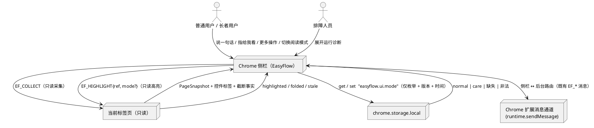
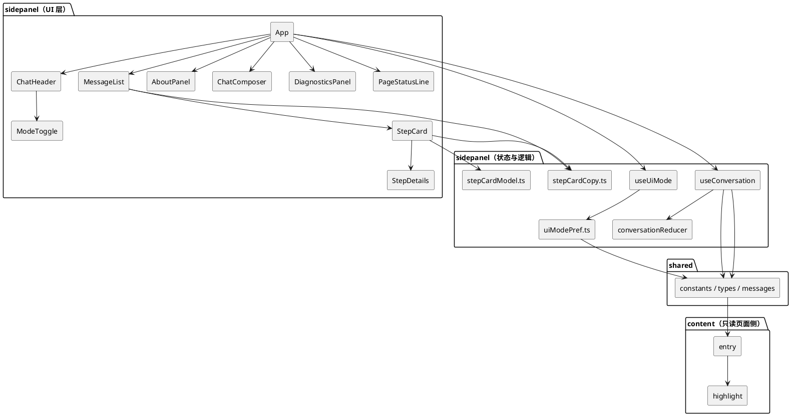
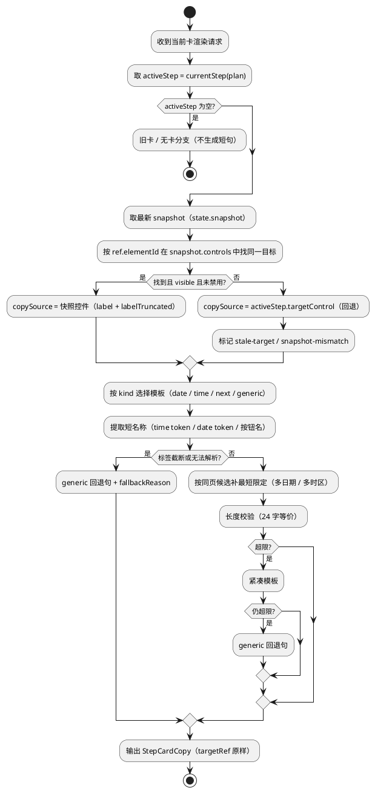
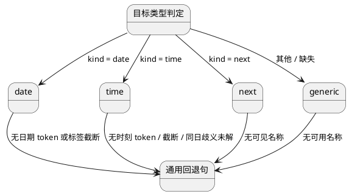
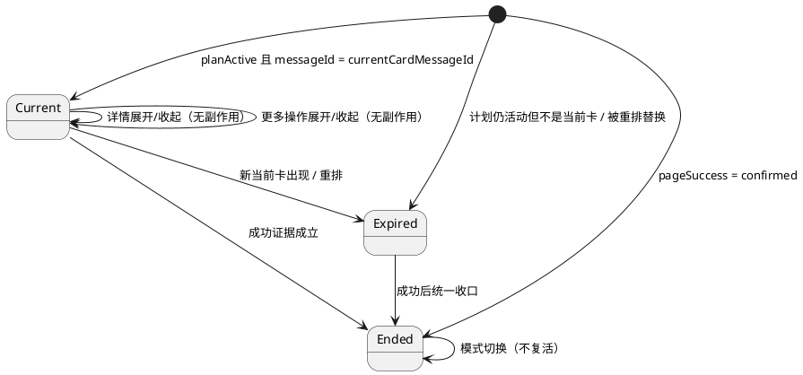
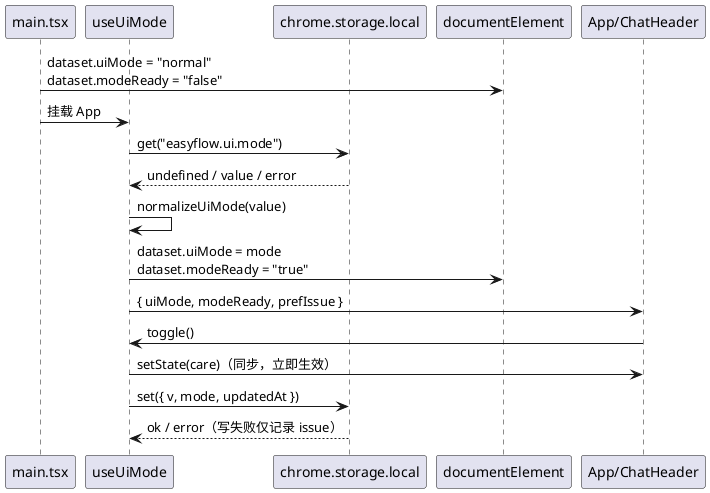
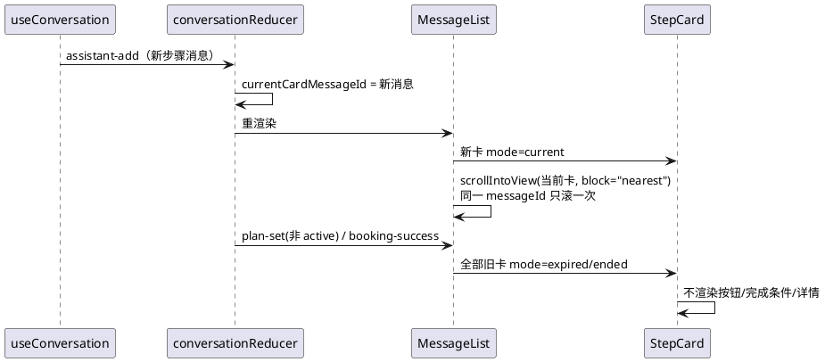
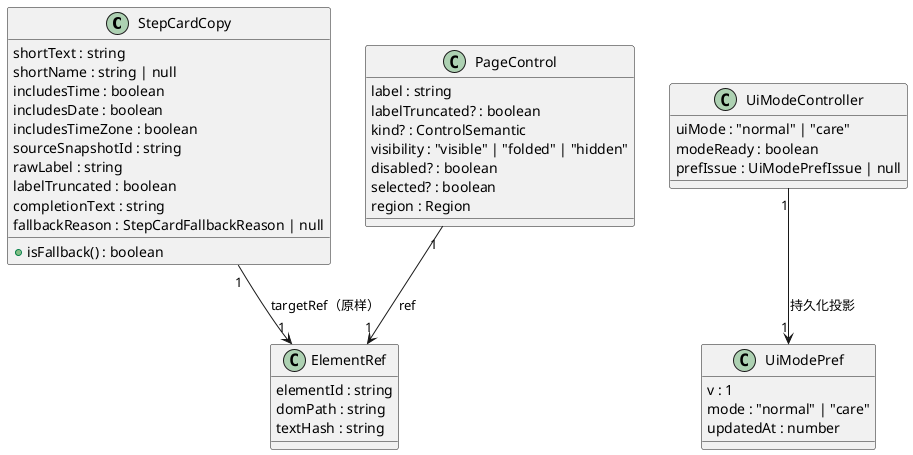
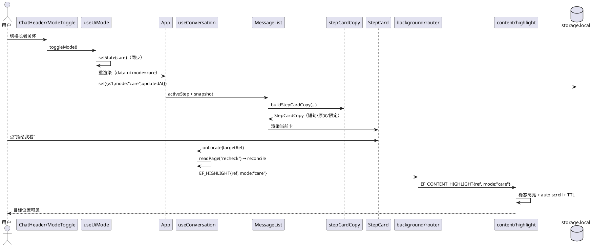

# 一、需求与存量功能关系分析

> 本文件是 `easyflow_page_guide` 第四轮增量（一句话当前步骤、操作收纳、普通/长者关怀切换）的实现方案，输入依据为 `iteration4-spec.md`（890 行，R-01—R-63，T4-01—T4-16）以及 `spec.md`、`design.md`、`tasks.md`、`iteration2-*`、`iteration3-*` 的既有约束。
>
> **本阶段声明**：只产出设计文档。未修改 `src/`、`scripts/`、`public/`，未修改前三轮文档，未运行 `npm run typecheck` / `npm run build` / `npm run selftest`，未创建 `codearts_proof/` 实绩文件，未创建真实预约。

## 1.0 分析前提（只读基线核实）

下列结论来自本轮对当前工作树的只读核查（2026-11-14），不沿用旧文档口径。核查范围限定在主工程 `D:\hwproject\translator`，不涉及任何其他工程的 `apps/extension` 或 `pnpm` 路径。

| 核查项 | 实测结果 | 对本设计的约束 |
|---|---|---|
| 应用骨架 | `src/sidepanel/App.tsx:22-58` 固定顺序：`ChatHeader` → `.ef-mode-notice`（整条“本地规则演示，未接入在线模型”横幅）→ `PageStatusLine` → 慢提示 → `main.ef-chat-main`（内为 `MessageList`）→ `ChatComposer` → `DiagnosticsPanel` | 顶部要加模式开关；“规则演示”横幅需降级；说明类内容应放进可滚动区而非固定底部，避免挤压输入区 |
| 顶部区域 | `src/sidepanel/components/chat/ChatHeader.tsx:1-16` 只有 `ef-brand` 与 `ef-mode-badge`（文本“规则演示”），无设置入口、无 props | 模式开关必须新增在 header；`ChatHeader` 需改为带 props 的组件 |
| 当前步骤卡首行 | `src/sidepanel/components/chat/StepCard.tsx:58` 的 `.ef-step-goal` 直接渲染 `targetControl.label`（可能是完整 `aria-label`，如 `Monday, November 16, 2026`） | 首行必须改为“短句”，`label` 移入折叠详情 |
| 完成条件位置 | `StepCard.tsx:59-61` 用 `shouldShowCompletion(mode)` 决定是否常显 `.ef-step-condition`；`stepCardModel.ts:27-29` 对 `expired` 返回 `true` | 完成条件移入详情；`expired` 口径需收紧（见 1.2.9 冲突裁决） |
| 动作平铺 | `StepCard.tsx:65-91` 主区并列渲染 `指给我看` + `我找不到` + `我点错了` + `我已完成` + `换一个任务`；`.ef-step-primary` 与 `.ef-step-action` 同为 `padding: 5px 8px; font-size: 11px`（`sidepanel.css:759-775`） | 主区只留一个主按钮；其余 4 个动作收进默认折叠区；尺寸需分级 |
| 卡片模式模型 | `stepCardModel.ts:1-40` 定义 `current/expired/ended`；`stepCardActions` 仅 `current` 返回 5 个动作；`shouldShowCompletion` 仅 `ended` 隐藏 | 需要新增“主/次动作分组”，并收紧 `expired` 的完成条件口径 |
| 当前卡指向 | `MessageList.tsx:48` `cardActive = planActive && message.messageId === currentCardMessageId`；`81-93` 用消息自带 `targetControl`/`completionCondition` 渲染卡片 | 当前卡需改用“计划当前步骤 + 最新快照”的控件作为展示源，否则短句可能落后于重读结果 |
| 消息流滚动 | `MessageList.tsx:113-117` 仅在 `messages.length` 变化时 `scrollIntoView({block:"end"})` | 需改为“当前卡变化时确保当前卡可见”，避免只依赖消息条数导致的反复滚底 |
| 输入区 | `ChatComposer.tsx:40-53`：禁用按钮“语音未开放”（`41-44`）+ “Enter 发送 · Shift+Enter 换行” + “发送”同处首行 | 移除禁用语音按钮；说明文字退为小字；主发送按钮需满足关怀尺寸 |
| 诊断面板 | `DiagnosticsPanel.tsx:64-65` 原生 `<details>` 默认折叠；`68-74` 内联 `maxHeight: 48vh` + `overflow: hidden`；`105-109` 内层 `overflowY: auto` + `tabIndex=0` + `aria-label` | 保留默认折叠与内部滚动能力，改为 token/CSS 驱动以适配关怀模式与 200% 缩放 |
| 会话状态 | `conversationReducer.ts:17-40` 的 `ConversationState` 已含 `phase/pageState/snapshot/plan/currentCardMessageId/pageSuccess/lastBookingCheck/busy/slowHint`；`153-161` `assistant-add` 更新当前卡；`164-172` `plan-set` 非 active 清空当前卡；`207-224` `booking-success` 清空当前卡 | 阅读模式属 UI 偏好，不得写入 `ConversationState.mode`（该字段已表示 `DialogueMode`），应独立管理 |
| 定位链路 | `useConversation.ts:1092-1155` `locateControl`：预约计划先 `readPage("recheck")` → `reconcileBookingPlan`；`replanned` 时追加新消息并 return；否则 `highlight(step.targetControl.ref)`；`1054-1083` `highlight` 发 `EF_HIGHLIGHT` | 短句只做展示，不改 `ref`；高亮需要新增“模式”入参以支持关怀稳态 |
| 动态时段 | `stepPlanner.ts:186-297` `createBookingPlan` 从 `snapshot.controls` 按 `kind==="time"` 取可用时段；`534-593` `reconcileBookingPlan` 用 `previousTimeLabel` 重排；`595-600` `currentStep` | 短句时刻必须复用该来源；重排后旧时刻不得成为当前指引 |
| 控件标签采集 | `content/controls.ts:118` `label = normalizeWhitespace(accessibleName ?? text).slice(0, MAX_CONTROL_LABEL_CHARS)`（`MAX_CONTROL_LABEL_CHARS = 80`，`shared/constants.ts:34`）；截断事实当前未记录 | 需记录“是否截断”以支撑详情的“原文已截断”标注与主句回退 |
| 样式基座 | `sidepanel.css:25-32` body 13px；`615-622` `.ef-bubble` 13px；`740-744` `.ef-step-goal` 13px；`746-750` 完成条件 11px；`715-725` `.ef-inline-link` 11px；`759-775` 步骤按钮 11px；`497-501` `--ef-muted: #6b7280`；无字号/触控尺寸 token；无 `prefers-reduced-motion` 媒体查询；`429-444` `.ef-skeleton` 常驻 `ef-shimmer` | 需要集中 token；`#6b7280` 在 `#f5f6fb` 背景上对比不足 4.5:1（见 2.6.4） |
| 布局约束 | `sidepanel.css:44-48` `.ef-app { min-height: 100vh }`；`528-536` `#root/.ef-chat-app { height: 100vh; overflow: hidden }`；`569-576` `.ef-chat-main { flex: 1; min-height: 0; overflow-y: auto }`；`797-802` composer `flex: none`；`860-866` diagnostics `flex: none` | 200% 缩放下固定区叠加会挤压输入区，需要显式的 flex 收缩上限 |
| 高亮与动态 | `content/highlight.ts:51-56` `prefersReducedMotion()`；`26-41` 命名颜色与 3px 边框；`245-277` 3 次脉冲；`377` TTL 4s；`425-431` reduce 时 `behavior:"auto"` | 需补“关怀模式稳态高亮”，且模式需从侧栏跨进程传入 |
| 存储与权限 | `shared/constants.ts:45` 仅 `GOAL_STORAGE_KEY = "easyflow.goal"`；`background/router.ts` 使用 `chrome.storage.local`；`public/manifest.json` 权限为 `activeTab/scripting/sidePanel/storage`（`scripts/selftest.mjs:1524` 断言四项） | 偏好必须用独立键，复用 `storage`，不新增权限 |
| 既有测试 | `scripts/selftest.mjs:31` 导出 `stepCardModel` 四个函数；`1241-1281` AT-38（当前卡唯一 + 源码静态断言）；`1428-1440` AT-44（`shouldShowCompletion("expired")===true`、`stepCardActions("current").length===5`）；`1456-1484` AT-45（`src/**` 禁止测试时刻字面量、真实域名、邮箱样式） | 源码不得写死时刻/域名/邮箱；AT-44 的口径调整必须显式；新增测试只补纯函数与偏好 |
| Fixture | `scripts/fixtures/cal-booking-date.html:7-9`（完整英文日期 `aria-label`、一个 disabled）；`cal-booking-time.html:15-17`（`02:00/02:15/disabled 02:30`）；`bjsjs-captured-items.json` 为津贴页面夹具 | 可直接验收“长标签→短名称”“动态时刻”“失效时刻不沿用”，不新增站点抓取 |

## 1.1 需求功能与存量功能对比

匹配度判定依据：输入输出是否一致、是否需要新增消息通道/权限、是否需要修改渲染契约。100% 表示可直接复用；75% 表示主体可用但需增补关键分支；50% 表示仅部分语义可复用；25% 表示只剩相邻能力。

### 1.1.1 已实现功能

| 需求功能 | 存量功能 | 代码位置 | 匹配度 |
|---|---|---|---|
| R-03/R-10 当前步骤跟随最新快照（时段失效即重排） | `reconcileBookingPlan` + `locateControl` 的 recheck 链路；`replanned` 追加新消息并切换当前卡 | `src/sidepanel/guide/stepPlanner.ts:534-593`；`src/sidepanel/hooks/useConversation.ts:1092-1155` | 100% |
| R-06/R-07 唯一“指给我看”按真实 `ref` 定位 | `StepCard` 主按钮调用 `onLocate(targetControl.ref)`；`locateControl` 成功后 `highlight(step.targetControl.ref)` | `src/sidepanel/components/chat/StepCard.tsx:68-76`；`src/sidepanel/hooks/useConversation.ts:1137-1142` | 100% |
| R-08 一次只给一个下一步 | 计划只保留一个 `currentIndex`；`currentCardMessageId` 单值 | `src/sidepanel/guide/stepPlanner.ts:595-600`；`src/sidepanel/state/conversationReducer.ts:153-172` | 100% |
| R-14 展开/收起不重读页面 | 折叠面板为纯本地渲染，无副作用（`EvidencePanel` 为原生 `<details>`） | `src/sidepanel/components/chat/EvidencePanel.tsx:12-36` | 100% |
| R-15 依据可定位 | `CitationAnchor.ref` + `onLocate` → `highlight`，失效有“已失效”文本 | `src/sidepanel/components/chat/EvidencePanel.tsx:18-32`；`src/sidepanel/hooks/useConversation.ts:1085-1090` | 100% |
| R-24 诊断默认折叠且可内部滚动 | 原生 `<details>` + `maxHeight: 48vh` + 内层 `overflowY: auto` + 键盘可达 | `src/sidepanel/components/chat/DiagnosticsPanel.tsx:64-65、68-74、105-109` | 100% |
| R-30/R-31 偏好可用既有存储持久化 | 清单已含 `storage`；后台已使用 `chrome.storage.local` | `public/manifest.json`；`src/background/router.ts`（`SAVE_GOAL/LOAD_GOAL`） | 75% |
| R-52 页面高亮尊重减少动态 | `prefersReducedMotion()` 控制脉冲与滚动行为 | `src/content/highlight.ts:51-56、245-277、425-431` | 100% |
| R-54/R-55 高亮不拦截、TTL 清除、Range 逐行 | Shadow DOM 覆盖层 + `pointer-events:none` + `getClientRects` + 4s TTL | `src/content/highlight.ts:128-167、355-378、380-399` | 100% |
| R-56/R-60 旧卡无按钮、当前卡唯一 | `stepCardActions` 非 current 返回空；`cardActive` 仅当前消息 | `src/sidepanel/components/chat/stepCardModel.ts:20-25`；`MessageList.tsx:48` | 75% |
| R-59 成功页当前卡清空 | `booking-success` 同时置 `pageSuccess` 与 `currentCardMessageId = null` | `src/sidepanel/state/conversationReducer.ts:207-224` | 75% |
| R-23 规则演示事实说明存在 | `.ef-mode-notice` 文案“本地规则演示，未接入在线模型” | `src/sidepanel/App.tsx:24`；`sidepanel.css:538-544` | 100%（位置需调整） |

### 1.1.2 需要扩展的功能

| 需求功能 | 存量功能 | 差异说明 | 扩展方向 |
|---|---|---|---|
| R-01—R-05、R-09 一句话当前步骤 | 首行直接显示 `targetControl.label`（`StepCard.tsx:58`），无短名称、无模板、无长度约束、无歧义防护 | 输入差异：需要 `snapshot` 与当前步骤控件；业务差异：原文→短句；边界差异：截断/同名/多日期/多时区 | 新增纯函数 `stepCardCopy.ts`；`StepCard` 改为渲染短句；`ref` 与完成条件保持不变 |
| R-11—R-13、R-16—R-18 详情与原文分层 | 完成条件常显；原文只在首行整段出现；无“详情”入口 | 结构差异：无折叠容器；内容差异：无原文/截断标注；一致性差异：主句与详情需同源 | `StepCard` 增加一个 `<details>`，内容为原文 + 完成条件 + 引用；主句与详情共用同一 copy 源 |
| R-19—R-21、R-27 操作收纳 | 4 个动作 + “换一个任务”平铺主区 | 层级差异：主/次未分离；可达性差异：折叠后需键盘可达 | `stepCardModel` 新增主/次分组；`StepCard` 用 `<details>` 收纳 4 个既有回调 |
| R-22 语音不占显著位置 | 输入区首行有禁用按钮“语音未开放” | 位置差异：位于首屏固定区首行 | 移除按钮；说明改入默认折叠的“说明”区，不可点 |
| R-23 规则说明降级 | 顶部整条高对比横幅 | 视觉权重差异：占首屏主要视觉 | 移入可滚动区内的折叠“说明”，默认收起 |
| R-25/R-26 当前步骤可达且翻历史不迷路 | 仅按消息条数滚到底；无当前卡定位 | 行为差异：无“当前卡进入可视区”的定向滚动；无滚动与状态的耦合（这点已满足） | `MessageList` 以 `currentCardMessageId` 为触发点定向滚动，且不监听滚动事件改变卡片状态 |
| R-28—R-36 模式开关与偏好 | 无开关；字号全部固定 13/11px；无偏好键 | 能力差异：无 UI 状态、无存储契约、无 token | 新增 `useUiMode` + `uiModePref` + `ModeToggle`；根元素 `data-ui-mode` 驱动 token |
| R-37—R-43 字号/对比度/触控/焦点 | `body 13px`、步骤按钮 11px/约 27px 高、`--ef-muted #6b7280`、无 focus-visible 规则、无触控 token | 数值差异：全部低于关怀下限；对比度部分不足 | 两套 token；`care` 下正文 18px、当前步骤 22px、主按钮 48px、可点目标 44px；统一可见焦点环 |
| R-44—R-49 窄栏与 200% 可达 | `.ef-chat-app{height:100vh;overflow:hidden}` + 3 个 `flex:none` 固定区；`100vh` 与 `min-height:100vh` 并存 | 布局差异：固定区叠加时消息区被压到 0；无 `dvh`；无窄宽单列规则 | 改用 `100dvh`、移除 `min-height:100vh`、固定区加上限与内部滚动、窄宽断点单列 |
| R-50/R-51/R-53 高亮表达 | 高亮固定 3 次脉冲（`highlight.ts:245-277`），无“关怀稳态”，模式无法传入 | 输入差异：高亮请求无模式字段；表达差异：脉冲不可关闭（除 reduce） | `EF_HIGHLIGHT` 增加可选 `mode`；`highlight.ts` 在 `care` 下只画稳态框；侧栏短句 + 形状线索兜底 |
| R-57 旧卡不显示旧完成条件 | `shouldShowCompletion` 对 `expired` 返回 `true` | 业务差异：过期卡仍展示“完成条件”，会被读成当前指令 | 收紧为仅 `current`；显式调整 AT-44 对应断言（见 1.2.9） |
| R-58 旧时刻不残留 | 旧卡显示旧目标标签（`StepCard.tsx:58`），虽无按钮但仍显示旧时刻 | 呈现差异：旧卡仍把旧时刻写成“目标” | 旧卡不渲染 `targetControl.label`，只留“已过期/已结束”状态行 |
| R-61/R-63 历史可追溯但不复活 | 旧卡无按钮但保留完整目标与完成条件 | 语义差异：历史卡仍像待办卡 | 旧卡仅保留状态文本；历史内容由助手消息文本承载 |

### 1.1.3 需要新增的功能或接口

**（1）短句生成（展示层纯函数）**

- 输入：当前步骤 `TargetControl`（含 `ref`、`label`、`kind`、`labelTruncated`）、最新快照 `PageSnapshot | null`、完成条件 `CompletionCondition`。
- 输出：`StepCardCopy`（`shortText`、`shortName?`、`includesTime`、`includesDate`、`includesTimeZone`、`sourceSnapshotId`、`targetRef`、`labelTruncated`、`fallbackReason?`、`rawLabel`、`completionText`）。
- 核心逻辑：按 `kind` 选模板 → 从目标标签抽取短名称 → 按同页上下文补最短限定 → 长度校验与逐级回退。
- 依赖：`snapshot.controls`（同页候选）、`MAX_CONTROL_LABEL_CHARS`（截断事实）；不新增网络、不新增页面采集。

**（2）主/次动作分组**

- 输入：`StepCardMode`。
- 输出：`StepCardLayout`（`primary: "locate" | null`、`secondary: StepCardAction[]`、`showDetails: boolean`、`showStateText: boolean`）。
- 依赖：既有 `stepCardActions` 语义保持不变（`current` 仍为 5 个动作，供 AT-44 断言）。

**（3）阅读模式偏好**

- 输入：`chrome.storage.local` 中的独立键值（字符串或带版本对象）。
- 输出：`UiMode = "normal" | "care"`、`UiModePrefIssue`（`missing`/`invalid`/`read-failed`/`write-failed`）。
- 核心逻辑：值域收紧 + 缺省/异常回退 `normal`；写入失败不阻塞界面。
- 依赖：既有 `storage` 权限；不涉及页面数据。

**（4）模式开关组件**：可见文字 + 状态文字 + 形状线索 + `role="switch"`；键盘 Enter/Space 可切换。

**（5）说明折叠区（规则演示 + 语音状态）**：位于可滚动消息区末尾，默认折叠；只陈述事实，不含按钮。

**（6）高亮模式字段**：`EF_HIGHLIGHT` / `EF_CONTENT_HIGHLIGHT` 增加可选 `mode?: "normal" | "care"`；`care` 下静态描边、不脉冲、`scrollIntoView` 不用平滑滚动。

**（7）目标标签截断事实**：`PageControl.labelTruncated?: boolean`（在 `annotateControls` 记录 `rawName.length > MAX_CONTROL_LABEL_CHARS`），供主句回退与详情标注使用；不扩大 80 字符上限、不新增原文副本字段。

## 1.2 存量功能详细分析

### 1.2.1 当前步骤卡的渲染契约（`StepCard.tsx`）

1. **接口契约**：入参 `targetControl`、`completionCondition`、`expired?`、`ended?`、5 个回调（`onLocate/onNotFound/onMisclicked/onDone/onSwitchTask`）。无异步、无副作用；`onLocate` 接收 `targetControl.ref` 并向上冒泡。
2. **业务规则**：`resolveStepCardMode({ended, expired})` 中 `ended` 优先；`stepCardActions` 仅 `current` 返回 5 个动作；`expired` 时额外渲染一行“页面已经变化，这一步已过期，请按上方最新指引操作。”（`StepCard.tsx:62-64`）。
3. **扩展点**：`mode` 与动作集合集中在 `stepCardModel.ts`，是唯一渲染决策来源；`StepCard` 没有 DOM 引用或惰性状态，适合改造为“短句 + 折叠”结构。
4. **约束**：样式类名 `.ef-step-card`、`.ef-step-goal`、`.ef-step-primary`、`.ef-step-action`、`.ef-step-condition` 被 `selftest.mjs:1278` 仅以字符串形式间接约束（`已过期`/`expired`）；可扩展但不应破坏既有引用。

### 1.2.2 卡片模式模型与既有测试口径（`stepCardModel.ts`）

1. `resolveStepCardMode`：`ended > expired > current`，与成功页优先级一致（第三轮结论）。
2. `stepCardActions`：非 `current` 一律空数组——保证“旧卡无按钮”已经成立。
3. `shouldShowCompletion`：`mode !== "ended"`——即 `expired` 仍显示完成条件。这是本轮 R-57 明确要改的点（旧完成条件会被读成当前指令）。
4. `stepCardLabel`：`当前 = "现在这一步"`、`过期 = "这一步已过期"`、`结束 = "这一步已结束"`；AT-44 已断言这三个值。

### 1.2.3 当前卡指向与消息流（`MessageList.tsx` + `conversationReducer.ts`）

1. `assistant-add`：消息携带 `targetControl` 时把 `currentCardMessageId` 指向该消息（`conversationReducer.ts:153-161`）。因此“当前卡”与“消息”是绑定关系，卡片渲染源是消息自带的 `targetControl`。
2. `plan-set`：计划非 active 时清空当前卡（`164-172`）——成功页/重排失败的降级已经由 reducer 完成。
3. `booking-success`：清空当前卡并置 `pageSuccess = "confirmed"`，同时按 `noticeKind` 去重完成提示（`207-224`）。
4. **约束**：由于 `reconcile` 的 `updated/unchanged` 分支只更新 `plan`，不更新历史消息，若当前卡继续使用消息自带 `targetControl`，其 `label` 可能落后于最新快照。本轮短句必须“来自最新快照”，因此当前卡的展示源要改为“计划当前步骤 + 最新快照同 `ref` 控件”，消息自带控件仅作回退。
5. **历史语义**：每个历史助手消息都会渲染自己的卡（`MessageList.tsx:126-158`），所以“旧卡降级”必须在卡片内部按 `mode` 完成，不能只改当前卡。

### 1.2.4 定位链路（`locateControl` → `highlight`）

1. 成功态前置守卫：`pageSuccess === "confirmed"` 时提示“这一步已经结束，不需要再定位”（`useConversation.ts:1094-1098`），不碰旧元素。
2. 非预约计划：直接 `highlight(ref)`，不重读（`1099-1103`）。
3. 预约计划：`readPage("recheck")` → `reconcileBookingPlan`：
   - `replanned`：`plan-set` + `nextStepMessage(replanNoticeText)` + `startWatch()` 后 **直接 return，不执行本次高亮**（`1114-1127`）。用户需要在新卡上再点一次。
   - `unavailable`：`plan-set(superseded)` + `appendBookingFailure` + `stopWatch()`（`1128-1133`）。
   - `updated/unchanged`：`plan-set`（如需要）→ `highlight(currentStep.targetControl.ref)`（`1134-1142`）。
4. `highlight`：`EF_HIGHLIGHT` → 后台 → content；`folded/partial/stale` 有可理解提示，`stale` 会再读一次并 `handleRecheck`（`1054-1083`）。
5. **约束**：短句不得参与定位计算；`targetRef` 必须原样透传。高亮若要区分模式，只能给请求加**可选**字段，否则 content 侧旧版本会因未知字段被拒（`entry.ts:30-59` 的校验只检查已知字段，未知字段不影响，但仍建议显式声明）。

### 1.2.5 目标标签采集与截断事实

1. `annotateControls` 使用 `accessibleName ?? text`，归一化空白后 `slice(0, 80)`（`controls.ts:118`）。
2. `ElementItem.truncated` 表示正文 300 字截断，**不是**控件标签截断；当前没有任何字段记录“控件标签被 80 截断”。
3. 影响：若标签被截断在日期/时区中间，主句若拼残缺限定会产生歧义（R-05/R-09 的边界）。因此需要“截断事实”，且 80 上限不变（T4-14 默认）。
4. 约束：`PageControl` 是跨进程结构（`PageSnapshot.controls`、`AssistantMessage.targetControl`、`DialogueRequest.controls`），新增字段必须是可选的，避免旧数据/旧 content 版本不可读。

### 1.2.6 样式基座与布局约束盘点

| 位置 | 现状 | 关怀模式缺口 |
|---|---|---|
| `body` | 13px / 1.55 | 正文需 ≥18px |
| `.ef-bubble` | 13px / 1.6 | 需跟随正文 token |
| `.ef-step-goal` | 13px / 700 | 需 ≥22px |
| `.ef-step-condition`、`.ef-inline-link`、`.ef-step-primary` | 11px | 需 ≥18px（按钮文字） |
| `.ef-step-primary/.ef-step-action` | `padding: 5px 8px`（约 27px 高） | 主按钮 ≥48px、可点 ≥44×44 |
| `.ef-composer-input` | 13px，`rows={2}` | 需 ≥18px、高 ≥44px |
| `.ef-send-btn` | 12px，`padding: 6px 12px` | 需 ≥48px 高 |
| `.ef-muted` | `#6b7280` | 在 `#f5f6fb` 上约 4.3:1，未达 4.5:1 |
| `.ef-message-role` / `.ef-composer-hint` / `.ef-footer` | `#9ca3af` 10px | 对比与字号均不足 |
| `.ef-skeleton` | 常驻 shimmer 无限动画 | 需 `prefers-reduced-motion` 关闭 |
| `#root` / `.ef-chat-app` | `height:100vh; overflow:hidden` | 需 `dvh` 并允许内部滚动 |
| `.ef-app` | `min-height:100vh` | 与 `height:100vh` 冲突，会撑高 |
| `.ef-chat-main` | `flex:1; min-height:0; overflow-y:auto` | 正确，保留 |
| `.ef-composer` / `.ef-diagnostics` | `flex:none` | 200% 下需上限与内部滚动 |
| 焦点 | 仅 `input` 有 box-shadow，按钮无统一焦点环 | 需 `:focus-visible` 统一 2px+ 轮廓 |

### 1.2.7 存储与权限

1. `public/manifest.json` 权限固定四项（`selftest.mjs:1524` 有断言），`storage` 已在其中；本轮零权限变更。
2. 现有唯一业务键为 `easyflow.goal`（`shared/constants.ts:45`），由后台 `SAVE_GOAL/LOAD_GOAL` 使用；偏好不得复用该键。
3. `chrome.storage.local` 为异步 API，侧栏首帧不可能同步拿到偏好——必须明确“首帧默认普通、读取完成后切换一次”的时序，并避免布局反复跳动。

### 1.2.8 既有测试与门禁

1. `selftest.mjs` 通过 esbuild 打包一组 `stdin.contents` 导出（`16-49`），因此新增纯函数必须显式加入该导出列表，否则无法断言。
2. AT-38（`1241-1281`）同时断言 reducer 行为与源码字符串：`MessageList` 含 `currentCardMessageId`、`planActive`；`StepCard` 含 `已过期`、`expired`；`App` 含 `planActive`。本轮改造必须保留这些字符串的可满足性。
3. AT-44（`1428-1440`）断言 `shouldShowCompletion("expired") === true` 与 `stepCardActions("current").length === 5`；前者与 R-57 冲突（见 1.2.9），后者必须保留。
4. AT-45（`1456-1484`）扫描 `src/**/*.ts|tsx`：禁止 `02:00|02:15|03:00` 字面量、真实站点域名、邮箱样式。新增短句代码必须使用正则/插槽，不得写死示例时刻。
5. 门禁命令：`npm run typecheck`（`tsc --noEmit`）、`npm run build`（typecheck + esbuild + manifest 校验）、`npm run selftest`。本阶段不执行。

### 1.2.9 规格与实现的冲突裁决

| 编号 | 冲突 | 裁决 | 影响与执行方式 |
|---|---|---|---|
| C4-01 | R-57“过期卡不显示完成条件” vs `shouldShowCompletion("expired") === true`（AT-44） | **收紧 `shouldShowCompletion` 为仅 `current`**；AT-44 该行断言由 `true` 改为 `false`，并在用例内注释“第四轮 R-57 收紧”。其余断言（`ended` false、`current` 5 动作、label 文案）不删除、不放宽 | 显式修改测试口径，不“偷偷放宽”；`StepCard` 与测试共用同一函数，避免双口径 |
| C4-02 | R-03“时刻来自最新快照” vs 当前卡使用消息自带 `targetControl`（可能落后） | 当前卡展示源改为“`currentStep(plan)` + 最新 `state.snapshot` 中同 `ref` 控件”，消息自带控件为回退；`ref` 不改 | `MessageList`/`App` 传 `activeStep` 与 `snapshot`；`locateControl` 链路不变 |
| C4-03 | R-12“原文完整保留” vs 80 字符采集上限 | 不扩上限（T4-14 默认）；新增 `labelTruncated` 事实字段；详情展示已采集原文并标注“原文已截断”；主句不使用残缺日期/时区 | 采集侧只加一个布尔字段；若用户选择扩到 120—160，再改常量与重新验收 |
| C4-04 | R-01“≤24 字” vs R-05“多日期/多时区必须补限定” | 采用“完整模板 → 紧凑模板 → 通用句”的降级阶梯；**歧义限定优先于冗词**，宁可缩短句式也不省略关键限定 | 见 2.4.4；歧义无法消除时回退通用句并保留“指给我看” |
| C4-05 | R-56“旧卡不像待办” vs R-61“历史可追溯” | 旧卡只保留“已过期/已结束”状态行，不重复渲染旧目标与旧完成条件；历史内容由助手消息文本承担 | 旧卡不渲染详情入口、不渲染动作 |
| C4-06 | R-22“语音不占显著位置” vs 既有 `ef-voice-btn` | 删除禁用按钮；语音状态仅在默认折叠的“说明”中出现一行不可点小字 | T4-06 默认；若用户要求直接删除说明，只需删一行文案 |
| C4-07 | R-62“模式切换不复活旧卡” vs 旧卡渲染依赖 `expired/ended` props | 模式只影响 CSS 根属性与高亮请求，不参与 `stepCardModel` 判定 | `uiMode` 不进入 reducer，不改变卡片模式 |
# 二、增量设计方案

## 2.1 实现模型

### 2.1.1 上下文视图

本轮不新增外部系统、不新增权限、不新增网络请求；只在既有四个外部交互面上增加“模式”这一展示维度。



约束：
1. 节点只显示通道与载荷类别，不显示侧栏内部组件。
2. `mode` 只在“高亮”这一条链路上跨进程传递；采集不携带模式，避免影响采集结果与隐私面。
3. 偏好只包含 `{ v, mode, updatedAt }`，不包含 URL、标题、对话、页面正文。

### 2.1.2 服务/组件总体架构



| 组件/模块 | 单一职责 | 关键边界 |
|---|---|---|
| `App` | 组合布局、把 `uiMode` 与 `activeStep`/`snapshot` 下传 | 不实现短句逻辑、不读写存储 |
| `ChatHeader` | 品牌 + 模式开关 | 不持有偏好状态（受控组件） |
| `ModeToggle` | 语义化开关（文字 + 状态 + 形状） | 只调用 `onToggle` |
| `MessageList` | 消息流、当前卡定位滚动、卡片模式判定结果下传 | 不生成文案、不判断页面事实 |
| `StepCard` | 当前卡（短句 + 主按钮 + 详情 + 更多操作）/旧卡（状态行） | 不读页面、不发请求；只调用既有 5 个回调 |
| `StepDetails` | 折叠的原文、完成条件、引用 | 展开不触发读取 |
| `stepCardCopy.ts` | 短句、短名称、限定、回退、完成条件文案 | 纯函数；输入只来自参数；不写死时刻/站点 |
| `stepCardModel.ts` | 模式与动作分组 | 纯函数；`current` 的动作集合语义不变 |
| `useUiMode` | 偏好读取/写入/切换的时序 | 内存优先、写入失败不阻塞 |
| `uiModePref.ts` | 值域收紧、解析、序列化 | 纯函数；可单测；不依赖 `chrome` |
| `AboutPanel` | 规则演示与语音状态的事实说明 | 默认折叠、无按钮、不占固定高度 |
| `useConversation` | 既有编排 + 高亮模式透传 | 不改计划/页面判定语义 |

### 2.1.3 实现设计文档

#### （1）短句生成流程



#### （2）短句模型分支（按目标类型）



判定表（与 `stepCardCopy.ts` 一一对应）：

| `kind` | 短名称来源 | 模板 | 回退条件 |
|---|---|---|---|
| `date` | 日期 token（`11月16日` / `11/16` / `Nov 16`） | `现在请选择 {date}` | 无日期 token、标签截断、日期解析失败 |
| `time` | 时刻 token（保留原始 `02:15` 形态；12 小时制保留 `2:15 PM`） | `现在请点网页上的 {time}`；有日期限定时 `现在请点 {date} {time}` | 无时刻 token、截断、多日期无唯一所选日期、多时区无自身时区 |
| `next` | 按钮名（去日期/时区/格式说明后 ≤12 字） | `现在请点击网页上的 {name}` | 名称为空或全是格式说明 |
| `generic` / 缺失 | 可见名（去日期/时区/格式说明后 ≤12 字） | `现在请在网页上选择{name}` / `现在请在网页上选择对应项` | 名称为空 |

#### （3）卡片渲染状态机（详情与操作收纳）



渲染契约：

| 模式 | 短句 | 主按钮 | 详情入口 | 更多操作 | 完成条件 | 状态文字 |
|---|---|---|---|---|---|---|
| `current` | 有（唯一首行） | 有（唯一） | 有（默认折叠） | 有（默认折叠，4 个动作） | 仅在详情内 | 徽标“现在这一步”（`aria-label` + 弱化小字） |
| `expired` | 无 | 无 | 无 | 无 | 无 | “这一步已过期” + 一行指引 |
| `ended` | 无 | 无 | 无 | 无 | 无 | “这一步已结束” + 一行完成说明 |

#### （4）阅读模式读取与切换时序



时序硬约束：
1. 首帧固定 `normal`，读取完成后最多切换一次；`font-size`、`padding`、`min-height` 不设过渡，避免“渐变中的抖动”。
2. 切换不触发 `readPage`、不 dispatch 任何 `ConversationAction`、不改变 `currentCardMessageId`。
3. 读取失败/非法 → `normal` + `prefIssue`（仅进诊断，不弹错误）。

#### （5）当前卡滚动与旧卡降级时序



## 2.2 接口设计

### 2.2.1 总体设计

| 接口组 | 用途 | 稳定性 | 调用方 |
|---|---|---|---|
| `stepCardCopy`（新增） | 短句/短名称/完成条件文案 | 稳定（纯函数，新增可扩展字段） | `StepCard`、`MessageList`、`selftest` |
| `stepCardModel`（扩展） | 模式、主/次动作、详情可见性 | 稳定（`stepCardActions` 语义不变） | `StepCard`、`MessageList`、`selftest` |
| `uiModePref`（新增） | 偏好值域/解析/序列化 | 稳定（纯函数） | `useUiMode`、`selftest` |
| `useUiMode`（新增） | 偏好读写时序 | 实验（内部 hook） | `App` |
| `HighlightRequest.mode?`（扩展） | 高亮表达模式 | 稳定（可选字段，向后兼容） | `useConversation` → 后台 → content |
| 组件 props（扩展） | 受控开关、当前步骤、快照 | 稳定（组件内部契约） | `App` |

命名与业务语言一致：`shortText`、`shortName`、`details`、`moreActions`、`uiMode`、`prefIssue`。禁止把 `uiMode` 命名为 `mode`（`ConversationState.mode` 已被 `DialogueMode` 占用）。

### 2.2.2 接口清单

#### 接口 A：`buildStepCardCopy`（新增，核心纯函数）

```ts
export type StepCardFallbackReason =
  | "no-label"
  | "label-truncated"
  | "unparseable"
  | "ambiguous-date"
  | "ambiguous-timezone"
  | "stale-target"
  | "snapshot-mismatch";

export interface StepCardCopyInput {
  targetControl: TargetControl;          // 当前步骤（activeStep.targetControl）
  snapshot: PageSnapshot | null;         // 最新成功读取的快照
  completionCondition: CompletionCondition;
}

export interface StepCardCopy {
  shortText: string;                     // 非空，≤24 字等价
  shortName: string | null;
  includesTime: boolean;
  includesDate: boolean;
  includesTimeZone: boolean;
  sourceSnapshotId: string;              // 最新快照 id；无快照时为空串
  targetRef: ElementRef;                 // 与入参完全相同（不重建）
  rawLabel: string;                      // 归一化空白后的采集原文
  labelTruncated: boolean;
  completionText: string;                // 用户可理解的完成条件
  fallbackReason: StepCardFallbackReason | null;
}

export function buildStepCardCopy(input: StepCardCopyInput): StepCardCopy;
```

- 业务说明：为当前卡生成一句可执行短句；主句与详情共用同一 copy 源，保证 R-16。
- 前置条件：`targetControl` 来自 `currentStep(plan)`；`snapshot` 为最近一次成功读取的结果（可为 `null`）。
- 后置条件：`targetRef === targetControl.ref`（同一对象或逐字段相等）；函数无副作用、不抛异常（内部 try/catch 后回退）。
- 异常映射：任何解析异常 → `shortText = 通用回退句`、`fallbackReason = "unparseable"`；不向 UI 抛错。
- 调用示例（展示层）：

```ts
const copy = buildStepCardCopy({
  targetControl: activeStep.targetControl,
  snapshot: state.snapshot,
  completionCondition: activeStep.completion,
});
```

#### 接口 B：短句辅助（同模块导出，便于单测）

```ts
export function completionTextOf(condition: CompletionCondition): string;
export function extractTimeToken(label: string): string | null;
export function extractDateToken(label: string, context: DateContext): string | null;
export function extractTimeZoneToken(label: string): string | null;
export function estimateCopyWidth(text: string): number;     // CJK=1，ASCII=0.6，取整
export function resolveCopySource(
  targetControl: TargetControl,
  snapshot: PageSnapshot | null,
): { control: TargetControl; source: "snapshot" | "step"; usable: boolean };
```

- `extractTimeToken`：只返回页面标签中真实出现的时刻片段，不做时区换算、不补零、不改写 12/24 小时制。
- `extractDateToken`：需要同页上下文（所选日期、同页日期集合、月份标签）才能把纯日号补成“11月16日”；无法确定时返回 `null`。
- `resolveCopySource`：按 `ref.elementId` 匹配快照控件；`usable=false` 表示“快照中同 ref 但不可见/禁用”，短句必须回退通用句（R-10）。

#### 接口 C：`stepCardModel` 扩展

```ts
export interface StepCardLayout {
  primary: "locate" | null;
  secondary: StepCardAction[];      // current: 4 个；expired/ended: 空
  showDetails: boolean;             // current: true
  showStateText: boolean;           // expired/ended: true
}

export function stepCardLayout(mode: StepCardMode): StepCardLayout;
```

- `stepCardActions(mode)` 保持原语义（`current` → 5 个动作），供 AT-44 断言与“动作集合唯一来源”。
- `shouldShowCompletion(mode)` 收紧为 `mode === "current"`（C4-01）。
- `stepCardLabel(mode)` 不变。

#### 接口 D：`uiModePref`（新增纯函数）

```ts
export type UiMode = "normal" | "care";
export type UiModePrefIssue = "missing" | "invalid" | "read-failed" | "write-failed";

export interface StoredUiMode {
  v: 1;
  mode: UiMode;
  updatedAt: number;
}

export function normalizeUiMode(value: unknown): UiMode;
export function parseStoredUiMode(value: unknown): { mode: UiMode; issue: UiModePrefIssue | null };
export function serializeUiMode(mode: UiMode, now: number): StoredUiMode;
```

- 值域：仅 `"normal"` / `"care"`；其余（含 `"huge"`、空串、对象缺字段）→ `normal` + `invalid`。
- `parseStoredUiMode` 兼容裸字符串（历史/手工写入）与版本对象 `{v:1,mode}`；`v` 不为 1 视为 `invalid`（保守回退）。
- `serializeUiMode` 只输出 `v/mode/updatedAt`，便于静态断言“不含页面/对话字段”。

#### 接口 E：`useUiMode`（新增 hook）

```ts
export interface UiModeController {
  uiMode: UiMode;
  modeReady: boolean;
  prefIssue: UiModePrefIssue | null;
  setMode: (mode: UiMode) => void;
  toggleMode: () => void;
}

export function useUiMode(): UiModeController;
```

- 读取：挂载后一次 `chrome.storage.local.get(UI_MODE_STORAGE_KEY)`；`try/catch` 后回退 `normal` + `read-failed`。
- 写入：`setMode` 先同步更新内存与根元素属性，再异步写入；失败仅置 `write-failed`（不撤销当前选择）。
- 副作用：仅更新 `document.documentElement.dataset.uiMode/modeReady`；不触碰对话状态。

#### 接口 F：`useConversation` 的高亮模式扩展

```ts
export function useConversation(uiMode: UiMode): ConversationController;
```

- 在 hook 内用 `uiModeRef` 保存最新值，`highlight` 读取 ref（不因模式切换重建全部回调）。
- `highlight(ref)` 发送 `{ type: EF_HIGHLIGHT, tabId, ref, mode }`；其余链路不变。
- 所有既有返回值（`send/retry/markDone/notFound/misclicked/switchTask/locateCitation/locateControl`）签名不变。

#### 接口 G：跨进程消息字段（可选）

```ts
export interface HighlightRequest extends BaseRequest {
  type: typeof MSG.HIGHLIGHT;
  tabId: number;
  ref: ElementRef;
  refs?: ElementRef[];
  mode?: "normal" | "care";
}

export interface ContentHighlightRequest extends BaseRequest {
  type: typeof MSG.CONTENT_HIGHLIGHT;
  ref: ElementRef;
  refs?: ElementRef[];
  mode?: "normal" | "care";
}
```

- 后台 `handleHighlight` 只有在 `mode` 为合法枚举时才透传；缺省视为 `normal`。
- content 侧校验保持宽松（未知字段忽略），旧版本 content 仍可处理该请求（向后兼容）。

#### 接口 H：组件 props 契约

```ts
interface ChatHeaderProps {
  uiMode: UiMode;
  modeReady: boolean;
  onToggleMode: () => void;
}

interface StepCardProps {
  targetControl: TargetControl;                 // 当前卡：activeStep.targetControl；旧卡忽略
  completionCondition: CompletionCondition;
  copy: StepCardCopy | null;                    // 当前卡必传；旧卡为 null
  citations: CitationAnchor[];                  // 详情内展示（可为空）
  expired?: boolean;
  ended?: boolean;
  onLocate: (ref: ElementRef) => void;
  onNotFound: () => void;
  onMisclicked: () => void;
  onDone: () => void;
  onSwitchTask: () => void;
  onCitation: (citation: CitationAnchor) => void;
}

interface MessageListProps {
  messages: DialogueMessage[];
  currentCardMessageId: string | null;
  planActive: boolean;
  bookingCompleted: boolean;
  activeStep: GuideStep | null;                 // 计划当前步骤（含 completion）
  snapshot: PageSnapshot | null;                // 最新快照
  // 既有回调全部保留
}
```

## 2.3 数据模型

### 2.3.1 设计目标

1. **展示模型与领域模型分离**：短句是“展示产物”，不写入 `AssistantMessage`、不写入存储、不进入 `DialogueRequest`，避免污染对话与出站数据。
2. **单一来源**：主句、详情原文、完成条件、高亮 `ref` 全部来自同一 `StepCardCopy` 与同一 `activeStep`。
3. **可测性**：所有判定在纯函数中完成，React 组件只负责排版与回调。
4. **向后兼容**：只新增可选字段；`ConversationState`、`GuidePlan`、`AssistantMessage` 既有字段语义不变。

### 2.3.2 模型实现



字段与约束：

| 模型 | 字段 | 约束 |
|---|---|---|
| `StepCardCopy` | `shortText` | 非空；中文 ≤24 字或英文 ≤8 词等价；不含 `elementId/domPath/role/score` |
| | `shortName` | 为空时 `shortText` 必须是通用回退句 |
| | `includesTime` | 为 `true` 时短句中的时刻必须能在同一目标标签中解析到 |
| | `includesDate/includesTimeZone` | 为 `true` 时限定值必须来自同一目标标签或同页所选日期，不拼历史快照 |
| | `sourceSnapshotId` | 等于最新成功读取的 `snapshot.snapshotId`；无快照时为空串 |
| | `targetRef` | 与 `activeStep.targetControl.ref` 逐字段相等（R-07） |
| | `rawLabel` | 归一化空白后的采集原文；仅用于详情展示，不写存储、不出站 |
| | `labelTruncated` | 来自 `PageControl.labelTruncated === true`；为 `true` 时不得输出日期/时区限定 |
| `PageControl` | `labelTruncated?` | 采集期 `rawName.length > MAX_CONTROL_LABEL_CHARS`；可选，缺省视为 `false` |
| `UiModePref` | `v/mode/updatedAt` | 仅此三个字段；`updatedAt` 为毫秒时间戳，不含人员信息 |

生命周期与持久化：

1. `StepCardCopy` 在渲染时按需计算（`useMemo` 依赖 `activeStep`、`snapshot`、`completionCondition`），不缓存跨快照值（R-10）。
2. `PageControl.labelTruncated` 随快照产生，随快照失效，不单独持久化。
3. `UiModePref` 在用户切换时写入 `chrome.storage.local`，是唯一持久化的本轮数据；无数据库、无表结构。

## 2.4 短句生成算法（重点）

### 2.4.1 输入与来源优先级

1. **第一步：锁定当前步骤**。`activeStep = currentStep(state.plan)`；`plan.status !== "active"` 时为空，当前卡不存在（不生成短句）。
2. **第二步：锁定复制源**。`resolveCopySource(activeStep.targetControl, state.snapshot)`：
   - 快照中按 `ref.elementId` 命中同一控件，且 `visibility === "visible"`、`disabled !== true`、`label` 非空 → 以该控件为源（`source = "snapshot"`），`sourceSnapshotId = snapshot.snapshotId`。
   - 命中但不可见/禁用 → `usable = false`，短句回退通用句，`fallbackReason = "stale-target"`（禁止把失效时刻写进主句）。
   - 未命中 → 以 `activeStep.targetControl` 为源，`fallbackReason = "snapshot-mismatch"`，且**不输出时刻/日期限定**（只允许按钮名或通用句），避免使用旧快照时刻。
3. **第三步：读标签**。`rawLabel = control.label`（已归一化空白）；`labelTruncated = control.labelTruncated === true`。
4. **第四步：上下文**。只在 `source === "snapshot"` 时使用同页候选：
   - `pageDates`：`snapshot.controls.filter(kind === "date" && visibility === "visible" && !disabled)`。
   - `selectedDate`：`pageDates.find(selected === true)`。
   - `pageTimes`：`kind === "time"` 且可见未禁用。
   - 不读取 `ElementItem.text` 之外的任何页面内容，不新增采集。

> 说明：`snapshot` 与 `activeStep` 的一致性由既有链路保证——计划来自同一快照（`createPlan`），重读后 `reconcileBookingPlan` 会把 `activeStep.targetControl` 更新为新快照控件（`updated`）或重建计划（`replanned`）。

### 2.4.2 短名称提取规则

**（a）时刻（`kind === "time"`）**

1. 用 `TIME_TOKEN = /(?:[01]?\d|2[0-3]):[0-5]\d(?:\s*(?:am|pm|AM|PM))?/` 在 `rawLabel` 中取**第一个**完整匹配，原样保留（`02:15` 不补零、不改 12/24 制）。
2. 中文时段词（`上午/下午/凌晨/晚上`）若出现在时刻前 6 个字符内，作为前缀保留（如“下午 2:15”），避免 12 小时制歧义。
3. 若标签同时含日期与时区，时刻本身只取时刻片段；日期/时区分别由下方规则决定是否加限定。
4. 标签截断（`labelTruncated === true`）时：**仅当**完整时刻 token 位于已采集前缀内才使用；否则 `fallbackReason = "unparseable"`。

**（b）日期（`kind === "date"`）**

1. 优先数字日期：`2026-11-16` / `2026/11/16` / `11/16` / `11-16` → 规范化为“11月16日”（保留两位月/日，不补星期）。
2. 其次中文日期：`11月16日` / `11 月 16 日` → 原样归一为“11月16日”。
3. 其次英文月日：`November 16` / `Nov 16` / `16 November` → 用月份映射表转“11月16日”。
4. 纯日号（如 `16`）：只有满足以下之一才补成“11月16日”，否则 `null`：
   - 同页存在 `selected === true` 的日期控件且其完整日期可解析；
   - 同页 `aria-label` 上下文（`controlContext === "calendar"`）的 `context/contextReason` 无法提供月份时不猜；
   - 同页所有日期标签的月份一致且唯一。
5. 年份：默认省略（约会日期通常是近期）；若同页日期集合跨年，则保留“2026年11月16日”。
6. 日期步骤**不需要**“多日期歧义防护”——多日期是正常可选集合；但若同页 `selectedDate` 存在且与目标日期不同，则优先显示目标日期（目标即计划选中的那一天）。

**（c）继续按钮（`kind === "next"`）**

1. 先去掉日期/时区/格式说明片段，再取剩余可见名（≤12 字）。
2. 若名称为空，或仅由 `next/continue/继续/下一步` 构成 → 使用 `现在请点击网页上的下一步按钮`（不臆造按钮名）。
3. 若名称含“继续/下一步/next/continue”，但还带有修饰（如“继续到确认页”）→ 保留完整名称（≤12 字）。

**（d）通用（`generic` 或缺失）**

1. 名称为 `select/选择/请选择` 且无其他语义 → 用通用回退句。
2. 其余取去噪后的可见名（≤12 字），模板 `现在请在网页上选择{name}`。

**（e）禁止项（静态可检查）**

1. 源码中不得出现具体时刻字面量（由 AT-45 扫描 `02:00|02:15|03:00`）。
2. 不得出现站点域名、站点专用选择器、预约编号规则。
3. 不得从 `ElementItem.text` 或页面标题拼接短句（只允许控件 `label` 与同页 `controls`）。

### 2.4.3 歧义防护与限定拼接

| 场景 | 判定 | 处理 |
|---|---|---|
| 同页多个日期、当前为时段步骤、存在唯一 `selected` 日期 | `pageDates.length > 1 && selectedDate !== undefined` | 在时刻前补该所选日期的短日期：`现在请点 11月16日 02:15` |
| 同页多个日期、无 `selected` 日期 | `pageDates.length > 1 && selectedDate === undefined` | 无法判断时段归属 → `fallbackReason = "ambiguous-date"` + 通用句（保留“指给我看”） |
| 同页仅一个日期 | `pageDates.length <= 1` | 只显示时刻（上下文唯一） |
| 同页多个时区（时段标签含不同 `GMT/UTC±n` 或不同缩写） | `timeZones.size > 1` | 当前标签含时区 → 追加 `（GMT+8）`；当前标签无时区 → `fallbackReason = "ambiguous-timezone"` + 通用句 |
| 同页仅一个时区或标签无时区但页面唯一 | `timeZones.size <= 1` | 不追加时区 |
| 同一时刻在页面上重复出现（短名称相同但 ref 不同） | 同页时刻 token 计数 > 1 且无法用日期区分 | 加日期限定；仍无法区分 → 通用句（不造成“点 02:15 但页面上两个 02:15”的误导） |

拼接顺序固定：`模板 +（日期）+（时刻）+（时区）`。限定值必须来自同一目标标签或同页唯一 `selected` 日期，不得取历史快照。

### 2.4.4 长度与回退阶梯

定义 `estimateCopyWidth`：CJK/全角字符计 1，ASCII 计 0.6，取整；阈值 `STEP_CARD_SHORT_MAX_WIDTH = 24`。

| 阶梯 | 形态 | 示例结构 | 触发条件 |
|---|---|---|---|
| L0 | 常规模板 | `现在请点网页上的 {time}` | 宽度 ≤24 |
| L1 | 紧凑模板 | `请点 {date} {time}` / `请点 {time}` | L0 超限且无歧义要求 |
| L2 | 保留限定紧凑模板 | `请点 {date} {time}（{tz}）` | 存在歧义且 L0 超限 |
| L3 | 通用回退句 | `现在请在网页上选择对应项` | L2 仍超限 / 解析失败 / 截断 / 目标失效 |

回退优先级：**R-05 的“不歧义”高于 R-01 的“更短”**；不得为了字数删除日期/时区限定，只能缩短句式或回退通用句（通用句不含时刻，因此不会产生歧义）。

回退判据（任一成立即 L3）：

1. `rawLabel` 为空或仅“select/选择”。
2. `labelTruncated === true` 且无法稳定解析时刻/日期。
3. `source === "step"` 且存在 `snapshot-mismatch`。
4. `usable === false`（快照同 ref 已不可用）。
5. 时刻/日期歧义无法用最短限定消除。
6. 生成过程抛错（`try/catch`）。

### 2.4.5 `ref` 不变与定位一致性

1. `buildStepCardCopy` 不重建 `ElementRef`：`targetRef` 直接引用 `targetControl.ref`，测试用 `assert.deepEqual` 校验三元组。
2. `StepCard` 的主按钮调用 `onLocate(copy.targetRef)`，即 `activeStep.targetControl.ref`；与 `locateControl` 中 `step.targetControl.ref` 同源。
3. 高亮仍由 `locateControl` 的既有链路决定：预约计划先 recheck → reconcile → 用**最新** `step.targetControl.ref`；短句的回退不影响该链路。
4. `copy` 不写入 `AssistantMessage`，因此历史消息的 `ref` 不会被改写。

### 2.4.6 反例（设计层“不通过”清单）

| 反例 | 判定 |
|---|---|
| 首行出现 `Monday, November 16, 2026 14:00 (GMT+8)` 整串 | 不通过（R-04） |
| `StepCard` 源码内出现 `02:15` 字面量 | 不通过（R-03b、AT-45） |
| 短句显示旧时刻而当前目标已换 | 不通过（R-10） |
| 主句写 A、详情写 B | 不通过（R-16） |
| 短名称生成后 `ref` 变化 | 不通过（R-07） |
| 多日期页面仍只显示 `02:15` 造成歧义 | 不通过（R-05） |

## 2.5 详情折叠与操作收纳

### 2.5.1 DOM 与 ARIA 结构

当前卡（结构示意，非完整 JSX）：

```
<section class="ef-step-card ef-step-card-current" data-step-mode="current"
         aria-labelledby="ef-step-short-{messageId}">
  p#ef-step-short-{messageId}.ef-step-goal        ← 短句（卡片内第一个文本）
  span.ef-step-state                              ← “现在这一步”（弱化小字 / 形状线索）
  button.ef-step-primary                          ← 唯一主按钮“指给我看”
  details.ef-step-details
    summary                                       ← “详细信息 / 网页依据”
    div.ef-step-raw                               ← 原始标签 + “原文已截断”标注
    div.ef-step-condition                         ← “完成条件：…”
    ul.ef-step-citations                          ← 引用条目 + “在网页中查看” / “已失效”
  details.ef-step-more
    summary                                       ← “遇到问题 / 更多操作”
    div.ef-step-more-actions
      button.ef-step-action ×4                    ← 我找不到 / 我点错了 / 我已完成 / 换一个任务
</section>
```

旧卡（`expired`/`ended`）：

```
<div class="ef-step-card ef-step-card-expired|ended" data-step-mode="expired|ended">
  div.ef-step-label            ← “这一步已过期” / “这一步已结束”
  p.ef-step-history-hint       ← 一行指引 / 完成说明（无按钮、无完成条件、无详情）
</div>
```

ARIA 与键盘：
1. 折叠区一律用原生 `<details>/<summary>`（自带 `aria-expanded` 与 Enter/Space 支持），不引入自定义折叠状态。
2. “现在这一步”不作为主句前置文本，避免首行混入状态词；以 `aria-labelledby` 指向短句，屏幕阅读器先读短句。
3. 主按钮保留 `type="button"`；折叠区内按钮同样为 `type="button"`，点击后由既有回调处理（无自研事件系统）。
4. `summary` 必须有可见文字（不能只有图标），并在两套 token 下保持 ≥44px 可点高度（关怀）。

### 2.5.2 展开不改状态

1. `<details>` 展开/收起不调用任何回调，不 dispatch reducer，不触发 `readPage`。
2. 卡片内容由 props 派生（`copy`、`completionCondition`、`citations`），无内部 `useState`；展开只改变浏览器原生 `open` 属性。
3. 页面在详情展开期间变化：`activeStep`/`snapshot` 更新 → `copy` 重算 → 详情内容随卡片一起更新；若当前卡降级为旧卡，则整张卡的结构切换为旧卡结构（详情 DOM 直接不渲染，不保留可点入口）。
4. 反复展开/收起幂等：无消息追加、无网络、无采集。

### 2.5.3 与 `EvidencePanel` 的关系

1. `EvidencePanel` 继续用于“无步骤卡”的回答消息（津贴问答、直接回答）。
2. 有步骤卡时，引用展示迁入 `StepDetails`（同一个 `onCitation` 回调），避免同一消息出现两个折叠入口、也避免 `<details>` 嵌套。
3. 抽取共享的引用条目渲染（`CitationList`，从 `EvidencePanel` 导出），两处共用，保证“已失效”文案与“在网页中查看”行为一致。
4. 迁移不影响 AT-31/32/33：这些用例只断言回答与证据内容，不断言 DOM 嵌套结构；津贴场景无步骤卡，仍走 `EvidencePanel`。

### 2.5.4 旧卡/成功页的详情入口

| 状态 | 详情入口 | 原文 | 完成条件 | 引用 | 动作 |
|---|---|---|---|---|---|
| `current` | 有（1 个） | 详情内 | 详情内 | 详情内 | 主按钮 + 4 个折叠动作 |
| `expired` | 无 | 不渲染 | 不渲染 | 不渲染 | 无 |
| `ended` | 无 | 不渲染 | 不渲染 | 不渲染 | 无 |

历史可追溯性由助手消息正文（`message.text`，例如“原来要点的‘…’现在已经不在页面上了”）承担；旧卡不重复呈现旧目标，避免被读成当前待办（R-58/R-61）。

## 2.6 阅读模式、偏好与样式 token

### 2.6.1 状态归属

1. `uiMode` 属于 UI 偏好，放在独立 hook `useUiMode`（App 层单实例）；**不进入** `ConversationState`（避免与 `mode: DialogueMode` 混淆、避免页面重读触发偏好重置）。
2. 只有两处消费：
   - `App` 根元素 `data-ui-mode` → CSS token；
   - `useConversation(uiMode)` → 高亮请求的 `mode`。
3. `ChatHeader` 通过受控 props 接收 `uiMode/modeReady/onToggleMode`；`MessageList`/`StepCard` 不接收 `uiMode`（样式全部由 CSS 继承），因此模式切换不会重渲染卡片逻辑。

### 2.6.2 存储契约

| 项 | 值 |
|---|---|
| 键名 | `easyflow.ui.mode`（`UI_MODE_STORAGE_KEY`，集中声明在 `shared/constants.ts`） |
| 存储区 | `chrome.storage.local`（既有 `storage` 权限） |
| 值形态 | 写入 `{ v: 1, mode: "normal" \| "care", updatedAt: number }`；读取兼容裸字符串 |
| 默认 | `normal`（首次、缺失、非法、读取异常） |
| 写入时机 | 用户切换后立即写（无防抖，低频操作） |
| 失败处理 | 内存保持用户选择，`prefIssue = "write-failed"`，不改 UI、不弹错 |
| 禁止 | 不含 URL/标题/对话/页面正文/截图；不按域名拼接；不写 `easyflow.goal` |

首帧时序：
1. `main.tsx` 在 `createRoot` 前设置 `documentElement.dataset.uiMode = "normal"`、`dataset.modeReady = "false"`（避免无 token 的首帧）。
2. `useUiMode` 挂载后发起一次读取；返回后设置 `dataset.uiMode` 与 `dataset.modeReady = "true"`。
3. CSS 对 `font-size`/`line-height`/`padding`/`min-height` 不设 `transition`，切换是一次性重排（读取慢时最多跳一次，符合 DFX 4.2 的“读取完成后切换一次”）。
4. 读取期间侧栏照常可用（普通模式），不出现空白或骨架屏。

### 2.6.3 token 表（普通 / 关怀两套值）

```css
:root {
  /* 字号 */
  --ef-font-title: 17px;
  --ef-font-body: 13px;
  --ef-font-current: 15px;
  --ef-font-small: 11px;
  --ef-line-body: 1.55;

  /* 间距与尺寸 */
  --ef-space-1: 4px;
  --ef-space-2: 6px;
  --ef-space-3: 8px;
  --ef-space-4: 12px;
  --ef-radius: 8px;
  --ef-tap-min: 28px;          /* 侧栏内可点目标最小高 */
  --ef-primary-min-h: 32px;    /* 主按钮最小高 */
  --ef-focus-width: 2px;
  --ef-step-border-width: 1px;

  /* 颜色（对比度见 2.6.4） */
  --ef-muted: #4b5563;
  --ef-faint: #4b5563;         /* 原 #9ca3af 的替代，用于角色名/提示 */
  --ef-step-ink: #1f2340;
  --ef-step-accent: #312e81;
  --ef-step-surface: #f7f8ff;
  --ef-step-surface-expired: #f3f4f6;
  --ef-focus: #1d4ed8;
}

html[data-ui-mode="care"] {
  --ef-font-title: 22px;
  --ef-font-body: 18px;
  --ef-font-current: 22px;
  --ef-font-small: 14px;
  --ef-line-body: 1.6;

  --ef-space-3: 10px;
  --ef-space-4: 16px;
  --ef-tap-min: 44px;
  --ef-primary-min-h: 48px;
  --ef-focus-width: 3px;
  --ef-step-border-width: 2px;

  --ef-muted: #374151;
  --ef-faint: #374151;
  --ef-step-ink: #111827;
  --ef-step-accent: #1e1b4b;
  --ef-step-surface: #eef2ff;
  --ef-step-surface-expired: #e5e7eb;
  --ef-focus: #1e40af;
}
```

映射规则（逐选择器）：

| 选择器 | 普通 | 关怀 |
|---|---|---|
| `body` | `font-size: var(--ef-font-body)` | 18px |
| `.ef-bubble`、`.ef-assistant-text`、`.ef-citation-text`、`.ef-step-condition`（详情内） | `var(--ef-font-body)` | 18px |
| `.ef-step-goal`（当前卡短句） | `var(--ef-font-current)`（15px） | 22px |
| `.ef-step-primary`、`.ef-send-btn` | `min-height: var(--ef-primary-min-h)` | 48px |
| `.ef-step-action`、`.ef-mode-toggle`、`summary`、`.ef-inline-link` | `min-height: var(--ef-tap-min)`；链接用内边距扩展热区 | 44px |
| `.ef-composer-input` | `var(--ef-font-body)`，高 ≥32px | 18px，高 ≥44px |
| `.ef-diagnostics`、`.ef-about` | `var(--ef-font-small)` | 14px |
| `.ef-step-card-current` | 1px 实线 + 左侧 4px 强调条 + 浅底 | 2px 实线 + 左侧 6px 强调条 + 稳态浅底 |
| `.ef-step-card-expired/ended` | 1px 虚线 + 灰底 + 灰字 | 2px 虚线 + 灰底 + 深灰字 |
| 焦点 | `outline: var(--ef-focus-width) solid var(--ef-focus); outline-offset: 2px` | 3px |

命名常量原则：字号/尺寸/颜色全部进 token；JS 侧只保留长度阈值（`STEP_CARD_SHORT_MAX_WIDTH` 等），不出现散落魔法数（DFX 4.4.1）。

### 2.6.4 对比度计算（正文文字）

| 前景/背景 | 相对对比度（计算值） | 结论 |
|---|---|---|
| 现状 `#6b7280` on `#f5f6fb` | ≈ 4.3:1 | 不达标（本轮修复） |
| 新 `#4b5563` on `#ffffff` | ≈ 7.0:1 | 通过 |
| 新 `#4b5563` on `#f5f6fb` | ≈ 6.1:1 | 通过 |
| 新 `#374151` on `#eef2ff`（关怀当前卡） | ≈ 8.9:1 | 通过 |
| `#ffffff` on `#4f46e5`（主按钮） | ≈ 6.3:1 | 通过 |
| `#312e81` on `#f7f8ff`（普通强调文字） | ≈ 11:1 | 通过 |
| 现状 `#9ca3af` on `#ffffff` | ≈ 2.5:1 | 不达标（本轮用 `--ef-faint` 替代） |

> 表中的比值按 WCAG 相对亮度公式估算，实现阶段需用取色/对比度工具复测并在 `codearts_proof/` 记录实测值；未复测前不得写“已通过”。

### 2.6.5 闪烁、脉冲与减少动态

| 位置 | 普通 | 关怀 | `prefers-reduced-motion: reduce` |
|---|---|---|---|
| 页面高亮（`highlight.ts`） | 3 次脉冲（750ms × 3）+ 静态描边 + 4s TTL | 无脉冲；3—4px 稳态边框 + 稳定半透明底色 + 静态外描边 | 无脉冲、无平滑滚动，仅静态 |
| 侧栏 `.ef-skeleton` | shimmer 1.3s 无限 | 关闭 | 关闭 |
| 侧栏按钮/卡片 | 无新增动画（仅 hover/active 过渡 ≤140ms） | 无动画 | 关闭过渡 |

1. 脉冲时长与次数沿用命名常量（`HIGHLIGHT_PULSE_COUNT`、`HIGHLIGHT_PULSE_DURATION_MS`、`HIGHLIGHT_TTL_MS`）；关怀模式新增常量 `HIGHLIGHT_CARE_BORDER_WIDTH`、`HIGHLIGHT_CARE_FILL`、`HIGHLIGHT_CARE_GLOW`、`HIGHLIGHT_CARE_BORDER`，不引入魔法值。
2. 关怀模式下 `scrollIntoView` 使用 `behavior: "auto"`（与 reduce 一致），避免长距离平滑滚动造成眩晕。
3. CSS 层新增媒体查询：在 `prefers-reduced-motion: reduce` 下关闭 `.ef-skeleton` 动画与所有 `transition`（限定在 `.ef-app` 作用域内，不影响页面）。
4. “不只靠颜色/闪烁”：当前卡有文字短句 + 实线粗边框 + 左侧强调条 + 唯一主按钮；旧卡有“已过期/已结束”文字 + 虚线边框；灰度下仍可区分（R-42/R-53）。

### 2.6.6 高亮模式传递

1. `useConversation` 保存 `uiModeRef`，`highlight(ref)` 发送 `mode`（`care` 或 `normal`）。
2. 后台 `handleHighlight` 校验 `mode` 为合法枚举后透传；不合法则省略（视为 `normal`）。
3. content `highlightRef(ref, mode)`：
   - `care` 或 reduce → `staticHighlight = true`（不调用 `box.animate`），使用稳态颜色与 3—4px 边框；
   - `normal` → 既有脉冲；
   - `scrollIntoView` 在 `care` 下用 `auto`。
4. 高亮覆盖层仍为 `pointer-events: none`、Shadow DOM、Range 逐行框选、4s TTL；不修改页面节点（R-54/R-55 不回退）。

## 2.7 布局与 200% 缩放

### 2.7.1 高度分配（flex 约束）

| 区域 | 现状 | 目标 |
|---|---|---|
| `#root` / `.ef-chat-app` | `height: 100vh; overflow: hidden` | `height: 100vh; height: 100dvh; min-height: 0; overflow: hidden` |
| `.ef-app` | `min-height: 100vh` | `min-height: 0`（移除 100vh） |
| `.ef-header` | `position: sticky`，内容单行 | `flex: none`；允许换行（`flex-wrap: wrap`）；`min-width: 0` |
| `.ef-mode-notice`（本轮移除） | 整条横幅 | 移入 `.ef-about`（可滚动区） |
| `.ef-page-status` / `.ef-slow-hint` | 单行、`flex: none` | `flex: none`；文字可换行；不设固定高 |
| `.ef-chat-main` | `flex: 1; min-height: 0; overflow-y: auto` | 保留，并加 `overscroll-behavior: contain` |
| `.ef-composer` | `flex: none` | `flex: none`；`max-height: 40vh`；内部 `overflow-y: auto` |
| `.ef-diagnostics` | `flex: none`，内联 `maxHeight: 48vh` | `flex: none`；`max-height: var(--ef-diag-max-h)`（普通 42vh / 关怀 36vh）；内部滚动 |
| `.ef-about` | — | 位于 `.ef-chat-main` 内（随消息区滚动，不占固定高度） |

硬约束：
1. 纵向滚动只发生在消息区、输入区（超上限时）、诊断内部；不出现横向滚动。
2. 任何固定区都不得使用会随缩放变大而锁死内容区的固定像素高度。
3. 所有 flex 子项 `min-width: 0`，文本 `overflow-wrap: anywhere`，按钮 `white-space: normal`（禁 `nowrap` + `ellipsis` 裁切关键文字）。

### 2.7.2 窄栏与缩放断点

| 断点 | 规则 |
|---|---|
| `max-width: 420px` | 头部品牌与开关分行；`.ef-step-actions`/`.ef-step-more-actions` 单列；`.ef-composer-row` 允许换行（发送按钮独占一行右侧） |
| `max-width: 320px`（约 400px × 200% 缩放） | 头部竖排；模式开关全宽；隐藏 `.ef-composer-hint` 与 `.ef-message-role` 等非关键小字（不隐藏功能按钮）；短句与按钮全部允许换行 |
| `max-height: 520px` | 诊断最大高降为 32vh，保证消息区与输入区可见 |

200% 缩放下的有效宽度约 200 CSS px，`.ef-step-goal` 22px + 中文会在 8—10 字处换行，因此：
1. 短句目标 ≤24 字（多数情况下 2—3 行），卡片高度增加但不裁切。
2. 主按钮宽度 100%（care 下 `display: flex; justify-content: center`），文字可换行。
3. 折叠区 `summary` 保持整行可点（44px 高），不因换行缩短热区。

### 2.7.3 输入区与诊断可达（验收路径）

1. 200% + 关怀 + 长对话：`.ef-chat-main` 可滚到当前卡与输入区；composer 的 `max-height: 40vh` 与内部滚动保证发送按钮始终在同屏（textarea 先滚动）。
2. 诊断展开：诊断自身 `max-height` + 内部 `overflow-y: auto`，不撑高整页；关闭后输入区位置不跳变（诊断在 composer 之后、可折叠）。
3. `.ef-about` 在消息区内，展开只增加消息区滚动高度，不挤压输入区。

## 2.8 旧卡与成功页

### 2.8.1 判定来源与优先级

1. `MessageList` 逐条计算：`cardActive = planActive && message.messageId === currentCardMessageId`；`ended = bookingCompleted`；`expired = !cardActive`（`ended` 优先，沿用 `resolveStepCardMode`）。
2. 成功态：`bookingCompleted = state.pageSuccess === "confirmed"` → 所有卡 `ended`；`currentCardMessageId` 已由 reducer 清空，因此 `cardActive` 为 `false`。
3. 模式切换不参与判定（C4-07）。

### 2.8.2 `stepCardModel` 调整（含测试口径）

| 函数 | 变更 | 理由 |
|---|---|---|
| `resolveStepCardMode` | 不变 | 第三轮口径 |
| `stepCardActions` | 不变（`current` → 5 个） | AT-44 断言保留；动作集合唯一来源 |
| `stepCardLayout` | 新增：`current → primary="locate" + secondary=[not-found, misclicked, done, switch-task] + showDetails=true`；`expired/ended → primary=null + secondary=[] + showDetails=false + showStateText=true` | 渲染分组唯一来源 |
| `shouldShowCompletion` | `mode !== "ended"` → `mode === "current"` | R-57（C4-01） |
| `stepCardLabel` | 不变 | AT-44 文案断言保留；当前卡以 `aria-labelledby` 关联短句，label 仅作状态徽标 |

AT-44 调整（显式）：
- `assert.equal(ef.shouldShowCompletion("expired"), true)` → `false`。
- 用例内新增注释：`// 第四轮 R-57：过期卡不展示旧完成条件（由 true 收紧为 false）`。
- 新增断言：`ef.stepCardLayout("expired").primary === null`、`ef.stepCardLayout("ended").secondary.length === 0`。
- 其余断言（`ended` 无动作、`current` 5 个动作、三档 label、mode 优先级）全部保留。

### 2.8.3 渲染收口

1. 旧卡不渲染 `targetControl.label`、`completionCondition`、`citations`、详情入口（从渲染条件上不生成 DOM，而非 CSS 隐藏）——满足 R-27 的“以渲染条件保证”。
2. 成功页：
   - 系统完成消息（`booking-complete`）是唯一被强调的完成状态；
   - 所有卡 `ended` → 只显示“这一步已结束”；
   - 不出现“指给我看”“下一步”“我已完成”等动作；
   - `DiagnosticsPanel` 的“重新读取页面”按钮保持 `disabled` + “已完成”（第三轮行为）。
3. 失败/超时等历史消息仍以普通助手文本呈现（不套卡片样式），避免被读成待办。
## 2.9 兼容与回归

### 2.9.1 状态与类型兼容

| 对象 | 变更 | 兼容性 |
|---|---|---|
| `ConversationState` | 不变（不新增 `uiMode`） | 100% 兼容；偏好独立于 reducer |
| `GuidePlan` / `GuideStep` | 不变 | 短句只读字段 |
| `AssistantMessage` | 不变（不写入 `copy`） | 历史消息可正常渲染 |
| `PageControl` | 新增可选 `labelTruncated?: boolean` | 旧数据缺省视为 `false`；旧 content 版本不产出该字段也不影响渲染 |
| `HighlightRequest` / `ContentHighlightRequest` | 新增可选 `mode?` | 缺省 `normal`；旧 content 忽略未知字段 |
| `stepCardActions` | 语义不变 | AT-44 断言保留 |
| `shouldShowCompletion` | 收紧（仅 `current`） | AT-44 显式调整；无其他调用点 |
| `ChatComposer` props | 不变（`onSend`、`disabled`） | 仅移除内部语音按钮 |
| `ChatHeader` | 从无 props 变为受控 props | 唯一调用点 `App.tsx` 同步修改 |
| `useConversation` | 新增入参 `uiMode` | 唯一调用点 `App.tsx`；`selftest` 不加载该 hook |

### 2.9.2 必须保持的既有能力（回归红线）

1. **AT-31/AT-32 津贴问答**：1—3 句回答、引用校验、多轮话题、折叠网页依据；本轮不触碰 `RuleEngine`/`validator`/`retriever`，只把“有卡时的引用”迁入卡内详情。
2. **AT-33 Cal.com fixture**：`annotateControls` 的 `kind` 分类与 `createPlan` 的目标选择不变；新增字段不参与分类。
3. **AT-36/AT-39—AT-45 成功页**：成功判定、一次性完成消息、完成回答、原因类别、隐私清洁、fixture 门禁全部不变；本轮只改 UI 呈现。
4. **AT-37 动态时段**：`reconcileBookingPlan` 与 `locateControl` 链路不变；短句只消费其结果。
5. **AT-38 当前卡唯一**：`currentCardMessageId`/`planActive` 逻辑不变；源码静态断言字符串保留。
6. **只读与隐私**：不读取输入框值、不点击/focus/fill、不新增权限、诊断不含正文。
7. **Range 高亮与 TTL**：`getClientRects` 逐行、`pointer-events:none`、4s 清除、折叠/失效降级全部保留。

### 2.9.3 兼容风险清单

| 风险 | 触发 | 处理 |
|---|---|---|
| 旧 content script 未重注入 | 扩展更新后页面仍是旧版本 | `CONTENT_VERSION` 升级为 `0.3.0` 触发重注入；`mode` 字段可选，旧版本也能处理 |
| 历史消息无 `labelTruncated` | 旧会话/旧快照 | 缺省 `false`；短句仍可生成 |
| `prefers-reduced-motion` 下仍见 shimmer | CSS 未覆盖 | 新增媒体查询并在 AT-50 做静态断言 |
| 关怀模式导致按钮换行过高 | 窄栏 + 长按钮文字 | 允许增高/换行，不缩小字号；`max-width:100%` |
| 100dvh 兼容性 | 旧 Chrome | 双写 `height:100vh; height:100dvh` |
| 短句回退过多 | 标签质量差/截断 | 回退只影响文案，不影响“指给我看”；诊断记录 `fallbackReason` |

## 2.10 测试与 fixture 设计

### 2.10.1 `selftest.mjs` 新增导出

在 `stdin.contents` 追加（保持既有导出行不变）：

```ts
export { buildStepCardCopy, completionTextOf, extractTimeToken, extractDateToken,
         extractTimeZoneToken, estimateCopyWidth, resolveCopySource } from "./src/sidepanel/components/chat/stepCardCopy.ts";
export { stepCardLayout } from "./src/sidepanel/components/chat/stepCardModel.ts";
export { normalizeUiMode, parseStoredUiMode, serializeUiMode } from "./src/shared/uiMode.ts";
```

### 2.10.2 用例矩阵（新增 AT-46—AT-50）

| 编号 | 用例 | 断言要点 | 覆盖需求 |
|---|---|---|---|
| AT-46 | 阅读模式偏好：默认/保存/非法/异常 | 裸 `undefined`→`normal`；`"care"`→`care`；`"huge"`/`{}`/`{v:2}`→`normal` + `invalid`；`serializeUiMode` 仅含 `v/mode/updatedAt`，序列化字符串不含 `url/title/text/snapshot` 字段名 | R-28—R-36、6.3、4.3.2 |
| AT-47 | 短句与原文分层（Cal fixture 控件） | 时刻目标 → `shortText` 含时刻 token、`includesTime === true`、`shortText` 不含完整英文日期整串、`rawLabel` 保留原文、`targetRef` 三元组深比较相等、`sourceSnapshotId` 等于快照 id | R-01—R-07、R-11—R-16 |
| AT-48 | 短句回退与歧义 | `label "Select"`→通用句 + `fallbackReason`；`labelTruncated`→不含日期/时区；多日期 + 唯一 `selected` → 短句含“11月16日”形态限定；多日期无 `selected` → 通用句；短句宽度 ≤24 | R-05、R-09、R-10、6.1 |
| AT-49 | 旧卡与成功态渲染决策 | `shouldShowCompletion("expired") === false`；`stepCardLayout("expired")/("ended")` 无 primary/secondary/details；`stepCardLayout("current")` 主 1 次 4；`stepCardActions("current").length === 5` 保留 | R-56—R-63 |
| AT-50 | 样式 token 与源码清洁（静态） | `sidepanel.css` 含 `data-ui-mode="care"`、`--ef-font-body: 18px`、`--ef-font-current: 22px`、`--ef-primary-min-h: 48px`、`--ef-tap-min: 44px`、`prefers-reduced-motion`；`ChatComposer.tsx` 不含 `语音未开放` 按钮文案（允许 `AboutPanel` 中的说明文本）；`HighlightRequest` 含 `mode?`；`src/**` 仍无测试时刻字面量 | R-37—R-55、4.1、4.4 |

用例设计约束：
1. 只断言“结构关系”与“字段存在”，不对整句文案做逐字断言（除通用回退句这类固定事实），避免脆弱。
2. 时刻断言使用测试侧常量（测试文件不在 `src/`，不受 AT-45 扫描限制），生产代码不含字面量。
3. 复用既有 `makeItem`/`makePageSnapshot`/`makeControl` 构造器；新增 `makeCopyTarget` 辅助函数。
4. AT-46 不加载 `chrome` API：所有解析/序列化在 `uiModePref`（`shared/uiMode.ts`）中以纯函数完成。

### 2.10.3 既有用例调整（唯一一处）

| 用例 | 调整 | 保留 |
|---|---|---|
| AT-44（`selftest.mjs:1428-1440`） | `shouldShowCompletion("expired")` 由 `true` 改为 `false`，并新增 `stepCardLayout` 断言 | 其余 9 条断言全部保留，用例不删除 |

AT-38 不做断言修改；只需保证 `MessageList.tsx` 仍含 `currentCardMessageId` 与 `planActive`、`StepCard.tsx` 仍含 `已过期` 与 `expired`、`App.tsx` 仍含 `planActive`（本轮结构改造时逐项自检）。

### 2.10.4 回归执行清单（实现阶段）

1. `npm run typecheck` → 0 error。
2. `npm run selftest` → AT-01 至 AT-50 全部通过（重点 AT-31/32/33/36/37/38/39—45/46—50）。
3. `npm run build` → 产物与图标齐全，`verify-manifest` 权限仍四项。
4. 源码清洁：无测试时刻、无真实域名、无邮箱样式、无站点专用选择器。
5. 真实页/截图验收（见 2.15）；无法执行则标注“人工验收待用户执行”。

## 2.11 逐文件改动清单

### 2.11.1 新增文件

| 文件 | 新增内容 | 说明 |
|---|---|---|
| `src/sidepanel/components/chat/stepCardCopy.ts` | `StepCardFallbackReason`、`StepCardCopyInput`、`StepCardCopy`、`buildStepCardCopy`、`completionTextOf`、`extractTimeToken`、`extractDateToken`、`extractTimeZoneToken`、`estimateCopyWidth`、`resolveCopySource`、模板常量、正则常量 | 纯函数；短句唯一来源；不写死时刻/站点；不依赖 React |
| `src/sidepanel/components/chat/StepDetails.tsx` | `StepDetails` 组件（`<details>` + 原文 + 截断标注 + 完成条件 + 引用列表） | 无状态、无副作用；复用 `CitationList` |
| `src/sidepanel/components/chat/ModeToggle.tsx` | `ModeToggle` 组件（`role="switch"` + 文字 + 状态 + 滑块） | 受控；键盘原生可用 |
| `src/sidepanel/components/chat/AboutPanel.tsx` | `AboutPanel` 组件（默认折叠的“说明”：规则演示 + 语音状态） | 无按钮；位于可滚动区 |
| `src/sidepanel/hooks/useUiMode.ts` | `useUiMode`、`UiModeController`、根元素属性同步、读写时序 | 单实例；写入失败不阻塞 |
| `src/shared/uiMode.ts` | `UiMode`、`UiModePrefIssue`、`StoredUiMode`、`normalizeUiMode`、`parseStoredUiMode`、`serializeUiMode` | 纯函数；可单测；`shared` 层无 `chrome` 依赖 |

### 2.11.2 修改文件（逐函数 / 逐选择器）

| 文件 | 位置 | 改动 |
|---|---|---|
| `src/shared/constants.ts` | 文件末尾 | 新增 `UI_MODE_STORAGE_KEY = "easyflow.ui.mode"`、`UI_MODE_SCHEMA_VERSION = 1`、`STEP_CARD_SHORT_MAX_WIDTH = 24`、`STEP_CARD_SHORT_NAME_MAX_CHARS = 12`、`CONTENT_VERSION` 由 `0.2.0` → `0.3.0`（新增 `mode` 字段，需重注入） |
| `src/shared/types.ts` | `PageControl`（185-200） | 新增可选 `labelTruncated?: boolean`（注释：仅表示控件标签被 80 字符上限截断） |
| `src/shared/messages.ts` | `HighlightRequest`（43-48）、`ContentHighlightRequest`（86-90） | 各新增可选 `mode?: "normal" \| "care"` |
| `src/content/controls.ts` | `annotateControls`（109-150） | 先取 `rawName = normalizeWhitespace(...)`，再 `label = rawName.slice(0, MAX_CONTROL_LABEL_CHARS)`；新增 `labelTruncated: rawName.length > MAX_CONTROL_LABEL_CHARS`；分类与 `ref` 逻辑不变 |
| `src/content/entry.ts` | `isContentRequest`（47-55）、`handle`（79-82） | 校验忽略未知字段（现状即可）；`highlightRef(request.ref, request.mode)` |
| `src/content/highlight.ts` | 常量（26-41）、`applyBoxStyle`（224-233）、`restartPulse`（245-277）、`highlightRef`（401-436） | 新增关怀态常量（`HIGHLIGHT_CARE_BORDER_WIDTH`、`HIGHLIGHT_CARE_BORDER`、`HIGHLIGHT_CARE_FILL`、`HIGHLIGHT_CARE_GLOW`）；`applyBoxStyle(box, care)`；`restartPulse(box, care)` 在 `care`/reduce 下不播放动画；`highlightRef(ref, mode = "normal")`；`scrollIntoView` 在 `care`/reduce 下 `behavior:"auto"` |
| `src/background/router.ts` | `handleHighlight`（约 212-226） | 透传合法 `request.mode`；其余校验不变 |
| `src/sidepanel/hooks/useConversation.ts` | 签名（约 284）、`highlight`（1054-1083）、`locateControl`（1092-1155） | `useConversation(uiMode: UiMode)`；新增 `uiModeRef` 同步；`highlight` 发送 `mode`；其余编排不变 |
| `src/sidepanel/App.tsx` | 全文（22-58） | 引入 `useUiMode`、`currentStep`；根 div 增加 `data-ui-mode`；移除 `.ef-mode-notice`；`ChatHeader` 传 `uiMode/modeReady/onToggleMode`；`useConversation(uiMode)`；计算 `activeStep` 并传 `MessageList`；`main` 内追加 `AboutPanel`；`ChatComposer` 调用不变 |
| `src/sidepanel/main.tsx` | `createRoot` 前 | 设置 `document.documentElement.dataset.uiMode = "normal"`、`dataset.modeReady = "false"` |
| `src/sidepanel/components/chat/ChatHeader.tsx` | 全文 | 改为受控组件：品牌区 + `ModeToggle`；移除 `ef-mode-badge`（“规则演示”说明移入 `AboutPanel`）；`flex-wrap` 结构 |
| `src/sidepanel/components/chat/ChatComposer.tsx` | `ef-composer-row`（40-53） | 移除 `ef-voice-btn` 与“语音未开放”；保留输入框与发送；hint 文案保留但由 CSS 弱化/窄栏隐藏；`aria-describedby` 指向 hint |
| `src/sidepanel/components/chat/StepCard.tsx` | 全文 | 分支：`current` → 短句 + 主按钮 + `StepDetails` + `ef-step-more`（4 个既有回调）；`expired/ended` → 状态行（含“已过期/已结束”字样，保留 AT-38 字符串）；props 扩展 `copy`/`citations`/`onCitation`；删除主区完成条件 |
| `src/sidepanel/components/chat/stepCardModel.ts` | `shouldShowCompletion`（27-29）、新增 `StepCardLayout`/`stepCardLayout` | 收紧为 `mode === "current"`；新增主/次分组；其余函数不变 |
| `src/sidepanel/components/chat/MessageList.tsx` | props（6-19、21-47）、`AssistantBubble`（48-97）、`MessageList`（99-162） | 新增 `activeStep`/`snapshot`；`cardActive` 时用 `buildStepCardCopy` 生成 `copy` 并传 `targetControl={activeStep.targetControl}`、`completionCondition={activeStep.completion}`；当前卡加 `ref` 并在 `currentCardMessageId` 变化时 `scrollIntoView({block:"nearest"})` 且同一 id 只滚一次；保留 `messages.length` 滚底作为兜底；旧卡不传 `copy` |
| `src/sidepanel/components/chat/EvidencePanel.tsx` | 文件末尾 | 抽出并导出 `CitationList`（渲染引用条目与“在网页中查看/已失效”）；`EvidencePanel` 内部改用它；行为不变 |
| `src/sidepanel/components/chat/DiagnosticsPanel.tsx` | 内联样式（68-74）、诊断头部（94-104） | 内联 `maxHeight: 48vh` 改为 CSS 变量 `--ef-diag-max-h`；新增一行“阅读模式偏好 normal/care（issue 类别）”或“偏好读取失败类别”；不记录页面正文 |
| `src/sidepanel/styles/sidepanel.css` | 全文件增量 | 新增 token 段（普通/care）；`body`/`.ef-bubble`/`.ef-step-goal`/`.ef-step-condition`/`.ef-step-primary`/`.ef-step-action`/`.ef-inline-link`/`.ef-composer*`/`.ef-diagnostics`/`.ef-evidence` 等改用 token；新增 `.ef-mode-toggle*`、`.ef-step-details`、`.ef-step-more*`、`.ef-step-raw`、`.ef-step-citations`、`.ef-step-history-hint`、`.ef-about`、`.ef-sr-only`；移除 `.ef-voice-btn`；移除 `.ef-mode-notice`；`.ef-app` 去掉 `min-height:100vh`；`.ef-chat-app` 用 `dvh`；`.ef-chat-main` 加 `overscroll-behavior`；`.ef-composer` 加 `max-height`；`.ef-diagnostics` 用 `--ef-diag-max-h`；新增 `@media (max-width: 420px)`、`@media (max-width: 320px)`、`@media (max-height: 520px)`、`@media (prefers-reduced-motion: reduce)`；新增统一 `:focus-visible` |
| `public/sidepanel.html` | `<html>` 标签 | 增加 `data-ui-mode="normal" data-mode-ready="false"`（与 `main.tsx` 双保险） |
| `scripts/selftest.mjs` | `stdin.contents`（16-38） | 新增三行导出（见 2.10.1） |
| `scripts/selftest.mjs` | AT-44（1428-1440） | 显式调整 `shouldShowCompletion("expired")` 为 `false`，新增 `stepCardLayout` 断言 |
| `scripts/selftest.mjs` | 文件末尾 | 新增 AT-46—AT-50（见 2.10.2） |

### 2.11.3 明确不修改

- `src/content/collect.ts`、`semantic.ts`、`observe.ts`、`registry.ts`、`normalize.ts`：采集与语义段不变。
- `src/sidepanel/guide/stepPlanner.ts`、`completion.ts`、`bookingSuccess.ts`：计划、完成判定、成功判定不变。
- `src/sidepanel/dialogue/**`：引擎、分类、检索、校验不变。
- `src/sidepanel/state/conversationReducer.ts`：不变（偏好不进入会话状态）。
- `public/manifest.json`：权限、`content_scripts`、`host_permissions` 不变。
- `scripts/build.mjs`、`verify-manifest.mjs`：构建形态不变。
- 前三轮文档：`spec.md`、`iteration2-*`、`iteration3-*` 不修改。

## 2.12 数据流（端到端）



关键点：
1. 短句计算只在渲染期发生，不落库、不出站。
2. 模式切换只影响 `data-ui-mode` 与后续高亮请求，不影响 `activeStep`、`snapshot`、消息条数。
3. 高亮 `ref` 与短句 `targetRef` 同源。

## 2.13 风险与回滚点

| 编号 | 风险 | 影响 | 缓解 | 回滚点 |
|---|---|---|---|---|
| R4-01 | 短句模板覆盖不足（页面标签格式特殊） | 短句回退为通用句，指引变弱 | 模板只依赖 `kind` + 通用 token 解析；诊断记录 `fallbackReason`；“指给我看”始终可用 | 删除 `buildStepCardCopy` 调用，回退为 `rawLabel` 首行（会退回旧体验） |
| R4-02 | 短句误判导致日期/时区歧义 | 用户点错时段 | 限定优先、无法消除即通用句；多日期无 `selected` 一律回退 | 关闭 `includesDate/includesTimeZone` 拼接 |
| R4-03 | 当前卡改用 `activeStep` 与消息文本不一致 | 文本与卡片短句不同步 | `replanned` 时既有链路会追加新消息；`updated/unchanged` 仅标签变化，文本仍成立 | `MessageList` 改回 `message.targetControl` |
| R4-04 | AT-44 口径调整被误读为“放宽测试” | 回归可信度下降 | 用例内注释 + 设计文档显式记录；保留其余断言；新增 `stepCardLayout` | 恢复 `true` 并让 `StepCard` 用独立函数（不推荐：双口径） |
| R4-05 | `labelTruncated` 新增字段影响快照体积/序列化 | 体积略增（每控件 1 布尔） | 仅布尔字段，无原文副本；`MAX_CONTROLS` 预算不变 | 删除字段，短句改用 `label.length >= 80` 推断 |
| R4-06 | 关怀模式大字号导致布局溢出 | 按钮裁切/输入区不可达 | token + 窄宽单列 + 换行 + 固定区上限；200% 验收 | `data-ui-mode` 回退 `normal` 即恢复 |
| R4-07 | 高亮 `mode` 字段被旧 content 拒绝 | 高亮失败 | 字段可选；`CONTENT_VERSION` 升级触发重注入 | 不传 `mode`（高亮退回普通脉冲） |
| R4-08 | 模式读取慢导致一次跳变 | 视觉抖动 | 首帧 `normal` + `modeReady` 标记 + 无过渡；读取完成最多切换一次 | 预置 `care`（需用户确认默认值） |
| R4-09 | 移除语音按钮后用户找不到语音说明 | 透明度下降 | `AboutPanel` 保留事实说明（不可点） | 恢复为小字说明（不放回输入区首行） |
| R4-10 | 真实 Chrome 截图未执行 | 无法下结论 | 标注“人工验收待用户执行”；不得写“已通过” | — |

回滚粒度：
1. **样式层**：移除 `data-ui-mode` 属性与 token 段，尺寸回到固定 13/11px。
2. **短句层**：`StepCard` 首行改回 `targetControl.label`，保留折叠结构（不影响定位）。
3. **收纳层**：折叠区改为常显（不推荐，违反 R-19）。
4. **高亮层**：后台不再透传 `mode`。

## 2.14 验证命令与留痕计划（实现阶段执行）

| 步骤 | 命令/检查 | 通过标准 | 留痕文件（建议） |
|---|---|---|---|
| 1 | `npm run typecheck` | 退出码 0，0 error，无 `any` 绕过 | `codearts_proof/iteration4-typecheck.log` |
| 2 | `npm run selftest` | 退出码 0；AT-01—AT-50 全部通过（含 AT-46—AT-50） | `codearts_proof/iteration4-selftest.log` |
| 3 | `npm run build` | 退出码 0；`dist/` 产物与图标齐全 | `codearts_proof/iteration4-build.log` |
| 4 | `npm run verify` | 退出码 0；权限仍为 `activeTab/scripting/sidePanel/storage` | `codearts_proof/iteration4-verify.log` |
| 5 | 源码清洁检索 | `src/**` 无 `02:00/02:15/03:00`、无真实域名、无邮箱样式、无站点选择器 | 同上日志内附命令与输出 |
| 6 | 模式偏好只读核验 | `chrome.storage.local` 仅含 `easyflow.goal` 与 `easyflow.ui.mode` 两键；后者仅 `v/mode/updatedAt` | `codearts_proof/23-iteration4-implementation.md` |
| 7 | 真实侧栏截图（普通/关怀） | 两张约 400px 宽截图 + 测量表 | 同上（截图路径写入文档） |
| 8 | 200% 缩放检查 | 当前卡/输入框/发送/折叠/诊断均可达，无横向裁切 | 同上 |
| 9 | 真实页只读验收 | 津贴问答 + Cal.com 日期→时段；预约只用 fixture 或只读页面，不提交新预约 | 同上 |

留痕要求：
1. 每条命令粘贴真实输出（含失败与修复过程），不只写“已检查”。
2. 结论必须区分“fixture/自测通过”与“真实页待验”。
3. 截图若含个人信息，先遮蔽；只记录页面类型与模式，不记录完整 URL。
4. 未在真实 Chrome 完成的项，一律写“**人工验收待用户执行**”，不得写“已通过”或“长者实测通过”。

## 2.15 验收与截图计划

### 2.15.1 场景一：政府津贴问答（回归为主）

| 检查 | 预期 | 对应 |
|---|---|---|
| 输入“高龄津贴谁能申请” | 1—3 句可直接理解的中文回答，正文无页脚噪声；下方一条默认折叠“网页依据” | R-35、AT-31/32 |
| 展开“网页依据” | 原文片段 + “在网页中查看”；点击可定位 | R-15、AT-31 |
| 无活动计划 | 不出现步骤卡/“指给我看”/预约动作 | R-08、R-63 |
| 切换关怀模式 | 回答与引用内容不变，仅排版变化；折叠入口键盘可操作 | R-33、R-35 |
| 历史消息 | 不被渲染成可操作卡片 | R-56 |

“不通过”判定：编造政策、引用非当前页、主回答罗列多段原文、关怀模式改变内容、依据不可定位。

### 2.15.2 场景二：Cal.com 日期 → 时段

| 步骤 | 检查 | 对应 |
|---|---|---|
| 日期步骤 | 首行为短句（`现在请选择 11月16日` 或通用日期句）；主区只有“指给我看”；详情含完整原文 `Monday, November 16, 2026`；点击定位同一控件且 `ref` 未变 | R-01、R-02、R-04、R-06、R-07、R-12 |
| 时段步骤 | 短句含最新快照时刻；详情含原始标签与完成条件；点击定位对应元素 | R-02、R-13、R-16 |
| 长标签 | 主句不出现整串日期/时区；详情可见完整原文；必要时补最短限定 | R-04、R-05 |
| 失效时段 | 重读后旧时刻不可用 → 新短句为新时刻或通用句；旧卡无按钮/无完成条件/无旧时刻指引 | R-03、R-10、R-57、R-58 |
| 操作收纳 | 默认看不到 4 个动作；展开后 4 个动作均可用 | R-19—R-21 |
| 当前步骤可达 | 连续多轮后当前卡在可视区；历史卡弱化且无按钮 | R-25、R-26、R-60 |
| 成功页 | 只显示完成状态；所有旧卡无按钮/无完成条件/无“下一步” | R-59、R-63 |

“不通过”判定：主句整段显示完整标签、时刻写死或沿用失效时段、主区多个主按钮、旧卡仍可点、成功页仍突出旧步骤、`ref` 被改写。

### 2.15.3 两张真实侧栏截图与测量

1. **截图**：真实 Chrome 侧栏（约 400px 宽），普通模式一张、关怀模式一张；文件建议 `codearts_proof/iteration4-sidebar-normal.png`、`codearts_proof/iteration4-sidebar-care.png`。
2. **可见要素**：短句、唯一“指给我看”、折叠的“详细信息 / 网页依据”、折叠的“遇到问题 / 更多操作”、弱化的“说明”、默认折叠的诊断。
3. **测量表**（截图时逐项记录并写入留痕）：

| 项目 | 普通预期 | 关怀预期 | 测量方法 |
|---|---|---|---|
| 正文计算字号 | ≥13px | ≥18px | DevTools computed `font-size` |
| 当前步骤字号 | ≥15px | ≥22px | 同上 |
| 主按钮高度 | 可用高度 | ≥48px | `getBoundingClientRect().height` |
| 可点目标 | — | ≥44×44 | 同上（4 个动作、summary、开关） |
| 正文对比度 | ≥4.5:1 | ≥4.5:1 | 取色 + 对比度计算 |
| 脉冲 | 3 次、2—3s、静态保留至 TTL | 无脉冲 | 屏录/动图 |
| 减少动态 | 无动画 | 无动画 | 系统设置 + 屏录 |
| 200% 缩放 | 无横向滚动；输入区可达 | 同左 | 浏览器缩放 + 逐项点击 |

4. **无法执行时**：留痕写“**人工验收待用户执行**”，列出待办项（截图、字号、对比度、200% 缩放、脉冲观感），不得声称已验证。

### 2.15.4 200% 缩放检查路径

1. 缩放 200% → 依次滚动检查：当前卡短句完整 → “指给我看”可点 → 展开详情 → 展开更多操作 → 输入框可聚焦 → 发送按钮可点 → 诊断展开后内部可滚到底 → 诊断收起后输入区仍可见。
2. 检查项：无横向滚动条、无省略号替代关键文字、无按钮被固定区遮挡。
3. “不通过”判定：输入框/发送/指给我看任一不可达；出现横向滚动；诊断展开后输入区永久不可见。

## 2.16 设计阶段需用户拍板的取舍（对齐 T4-01—T4-16）

| 编号 | 取舍点 | 默认选择（本设计已按此展开） | 影响 | 需要确认的问题 |
|---|---|---|---|---|
| D4-01（T4-01） | 短句生成方式 | 目标类型模板（date/time/next/generic）+ 短名称插槽；纯函数 `stepCardCopy.ts` | 覆盖 Cal.com 与网点类页面；模板数量可控；不写死站点 | 是否接受“模板 + 短名称”而非逐站点文案？ |
| D4-02（T4-02） | 主句是否总带日期/时区 | 仅在有歧义（多日期/多时区）或标签明示时补最短限定；日期步骤可带短日期 | 兼顾短与不歧义；多日期下不会点错 | 是否要求任何情况都带日期？ |
| D4-03（T4-03） | 详情入口 | 卡内一个“详细信息 / 网页依据”（引用列表内嵌，不嵌套 `<details>`） | 只有一个折叠入口；复用既有定位 | 是否拆成两个入口？ |
| D4-04（T4-04） | 完成条件位置 | 移入详情，主区不常驻 | 主区更干净；完成条件仍可查 | 是否接受主区完全看不到完成条件？ |
| D4-05（T4-05） | “我已完成”位置 | 与另外 3 个动作一起收进“遇到问题 / 更多操作” | 严格执行“只突出一个主按钮”；完成操作多一步 | 是否接受“我已完成”也不在主区？ |
| D4-06（T4-06） | “语音未开放”处理 | 移除输入区禁用按钮；仅在 `AboutPanel` 保留一行不可点小字 | 消除首屏死按钮；不新增语音能力 | 保留小字说明还是彻底删除？ |
| D4-07（T4-07） | “规则演示”说明位置 | 移出顶部横幅，收入可滚动区内的 `AboutPanel`（默认折叠） | 保留透明度；首屏让位于当前步骤与输入 | 是否接受默认看不到？ |
| D4-08（T4-14） | 控件标签 80 字符上限 | 不扩大；新增 `labelTruncated` 布尔事实；截断时主句回退通用句、详情标注“原文已截断” | 不扩大采集与隐私面；极长标签无法在主句显示完整日期 | 是否允许提高到 120—160？ |
| D4-09（T4-08/T4-09） | 模式默认值与是否跟随系统 | 默认 `normal`；只由用户开关决定；不跟随系统字号/高对比自动切换 | 不打扰普通用户；行为可预期 | 是否默认开启关怀？是否跟随系统？ |
| D4-10（T4-10） | 普通模式字号 | 正文保持 13px（当前步骤用 15px 区分层级） | 减少对现有布局冲击 | 是否把普通正文提到 14—15px？ |
| D4-11（T4-11） | 普通模式脉冲 | 保留既有 3 次/2—3 秒脉冲，结束静态至 TTL；关怀与 reduce 下无脉冲 | 兼顾“可保留”与“默认关闭闪烁” | 是否要求普通模式也全局稳态（无脉冲）？ |
| D4-12（T4-12/T4-13） | 当前卡定位方式与旧卡强度 | 消息流内 + 当前卡 `scrollIntoView(nearest)`；旧卡保留状态文本、灰化、无按钮/无完成条件/无详情 | 最小改动；避免固定条在 200% 下挤压 | 是否要求当前卡固定在输入框上方？是否把旧卡折叠成一行？ |
| D4-13（T4-15） | 真实截图与 200% 验收方式 | 真实 Chrome 手工截图与缩放检查；无法执行则标注“人工验收待用户执行” | 不允许合成截图冒充真实 | 是否由用户提供两张截图与测量值？ |
| D4-14（T4-16） | 模式偏好存储键 | `easyflow.ui.mode` + `{v:1,mode,updatedAt}`；与 `easyflow.goal` 分离 | 语义清晰、互不影响 | 是否接受键名与版本字段？ |
| D4-15 | 关怀模式高亮的模式传递 | 通过 `EF_HIGHLIGHT{mode}` 跨进程传递；content 侧不读侧栏 CSS | 单一事实来源是“请求参数”，避免注入共享 CSS | 是否接受高亮模式需经消息通道（而非自动跟随）？ |
| D4-16 | 位置词（“左侧/右侧”） | 不使用方位词，统一“网页上”；只按 `region` 决定是否加“在页面左侧/右侧”（默认不加） | 避免猜测位置造成误导 | 是否要求必须指出“左侧/右侧”？ |

> 与需求阶段取舍点的对应：D4-01↔T4-01；D4-02↔T4-02；D4-03↔T4-03；D4-04↔T4-04；D4-05↔T4-05；D4-06↔T4-06；D4-07↔T4-07；D4-08↔T4-14；D4-09↔T4-08/T4-09；D4-10↔T4-10；D4-11↔T4-11；D4-12↔T4-12/T4-13；D4-13↔T4-15；D4-14↔T4-16。D4-15/D4-16 为本设计新增的实现层取舍。

---

# 三、附录

## 附录 A：用户验收目标追踪

| 用户验收目标 | 对应需求 | 设计落点 | 证据计划 |
|---|---|---|---|
| 1. 当前步骤一句话、可带动态时刻 | R-01—R-05、R-09—R-10 | 2.4、2.2 接口 A/B、2.12 | AT-47/AT-48；Cal fixture；真实页截图 |
| 2. 详情可展开、原文与完成条件保留 | R-11—R-18 | 2.5、2.3 | AT-47；津贴与 Cal 场景 |
| 3. 只突出“指给我看”，其余收纳 | R-06—R-08、R-19—R-27 | 2.5、2.2 接口 C | AT-49；截图 |
| 4. 旧卡不像可操作、成功页只显示完成 | R-56—R-63 | 2.8、2.1.3（3） | AT-49；AT-36/39—45 回归 |
| 5. 顶部模式开关与偏好保存 | R-28—R-36 | 2.6.1、2.6.2、2.2 接口 D/E | AT-46；重开侧栏验收 |
| 6. 关怀字号/对比度/触控 | R-37—R-43 | 2.6.3、2.6.4 | AT-50 + 测量表 |
| 7. 窄栏与 200% 可达 | R-44—R-49 | 2.7 | 200% 检查清单 |
| 8. 减少动态与不只靠颜色 | R-50—R-55 | 2.6.5、2.6.6 | AT-50 + 屏录/灰度检查 |
| 9. 不新增权限、不接模型/语音、不建真实预约 | 4.3、8.2 | 2.11.3、2.14 | `verify-manifest` 日志、留痕声明 |

## 附录 B：明确不做

1. 不重写第三方网页布局，不注入可见内容，不修改页面 DOM/样式。
2. 不新增 `permissions`/`host_permissions`/`content_scripts`，不接入在线模型，不实现语音。
3. 不代填、代选、代提交，不读取输入框值；不为验收创建真实预约。
4. 不做站点专用短句、域名白名单、预约编号规则、页面选择器特判。
5. 不重写采集、语义段、控件标注、Range 高亮、对话引擎、校验器。
6. 不把步骤卡替换为聊天气泡，不新增独立网站/页面/面板。
7. 不做跨设备同步、主题换肤、字号滑杆、完整无障碍认证。
8. 不修改前三轮文档与既有测试的误报防护断言。

## 附录 C：R-01—R-63 设计落点对照

| 需求 | 设计落点 | 验收证据 |
|---|---|---|
| R-01 首行短句 | 2.4.2、2.4.4、2.5.1 | AT-47；Cal 日期步骤截图 |
| R-02 短名称 | 2.4.2（a） | AT-47；时段步骤 |
| R-03 动态时刻 | 2.4.1、2.4.5、2.12 | AT-47/AT-48；AT-37 回归 |
| R-04 原文分层 | 2.4.2、2.5.3 | AT-47（`rawLabel` 保留） |
| R-05 歧义防护 | 2.4.3、2.4.4（L2） | AT-48 |
| R-06 唯一主操作 | 2.5.1、2.8.2 | AT-49；截图 |
| R-07 `ref` 不改写 | 2.4.5 | AT-47（深比较） |
| R-08 一次一个下一步 | 2.4.1、2.8.1 | AT-38 回归 |
| R-09 短句回退 | 2.4.4（L3） | AT-48 |
| R-10 禁止失效时刻 | 2.4.1（`usable=false`）、2.4.4 | AT-48；AT-37 回归 |
| R-11 详情入口唯一 | 2.5.1、2.5.3 | AT-49；截图 |
| R-12 原文完整保留 | 2.5.1、2.3.2（`rawLabel`）、C4-03 | AT-47 |
| R-13 完成条件可查 | 2.5.1（详情内）、2.8.2 | AT-49 |
| R-14 展开不改状态 | 2.5.2 | 人工交互 + 无状态断言设计 |
| R-15 依据可定位 | 2.5.3（`CitationList` 复用） | AT-31 回归 + 人工点击 |
| R-16 主句与详情一致 | 2.3.2、2.4.5 | AT-47（同一 `ref`） |
| R-17 详情不放正文 | 2.5.1（仅标签/条件/引用） | 截图 + 代码审查 |
| R-18 详情无技术字段 | 2.5.1、2.3.2（字段约束） | 静态检索 |
| R-19 主区只留主操作 | 2.5.1、2.8.2 | AT-49；截图 |
| R-20 操作收纳 | 2.5.1、2.2 接口 C | AT-49；展开交互 |
| R-21 折叠区无死按钮 | 2.5.1（复用既有 5 回调） | 手动逐个点击 |
| R-22 语音不占显著位置 | 2.11.2（`ChatComposer`）、2.5.1 之外的 `AboutPanel` | AT-50；截图 |
| R-23 规则说明降级 | `AboutPanel`（2.11.1/2.11.2） | 截图（首屏无横幅） |
| R-24 诊断仍可折叠可滚 | 2.7.1、`DiagnosticsPanel` 改动 | AT-34 回归 + 200% 检查 |
| R-25 当前步骤易找 | 2.1.3（5）、2.7.1 | 多轮截图 |
| R-26 翻历史不迷路 | 2.1.3（5）（不监听滚动改状态） | 人工滚动验收 |
| R-27 禁止第二主按钮 | 2.5.1、2.8.2 | AT-49；截图 |
| R-28 顶部开关 | `ModeToggle`（2.2 接口 H） | AT-50 + 键盘验收 |
| R-29 不只靠颜色 | 2.6.3（状态文字 + 滑块） | 灰度检查 |
| R-30 既有存储权限 | 2.6.2 | `verify-manifest` |
| R-31 偏好可恢复 | 2.6.1、2.6.2 | AT-46 + 重开侧栏 |
| R-32 非法值回退 | `normalizeUiMode`（接口 D） | AT-46 |
| R-33 切换即时无副作用 | 2.6.1、2.1.3（4） | 切换前后消息条数/`currentCardMessageId` 不变 |
| R-34 默认普通 | 2.6.2 | AT-46 |
| R-35 模式不改内容 | 2.6.1（样式专属） | 津贴场景两模式对照 |
| R-36 禁止自动切换 | 2.6.1（只由开关决定） | 代码审查 |
| R-37 关怀字号 | 2.6.3 | AT-50 + 测量表 |
| R-38 普通字号 | 2.6.3 | 测量表 |
| R-39 对比度 | 2.6.4 | 测量表 |
| R-40 触控尺寸 | 2.6.3 | 测量表 |
| R-41 焦点可见 | 2.6.3（`:focus-visible`） | 键盘走查 |
| R-42 不只靠颜色 | 2.6.5（文字/形状） | 灰度检查 |
| R-43 放大不裁字 | 2.7.2 | 关怀截图 |
| R-44 纵向可滚 | 2.7.1、2.7.2 | 200% 检查 |
| R-45 输入区可达 | 2.7.1、2.7.3 | 200% 检查 |
| R-46 诊断内部滚动 | 2.7.1、2.7.3 | 200% 检查 |
| R-47 固定区不遮内容 | 2.7.1 | 200% 检查 |
| R-48 无内容丢失 | 2.7.2 | 截图 + 逐项检查 |
| R-49 禁止固定高锁死 | 2.7.1 硬约束 2 | 代码审查 + 200% 检查 |
| R-50 关怀稳态 | 2.6.5、2.6.6 | 屏录 |
| R-51 普通有限脉冲 | 2.6.5 | 屏录 + 常量 |
| R-52 尊重减少动态 | 2.6.5（CSS + 运行时） | AT-50 + 系统设置验收 |
| R-53 不只靠颜色/闪烁 | 2.6.5 | 灰度 + 关动画 |
| R-54 高亮不拦截 | 2.6.6（既有实现保留） | AT 回归 |
| R-55 TTL 清除 | 2.6.6（既有常量） | 屏录 |
| R-56 旧卡不可操作且不像待办 | 2.8.3 | AT-49；截图 |
| R-57 旧卡不显示旧完成条件 | 2.8.2（C4-01） | AT-49（口径调整） |
| R-58 旧时刻不残留 | 2.8.3、2.4.1 | AT-48；AT-37 回归 |
| R-59 成功页只显示完成 | 2.8.3 | AT-36/39—45 回归 + 截图 |
| R-60 当前可执行唯一 | 2.8.1 | AT-38 回归 |
| R-61 历史可追溯 | 2.8.3（消息文本） | 截图 |
| R-62 模式切换不复活旧卡 | 2.6.1、C4-07 | 人工切换验收 |
| R-63 禁止旧卡/成功页动作 | 2.8.2、2.8.3 | AT-49；手动点击