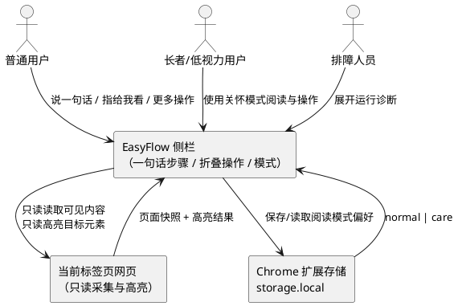
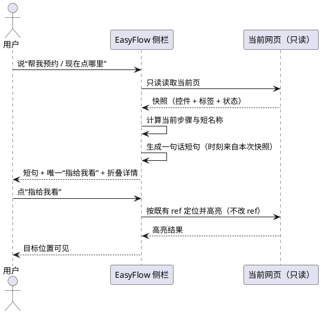
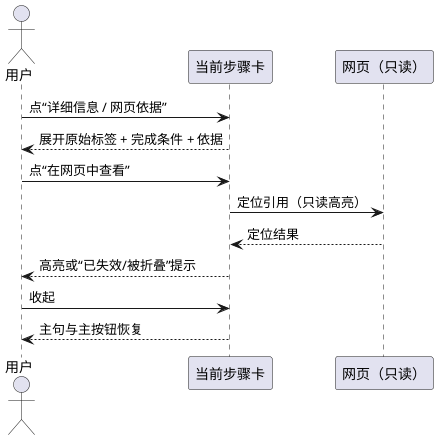
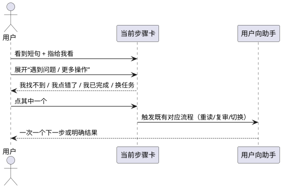
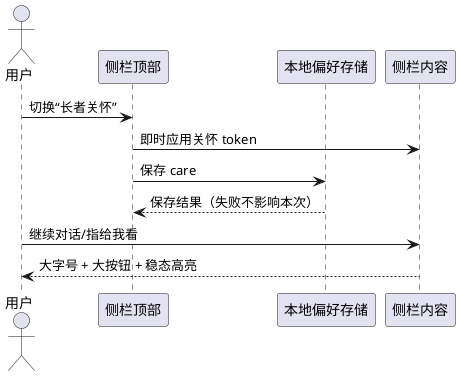
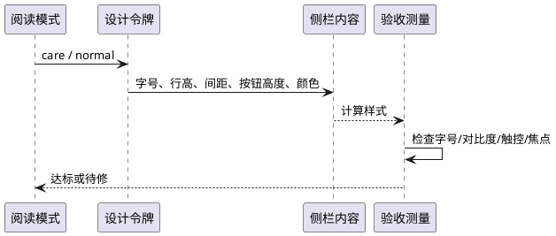
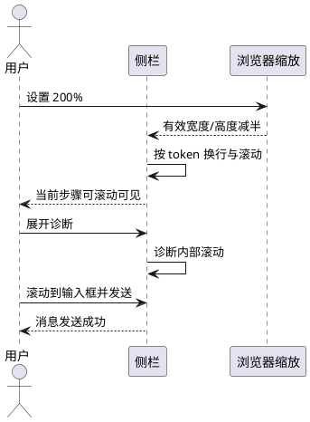
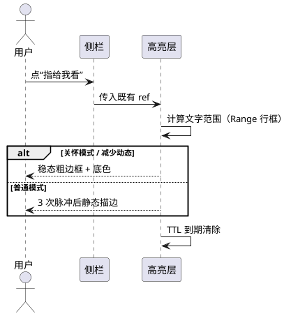
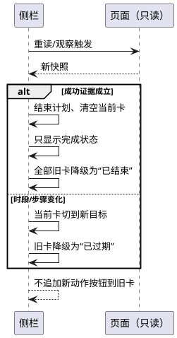

# EasyFlow 一句话当前步骤、操作收纳与长者关怀需求规格（第四轮增量）

> 本文件是 `easyflow_page_guide` 特性的第四轮增量规格，不替代第一轮 `spec.md`、第二轮 `iteration2-spec.md`、第三轮 `iteration3-spec.md`。本轮只做三件事：**一句话当前步骤**、**减少学习成本**、**普通/长者关怀切换**。
>
> 验收条件采用 EARS 标准英文触发词 + 中文变量的写法（When / If / While / Where + the system shall），与前三轮文档语义一致。本文件只描述“要什么、怎么算做到”，不描述“怎么改代码”，也不包含数据库、类结构、函数签名等实现细节。
>
> **本阶段声明**：只产出需求规格。未修改任何源码、未修改前三轮文档、未运行 `npm run typecheck` / `npm run build` / `npm run selftest`、未创建真实预约。

---

## 0. 背景与现状盘点

### 0.1 本轮用户目标（三项，范围封顶）

1. **一句话当前步骤**：预约等导办任务中，当前步骤卡首行用一句易懂短句说明“现在做什么”；有明确当前目标时可显示动态时刻（例：“现在请点左侧 02:15”），时刻必须来自最新页面快照，不得写死、不得继续显示已失效时段。只突出一个“指给我看”主按钮。原始控件标签含完整日期、时区时，主句只取网页上可见的短名称；可展开的“详细信息 / 网页依据”里保留原始标签与完成条件。不得更改目标控件 `ref`，不得省略关键日期/时区造成歧义。
2. **减少学习成本**：“我找不到 / 我点错了 / 我已完成 / 换任务”收进一个清晰的“遇到问题 / 更多操作”折叠区；规则演示说明保留但不占主要视觉；开发诊断仍可打开且默认折叠；旧步骤卡在聊天历史里不得看起来仍可操作；当前可执行步骤始终容易找到；成功页只显示完成状态，不再突出旧步骤；不得加入无法工作的按钮；不得把“语音未开放”放在最醒目位置。
3. **普通/长者关怀切换**：侧栏顶部设置明确开关，用现有 `storage` 权限保存偏好。关怀模式正文至少约 18px、当前步骤约 22px、主要按钮至少 48px 高；普通文本与背景对比至少 4.5:1。窄侧栏和 Chrome 200% 缩放时内容可滚动、不被裁切、输入框和按钮可达。关怀模式高亮使用清晰粗边框和稳态背景；默认关闭闪烁，并尊重 `prefers-reduced-motion`；普通模式可保留现有脉冲，但不能仅靠颜色/闪烁表达目标。

### 0.2 已核实基线（2026-11-14 只读核查）

| 核查项 | 实际结果 | 对本轮规格的约束 |
|---|---|---|
| 顶部区域 | `src/sidepanel/components/chat/ChatHeader.tsx` 只有 `EasyFlow / 陪你办事` 品牌区与 `规则演示` 徽章，无设置入口 | 模式开关必须新增在顶部区域；不得用全新页面承载 |
| 应用骨架 | `src/sidepanel/App.tsx` 固定顺序：`ChatHeader` → `ef-mode-notice`（“本地规则演示，未接入在线模型”整条横幅）→ `PageStatusLine` → 慢提示 → `MessageList` → `ChatComposer` → `DiagnosticsPanel` | “规则演示说明”当前占据主要视觉，需降级但保留；诊断已在底部 |
| 页面状态行 | `PageStatusLine` 仅输出“准备读取 / 正在读取 / 页面已变化 / 无法读取 / 已看到 X 的页面”，不承载当前步骤 | 当前步骤短句应落在步骤卡，不应改造成第二状态行 |
| 消息列表与卡片 | `MessageList` 的 `AssistantBubble` 用 `cardActive = planActive && message.messageId === currentCardMessageId`；`expired={!cardActive}`、`ended={bookingCompleted}`；每个历史助手消息都可能渲染一张卡 | 旧卡降级与成功页收口必须在既有消息流内完成，不能只改当前卡 |
| 当前步骤卡 | `src/sidepanel/components/chat/StepCard.tsx` 首行 `ef-step-goal` 直接渲染 `targetControl.label`（可能为完整 `aria-label`）；`ef-step-condition` 常显完成条件；主区并列渲染 4 个按钮 + “换一个任务”链接；`ef-step-primary` 与 `ef-step-action` 同尺寸（`padding: 5px 8px`、`font-size: 11px`） | 首行短句、主按钮唯一、操作收纳均需改造当前卡；不能只换文案 |
| 卡片模式模型 | `stepCardModel.ts` 定义 `current / expired / ended`；`stepCardActions(mode)` 仅在 `current` 返回 5 个动作；`shouldShowCompletion` 在 `expired` 仍为 true，仅 `ended` 隐藏完成条件 | “旧卡不得看起来仍可操作”仍有缺口：过期的卡虽无按钮，但仍完整展示目标与完成条件，视觉上仍是待办卡 |
| 输入区 | `ChatComposer` 为 `textarea` + 禁用按钮“语音未开放” + “Enter 发送 · Shift+Enter 换行” + “发送”；语音禁用按钮位于输入区首行、紧邻发送按钮 | “语音未开放”确实处于显著位置，与本轮要求冲突 |
| 诊断面板 | `DiagnosticsPanel` 为原生 `
`，默认折叠；展开区 `maxHeight: 48vh` + 内层 `overflowY: auto` + `tabIndex=0` + `aria-label="页面采集诊断详情，可滚动"`；另含时间/日期候选明细 | 诊断可滚动能力已存在，本轮要求“保留且默认折叠、200% 缩放下可滚动不裁切”，属于保护性回归 |
| 会话状态 | `conversationReducer.ts` 的 `ConversationState` 已含 `phase/pageState/snapshot/plan/currentCardMessageId/pageSuccess/lastBookingCheck/messages/diagnostics/busy/slowHint`；`assistant-add` 遇到带 `targetControl` 的消息即更新 `currentCardMessageId`；`plan-set` 在计划非活动时清空当前卡；`booking-success` 结束计划并清空当前卡 | 模式偏好属于新增 UI 状态，不应混入现有页面/计划状态机；成功态字段沿用 |
| 定位入口 | `useConversation.ts` 的 `locateControl` 对预约类计划先 `readPage("recheck")` → `reconcileBookingPlan` → 再 `highlight(step.targetControl.ref)`；成功态下直接提示“这一步已经结束，不需要再定位” | “指给我看”必须继续使用当前步骤的 `ref`；短句改造不得绕开这条链路 |
| 时段来源 | `stepPlanner.ts` 的 `createBookingPlan` 从 `snapshot.controls` 中按 `kind === "time"` 取可用时段，`reconcileBookingPlan` 用 `previousTimeLabel` 与 `timePreference` 重排；`replanNoticeText` 使用新目标标签提示“原来要点的…已不在页面上” | “动态时刻必须来自最新快照”已有实现基础；短句必须复用该来源，禁止新增写死时刻 |
| 标签采集 | `src/content/controls.ts` 的 `annotateControls` 用 `accessibleName ?? text` 归一化后截断到 `MAX_CONTROL_LABEL_CHARS = 80`，再做控件语义分类 | 长 `aria-label`（含日期、时区）可能被 80 字符截断；短句与“原文保留”需处理截断事实，避免用残缺信息拼出歧义短句 |
| 样式基座 | `src/sidepanel/styles/sidepanel.css`：`body` 13px；`.ef-bubble` 13px；`.ef-step-goal` 13px；`.ef-step-condition` / `.ef-inline-link` / `.ef-step-primary` 11px；`.ef-muted` 为 `#6b7280`；无字号/触控尺寸 token；无 `prefers-reduced-motion` 媒体查询 | 两套模式需要集中 token；当前无可直接套用的“关怀字号”能力 |
| 高亮与动态 | `src/content/highlight.ts` 已有 `prefersReducedMotion()`，脉冲 3 次、`HIGHLIGHT_PULSE_DURATION_MS = 750`、`HIGHLIGHT_TTL_MS = 4000`；颜色与时长已命名常量；CSS 中 `ef-shimmer` 常驻动画 | 高亮侧已有减少动态基础；本轮需补“关怀模式稳态高亮”和“CSS 动画在 reduce 下关闭” |
| 布局与滚动 | `.ef-chat-app { height: 100vh; overflow: hidden }`；`.ef-chat-main { flex: 1; min-height: 0; overflow-y: auto }`；composer 与 diagnostics 均为 `flex: none`；`.ef-app` 同时存在 `min-height: 100vh` | 纵向滚动只发生在消息区；200% 缩放时 header/说明/状态/composer/诊断挤压后，输入区可能不可达，需实测并定义为验收红线 |
| 存储现状 | `src/shared/constants.ts` 仅有 `GOAL_STORAGE_KEY = "easyflow.goal"`；`src/background/router.ts` 用 `chrome.storage.local` 存取目标；`public/manifest.json` 已含 `storage` 权限 | 偏好可复用 `storage`，不新增权限；需新增独立键，不得复用目标键 |
| 既有测试 | `scripts/selftest.mjs` 已覆盖：AT-31/32 政府津贴问答与多轮、AT-33 Cal.com 日历语义与 fixture、AT-36 成功页判定、AT-38 卡片过期与源码静态断言（`StepCard` 含“已过期”、`App` 含 `planActive`）、AT-39—AT-45 成功页与完成回答；无模式偏好、字号、对比度、短句、操作收纳用例 | 新增测试应集中在本轮新增的纯函数与偏好读写；避免把文案硬断言扩散到全量 |
| 夹具现状 | `scripts/fixtures/cal-booking-date.html` 含 `aria-label="Monday, November 16, 2026"`（完整日期）；`cal-booking-time.html` 含 `aria-label="02:00" / "02:15" / disabled "02:30"`；津贴页面走 `bjsjs-captured-items.json` | 可用前者验收“长标签→短名称”，用后者验收“动态时刻来自快照”与“失效时段不沿用”；不得新增真实站点抓取 |

### 0.3 三项需求与现状的差距

| 用户目标 | 现状缺口 | 本轮规格落点 |
|---|---|---|
| 一句话当前步骤 | 首行是控件原始标签（可能是 “Monday, November 16, 2026”）；无“短名称 + 动态时刻”模型；无短句回退与歧义防护 | 5.1、6.1、6.2 |
| 详情与原文保留 | 完成条件常驻主区，原文只在首行整段出现，没有“主句短 / 原文可查”的分层 | 5.2、6.2 |
| 操作收纳 | 4 个动作按钮与“换任务”平铺；语音禁用按钮在首行；“规则演示”整条横幅占视觉；过期卡仍展示目标与完成条件 | 5.3、5.8 |
| 模式开关与偏好 | 无开关、无偏好键；字号全部固定 13/11px；按钮高度约 27—30px | 5.4、5.5、6.3 |
| 窄栏与 200% 缩放 | 未验证；固定 `100vh` + 多段 `flex: none` | 5.6、DFX 4.1—4.2 |
| 减少动态 | 高亮有 reduce 处理，但关怀模式无稳态表达；CSS shimmer 未关闭 | 5.7、DFX 4.2 |
| 旧卡与成功页 | 过期卡无按钮但仍展示完成条件与目标，视觉上仍像待办；成功页历史消息文本仍可能被读成待办 | 5.3、5.8 |

---

## 1. 组件定位

### 1.1 核心职责

本组件负责在用户正在办理的真实网页旁，用**一句可执行的当前步骤短句 + 一个“指给我看”**引导用户完成下一步，并让用户可自行选择“普通 / 长者关怀”阅读方式。

### 1.2 核心输入

1. **当前标签页只读页面快照**：可见文本条目、可交互控件（含标签、类型、可见/禁用/选中状态、语义 `date/time/next/form/generic`）、采集时刻与 `snapshotId`。
2. **当前陪办计划与当前步骤**：计划状态、`currentIndex`、当前步骤的 `targetControl`（含 `ref`、原始标签）与 `completionCondition`。
3. **会话历史消息**：已产生的助手消息、步骤卡、系统完成提示、网页依据引用。
4. **用户操作**：输入文字、“指给我看”、“我找不到 / 我点错了 / 我已完成 / 换一个任务”、展开“详细信息 / 网页依据”、展开“遇到问题 / 更多操作”、切换模式开关。
5. **本地 UI 偏好**：用户选择的阅读模式，来自扩展本地存储。
6. **页面变化信号**：标签页切换、导航、刷新、观察 tick，用于触发重读与当前步骤复核。

### 1.3 核心输出

1. **当前步骤卡**：一句短句（可含动态时刻/短日期）、唯一主按钮“指给我看”、可展开的“详细信息 / 网页依据”。
2. **折叠操作区**：“遇到问题 / 更多操作”，内含“我找不到 / 我点错了 / 我已完成 / 换一个任务”等既有动作。
3. **历史与成功态呈现**：历史步骤卡降级为不可操作的“已过期 / 已结束”；成功页只显示完成状态。
4. **阅读模式呈现**：普通或长者关怀下的字号、间距、触控尺寸、对比度与高亮表达。
5. **折叠诊断**：读取/引擎/成功判定诊断，默认折叠、可滚动，不含页面正文与敏感值。

### 1.4 职责边界

1. 本组件**禁止**重写第三方网页布局、注入可见内容、隐藏协议/费用/提交按钮或改写页面文案。
2. 本组件**禁止**更改目标控件的 `ref`（`elementId + domPath + textHash` 三元组）或用短句替代真实元素定位。
3. 本组件**禁止**写死具体时刻、具体站点、具体预约编号；短句中的时刻/日期只能来自最新页面快照。
4. 本组件**禁止**代填、代选、代提交，不读取输入框值，不点击网页按钮。
5. 本组件**禁止**新增权限、接入在线模型、播放语音、伪造“语音可用”按钮。
6. 本组件**禁止**为验收创建真实预约；预约类验收只使用虚构 fixture 或用户已有只读页面。
7. 本组件不负责跨设备同步偏好、不负责主题换肤、不负责完整无障碍认证（只做到本规格列出的红线）。

---

## 2. 领域术语

**当前步骤短句**
: 当前可执行步骤卡首行的一句话，用用户能直接照做的动作描述“现在做什么”，不超过约 24 个汉字或等价长度。

**短名称**
: 从当前步骤目标控件的原始标签中提取、且用户能在网页上直接看见的最短可识别名称（如“02:15”），用于主句；不改变目标控件，不替代定位。

**原始控件标签**
: 页面采集得到的控件可读标签（优先 `aria-label`，其次可见文本），归一化空白后的原文，可能含完整日期、星期、时区或格式说明。

**动态时刻**
: 出现在当前步骤短句中的具体时间（如“02:15”），其值必须来自最近一次成功读取页面快照中的当前步骤目标控件，并随重读/重排更新。

**详情区（详细信息 / 网页依据）**
: 当前步骤卡内默认折叠的可展开区域，用于展示原始控件标签、完成条件与必要页面依据；展开不触发重新读取。

**遇到问题 / 更多操作**
: 当前步骤卡内的折叠操作区，收纳“我找不到 / 我点错了 / 我已完成 / 换一个任务”等非主操作。

**旧步骤卡**
: 聊天历史中已不再处于当前可执行状态的步骤卡，包括过期、被重排替换、计划结束或成功页后的卡片。

**成功态**
: 页面已具备既有成功证据（沿用第三轮判定），计划结束、当前卡清空、只显示完成状态。

**阅读模式**
: 侧栏的两种呈现偏好：`普通` 与 `长者关怀`；仅影响排版、字号、触控尺寸与高亮表达，不改变回答内容与页面操作边界。

**关怀模式**
: 阅读模式之一，要求更大字号、更大触控目标、更高对比度、稳态高亮与更少动态。

**稳态高亮**
: 不使用闪烁的静态高亮：清晰粗边框 + 半透明底色 + 明显的静态描边；结束后自动清除。

**减弱动态偏好**
: 浏览器 `prefers-reduced-motion: reduce` 所表达的用户系统级偏好。

---

## 3. 角色与边界

### 3.1 核心角色

1. **普通用户**：在真实网页上自行填写与提交，依赖侧栏获得“现在做什么”的一句话指引。
2. **长者 / 低视力用户**：需要更大字号、更高对比度、更大按钮与更少闪烁；不阅读技术说明。
3. **排障人员（开发/测试）**：需要打开折叠的运行诊断、查看页面采集候选与成功判定原因。

### 3.2 外部系统

1. **当前标签页网页**：只读采集可见文本与控件；由本组件发起只读高亮定位，不写入页面节点。
2. **Chrome 扩展运行时**：`chrome.runtime` 消息、`chrome.storage.local` 偏好存取、`sidePanel` 承载侧栏。
3. **系统显示设置**：`prefers-reduced-motion` 与页面缩放（200%）影响侧栏排版与可达性。

### 3.3 交互上下文

图中禁止出现侧栏内部组件划分、数据库表与具体接口参数。

---

## 4. DFX 约束

### 4.1 性能

1. **模式切换**：When 用户切换阅读模式，the system shall 在 100 毫秒内完成视觉切换，不触发页面重新读取、不重新发送对话请求。
2. **短句生成**：短句生成 shall 只使用已在内存中的当前计划与最近快照，不新增网络请求、不新增页面采集。
3. **高亮时延**：点击“指给我看”后，滚动与高亮 shall 在 500 毫秒内出现（沿用既有红线）；若需重读页面，按既有读取链路耗时并给出可理解反馈。
4. **诊断展开**：展开运行诊断 shall 在 100 毫秒内渲染可见内容，不重新读取页面。
5. **滚动**：新当前步骤出现后，将其带入可视区域的操作不得造成连续抖动或反复滚动。

### 4.2 可靠性

1. **偏好容错**：If 偏好读取失败、存储不可用或值非法，the system shall 以 `普通` 模式继续工作，并在当前会话内保留用户刚刚选择的模式（内存生效）。
2. **短句回退**：If 无法从当前步骤生成可靠短句，the system shall 回退到通用动作句并保持目标控件不变，不得隐藏“指给我看”。
3. **元素失效**：If 目标控件在重读后不可见/禁用/消失，the system shall 按既有重排逻辑更新当前步骤，并使旧时刻不再出现在短句中。
4. **高频变化**：While 页面在短时间内多次变化，the system shall 沿用既有复审节流，不得对每个变化都重排短句或重复追加消息。
5. **减弱动态**：Where 用户系统声明 `prefers-reduced-motion: reduce`，the system shall 不播放脉冲/闪烁动画，仅保留静态高亮。

### 4.3 安全性

1. **权限**：本轮 shall 不新增任何 `permissions` / `host_permissions` / `content_scripts`；仅复用既有 `storage`。
2. **偏好内容**：偏好记录 shall 只包含模式枚举值与必要的版本/时间信息，不得包含页面正文、对话内容、网址查询串或个人敏感值。
3. **只读边界**：采集与定位 shall 继续只读；不得读取输入框值、勾选状态之外的表单值，不得点击、聚焦、填写、提交。
4. **诊断清洁**：诊断区不得展示页面正文、引用原文、用户话语全文、姓名、邮箱、验证码、完整 URL 查询串。
5. **截图留痕**：真实页验收截图若含个人信息，留痕前必须自行遮蔽；留痕只记录页面类型与模式，不记录完整 URL。

### 4.4 可维护性

1. **命名常量**：字号、间距、按钮高度、边框宽度、动画时长、对比度相关颜色 shall 以命名常量或集中 CSS 变量表达，不得散落魔法数。
2. **单一来源**：普通/关怀两套模式 shall 由同一组 token 驱动，不得各写一套零散覆盖。
3. **可追溯**：短句采用短名称还是通用回退、原文是否被截断，shall 可在折叠诊断中看到判定类别（不记录原文正文）。
4. **日志**：新增偏好读取/写入失败 shall 有可诊断的错误类别，不向主对话区抛技术错误码。

### 4.5 兼容性

1. **既有状态字段**：`ConversationState`、`GuidePlan`、`AssistantMessage` 的既有字段语义不得改变；新增字段必须可选或有默认值。
2. **消息历史**：已产生的历史消息在模式切换、页面重读后仍可正常渲染；不得因新增短句模型而导致旧消息无法显示。
3. **存储键**：模式偏好键不得与 `easyflow.goal` 冲突；键名集中声明。
4. **选择器与样式**：既有 `.ef-step-*`、`.ef-diagnostics`、`.ef-composer*` 类名可扩展但不得破坏既有引用；`selftest.mjs` 对源码字符串的断言需保持可满足。
5. **第三方页面**：不修改任何网页 DOM 结构与样式；高亮只在独立覆盖层内绘制。

---

## 5. 核心能力

## 5.1 一句话当前步骤

### 5.1.1 业务规则

1. **R-01 首行必须是短句**：While 存在当前可执行步骤，the system shall 在当前步骤卡首行只显示一句可执行短句，长度不超过约 24 个汉字（英文等价为不超过 8 个词），不得展示完整 `aria-label`、控件类型、角色、元素 ID 或坐标。
   a. 验收条件：打开 Cal.com 日期步骤 → 首行为“现在请选择网页上可用的日期”或含短日期名的同类短句，不含 “Monday, November 16, 2026” 整段。
2. **R-02 有明确目标时带短名称**：Where 当前步骤目标控件存在用户可见的短名称（时刻、日期、按钮名），the system shall 在短句中带上该短名称，使短句可直接照做。
   a. 验收条件：当前步骤为 02:15 时段 → 短句含“02:15”，例如“现在请点左侧 02:15”。
3. **R-03 动态时刻只来自最新快照**：When 当前步骤短句包含时刻或日期，the system shall 只使用最近一次成功读取的页面快照中、当前步骤目标控件的标签值；不得使用固定字面量、历史快照或已失效控件。
   a. 验收条件：fixture 快照含 02:00/02:15，当前步骤为 02:15 → 短句含 02:15；重读后 02:15 被移除且 03:00 可选 → 短句含 03:00 且不含 02:15。
   b. 验收条件：源码 `src/` 中不得出现用于演示的 `02:15`/`02:00` 等时刻字面量作为短句内容。
4. **R-04 短名称提取与原文分层**：Where 原始控件标签包含完整日期、星期、时区或时间格式说明，the system shall 在主句使用网页上可见的短名称，并保证完整原文不在主句整段出现。
   a. 验收条件：标签为 “Monday, November 16, 2026 14:00 (GMT+8)” → 主句不出现该整串；主句为可照做的短句。
5. **R-05 歧义防护**：If 仅显示短名称会造成日期、上下午或时区歧义（例如页面同时存在多个日期、多个时区或 12/24 小时格式切换），the system shall 在主句补充最短必要限定（如“11月16日 02:15”），不得省略关键信息。
   a. 验收条件：同页存在 11/16 与 11/17 两组时段且当前为 11/16 的 02:15 → 主句含“11月16日”或等价限定；若页面仅一处日期且上下文唯一，可只显示“02:15”。
6. **R-06 只有一个主操作**：While 存在当前可执行步骤，the system shall 只突出一个主按钮“指给我看”；该按钮点击后必须定位当前步骤的真实网页元素。
   a. 验收条件：当前卡主区可见区域只有 1 个主按钮；点击后高亮落在当前步骤目标元素上。
7. **R-07 定位不被短句改写**：The system shall 使短句与短名称仅用于展示，不得修改当前步骤的 `ref`、`elementId`、`domPath`、`textHash`，不得因短句生成新增目标控件。
   a. 验收条件：短句生成前后，当前步骤目标 `ref` 三元组一致；点击“指给我看”仍定位同一元素。
8. **R-08 一次只给一个下一步**：The system shall 保持既有“一次只给一个下一步”，不得在同一当前卡中并列展示两个动作目标或两个时刻。
   a. 验收条件：Cal.com 时段页 → 当前卡只出现一个时刻目标。
9. **R-09 短句生成可回退**：If 目标控件无可用短名称或标签被截断到无法判断，the system shall 回退到不含具体时刻的通用动作句，并保持目标与主按钮不变。
   a. 验收条件：目标标签仅有 “Select” 或空白 → 短句为“现在请在网页上选择对应项”，不出现猜测的时刻或日期。
10. **R-10 禁止项**：The system shall 禁止把已过期、已禁用、不可见或不在最新快照中的时刻写入短句，也禁止为提速而缓存跨快照的时刻作为当前指引。
    a. 验收条件：重读后旧时刻消失 → 新版短句、当前卡、旧卡均不把旧时刻作为当前动作。

### 5.1.2 交互流程

### 5.1.3 异常场景

1. **最新快照中目标时刻已失效**
   a. 触发条件：重读后原时刻控件消失/禁用/被替换。
   b. 系统行为：按既有重排逻辑更新当前步骤；旧卡降级；短句使用新目标或通用回退句。
   c. 用户感知：“原来要点的 02:15 现在已经不在页面上了，现在这一步是 03:00。”
2. **标签被 80 字符截断且截断处位于日期/时区**
   a. 触发条件：原始标签超长，截断后无法判断日期或时区。
   b. 系统行为：主句不拼接残缺日期/时区，改用通用短句；详情标注“原文已截断”。
   c. 用户感知：主句不出现可能误导的具体时刻；详情可见已采集到的原文前缀。
3. **同一页面多个同名时刻**
   a. 触发条件：多个控件短名称相同但日期不同。
   b. 系统行为：短句补充最短日期/时区限定；若仍无法消除歧义，则回退通用句并保留“指给我看”定位当前目标。
   c. 用户感知：不会出现“点 02:15”但页面上有两个 02:15 而无从判断的情况。
4. **短句生成抛错**
   a. 触发条件：标签解析异常或数据不完整。
   b. 系统行为：回退通用动作句，记录一条不含正文的诊断类别。
   c. 用户感知：仍能看到“现在请在网页上选择对应项”并可点“指给我看”。
5. **用户只想要信息，不需要步骤**
   a. 触发条件：用户问的是政策/条件类问题，当前无活动计划。
   b. 系统行为：不生成步骤卡，保持 1—3 句回答 + 折叠网页依据。
   c. 用户感知：不会看到无目标的“指给我看”。

## 5.2 详情展开与原文保留

### 5.2.1 业务规则

1. **R-11 详情入口**：While 存在当前步骤卡，the system shall 提供且只提供一个默认折叠的“详细信息 / 网页依据”入口。
   a. 验收条件：当前卡 → 可见一个折叠入口；展开前不显示原文全文与完成条件。
2. **R-12 原文完整保留**：When 展开详情，the system shall 展示原始控件标签全文（归一化空白但不改写语义），包括日期、星期、时区与格式说明。
   a. 验收条件：标签 “Monday, November 16, 2026 14:00 (GMT+8)” → 详情逐字可见该串（空白可归一化）。
3. **R-13 完成条件可查**：The system shall 在详情中展示当前步骤完成条件的用户可理解表述（如“你在网页上选中时段后告诉我”“页面上出现下一步入口”）。
   a. 验收条件：展开详情 → 可见“完成条件：…”；收起后主区不被完成条件占满。
4. **R-14 展开不改状态**：The system shall 使展开/收起详情不触发页面重新读取、不推进计划、不发送消息、不改变当前步骤。
   a. 验收条件：展开前后 → `snapshotId`、当前步骤、消息条数不变。
5. **R-15 网页依据可定位**：Where 详情包含页面依据或“在网页中查看”，the system shall 沿用既有引用定位能力；定位失败时给出可理解提示（已失效 / 被折叠），不得静默失败。
   a. 验收条件：津贴页面展开网页依据 → 点击“在网页中查看”可在网页上高亮对应原文。
6. **R-16 主句与详情一致**：The system shall 保证主句短名称与详情原始标签指向同一个目标控件，不得出现主句写 A、详情写 B。
   a. 验收条件：主句“02:15” → 详情原文含 02:15，且二者 `ref` 相同。
7. **R-17 详情不放大段正文**：The system shall 使详情只展示与当前步骤直接相关的原文/依据，不得把整页正文或整个段落群作为详情内容。
   a. 验收条件：展开详情 → 内容为标签、完成条件与必要引用，不是整页文本。
8. **R-18 禁止项**：The system shall 禁止在详情中展示 `elementId`、`domPath`、`score`、`role` 等技术字段；技术信息只允许出现在折叠运行诊断中。
   a. 验收条件：主对话区与详情区检索 `elementId/domPath/score` → 0 命中（诊断区除外）。

### 5.2.2 交互流程

### 5.2.3 异常场景

1. **原文超长**
   a. 触发条件：原始标签超过采集上限。
   b. 系统行为：详情展示已采集到的原文并标注“原文已截断”；主句不拼接残缺关键信息。
   c. 用户感知：可明确知道原文不完整，而不是被误导为完整日期/时区。
2. **依据失效**
   a. 触发条件：页面变化后引用元素消失。
   b. 系统行为：显示“已失效”并停止该引用的定位动作。
   c. 用户感知：看到“已失效”，不会点击后无反应。
3. **详情展开后页面变化**
   a. 触发条件：详情展开期间页面重读并重排。
   b. 系统行为：详情内容随当前步骤一起更新或自动收起；旧卡不得保留可操作按钮。
   c. 用户感知：不会在旧详情中继续点“指给我看”到错误位置。
4. **重复展开**
   a. 触发条件：用户反复展开/收起。
   b. 系统行为：幂等渲染，不追加消息、不重复读取。
   c. 用户感知：无闪烁、无重复内容。

## 5.3 操作收纳与当前步骤可达

### 5.3.1 业务规则

1. **R-19 主区只留主操作**：While 存在当前可执行步骤，the system shall 使卡片主区只保留“指给我看”一个按钮，其余操作不得与主按钮并列突出。
   a. 验收条件：当前卡收起状态 → 主区只有 1 个可点按钮。
2. **R-20 操作收纳**：The system shall 将“我找不到 / 我点错了 / 我已完成 / 换一个任务”收纳在一个默认折叠的“遇到问题 / 更多操作”区域内。
   a. 验收条件：默认不可见这 4 个动作；展开“遇到问题 / 更多操作”后 4 个动作均可用，行为与既有语义一致（重读、复审、完成复核、切换任务）。
3. **R-21 折叠区无死按钮**：The system shall 禁止在“遇到问题 / 更多操作”中放置任何无法工作的按钮或占位功能。
   a. 验收条件：展开后逐个点击 → 均有明确结果或可理解提示，无“点击无反应”。
4. **R-22 语音不占显著位置**：The system shall 不把“语音未开放”作为按钮放在输入区首行、header 或主按钮旁等醒目位置；若保留语音状态说明，只能以小字说明或帮助文案呈现，且不可点击。
   a. 验收条件：侧栏首屏最醒目区域（顶部、输入区首行、当前卡主区）→ 不存在“语音未开放”按钮。
5. **R-23 规则演示说明降级**：The system shall 保留“本地规则演示，未接入在线模型”的事实说明，但不得以整条高对比横幅占据主要视觉。
   a. 验收条件：说明仍可在侧栏找到（弱化小字或收入“更多操作/关于”折叠），首屏主要视觉为当前步骤与输入。
6. **R-24 诊断仍可打开且默认折叠**：The system shall 保留运行诊断入口，默认折叠；展开后内容可滚动且不遮挡输入区。
   a. 验收条件：未点击时诊断内容不可见；点击后可见运行记录与页面采集信息，且可滚动到末尾。
7. **R-25 当前步骤始终容易找到**：When 新的当前步骤出现或被重排，the system shall 使该卡进入可视区域，且在视觉权重上明显高于历史卡。
   a. 验收条件：连续多轮产生多张卡后，最新当前卡在侧栏可视区域内；历史卡明显弱化。
8. **R-26 用户翻看历史后不迷路**：While 用户向上滚动查看历史，the system shall 不因历史滚动而把当前步骤卡误判为过期；当前卡状态只由计划与页面事实决定。
   a. 验收条件：滚动到历史再滚回 → 当前卡仍可操作。
9. **R-27 禁止项**：The system shall 禁止把“我已完成”做成与“指给我看”同等醒目的第二个主按钮，也禁止新增“自动完成/一键提交”类按钮。
   a. 验收条件：主区视觉层级 → 只有“指给我看”为主按钮。

### 5.3.2 交互流程

### 5.3.3 异常场景

1. **折叠区展开后按钮不可用**
   a. 触发条件：计划已结束或步骤已过期。
   b. 系统行为：不显示操作区或显示为不可操作的历史态，并说明“这一步已结束”。
   c. 用户感知：不会看到可点但无反应的按钮。
2. **当前卡在 200% 缩放下被挤出可视区**
   a. 触发条件：窄宽度 + 缩放 + 长历史。
   b. 系统行为：按 5.6 的滚动规则保证当前卡与主按钮可达；必要时收起非必要说明。
   c. 用户感知：滚动即可看到当前卡和“指给我看”。
3. **用户连续点“我找不到”**
   a. 触发条件：同一位置多次点击。
   b. 系统行为：沿用既有节流与幂等，不重复刷屏、不重复追加相同消息。
   c. 用户感知：得到一次明确的复审结果或可理解限制。
4. **诊断展开时空间不足**
   a. 触发条件：诊断展开 + 小屏/200% 缩放。
   b. 系统行为：诊断内部滚动，不把输入区永久推出可视区。
   c. 用户感知：可滚动查看诊断，也能回到输入框与发送。

## 5.4 普通 / 长者关怀模式切换与偏好

### 5.4.1 业务规则

1. **R-28 顶部明确开关**：The system shall 在侧栏顶部区域提供明确的“普通 / 长者关怀”切换控件，带可见文字标签与可读名称，键盘可操作。
   a. 验收条件：侧栏顶部可见模式控件；Tab 可聚焦，Enter/Space 可切换；控件有可读名称（如“阅读模式：长者关怀”）。
2. **R-29 不靠颜色/图标单独表达**：The system shall 使当前模式有文字或形状线索（如“已开启”文字、勾选/滑块位置），不得只用颜色区分。
   a. 验收条件：关闭颜色后仍能判断当前模式。
3. **R-30 使用既有存储权限**：The system shall 使用既有 `storage` 能力在本地保存阅读模式偏好；不得新增权限。
   a. 验收条件：`manifest.json` 权限集合不增加；偏好写入扩展本地存储。
4. **R-31 偏好可恢复**：When 侧栏重新打开或扩展重载后，the system shall 读取已保存偏好并应用同一模式。
   a. 验收条件：设为关怀 → 关闭侧栏 → 重新打开 → 仍为关怀；字号与按钮尺寸仍生效。
5. **R-32 非法值回退**：If 偏好缺失、读取失败或值不在允许集合，the system shall 回退到 `普通` 并正常显示，不得报错或空白。
   a. 验收条件：存储值为 `"huge"`/空/读取抛错 → 侧栏以普通模式可用。
6. **R-33 切换即时且无副作用**：When 用户切换模式，the system shall 立即更新排版与尺寸，不丢失对话、不重置计划、不重新读取页面、不改变当前步骤。
   a. 验收条件：切换前后 → 消息条数、`currentCardMessageId`、`snapshotId` 不变。
7. **R-34 默认普通**：The system shall 首次使用默认 `普通` 模式。
   a. 验收条件：清除存储后首次打开 → 普通模式。
8. **R-35 模式不改变内容与边界**：The system shall 保证两种模式下回答文本、引用内容、完成条件、页面操作边界完全一致，只改变呈现。
   a. 验收条件：同一问题在两种模式下 → 回答与引用一致，仅字号/间距/尺寸不同。
9. **R-36 禁止项**：The system shall 禁止根据设备、年龄推断或页面域名自动切换模式，也禁止把模式偏好写入页面或跨站点共享。
   a. 验收条件：不同页面打开 → 模式只由本地偏好决定。

### 5.4.2 交互流程

### 5.4.3 异常场景

1. **存储写入失败**
   a. 触发条件：扩展存储不可用或写入被拒。
   b. 系统行为：当前会话仍应用用户选择的模式，并记录不含正文的诊断；下次打开回退默认。
   c. 用户感知：切换立即生效；不会看到技术错误。
2. **存储读取慢**
   a. 触发条件：打开侧栏时偏好读取尚未返回。
   b. 系统行为：先以默认普通渲染，读取完成后切换一次；不得出现长时间空白或布局反复跳动。
   c. 用户感知：侧栏可用，模式在短暂后稳定。
3. **偏好值被外部改为非法**
   a. 触发条件：存储中为未知字符串。
   b. 系统行为：回退普通，并在诊断中标注“偏好非法”。
   c. 用户感知：界面正常，无需处理。
4. **模式切换时对话正在生成**
   a. 触发条件：等待回答期间切换。
   b. 系统行为：只更新呈现，不取消请求、不重复发送。
   c. 用户感知：回答照常出现，字号即时变化。

## 5.5 字号、对比度与触控尺寸

### 5.5.1 业务规则

1. **R-37 关怀模式字号**：While 处于关怀模式，the system shall 使正文（回答文本、说明、详情正文、按钮文字、输入框文字）不小于约 18px，当前步骤短句不小于约 22px，行高不小于 1.5。
   a. 验收条件：关怀模式下测量 → 正文计算字号 ≥18px、当前步骤 ≥22px。
2. **R-38 普通模式字号**：While 处于普通模式，the system shall 保持正文不小于 13px；辅助技术信息（诊断）不小于 11px 且可滚动。
   a. 验收条件：普通模式测量 → 正文 ≥13px；诊断字号 ≥11px。
3. **R-39 对比度**：While 任一模式，the system shall 保证正文文字与其背景对比度不小于 4.5:1；大字号文字不小于 3:1；按钮文字与其背景不小于 4.5:1。
   a. 验收条件：用取色/对比度工具测量主要文本与按钮 → 达标；未达标项不得以“看起来还行”通过。
4. **R-40 触控尺寸**：While 处于关怀模式，the system shall 使主要按钮（“指给我看”“发送”）高度不小于 48px；所有可点击目标不小于 44×44 CSS px；输入框不小于 44px 高。
   a. 验收条件：关怀模式下测量 → 主按钮 ≥48px 高、可点目标 ≥44×44。
5. **R-41 焦点可见**：The system shall 为所有可交互控件提供可见焦点指示（至少 2px 对比明显的轮廓），且焦点不被顶部固定区遮挡。
   a. 验收条件：仅用键盘 Tab 走完顶部开关 → 当前卡 → 详情 → 更多操作 → 输入 → 发送 → 诊断；每步都有可见焦点。
6. **R-42 不只靠颜色**：The system shall 使“当前步骤 / 已完成 / 已过期 / 目标位置”同时具备文字或形状线索，禁止仅用颜色差异表达。
   a. 验收条件：灰度查看 → 仍能区分当前卡与历史卡、仍能看出目标位置。
7. **R-43 放大不裁字**：When 字号增大，the system shall 通过换行、增高容器保持文字完整，不得裁切或截断按钮文字。
   a. 验收条件：关怀模式 → “指给我看”“遇到问题 / 更多操作”“发送”文字完整可见。

### 5.5.2 交互流程

### 5.5.3 异常场景

1. **大字号导致按钮换行过高**
   a. 触发条件：窄栏 + 关怀模式 + 长按钮文字。
   b. 系统行为：允许按钮增高/换行，优先保证文字完整与可点；不得缩小字号。
   c. 用户感知：按钮变高但仍可点，文字不裁切。
2. **对比度不足的灰色说明**
   a. 触发条件：沿用既有浅灰辅助文字。
   b. 系统行为：提高对比度或改为带文字的明确状态（如“已结束”），不得仅靠浅灰表达。
   c. 用户感知：说明文字可读。
3. **系统级放大字体**
   a. 触发条件：浏览器/系统字号放大。
   b. 系统行为：按 5.6 滚动与换行规则保持可达。
   c. 用户感知：内容可滚动，输入与发送可达。

## 5.6 窄侧栏与 200% 缩放可达性

### 5.6.1 业务规则

1. **R-44 纵向可滚动**：While 侧栏宽度约为 400px 或页面缩放到 200%（有效 CSS 宽度约减半），the system shall 使内容纵向可滚动，不出现横向滚动条，不横向裁切按钮与文字。
   a. 验收条件：约 400px 宽与 200% 缩放下 → 无横向滚动；所有按钮完整可见。
2. **R-45 输入区可达**：The system shall 保证输入框与发送按钮在任意滚动位置、任意模式、诊断展开或收起时均可滚动到达并操作。
   a. 验收条件：200% 缩放 + 诊断展开 + 长对话 → 可滚动到输入框并发送一条消息。
3. **R-46 诊断内部滚动**：While 诊断展开，the system shall 使诊断内容在自身区域内滚动，不撑高整页、不永久遮挡输入区。
   a. 验收条件：诊断展开 → 消息区与输入区仍可到达；诊断内部可滚到末尾。
4. **R-47 固定区不遮内容**：The system shall 使顶部区域与底部输入区不遮挡当前步骤卡的主按钮与详情入口；必要时压缩非关键说明。
   a. 验收条件：200% 缩放下滚动到当前卡 → “指给我看”完整可见且可点。
5. **R-48 无内容丢失**：The system shall 在窄栏/缩放下通过换行、增行、滚动保持所有关键文字完整（短句、按钮、完成状态、错误提示）。
   a. 验收条件：逐项检查短句、按钮、详情标题、状态说明 → 无省略号替代关键信息、无裁切。
6. **R-49 禁止项**：The system shall 禁止用固定像素高度锁死内容区导致 200% 缩放下输入区不可达，也禁止通过隐藏关键按钮换取布局。
   a. 验收条件：200% 缩放下不存在“找不到发送/指给我看/更多操作”的情况。

### 5.6.2 交互流程

### 5.6.3 异常场景

1. **极端窄宽（<320px）**
   a. 触发条件：分屏或更小侧栏。
   b. 系统行为：进一步换行、隐藏非关键提示文字（不隐藏功能按钮），保持滚动可达。
   c. 用户感知：按钮仍可用，不出现横向裁切。
2. **诊断内容超长**
   a. 触发条件：时间/日期候选很多。
   b. 系统行为：候选列表内部滚动，限制最大高度，保留关闭/收起路径。
   c. 用户感知：可滚完诊断，也能回到对话。
3. **软键盘弹出（触屏设备）**
   a. 触发条件：输入框聚焦。
   b. 系统行为：不改变布局导致输入框被遮挡；必要时消息区让出空间。
   c. 用户感知：能看到输入内容与发送按钮。

## 5.7 减少动态与高亮表达

### 5.7.1 业务规则

1. **R-50 关怀模式默认稳态**：While 处于关怀模式，the system shall 使用稳态高亮：不小于 3px 的清晰粗边框 + 稳定的半透明底色 + 明显静态外描边；不得闪烁或脉动。
   a. 验收条件：关怀模式点“指给我看” → 高亮出现后保持静止，无反复明暗变化。
2. **R-51 普通模式可保留脉冲**：While 处于普通模式，the system shall 至多保留既有 3 次、2—3 秒脉冲，结束后保留静态描边直到自动清除（不超过约 4 秒）；不得无限闪烁。
   a. 验收条件：普通模式 → 脉冲次数有限，结束后静态高亮，随后自动清除；文字始终可读。
3. **R-52 尊重减少动态**：Where 系统声明 `prefers-reduced-motion: reduce`，the system shall 在两种模式下都不播放脉冲/闪烁/位移动画，只保留静态高亮；CSS 装饰动画（如骨架 shimmer）也应关闭。
   a. 验收条件：开启减少动态后 → 高亮与侧栏均无动画；目标仍清晰可见。
4. **R-53 不只靠颜色/闪烁**：The system shall 同时用侧栏短句与静态高亮（边框/形状）指明目标，不得仅依赖颜色或闪烁。
   a. 验收条件：灰度/关闭动画后 → 仍能看出目标位置与当前步骤。
5. **R-54 高亮层不拦截操作**：The system shall 使高亮覆盖层 `pointer-events: none`，不拦截鼠标、不修改页面节点；沿用既有 Range 逐行框选，短标题只框文字范围。
   a. 验收条件：高亮期间可在网页正常滚动/输入；页面 DOM 结构未被改写。
6. **R-55 自动清除**：The system shall 使高亮在有限时间内自动清除（沿用既有约 4 秒 TTL），不得无限保留。
   a. 验收条件：等待超过 TTL → 覆盖层消失，页面无残留。

### 5.7.2 交互流程

### 5.7.3 异常场景

1. **高亮定位失败**
   a. 触发条件：元素折叠、失效或不可见。
   b. 系统行为：沿用既有降级与提示，不静默失败；必要时重读并重排。
   c. 用户感知：“这段内容被折叠了 / 这个位置已经不在页面上了”。
2. **页面自身有动画**
   a. 触发条件：目标区域位于滚动或动画容器。
   b. 系统行为：低干扰重绘或保持静态描边；不追逐页面动画导致视觉抖动。
   c. 用户感知：仍能定位或得到明确说明。
3. **减少动态下仍看到动画**
   a. 触发条件：CSS 或 Web Animations 未受媒体查询控制。
   b. 系统行为：视为缺陷；实现阶段必须补齐 CSS 媒体查询与运行时判断。
   c. 用户感知：无闪烁。

## 5.8 旧步骤卡与成功页状态

### 5.8.1 业务规则

1. **R-56 旧卡不可操作且不像待办**：While 步骤已过期、被替换或计划已结束，the system shall 使该卡不显示任何操作按钮、不显示主按钮样式、不显示“现在这一步”，并以“这一步已过期 / 已结束”文字明确说明。
   a. 验收条件：历史卡 → 无按钮、无主色主按钮、无“现在这一步”；鼠标悬停无按钮态。
2. **R-57 旧卡不显示旧完成条件**：The system shall 在过期/结束态下不展示旧完成条件（包括“完成后点我已完成”“页面上出现指定文本”），避免历史命令被读成当前指令。
   a. 验收条件：过期卡 → 不出现“完成条件：”。
3. **R-58 旧时刻不残留**：When 页面重读导致时段失效，the system shall 使旧卡的旧时刻不再作为当前指引出现，且不得保留可点的“指给我看”指向旧时刻。
   a. 验收条件：02:15 失效后 → 旧卡无指向 02:15 的可点动作；当前短句不使用 02:15。
4. **R-59 成功页只显示完成状态**：While 成功态成立，the system shall 只突出完成消息/完成状态，旧卡统一降级为历史；不得出现“指给我看”“下一步”或新的步骤卡。
   a. 验收条件：成功页 → 完成消息可见；所有步骤卡无按钮、无完成条件；无“下一步”。
5. **R-60 当前可执行唯一**：The system shall 保证同一时刻最多一张卡处于“当前可执行”状态；新当前卡出现时，旧当前卡立即降级。
   a. 验收条件：连续两轮产生步骤 → 只有最后一张有“指给我看”。
6. **R-61 历史可追溯**：The system shall 保留必要的会话历史文本，但不得让历史文本看起来像当前待办指令。
   a. 验收条件：历史中“填写姓名、邮箱”类文本 → 以历史语义呈现，不被当前卡样式或按钮强化。
7. **R-62 模式切换不复活旧卡**：When 切换阅读模式，the system shall 不改变旧卡不可操作状态，也不改变成功态。
   a. 验收条件：关怀/普通来回切换 → 旧卡仍无按钮，成功页仍只显示完成状态。
8. **R-63 禁止项**：The system shall 禁止在成功页或旧卡上渲染“我已完成/我找不到/我点错了/换任务/指给我看”等可点动作。

### 5.8.2 交互流程

### 5.8.3 异常场景

1. **计划状态更新滞后**
   a. 触发条件：成功消息已出现但计划仍显示进行中。
   b. 系统行为：以成功状态优先，立即禁用旧卡操作；不得等待下一轮读取。
   c. 用户感知：旧卡“已结束”，无按钮。
2. **旧卡残留可点区域**
   a. 触发条件：样式覆盖不完整或事件未解绑。
   b. 系统行为：实现阶段必须以渲染条件保证不渲染操作，而非仅视觉隐藏。
   c. 用户感知：点击旧卡区域无动作或提示“这一步已经结束”。
3. **成功页又出现新入口**
   a. 触发条件：成功页上仍有“继续”类控件。
   b. 系统行为：不生成新步骤、不显示“指给我看”，只陈述页面显示事实。
   c. 用户感知：完成状态不被新指引打断。
4. **用户说“我点错了”**
   a. 触发条件：成功态下旧操作入口已被折叠。
   b. 系统行为：按既有成功态护栏回答，不复活计划。
   c. 用户感知：得到“已完成/以网页为准”的客观回答。

---

## 6. 数据约束

### 6.1 当前步骤短句模型

1. **shortText**：一句可执行短句，非空；中文不超过约 24 字，英文不超过约 8 词；不得包含技术字段。
2. **shortName**：可选的可见短名称（如“02:15”“11月16日”）；若为空，则 shortText 必须是通用回退句。
3. **includesTime**：布尔值，表示 shortText 是否包含具体时刻；为 true 时必须能从当前步骤目标标签中解析出同一时刻。
4. **includesDate / includesTimeZone**：布尔值，表示是否包含日期/时区限定；为 true 时值必须来自同一目标标签，不得拼接其他控件或历史快照的内容。
5. **sourceSnapshotId**：该短句计算所依据的快照标识；必须等于最近一次成功读取并驱动当前计划的快照。
6. **targetRef**：`elementId + domPath + textHash` 三元组；短句生成前后必须完全一致，不允许被短名称替换。
7. **labelTruncated**：布尔值，表示原始标签是否被采集上限截断；为 true 时 shortText 不得包含残缺的日期/时区限定。
8. **fallbackReason**：可选枚举（如“标签缺失”“同名歧义”“标签截断”），仅用于折叠诊断，不展示原文。

### 6.2 原始控件标签与详情

1. **rawLabel**：原始标签原文（归一化空白）；在当前会话内用于详情展示，不写入存储、不进入对外请求。
2. **rawLabelLength**：字符数；用于判断是否截断。
3. **completionText**：当前步骤完成条件的用户可理解表述；同一时刻只能对应一个完成条件。
4. **evidenceItems**：可选的页面依据引用（原文片段 + 引用标识）；引用必须可在当前页定位或明确标注“已失效”。
5. **禁止字段**：详情不得包含 `elementId`、`domPath`、`score`、`role`、`tagName` 等展示字段。

### 6.3 阅读模式偏好

1. **mode**：枚举，仅允许 `normal` 与 `care`。
2. **storageKey**：固定命名的本地键，不得与 `easyflow.goal` 相同，不得按域名拼接。
3. **defaultMode**：`normal`。
4. **写入时机**：用户切换后写入；写入失败不阻塞界面。
5. **内容限制**：不得包含页面 URL、标题、对话内容、时间戳以外的人员信息；不包含截图或文本片段。
6. **读取容错**：缺失/非法/异常统一回退 `normal`。

### 6.4 展示令牌

1. **fontSizeBody**：普通 ≥13px；关怀 ≥18px。
2. **fontSizeCurrentStep**：关怀 ≥22px；普通不低于正文。
3. **lineHeightBody**：≥1.5。
4. **primaryButtonMinHeight**：关怀 ≥48px；普通可低于 48px，但不得低于既有可用尺寸。
5. **minTouchTarget**：关怀 ≥44×44 CSS px。
6. **contrastBodyText**：≥4.5:1；**contrastLargeText**：≥3:1；**contrastButtonText**：≥4.5:1。
7. **highlightBorderWidth**：关怀 ≥3px；**highlightBorderStyle**：稳态实线；**highlightFill**：稳定半透明底色。
8. **pulseCount / pulseDuration / highlightTtl**：沿用既有命名常量；关怀模式不启用脉冲。

### 6.5 成功与旧卡状态

1. **pageSuccess**：沿用 `none | confirmed`；`confirmed` 时当前卡必须为空。
2. **currentCardMessageId**：最多一个；成功态与计划非活动时必须为空。
3. **旧卡状态**：`expired` 与 `ended` 均不得携带可操作动作；`ended` 不得展示完成条件。
4. **成功提示**：同一会话内最多一条同类完成系统提示（沿用既有幂等）。

### 6.6 验收留痕

1. **截图**：普通模式与关怀模式各一张真实侧栏截图，宽度约 400px；文件名可读、可区分模式。
2. **测量记录**：字号、按钮高度、对比度、闪烁关闭结果、200% 缩放结果。
3. **待验标注**：未能本机验证的项目必须写“人工验收待用户执行”，不得写“已通过”。
4. **证据目录**：统一放入 `codearts_proof/`，并在其中引用规格与命令日志。

---

## 7. 验收标准

### 7.1 政府津贴问答场景

使用既有津贴页面夹具/只读页面（`scripts/fixtures/bjsjs-captured-items.json`、`bjsjs-highlights.html` 与既有 AT-31/AT-32 用例），检查：

1. 输入“高龄津贴谁能申请” → 1—3 句可直接理解的中文回答，正文不含“日期/来源”等页脚噪声；下方一条默认折叠“网页依据”。
2. 展开“网页依据” → 可见原文片段与“在网页中查看”；点击后仍能在网页定位对应原文。
3. 该场景无活动预约计划 → 不出现步骤卡、“指给我看”或“更多操作”中的预约动作。
4. 切换到关怀模式 → 回答与引用内容不变，仅字号/间距变大；折叠入口仍可键盘操作。
5. 长标题/长段落不得整段进入主回答；主回答短、详情可查。
6. 旧步骤卡不适用（无步骤）；但历史消息不得呈现为可操作卡片。

**不通过判定**：回答编造政策内容、引用非当前页、主回答罗列多段原文、关怀模式改变回答内容、网页依据不可定位。

### 7.2 Cal.com 日期 → 时段指引场景

使用既有 fixture（`cal-booking-date.html`、`cal-booking-time.html`）或用户只读真实页，检查：

1. **日期步骤**：短句为“现在请选择网页上可用的日期”或含短日期名；主区只有“指给我看”；详情含原始标签 “Monday, November 16, 2026”；点击“指给我看”定位该日期控件且 `ref` 未变。
2. **时段步骤**：短句含最新快照中的 02:15（例：“现在请点左侧 02:15”）；详情含原始标签 “02:15”与完成条件；点击“指给我看”定位 02:15 对应元素。
3. **长标签**：若标签含完整日期/时区（如 “Monday, November 16, 2026 02:15 (GMT+8)”）→ 主句不得整段显示；详情可见完整原文；主句不得因省略造成日期/时区歧义（必要时补最短限定）。
4. **动态失效**：重读后 02:15 被禁用/移除、03:00 可选 → 新短句为 03:00 或通用回退；旧卡无按钮、无旧完成条件；页面不残留 02:15 的“指给我看”。
5. **操作收纳**：默认看不到“我找不到/我点错了/我已完成/换任务”；展开“遇到问题 / 更多操作”后 4 个动作均可用，行为与既有语义一致。
6. **当前步骤可达**：连续多轮后，当前卡与“指给我看”在可视区域；历史卡明显弱化且无按钮。
7. **成功页**（沿用第三轮 fixture）：只显示完成状态；所有旧卡无按钮、无完成条件、无“下一步”；不出现新的“指给我看”。

**不通过判定**：主句整段显示完整标签、时刻写死或沿用失效时段、主区出现多个主按钮、旧卡仍可点、成功页仍突出旧步骤、`ref` 被改写。

### 7.3 两张真实侧栏截图（普通 / 关怀）

1. 在真实 Chrome 侧栏（约 400px 宽）分别截图：普通模式一张、长者关怀模式一张。
2. 两张截图须能看出：当前步骤短句、唯一“指给我看”、折叠的“遇到问题 / 更多操作”、折叠的“详细信息 / 网页依据”、弱化的规则演示说明、默认折叠的诊断。
3. 关怀截图须能看出更大字号与更高按钮。
4. 记录：正文计算字号、当前步骤字号、主按钮高度、可点目标尺寸、文字/背景对比度、闪烁关闭结果。
5. 若本机无法完成真实 Chrome 截图或测量，必须在留痕中写“**人工验收待用户执行**”，并列出待执行项；不得声称“长者实测通过”。

**不通过判定**：截图缺失却写“已通过”；截图与测量值不符；用合成页面截图冒充真实侧栏。

### 7.4 200% 缩放检查

1. Chrome 页面缩放设为 200%，侧栏有效宽度约减半。
2. 依次检查：当前步骤卡与“指给我看”可达；输入框可聚焦并发送；发送按钮可点；“更多操作”与详情可展开；诊断展开后可内部滚动。
3. 检查无横向裁切、无文字被截断、无按钮被遮挡。
4. 记录结果；无法验证时标注“人工验收待用户执行”。

**不通过判定**：输入框/发送/指给我看任一不可达；出现横向滚动导致按钮被裁；诊断展开后输入区永久不可见。

### 7.5 自动化门禁与建议新增测试

1. 必须执行并通过：`npm run typecheck`、`npm run build`、`npm run selftest`（本轮需求阶段不执行，实现阶段执行并留痕）。
2. 建议新增（只做有意义的测试，避免文案脆弱断言）：
   - **模式偏好**：默认 normal；保存 care 后可读回；非法值/读取异常回退 normal；偏好不含页面/对话字段。
   - **短句与原文**：短名称提取后主句不含完整原始标签；详情字段保留原始标签；短句时刻来自当前步骤目标标签；标签截断时回退通用句。
   - **旧卡不误操作**：`expired`/`ended` 动作集合为空；当前态动作集合收敛为“指给我看 + 更多操作”；成功态无当前卡。
   - **动态时刻**：给定两版快照（含/不含 02:15），短句随快照变化；不得在 `src/` 出现演示时刻字面量。
   - **样式令牌**：关怀与普通字号/按钮高度/对比度令牌存在且满足下限（可用静态断言 + 人工测量）。
3. 既有 AT-31/32/33/36/38/39—45 不得删除；若因文案或结构变化需要调整，必须保留其误报防护与边界断言。

### 7.6 留痕要求（`codearts_proof/`）

1. 新增本轮证明文件，至少包含：用户需求原文摘要、修改文件清单、`typecheck/build/selftest` 命令与结果日志、两张截图路径与测量表、200% 缩放结果、待验风险清单。
2. 日志必须为真实执行输出，不得手工编造；失败时保留失败日志与修复后日志。
3. 与真实页相关的结论必须区分“fixture 通过”与“真实页待验”。

### 7.7 通过 / 不通过判定

满足以下全部条件方可判“本轮通过”：

1. 三项需求对应的 R-01—R-63 均有实现证据（代码位置 + 测试或截图）。
2. `typecheck` / `build` / `selftest` 全绿，且既有成功页、动态时段、只读与隐私边界测试未被削弱。
3. 两张模式截图与 200% 缩放检查已完成，或明确标注“人工验收待用户执行”。
4. 未新增权限、未接入模型/语音、未创建真实预约、未重写第三方网页。
5. `src/` 中无演示时刻字面量、无站点专用短句、无无法工作的按钮。

---

## 8. 现有能力保留与非目标

### 8.1 必须保留的现有能力

1. **动态时段更新与复审**：页面变化/replan 后当前步骤跟随最新快照（`reconcileBookingPlan`、`replanNoticeText`）。
2. **成功页收尾**（第三轮）：成功证据、一次性完成消息、旧卡“已结束”、成功态停止自动复审。
3. **只读与隐私边界**：只读采集、不读输入值、不代填/代提交、脱敏、诊断不含正文。
4. **一次一个下一步**、四类响应（直接回答/追问/下一步/无法回答）与回答校验。
5. **Range 逐行高亮、TTL 自动清除、pointer-events: none、折叠/失效降级**。
6. **折叠诊断可滚动**（`maxHeight` + 内层滚动 + 键盘可达）。
7. **既有构建与自测门禁**（`scripts/build.mjs`、`scripts/selftest.mjs`、`verify-manifest.mjs`）。

### 8.2 非目标

1. 不重写第三方网页布局，不隐藏协议/费用/提交说明，不修改页面 DOM 与样式。
2. 不新增权限，不接入在线模型，不实现语音，不新增任何占位/无效按钮。
3. 不改变用户手动填写与提交边界，不创建真实预约，不使用真实预约做验收。
4. 不实现站点专用逻辑、域名白名单、预约编号规则或页面选择器特判。
5. 不重写采集、语义段、控件标注、Range 高亮、对话引擎、校验器。
6. 不把步骤卡替换为聊天气泡，不新增独立网站/页面/面板。
7. 不做跨设备同步、主题换肤、字号自定义滑杆、完整无障碍认证。
8. 不修改第一轮 `spec.md`、第二轮 `iteration2-*.md`、第三轮 `iteration3-*.md`。
9. 不在本阶段修改源码、运行构建或创建 `codearts_proof` 实绩文件（留到实现阶段）。

---

## 9. 需用户拍板的取舍点与默认选择

| 编号 | 取舍点 | 默认选择 | 理由与影响 | 需要用户确认的问题 |
|---|---|---|---|---|
| T4-01 | 短句生成方式 | 按目标类型（日期/时段/继续/通用）用有限模板 + 短名称插槽，禁止站点写死 | 可覆盖 Cal.com 与网点查询等不同页面；模板数量可控 | 是否接受“模板 + 短名称”而非逐站点文案？ |
| T4-02 | 主句是否总带日期/时区 | 同日时段且页面日期唯一时只显示时刻；存在多日期/多时区或标签明示时补最短限定 | 兼顾“短”与“不歧义”；多日期下不会点错 | 是否要求任何情况都带日期？ |
| T4-03 | 详情入口命名 | 当前卡内一个“详细信息 / 网页依据”折叠入口 | 用户可理解；不新增第二套入口 | 是否拆成两个折叠入口（详细信息 / 网页依据）？ |
| T4-04 | 完成条件位置 | 移入详情；主区不常驻 | 主区更干净；完成条件仍可查 | 是否接受主区完全看不到完成条件？ |
| T4-05 | “我已完成”位置 | 与“我找不到/我点错了/换任务”一起收进“遇到问题 / 更多操作” | 严格执行“只突出一个主按钮”；代价是完成操作多一步 | 是否接受“我已完成”也不在主区？ |
| T4-06 | “语音未开放”处理 | 移除输入区禁用按钮，改为“更多操作/关于”内一行不可点说明（或直接不显示） | 避免最醒目位置的死按钮；不新增语音能力 | 是否直接删除该说明，还是保留小字说明？ |
| T4-07 | “规则演示”说明位置 | 顶部下方弱化小字或收入“更多操作”折叠，保留“未接入在线模型”事实 | 保留透明度但让位于当前步骤 | 是否接受收入折叠（默认看不到）？ |
| T4-08 | 模式默认值与命名 | 默认 `normal`；开关文案“长者关怀”；偏好键独立命名 | 不打扰普通用户；可撤销 | 是否默认开启关怀（适合长辈首次使用）？ |
| T4-09 | 是否跟随系统自动切模式 | 不自动，只由用户显式开关 + 浏览器缩放生效 | 避免误判年龄/设备；行为可预期 | 是否希望跟随系统字号/高对比自动切换？ |
| T4-10 | 普通模式字号是否也提升 | 普通保持 13px；仅关怀提升 | 减少对现有布局的冲击 | 是否把普通正文也提到 14—15px？ |
| T4-11 | 普通模式是否保留脉冲 | 保留既有 3 次/2—3 秒脉冲，结束静态；关怀与减少动态下无脉冲 | 兼顾“可保留”与“默认关闭闪烁” | 是否要求普通模式也默认无脉冲（全局稳态）？ |
| T4-12 | 当前步骤的定位方式 | 保留消息流 + 新步骤自动滚动到当前卡；不做底部固定条 | 最小改动；避免 200% 缩放下固定条挤压 | 是否要求把当前卡固定在输入框上方？ |
| T4-13 | 旧卡呈现强度 | 保留历史文本，卡体灰化、无按钮、无“现在这一步”、无完成条件 | 满足“不像可操作”，不破坏会话连续 | 是否要求历史卡完全折叠成一行“已过期步骤”？ |
| T4-14 | 控件标签 80 字符上限 | 不扩大采集上限；截断时主句回退通用句，详情标注“原文已截断” | 避免扩大采集范围与隐私面；代价是极长标签无法在主句显示完整日期 | 是否允许把上限提高到 120—160 以保证时区完整？ |
| T4-15 | 真实截图与 200% 验收方式 | 真实 Chrome 手工截图与缩放检查；无法执行则标注“人工验收待用户执行” | 不允许合成截图冒充真实；不虚报长者实测 | 是否由用户提供两张截图与测量值？ |
| T4-16 | 模式偏好存储键 | 新增独立键（如 `easyflow.ui.mode`），与 `easyflow.goal` 分离 | 语义清晰、互不影响 | 是否接受该键名？是否要求版本字段？ |

---

## 附录 A：用户验收目标追踪

| 用户验收目标 | 对应需求 | 验收场景 |
|---|---|---|
| 1. 当前步骤一句话、易懂、可带动态时刻 | R-01—R-05、R-09—R-10 | 7.2 日期/时段 |
| 2. 详情可展开、原文与完成条件保留 | R-11—R-18 | 7.1、7.2 |
| 3. 只突出“指给我看”，其余操作收纳 | R-06—R-08、R-19—R-27 | 7.2 |
| 4. 旧卡不像可操作、成功页只显示完成 | R-56—R-63 | 7.2、7.3 |
| 5. 顶部模式开关与偏好保存 | R-28—R-36 | 7.3 |
| 6. 关怀字号/对比度/触控尺寸 | R-37—R-43 | 7.3 |
| 7. 窄栏与 200% 缩放可达 | R-44—R-49 | 7.4 |
| 8. 减少动态与不只靠颜色 | R-50—R-55 | 7.3、7.4 |
| 9. 不新增权限、不接模型/语音、不创建真实预约 | 4.3、8.2 | 7.5、7.6 |

## 附录 B：与既有规格/实现的一致性说明

1. 第二轮“一次只给一个下一步、含指给我看与完成条件、只在对话内操作”（`iteration2-spec.md` 5.4）继续有效；本轮把“完成条件”从主区移入详情，属于呈现调整，不改变其语义与判定。
2. 第二轮“证据折叠、诊断默认折叠、主对话区不出现技术术语”继续有效；本轮新增的“详细信息”同样不得出现技术字段。
3. 第三轮“成功页只保留完成状态、旧卡无按钮、成功态不复活计划”继续有效；本轮只增强旧卡视觉降级与成功页不突出旧步骤。
4. 第三轮高亮红线（3px 深色边框、脉冲有限、TTL 自动清除、`prefers-reduced-motion` 静态、Range 逐行）继续有效；本轮新增“关怀模式默认稳态”，与之相容。
5. `selftest.mjs` 现有的源码静态断言（`App.tsx` 含 `planActive`、`MessageList.tsx` 含 `currentCardMessageId`、`StepCard.tsx` 含“已过期”）在实现阶段可能需要随结构调整；调整时必须保留其行为意图，不得删除对应回归用例。
6. `MAX_CONTROL_LABEL_CHARS = 80` 的截断事实与“原文完整保留”存在天然冲突；本规格通过 T4-14 与 R-09/R-12 的“截断标注 + 回退通用句”处理，不强行在需求层扩大采集预算。
7. 现有 `ef-mode-notice` 横幅、`ef-voice-btn` 禁用按钮、`ef-step-primary` 与 `ef-step-action` 同尺寸，是本轮明确要调整的对象；调整范围限于侧栏 UI，不触及页面采集与对话引擎。

## 附录 C：本阶段声明与下一步

1. 本阶段只生成 `iteration4-spec.md`；未修改 `src/`、`scripts/`、`public/`，未修改前三轮文档，未运行构建与自测，未创建 `codearts_proof` 实绩文件。
2. 本轮需求确认后，下一步进入设计阶段（由 `spec-design-agent` 产出 `iteration4-design.md`），再进入任务规划与实现；实现阶段才允许改代码、跑门禁、补截图与留痕。
3. 设计阶段需重点回答：短句模型与渲染位置、详情折叠结构、操作收纳组件形态、模式 token 与存储读取时机、当前卡滚动策略、200% 缩放的布局约束。