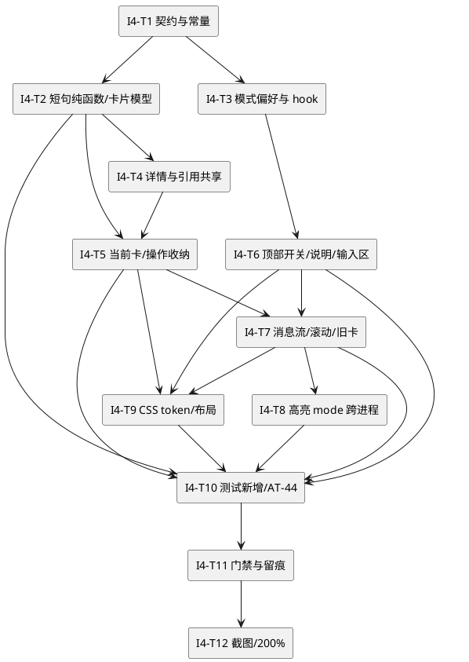

# EasyFlow 一句话当前步骤、操作收纳与长者关怀（第四轮）— 编码任务清单

**输入依据**

- `.codeartsdoer/specs/easyflow_page_guide/iteration4-spec.md`（R-01—R-63、T4-01—T4-16）
- `.codeartsdoer/specs/easyflow_page_guide/iteration4-design.md`（重点：1.2 存量分析、2.1 实现模型、2.2 接口 A—H、2.4 短句算法、2.5 详情/操作收纳、2.6 模式/token、2.7 布局与 200% 缩放、2.8 旧卡/成功页、2.10 测试、2.11 逐文件改动、2.13 风险、2.14 验证、2.15 截图、2.16 取舍）
- `.codeartsdoer/specs/easyflow_page_guide/iteration3-spec.md`、`iteration3-design.md`、`iteration3-tasks.md`
- `.codeartsdoer/specs/easyflow_page_guide/spec.md`、`design.md`、`tasks.md`、`iteration2-*`
- 现有实现：`src/sidepanel/**`、`src/content/**`、`src/shared/**`、`scripts/selftest.mjs`、`scripts/build.mjs`、`scripts/verify-manifest.mjs`、`public/manifest.json`、`package.json`

**阶段声明**

- 本文件只是第四轮**编码任务规划**，不包含任何实现，不修改源码。
- 编写本文件时**未执行** `npm run typecheck`、`npm run selftest`、`npm run build`、`npm run verify`，未创建 `codearts_proof/iteration4-*` 实绩日志。
- 实现阶段必须真实执行门禁并留痕；未在真实 Chrome 侧栏验证的项目一律写“**人工验收待用户执行**”，不得写“已通过”，不得宣称“长者实测通过”。
- 预约类验收只使用虚构 fixture 或用户已有只读页面，**不得提交新预约**。

---

## 0. 使用说明与全局约束

**0.1 基线事实（2026-11-14 只读核查）**

| 核查项 | 实测结果 | 对任务的要求 |
|---|---|---|
| 应用骨架 | `src/sidepanel/App.tsx:22-58`：`ChatHeader` → `.ef-mode-notice` 横幅 → `PageStatusLine` → 慢提示 → `main.ef-chat-main` → `ChatComposer` → `DiagnosticsPanel` | 模式开关进 header；规则说明移入消息区折叠；固定区不得锁死输入区 |
| 顶部区域 | `ChatHeader.tsx:1-16` 只有品牌与 `ef-mode-badge`，无 props | 改为受控组件，新增顶部开关 |
| 当前卡首行 | `StepCard.tsx:58` 直接渲染 `targetControl.label` | 首行改短句；原文进详情 |
| 完成条件 | `StepCard.tsx:59-61` 常显；`stepCardModel.ts:27-29` 对 `expired` 返回 `true` | 完成条件进详情；`expired` 收紧为不显示 |
| 动作平铺 | `StepCard.tsx:65-91` 并列 5 个按钮/链接；CSS `padding:5px 8px;font-size:11px` | 主区只留“指给我看”；其余 4 个动作进折叠区 |
| 当前卡指向 | `MessageList.tsx:48` `cardActive`；卡片源是消息自带 `targetControl` | 当前卡展示源改为 `currentStep(plan)` + 最新快照同 `ref` 控件 |
| 滚动 | `MessageList.tsx:113-117` 仅按 `messages.length` 滚到底 | 增加当前卡定向滚动，同一 id 只滚一次 |
| 输入区 | `ChatComposer.tsx:40-53` 禁用“语音未开放”按钮紧邻发送 | 删除死按钮；说明降级 |
| 诊断 | `DiagnosticsPanel.tsx:64-65` 原生 `<details>` 默认折叠；`68-74` 内联 `maxHeight:48vh`；`105-109` 内层滚动 | 保留默认折叠与内部滚动，改 CSS 变量 |
| 会话状态 | `conversationReducer.ts` 已有 `plan/pageSuccess/currentCardMessageId/snapshot`；`assistant-add` 更新当前卡 | 偏好不得进入 `ConversationState` |
| 定位链路 | `useConversation.ts:1092-1155` 预约先 recheck → reconcile → `highlight(ref)` | 短句不改 `ref`，不绕开定位链路 |
| 动态时段 | `stepPlanner.ts:186-297`、`534-593`、`595-600` | 短句只消费 `currentStep(plan)` 与最新快照 |
| 标签采集 | `content/controls.ts:118` 归一化后 `slice(0, 80)`，截断事实未记录 | 增加 `labelTruncated` 布尔；不扩上限 |
| 样式基座 | `sidepanel.css` body 13px、步骤按钮 11px、`--ef-muted #6b7280`、无 token、无 reduce 媒体查询 | 新增两套 token、焦点环、reduce 规则 |
| 布局 | `#root/.ef-chat-app { height:100vh;overflow:hidden }`；`.ef-app { min-height:100vh }`；composer/diagnostics `flex:none` | 改 `dvh`、去 `min-height:100vh`、固定区加上限 |
| 存储 | `shared/constants.ts:45` 仅 `easyflow.goal`；manifest 已含 `storage` | 新增独立键 `easyflow.ui.mode`，零权限变更 |
| 既有测试 | `selftest.mjs` AT-38（1241-1281）、AT-44（1428-1440）、AT-45（1456-1484）；AT-44 断言 `shouldShowCompletion("expired")===true` | 仅 AT-44 显式改一处，其余断言保留 |
| Fixture | `cal-booking-date.html`（完整英文日期 `aria-label`）、`cal-booking-time.html`（时刻与 disabled 时段） | 用于短句、原文、动态失效验收；不新增站点抓取 |

**0.2 全局硬约束（每个任务都必须遵守）**

1. **只改主工程**：只改 `D:\hwproject\translator`，不套用队友工程 `apps/extension`，不使用 `pnpm dev:web`。
2. **权限不变**：不新增 `permissions`/`host_permissions`/`content_scripts`，不新增麦克风、`tabs`、`<all_urls>`。
3. **只读边界**：不读取输入框值、下拉选中值、密码/隐藏字段；不点击、聚焦、填写、勾选、提交、导航、新开标签页；高亮只读。
4. **短句不定位**：短句只做展示；`ref`、`elementId`、`domPath`、`textHash` 不改写；主按钮始终按当前步骤真实 `ref` 定位。
5. **动态值单源**：短句中的时刻/日期/时区只能来自最新快照中的当前步骤控件或同页唯一 `selected` 日期；禁止写死、禁止跨快照缓存。
6. **偏好独立**：`uiMode` 不进入 `ConversationState`，不写入页面、不按域名拼接、不含 URL/标题/对话/正文。
7. **会话状态不变**：`conversationReducer.ts`、`GuidePlan`、`GuideStep`、`AssistantMessage` 既有语义不变；旧卡/成功页由既有字段派生。
8. **文案单点**：短句模板、通用回退句、完成条件文案、规则演示说明、语音状态说明各只有一处来源。
9. **每步可构建**：每个任务结束时 `npm run typecheck` 必须为 0 error；不得留下未接线的受控组件导致编译失败。
10. **如实留痕**：未执行的命令/人工验收必须单列；失败日志保留，不得手工编造；未在真实 Chrome 验证时写“人工验收待用户执行”。
11. **不提交预约**：预约验收只用虚构 fixture 或只读页面；不创建真实预约、不代填、不代选、不代提交。
12. **文档不改**：第一轮 `spec.md`/`design.md`/`tasks.md`、第二轮 `iteration2-*`、第三轮 `iteration3-*`、本轮 `iteration4-spec.md`/`iteration4-design.md` 均不修改。

**0.3 明确“不改文件”清单**

以下文件本轮**不得修改**：

- `src/content/collect.ts`、`src/content/semantic.ts`、`src/content/observe.ts`、`src/content/registry.ts`、`src/content/normalize.ts`：采集与语义段主链。
- `src/sidepanel/guide/stepPlanner.ts`：计划创建、重排、`currentStep` 不变。
- `src/sidepanel/guide/completion.ts`：完成条件判定不变。
- `src/sidepanel/guide/bookingSuccess.ts`：成功判定与完成回答不变。
- `src/sidepanel/dialogue/**`：`RuleEngine`、分类、检索、校验、模型均不改。
- `src/sidepanel/state/conversationReducer.ts`、`sessionReducer.ts`、`initialState.ts`：会话状态机不变。
- `src/sidepanel/hooks/usePageSession.ts`、`src/background/index.ts`、`injector.ts`、`tabContext.ts`：页面会话与后台装配不变。
- `src/shared/privacy/**`、`src/sidepanel/match/**`、`src/sidepanel/dialogue/model/**`：隐私与规则匹配不改。
- `public/manifest.json`、`scripts/build.mjs`、`scripts/verify-manifest.mjs`：权限与构建形态不变。
- 第一轮 `spec.md`、`design.md`、`tasks.md`；第二轮 `iteration2-*`；第三轮 `iteration3-*`；本轮 `iteration4-spec.md`、`iteration4-design.md`。

**允许新增/修改**：`src/shared/types.ts`、`src/shared/messages.ts`、`src/shared/constants.ts`、`src/shared/uiMode.ts`（新增）、`src/content/controls.ts`（仅截断事实）、`src/content/entry.ts`、`src/content/highlight.ts`、`src/background/router.ts`、`src/sidepanel/components/chat/stepCardCopy.ts`（新增）、`stepCardModel.ts`、`StepCard.tsx`、`StepDetails.tsx`（新增）、`ModeToggle.tsx`（新增）、`AboutPanel.tsx`（新增）、`ChatHeader.tsx`、`ChatComposer.tsx`、`MessageList.tsx`、`EvidencePanel.tsx`（抽 `CitationList`）、`DiagnosticsPanel.tsx`（仅内联样式/偏好诊断）、`App.tsx`、`main.tsx`、`src/sidepanel/hooks/useUiMode.ts`（新增）、`src/sidepanel/hooks/useConversation.ts`（仅 `uiMode` 透传）、`src/sidepanel/styles/sidepanel.css`、`public/sidepanel.html`、`scripts/selftest.mjs`、`codearts_proof/iteration4-*.log`、`codearts_proof/iteration4-sidebar-*.png`、`codearts_proof/23-iteration4-implementation.md`。

**0.4 任务编号与追溯约定**

- 本轮编码任务编号为 `I4-T1`—`I4-T12`；需求/设计阶段的取舍点仍写作 `T4-01`—`T4-16`，两者不混用。
- 测试用例编号沿用 `AT-xx`；本轮新增 `AT-46`—`AT-50`，仅调整 `AT-44` 一处断言。
- 每个任务的“完成标准”中的命令在**实现阶段**执行；本文件编写阶段不执行。
- 设计章节引用格式：`设计 2.4.2` 指 `iteration4-design.md` 的对应小节。

**0.5 执行顺序总览**

| 顺序 | 任务 | 标题 | 依赖 | 主要产物 | 构建检查点 |
|---|---|---|---|---|---|
| 1 | I4-T1 | 契约与命名常量落位 | 无 | `types.ts`、`messages.ts`、`constants.ts` | `typecheck` 0 error |
| 2 | I4-T2 | 短句纯函数与卡片模型（唯一文案来源） | I4-T1 | `stepCardCopy.ts`、`stepCardModel.ts`、`controls.ts` | `typecheck`；一次性 node 断言 |
| 3 | I4-T3 | 模式偏好纯函数与 `useUiMode` | I4-T1 | `shared/uiMode.ts`、`hooks/useUiMode.ts`、`main.tsx`、`sidepanel.html` | `typecheck`；纯函数断言 |
| 4 | I4-T4 | 详情折叠与引用列表共享 | I4-T2 | `StepDetails.tsx`、`EvidencePanel.tsx` | `typecheck`；AT-31/32 回归 |
| 5 | I4-T5 | 当前卡短句、唯一主按钮与操作收纳 | I4-T2、I4-T4 | `StepCard.tsx` | `typecheck`；AT-38/49 |
| 6 | I4-T6 | 顶部开关、说明折叠与输入区清理 | I4-T1、I4-T3 | `ModeToggle.tsx`、`AboutPanel.tsx`、`ChatHeader.tsx`、`ChatComposer.tsx`、`App.tsx`（header 部分） | `typecheck`；AT-50 静态断言 |
| 7 | I4-T7 | 消息流装配、当前卡滚动与旧卡/成功页 | I4-T2、I4-T4、I4-T5、I4-T6 | `MessageList.tsx`、`App.tsx` | `typecheck`；AT-38/49 |
| 8 | I4-T8 | 高亮模式跨进程传递与 content 稳态 | I4-T1、I4-T3、I4-T7 | `router.ts`、`entry.ts`、`highlight.ts`、`useConversation.ts`、`App.tsx` | `typecheck`；AT-37/50 |
| 9 | I4-T9 | 样式 token、布局、焦点与减少动态 | I4-T5、I4-T6、I4-T7 | `sidepanel.css` | `typecheck`；AT-50 |
| 10 | I4-T10 | 自动化测试新增与 AT-44 显式调整 | I4-T1—I4-T9 | `scripts/selftest.mjs` | `npm run selftest` |
| 11 | I4-T11 | 门禁执行、清洁检索与实现留痕 | I4-T10 | `codearts_proof/iteration4-*.log`、`23-iteration4-implementation.md` | 四命令全绿 |
| 12 | I4-T12 | 真实侧栏截图与 200% 人工验收（条件执行） | I4-T11 | 两张截图 + 测量表 | 人工验收或“待用户执行” |

**0.6 依赖图**

```text
I4-T1 ──> I4-T2 ──┬──> I4-T4 ──> I4-T5 ──┐
  │               │                       ├──> I4-T7 ──> I4-T8 ──┐
  ├──> I4-T3 ─────┴──> I4-T6 ─────────────┘                      │
  │                         │                                    ├──> I4-T10 ──> I4-T11 ──> I4-T12
  └─────────────────────────┴──> I4-T9 ──────────────────────────┘
```



**硬性顺序**

1. **I4-T1 必须最先**：类型/字段/常量是后续所有改动的编译基础；`CONTENT_VERSION` 升级与 `mode` 字段必须同时落位。
2. **I4-T2 先于 I4-T4/I4-T5**：短句、完成条件文案、卡片分组只有一处来源，避免组件层各写一套。
3. **I4-T3 先于 I4-T6**：`ModeToggle` 与 `App` 需要 `uiMode` 状态与存储时序。
4. **I4-T4 先于 I4-T5**：`StepCard` 当前卡必须嵌入 `StepDetails`；旧卡不渲染详情。
5. **I4-T5/I4-T6 先于 I4-T7**：`MessageList` 需要新的 `StepCard` props 与 header 装配后的 `App` 结构。
6. **I4-T7 先于 I4-T8**：`App` 已能传入 `uiMode` 后，`useConversation` 才能改为带参签名。
7. **I4-T9 在 I4-T5/I4-T6/I4-T7 之后**：CSS 选择器依赖新 DOM 类名；但不得等 I4-T8 才写 token，避免样式返工。
8. **I4-T10 在 I4-T9 之后**：新增测试同时校验纯函数与静态源码，必须等结构与样式稳定。
9. **I4-T11 在 I4-T10 之后**：先有全量自测结果，再执行四道门禁并留痕。
10. **I4-T12 在 I4-T11 之后**：只有构建产物存在，才能做真实侧栏截图与 200% 检查。

**0.7 阶段门禁与留痕**

| 时点 | 命令/检查 | 通过标准 | 留痕 |
|---|---|---|---|
| 每个任务结束 | `npm run typecheck` | 退出码 0，0 error | 可汇总到 `codearts_proof/iteration4-typecheck.log` |
| I4-T2、I4-T3、I4-T5、I4-T6、I4-T7、I4-T10 后 | 一次性 node 断言 / `npm run selftest` | 纯函数断言通过；既有用例不回退 | 可汇总到 `iteration4-selftest.log` |
| I4-T9、I4-T10 后 | `npm run build` | 退出码 0，`dist/` 产物与图标齐全 | `codearts_proof/iteration4-build.log` |
| I4-T11 | `npm run verify` | 退出码 0，权限仍为 `activeTab/scripting/sidePanel/storage` | `codearts_proof/iteration4-verify.log` |
| I4-T11 | 源码清洁检索 | 0 命中或逐处说明 | 日志内附命令与输出 |
| I4-T11 | 偏好存储只读核验 | 仅 `easyflow.goal` 与 `easyflow.ui.mode`；后者仅 `v/mode/updatedAt` | `23-iteration4-implementation.md` |
| I4-T12 | 真实侧栏截图 + 测量 | 两张约 400px 截图或“人工验收待用户执行” | 截图路径 + 测量表 |

> 门禁顺序固定为 `npm run typecheck` → `npm run selftest` → `npm run build` → `npm run verify`。`build` 内部虽含 typecheck 与 verify，仍要求四条命令分别留痕。

---

## 1. I4-T1 契约与命名常量落位

**编号与标题**：I4-T1 / 契约与命名常量落位。

**目标**：在不改变任何行为的前提下，先把本轮需要的可选字段、存储键、短句阈值与内容版本集中声明，保证后续任务可独立编译、可回滚。

**对应需求/设计条目**：R-03、R-07、R-30；设计 2.2.2 接口 A/G、2.6.2、2.9.1、2.11.1、2.11.2；T4-14、T4-16。

**涉及文件与函数/props/CSS 选择器**

- `src/shared/types.ts`：`PageControl` 增加 `labelTruncated?: boolean`（放在 `label` 附近，注释“仅表示控件标签被 `MAX_CONTROL_LABEL_CHARS` 截断；缺省视为 false”）。
- `src/shared/messages.ts`：`HighlightRequest`、`ContentHighlightRequest` 各增加 `mode?: "normal" | "care"`（用字面量，不 import `UiMode`，避免 `shared` 循环依赖）。
- `src/shared/constants.ts` 末尾增加：
  - `UI_MODE_STORAGE_KEY = "easyflow.ui.mode"`
  - `UI_MODE_SCHEMA_VERSION = 1`
  - `STEP_CARD_SHORT_MAX_WIDTH = 24`
  - `STEP_CARD_SHORT_NAME_MAX_CHARS = 12`
  - `CONTENT_VERSION` 由 `"0.2.0"` 改为 `"0.3.0"`（新增 `mode` 字段，需触发 content 重注入）。

**实现要点与前置依赖**

- [ ] 只新增可选字段与常量，不改任何函数体、不改 `manifest.json`、不改 reducer。
- [ ] `mode` 字段缺省语义为 `normal`；后台与 content 的校验保持宽松，旧版本忽略未知字段。
- [ ] `CONTENT_VERSION` 与 `mode` 字段必须同一任务落位，避免“新侧栏请求旧 content”造成高亮失败。
- [ ] 前置依赖：无；本任务是所有后续任务的第一块编译基础。

**明确不做事项**

- 不实现短句、不改 `StepCard`/`MessageList`/`App`。
- 不新增权限、不改 `MAX_CONTROL_LABEL_CHARS`（仍为 80）。
- 不引入新依赖、不修改 `package.json`。
- 不修改 `stepPlanner.ts`、`conversationReducer.ts`、`manifest.json`。

**完成标准与自验方式**

- [ ] `npm run typecheck` 退出码 0，0 error。
- [ ] 静态断言：`PageControl` 含 `labelTruncated?: boolean`；`HighlightRequest` 与 `ContentHighlightRequest` 含 `mode?: "normal" | "care"`；`CONTENT_VERSION === "0.3.0"`；`UI_MODE_STORAGE_KEY === "easyflow.ui.mode"`。
- [ ] `public/manifest.json` 权限仍为四项（本任务不跑 `verify`，I4-T11 复验）。
- [ ] 代码检索 `rg "easyflow\.ui\.mode" src/` 命中且仅在常量声明处；`rg "labelTruncated" src/shared/types.ts` 命中。

**风险与回滚点**

- **风险**：`CONTENT_VERSION` 升级触发所有已注入页面重注入，首次高亮可能多一次注入耗时。
- **回滚**：把 `CONTENT_VERSION` 改回 `"0.2.0"` 并移除 `mode` 字段即可恢复旧协议；新增可选字段本身无行为影响。

---

## 2. I4-T2 短句纯函数与卡片模型（唯一文案来源）

**编号与标题**：I4-T2 / 短句纯函数与卡片模型（唯一文案来源）。

**目标**：新增不依赖 React、不读页面、不写存储的短句生成模块，覆盖“模板 + 短名称 + 最短限定 + L0—L3 回退”；同时把卡片的主/次动作、详情可见性、完成条件口径收敛到 `stepCardModel.ts`，并记录控件标签截断事实。

**对应需求/设计条目**：R-01—R-05、R-09、R-10、R-16、R-57；设计 1.1.3（1）、2.2.2 接口 A/B/C、2.3.2、2.4.1—2.4.6、2.8.2；T4-01、T4-02、T4-14；C4-01、C4-03、C4-04。

**涉及文件与函数/props/CSS 选择器**

- 新增 `src/sidepanel/components/chat/stepCardCopy.ts`，导出：
  - 类型：`StepCardFallbackReason`、`StepCardCopyInput`、`StepCardCopy`。
  - 主函数：`buildStepCardCopy(input: StepCardCopyInput): StepCardCopy`。
  - 辅助：`completionTextOf(condition: CompletionCondition): string`、`extractTimeToken(label: string): string | null`、`extractDateToken(label: string, context: DateContext): string | null`、`extractTimeZoneToken(label: string): string | null`、`estimateCopyWidth(text: string): number`、`resolveCopySource(targetControl: TargetControl, snapshot: PageSnapshot | null): { control: TargetControl; source: "snapshot" | "step"; usable: boolean }`。
  - 常量：`TIME_TOKEN`、`DATE_TOKEN`、`TZ_TOKEN`、`TEMPLATE_*`、`GENERIC_FALLBACK_TEXT`、月份映射表；长度阈值复用 `STEP_CARD_SHORT_MAX_WIDTH`。
- 修改 `src/sidepanel/components/chat/stepCardModel.ts`：
  - 新增 `StepCardLayout`：`primary: "locate" | null`、`secondary: StepCardAction[]`、`showDetails: boolean`、`showStateText: boolean`。
  - 新增 `stepCardLayout(mode: StepCardMode): StepCardLayout`。
  - `shouldShowCompletion(mode)` 改为 `mode === "current"`（C4-01）。
  - `stepCardActions(mode)`、`resolveStepCardMode`、`stepCardLabel` 语义不变。
- 修改 `src/content/controls.ts` 的 `annotateControls`：
  - 先 `const rawName = normalizeWhitespace(item.accessibleName ?? item.text);`
  - `const label = rawName.slice(0, MAX_CONTROL_LABEL_CHARS);`
  - 新增 `labelTruncated: rawName.length > MAX_CONTROL_LABEL_CHARS`。
  - 分类、`ref`、`ambiguous` 逻辑不变。

**实现要点与前置依赖**

- [ ] **复制源优先级**：`activeStep = currentStep(plan)`；按 `ref.elementId` 在 `snapshot.controls` 中找同一控件；仅当 `visibility === "visible"`、`disabled !== true`、`label` 非空时 `source = "snapshot"`；命中但不可用 → `usable = false` + `fallbackReason = "stale-target"`；未命中 → `source = "step"` + `snapshot-mismatch`，且**不得输出时刻/日期限定**。
- [ ] **`targetRef` 原样**：`copy.targetRef` 直接引用 `targetControl.ref`，不得用快照控件的 `ref` 重建；`sourceSnapshotId` 等于最新快照 `snapshotId`，无快照时为空串。
- [ ] **时刻 token**：`TIME_TOKEN = /(?:[01]?\d|2[0-3]):[0-5]\d(?:\s*(?:am|pm|AM|PM))?/`，取第一个完整匹配并原样保留；不补零、不换算 12/24 制；时刻前 6 字符内的“上午/下午/凌晨/晚上”作为前缀保留。
- [ ] **日期 token**：支持 `2026-11-16`、`2026/11/16`、`11/16`、`11-16`、`11月16日`、`November 16`、`Nov 16`、`16 November`，规范为“11月16日”；纯日号仅在“同页存在唯一 `selected` 日期且可解析”或“同页日期月份唯一”时补月份，否则 `null`；同页日期跨年时保留年份。
- [ ] **时区 token**：识别 `GMT/UTC±n`、`GMT+8`、`UTC` 等；只用于限定，不做时区换算。
- [ ] **模板**：
  - `date`：`现在请选择 {date}`；无日期 token → L3。
  - `time`：L0 `现在请点网页上的 {time}`；有日期限定 `现在请点 {date} {time}`；L1 `请点 {time}`；L2 `请点 {date} {time}（{tz}）`。
  - `next`：`现在请点击网页上的 {name}`；名称为空或仅“下一步/继续/next/continue”时用“下一步按钮”措辞。
  - `generic`：`现在请在网页上选择{name}`；无可用名称 → `现在请在网页上选择对应项`。
- [ ] **歧义防护**：`pageDates` = 可见未禁用 `kind === "date"`；`selectedDate` = 其中 `selected === true`；`pageTimes` = 可见未禁用 `kind === "time"`；多日期且存在唯一 `selected` → 时刻前补该短日期；多日期无 `selected` → `ambiguous-date` + 通用句；多时区且当前标签含时区 → 追加该时区；多时区且当前标签无时区 → `ambiguous-timezone` + 通用句；同一时刻重复且无法用日期区分 → 通用句。
- [ ] **长度与回退**：`estimateCopyWidth` CJK/全角计 1、ASCII 计 0.6、取整；按 L0 → L1 → L2 → L3 降级；**歧义限定优先于字数**，不得为缩短删除日期/时区；L3 固定为 `现在请在网页上选择对应项`。
- [ ] **截断事实**：`labelTruncated === true` 时，仅当完整 token 位于已采集前缀内才使用；否则 `fallbackReason = "unparseable"`，主句不得出现残缺日期/时区；详情由 I4-T4 标注“原文已截断”。
- [ ] **异常安全**：整个 `buildStepCardCopy` 用 `try/catch` 包裹，任何异常 → L3 + `unparseable`，不向 UI 抛错。
- [ ] **完成条件文案**：把 `StepCard.tsx` 现有本地 `completionText` 逻辑迁入 `completionTextOf`，保持“完成条件：”由详情组件拼接；`user-confirmed` 文案仍为“完成后点‘我已完成’”。
- [ ] **前置依赖**：I4-T1 的 `labelTruncated` 字段、`STEP_CARD_SHORT_MAX_WIDTH`、`STEP_CARD_SHORT_NAME_MAX_CHARS` 已存在。

**明确不做事项**

- 不改 `StepCard.tsx`、`MessageList.tsx`、`App.tsx`（由 I4-T4/I4-T5/I4-T7 接线）。
- 不改 `controls.ts` 的 80 上限、不改 `classifyControlSemantic`、不改 `refOf`。
- 不写死 `02:15`/`02:00`/`03:00` 等演示时刻；不写站点域名、预约编号规则、站点选择器。
- 不读取 `ElementItem.text` 或页面标题拼短句；不新增网络、不新增页面采集。
- 不把 `StepCardCopy` 写入 `AssistantMessage` 或存储。

**完成标准与自验方式**

- [ ] `npm run typecheck` 退出码 0。
- [ ] 一次性 node 断言（esbuild 打包 `stepCardCopy.ts`，脚本放临时目录、不提交）覆盖：
  - 时刻目标 → `shortText` 含时刻 token、`includesTime === true`；
  - 完整英文日期标签 → `shortText` 不含整串、`rawLabel` 保留原文；
  - `targetRef` 与入参 `ref` 做 `deepEqual` 通过；`sourceSnapshotId` 等于快照 id；
  - `label "Select"` → 通用句 + `fallbackReason`；
  - `labelTruncated` → 不含日期/时区；
  - 多日期 + 唯一 `selected` → 含“11月16日”形态；多日期无 `selected` → 通用句；
  - `estimateCopyWidth(shortText) <= STEP_CARD_SHORT_MAX_WIDTH`。
- [ ] `rg "02:00|02:15|03:00" src/` 为 0 命中（AT-45 口径）。
- [ ] `stepCardLayout("current")` 返回 `primary === "locate"`、`secondary.length === 4`、`showDetails === true`；`expired/ended` 返回 `primary === null`、`secondary.length === 0`、`showDetails === false`、`showStateText === true`。
- [ ] `shouldShowCompletion("expired") === false`、`shouldShowCompletion("ended") === false`、`shouldShowCompletion("current") === true`。

**风险与回滚点**

- **风险 R4-01/R4-02**：页面标签格式特殊导致回退过多，或日期/时区限定误判。缓解：限定优先、无法消除即通用句；诊断记录 `fallbackReason`。
- **风险 R4-05**：`labelTruncated` 增加快照体积（每控件 1 布尔）。缓解：仅布尔、无原文副本；`MAX_CONTROLS` 预算不变。
- **回滚**：`StepCard` 首行改回 `targetControl.label`（保留折叠结构）；删除 `buildStepCardCopy` 调用即可退回旧展示；`shouldShowCompletion` 恢复 `mode !== "ended"` 会回退 R-57，不推荐。

---

## 3. I4-T3 模式偏好纯函数与 `useUiMode`

**编号与标题**：I4-T3 / 模式偏好纯函数与 `useUiMode`。

**目标**：新增仅依赖 `chrome.storage.local`（既有 `storage` 权限）的阅读模式偏好：默认 `normal`、保存后可读回、非法/异常回退 `normal`、写入失败不阻塞界面；首帧先以普通渲染，读取完成后最多切换一次。

**对应需求/设计条目**：R-28—R-36；设计 2.2.2 接口 D/E、2.3.2、2.6.1、2.6.2、2.9.1；T4-08、T4-09、T4-16；C4-07。

**涉及文件与函数/props/CSS 选择器**

- 新增 `src/shared/uiMode.ts`：
  - `type UiMode = "normal" | "care"`；`type UiModePrefIssue = "missing" | "invalid" | "read-failed" | "write-failed"`。
  - `interface StoredUiMode { v: 1; mode: UiMode; updatedAt: number }`。
  - `normalizeUiMode(value: unknown): UiMode`。
  - `parseStoredUiMode(value: unknown): { mode: UiMode; issue: UiModePrefIssue | null }`。
  - `serializeUiMode(mode: UiMode, now: number): StoredUiMode`。
- 新增 `src/sidepanel/hooks/useUiMode.ts`：
  - `interface UiModeController { uiMode: UiMode; modeReady: boolean; prefIssue: UiModePrefIssue | null; setMode(mode: UiMode): void; toggleMode(): void }`。
  - `export function useUiMode(): UiModeController`。
- 修改 `src/sidepanel/main.tsx`：`createRoot` 前设置 `document.documentElement.dataset.uiMode = "normal"`、`dataset.modeReady = "false"`。
- 修改 `public/sidepanel.html`：`<html lang="zh-CN" data-ui-mode="normal" data-mode-ready="false">`（与 `main.tsx` 双保险）。

**实现要点与前置依赖**

- [ ] **值域收紧**：仅 `normal`/`care` 合法；`undefined`/空串/`"huge"`/`{}`/`{v:2}`/缺字段 → `normal` + `invalid`（`undefined` 视为 `missing`）。
- [ ] **兼容读取**：`parseStoredUiMode` 兼容裸字符串 `"care"` 与版本对象 `{v:1, mode:"care"}`；`v !== 1` 保守回退 `normal` + `invalid`。
- [ ] **序列化最小化**：`serializeUiMode` 只输出 `{ v: 1, mode, updatedAt }`，禁止 URL/标题/对话/正文/快照字段。
- [ ] **读取时序**：挂载后一次 `chrome.storage.local.get(UI_MODE_STORAGE_KEY)`；`try/catch` → `normal` + `read-failed`；读取完成后设置 `dataset.uiMode` 与 `dataset.modeReady = "true"`。
- [ ] **切换时序**：`setMode` 先同步更新内存与 `dataset.uiMode`，再异步写入；写入失败仅置 `write-failed`，不撤销当前选择、不弹技术错误。
- [ ] **无副作用**：不 dispatch 任何 `ConversationAction`、不调用 `readPage`、不改变 `currentCardMessageId`、不进入 `ConversationState`。
- [ ] **不自动切换**：不根据设备、年龄、域名、系统字号自动选择模式；只由用户开关决定。
- [ ] **前置依赖**：I4-T1 的 `UI_MODE_STORAGE_KEY`、`UI_MODE_SCHEMA_VERSION` 已存在。

**明确不做事项**

- 不新增权限、不写 `easyflow.goal`、不按域名拼接键名。
- 不实现主题换肤、字号滑杆、跨设备同步、跟随系统高对比。
- 不在 hook 内读取页面内容、不发送对话请求。
- 不改 `conversationReducer.ts` 或 `initialState.ts`。

**完成标准与自验方式**

- [ ] `npm run typecheck` 退出码 0。
- [ ] 纯函数断言（一次性 node 脚本或 I4-T10 的 AT-46）：
  - `normalizeUiMode(undefined) === "normal"`；
  - `normalizeUiMode("care") === "care"`；
  - `normalizeUiMode("huge") === "normal"`；
  - `parseStoredUiMode("care").mode === "care"` 且 `issue === null`；
  - `parseStoredUiMode({v:2,mode:"care"}).issue === "invalid"`；
  - `JSON.stringify(serializeUiMode("care", 1))` 仅含 `v`、`mode`、`updatedAt` 三个键，且不含 `url/title/text/snapshot`。
- [ ] 源码静态断言：`useUiMode.ts` 含 `modeReady`、`read-failed`、`write-failed`；`main.tsx` 在 `createRoot` 前设置 dataset。
- [ ] `rg "easyflow\.goal" src/shared/uiMode.ts src/sidepanel/hooks/useUiMode.ts` 为 0 命中。

**风险与回滚点**

- **风险 R4-08**：读取慢导致首帧一次跳变。缓解：首帧 `normal` + `modeReady` 标记 + CSS 不对字号/尺寸设 transition。
- **风险**：写入失败后下次打开回退普通。缓解：仅诊断记录 issue，不阻塞当前会话。
- **回滚**：移除 `useUiMode` 调用与 `dataset.uiMode`，模式固定普通；偏好键可保留但不再读取。

---

## 4. I4-T4 详情折叠与引用列表共享

**编号与标题**：I4-T4 / 详情折叠与引用列表共享。

**目标**：为当前卡提供且只提供一个默认折叠的“详细信息 / 网页依据”，展示原始控件标签、截断标注、完成条件与引用；展开/收起不触发读取、不推进计划、不改变当前步骤。引用渲染与 `EvidencePanel` 共用同一套“已失效 / 在网页中查看”行为。

**对应需求/设计条目**：R-11—R-18；设计 2.5.1—2.5.4、2.2.2 接口 H；T4-03、T4-04。

**涉及文件与函数/props/CSS 选择器**

- 新增 `src/sidepanel/components/chat/StepDetails.tsx`：
  - props：`copy: StepCardCopy`、`completionCondition: CompletionCondition`、`citations: CitationAnchor[]`、`onCitation: (citation: CitationAnchor) => void`。
  - DOM：`<details className="ef-step-details">`、`<summary>详细信息 / 网页依据</summary>`、`div.ef-step-raw`、`div.ef-step-raw-truncated`、`div.ef-step-condition`、`ul.ef-step-citations`。
  - 原文：`copy.rawLabel`；`copy.labelTruncated === true` 时显示“原文已截断”。
  - 完成条件：`完成条件：{copy.completionText}`（兜底用 `completionTextOf`）。
  - 引用：复用 `CitationList`。
- 修改 `src/sidepanel/components/chat/EvidencePanel.tsx`：
  - 导出 `CitationList({ citations, onLocate })`，内部渲染 `.ef-citation`、`.ef-citation-text`、`.ef-citation-stale`“已失效”、`.ef-inline-link`“在网页中查看”。
  - `EvidencePanel` 内部改用它，保留 `<details className="ef-evidence">` 与 summary“网页依据（N 处）”。

**实现要点与前置依赖**

- [ ] 只使用原生 `<details>/<summary>`，不引入自定义折叠状态、不嵌套 `<details>`。
- [ ] 当前卡详情只包含：原始标签、截断标注、完成条件、必要引用；不得放整页正文、整段段落群。
- [ ] 详情不得出现 `elementId`、`domPath`、`score`、`role`、`tagName` 等技术字段；技术信息只允许在折叠运行诊断中。
- [ ] 展开/收起不调用回调、不 dispatch、不 `readPage`；内容由 props 派生，无内部 `useState`。
- [ ] 引用失效显示“已失效”，不渲染可点按钮；可定位时点击调用 `onCitation`，行为与 `EvidencePanel` 一致。
- [ ] 主句与详情同源：`copy.rawLabel` 与 `copy.shortText` 来自同一目标控件，保证 R-16。
- [ ] 前置依赖：I4-T2 的 `StepCardCopy`、`completionTextOf` 已存在。

**明确不做事项**

- 不把详情做成第二个“网页依据”入口；不拆成两个折叠入口（T4-03 默认）。
- 不在详情中展示技术字段、页面正文、完整 URL 查询串。
- 不改变 `EvidencePanel` 的文案与定位行为。
- 不因展开详情重新读取页面或追加消息。

**完成标准与自验方式**

- [ ] `npm run typecheck` 退出码 0。
- [ ] 源码静态断言：`StepDetails.tsx` 含 `ef-step-details`、`ef-step-raw`、`原文已截断`、`完成条件`；`EvidencePanel.tsx` 导出 `CitationList`。
- [ ] `rg "elementId|domPath|score" src/sidepanel/components/chat/StepDetails.tsx` 为 0 命中。
- [ ] AT-31/AT-32 回归：津贴问答仍走 `EvidencePanel`，折叠网页依据与“在网页中查看”行为不变。
- [ ] 手工/单测断言：展开前后 `messages.length`、`snapshotId`、当前步骤不变（由无副作用结构保证，I4-T10 可加静态断言）。

**风险与回滚点**

- **风险**：`EvidencePanel` 抽取 `CitationList` 影响 AT-31/32 的 DOM 结构断言。缓解：只抽渲染片段，不改文案与类名；先跑 AT-31/32。
- **风险**：详情内容过长挤压卡片。缓解：I4-T9 的 `max-height`/内部滚动与换行规则。
- **回滚**：保留 `EvidencePanel` 原实现，`StepDetails` 单独渲染引用；或把详情入口改回仅展示完成条件（不推荐）。

---

## 5. I4-T5 当前卡短句、唯一主按钮与操作收纳

**编号与标题**：I4-T5 / 当前卡短句、唯一主按钮与操作收纳。

**目标**：把当前步骤卡改造成“一句短句 + 唯一‘指给我看’ + 默认折叠详情 + 默认折叠更多操作”；旧卡只保留“已过期 / 已结束”状态行，不渲染旧目标、旧完成条件、详情和任何按钮。

**对应需求/设计条目**：R-06、R-08、R-11—R-21、R-27、R-56—R-63；设计 2.5.1、2.5.4、2.8.2、2.8.3；T4-05、T4-13；C4-05。

**涉及文件与函数/props/CSS 选择器**

- 修改 `src/sidepanel/components/chat/StepCard.tsx`：
  - props 扩展：`copy: StepCardCopy | null`、`citations: CitationAnchor[]`、`onCitation: (citation: CitationAnchor) => void`；保留 `targetControl`、`completionCondition`、`expired?`、`ended?`、`onLocate/onNotFound/onMisclicked/onDone/onSwitchTask`。
  - `const mode = resolveStepCardMode({ ended, expired }); const layout = stepCardLayout(mode);`
  - `current` 结构：
    - `<section className="ef-step-card ef-step-card-current" data-step-mode="current" aria-labelledby={shortId}>`
    - `<p id={shortId} className="ef-step-goal">{copy.shortText}</p>`
    - `<span className="ef-step-state">现在这一步</span>`（弱化小字/形状线索）
    - `<button type="button" className="ef-step-primary" onClick={() => onLocate(copy.targetRef)}>指给我看</button>`（主区唯一按钮）
    - `<StepDetails copy={copy} completionCondition={completionCondition} citations={citations} onCitation={onCitation} />`
    - `<details className="ef-step-more"><summary>遇到问题 / 更多操作</summary><div className="ef-step-more-actions">` 4 个 `button.ef-step-action`：我找不到 / 我点错了 / 我已完成 / 换一个任务。
  - `expired/ended` 结构：
    - `<div className={`ef-step-card ef-step-card-${mode}`} data-step-mode={mode}>`
    - `<div className="ef-step-label">{stepCardLabel(mode)}</div>`
    - `<p className="ef-step-history-hint">`：过期“页面已经变化，这一步已过期，请按上方最新指引操作。”；结束“这一步已结束，以网页显示为准。”
    - 不渲染 `targetControl.label`、`completionCondition`、`citations`、`StepDetails`、`ef-step-more`、任何 button。
  - 保留源码字符串“已过期”与 `expired`（AT-38 静态断言）。
  - `copy === null` 的 current 卡视为不可渲染当前态：安全降级为旧卡结构或返回 `null`，不得用 `targetControl.label` 拼短句。

**实现要点与前置依赖**

- [ ] 主区只保留一个 `.ef-step-primary`；4 个动作全部在 `.ef-step-more` 内，默认不可见。
- [ ] “我已完成”不在主区（T4-05 默认）；不新增“自动完成/一键提交”类按钮。
- [ ] 所有按钮 `type="button"`，回调沿用既有语义，不新增事件系统。
- [ ] `summary` 必须有可见文字；折叠区不依赖 CSS 隐藏来实现“无按钮”，旧卡从渲染条件上不生成 DOM。
- [ ] “现在这一步”只作为状态徽标，不作为主句前置文本；`aria-labelledby` 指向短句。
- [ ] 旧卡不显示“完成条件：”“详细信息 / 网页依据”“指给我看”“我已完成”等当前指令。
- [ ] 主按钮点击传 `copy.targetRef`，与 I4-T2 的 `targetRef` 同源；不得改传 `targetControl.ref` 之外的派生 ref。
- [ ] 前置依赖：I4-T2 的 `stepCardLayout`/`StepCardCopy`；I4-T4 的 `StepDetails`。

**明确不做事项**

- 不读页面、不发请求、不调用 `readPage`、不改变 `onLocate` 语义。
- 不把“我已完成”做成第二个主按钮；不新增“下一步/自动完成/一键提交”。
- 不在旧卡上保留旧时刻、旧完成条件、详情入口或折叠操作。
- 不删除“已过期”/“已结束”文字，不用纯颜色表达状态。

**完成标准与自验方式**

- [ ] `npm run typecheck` 退出码 0。
- [ ] 源码静态断言：`StepCard.tsx` 含 `ef-step-primary`、`ef-step-more`、`ef-step-details`、`已过期`、`expired`；`ef-step-primary` 只出现一次（主按钮）。
- [ ] 渲染结构断言（I4-T10 可加）：`current` 的 `ef-step-more-actions` 内恰好 4 个 `ef-step-action`；`expired/ended` 不含 `button`、`ef-step-details`、`ef-step-condition`。
- [ ] AT-38 回归：`MessageList.tsx` 仍含 `currentCardMessageId`/`planActive`，`StepCard.tsx` 仍含“已过期”/`expired`，`App.tsx` 仍含 `planActive`。
- [ ] AT-49 断言：`stepCardLayout("expired").primary === null`、`stepCardLayout("ended").secondary.length === 0`、`stepCardLayout("current").secondary.length === 4`。

**风险与回滚点**

- **风险 R4-05/C4-05**：旧卡信息过少，用户无法追溯。缓解：历史可追溯由助手消息正文承担（`replanNoticeText` 等）；旧卡只留状态行。
- **风险**：AT-38 的字符串断言因结构调整失效。缓解：在旧卡状态行保留“已过期”文字与 `expired` 变量名。
- **回滚**：`StepCard` 首行改回 `targetControl.label`，动作改回平铺；会违反 R-19/R-56，仅作紧急回退。

---

## 6. I4-T6 顶部开关、说明折叠与输入区清理

**编号与标题**：I4-T6 / 顶部开关、说明折叠与输入区清理。

**目标**：在侧栏顶部提供明确的“普通 / 长者关怀”开关；把“本地规则演示，未接入在线模型”从整条横幅降级到消息区末尾的默认折叠说明；移除输入区“语音未开放”死按钮，只保留不可点小字说明。

**对应需求/设计条目**：R-22—R-24、R-28、R-29；设计 2.5.1、2.6.1、2.11.1、2.11.2；T4-06、T4-07；C4-06。

**涉及文件与函数/props/CSS 选择器**

- 新增 `src/sidepanel/components/chat/ModeToggle.tsx`：
  - props：`{ uiMode: UiMode; modeReady: boolean; onToggle: () => void }`。
  - DOM：`button.ef-mode-toggle`，`role="switch"`、`aria-checked={uiMode === "care"}`、`aria-label="阅读模式：长者关怀"`；可见文字“长者关怀”、状态文字“已开启/已关闭”、滑块 `span.ef-mode-toggle-thumb`。
  - 键盘：原生 button 支持 Enter/Space；不拦截 Tab。
- 新增 `src/sidepanel/components/chat/AboutPanel.tsx`：
  - `<details className="ef-about">`、`<summary>说明</summary>`。
  - 内容：“本地规则演示，未接入在线模型。”；“语音暂未开放。”一行不可点小字；不渲染 button。
- 修改 `src/sidepanel/components/chat/ChatHeader.tsx`：
  - 改为受控组件，props 为 `{ uiMode, modeReady, onToggleMode }`。
  - 品牌区保留；右侧渲染 `<ModeToggle ... />`；移除 `ef-mode-badge`（“规则演示”说明移入 `AboutPanel`）；header 允许 `flex-wrap`。
- 修改 `src/sidepanel/components/chat/ChatComposer.tsx`：
  - 删除 `.ef-voice-btn` 与“语音未开放”按钮。
  - 保留 `textarea`、`ef-composer-hint`、`ef-send-btn`；hint 保留文案但由 CSS 弱化/窄栏隐藏；`textarea` 增加 `aria-describedby` 指向 hint。
- 修改 `src/sidepanel/App.tsx`（仅本任务范围）：
  - 引入 `useUiMode`；根 `div.ef-app` 增加 `data-ui-mode={uiMode}`。
  - 移除 `.ef-mode-notice` 横幅。
  - `<ChatHeader uiMode={uiMode} modeReady={modeReady} onToggleMode={toggleMode} />`。
  - `main.ef-chat-main` 内 `MessageList` 之后追加 `<AboutPanel />`。
  - 暂不改变 `useConversation()` 签名（I4-T8 再传 `uiMode`）；保留 `planActive` 表达式。

**实现要点与前置依赖**

- [ ] 开关必须有可见文字 + 状态文字 + 形状线索（滑块位置），不能只靠颜色区分（R-29）。
- [ ] `role="switch"` 与 `aria-checked` 成对；`aria-label` 可读；键盘可操作。
- [ ] 规则演示事实必须保留，但默认折叠、位于可滚动消息区，不占首屏固定高度。
- [ ] 语音状态说明只能作为不可点小字；不得出现在输入区首行、header 或主按钮旁。
- [ ] 发送逻辑、禁用条件、`onSend` 语义不变；不新增语音能力。
- [ ] 前置依赖：I4-T1 的常量；I4-T3 的 `useUiMode`。

**明确不做事项**

- 不删除“未接入在线模型”事实说明；不新增语音/麦克风按钮。
- 不把模式开关做成下拉菜单或设置页；不新增独立面板。
- 不改 `manifest.json` 权限；不跟随系统自动切换。
- 不改 `ChatComposer` 的发送、重试、输入长度逻辑。

**完成标准与自验方式**

- [ ] `npm run typecheck` 退出码 0。
- [ ] 源码静态断言：`ModeToggle.tsx` 含 `role="switch"`、`aria-checked`；`ChatComposer.tsx` 不含“语音未开放”按钮文案；`AboutPanel.tsx` 含“本地规则演示，未接入在线模型”“语音暂未开放”；`App.tsx` 不含 `ef-mode-notice`。
- [ ] `rg "ef-voice-btn" src/` 为 0 命中。
- [ ] AT-38 回归：`App.tsx` 仍含 `planActive`。
- [ ] 手工/静态断言：首屏 header 有模式开关，规则说明默认不可见；输入区首行只有 hint 与发送。

**风险与回滚点**

- **风险 R4-09**：移除语音按钮后用户找不到语音说明。缓解：`AboutPanel` 保留一行不可点说明；若用户要求彻底删除，只删一行文案。
- **风险**：规则说明默认折叠导致透明度下降。缓解：保留入口文字“说明”，需要时可展开。
- **回滚**：恢复 `.ef-mode-notice` 与 `.ef-voice-btn`；`ChatHeader` 改回无 props（会丢失模式开关，不推荐）。

---

## 7. I4-T7 消息流装配、当前卡滚动与旧卡/成功页

**编号与标题**：I4-T7 / 消息流装配、当前卡滚动与旧卡/成功页。

**目标**：让当前卡的展示源改为“`currentStep(plan)` + 最新 `snapshot` 中同 `ref` 控件”，当前卡变化时定向滚动到可视区；旧卡与成功页统一由 `resolveStepCardMode`/`stepCardLayout` 收口，成功页只强调完成状态。

**对应需求/设计条目**：R-03、R-10、R-25、R-26、R-56—R-63；设计 1.2.3、2.1.3（5）、2.5.4、2.8.1、2.8.3、2.12；T4-12、T4-13；C4-02。

**涉及文件与函数/props/CSS 选择器**

- 修改 `src/sidepanel/components/chat/MessageList.tsx`：
  - props 增加：`activeStep: GuideStep | null`、`snapshot: PageSnapshot | null`。
  - `AssistantBubble`：
    - 保留 `cardActive = planActive && message.messageId === currentCardMessageId`。
    - `const copy = cardActive && activeStep !== null ? buildStepCardCopy({ targetControl: activeStep.targetControl, snapshot, completionCondition: activeStep.completion }) : null;`
    - 当前卡：`targetControl={activeStep.targetControl}`、`completionCondition={activeStep.completion}`、`copy={copy}`、`citations={message.citations}`、`onCitation={onCitation}`。
    - 旧卡：`copy={null}`、`expired={!cardActive}`、`ended={bookingCompleted}`；仍保留 `targetControl`/`completionCondition` props 以满足类型，但 `StepCard` 在旧卡分支不读取它们。
  - 当前卡定向滚动：
    - `const currentCardRef = useRef<HTMLDivElement>(null);`
    - `const lastScrolledCardId = useRef<string | null>(null);`
    - `useEffect` 依赖 `currentCardMessageId`：当非空且与 `lastScrolledCardId.current` 不同，`currentCardRef.current?.scrollIntoView({ block: "nearest" })`，并记录 id。
    - 保留 `messages.length` 变化时 `endRef.scrollIntoView({ block: "end" })` 作为兜底；不监听滚动事件改变卡片状态。
- 修改 `src/sidepanel/App.tsx`：
  - `const activeStep = currentStep(state.plan);`
  - `<MessageList activeStep={activeStep} snapshot={state.snapshot} ... />`。
  - 保留 `planActive={state.plan?.status === "active"}`、`bookingCompleted={state.pageSuccess === "confirmed"}`。
  - 暂不传 `uiMode` 给 `useConversation`（I4-T8）。

**实现要点与前置依赖**

- [ ] 当前卡 `copy` 只来自 `activeStep` 与最新 `snapshot`；消息自带 `targetControl` 仅作旧卡占位，不再作为当前卡短句来源。
- [ ] `activeStep === null` 时当前卡不生成 `copy`，由 `StepCard` 安全降级；不得回退到 `message.targetControl.label` 拼短句。
- [ ] 旧卡不传 `copy`；旧卡不渲染目标、完成条件、详情、按钮（由 I4-T5 保证）。
- [ ] 成功态：`bookingCompleted === true` 时所有卡 `ended`；`currentCardMessageId` 已由 reducer 清空；不出现“指给我看”“下一步”。
- [ ] 滚动只针对当前卡，同一 `messageId` 只滚一次；不造成连续抖动；不因滚动改变 `expired`。
- [ ] 前置依赖：I4-T2（`buildStepCardCopy`）、I4-T4（`StepDetails`）、I4-T5（新 `StepCard` props）、I4-T6（`App` header 装配）。

**明确不做事项**

- 不改 `conversationReducer.ts`、不改 `currentCardMessageId` 语义、不新增消息类型。
- 不监听 `scroll` 事件改变卡片状态；不把当前卡固定在输入框上方（T4-12 默认）。
- 不删除历史消息、不把旧卡完全折叠成一行（T4-13 默认保留状态行）。
- 不在 `MessageList` 内生成文案模板或判断页面事实。

**完成标准与自验方式**

- [ ] `npm run typecheck` 退出码 0。
- [ ] 源码静态断言：`MessageList.tsx` 含 `currentCardMessageId`、`planActive`、`activeStep`、`snapshot`、`buildStepCardCopy`、`block: "nearest"`；`App.tsx` 含 `currentStep`、`planActive`。
- [ ] AT-38 回归：`currentCardMessageId` 在 `assistant-add` 后指向新消息，`plan-set` 非 active 清空；源码字符串断言保留。
- [ ] AT-49 断言：旧卡无 `primary/secondary/details`；成功态所有卡 `ended`。
- [ ] 手工/静态断言：连续两轮步骤后只有最后一张卡有 `ef-step-primary`；滚动到历史再滚回，当前卡仍可操作（不因滚动改变状态）。

**风险与回滚点**

- **风险 R4-03**：当前卡改用 `activeStep` 后与消息文本短暂不同步（重排追加消息前）。缓解：`replanned` 既有链路会追加新消息；`updated/unchanged` 只更新标签，文本仍成立。
- **风险**：定向滚动与 `messages.length` 兜底滚动叠加导致跳动。缓解：同一 id 只滚一次；`block:"nearest"`。
- **回滚**：`MessageList` 当前卡改回 `message.targetControl`；删除 `activeStep`/`snapshot` props（会回退 R-03/R-10，不推荐）。

---

## 8. I4-T8 高亮模式跨进程传递与 content 稳态

**编号与标题**：I4-T8 / 高亮模式跨进程传递与 content 稳态。

**目标**：把侧栏当前阅读模式通过既有 `EF_HIGHLIGHT` 请求传到 content；关怀模式与 `prefers-reduced-motion: reduce` 下只画稳态粗边框、不播放脉冲、不使用平滑滚动；普通模式保留既有 3 次/2—3 秒脉冲与 4 秒 TTL。

**对应需求/设计条目**：R-50—R-55；设计 2.2.2 接口 F/G、2.6.5、2.6.6、2.12；T4-11；D4-15。

**涉及文件与函数/props/CSS 选择器**

- 修改 `src/background/router.ts` 的 `handleHighlight`：仅当 `request.mode` 为 `"normal" | "care"` 时向 `MSG.CONTENT_HIGHLIGHT` 透传 `mode`；缺省/非法省略（视为 `normal`）。
- 修改 `src/content/entry.ts`：`highlightRef(request.ref, request.mode)`；`isContentRequest` 保持忽略未知字段（现状）。
- 修改 `src/content/highlight.ts`：
  - 新增常量：`HIGHLIGHT_CARE_BORDER_WIDTH = "4px"`（≥3px）、`HIGHLIGHT_CARE_BORDER`、`HIGHLIGHT_CARE_FILL`、`HIGHLIGHT_CARE_GLOW`。
  - `applyBoxStyle(box, care)`：`care` 使用粗边框、稳定半透明底色、静态外描边；`normal` 保持现有颜色。
  - `restartPulse(box, care)`：`care === true` 或 `prefersReducedMotion()` 时直接 `return`，不调用 `box.animate`。
  - `highlightRef(ref: ElementRef, mode: "normal" | "care" = "normal"): HighlightResult`；`scrollIntoView` 在 `care` 或 reduce 下用 `behavior: "auto"`。
  - 保留 `pointer-events: none`、Shadow DOM、Range `getClientRects()` 逐行、`HIGHLIGHT_TTL_MS` 自动清除、折叠/失效降级。
- 修改 `src/sidepanel/hooks/useConversation.ts`：
  - `export function useConversation(uiMode: UiMode)`；新增 `uiModeRef`，在 `uiMode` 变化时同步。
  - `highlight(ref)` 发送 `{ type: MSG.HIGHLIGHT, tabId, ref, mode: uiModeRef.current }`。
  - `locateControl`、`locateCitation`、`send/retry/markDone/notFound/misclicked/switchTask` 的签名与语义不变。
- 修改 `src/sidepanel/App.tsx`：`useConversation(uiMode)`。

**实现要点与前置依赖**

- [ ] `mode` 字段可选，旧 content 忽略未知字段仍可高亮；`CONTENT_VERSION` 已在 I4-T1 升到 `0.3.0` 触发重注入。
- [ ] 关怀模式不脉冲、不闪烁；稳态边框 + 半透明底色 + 静态外描边，文字始终可读。
- [ ] 普通模式脉冲次数仍为 `HIGHLIGHT_PULSE_COUNT = 3`、单次 `750ms`、总时长 2—3 秒；结束后静态至 4 秒 TTL。
- [ ] reduce 下两种模式都不播放动画；CSS 侧装饰动画由 I4-T9 关闭。
- [ ] 高亮层不拦截鼠标、不修改页面节点；短标题只框文字范围，不回退整行容器。
- [ ] 前置依赖：I4-T1（`mode` 字段、`CONTENT_VERSION`）、I4-T3（`uiMode`）、I4-T7（`App` 可传入 `uiMode`）。

**明确不做事项**

- 不改定位链路（recheck → reconcile → highlight）、不改 TTL、不改 Range 逐行算法。
- 不改页面 DOM/样式、不注入共享 CSS、不新增权限。
- 不读取侧栏 CSS 来决定高亮模式；模式只来自请求参数。
- 不把关怀模式做成“永久高亮”；仍按 TTL 清除。

**完成标准与自验方式**

- [ ] `npm run typecheck` 退出码 0。
- [ ] 源码静态断言：`messages.ts` 的 `HighlightRequest`/`ContentHighlightRequest` 含 `mode`；`router.ts` 透传 `mode`；`highlight.ts` 含 `HIGHLIGHT_CARE_BORDER_WIDTH`、`highlightRef` 第二参数、`prefersReducedMotion`；`useConversation.ts` 含 `uiModeRef` 与 `mode: uiModeRef.current`。
- [ ] AT-37 回归：动态时段重排逻辑不变。
- [ ] AT-50 静态断言：`HighlightRequest` 含 `mode?`；`highlight.ts` 含 care 常量。
- [ ] 手工验收（I4-T12）：普通模式脉冲 3 次；关怀模式无脉冲；reduce 下无动画；TTL 后覆盖层消失。

**风险与回滚点**

- **风险 R4-07**：旧 content 未重注入时可能拒绝/忽略 `mode`。缓解：字段可选、版本升级触发重注入；最坏回退普通脉冲。
- **风险**：care 下静态高亮不够醒目。缓解：4px 边框 + 静态外描边 + 半透明底色；灰度可辨。
- **回滚**：后台不再透传 `mode`，高亮退回普通脉冲；或 `highlightRef` 忽略第二参数。

---

## 9. I4-T9 样式 token、布局、焦点与减少动态

**编号与标题**：I4-T9 / 样式 token、布局、焦点与减少动态。

**目标**：用同一组 token 驱动普通/关怀两套呈现；关怀模式正文 ≥18px、当前步骤 ≥22px、主按钮 ≥48px、可点目标 ≥44px、正文对比度 ≥4.5:1；窄栏与 200% 缩放下纵向可滚动、输入区可达、无横向裁切；reduce 下关闭侧栏动画与过渡。

**对应需求/设计条目**：R-37—R-49、R-52；设计 2.6.3—2.6.5、2.7.1—2.7.3；T4-10、T4-11。

**涉及文件与函数/props/CSS 选择器**

- 修改 `src/sidepanel/styles/sidepanel.css`：
  - 新增 `:root` token 与 `html[data-ui-mode="care"]` 覆盖：
    - 普通：`--ef-font-title:17px; --ef-font-body:13px; --ef-font-current:15px; --ef-font-small:11px; --ef-line-body:1.55; --ef-space-1:4px; --ef-space-2:6px; --ef-space-3:8px; --ef-space-4:12px; --ef-tap-min:28px; --ef-primary-min-h:32px; --ef-focus-width:2px; --ef-step-border-width:1px; --ef-muted:#4b5563; --ef-faint:#4b5563; --ef-step-ink:#1f2340; --ef-step-accent:#312e81; --ef-step-surface:#f7f8ff; --ef-step-surface-expired:#f3f4f6; --ef-focus:#1d4ed8; --ef-diag-max-h:42vh;`
    - 关怀：`--ef-font-title:22px; --ef-font-body:18px; --ef-font-current:22px; --ef-font-small:14px; --ef-line-body:1.6; --ef-space-3:10px; --ef-space-4:16px; --ef-tap-min:44px; --ef-primary-min-h:48px; --ef-focus-width:3px; --ef-step-border-width:2px; --ef-muted:#374151; --ef-faint:#374151; --ef-step-ink:#111827; --ef-step-accent:#1e1b4b; --ef-step-surface:#eef2ff; --ef-step-surface-expired:#e5e7eb; --ef-focus:#1e40af; --ef-diag-max-h:36vh;`
  - 选择器映射：
    - `body`、`.ef-bubble`、`.ef-assistant-text`、`.ef-citation-text`、`.ef-step-condition` → `var(--ef-font-body)`；
    - `.ef-step-goal` → `var(--ef-font-current)`；
    - `.ef-step-primary`、`.ef-send-btn` → `min-height: var(--ef-primary-min-h)`；
    - `.ef-step-action`、`.ef-mode-toggle`、`summary`、`.ef-inline-link` → `min-height: var(--ef-tap-min)`（链接用内边距扩展热区）；
    - `.ef-composer-input` → `var(--ef-font-body)`，普通 ≥32px、关怀 ≥44px；
    - `.ef-diagnostics`、`.ef-about` → `var(--ef-font-small)`；
    - `.ef-step-card-current` → 1px/2px 实线 + 左侧 4px/6px 强调条 + 浅底；
    - `.ef-step-card-expired`/`.ef-step-card-ended` → 1px/2px 虚线 + 灰底 + 深灰字；
    - `:focus-visible` → `outline: var(--ef-focus-width) solid var(--ef-focus); outline-offset: 2px`。
  - 新增类：
    - `.ef-mode-toggle`、`.ef-mode-toggle-track`、`.ef-mode-toggle-thumb`、`.ef-mode-toggle-state`；
    - `.ef-step-details`、`.ef-step-details > summary`、`.ef-step-raw`、`.ef-step-raw-truncated`、`.ef-step-citations`；
    - `.ef-step-more`、`.ef-step-more > summary`、`.ef-step-more-actions`；
    - `.ef-step-history-hint`、`.ef-about`、`.ef-sr-only`。
  - 移除 `.ef-voice-btn`、`.ef-mode-notice`。
  - 布局：
    - `#root`/`.ef-chat-app`：`height:100vh; height:100dvh; min-height:0; overflow:hidden`；
    - `.ef-app`：`min-height:0`（移除 `100vh`）；
    - `.ef-header`：`flex:none; flex-wrap:wrap; min-width:0`；
    - `.ef-page-status`/`.ef-slow-hint`：`flex:none`，文字可换行；
    - `.ef-chat-main`：保留 `flex:1; min-height:0; overflow-y:auto`，加 `overscroll-behavior:contain`；
    - `.ef-composer`：`flex:none; max-height:40vh; overflow-y:auto`；
    - `.ef-diagnostics`：`flex:none; max-height:var(--ef-diag-max-h)`，内部滚动；
    - `.ef-about` 位于 `.ef-chat-main` 内，不占固定高度。
  - 断点：
    - `@media (max-width:420px)`：header 品牌与开关分行；`.ef-step-actions`/`.ef-step-more-actions` 单列；`.ef-composer-row` 允许换行；
    - `@media (max-width:320px)`：header 竖排、模式开关全宽；隐藏 `.ef-composer-hint`、`.ef-message-role` 等非关键小字（不隐藏功能按钮）；短句与按钮换行；
    - `@media (max-height:520px)`：`--ef-diag-max-h:32vh`。
  - `@media (prefers-reduced-motion: reduce)`：关闭 `.ef-skeleton` 动画、关闭 `.ef-app` 作用域内 `transition`。
  - 文本：`overflow-wrap:anywhere`；按钮 `white-space:normal`；禁止 `nowrap + ellipsis` 裁关键文字。
- 修改 `DiagnosticsPanel.tsx` 的内联样式：`maxHeight:"48vh"` 改为 CSS 变量 `--ef-diag-max-h`（通过类名/CSS 驱动）；保留内层 `overflowY:auto`、`tabIndex=0`、`aria-label`。

**实现要点与前置依赖**

- [ ] 两套模式由同一组 token 驱动，不各写一套零散覆盖；字号/尺寸/颜色不散落魔法数。
- [ ] 关怀模式正文 18px、当前步骤 22px、主按钮 48px、可点目标 44×44；按钮文字可换行，不缩小字号。
- [ ] 对比度：`--ef-muted`/`--ef-faint` 使用 `#4b5563`（普通）与 `#374151`（关怀）；主按钮白字 `#4f46e5`；未复测前不得写“已通过”。
- [ ] 200% 缩放下无横向滚动；当前卡、输入框、发送、详情、更多操作、诊断均可达；诊断内部滚动不撑高整页。
- [ ] reduce 下无 shimmer、无过渡、无脉冲；静态高亮仍清晰。
- [ ] 前置依赖：I4-T5/I4-T6/I4-T7 的新 DOM 类名已存在。

**明确不做事项**

- 不改第三方页面样式、不新增主题/换肤、不做字号滑杆。
- 不隐藏功能按钮换取布局；不用固定像素高度锁死内容区。
- 不把 `.ef-step-*` 既有类名整体重命名；只扩展。
- 不在 CSS 中写站点专用选择器。

**完成标准与自验方式**

- [ ] `npm run typecheck` 退出码 0。
- [ ] 静态断言：CSS 含 `html[data-ui-mode="care"]`、`--ef-font-body: 18px`、`--ef-font-current: 22px`、`--ef-primary-min-h: 48px`、`--ef-tap-min: 44px`、`prefers-reduced-motion: reduce`、`max-height: 40vh`、`100dvh`、`:focus-visible`。
- [ ] `rg "ef-voice-btn|ef-mode-notice" src/sidepanel/styles/sidepanel.css` 为 0 命中。
- [ ] AT-50 静态断言通过。
- [ ] I4-T12 人工验收：两张截图测量值满足 18/22/48/44 与对比度 ≥4.5:1；200% 缩放无横向滚动、输入区可达。

**风险与回滚点**

- **风险 R4-06**：关怀大字号导致按钮换行过高/布局溢出。缓解：允许增高/换行、窄宽单列、固定区上限、200% 验收。
- **风险**：`100dvh` 旧 Chrome 兼容。缓解：双写 `height:100vh; height:100dvh`。
- **回滚**：移除 `html[data-ui-mode]` token 段与 `data-ui-mode` 属性，尺寸回到固定 13/11px；布局改动可单独保留。

---

## 10. I4-T10 自动化测试新增与 AT-44 显式调整

**编号与标题**：I4-T10 / 自动化测试新增与 AT-44 显式调整。

**目标**：为短句、偏好、旧卡/成功态、样式 token 与源码清洁建立可执行断言；仅显式调整 AT-44 中 `shouldShowCompletion("expired")` 一处口径，其余断言与既有回归红线全部保留。

**对应需求/设计条目**：设计 2.10.1—2.10.4、2.14；spec 7.5；R-01—R-63 的测试证据；C4-01。

**涉及文件与函数/props/CSS 选择器**

- 修改 `scripts/selftest.mjs`：
  - `stdin.contents` 追加三行导出（保持既有导出行不变）：
    - `export { buildStepCardCopy, completionTextOf, extractTimeToken, extractDateToken, extractTimeZoneToken, estimateCopyWidth, resolveCopySource } from "./src/sidepanel/components/chat/stepCardCopy.ts";`
    - `export { stepCardLayout } from "./src/sidepanel/components/chat/stepCardModel.ts";`
    - `export { normalizeUiMode, parseStoredUiMode, serializeUiMode } from "./src/shared/uiMode.ts";`
  - AT-44（约 1428-1440）：
    - 仅把 `assert.equal(ef.shouldShowCompletion("expired"), true)` 改为 `false`，并在用例内注释 `// 第四轮 R-57：过期卡不展示旧完成条件（由 true 收紧为 false）`。
    - 新增 `stepCardLayout` 断言：`stepCardLayout("expired").primary === null`、`stepCardLayout("ended").secondary.length === 0`、`stepCardLayout("current").primary === "locate"`、`stepCardLayout("current").secondary.length === 4`、`stepCardLayout("current").showDetails === true`。
    - 其余断言（`ended` 无动作、`current` 5 个动作、三档 label、mode 优先级）全部保留，不放宽、不删除。
  - 文件末尾新增 AT-46—AT-50（见下）。

**测试用例矩阵**

| 编号 | 用例 | 必需断言 | 覆盖需求 |
|---|---|---|---|
| AT-46 | 阅读模式偏好：默认/保存/非法/序列化 | `normalizeUiMode(undefined)==="normal"`；`"care"` 读回 `care`；`"huge"`/`{}`/`{v:2}` → `normal` + `invalid`；`serializeUiMode` 仅 `v/mode/updatedAt`，序列化字符串不含 `url/title/text/snapshot`；不加载 `chrome` API | R-28—R-36、6.3、4.3.2 |
| AT-47 | 短句与原文分层（Cal fixture 控件） | 时刻目标 → `shortText` 含时刻 token、`includesTime === true`；`shortText` 不含完整英文日期整串；`rawLabel` 保留原文；`deepEqual(copy.targetRef, targetControl.ref)`；`sourceSnapshotId === snapshot.snapshotId` | R-01—R-07、R-11—R-16 |
| AT-48 | 短句回退、多日期/多时区歧义与最长限定 | `label "Select"` → 通用句 + `fallbackReason`；`labelTruncated` → 不含日期/时区；多日期 + 唯一 `selected` → 含“11月16日”形态限定；多日期无 `selected` → 通用句；多时区且当前标签含时区 → 保留该时区限定（L2 不删限定）；多时区且当前标签无时区 → 通用句；`estimateCopyWidth(shortText) <= 24` | R-05、R-09、R-10、6.1 |
| AT-49 | 旧卡/成功态渲染决策 | `shouldShowCompletion("expired") === false`；`stepCardLayout("expired")/("ended")` 无 primary/secondary/details；`stepCardLayout("current")` 主 1 次 4；`stepCardActions("current").length === 5` 保留 | R-56—R-63 |
| AT-50 | 样式 token/源码清洁静态断言 | `sidepanel.css` 含 `data-ui-mode="care"`、`--ef-font-body: 18px`、`--ef-font-current: 22px`、`--ef-primary-min-h: 48px`、`--ef-tap-min: 44px`、`prefers-reduced-motion`；`ChatComposer.tsx` 不含“语音未开放”按钮文案（允许 `AboutPanel` 说明）；`HighlightRequest` 含 `mode?`；`src/**` 仍无测试时刻字面量 | R-37—R-55、4.1、4.4 |

**实现要点与前置依赖**

- [ ] 测试侧可使用测试时刻常量（`scripts/` 不在 `src/**` 扫描范围）；生产代码 `src/**` 仍不得出现 `02:00|02:15|03:00`。
- [ ] 复用既有 `makeItem`/`makePageSnapshot`/`makeControl` 构造器，新增 `makeCopyTarget` 辅助；不复制一套 fixture 结构。
- [ ] 只断言“结构关系”与“字段存在”，不对整句文案逐字断言（通用回退句这类固定事实除外）。
- [ ] 回归红线必须保持：AT-31/32（津贴问答与多轮）、AT-33（Cal 日历语义与 fixture）、AT-36/39—45（成功页与完成回答）、AT-37/38（动态时段与当前卡唯一）。
- [ ] 前置依赖：I4-T1—I4-T9 全部完成；`StepCard`/`MessageList` 结构已稳定。

**明确不做事项**

- 不删除既有用例、不放宽误报防护断言、不修改 AT-38 的静态字符串断言。
- 不在 `src/**` 写测试时刻/真实域名/邮箱样式；不使用真实站点 fixture。
- 不对整句短句做脆弱逐字断言（除固定通用句）。
- 不加载 `chrome` API 做偏好测试；偏好纯函数在 `shared/uiMode.ts` 完成。

**完成标准与自验方式**

- [ ] `npm run selftest` 退出码 0；AT-01—AT-50 全部通过（含 AT-46—AT-50）。
- [ ] 既有 AT-31/32、AT-33、AT-36/39—45、AT-37/38 全部保持，无删除、无放宽。
- [ ] AT-44 仅一处断言调整；其余断言（含 `ended` 无动作、`current` 5 个动作、三档 label、mode 优先级）全部保留，不删除、不放宽；用例内注释存在。
- [ ] 日志写入 `codearts_proof/iteration4-selftest.log`（I4-T11 汇总）。

**风险与回滚点**

- **风险 R4-04**：AT-44 口径调整被误读为“放宽测试”。缓解：用例内注释 + 设计/任务文档显式记录；保留其余断言；新增 `stepCardLayout` 断言。
- **风险**：文案/结构断言脆弱。缓解：只断言字段关系与固定通用句；不逐字断言模板句。
- **回滚**：只回退新增 AT-46—AT-50；AT-44 调整若回退需恢复 `true`，但会违反 R-57，不推荐。

---

## 11. I4-T11 门禁执行、清洁检索与实现留痕

**编号与标题**：I4-T11 / 门禁执行、清洁检索与实现留痕。

**目标**：按固定顺序真实执行四道门禁，保留原始日志；完成源码/偏好/fixture 清洁检索，形成可追溯的实现记录。

**对应需求/设计条目**：spec 7.5—7.7、4.3；设计 2.14；R-30、4.4.4。

**涉及文件与产物**

- `codearts_proof/iteration4-typecheck.log`
- `codearts_proof/iteration4-selftest.log`
- `codearts_proof/iteration4-build.log`
- `codearts_proof/iteration4-verify.log`
- `codearts_proof/23-iteration4-implementation.md`
- 可选清洁检索日志：`iteration4-clean-clock.log`、`iteration4-clean-domain.log`、`iteration4-clean-email.log`、`iteration4-clean-fixture.log`、`iteration4-clean-manifest.log`。

**实现要点与前置依赖**

- [ ] 严格按 `npm run typecheck` → `npm run selftest` → `npm run build` → `npm run verify` 顺序执行；每条命令单独重定向输出到对应日志。
- [ ] 源码清洁检索：
  - `rg "02:00|02:15|03:00" src/` → 0 命中；
  - `rg "cal\.com|calendar\.google\.com|outlook\.com|teams\.microsoft\.com" src/` → 0 命中；
  - 邮箱样式正则 → 0 命中；
  - fixture 只含 `.test` 域名/虚构编号/虚构邮箱。
- [ ] 偏好存储只读核验：`chrome.storage.local` 仅含 `easyflow.goal` 与 `easyflow.ui.mode`；后者仅 `v/mode/updatedAt`，不含 URL/标题/对话/正文。
- [ ] `verify-manifest` 权限仍为 `activeTab/scripting/sidePanel/storage`，`content_scripts` 不变。
- [ ] 留痕文档写入：修改文件清单、命令与结果、失败/修复过程、待验清单。
- [ ] 前置依赖：I4-T10 自测通过。

**明确不做事项**

- 不伪造日志、不只写“已检查”、不跳过失败命令。
- 不通过修改 `build.mjs`/`verify-manifest.mjs` 绕过校验。
- 不新增权限、不改 `manifest.json`。
- 不把 fixture 通过写成“真实页已通过”。

**完成标准与自验方式**

- [ ] 四条命令退出码均为 0；日志文件存在且含真实输出。
- [ ] `typecheck` 0 error；`selftest` AT-01—AT-50 全通过；`build` 产物与图标齐全；`verify` 权限四项。
- [ ] 清洁检索 0 命中（或逐处说明且不影响门禁）。
- [ ] `23-iteration4-implementation.md` 含“fixture/自测通过”与“真实页待验/人工验收待用户执行”的区分。

**风险与回滚点**

- **风险**：构建失败/自测回归。缓解：保留失败日志，按失败用例修复后重跑，保留前后两份日志。
- **风险**：清洁检索命中旧代码。缓解：逐处定位；若为测试侧（`scripts/`）则说明不在 `src/**` 扫描范围。
- **回滚**：按最近一次全绿日志的提交状态回退；不删除失败日志。

---

## 12. I4-T12 真实侧栏截图与 200% 人工验收（条件执行）

**编号与标题**：I4-T12 / 真实侧栏截图与 200% 人工验收（条件执行）。

**目标**：在真实 Chrome 侧栏（约 400px 宽）取得普通/关怀两张截图并记录测量值；在 200% 缩放下逐项检查当前卡、输入框、发送、折叠区与诊断可达。无法本机执行时，明确标注“人工验收待用户执行”，不得伪造。

**对应需求/设计条目**：spec 7.3—7.4、6.6；设计 2.15.1—2.15.4；T4-15。

**涉及对象与边界**

- 真实 Chrome 侧栏（主工程 `dist/` 构建产物）；不使用合成页面截图冒充。
- 场景：政府津贴问答（只读页面/fixture）+ Cal.com 日期→时段（fixture 或只读页面）。
- 截图路径：`codearts_proof/iteration4-sidebar-normal.png`、`codearts_proof/iteration4-sidebar-care.png`。
- 记录文档：`codearts_proof/23-iteration4-implementation.md`。
- **不提交新预约**；不填写/提交真实表单；不读取输入框值。

**验收步骤与测量表**

- [ ] 普通模式截图：短句、唯一“指给我看”、折叠“详细信息 / 网页依据”、折叠“遇到问题 / 更多操作”、弱化“说明”、默认折叠诊断。
- [ ] 关怀模式截图：同样要素，字号与按钮明显更大。
- [ ] 测量并记录：
  - 正文计算字号：普通 ≥13px、关怀 ≥18px；
  - 当前步骤字号：普通 ≥15px、关怀 ≥22px；
  - 主按钮高度：关怀 ≥48px；
  - 可点目标：关怀 ≥44×44（4 个动作、summary、开关）；
  - 正文/按钮对比度：≥4.5:1（大字号 ≥3:1）；
  - 脉冲：普通 3 次、总时长 2—3 秒、静态保留至 TTL；关怀无脉冲；
  - reduce：两种模式均无动画；
  - 200% 缩放：无横向滚动；当前卡/输入框/发送/详情/更多操作/诊断均可达；诊断内部可滚到底；收起后输入区仍可见。
- [ ] 若无法本机完成真实 Chrome 截图或测量：在留痕中写“**人工验收待用户执行**”，列出待办项（截图、字号、对比度、200% 缩放、脉冲观感）；不得写“已通过”或“长者实测通过”。
- [ ] 截图若含个人信息，先遮蔽；只记录页面类型与模式，不记录完整 URL。

**明确不做事项**

- 不伪造截图、不用合成页面冒充真实侧栏、不宣称长者实测通过。
- 不创建真实预约、不提交表单、不读取输入框值。
- 不改 `manifest.json`/构建脚本以方便截图。
- 不把“fixture 通过”写成“真实页通过”。

**完成标准与自验方式**

- [ ] 两张截图存在且文件名可区分模式；或留痕明确“人工验收待用户执行”。
- [ ] 测量表逐项有值或标注“待用户执行”；数值与 token 预期一致（未复测不得写达标）。
- [ ] 200% 缩放检查结果记录；任一不可达项必须列为风险，不得判“通过”。
- [ ] 留痕包含“fixture/自测通过”与“真实页待验”的区分。

**风险与回滚点**

- **风险 R4-10**：无法本机执行真实 Chrome 截图。缓解：明确待验，不伪造；由用户提供截图与测量值。
- **风险**：截图含个人信息。缓解：先遮蔽；只记录页面类型与模式。
- **回滚**：无需代码回滚；本任务只产生留痕，不改变实现。

---

## 13. 需求到任务追踪矩阵（R-01—R-63）

| 需求 | 主责任务 | 证据/验收 |
|---|---|---|
| R-01 首行短句 | I4-T2、I4-T5 | AT-47；Cal 日期步骤 |
| R-02 短名称 | I4-T2、I4-T5 | AT-47；时段步骤 |
| R-03 动态时刻只来自最新快照 | I4-T2、I4-T7 | AT-47/48；AT-37 回归 |
| R-04 短名称与原文分层 | I4-T2、I4-T4 | AT-47（`rawLabel`） |
| R-05 歧义防护 | I4-T2 | AT-48；多日期/多时区 |
| R-06 唯一主操作 | I4-T5 | AT-49；截图 |
| R-07 `ref` 不改写 | I4-T2、I4-T5 | AT-47 深比较 |
| R-08 一次一个下一步 | I4-T2、I4-T7 | AT-38 回归 |
| R-09 短句回退 | I4-T2 | AT-48（L3） |
| R-10 禁止失效时刻 | I4-T2、I4-T7 | AT-48；AT-37 回归 |
| R-11 详情入口唯一 | I4-T4、I4-T5 | AT-49；截图 |
| R-12 原文完整保留 | I4-T4 | AT-47；截断标注 |
| R-13 完成条件可查 | I4-T4、I4-T5 | AT-49 |
| R-14 展开不改状态 | I4-T4 | 结构无副作用 + 人工 |
| R-15 依据可定位 | I4-T4 | AT-31 回归 + 人工点击 |
| R-16 主句与详情一致 | I4-T2、I4-T4 | AT-47（同一 `ref`） |
| R-17 详情不放正文 | I4-T4 | 代码审查 + 截图 |
| R-18 详情无技术字段 | I4-T4 | 静态检索 |
| R-19 主区只留主操作 | I4-T5 | AT-49；截图 |
| R-20 操作收纳 | I4-T5 | AT-49；展开交互 |
| R-21 折叠区无死按钮 | I4-T5 | 手动逐个点击 |
| R-22 语音不占显著位置 | I4-T6 | AT-50；截图 |
| R-23 规则说明降级 | I4-T6 | 截图（首屏无横幅） |
| R-24 诊断默认折叠可滚 | I4-T6、I4-T9 | AT-34 回归 + 200% |
| R-25 当前步骤易找 | I4-T7 | 多轮截图 + 定向滚动 |
| R-26 翻历史不迷路 | I4-T7 | 人工滚动验收 |
| R-27 禁止第二主按钮 | I4-T5 | AT-49；截图 |
| R-28 顶部开关 | I4-T6 | AT-50 + 键盘验收 |
| R-29 不只靠颜色 | I4-T6、I4-T9 | 状态文字 + 滑块 |
| R-30 既有存储权限 | I4-T3、I4-T11 | `verify` 权限四项 |
| R-31 偏好可恢复 | I4-T3 | AT-46 + 重开侧栏 |
| R-32 非法值回退 | I4-T3 | AT-46 |
| R-33 切换即时无副作用 | I4-T3、I4-T6 | 切换前后状态不变 |
| R-34 默认普通 | I4-T3 | AT-46 |
| R-35 模式不改内容 | I4-T6、I4-T9 | 津贴两模式对照 |
| R-36 禁止自动切换 | I4-T3 | 代码审查 |
| R-37 关怀字号 | I4-T9 | AT-50 + 测量表 |
| R-38 普通字号 | I4-T9 | 测量表 |
| R-39 对比度 | I4-T9、I4-T12 | 取色/对比度测量 |
| R-40 触控尺寸 | I4-T9、I4-T12 | 测量表 |
| R-41 焦点可见 | I4-T9 | 键盘走查 |
| R-42 不只靠颜色 | I4-T9 | 灰度检查 |
| R-43 放大不裁字 | I4-T9 | 关怀截图 |
| R-44 纵向可滚 | I4-T9、I4-T12 | 200% 检查 |
| R-45 输入区可达 | I4-T9、I4-T12 | 200% 检查 |
| R-46 诊断内部滚动 | I4-T9、I4-T12 | 200% 检查 |
| R-47 固定区不遮内容 | I4-T9 | 200% 检查 |
| R-48 无内容丢失 | I4-T9 | 截图 + 逐项检查 |
| R-49 禁止固定高锁死 | I4-T9 | 代码审查 + 200% |
| R-50 关怀稳态 | I4-T8 | 屏录/人工 |
| R-51 普通有限脉冲 | I4-T8 | 屏录 + 常量 |
| R-52 尊重减少动态 | I4-T8、I4-T9 | AT-50 + 系统设置 |
| R-53 不只靠颜色/闪烁 | I4-T8、I4-T9 | 灰度 + 关动画 |
| R-54 高亮不拦截 | I4-T8 | 既有实现保留 |
| R-55 TTL 清除 | I4-T8 | 屏录/人工 |
| R-56 旧卡不可操作且不像待办 | I4-T5、I4-T7 | AT-49；截图 |
| R-57 旧卡不显示旧完成条件 | I4-T2、I4-T5、I4-T10 | AT-44 口径调整 |
| R-58 旧时刻不残留 | I4-T5、I4-T7 | AT-48；AT-37 回归 |
| R-59 成功页只显示完成 | I4-T7 | AT-36/39—45 回归 |
| R-60 当前可执行唯一 | I4-T7 | AT-38 回归 |
| R-61 历史可追溯 | I4-T5、I4-T7 | 截图 |
| R-62 模式切换不复活旧卡 | I4-T3、I4-T9 | 人工切换验收 |
| R-63 禁止旧卡/成功页动作 | I4-T5、I4-T7、I4-T10 | AT-49；手动点击 |

## 14. 风险汇总与回滚粒度

| 编号 | 风险 | 影响 | 缓解 | 回滚点 |
|---|---|---|---|---|
| R4-01 | 短句模板覆盖不足 | 回退通用句，指引变弱 | 模板只依赖 `kind` + token；诊断记录 `fallbackReason`；“指给我看”始终可用 | 删除 `buildStepCardCopy` 调用，首行回退 `rawLabel` |
| R4-02 | 日期/时区歧义误判 | 用户点错时段 | 限定优先；无法消除即通用句；多日期无 `selected` 一律回退 | 关闭日期/时区限定拼接 |
| R4-03 | 当前卡与消息文本不同步 | 文本/短句短暂不一致 | `replanned` 追加新消息；`updated/unchanged` 只更新标签 | `MessageList` 改回 `message.targetControl` |
| R4-04 | AT-44 口径调整被误读 | 回归可信度下降 | 用例内注释 + 文档记录；保留其余断言；新增 `stepCardLayout` | 恢复 `true`（不推荐，违反 R-57） |
| R4-05 | `labelTruncated` 增加快照体积 | 每控件 1 布尔 | 仅布尔、无原文副本；预算不变 | 删除字段，用 `label.length >= 80` 推断 |
| R4-06 | 关怀大字号布局溢出 | 按钮裁切/输入区不可达 | token + 窄宽单列 + 换行 + 固定区上限；200% 验收 | `data-ui-mode` 回退 `normal` |
| R4-07 | 旧 content 拒绝 `mode` | 高亮失败 | 字段可选；`CONTENT_VERSION` 升级触发重注入 | 不传 `mode`，退回普通脉冲 |
| R4-08 | 模式读取慢导致跳变 | 视觉抖动 | 首帧 `normal` + `modeReady` + 无过渡 | 预置 `care`（需用户拍板默认值） |
| R4-09 | 移除语音按钮后透明度下降 | 用户找不到说明 | `AboutPanel` 保留不可点小字 | 恢复小字说明（不放回输入区首行） |
| R4-10 | 真实截图未执行 | 无法下结论 | 标注“人工验收待用户执行” | 无代码回滚 |
| R4-T1 | 任务顺序导致中间不可构建 | 无法逐任务验证 | I4-T1 先落字段；I4-T6 同时最小改 `App`；I4-T8 最后改 `useConversation` 签名 | 按任务回滚到上一构建点 |
| R4-T2 | AT-38 源码字符串断言失效 | 回归失败 | 旧卡保留“已过期”/`expired`；`App` 保留 `planActive` | 恢复对应字符串/变量名 |

**回滚粒度**

1. **样式层**：移除 `data-ui-mode` 与 token 段，尺寸回到固定 13/11px。
2. **短句层**：`StepCard` 首行改回 `targetControl.label`，保留折叠结构（不影响定位）。
3. **收纳层**：折叠区改为常显（不推荐，违反 R-19）。
4. **高亮层**：后台不再透传 `mode`。
5. **偏好层**：移除 `useUiMode` 调用，模式固定普通；偏好键可保留不读。

## 15. 需用户拍板的任务级取舍（对齐 T4-01—T4-16）

| 任务 | 取舍点 | 默认选择（本任务已按此展开） | 影响 | 需要确认的问题 |
|---|---|---|---|---|
| I4-T2 | T4-01 短句生成方式 | 目标类型模板（date/time/next/generic）+ 短名称插槽；纯函数 | 覆盖多类页面；不写死站点 | 是否接受“模板 + 短名称”而非逐站点文案？ |
| I4-T2 | T4-02 主句是否总带日期/时区 | 仅多日期/多时区或标签明示时补最短限定 | 兼顾短与不歧义 | 是否要求任何情况都带日期？ |
| I4-T4 | T4-03 详情入口 | 卡内一个“详细信息 / 网页依据” | 只有一个折叠入口 | 是否拆成两个折叠入口？ |
| I4-T4/I4-T5 | T4-04 完成条件位置 | 移入详情，主区不常驻 | 主区更干净；仍可查 | 是否接受主区完全看不到完成条件？ |
| I4-T5 | T4-05 “我已完成”位置 | 与另外 3 个动作一起收进“遇到问题 / 更多操作” | 严格执行唯一主按钮；完成操作多一步 | 是否接受“我已完成”也不在主区？ |
| I4-T6 | T4-06 “语音未开放”处理 | 移除输入区按钮；`AboutPanel` 保留一行不可点小字 | 消除首屏死按钮；不新增语音 | 保留小字说明还是彻底删除？ |
| I4-T6 | T4-07 “规则演示”说明位置 | 移出顶部横幅，收入可滚动区 `AboutPanel`（默认折叠） | 保留透明度；首屏让位 | 是否接受默认看不到？ |
| I4-T3/I4-T6 | T4-08/T4-09 默认值与是否跟随系统 | 默认 `normal`；只由用户开关决定；不跟随系统字号/高对比 | 不打扰普通用户；行为可预期 | 是否默认开启关怀？是否跟随系统？ |
| I4-T9 | T4-10 普通模式字号 | 正文 13px；当前步骤 15px 区分层级 | 减少对现有布局冲击 | 是否把普通正文提到 14—15px？ |
| I4-T8/I4-T9 | T4-11 普通模式脉冲 | 保留 3 次/2—3 秒；关怀与 reduce 无脉冲 | 兼顾“可保留”与“默认关闭闪烁” | 是否要求普通模式也全局稳态？ |
| I4-T7 | T4-12 当前卡定位方式 | 消息流内 + `scrollIntoView({block:"nearest"})`；不做固定条 | 最小改动；避免 200% 挤压 | 是否要求固定在输入框上方？ |
| I4-T5/I4-T7 | T4-13 旧卡呈现强度 | 保留状态文本、灰化、无按钮/完成条件/详情；不折叠成一行 | 满足“不像可操作”，保留会话连续 | 是否要求旧卡完全折叠成一行？ |
| I4-T2 | T4-14 控件标签 80 字符上限 | 不扩大；新增 `labelTruncated`；截断时主句回退、详情标注 | 不扩大采集与隐私面；极长标签无法主句显示完整日期 | 是否允许提高到 120—160？ |
| I4-T12 | T4-15 真实截图与 200% 验收 | 真实 Chrome 手工截图；无法执行则“人工验收待用户执行” | 不允许合成截图冒充 | 是否由用户提供两张截图与测量值？ |
| I4-T3 | T4-16 模式偏好存储键 | `easyflow.ui.mode` + `{v:1,mode,updatedAt}`，与 `easyflow.goal` 分离 | 语义清晰、互不影响 | 是否接受键名与版本字段？ |
| I4-T8 | D4-15 高亮模式传递 | 经 `EF_HIGHLIGHT{mode}` 跨进程；content 不读侧栏 CSS | 单一事实来源是请求参数 | 是否接受经消息通道？ |
| I4-T2 | D4-16 位置词 | 不使用“左侧/右侧”，统一“网页上” | 避免猜测位置误导 | 是否要求必须指出左右？ |

## 16. 任务级完成定义（DoD）

一个任务只有同时满足以下条件才算完成：

- [ ] 该任务“完成标准与自验方式”中的 checkbox 全部勾选，或有明确“待用户执行”的区分。
- [ ] `npm run typecheck` 退出码 0，且没有用 `any`/`@ts-ignore` 绕过。
- [ ] 未修改 0.3 节“不改文件”清单中的任何文件。
- [ ] 未新增权限、未新增网络请求、未新增语音、未写死时刻/站点/预约编号。
- [ ] 未删除既有测试用例，未放宽误报防护断言（AT-44 的唯一显式调整除外）。
- [ ] 变更点能在 `iteration4-design.md` 2.11 中找到对应文件/函数/选择器；超出部分已记录原因。
- [ ] 若涉及真实页/截图，已标注“fixture 通过”与“真实页待验/人工验收待用户执行”的区别。

**下一步**

1. 用户审阅本任务清单，确认或调整第 15 节的取舍项。
2. 确认后按 I4-T1 → I4-T12 顺序进入任务执行阶段；每个任务结束执行 `npm run typecheck`，I4-T10 起执行完整门禁。
3. 任务执行阶段才允许修改源码、运行构建/自测、创建 `codearts_proof/iteration4-*` 实绩文件；本阶段到此为止。