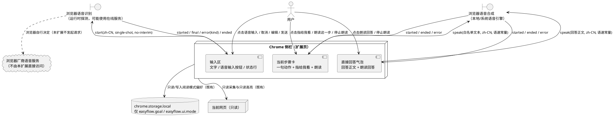
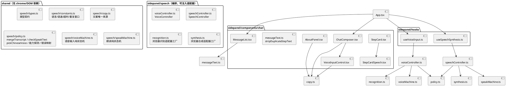
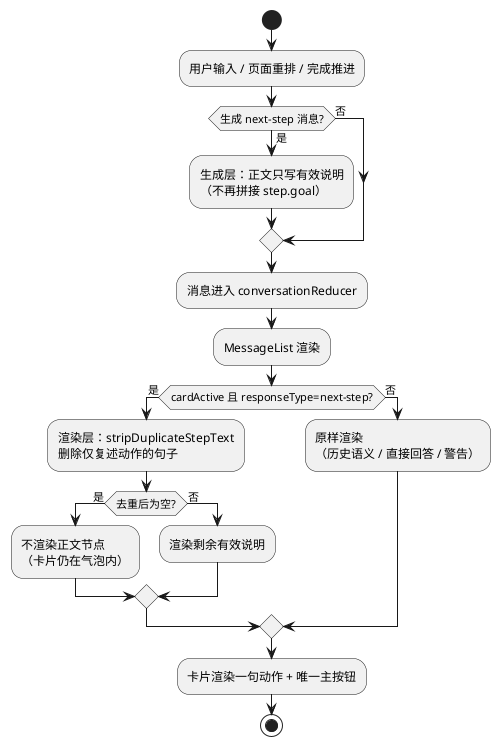
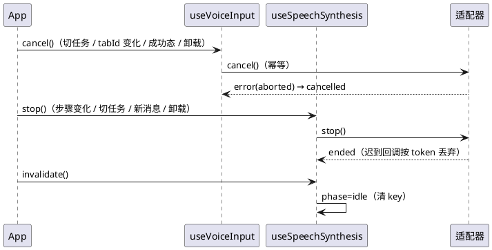
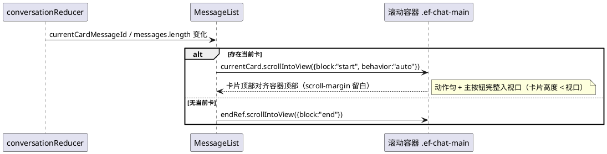
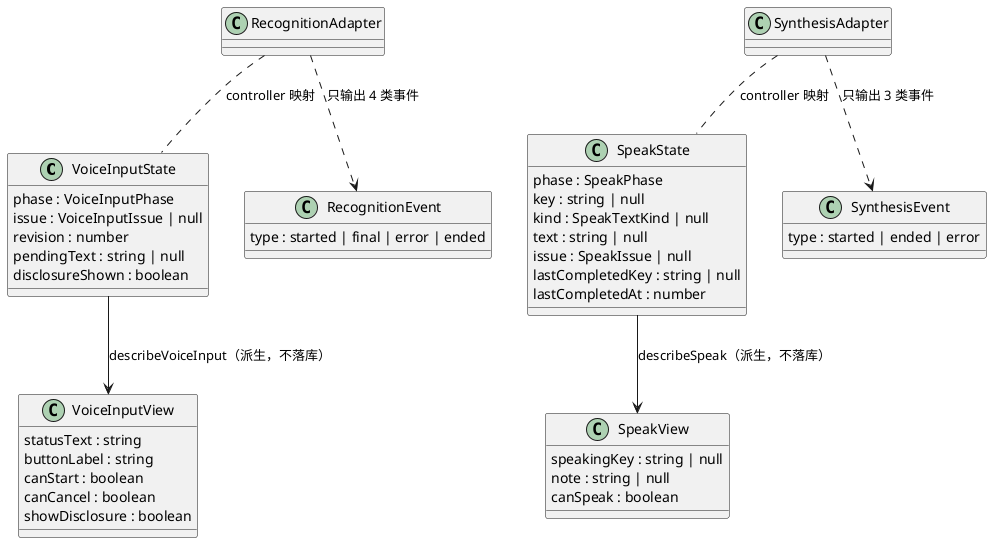
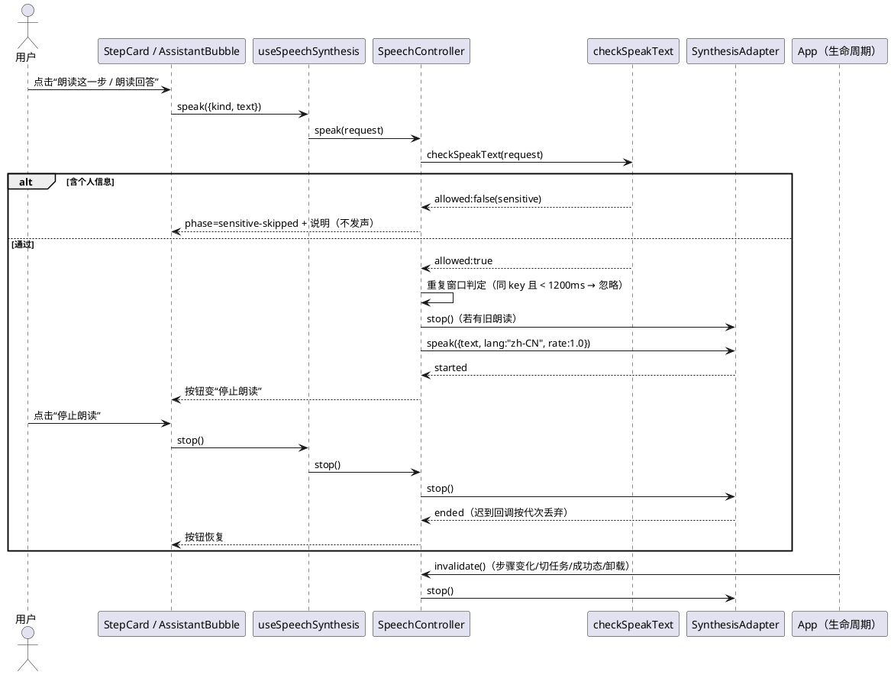
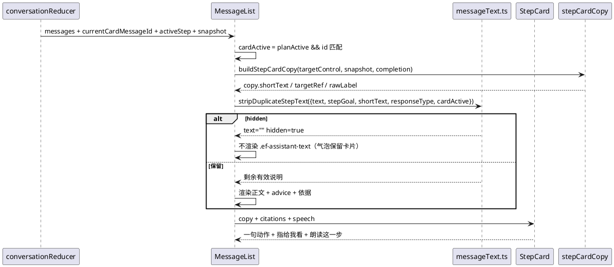

# 一、需求与存量功能关系分析

> 本文件是 `easyflow_page_guide` 特性第五轮增量设计，对应 `iteration5-spec.md`（R-101—R-169、AT-51—AT-63）。
> 本文件不替代 `design.md`、`iteration2-design.md`、`iteration3-design.md`、`iteration4-design.md`。
>
> **本阶段声明**：只产出设计文档。未修改 `src/`、`scripts/`、`public/`，未修改第一至第四轮文档，未运行 `npm run typecheck` / `build` / `selftest` / `verify`，未创建 `codearts_proof` 实绩文件，未调用真实麦克风或语音合成。
>
> 设计只描述架构、接口契约、状态机、数据流与验收落点，不含逐行实现代码。

## 1.0 分析前提（只读基线核实，2026-11-14）

| 核查项 | 实际结果（含位置） | 对本设计的硬约束 |
|---|---|---|
| 应用骨架 | `src/sidepanel/App.tsx:26-69`：`ChatHeader` → `PageStatusLine` → 慢提示 → `main.ef-chat-main`（`MessageList` + `AboutPanel`）→ `ChatComposer` → `DiagnosticsPanel` | 语音入口只能加在既有 `ChatComposer` 内；朗读入口只能加在既有 `StepCard` / `AssistantBubble` 内；不新增面板或路由 |
| 输入区 | `ChatComposer.tsx:22-54`：`textarea`（`rows={2}`、`maxLength={MAX_TURN_CHARS}`、`aria-describedby="ef-composer-hint"`）+ 提示行 + 发送按钮；`submit()` 内部 `text.trim()`，空文本或 `disabled` 直接返回 | `onSend(text)`、Enter/Shift+Enter、空文本判定、`disabled` 语义一律不改 |
| 长度上限 | `src/shared/constants.ts:17` `MAX_TURN_CHARS = 500`；`ChatComposer` 的 `maxLength` 与 `useConversation.runTurn`（`useConversation.ts:648`）共用 | 识别结果写入必须复用同一常量，**不得新增第二套长度** |
| 当前步骤卡 | `StepCard.tsx:77-141`：`ef-step-label`（内 `ef-step-state`="现在这一步"）→ `ef-step-goal`（`copy.shortText`）→ 唯一 `ef-step-primary`（"指给我看"）→ `StepDetails` → `ef-step-more`（4 个动作） | 去重不得改变卡片结构顺序与"唯一主按钮"，只允许在既有结构中增删受控文本节点/新增次级按钮 |
| 旧卡与成功态 | `StepCard.tsx:51-62` 非当前态只渲染 `stepCardLabel(mode)` + 一行 hint；`MessageList.tsx:62` 用 `planActive && messageId === currentCardMessageId` 判定当前卡；`MessageList.tsx:109-110` 传 `expired={!cardActive}` / `ended={bookingCompleted}` | 朗读/语音按钮不得出现在旧卡与成功态；旧卡 hint 中的"已过期"字样必须保留（AT-38 源码断言） |
| 重复文案来源 1 | `RuleEngine.ts:196` `textWithGoal = text.includes(step.goal) ? text : \`${text}${step.goal}。\``，调用点 `RuleEngine.ts:398-402、433-438、465-474、481-485、515-520、539` | 追加逻辑是重复的第一来源，必须移除；但 `validateResponse`（`validator.ts:161-163`）要求 `text.trim().length > 0`，因此正文**不能为空串**，必须改为"非动作复述"的有效说明句 |
| 重复文案来源 2 | `useConversation.ts:474-491` `nextStepMessage`：`text.includes(step.goal) ? text : \`${text}${step.goal}。\``；调用点 `564-572、597-608、620-630、781-789、1123-1131` | 同步移除追加 |
| 重复文案来源 3 | `useConversation.ts:181-202` `replanNoticeText`：`197` "目前可选的最早时段是“Y”。现在这一步："、`199` "现在这一步是“Y”。" | 删除"现在这一步"句式；保留"原来要点的 X 不在页面上了""目前可选的最早时段是 Y"等有效变化说明（R-103） |
| 重复文案来源 4 | `StepCard.tsx:83-85` `<span className="ef-step-state">现在这一步</span>` | 与卡片动作句语义重复；改为弱化短标签，但**不改 `stepCardLabel("current")` 的返回值**（AT-44 断言其为"现在这一步"） |
| 短句来源 | `stepCardCopy.ts:385-447` `buildStepCardCopy` 只用 `targetControl` + 最新 `snapshot`；时刻/日期由 `extractTimeToken`/`extractDateToken` 从标签解析；`MessageList.tsx:63-70` 仅当前卡计算 `copy` | 去重只改呈现；不得新增时刻/日期字面量，不得改 `targetRef` |
| 滚动契约 | `MessageList.tsx:144-146` 消息条数变化即 `scrollIntoView({block:"end"})`；`148-157` 当前卡变化时 `block:"nearest"` 且同一 id 只滚一次 | 两个 effect 会相互抵消；要实现"动作句 + 主按钮首屏可见"，需收敛为单一滚动策略 |
| 语音能力现状 | `src/` 全文检索 `SpeechRecognition`、`webkitSpeechRecognition`、`speechSynthesis`、`SpeechSynthesisUtterance`、`getUserMedia`、`MediaRecorder` → **0 命中**；`types.ts:232` 仅 `VoiceState`；`conversationReducer.ts:24、100` `voiceState` 恒 `"disabled"` | 本轮是从零新增；必须运行时探测；不得把语音状态写进会话状态机 |
| 既有语音文案 | `AboutPanel.tsx:6` "语音暂未开放。"；`selftest.mjs:1715` 断言该串；`selftest.mjs:1709` 断言 `ChatComposer` 不含"语音未开放" | 必须改写 `AboutPanel` 文案，并**显式改写 AT-50 的这一行断言**（其余断言保留） |
| 隐私能力 | `src/shared/privacy/detect.ts:40-54` `detectSensitive`/`containsSensitive`（身份证/手机/银行卡/邮箱/验证码/密码）；`redact.ts` `redactText` | 朗读前只读复用 `detectSensitive`；不新增检测规则，不落盘 |
| 权限清单 | `public/manifest.json:7` `["activeTab","scripting","sidePanel","storage"]`；无 `host_permissions`；`selftest.mjs:1534-1535` 深比较该数组 | 不得新增任何权限/内容脚本；麦克风授权由浏览器在用户点击后弹出 |
| 关怀 token | `sidepanel.css:891-933`：普通 `--ef-tap-min: 28px` / `--ef-primary-min-h: 32px`；`html[data-ui-mode="care"]` 下 `44px` / `48px`；care 下 `--ef-font-body: 18px` / `--ef-font-current: 22px` / `--ef-font-small: 14px` | 新控件必须消费既有 token；不得自带更小高度或缩小字号 |
| 布局约束 | `#root/.ef-chat-app`（`1147-1158`）`100dvh` + `overflow:hidden`；`.ef-chat-main`（`1176-1181`）唯一纵向滚动区；`.ef-composer`（`1183-1187`）`max-height:40vh` + 自身滚动；`.ef-diagnostics`（`1201-1205`）`--ef-diag-max-h` 且默认 `<details>` 折叠 | 首屏容量只能靠"去重 + 当前卡滚动对齐"腾出；不得压缩按钮或隐藏主按钮 |
| 测试结构 | `selftest.mjs:14-51` 用 esbuild `stdin.contents` 导出纯函数；`AT-38`（`1243-1283`）断言 `StepCard.tsx` 含"已过期"/`expired`、`App.tsx` 含 `planActive`；`AT-44`（`1430-1451`）断言 `stepCardLabel("current") === "现在这一步"`；`AT-45`（`1467-1536`）扫描 `src/**` 禁"测试时刻字面量/真实域名/邮箱样式"并深比较权限；`AT-50`（`1685-1727`）断言 CSS token 与 `AboutPanel` 文案 | 新增纯逻辑必须加入同一 `stdin.contents` 导出列表；新增 UI 组件不得含浏览器语音构造器名（R-162）；测试数据不得在 `src/**` 写邮箱/时刻字面量 |
| 构建 | `scripts/build.mjs:47-62` esbuild `minify:true`、`platform:"browser"`、`target:"chrome116"`；`public/manifest.json` `minimum_chrome_version: "116"` | 浏览器语音 API 必须做能力探测；不得假设 `SpeechRecognition` 一定存在 |

## 1.1 需求功能与存量功能对比

### 1.1.1 已实现功能（可直接复用，不改语义）

| 需求功能 | 存量功能 | 代码位置 | 匹配度 |
|---|---|---|---|
| 当前步骤唯一动作短句 + 动态时刻/日期 | `buildStepCardCopy` 短句生成、`includesTime/includesDate`、稳定回退 | `stepCardCopy.ts:385-447`、`59-118`、`167-235` | 100% |
| 唯一"指给我看"与 `ref` 定位 | `stepCardActions("current")` 含 `locate`；`locateControl` → `highlight` → 后台 → content | `stepCardModel.ts:39-44`、`StepCard.tsx:89-97`、`useConversation.ts:1099-1162` | 100% |
| 旧卡/成功态收口 | `resolveStepCardMode` 优先级 ended > expired；非当前态无主按钮/详情 | `stepCardModel.ts:17-37`、`StepCard.tsx:51-62`、`switchTask` 后端链路 | 100% |
| 详情与原文分层 | `StepDetails` 原始标签、截断标注、完成条件、引用定位 | `StepDetails.tsx:13-35`、`EvidencePanel.tsx:33-50` | 100% |
| 操作收纳 | `ef-step-more` 内 4 个既有动作 | `StepCard.tsx:107-139`、`stepCardModel.ts:27-37` | 100% |
| 网页依据折叠与定位 | `EvidencePanel`（"网页依据（N 处）"）+ `CitationList`（"在网页中查看"） | `EvidencePanel.tsx:38-49`、`MessageList.tsx:100-102` | 100% |
| 人工发送与长度校验 | `ChatComposer.submit` 的 `trim()`/`disabled`；`runTurn` 的 `MAX_TURN_CHARS` 复检 | `ChatComposer.tsx:12-19`、`useConversation.ts:645-650` | 100% |
| 个人信息只读检测 | `detectSensitive` 六类模式，纯函数、无落盘 | `detect.ts:20-54` | 100% |
| 关怀模式字号/触控/焦点/减少动态 | 两套 token + `:focus-visible` + `prefers-reduced-motion` | `sidepanel.css:891-933`、`1226-1229`、`1267-1277` | 100% |
| 诊断默认折叠且不含正文 | `DiagnosticsPanel` `<details>` + `--ef-diag-max-h` | `DiagnosticsPanel.tsx:63-65`、`sidepanel.css:1201-1205` | 100% |
| 会话状态与消息协议 | `conversationReducer` 既有字段；本轮不新增消息类型 | `conversationReducer.ts:17-66`、`messages.ts:9-18` | 100% |

### 1.1.2 需要扩展的功能（部分匹配，需在既有基础上改造）

| 需求功能 | 存量功能 | 差异说明 | 扩展方向 |
|---|---|---|---|
| R-101—R-103 同一动作只说一次 | 生成层把 `step.goal` 追加进 next-step 正文（`RuleEngine.ts:196`、`useConversation.ts:482`）；`replanNoticeText` 再复述一次 | 输入输出差异：正文从"引导词 + 目标"变成"仅有效说明"；业务逻辑差异：不再依赖 `includes(goal)` 判重；边界差异：`validateResponse` 要求正文非空 | 生成层移除追加并替换 6 处引导文案；渲染层新增 `stripDuplicateStepText` 作为历史消息防线 |
| R-104/R-105 依据与完成状态保留 | `EvidencePanel`、`booking-complete` 系统提示 | 无逻辑差异，只有"去重时不得连带删除"的约束 | 去重只作用于 `responseType === "next-step"` 且 `cardActive` 的正文；`advice`/`citations`/system notice 独立节点不参与 |
| R-106 首屏可见 | 两条 `scrollIntoView` 互相抵消（`block:"end"` 与 `block:"nearest"`） | 行为差异：当前卡出现时的滚动目标不同 | 合并为单一 effect：有当前卡 → 当前卡 `block:"start"`；无当前卡 → `block:"end"` |
| R-109 旧卡不新增指令 | `stepCardLayout` 已返回 `primary:null/showDetails:false` | 新增朗读按钮若不按 mode 收敛，会出现在旧卡 | 朗读入口只在 `mode === "current"` 分支渲染；`stepCardLayout` 增加 `showSpeak` 字段并默认 false |
| R-111—R-121 按键说话 | 输入区只有 `textarea` + 发送 | 完全新增输入方式，但必须保留 `onSend`/长度/发送语义 | `ChatComposer` 增加受控 voice 控制器与状态行；`text` 仍由 `ChatComposer` 持有 |
| R-145—R-155 按需朗读 | 无任何合成代码 | 从零新增 | 在 `StepCard` 当前态与 `AssistantBubble` 直接回答内新增受控朗读按钮 |
| R-156—R-161 关怀尺寸 | token 已存在，但新控件尚未接入 | 新增类必须消费 token | 新增 `.ef-speech-btn`/`.ef-speak-btn` 使用 `--ef-tap-min`，主按钮沿用 `--ef-primary-min-h` |
| R-137—R-144 告知与隐私 | `AboutPanel` 只有"语音暂未开放" | 文案矛盾，需替换为真实告知 | `AboutPanel` 引用同一告知常量；首次点击在输入区显示一次 |
| AT-50 既有断言 | 断言 `AboutPanel` 含"语音暂未开放" | 与新增能力冲突 | 该行显式改写为"告知常量 + 可能使用在线服务 + 不保存音频"，其余断言原样保留 |

### 1.1.3 需要新增的功能或接口

**（1）文案去重（呈现层）**

| 功能点 | 输入 | 输出 | 核心逻辑 | 依赖 |
|---|---|---|---|---|
| 历史消息重复句剥离 `stripDuplicateStepText` | `text`、`stepGoal`、`shortText`、`responseType`、`cardActive` | `{ text, hidden, removed }` | 按句切分，删除"仅复述动作"的句子；全删则 `hidden` | `normalizeWhitespace`（`shared/domPath.ts`） |
| 当前卡状态短标签 `stepCardStateTag` | `StepCardMode` | `"当前步骤" \| "这一步已过期" \| "这一步已结束"` | 纯映射；与动作句不重复 | 被 `StepCard`、`selftest` 使用 |
| 布局字段 `StepCardLayout.showSpeak` | `StepCardMode` | `boolean`（仅 current 为 true） | 朗读入口收敛 | 被 `StepCard`、`AT-49/AT-63` 使用 |

**（2）语音适配层（新增模块）**

| 功能点 | 输入 | 输出 | 核心逻辑 | 依赖 |
|---|---|---|---|---|
| 识别适配器 `RecognitionAdapter` | `SpeechStartOptions{lang:"zh-CN", singleShot:true, interimResults:false}`、`cancel()` | 四类事件：`started` / `final{text}` / `error{kind}` / `ended` | 单会话、单次、无中间结果、迟到事件丢弃、幂等取消 | 浏览器 `SpeechRecognition`/`webkitSpeechRecognition`（运行时探测） |
| 合成适配器 `SynthesisAdapter` | `SpeakOptions{text, lang:"zh-CN", rate}`、`stop()` | `started` / `ended` / `error{kind}` | 中文语音选择、单实例、停止后不回调 | 浏览器 `speechSynthesis`（运行时探测） |
| 能力探测 `detectRecognitionSupport` / `detectSynthesisSupport` | 普通对象（`window` 的子集） | `"supported" \| "unsupported"` | 只读属性探测，构造失败归 unsupported | 无（纯函数） |
| 错误统一映射 `mapRecognitionError` | 浏览器原始 `error` 字符串 / `SpeechErrorKind` | 7 类统一类别 | 禁止把原始错误码暴露到主界面 | 无（纯函数） |

**（3）语音输入编排（新增）**

| 功能点 | 输入 | 输出 | 核心逻辑 | 依赖 |
|---|---|---|---|---|
| `VoiceController` | `start()`/`cancel()`/`accept(event)`/`setComposerText(text)` | `VoiceInputState` + `pendingText` | 单会话、五类可见状态 + 已取消/失败、长度合并、迟到丢弃 | `RecognitionAdapter`（可注入）、`mergeTranscript`、`MAX_TURN_CHARS` |
| `useVoiceInput` | 无（默认工厂） | 控制器视图 | `useSyncExternalStore` 订阅；卸载 `dispose()` | `VoiceController`、`createRecognitionAdapter` |
| 输入区 UI `VoiceInputControl` | 控制器视图 + `uiMode` | 按钮 / 状态行 / 告知 | 状态文字唯一来源；按钮禁用形态 + 原因 | `shared/speech/copy.ts` |

**（4）按需朗读编排（新增）**

| 功能点 | 输入 | 输出 | 核心逻辑 | 依赖 |
|---|---|---|---|---|
| 朗读白名单 `checkSpeakText` | `{kind:"step-action"\|"direct-answer", text}` | `{allowed:true}` / `{allowed:false, reason:"empty"\|"sensitive"}` | 只接受白名单文本；`detectSensitive` 命中即拒绝 | `detectSensitive` |
| 中文语音选择 `pickChineseVoice` | 只读语音列表 | `{voice, matched}` | `zh-CN` → `zh*` → `default` → `null` | 无（纯函数） |
| `SpeechController` | `speak(request)`/`stop()`/`invalidate()` | `SpeakState` | 单实例、先停后起、防同一句重复、生命周期失效 | `SynthesisAdapter`（可注入）、`checkSpeakText`、`pickChineseVoice` |
| `useSpeechSynthesis` | 无 | 控制器视图 | 订阅 + 卸载停止 | `SpeechController`、`createSynthesisAdapter` |

**（5）告知与诊断（新增）**

| 功能点 | 输入 | 输出 | 核心逻辑 | 依赖 |
|---|---|---|---|---|
| 告知文案单源 | 无 | `SPEECH_DISCLOSURE_TEXT` | 首次提示与 `AboutPanel` 共用同一常量 | 无 |
| 状态文案单源 | `VoiceInputState` / `SpeakState` | 按钮名、状态行、说明 | 所有中文文案集中映射，组件不各写一份 | `copy.ts` |
| 诊断类别行（可选，见 T5-18） | `VoiceInputIssue` / `SpeakIssue` | 枚举类别文字 | 只显示类别，不含识别原文 | `DiagnosticsPanel` props 扩展 |

## 1.2 存量功能详细分析

### 1.2.1 重复文案的精确链路（本轮核心问题）

一次"下一步"消息的正文与卡片在同一屏可能出现 2—3 次同一动作，链路如下：

1. **RuleEngine 层追加**：`RuleEngine.ts:186-209` `nextStepResponse(plan, text)` 在 196 行做 `textWithGoal`；`payload.text` 变为 `"先做这一步：{step.goal}。"`。`step.goal` 来自 `stepPlanner.ts` 生成的自然语言目标（例如"现在请点 09:30"或"我想预约这个15分钟会议，请一步一步告诉我先点哪里"）。
2. **useConversation 层再次追加**：`useConversation.ts:474-491` `nextStepMessage` 对重规划/完成推进路径做同样追加，因此 `replanNoticeText` 的返回值也会被再拼一次 `step.goal`。
3. **replanNoticeText 复述**：`useConversation.ts:181-202` 在重规划时直接生成"目前可选的最早时段是“Y”。现在这一步："/"现在这一步是“Y”。"，与卡片短句"现在请点 Y"语义重复。
4. **StepCard 状态行**：`StepCard.tsx:83-85` 可见文本"现在这一步"，加上卡片短句"现在请点 …"，构成第二遍动作复述。

**关键事实**：
- `step.goal`（原始目标）与 `copy.shortText`（呈现短句）**不是同一字符串**，因此不能用单一 `includes` 判重；必须同时比较两者。
- 历史消息中已经落库的正文仍带 `step.goal` 尾巴（切换阅读模式、重新打开侧栏后重绘时会重现），所以**只在生成层改不够**，渲染层需要防线。
- `validateResponse`（`validator.ts:161-163`）拒绝空正文；`nextStepResponse` 的返回值必须非空。这是"去重"与"校验"之间的硬约束，设计必须为每个 next-step 分支提供一句**不复述动作**的有效说明。

### 1.2.2 当前卡渲染契约与既有测试口径

| 契约 | 现状 | 测试口径（不得破坏） |
|---|---|---|
| 卡片模式 | `resolveStepCardMode({ended, expired})`：`ended` 优先，其次 `expired`，否则 `current` | `AT-44`（`1431-1433`）、`AT-49`（`1674-1682`） |
| 标签函数 | `stepCardLabel("current") === "现在这一步"`；`expired → "这一步已过期"`；`ended → "这一步已结束"` | `AT-44`（`1442-1443`）**直接断言字符串** |
| 动作集合 | `stepCardActions("current").length === 5`；`expired/ended` 为 0 | `AT-44`（`1434-1438`）、`AT-49`（`1682`） |
| 详情可见性 | `stepCardLayout("current").showDetails === true`；非当前态 false | `AT-49`（`1677-1679`） |
| 源码字符串 | `StepCard.tsx` 含"已过期"与 `expired`；`App.tsx` 含 `planActive` | `AT-38`（`1280-1282`） |
| 旧卡结构 | 非当前态仅 `ef-step-label` + `ef-step-history-hint`，无目标/条件/按钮 | `AT-49`、`AT-44` |
| 唯一主按钮 | 当前态仅 `ef-step-primary` 一个主按钮 | 第四轮 R-02 人工验收 + 本轮 R-145 |

**由此得出设计约束**：
1. `stepCardLabel()` 必须保持原样（含 `"现在这一步"`），**不能**为了让卡片标签变成"当前步骤"而修改该函数；新增独立的 `stepCardStateTag()` 只服务呈现。
2. `StepCard.tsx` 必须继续包含 `"已过期"` 与 `expired` 字符串（旧卡分支保留现状即可）。
3. `App.tsx` 必须保留 `planActive={...}` 这一 JSX 属性名，不得内联为 `active`。
4. `stepCardLayout` 只能**新增字段**（`showSpeak`），不得改变既有一等字段语义。

### 1.2.3 消息流、当前卡认定与滚动

| 维度 | 现状 | 影响 |
|---|---|---|
| 当前卡认定 | `conversationReducer` 在 `assistant-add` 时，若 `message.targetControl !== undefined` 则更新 `currentCardMessageId`；`plan-set` 非 active 时置 null | 当前卡与计划状态解耦，但 UI 叠加 `planActive` 二次判定（`MessageList.tsx:62`） |
| 消息文本渲染 | `AssistantBubble` 渲染 `message.text` → `limitation.advice` → 重试 → 澄清选项 → `EvidencePanel` → `StepCard` | 去重只能作用于第一个节点；后续节点是有效附加信息 |
| 滚动 1 | `useEffect([messages.length])` → `endRef.scrollIntoView({block:"end"})` | 新消息到达先滚到底 |
| 滚动 2 | `useEffect([currentCardMessageId])` → 当前卡 `scrollIntoView({block:"nearest"})`，同一 id 只滚一次 | 若卡片在底部，`nearest` 不会把它顶到视口顶部；care 大字号下可能只显示部分 |
| 滚动顺序 | 两个 effect 按声明顺序执行，第二次覆盖第一次 | 当前实现不能保证"动作句 + 主按钮"完整入视口 |

### 1.2.4 输入区契约

| 契约 | 现状 | 本轮要求 |
|---|---|---|
| 受控文本 | `ChatComposer` 内部 `useState("")` | 识别结果只能通过"补丁"写入同一 `setText`，不新增第二条发送通道 |
| 发送 | `submit()` → `trim()` → `onSend(trimmed)` → `setText("")` | 不变；识别路径不得调用 `submit()` |
| 回车语义 | `Enter` 发送、`Shift+Enter` 换行 | 不变 |
| 禁用 | `disabled` 只控制发送按钮与 `submit` 提前返回 | 识别期间仍可编辑与发送（spec 5.2.3 异常 4） |
| 长度 | `maxLength={MAX_TURN_CHARS}` + `runTurn` 复检 | 识别写入前用同一上限判断，超长不写入 |
| 提示 | `ef-composer-hint` "Enter 发送 · Shift+Enter 换行"；`@media (max-width:360px)` 隐藏 | care 400px 下需压缩提示而不是缩小按钮（R-158） |
| 可访问名称 | `aria-label` + `aria-describedby="ef-composer-hint"` | 新增状态行需 `aria-live="polite"`，按钮需可读名称 |

### 1.2.5 隐私与诊断的既有能力

1. `detectSensitive`（`detect.ts:40-50`）返回 `SensitiveHit[]`（kind/index/length），纯函数、无存储；`containsSensitive` 为其布尔包装。朗读前直接复用即可，不需要新规则。
2. `runTurn` 在 `useConversation.ts:656-670` 已用 `detectSensitive` 拦截含个人信息的用户输入并脱敏后落库；**语音输入不改变该链路**，因为语音只填输入框，用户点击发送后才进入 `runTurn`。
3. 诊断（`ConversationDiagnostics`）由 `useConversation` 在对话轮次写入，字段不含正文；本轮**不新增** `ConversationState` 字段，语音/朗读不可用类别作为组件层状态传入 `DiagnosticsPanel`（见 T5-18），只显示枚举。
4. 存储只有 `easyflow.goal` 与 `easyflow.ui.mode`；本轮不新增键。识别原文只存在于 `ChatComposer` 的 `text` state（关闭侧栏即消失）。

### 1.2.6 语音能力真实基线

- 浏览器侧：Chrome MV3 侧栏页面属于扩展页（`chrome-extension://`），`webkitSpeechRecognition` 在多数 Chrome 桌面版可用，但**企业策略、无麦克风设备、站点权限模型**均可能导致不可用；`speechSynthesis` 通常可用，但语音列表可能异步加载（`voiceschanged`）。
- 工程侧：`minimum_chrome_version: 116`，TypeScript 5.6 + `lib.dom` 未声明 `SpeechRecognition`/`webkitSpeechRecognition`，因此适配器内必须自带**最小结构化类型**（禁止 `any`）。
- 测试侧：`selftest.mjs` 是 Node 环境，没有 `window`/`SpeechSynthesisUtterance`。因此：
  - 能力探测函数必须接受"类 window 对象"入参（默认 `globalThis`），测试可传 `{}` 或带构造器的普通对象；
  - 编排必须放在无 React、无 DOM 的 controller 中，测试可注入假适配器；
  - 组件层只渲染 controller 视图，不直接触碰浏览器全局对象（R-162）。

### 1.2.7 样式基座与首屏容量

| 区域 | 现状高度来源 | 本轮增量 |
|---|---|---|
| `ChatHeader` | `.ef-header` 品牌 + 模式开关，`flex-wrap` | 不变 |
| `PageStatusLine` | `.ef-page-status` 11px→`--ef-font-small` | 不变 |
| `main.ef-chat-main` | `flex:1`，唯一滚动区 | 当前卡滚动对齐方式改变 |
| `MessageList` | 消息气泡 + 卡片 + `AboutPanel` | 当前卡正文减少 1—2 行；卡片新增一个次级按钮 |
| `ChatComposer` | 输入框 + 提示行，`max-height:40vh` 自身滚动 | 新增语音按钮行 + 状态行 + 首次告知行（约 44—96px，care） |
| `DiagnosticsPanel` | `<details>` 折叠，`--ef-diag-max-h` | 展开后新增一行类别（可选） |

结论：首屏达标的主手段是**去重**（减少正文）+ **当前卡对齐顶部**（自动滚动，不算"手动滚动"）；输入区增量在固定区，靠 `max-height:40vh` 内部滚动兜底，不挤占 `main` 的可视高度（`flex:1` 会同比缩小，但当前卡已对齐顶部）。

### 1.2.8 测试与门禁结构（必须沿用的机制）

1. `selftest.mjs` 的 `stdin.contents`（`16-40`）是唯一的"可测面"入口；未被导出的纯函数等于未测试（spec 7.1 约束 5）。
2. 用例以 `test("AT-xx …")` 命名，顺序执行；新增用例追加在文件末尾。
3. `AT-45`/`AT-50` 会递归扫描 `src/**`：新增文件不得含 `02:00|02:15|03:00`、`cal.com|calendar.google.com|outlook.com|teams.microsoft.com`、邮箱样式。
4. `AT-50` 会断言 CSS 中**不存在** `ef-voice-btn`/`ef-mode-notice`；新增类名必须避开这两个串。
5. `AT-44`/`AT-49` 断言 `stepCardModel` 的纯函数返回值；新增 `showSpeak` 字段不改变既有断言。
6. `AT-38` 断言源码字符串（`StepCard.tsx` 的"已过期"、`App.tsx` 的 `planActive`）；重构时不得删除这些字面量。

# 二、增量设计方案

## 2.1 实现模型

### 2.1.1 上下文视图



约束标注：
1. 语音能力只在**用户点击后**启动，频率为"每次点击 1 次会话"。
2. 识别结果**只**流向输入区，不进入对话引擎，不进入消息流。
3. 合成只接收白名单文本；本扩展不发起任何语音相关网络请求。

### 2.1.2 组件/服务总体架构



依赖方向（单向、无环）：
`shared/speech` ← `sidepanel/speech` ← `hooks` ← `components` ← `App`。
`components` 不得 import `recognition.ts`/`synthesis.ts`（保证 R-162：UI 不直连浏览器全局对象）。

### 2.1.3 实现设计文档

#### （1）去重判定位置（生成层 + 渲染层双层）



选择理由：
- 生成层治本：新消息不再重复，成本最低、可被源码断言（AT-62）。
- 渲染层治旧：历史消息与已落库正文无法追溯修改，只能呈现层收敛（R-101 的"可见区域内"）。
- 两层都只处理 `next-step` + `cardActive`，从类型/条件上排除 `direct-answer`/`cannot-answer`/`clarify`，避免误删事实回答（R-103/R-104）。

#### （2）语音输入状态机（简化）

```plantuml
@startuml
[*] --> idle
idle --> unsupported : start（探测=不支持）
idle --> listening : start（探测=支持）
idle --> permission-denied : start 后发现授权拒绝
listening --> listening : 重复 start（忽略）
listening --> recognized : adapter-final（长度合法）
listening --> failed : adapter-final（超长）
listening --> no-speech : error(no-speech / unknown)
listening --> permission-denied : error(not-allowed / audio-capture)
listening --> failed : error(network)
listening --> cancelled : cancel / aborted（用户）
listening --> cancelled : 超时 / 系统中断
recognized --> idle : 用户编辑 / 再次点击
no-speech --> listening : 再次点击
permission-denied --> listening : 再次点击（权限恢复）
failed --> listening : 再次点击
cancelled --> listening : 再次点击
unsupported --> unsupported : 再次点击（重探测）
@enduml
```

#### （3）朗读状态机（简化）

```plantuml
@startuml
[*] --> idle
idle --> unsupported : speak（探测=不支持）
idle --> sensitive-skipped : speak（命中个人信息）
idle --> speaking : speak（白名单通过）
idle --> idle : speak（同一句在重复窗口内）
speaking --> speaking : speak（不同文本：先 stop 再 speak）
speaking --> idle : ended / stop
speaking --> failed : error（合成失败/被打断）
speaking --> idle : invalidate（步骤变化/切任务/成功态/卸载）
sensitive-skipped --> idle : 用户再次点击
failed --> speaking : 用户再次点击（重试）
@enduml
```

#### （4）生命周期停止时序



#### （5）首屏滚动时序（改造后）



## 2.2 接口设计

### 2.2.1 总体设计

| 接口组 | 用途 | 稳定性 | 调用方 |
|---|---|---|---|
| `shared/speech/types.ts` | 适配器/事件/错误类别/状态类型 | 稳定（契约） | controller、hook、组件、selftest |
| `shared/speech/constants.ts` | 语言、语速、超时、重复窗口 | 稳定（命名常量） | controller、适配器、selftest |
| `shared/speech/copy.ts` | 所有语音/朗读中文文案 | 稳定（唯一来源） | 组件、AboutPanel、selftest |
| `shared/speech/policy.ts` | 纯策略函数 | 稳定（纯函数） | controller、selftest |
| `shared/speech/voiceMachine.ts` | 语音输入状态转移 | 稳定（纯函数） | `VoiceController`、selftest |
| `shared/speech/speakMachine.ts` | 朗读状态转移 | 稳定（纯函数） | `SpeechController`、selftest |
| `sidepanel/speech/recognition.ts` | 浏览器识别适配器工厂 | 实验（浏览器实现） | `useVoiceInput`（默认工厂） |
| `sidepanel/speech/synthesis.ts` | 浏览器合成适配器工厂 | 实验（浏览器实现） | `useSpeechSynthesis`（默认工厂） |
| `sidepanel/speech/voiceController.ts` | 语音输入编排 | 稳定（无 React） | `useVoiceInput`、selftest |
| `sidepanel/speech/speechController.ts` | 朗读编排 | 稳定（无 React） | `useSpeechSynthesis`、selftest |
| `components/chat/messageText.ts` | 去重纯函数 | 稳定（纯函数） | `MessageList`、selftest |
| 组件 props 扩展 | voice/speech 控制器视图 | 稳定（内部契约） | `App` → 组件 |

命名与既有业务语言一致：`shortText`、`stepGoal`、`cardActive`、`pendingText`、`speakKey`、`issue`。
禁止把语音输入状态命名为 `voiceState`（已被 `ConversationState.voiceState: VoiceState` 占用，语义为"语音能力状态"，本轮不改）。

### 2.2.2 接口清单

#### 接口 A：语音领域类型（新增，契约核心）

```ts
// src/shared/speech/types.ts
export type SpeechErrorKind =
  | "unsupported"
  | "permission-denied"
  | "no-audio-device"
  | "no-speech"
  | "network"
  | "aborted"
  | "unknown";

export interface SpeechStartOptions {
  lang: "zh-CN";
  singleShot: true;
  interimResults: false;
}

export type RecognitionEvent =
  | { type: "started" }
  | { type: "final"; text: string }
  | { type: "error"; kind: SpeechErrorKind }
  | { type: "ended" };

export interface RecognitionAdapter {
  start(options: SpeechStartOptions): void;
  cancel(): void;
  subscribe(listener: (event: RecognitionEvent) => void): () => void;
  dispose(): void;
}

export interface SpeakOptions {
  text: string;
  lang: "zh-CN";
  rate: number;
}

export type SynthesisEvent =
  | { type: "started" }
  | { type: "ended" }
  | { type: "error"; kind: "unsupported" | "unknown" };

export interface SynthesisAdapter {
  speak(options: SpeakOptions): void;
  stop(): void;
  subscribe(listener: (event: SynthesisEvent) => void): () => void;
  dispose(): void;
}

export type VoiceInputPhase =
  | "idle"
  | "listening"
  | "recognized"
  | "no-speech"
  | "permission-denied"
  | "unsupported"
  | "failed"
  | "cancelled";

export type VoiceInputIssue =
  | "no-audio-device"
  | "network"
  | "timeout"
  | "too-long"
  | "interrupted";

export type SpeakTextKind = "step-action" | "direct-answer";

export interface SpeakRequest {
  kind: SpeakTextKind;
  text: string;
}

export type SpeakPhase = "idle" | "speaking" | "unsupported" | "failed" | "sensitive-skipped";

export type SpeakIssue = "sensitive" | "interrupted" | "start-failed";
```

- 业务说明：UI 与测试只依赖这些类型；浏览器实现被完全隔离在 `sidepanel/speech/*.ts`。
- 前置条件：`start` 只能在用户手势回调内调用；`speak` 只能在点击回调内调用。
- 后置条件：`subscribe` 返回取消订阅函数；`dispose` 后不再派发任何事件。
- 异常映射：构造失败 → `unsupported`；运行错误 → 统一 `SpeechErrorKind`；UI 不接收原始错误对象。

#### 接口 B：纯策略函数（新增，可单测）

```ts
// src/shared/speech/policy.ts
export interface TranscriptMergeOk {
  ok: true;
  text: string;
}
export interface TranscriptMergeFail {
  ok: false;
  reason: "too-long";
}
export type TranscriptMerge = TranscriptMergeOk | TranscriptMergeFail;

export function mergeTranscript(current: string, incoming: string, limit: number): TranscriptMerge;

// SpeakRequest 定义在 types.ts（接口 A），此处仅复用
export type SpeakTextCheck =
  | { allowed: true; text: string }
  | { allowed: false; reason: "empty" | "sensitive" };
export function checkSpeakText(request: SpeakRequest): SpeakTextCheck;

export interface SpeechVoiceLike {
  name: string;
  lang: string;
  default: boolean;
}
export interface VoicePick {
  voice: SpeechVoiceLike | null;
  matched: "zh-CN" | "zh" | "default" | "none";
}
export function pickChineseVoice(voices: readonly SpeechVoiceLike[]): VoicePick;

export type RecognitionSupport = "supported" | "unsupported";
export function detectRecognitionSupport(scope: unknown): RecognitionSupport;
export function detectSynthesisSupport(scope: unknown): RecognitionSupport;

export function mapRecognitionError(raw: string | undefined): SpeechErrorKind;
```

- `mergeTranscript`：
  - 前置：`incoming` 可为任意识别文本；`current` 为输入框当前值（可能已含用户编辑）；`limit` 由调用方传 `MAX_TURN_CHARS`。
  - 后置：成功时 `text.length <= limit` 且包含 `current` 原文；失败时不返回任何可用文本（调用方不得写入）。
  - 不做纠错、补全、截断；仅做首尾空白归一与中文/英文拼接分隔。
- `checkSpeakText`：
  - 白名单：`step-action` 的 `text` 必须由调用方传 `copy.shortText`；`direct-answer` 传 `message.text`。
  - 后置：`allowed:false` 时 `text` 不得出现任何片段（不返回脱敏文本）；命中 `detectSensitive` 即 `sensitive`。
- `pickChineseVoice`：优先级 `zh-CN` → `zh*` → `default:true` → `null`；无 `zh` 语音时不退化为英文朗读（由 controller 决定"仍以 zh-CN 请求系统默认"，见 2.7.3）。
- `detectRecognitionSupport` / `detectSynthesisSupport`：只读探测，绝不构造实例；`scope` 允许传普通对象，供 selftest 使用。
- `mapRecognitionError`：`raw` 为浏览器 `SpeechRecognitionErrorEvent.error` 或统一类别字符串；未知值 → `"unknown"`。

#### 接口 C：语音输入状态机（新增）

```ts
// src/shared/speech/voiceMachine.ts
export interface VoiceInputState {
  phase: VoiceInputPhase;
  issue: VoiceInputIssue | null;
  revision: number;
  pendingText: string | null;
  disclosureShown: boolean;
}

export type VoiceInputEvent =
  | { type: "start-requested"; supported: boolean }
  | { type: "adapter-started" }
  | { type: "adapter-final"; merge: TranscriptMerge }
  | { type: "adapter-error"; kind: SpeechErrorKind; cancelledByUser: boolean }
  | { type: "adapter-ended" }
  | { type: "timeout" }
  | { type: "cancel-requested" }
  | { type: "composer-consumed" }
  | { type: "invalidate" };

export function createVoiceInputState(): VoiceInputState;
export function voiceInputReducer(state: VoiceInputState, event: VoiceInputEvent): VoiceInputState;

export interface VoiceInputView {
  phase: VoiceInputPhase;
  statusText: string;
  buttonLabel: string;
  canStart: boolean;
  canCancel: boolean;
  showDisclosure: boolean;
  pendingText: string | null;
  revision: number;
}
export function describeVoiceInput(state: VoiceInputState): VoiceInputView;
```

- 幂等：`start-requested` 在 `phase === "listening"` 时返回**同一 state 引用**（AT-56 用引用相等断言）。
- 迟到丢弃：`adapter-final` 在 `cancelled/no-speech/permission-denied/unsupported/failed` 终态返回同一 state（AT-52/AT-57）。
- 文案：`describeVoiceInput` 是按钮名与状态行的唯一来源；组件不得内联中文。

#### 接口 D：朗读状态机（新增）

```ts
// src/shared/speech/speakMachine.ts
export interface SpeakState {
  phase: SpeakPhase;
  key: string | null;
  kind: SpeakTextKind | null;
  text: string | null;
  issue: SpeakIssue | null;
  lastCompletedKey: string | null;
  lastCompletedAt: number;
}

export type SpeakEvent =
  | {
      type: "speak-requested";
      request: SpeakRequest;
      check: SpeakTextCheck;      // controller 预计算：allowed / sensitive
      supported: boolean;
      now: number;
    }
  | { type: "adapter-started" }
  | { type: "adapter-ended"; now: number }
  | { type: "adapter-error"; kind: "unsupported" | "unknown" }
  | { type: "stop-requested" }
  | { type: "invalidate" };

export function createSpeakState(): SpeakState;
export function speakReducer(state: SpeakState, event: SpeakEvent): SpeakState;
export function speakKeyOf(request: SpeakRequest): string;

export interface SpeakView {
  phase: SpeakPhase;
  speakingKey: string | null;
  note: string | null;
  canSpeak: boolean;
}
export function describeSpeak(state: SpeakState): SpeakView;
```

- `speakKeyOf({kind, text})` → `` `${kind}:${text}` ``；用于"同一句不重复"与按钮切换。
- 重复窗口：`now - lastCompletedAt < SPEECH_REPEAT_WINDOW_MS` 且同 key → 返回同一 state（AT-60）。
- 敏感跳过：`checkSpeakText` 的 `sensitive` 结果作为 `speak-requested` 的入参（controller 预先计算），reducer 置 `phase:"sensitive-skipped"` 且不调用适配器。

#### 接口 E：`VoiceController`（新增，可注入假适配器）

```ts
// src/sidepanel/speech/voiceController.ts
export interface VoiceControllerDeps {
  adapter: RecognitionAdapter | null;   // null = 探测为不支持（不发起任何调用）
  limit: number;                        // 恒为 MAX_TURN_CHARS
  now: () => number;
}

export interface VoiceControllerView extends VoiceInputView {
  revision: number;
  pendingText: string | null;
}

export class VoiceController {
  constructor(deps: VoiceControllerDeps);
  subscribe(listener: () => void): () => void;
  getView(): VoiceControllerView;
  setComposerText(text: string): void;   // 只写内部 ref，不触发通知
  start(): void;                          // 用户点击
  cancel(): void;
  consumePending(): void;                 // ChatComposer 写入后确认消费
  dispose(): void;
}
```

- 业务说明：把"浏览器事件 → 状态 → 待写入文本"的编排从 React 中剥离，测试可直接注入假适配器并断言 `adapter.startCalls`/`cancelCalls` 与 `view.pendingText`。
- 前置条件：`now` 可注入，用于超时与测试时间控制。
- 后置条件：`start()` 在 `listening` 时不得再次调用 `adapter.start`（AT-56）；`cancel()` 幂等；`dispose()` 后所有事件丢弃。
- 超时：`start()` 后启动 `SPEECH_NO_RESULT_TIMEOUT_MS` 定时器；到期未终态 → `cancel()` + `issue:"timeout"` + `no-speech`（AT-55）。
- 调用示例：

```ts
const controller = new VoiceController({ adapter: fakeAdapter, limit: 500, now: () => Date.now() });
controller.setComposerText("");
controller.start();
fakeAdapter.emit({ type: "started" });
fakeAdapter.emit({ type: "final", text: "帮我看看现在点哪里" });
const view = controller.getView();   // phase === "recognized"，pendingText 非空
```

#### 接口 F：`SpeechController`（新增，可注入假适配器）

```ts
// src/sidepanel/speech/speechController.ts
export interface SpeechControllerDeps {
  adapter: SynthesisAdapter;
  now: () => number;
}

export interface SpeechControllerView extends SpeakView {
  speakingKey: string | null;
  note: string | null;
}

export class SpeechController {
  constructor(deps: SpeechControllerDeps);
  subscribe(listener: () => void): () => void;
  getView(): SpeechControllerView;
  speak(request: SpeakRequest): void;
  stop(): void;
  invalidate(): void;
  dispose(): void;
}
```

- 业务说明：`speak()` 内部先算 `checkSpeakText`；不通过时不调用适配器；通过时先 `adapter.stop()`（若有旧朗读）再 `adapter.speak({text, lang:SPEECH_LANG, rate:SPEECH_RATE})`。
- 后置条件：同一 key 在重复窗口内只调用适配器 1 次（AT-60）；`stop()` 幂等（AT-59）。
- 前置条件：调用方只能传白名单文本（由接口类型 `SpeakRequest.kind` 约束）。

#### 接口 G：组件 props 扩展

```ts
// ChatComposer.tsx
interface ChatComposerProps {
  onSend: (text: string) => void;
  disabled: boolean;
  voice: ChatComposerVoice;     // 见下
  uiMode: UiMode;               // 用于压缩提示文字（T5-19）
}

interface ChatComposerVoice {
  view: VoiceInputView;
  start: () => void;
  cancel: () => void;
  consumePending: () => void;
  onComposerTextChange: (text: string) => void;
}

// StepCard.tsx（新增可选 props，默认不影响旧卡）
interface StepCardVoiceProps {
  speech: SpeechUi;             // 见下
  stepKey: string;              // `step:${stepId}:${shortText}`
}

interface SpeechUi {
  supported: boolean;
  speakingKey: string | null;
  note: string | null;
  isSpeaking: (key: string) => boolean;   // 纯比较：speakingKey === key
  speak: (request: SpeakRequest) => void;
  stop: () => void;
}

// MessageList.tsx（新增）
interface MessageListSpeechProps {
  speech: SpeechUi;
  answerKeyOf: (messageId: string) => string;
}
```

- `SpeechUi` 是唯一注入点；`StepCard`/`MessageList` 不 import 浏览器适配器（R-162）。
- `StepCard` 的 `speech` 可选：未传时不渲染朗读入口（默认关闭），保证 `AT-49` 旧卡结构断言不被破坏。

#### 接口 H：去重纯函数

```ts
// src/sidepanel/components/chat/messageText.ts
export interface StepDedupeInput {
  text: string;
  stepGoal: string;
  shortText: string;
  responseType: ResponseType;
  cardActive: boolean;
}
export interface StepDedupeResult {
  text: string;
  hidden: boolean;
  removed: number;
}
export function stripDuplicateStepText(input: StepDedupeInput): StepDedupeResult;
export const STEP_LEAD_PATTERNS: readonly string[];
```

- 前置：`stepGoal`/`shortText` 可能为空串；为空时不做删除（防误删）。
- 后置：`removed > 0` 时 `text` 为剩余句子拼接；全部删除时 `hidden=true` 且 `text=""`。
- 无副作用、不抛异常；不返回被删除文本（避免把重复句带进诊断）。

## 2.3 数据模型

### 2.3.1 设计目标

1. **临时性**：语音/朗读状态是侧栏内存态，关闭即丢弃；不进入 `ConversationState`、不写 `storage`、不写诊断正文。
2. **可判定**：每个状态都有明确的进入条件与终态条件，避免"永久正在听"。
3. **可注入**：适配器通过接口注入，测试用假实现即可完整覆盖，不触发真实麦克风与发声。
4. **类型安全**：所有跨层数据使用显式接口；浏览器对象使用最小结构化类型，禁止 `any`。
5. **与既有数据兼容**：`VoiceState`、`NoticeKind.voice-disabled`、`DialogueCapabilities.voiceEnabled` 语义不变。

### 2.3.2 模型实现



**对象生命周期**：

| 对象 | 创建 | 销毁 | 持久化 |
|---|---|---|---|
| `VoiceController` / `VoiceInputState` | `useVoiceInput` 首次渲染（懒创建） | 侧栏卸载 `dispose()` | 无 |
| `SpeechController` / `SpeakState` | `useSpeechSynthesis` 首次渲染 | 侧栏卸载 `dispose()` | 无 |
| `RecognitionAdapter` 实例 | 每次 `start()` 新建（单会话） | `final`/`error`/`ended`/`cancel` 后解绑 | 无 |
| `SynthesisAdapter`（内部 utterance） | 每次 `speak()` 新建 | `ended`/`error`/`stop` | 无 |
| `pendingText` | `adapter-final` 且长度合法 | `consumePending()` | 无（只进输入框） |
| `disclosureShown` | 首次 `start()` | 侧栏卸载 | 无（会话内一次） |

**禁止字段**（类型层不出现）：音频、音频片段、中间文本数组、原始 `Error` 对象、设备 ID、识别原文（除 `pendingText` 与 UI 输入框）。
## 2.4 文案去重与首屏（R-101—R-110）

### 2.4.1 双层职责边界

| 层 | 负责 | 不负责 | 依据 |
|---|---|---|---|
| 生成层（`RuleEngine` + `useConversation`） | 新产生的 next-step 正文不再含 `step.goal`；`replanNoticeText` 不再含"现在这一步"句式 | 不处理历史消息、不改 `plan/goal/ref` | R-102、R-108 |
| 渲染层（`MessageList` + `messageText.ts`） | 对 `cardActive` 的 next-step 正文做防御性句子剥离 | 不改消息对象、不落库、不触碰卡片内部 | R-101、5.1.3 |
| 卡片层（`StepCard` + `stepCardModel`） | 当前卡状态标签改为弱化短标签；朗读入口仅在 current 渲染 | 不改 `stepCardLabel` 返回值、不改动作集合 | T5-02、R-109 |

**为什么必须在生成层改**：`replanNoticeText` 与 `nextStepMessage` 的追加会在**新消息**里直接产生重复，只在渲染层删会让历史消息与新消息走两套语义，且 `stepCardLabel` 之外的重复无法被 AT-62 覆盖（AT-62 断言 `RuleEngine.ts` 不再出现 `text.includes(step.goal)`）。

**为什么必须在渲染层改**：`conversationReducer` 的消息一旦产生就不可变；切换阅读模式、重新打开侧栏、`messages.length` 变化都会重绘历史消息。历史消息正文里已含 `step.goal` 尾巴（旧版本产物或同一会话早期消息），只有渲染层能保证"可见区域内只出现一次"。

### 2.4.2 生成层精确改动（6 个 `nextStepResponse` 调用点 + 1 个 `nextStepMessage`）

先改**公共函数**，再改**调用点文案**，最后改 `replanNoticeText`。顺序不可颠倒，否则中间状态会出现空正文（被 `validator.ts:161` 拒绝）。

| 文件/函数 | 位置 | 现状 | 改为 | 保留的有效信息 |
|---|---|---|---|---|
| `RuleEngine.nextStepResponse` | `186-209`，关键 196 | `textWithGoal = text.includes(step.goal) ? text : \`${text}${step.goal}。\``，写入 `response.text` | `response.text = text`（不再拼接） | 由调用点保证非空且不含动作复述 |
| `RuleEngine` 未找到后重新定位成功 | `398-402` | `"我重新找到了这个入口。你可以点下面的“指给我看”。"` + goal | 原文保留（去追加后已不重复） | 定位结果说明 + 操作提示 |
| `RuleEngine` 点错了后重规划 | `433-438` | `"好，我按当前页面重新规划了一下。先做这一步："` + goal | `"好，我按当前页面重新规划了一下。"` | 重规划变化说明 |
| `RuleEngine` 确认完成/未能验证后推进 | `465-474` | `"这一步完成了。下一步："` / `"按你的确认继续，页面未能验证。下一步："` + goal | `"这一步完成了。"` / `"按你的确认继续，页面未能验证。"` | 完成状态（R-105）+ 未验证事实 |
| `RuleEngine` 已有活动计划的流程目标 | `481-485` | `"先完成这一步："` + goal | `NEXT_STEP_LEAD`（常量，见下） | 无（正文仅过渡语） |
| `RuleEngine` 新建计划的流程目标 | `515-520` | `"先做这一步："` + goal | `NEXT_STEP_CREATED_LEAD` | 新计划已建立的说明 |
| `RuleEngine` 省略指代且当前步骤已验证 | `539` | `"继续下一步："` + goal | `NEXT_STEP_LEAD` | 无 |
| `useConversation.nextStepMessage` | `474-491`，关键 482 | 与 `RuleEngine` 相同的 `includes` 追加 | `text` 原样作为 `response.text` | 调用点传入的说明 |
| `useConversation` 创建计划后的完成推进 | `597-608`（`"这一步完成了。下一步："`） | 完成说明 + `"下一步："` + goal | `"这一步完成了。"` | 完成状态 |
| `useConversation` 非预约计划的步骤推进 | `620-630`（同上） | 同上 | 同上 | 完成状态 |
| `useConversation` 重规划（3 处） | `564-572`、`781-789`、`1123-1131` | `replanNoticeText(reconciled)` + goal | 仅 `replanNoticeText` 返回值 | 变化说明 + 时段变化 |

**新增文案常量（`RuleEngine.ts` 顶部或 `shared/speech/copy.ts`）**：

| 常量 | 取值 | 用途 |
|---|---|---|
| `NEXT_STEP_LEAD` | `"我按当前页面接着来。"` | 无可复述内容时的过渡语（非动作句、非近义词改写） |
| `NEXT_STEP_CREATED_LEAD` | `"我按当前页面找到了下一步。"` | 新计划建立后的定位说明 |

约束：
1. 这两句**不得**包含"先""点""选择""现在请"等动作引导词，避免被判定为动作复述（R-110）。
2. 它们不是"第二句动作"，只表达"按当前页面继续"的状态，主语是助手而不是用户操作。
3. `nextStepResponse` 与 `nextStepMessage` 均不校验 `text` 是否含 `step.goal`；**不保留**任何 `includes(step.goal)` 分支（源码断言要求消失）。

### 2.4.3 `replanNoticeText` 改法（保留变化说明，删除动作复述）

现状（`useConversation.ts:181-202`）三种返回：
1. 时段场景：`"{prefix}目前可选的最早时段是“{nextLabel}”。现在这一步："`
2. 一般场景：`"{prefix}现在这一步是“{nextLabel}”。"`
3. 无标签：`"{prefix}我按当前页面重新看了一遍。"`

改为：

| 场景 | 新返回 | 说明 |
|---|---|---|
| 时段场景（`preference==="any"` 且前后都是 time 控件） | `"{prefix}目前可选的最早时段是“{nextLabel}”。"` | "最早时段"是变化结果（R-103 有效附加信息），保留；删除"现在这一步："标签 |
| 一般场景（`nextLabel` 非空、非时段） | `"{prefix}我按当前页面重新看了一遍。"` | 删除 `现在这一步是“X”`；新目标由卡片承载 |
| 无 `nextLabel` | `"{prefix}我按当前页面重新看了一遍。"` | 不变 |

`prefix` 保持现状（`"原来要点的“X”现在已经不在页面上了。"` / `"页面变化了，原来的步骤已经不在页面上了。"`），因为它说明"页面变了"这一事实，是 R-103 的核心。

**边界**：
- `nextLabel` 与 `shortText` 可能相同（例如"09:30"），但句子语义是"最早可选时段是 X"（变化结果），不是"请点 X"（动作），不属于动作复述；这是 spec 5.1.3 异常 2 明确允许的保留项。
- `prefix` 中含 `previous.label`（原始标签），可能较长；不改截断策略（既有 `MAX_CONTROL_LABEL_CHARS = 80`）。

### 2.4.4 渲染层去重算法（`stripDuplicateStepText`）

**输入**：`text`（消息正文）、`stepGoal`（`activeStep.goal`）、`shortText`（`copy.shortText`）、`responseType`、`cardActive`。

**步骤**：

1. **短路条件**（任一成立即原样返回 `{text, hidden:false, removed:0}`）：
   - `cardActive !== true`（历史消息保留原有语义，R-109）；
   - `responseType !== "next-step"`（直接回答/澄清/不能回答一律不动，防止误删事实，R-110）；
   - `stepGoal.trim() === ""` 或 `shortText.trim() === ""`（无比较基准）；
   - `text.trim() === ""`。
2. **归一化键**：`normalizeWhitespace` 后去掉首尾标点与引号（`。！？；：、“”"`）。归一化只用于比较，不改输出原文。
3. **按句切分**：以 `。！？；` 为界，**保留分隔符**；不按逗号切（避免把一句内的有效说明拆碎）。
4. **判定"动作复述句"**（满足任一）：
   - a. 归一化后 === 归一化 `shortText`；
   - b. 归一化后 === 归一化 `stepGoal`；
   - c. 归一化后以归一化 `stepGoal` 结尾，且前缀（去掉结尾后的部分）∈ `STEP_LEAD_PATTERNS`；
   - d. 归一化后以归一化 `shortText` 结尾，且前缀 ∈ `STEP_LEAD_PATTERNS`。
5. **`STEP_LEAD_PATTERNS`（常量，唯一来源）**：
   `"先做这一步"`、`"先完成这一步"`、`"现在这一步"`、`"现在这一步是"`、`"现在请"`、`"下一步"`、`"继续下一步"`、`"好，我按当前页面重新规划了一下。先做这一步"`（历史消息里 prefix 可能与句号合并，因此比较前先剥标点）。
   > 说明：`"现在请"` 用于覆盖卡片短句 `GENERIC_FALLBACK_TEXT = "现在请在网页上选择对应项"` 与 `"现在请点 …"` 被完整复制到正文的情况。
6. **输出**：
   - 删除所有命中句；`removed` 计数；
   - 若剩余为空 → `{ text: "", hidden: true, removed }`；
   - 否则 → 剩余句按原顺序拼接（保留原标点），`hidden:false`。

**典型输入输出（用于 AT-62）**：

| # | 输入 `text` | `stepGoal` / `shortText` | 输出 | 原因 |
|---|---|---|---|---|
| 1 | `"先做这一步：现在请点 09:30。"` | 同 `"现在请点 09:30"` | `hidden:true` | 整段仅复述（规则 c） |
| 2 | `"原来要点的“09:00”现在已经不在页面上了。现在这一步是“09:30”。"` | `"现在请点 09:30"` | `"原来要点的“09:00”现在已经不在页面上了。"` | 保留变化说明，删第二句 |
| 3 | `"这一步完成了。下一步：现在请点 09:30。"` | 同上 | `"这一步完成了。"` | 保留完成状态（R-105） |
| 4 | `"我按当前页面重新看了一遍。现在请点 09:30。"` | 同上 | `"我按当前页面重新看了一遍。"` | 保留重看说明 |
| 5 | `"先做这一步：我想预约这个会议。"` | `stepGoal="我想预约这个会议"`、`shortText="现在请点 09:30"` | `hidden:true` | 规则 c（历史消息尾巴是 `goal`） |
| 6 | 同上但 `cardActive:false` | — | 原样 | 历史语义 |
| 7 | `"当前页面没有找到这项信息。"`（直接回答） | — | 原样 | 非 next-step |
| 8 | `"现在请点 09:30"` 但 `shortText=""` | — | 原样 | 无基准，保守 |

**防误删规则**：
- 只删"整句命中"，绝不删句子内部的片段（避免把"原来要点的 X 不在页面上了，现在请点 Y"这种合句切断成残句；这类合句由规则 c 判定整句为复述时，会连同变化说明一起删除——因此**额外保护**：若句子同时包含 `"原来"`/`"变化"`/`"不在页面"`/`"最早"` 等变化信号词，则不判为复述，交由生成层已修正的新消息处理。该信号词表与 `STEP_LEAD_PATTERNS` 同级维护）。
- `hidden:true` 时，`MessageList` 不渲染 `.ef-assistant-text` 节点；`advice`、`retry`、`clarify`、`EvidencePanel`、`StepCard` 仍正常渲染。

### 2.4.5 保留/隐藏矩阵（R-103—R-105、R-110）

| 内容 | 当前卡存在时 | 当前卡不存在/历史 | 处理位置 |
|---|---|---|---|
| 与动作句重复的引导句（"先做这一步：…"、"现在这一步是…"） | 删除 | 保留（历史语义） | `stripDuplicateStepText` 仅 `cardActive` |
| 页面变化说明（"原来要点的 X 不在页面上了"） | 保留 | 保留 | 不参与删除（信号词保护） |
| 时段被替换说明（"目前可选的最早时段是 Y"） | 保留 | 保留 | `replanNoticeText` 保留 |
| 限制/警告建议 `limitation.advice` | 保留 | 保留 | 独立节点，不参与去重 |
| 失败原因（`cannot-answer` 正文） | 保留 | 保留 | `responseType !== "next-step"` 短路 |
| 完成状态（`"这一步完成了。"` / 系统提示 `BOOKING_COMPLETE_NOTICE`） | 保留 | 保留 | 句子级保留 + system notice 独立渲染 |
| 网页依据 `EvidencePanel`（"网页依据（N 处）"） | 保留 | 保留 | 独立 `<details>` |
| 重试入口 / 澄清选项 | 保留 | 保留 | 独立节点 |
| 旧卡状态行（"这一步已过期/已结束"） | — | 保留 | `StepCard` 非当前态分支 |
| 卡片动作句 | 仅卡片内 1 次 | 旧卡不显示 | `StepCard` |

### 2.4.6 卡片状态行的最终形态（兼容 AT-38/AT-44）

| 位置 | 现状 | 改为 | 测试兼容 |
|---|---|---|---|
| `stepCardModel.stepCardLabel(mode)` | `current → "现在这一步"` | **保持不变**（注释标记为"既有测试兼容值，不再驱动当前卡渲染"） | AT-44 `1443` 直接断言，必须保留 |
| 新增 `stepCardStateTag(mode)` | — | `current → "当前步骤"`、`expired → "这一步已过期"`、`ended → "这一步已结束"` | AT-62 新增断言；AT-44 不受影响 |
| `StepCard` 当前态状态行 | `<span className="ef-step-state">现在这一步</span>` | `<span className="ef-step-state ef-step-state-tag">当前步骤</span>` | 可见文本不再是句子；`aria-labelledby` 仍指向动作句 |
| `StepCard` 旧卡 | `stepCardLabel(mode)` + hint（含"已过期"） | **保持不变** | AT-38 断言 `StepCard.tsx` 含"已过期"；AT-44 断言标签值 |
| `stepCardLayout(mode)` | 4 个字段 | 新增第 5 个字段 `showSpeak: boolean`（current 为 true，其余 false） | 既有断言只读取旧字段，不受影响 |

**为什么不让 `stepCardLabel("current")` 返回"当前步骤"**：AT-44 是既有红线，spec 4.5.5 只允许显式改写 AT-50 的一处断言；擅改 `stepCardLabel` 会让 AT-44 失败，属于"削弱既有回归"。因此采用"函数保留旧值 + 新增呈现标签函数"的双轨方案，并在设计文档与代码注释中显式说明，避免后续误删。

**动作句数量核对（R-101 验收路径）**：从上到下逐条读取可见文本，当前卡只有
① 状态短标签"当前步骤"（标签，不是句子）→ ② `copy.shortText`（唯一动作句）→ ③ "指给我看"（按钮）→ ④ "朗读这一步"（次级按钮）→ ⑤ 两个折叠入口。动作句数量为 1。

### 2.4.7 首屏与滚动（R-106、5.1.3 异常 3）

**滚动策略改造**（`MessageList`）：

| 现状 | 改为 | 理由 |
|---|---|---|
| effect A：`[messages.length]` → `endRef.scrollIntoView({block:"end"})` | 仅当 `currentCardMessageId === null` 时滚到底 | 有当前卡时"滚底"会把卡片顶出视口 |
| effect B：`[currentCardMessageId]` → 当前卡 `scrollIntoView({block:"nearest"})` | 当前卡变化时 `scrollIntoView({block:"start", behavior:"auto"})`，并保留"同一 id 只滚一次"的去重 ref | `start` 保证卡片顶部对齐，动作句与主按钮完整可见 |
| 两个 effect 各自触发 | 合并为单一 effect，依赖 `[currentCardMessageId, messages.length]` | 消除相互覆盖 |

**CSS 配合**：
- 当前卡包裹容器新增 `scroll-margin-block-start: var(--ef-space-3)`，避免贴边。
- `behavior:"auto"`（非 `smooth"`）在 `prefers-reduced-motion: reduce` 下天然安全，且满足"打开侧栏即就位"。

**首屏高度预算（care 400px，估算）**：

| 区块 | 高度 | 说明 |
|---|---|---|
| `ChatHeader` | 约 64—76px | 标题 22px + 副标题 14px + 开关 44px |
| `PageStatusLine` | 约 30—36px | 14px 文字 |
| 当前卡 | 约 150—200px | 标签 14 + 动作句 22×1—2 行 + 按钮行 48 + 折叠 2×44 |
| 当前消息正文（去重后） | 约 0—60px | 0—2 行 ×18px |
| 历史消息 | 由用户滚动决定 | 当前卡 `start` 对齐后位于视口顶部，历史消息在其上方 |
| `ChatComposer`（固定底部） | 约 180—240px | 输入框 48 + 语音行 44 + 状态行 20 + 提示/发送 48 + 告知 20 |
| `DiagnosticsPanel`（折叠） | 约 44px | `<summary>` 高度 |

结论：侧栏可视高度（`100dvh`）通常 ≥ 600px；`main` 可用高度约为 `dvh − header − status − composer − diagnostics`。care 下若输入区达到 240px，`main` 仍约 250—300px，足以完整显示"动作句 + 主按钮"（约 90px）。**不需要隐藏任何关键内容**；输入区若超限，由既有 `.ef-composer { max-height: 40vh; overflow-y: auto }` 内部滚动兜底。

`AboutPanel` 与诊断的关系：
- `AboutPanel` 位于 `.ef-chat-main` 内、`MessageList` 之后（`App.tsx:56`），因此**不在首屏上半部**，不参与首屏竞争；本轮不移动它（移动会改变既有滚动锚点与 AT 结构断言）。
- `DiagnosticsPanel` 位于 `.ef-composer` 之后、默认折叠；新增"语音/朗读类别"一行只在展开后可见，不影响首屏。
- 首次告知行放在输入区（固定底部），**不放进 `main`**，避免挤占消息区。

### 2.4.8 去重"不通过"清单（人工/自测共用的反例）

1. 通过隐藏 `.ef-advice`、`EvidencePanel`、完成系统提示来"减少重复"。
2. 把同一动作改写成"现在请点击/请选择/下一步点"两种说法继续出现。
3. 修改 `targetRef`/`elementId`/`domPath`/`textHash`，导致"指给我看"高亮位置变化。
4. 在旧卡上渲染动作句、主按钮或朗读按钮。
5. 去重后气泡出现空白占位（`hidden` 时仍渲染空 `.ef-assistant-text`）。
6. 把 `cardActive` 判断放宽到"只要消息带 `targetControl`"，导致历史卡正文被删。

## 2.5 语音适配器与运行时检测（R-162—R-169）

### 2.5.1 模块划分与依赖方向

| 层 | 文件 | 允许依赖 | 禁止依赖 |
|---|---|---|---|
| 契约 | `src/shared/speech/types.ts` | 无 | React、chrome、window |
| 常量 | `src/shared/speech/constants.ts` | 无 | 同上 |
| 文案 | `src/shared/speech/copy.ts` | `types.ts` | 同上 |
| 策略 | `src/shared/speech/policy.ts` | `types.ts`、`constants.ts`、`shared/privacy/detect.ts`、`shared/domPath.ts` | window、React、chrome |
| 状态机 | `src/shared/speech/voiceMachine.ts`、`speakMachine.ts` | `types.ts`、`copy.ts`、`policy.ts` | 同上 |
| 适配器 | `src/sidepanel/speech/recognition.ts`、`synthesis.ts` | `shared/speech/types.ts` | React、chrome、其他组件 |
| 编排 | `src/sidepanel/speech/voiceController.ts`、`speechController.ts` | 上述全部 | React、window |
| Hook | `src/sidepanel/hooks/useVoiceInput.ts`、`useSpeechSynthesis.ts` | controller + 适配器工厂 + React | 组件 |
| UI | `components/chat/*` | hook 视图 / `copy.ts` | 适配器工厂、window 语音全局对象 |

`detect.ts` 已确认不依赖 chrome/window（纯正则），因此 `policy.ts` 引用它不会破坏 shared 层约束。

### 2.5.2 识别适配器契约

| 契约项 | 规定 | 依据 |
|---|---|---|
| 语言 | `lang = "zh-CN"`（常量 `SPEECH_LANG`） | R-163、5.3.3 异常 3（不得退化为英文） |
| 单次 | `continuous = false`；`singleShot: true` 仅允许一次最终结果 | R-163 |
| 无中间结果 | `interimResults = false`；`onresult` 只取 `isFinal === true` 的第一条 `transcript`，非 final 一律丢弃 | R-164、R-120 |
| 备选数 | `maxAlternatives = 1`（避免多候选进入 UI） | R-164 |
| 事件顺序 | `started` → (`final` \| `error`) → `ended`；每类最多一次 | R-164、4.2.3 |
| 启动反馈 | `start()` 内**同步**派发 `started`（不等待浏览器 `onstart`），保证 300ms 内可见 | 4.1.1 |
| 构造失败 | `start()` 内 `new Ctor()` 抛错 → `error{unsupported}` → `ended` | 5.8.3 异常 1 |
| 停止 | `cancel()` 调用 `abort()`；已结束则直接返回 | R-167 |
| 运行时错误 | `onerror` → `mapRecognitionError(event.error)` → `error{kind}` | R-166 |
| `onend` 兜底 | 若既无 `final` 也无 `error` → `error{no-speech}` → `ended` | R-124 |
| 幂等 | 内部 `settled` 标志；`start()` 在会话进行中直接返回；`cancel()` 二次调用不再派发 | R-167、R-135 |
| 迟到丢弃 | 每次 `start()` 新建实例 + 解绑旧实例全部处理器；`settled` 后所有回调直接返回 | R-134 |
| 资源 | 不保存音频、不访问设备 ID、不发起网络请求、不重试（重试由用户点击） | R-169、4.3.2 |

**最小结构化类型**（`types.ts` 内，避免 `any`）：

```ts
export interface RecognitionLike {
  lang: string;
  continuous: boolean;
  interimResults: boolean;
  maxAlternatives: number;
  onstart: ((event: Event) => void) | null;
  onresult: ((event: RecognitionResultLike) => void) | null;
  onerror: ((event: RecognitionErrorLike) => void) | null;
  onend: ((event: Event) => void) | null;
  start(): void;
  abort(): void;
}

export interface RecognitionResultLike {
  resultIndex: number;
  results: ArrayLike<ArrayLike<{ transcript: string }> & { isFinal: boolean }>;
}

export interface RecognitionErrorLike {
  error: string;
}
```

探测函数只检查 `typeof scope.SpeechRecognition === "function"` / `typeof scope.webkitSpeechRecognition === "function"`，**不构造**。

### 2.5.3 合成适配器契约

| 契约项 | 规定 | 依据 |
|---|---|---|
| 文本 | 只接受白名单文本（由 `SpeechController` 传入） | R-148、R-155 |
| 语言 | `utterance.lang = "zh-CN"` | R-150 |
| 语音选择 | `pickChineseVoice(speechSynthesis.getVoices())`；`zh-CN` → `zh*` → `default` → 不设置 `voice`（走系统默认，`lang` 仍为 `zh-CN`） | R-150 |
| 语音列表异步 | `getVoices()` 为空时**不等待**（避免突破 500ms）；当前句使用系统默认；下一句再尝试 | 4.1.3 |
| 语速 | `rate = SPEECH_RATE = 1.0`（允许 0.9—1.1） | R-150、T5-08 |
| 单实例 | 每次 `speak()` 前 `cancel()` 旧 utterance（先停再起） | R-151、4.2.2 |
| 事件 | `onstart → started`、`onend → ended`、`onerror → error{unknown}` | R-165 |
| 停止 | `stop()` → `speechSynthesis.cancel()`；300ms 内停止发声 | R-149、4.1.4 |
| 不支持 | `detectSynthesisSupport === "unsupported"` 时不构造、不调用，直接 `error{unsupported}` | R-154 |
| 迟到 | `stop()` 后旧 utterance 的 `onend` 不再派发（代次 token 过滤） | R-134 |
| 副作用 | 不修改页面、不写存储、不发起网络请求 | R-143 |

### 2.5.4 运行时探测矩阵

| 情形 | 探测方式 | 结果 | UI |
|---|---|---|---|
| 标准识别构造器存在 | `typeof scope.SpeechRecognition === "function"` | supported | 正常按钮 |
| 仅 webkit 前缀存在 | `typeof scope.webkitSpeechRecognition === "function"` | supported | 正常按钮 |
| 两者皆无 | 上述均为 false | unsupported | 按钮禁用 + "当前浏览器不支持语音输入" |
| 存在但构造抛错 | `start()` 内 try/catch | `error{unsupported}` | 同上，并记诊断类别 |
| 无 `speechSynthesis` | `typeof scope.speechSynthesis === "object"` 为 false | unsupported（TTS） | 朗读按钮替换为"当前浏览器不支持朗读" |
| 无 `SpeechSynthesisUtterance` | `typeof scope.SpeechSynthesisUtterance === "function"` 为 false | unsupported（TTS） | 同上 |
| `speak()` 抛错 | try/catch → `error{unknown}` | failed | "朗读失败，可以再试" + 按钮恢复 |
| 权限被拒 | 识别 `onerror: not-allowed` | permission-denied | "无权限" + 建议 + 可重试 |
| 无麦克风 | `onerror: audio-capture` | permission-denied + `issue:"no-audio-device"` | "没有检测到麦克风" |
| 中文不支持 | `onerror: language-not-supported` | unsupported | "不支持中文语音识别，可以直接打字" |

探测时机：`useVoiceInput` / `useSpeechSynthesis` 首次渲染时调用一次（记录到 controller 的 `capability` 字段）；**每次点击前**再探测一次（R-128 可恢复：用户重新允许权限/插入麦克风后无需刷新侧栏）。探测本身不构造实例、不请求权限。

### 2.5.5 错误类别统一映射（R-166）

| 统一类别 | 来源（浏览器 `error`） | 语音输入阶段 | 按钮形态 | 可见文案（`copy.ts` 单一来源） |
|---|---|---|---|---|
| `unsupported` | 构造器缺失 / 构造抛错 / `language-not-supported` | `unsupported` | 禁用 + 原因 | "当前浏览器不支持中文语音输入，可以直接打字。" |
| `permission-denied` | `not-allowed`、`service-not-allowed` | `permission-denied` | 可重试 | "没有麦克风权限。请在浏览器站点设置里允许麦克风，或直接打字。" |
| `no-audio-device` | `audio-capture` | `permission-denied`（`issue=no-audio-device`） | 可重试 | "没有检测到可用的麦克风，可以直接打字。" |
| `no-speech` | `no-speech`、`bad-grammar`、静音结束 | `no-speech` | 可重试 | "未识别到语音，请再说一次，或直接打字。" |
| `network` | `network` | `failed`（`issue=network`） | 可重试 | "未识别：网络或语音服务暂不可用，可以直接打字。" |
| `aborted` | `aborted`（用户取消） | `cancelled` | 可重试 | "已取消识别。" |
| `aborted` | `aborted`（系统中断，非用户取消） | `cancelled`（`issue=interrupted`） | 可重试 | "识别已中断，可以再试或直接打字。" |
| `unknown` / 其他 | 任意未列出字符串 | `no-speech` | 可重试 | 同 `no-speech` |
| `too-long`（UI 类别，非浏览器） | `mergeTranscript` 返回 `reason:"too-long"` | `failed`（`issue=too-long`） | 可重试 | "内容较长，请先精简后再试，原文已保留。" |
| `timeout`（UI 类别） | controller 定时器 | `no-speech`（`issue=timeout`） | 可重试 | "没有听到内容，可以再试或直接打字。" |

约束：
1. 主界面**不得**出现 `NotAllowedError`、`no-speech`、`network`、`audio-capture` 等原始串（AT-55）。
2. 诊断只记录统一类别字符串（7 类之一），不记录原始错误、不记录原文（4.3.7）。
3. `aborted` 在用户主动取消时**不得**显示为失败（6.2 映射规则）。

### 2.5.6 幂等、取消与迟到事件

| 场景 | 适配器行为 | controller 行为 | 用户可见结果 |
|---|---|---|---|
| 连续点击 3 次开始 | 第 2、3 次 `start()` 因 `settled === false` 直接返回 | `phase === "listening"` 时 `start()` 不调用适配器 | 只有 1 次会话（AT-56） |
| 点击取消 | `abort()` → `error{aborted}` + `ended`（各一次） | 置 `cancelled`、清 `pendingText`、递增 sessionToken | "已取消识别"，无结果写入 |
| 取消后再取消 | `settled === true` → 直接返回 | `phase !== "listening"` → no-op | 无闪烁、无报错 |
| 取消后 2 秒迟到 `final` | 旧实例已解绑处理器，事件无法派发 | 即便派发也因 token 不匹配丢弃 | 输入框不变（AT-52） |
| 适配器 `ended` 后到达 `final` | `settled` 已置位 → 丢弃 | token 过滤 → 丢弃 | 状态稳定（5.8.3 异常 2） |
| 切换任务与卸载同时发生 | `cancel()` 幂等 | `dispose()` 内部再调用一次 `cancel()` | 适配器 `cancel` 调用 ≤ 2 次、无异常（R-135） |
| 适配器 `cancel()` 抛错 | try/catch 吞掉并继续置终态 | 记录诊断类别 `unknown` | 界面已停止，无错误码（5.4.3 异常 1） |

**double-token 设计**：适配器内 `instanceToken`（每次 start 递增）+ controller 内 `sessionToken`（每次 start/cancel 递增）。两侧都校验，保证"取消/切任务/卸载后绝不写入"。

### 2.5.7 可注入与自测接缝（R-168）

| 接缝 | 形式 | 测试用途 |
|---|---|---|
| `VoiceControllerDeps.adapter` | 构造参数注入 `RecognitionAdapter` | 假适配器可手动 `emit` 四类事件，断言 `startCalls/cancelCalls` |
| `SpeechControllerDeps.adapter` | 构造参数注入 `SynthesisAdapter` | 断言"恰好 1 次 speak 调用"、参数 `lang/rate/text`（AT-59/AT-60） |
| `VoiceControllerDeps.now` / `SpeechControllerDeps.now` | 注入时钟 | 超时与重复窗口测试，不依赖真实时间 |
| `detectRecognitionSupport(scope)` / `detectSynthesisSupport(scope)` | 入参为普通对象 | `{}` → unsupported；`{ SpeechRecognition: fn }` → supported（AT-54） |
| `mergeTranscript(current, incoming, limit)` | 纯函数 | 长度策略（AT-58） |
| `checkSpeakText(request)` | 纯函数 | 白名单与个人信息（AT-61） |
| `stripDuplicateStepText(input)` | 纯函数 | 去重（AT-62） |

**假适配器放置位置**：`scripts/selftest.mjs` 文件内（局部类），**不放进 `src/`**。理由：
1. 假适配器不是产品代码，放进 `src/` 会被 `AT-45` 的源码清洁扫描纳入（虽不违规，但增加噪声）；
2. `src/` 需要保持"移除语音入口即可回滚"的干净状态（4.4.5）；
3. spec 约束"未导出的纯逻辑视为未测试"，controller 与 policy 已导出，假适配器作为测试夹具无需被产品代码引用。

**禁止项核对**（R-169）：
- 适配器内无 `onSend`/`dispatch`/`click`/`submit` 调用；
- 无 `localStorage`/`chrome.storage`/`fetch`/`XMLHttpRequest`；
- 无自动重试（仅用户再次点击）；
- 无 `getUserMedia`/`MediaRecorder`（不使用录音 API）。

## 2.6 语音输入状态机与输入区 UI（R-111—R-121、R-130—R-136）

### 2.6.1 状态定义与可见文案（唯一来源）

| phase | issue | 状态行文案 | 按钮文字 | 按钮可用 | 可取消 |
|---|---|---|---|---|---|
| `idle` | null | 空（不渲染状态行，不占高度） | "语音输入" | 是 | 否 |
| `listening` | null | "正在听，请说一句中文…" | "取消识别" | 是（语义为取消） | 是 |
| `recognized` | null | "已识别，请检查文字后自己点发送。" | "语音输入"（可再次识别） | 是 | 否 |
| `no-speech` | null / `timeout` | "未识别到语音，请再说一次，或直接打字。" / "没有听到内容，可以再试或直接打字。" | "语音输入" | 是 | 否 |
| `permission-denied` | `no-audio-device` | "没有检测到可用的麦克风，可以直接打字。" | "语音输入"（视觉弱化 + 原因行） | 是（点击重新探测/重试） | 否 |
| `permission-denied` | null | "没有麦克风权限。请在浏览器站点设置里允许麦克风，或直接打字。" | 同上 | 是（点击重新探测/重试） | 否 |
| `unsupported` | null | "当前浏览器不支持中文语音输入，可以直接打字。" | "语音输入"（禁用） | 否 | 否 |
| `failed` | `network` | "未识别：网络或语音服务暂不可用，可以直接打字。" | "语音输入" | 是 | 否 |
| `failed` | `too-long` | "内容较长，请先精简后再试，原文已保留。" | "语音输入" | 是 | 否 |
| `failed` | null | "识别失败，可以再试或直接打字。" | "语音输入" | 是 | 否 |
| `cancelled` | `interrupted` | "识别已中断，可以再试或直接打字。" | "语音输入" | 是 | 否 |
| `cancelled` | null | "已取消识别。" | "语音输入" | 是 | 否 |

实现落点：`describeVoiceInput(state)` 返回 `{ statusText, buttonLabel, canStart, canCancel, showDisclosure }`；`copy.ts` 提供 `VOICE_STATUS_TEXT` / `VOICE_BUTTON_TEXT` 两个映射表。组件**只允许**从 `view` 取值，禁止内联中文。

按钮形态（T5-11）分两类，不能一刀切禁用：
- `permission-denied` / `no-audio-device`：**保留可点按钮**（点击重新探测并再次请求，满足 R-128），视觉弱化为次级样式，`aria-describedby` 指向状态行说明原因；**不在后台自动重试**，避免循环弹窗（R-123）。
- `unsupported`：保留按钮但 `disabled`（能力缺失无法通过重试恢复；下次打开侧栏重新探测），`aria-describedby` 指向状态行。
两类都不使用"看起来可点但无反应"的死按钮（R-129）。

### 2.6.2 事件表（`voiceInputReducer`）

| 当前 phase | 事件 | 结果 | 是否调用适配器 | 说明 |
|---|---|---|---|---|
| 任意 | `start-requested{supported:false}` | `unsupported` | 否 | 探测失败/构造失败（R-122） |
| 任意（非 listening） | `start-requested{supported:true}` | `listening`（`issue:null`） | 是（`start`） | 首次点击同时 `disclosureShown:true` |
| `listening` | `start-requested` | **返回同一 state** | 否 | 幂等（R-113/4.2.1），AT-56 用引用相等断言 |
| `listening` | `adapter-started` | `listening` | — | 仅用于"真实 onstart 到达"，不改变文案 |
| `listening` | `adapter-final{merge.ok}` | `recognized`，`pendingText = merge.text`，`revision+1` | — | 只入输入框（R-115/4.1.2） |
| `listening` | `adapter-final{merge.too-long}` | `failed`（`issue:too-long`），`pendingText:null` | — | 不写入、不截断（R-119） |
| `listening` | `adapter-error{kind:no-speech\|unknown}` | `no-speech` | — | 可重试（R-124） |
| `listening` | `adapter-error{kind:permission-denied\|no-audio-device}` | `permission-denied`（`issue` 按 kind） | — | 不循环弹窗（R-123） |
| `listening` | `adapter-error{kind:unsupported}` | `unsupported` | — | 中文不支持（5.3.3 异常 3） |
| `listening` | `adapter-error{kind:network}` | `failed`（`issue:network`） | — | 具体说明（R-125） |
| `listening` | `adapter-error{kind:aborted, cancelledByUser:true}` | `cancelled` | — | 不显示为失败（6.2） |
| `listening` | `adapter-error{kind:aborted, cancelledByUser:false}` | `cancelled`（`issue:interrupted`） | — | 系统打断（5.3.3 异常 2） |
| `listening` | `cancel-requested` | `cancelled` | 是（`cancel`） | R-130 |
| `listening` | `invalidate` | `idle`（清 issue/pending） | 是（`cancel`） | 切任务/卸载/成功态（R-131/133） |
| `listening` | `timeout`（controller 定时器触发后先 `adapter.cancel()`） | `no-speech`（`issue:timeout`） | 是（`cancel`） | 不得永久"正在听"（5.2.3 异常 2） |
| `recognized` | `composer-consumed` | `recognized`，`pendingText:null` | — | 输入框已写入，避免重复写入 |
| `recognized` / `no-speech` / `cancelled` / `failed` | `start-requested` | `listening` | 是 | 再试（R-128） |
| `permission-denied` | `start-requested` | 重新探测：支持 → `listening`；仍拒绝 → 保持 | 视探测结果 | 权限恢复后可用（R-128） |
| `unsupported` | `start-requested`（仅程序化或重开侧栏） | 重新探测：支持 → `listening`；不支持 → 保持 | 视探测结果 | 能力恢复（R-122/R-128）；按钮禁用时不产生该事件 |
| 任意终态 | `adapter-final` / `adapter-started` | **返回同一 state** | — | 迟到丢弃（R-134） |
| 任意 | `adapter-ended` | 若 `listening` → `no-speech`；否则不变 | — | 兜底收敛（4.2.3） |

**`disclosureShown`**：只在首次 `start-requested` 置 true；`invalidate` 不回退；组件卸载后随 controller 丢弃（会话内一次，R-144）。

### 2.6.3 写入策略（`mergeTranscript`，R-115/R-118/R-119）

| 场景 | `current` | `incoming` | 结果 |
|---|---|---|---|
| 空框 | `""` | `"帮我看看现在点哪里"` | 写入 `"帮我看看现在点哪里"` |
| 已有中文 | `"帮我预约"` | `"明天下午"` | `"帮我预约明天下午"`（中文无分隔符） |
| 已有英文/数字结尾 | `"help me"` | `"book"` | `"help me book"`（ASCII 词间补 1 个空格） |
| 已有 480 字 | 480 字 | 40 字 | `ok:false, reason:"too-long"`；不写入；原文保留 |
| 已有 500 字 | 500 字 | `""` | 归一化后仍 500 字 → `ok:true, text=current`（空结果不改变输入） |
| 单次结果 501 字 | `""` | 501 字 | `ok:false` |

规则细节：
1. `incoming` 归一：`replace(/\s+/g, " ").trim()`；不改字词、不加标点、不做纠错（R-118）。
2. `current` **不归一**（保留用户原样输入，包括换行）。
3. 拼接分隔符：仅当 `current` 末字符是 ASCII 字母/数字且 `incoming` 首字符是 ASCII 字母/数字时插入 1 个空格；中文与中文之间不插空格。
4. 长度判断基于 `Array.from(merged).length`？—— 既有 `MAX_TURN_CHARS` 与 `textarea.maxLength` 均按 **UTF-16 code unit** 计数（HTML `maxLength` 与 `String.length` 一致）。为保证"界面允许编辑的字符数"与"写入判断"一致，使用 `merged.length`，**不要**改用 code point。这是关键一致性决策（写到风险表）。
5. 超长时**不截断**（R-119 "不得截断成半句造成歧义"），不自动发送。
6. `pendingText` 只在 `recognized` 时存在；`ChatComposer` 消费后立刻 `consumePending()`（置 null + 不再递增 revision）。

**`ChatComposer` 的消费方式**（不自动发送、不自动聚焦）：

| 要求 | 实现约束 |
|---|---|
| 写入 | `useEffect` 依赖 `view.revision`，读取 `pendingText` 后 `setText(pendingText)` 再 `consumePending()` |
| 不自动发送 | 该 effect 内**禁止**调用 `submit()`；源码断言（AT-51）截取 effect 块并检查不含 `submit` |
| 不自动聚焦 | 不为 `textarea` 添加 `ref.focus()`/`autoFocus`；焦点停留在语音按钮 |
| 同步最新文字 | `onChange` 时调用 `voice.onComposerTextChange(next)`，controller 用该值做合并 |
| 识别期间发送 | `submit()` 仍按当前 `text` 工作；发送后 `setText("")`，识别结果稍后写入空框（5.2.3 异常 4） |

### 2.6.4 生命周期停止矩阵（R-130—R-136）

| 触发条件 | 识别 | 朗读 | 落点 |
|---|---|---|---|
| 点击"取消识别" | `cancel()` → `cancelled` | — | `VoiceInputControl` |
| 连点取消/重复点击 | 幂等 | — | `VoiceController.cancel` |
| 点击"换一个任务" | `cancel()` + 丢弃 | `stop()` | `App.handleSwitchTask` 包装 |
| `state.tabId` 变化 | `invalidate()` | `stop()` | `App` effect |
| `plan.status` 变为 `completed`/`superseded` | `invalidate()` | `stop()` | `App` effect |
| `pageSuccess === "confirmed"` | `invalidate()` | `stop()` | `App` effect |
| 当前步骤 `stepId`/`shortText` 变化 | 保持（输入区跨步骤仍有效） | `stop()`/`invalidate()` | `App` effect（T5 说明） |
| 新助手消息到达 | 保持 | `stop()`（避免与旧回答朗读竞争） | `App` effect |
| 发送成功 | 保持（结果写入空框） | 保持 | `ChatComposer` |
| 侧栏卸载 | `dispose()` → `cancel()` | `dispose()` → `stop()` | hook cleanup |
| 阅读模式切换 | 保持 | 保持（不重启、不重复开头，5.6.3 异常 4） | 无 effect |
| 页面重排（replanned） | 保持 | `stop()`（步骤变化） | `App` effect |

**为什么步骤变化不强制停止识别**：识别属于输入区，与当前步骤无关；强制停止会让用户刚说的话丢失，且 `R-132` 的措辞是"并按需停止识别"。切任务/成功态/卸载三类**必须停止**（R-131/R-133）。

### 2.6.5 输入区 UI 结构（DOM/ARIA）

```
div.ef-composer
├─ textarea.ef-composer-input                     ← 既有（不改 maxLength/aria）
├─ div.ef-speech-row                              ← 新增
│  ├─ button.ef-speech-btn                        ← "语音输入" / "取消识别"
│  │   aria-describedby="ef-speech-status"
│  └─ (可选) span.ef-speech-hint                  ← "点一下再说"
├─ div.ef-speech-status#ef-speech-status          ← 新增，aria-live="polite"
│  └─ 状态行文字（来自 view.statusText）
├─ p.ef-speech-disclosure                         ← 新增，首次告知（会话内一次）
├─ div.ef-composer-row                            ← 既有（hint + 发送）
│  ├─ span.ef-composer-hint
│  └─ button.ef-send-btn
```

约束：
1. `ef-speech-status` 使用 `aria-live="polite"` + `role="status"`，状态变化通过文字表达（R-160），不只靠颜色。
2. 状态行在 `idle` 时**不渲染**（不占高度）。
3. 首次告知 `ef-speech-disclosure` 只在 `showDisclosure === true` 时渲染一行；不阻塞按钮（不是模态）。
4. 按钮名与状态文字同源（`copy.ts`），避免"按钮说支持、状态说不支持"的矛盾。
5. 不新增 `autoFocus`；Tab 顺序：`textarea` → 语音按钮 → 发送按钮（DOM 顺序决定）。

### 2.6.6 首次告知（R-137—R-144）

| 项 | 规定 |
|---|---|
| 文案来源 | `SPEECH_DISCLOSURE_TEXT`（`copy.ts` 唯一常量） |
| 文案内容 | "语音识别由浏览器提供，可能使用浏览器厂商的在线服务；本扩展不保存音频，也不保存识别原文。" |
| 首次显示 | 用户首次点击"语音输入"时，在输入区显示一行小字；同一渲染周期内启动识别（5.5.3 异常 1：至少 1 次渲染，但不启动两次） |
| 后续点击 | 同一侧栏会话内不再显示（`disclosureShown` 持久于 controller 内存） |
| 常驻位置 | `AboutPanel` 展开"说明"时可见同一常量 + "不代填、不代提交"边界 |
| 禁止表述 | "离线""纯本地""不上传音频"（R-139）；文案中不得出现"离线"二字 |
| 与授权弹窗 | 首次点击会同时触发浏览器麦克风授权弹窗；告知行先于/同时于弹窗出现，不遮挡 |

### 2.6.7 降级与重试（R-122—R-129）

| 降级状态 | 输入框 | 发送按钮 | "指给我看" | 朗读 | 诊断 | 恢复 |
|---|---|---|---|---|---|---|
| `unsupported` | 完整可编辑 | 正常 | 正常 | 正常（若 TTS 支持） | 展开可见类别 | 重新探测（下次点击） |
| `permission-denied` | 完整可编辑 | 正常 | 正常 | 正常 | 同上 | 用户允许后再次点击 |
| `no-audio-device` | 完整可编辑 | 正常 | 正常 | 正常 | 同上 | 插入麦克风后再次点击 |
| `no-speech` / `failed` / `cancelled` | 完整可编辑 | 正常 | 正常 | 正常 | 同上 | 直接再次点击 |

**不做**：
- 不自动重复请求权限（避免循环弹窗，5.3.3 异常 1）；
- 不把语音不可用作为发送/步骤功能的前置条件（R-127）；
- 不用"语音暂未开放"掩盖具体错误（R-129）。

## 2.7 按需朗读（R-145—R-155）

### 2.7.1 朗读白名单（R-148、R-155）

| `kind` | 取值来源 | 允许 | 禁止 |
|---|---|---|---|
| `step-action` | 当前卡 `buildStepCardCopy(...)` 的 `copy.shortText` | 一句动作短句（含来自页面的时刻/日期） | `copy.rawLabel`、`copy.completionText`、`citations[].text`、`targetControl.label` |
| `direct-answer` | `AssistantMessage.text`（`responseType === "direct-answer"`） | 回答正文（≤ `MAX_ANSWER_CHARS`） | `limitation.advice`、`citations[].text`、`clarify.question/options`、`diagnostics` |

**类型层保证**：
- `SpeechUi.speak(request: SpeakRequest)` 只接受 `{kind, text}`，不接受 `AssistantMessage`/`StepCardCopy` 整体；
- `StepCardSpeech` 调用时只传 `copy.shortText`；`AnswerSpeechButton` 只传 `message.text`；
- 在 `src/**` 中不出现"把 `rawLabel`/`completionText`/`citation.text` 传给 speak"的路径（AT-61 源码断言）。

**长度**：不额外截断；步骤短句受 `STEP_CARD_SHORT_MAX_WIDTH ≈ 24` 约束，回答受 `MAX_ANSWER_CHARS = 180` 与 `MAX_ANSWER_SENTENCES = 3` 约束（`validator.ts:56-58`）。因此不会出现"读整页"。

### 2.7.2 朗读状态机与"同一句不重复"（R-151）

| 场景 | 条件 | 行为 |
|---|---|---|
| 首次点击 | `phase=idle`，白名单通过，同 key 不在重复窗口 | `phase=speaking`；调用适配器 1 次 |
| 朗读中点击同一按钮 | 按钮此时文字为"停止朗读" | UI 触发 `stop-requested`，不触发 `speak-requested` |
| 朗读中点击另一处"朗读" | `phase=speaking` 且 key 不同 | controller 先 `adapter.stop()`，再 `speak(new)` → 始终单实例 |
| 连续点击同一朗读 3 次（快速） | 第 1 次进入 speaking；第 2、3 次 UI 已是"停止朗读"，若被程序化重复调用则 reducer 返回同一 state | 适配器 `speak` 调用次数 = 1 |
| 读完后再点同一句 | `now - lastCompletedAt < SPEECH_REPEAT_WINDOW_MS(=1200)` | 忽略，不重复朗读（AT-60） |
| 读完 1.2 秒后再点同一句 | 窗口外 | 允许再读（用户可能想再听） |
| 朗读中收到 `adapter-ended` | — | `phase=idle`，记录 `lastCompletedKey/At` |
| 朗读中收到 `adapter-error` | — | `phase=failed`，`issue=start-failed`（或 `interrupted`），按钮恢复"朗读…" |
| 步骤变化/切任务/成功态/卸载 | `invalidate()` | `phase=idle`，`key=null`，调 `adapter.stop()` |

**"先停再起"的落点**：`SpeechController.speak()` 在调用 `adapter.speak` 前，若 `state.phase === "speaking"` 则先 `adapter.stop()` 并把旧 key 置空。保证无叠音（5.6.3 异常 3）。

### 2.7.3 语音选择与常量（R-150）

| 常量 | 值 | 说明 |
|---|---|---|
| `SPEECH_LANG` | `"zh-CN"` | 识别与合成共用 |
| `SPEECH_RATE` | `1.0` | 适中语速（0.9—1.1 区间；T5-08） |
| `SPEECH_PITCH` | `1.0` | 不调整音高（避免"营销腔"） |
| `SPEECH_NO_RESULT_TIMEOUT_MS` | `8000` | 识别无结果主动收敛 |
| `SPEECH_REPEAT_WINDOW_MS` | `1200` | 同一句防重复窗口 |
| `SPEECH_STOP_ACK_MS` | `300` | 停止时延验收目标（非定时器） |
| `SPEECH_VOICE_RETRY_MS` | `0` | 不等待 `voiceschanged`（避免突破 500ms 启动） |

**语音选择顺序**（`pickChineseVoice`）：
1. `lang` 归一化（小写、`_`→`-`）后严格等于 `zh-cn`；
2. 以 `zh` 开头；
3. `default === true`；
4. `null`（不设置 `utterance.voice`，但 `lang="zh-CN"` 仍请求系统默认中文）。

`getVoices()` 为空时：不等待、不重播；当前句用 `lang="zh-CN"` 让浏览器选择；下一句再次 `pickChineseVoice`。理由：`voiceschanged` 在部分平台延迟数百毫秒到数秒，等待会违反 500ms 启动约束（4.1.3）。

### 2.7.4 个人信息不朗读（R-153）

| 项 | 规定 |
|---|---|
| 检测 | `checkSpeakText` 内调用 `detectSensitive(text)`；只读、不落盘、不改文本 |
| 命中（姓名/邮箱/证件号/手机号/银行卡号/验证码/密码） | `allowed:false, reason:"sensitive"`，**整句不朗读**（不脱敏后朗读，T5-09） |
| 可见说明 | "这段内容含个人信息，未朗读。"（`SPEAK_SENSITIVE_TEXT`，显示在按钮下方 `role="status"`） |
| 状态 | `sensitive-skipped`（`issue:"sensitive"`）；按钮恢复"朗读…"，用户可再次点击（仍会被拦截） |
| 范围 | 只对将被朗读的那一段文本检测；不检测页面其他内容（不新增采集） |
| 诊断 | 只记录 `sensitive-skipped` 类别，不记录命中位置或原文 |

**注意**：`detectSensitive` 的"姓名"不在模式列表中（`detect.ts:20-25` 只有身份证/手机/银行卡/邮箱，外加验证码/密码上下文）。spec R-153 提到"姓名"，但既有能力不含姓名识别。设计处理：
- **不新增正则**（避免误伤"联系人"等普通词，也避免超出本轮范围）；
- 在验收与文档中明确："姓名类个人信息由既有人工边界（不朗读 `rawLabel`、不朗读表单值）保障；当前自动检测覆盖邮箱/手机/证件号/银行卡/验证码/密码六类"；
- 该差异写入"已知限制"与 T5-09 确认项，不宣称"已覆盖姓名"。

### 2.7.5 UI 位置与文案（T5-10、T5-14）

| 位置 | 结构 | 文案 | 不可用时 |
|---|---|---|---|
| 当前步骤卡 | `ef-step-actions-line`（新增同行容器）：`button.ef-step-primary`（"指给我看"）+ `StepCardSpeech`（次级 `button.ef-speak-btn`） | "朗读这一步" / "停止朗读" | 替换为 `span.ef-speak-unavailable`："当前浏览器不支持朗读，可以直接看文字。" |
| 直接回答气泡 | `.ef-assistant-text` 之后、`EvidencePanel` 之前 | "朗读回答" / "停止朗读" | 同上（不渲染死按钮） |
| 敏感跳过说明 | 按钮下方 `span.ef-speak-note`（`role="status"`） | "这段内容含个人信息，未朗读。" | — |
| 失败说明 | 同上 | "朗读失败，可以再试。" / "朗读已中断，可以再试。" | — |

**为什么与主按钮同行**：care 400px 下，若朗读按钮独占一行（44—48px + 间距），当前卡高度增加约 56px，会挤压首屏。同行方案利用主按钮已有的 48px 高度，不新增行高；窄至 320px 时通过 `flex-wrap: wrap` 换行仍满足 ≥44px（R-158/T5-14）。

**"朗读这一步"不得抢主按钮**：`ef-speak-btn` 使用次级样式（白底 + 边框 + 强调色文字），`ef-step-primary` 保持唯一实心主按钮。

### 2.7.6 朗读生命周期

| 触发 | 行为 | 依据 |
|---|---|---|
| `speechScopeKey` 变化（步骤 `stepId`/`shortText`） | `invalidate()` → 停止 | R-152 |
| 切换任务 | `stop()` | R-131 |
| 计划结束/`pageSuccess` 成立 | `stop()` | R-152 |
| 新助手消息到达（`messages.length` 变化） | `stop()`（避免旧回答继续读） | R-152 延伸 |
| 阅读模式切换 | 不停止、不重启（保持已读文本） | 5.6.3 异常 4 |
| 卸载 | `dispose()` → `stop()` | R-133 |
| 点击"停止朗读" | `stop()`；按钮恢复 | R-149 |

**回答朗读与步骤朗读互斥**：同一时刻只有一个 `speakingKey`；先点步骤朗读再点回答朗读 → 先停后读（单实例）。

## 2.8 关怀尺寸与 CSS（R-156—R-161）

### 2.8.1 CSS 新增类与选择器（不重命名既有类）

| 新增类 | 选择器/位置 | 关键声明（消费既有 token） | 用途 |
|---|---|---|---|
| `.ef-speech-row` | `.ef-composer .ef-speech-row` | `display:flex; gap:var(--ef-space-3); flex-wrap:wrap; margin-top:var(--ef-space-3)` | 语音按钮行 |
| `.ef-speech-btn` | 同左 | `min-height: var(--ef-tap-min); font-size: var(--ef-font-small); padding: 6px 12px` | "语音输入"/"取消识别" |
| `.ef-speech-btn[disabled]` | 同左 | `cursor:not-allowed; opacity:.6` | 不可用形态（仍有原因文字） |
| `.ef-speech-status` | 同左 | `font-size: var(--ef-font-small); color: var(--ef-muted); overflow-wrap:anywhere` | 状态行（`role="status"`） |
| `.ef-speech-disclosure` | 同左 | `margin:var(--ef-space-3) 0 0; font-size: var(--ef-font-small); color: var(--ef-muted)` | 首次告知（一行小字） |
| `.ef-step-actions-line` | `.ef-step-card-current` 内 | `display:flex; gap:var(--ef-space-3); align-items:stretch; flex-wrap:wrap; margin-top:var(--ef-space-3)` | 主按钮 + 朗读按钮同行 |
| `.ef-step-actions-line > .ef-step-primary` | 同左 | `flex:1 1 auto; min-height: var(--ef-primary-min-h)`（沿用既有 `.ef-step-primary` 的 100% 宽，改为弹性） | 主按钮不被朗读按钮挤掉 |
| `.ef-speak-btn` | `.ef-step-actions-line`、`.ef-bubble-assistant` | `min-height: var(--ef-tap-min); font-size: var(--ef-font-small); padding: 6px 12px; background:#fff; border:1px solid var(--ef-step-accent); color: var(--ef-step-accent)` | 次级朗读按钮 |
| `.ef-speak-unavailable` | 同上 | `align-self:center; font-size: var(--ef-font-small); color: var(--ef-muted)` | 不支持说明（替代死按钮） |
| `.ef-speak-note` | 同上 | `margin-top:4px; font-size: var(--ef-font-small); color: var(--ef-muted)` | 敏感/失败说明 |
| `.ef-step-state-tag` | `.ef-step-label` 内 | `font-size: var(--ef-font-small); font-weight:700; color: var(--ef-step-accent)` | "当前步骤"短标签（非句子） |
| `.ef-bubble-card-only` | `.ef-bubble-assistant` 条件类 | `padding: 6px 8px`（正文隐藏时减少内边距，仍承载卡片） | 去重后无正文的气泡 |

约束：
1. **禁止新增** `ef-voice-btn`、`ef-mode-notice`（AT-50 明确断言 CSS 不含这两个串）。
2. 新增类不使用写死高度（如 `height: 28px`）；全部 `min-height: var(--ef-tap-min)` 或 `var(--ef-primary-min-h)`。
3. 新增文字统一使用 `--ef-font-small` / `--ef-font-body`，不得写死 `10px`/`11px`。
4. 既有类不改名；`.ef-step-primary` 的 `width:100%` 在同行容器内改为 `flex:1 1 auto`（作用域限定 `.ef-step-actions-line > .ef-step-primary`，不影响旧卡与普通场景）。

### 2.8.2 token 消费对照（R-156/R-157）

| 控件 | 普通模式计算高度 | 关怀模式计算高度 | 验收阈值 |
|---|---|---|---|
| `.ef-speech-btn`（语音输入 / 取消识别） | `max(28px, 内容)` ≈ 28—32px | `44px` | care ≥ 44px |
| `.ef-speak-btn`（朗读这一步 / 朗读回答 / 停止朗读） | ≈ 28—32px | `44px` | care ≥ 44px |
| `.ef-step-primary`（指给我看） | `32px` | `48px` | care ≥ 48px |
| `.ef-send-btn`（发送） | `32px` | `48px` | care ≥ 48px |
| `.ef-speech-status` | 14—16px 行高（文字，非控件） | 20—24px | 文字完整 |

### 2.8.3 400px 与 200% 缩放布局（R-158/R-159）

| 场景 | 规则 | 结果 |
|---|---|---|
| care + 400px + 朗读按钮同行 | `.ef-step-actions-line` 允许 `flex-wrap`；主按钮 `flex:1 1 auto`（最小约 120px）；朗读按钮 `flex:0 0 auto` | 两按钮同行或换行；均 ≥44px；动作句不被压缩 |
| care + 400px + 语音行 | `.ef-speech-row` 横向排列；`ef-speech-btn` 自适应宽度 | 不产生横向滚动 |
| 200% 缩放（等效窄宽） | 全部容器 `min-width:0`；文字 `overflow-wrap:anywhere`；不使用固定 `width` | 纵向滚动、无横向滚动条 |
| 输入区超限 | 既有 `.ef-composer{max-height:40vh; overflow-y:auto}` | 输入框/语音/发送可滚动到达 |
| `max-width:420px` | 沿用既有断点：`.ef-header` 与 `.ef-step-more-actions` 单列；新增 `.ef-step-actions-line` 也走 `flex-wrap` | 无横向裁切 |

**不挤占首屏的量化约束**（设计红线）：
- 当前卡内新增的可见高度 ≤ 0（同行方案），仅在换行时增加 ≤ 56px；
- 输入区新增高度 ≤ 96px（care：语音按钮 44 + 状态行 24 + 告知 28），由 `.ef-composer` 自身滚动吸收；
- 任何情况下不得通过 `font-size` 缩小、`text-overflow: ellipsis` 裁切或隐藏主按钮来腾空间（R-161）。

### 2.8.4 焦点与语义（R-160）

| 控件 | 语义 | 焦点 | 状态表达 |
|---|---|---|---|
| 语音输入按钮 | `<button type="button">`，可读名称来自 `buttonLabel` | 既有 `:focus-visible` 统一描边（`--ef-focus-width` / `--ef-focus`） | 文字 + `aria-describedby` 指向状态行 |
| 取消识别 | 同一按钮切换文字（不新增第二个按钮） | 同上 | 文字"取消识别" |
| 朗读按钮 | `<button type="button">` | 同上 | 文字"朗读这一步"/"停止朗读" |
| 不支持说明 | `<span role="status">`（非按钮） | 不可聚焦 | 文字说明 |
| 状态行 | `<div role="status" aria-live="polite">` | 不聚焦 | 文字（不只颜色） |

**Tab 顺序**（care 400px）：`textarea` → "语音输入" → "发送" → 卡片"指给我看" → "朗读这一步" → 详情 → 更多操作。语音按钮在 DOM 上位于 textarea 之后、发送之前（见 2.6.5 结构）。
## 2.9 兼容与回归

### 2.9.1 类型与状态兼容

| 既有对象 | 本轮处理 | 理由 |
|---|---|---|
| `ConversationState.voiceState: VoiceState`（`conversationReducer.ts:24`） | **不修改**，保持 `"disabled"` | spec 4.5.2：该字段语义为"语音能力状态"，本轮语音输入是临时 UI 状态 |
| `NoticeKind` 中的 `"voice-disabled"`（`types.ts:236-245`） | **不新增派发、不改变语义** | 通知体系与本轮无关；不写会话消息 |
| `DialogueCapabilities.voiceEnabled`（`types.ts:442-445`） | 保持 `false` | 语音只影响输入方式，不改变对话引擎出站载荷 |
| `DialogueRequest.capabilities`（`useConversation.ts:842`） | 不动 | 不新增字段 |
| `ConversationDiagnostics`（`types.ts:488`） | 不新增字段 | 语音/朗读类别由组件层状态直达 `DiagnosticsPanel`，不落会话状态 |
| `messages.ts` 跨进程消息 | 不新增类型 | 语音/朗读不经过后台与 content |
| `MAX_TURN_CHARS` | 唯一长度上限 | 不新增第二套长度 |
| `stepCardLabel()` | 保留原值（含 `"现在这一步"`） | AT-44 直接断言 |
| `stepCardLayout()` | 只新增 `showSpeak` | AT-44/AT-49 只读旧字段 |
| `ChatComposer.onSend(text)` | 不变 | R-117 |
| `ChatComposer.disabled` | 只控制发送 | 识别期间仍可发送既有文字 |

### 2.9.2 回归红线（实现阶段逐条核对）

| 红线 | 断言位置 | 为什么本轮不会破坏 |
|---|---|---|
| AT-31/AT-32 追问话题与预约阶段 | `selftest.mjs:677、696` | 不改 `topic.ts`、`RuleEngine` 的意图分支、`stepPlanner`；只改 next-step 正文文案 |
| AT-33 日历控件语义与 fixture | `selftest.mjs:860` | 不改 `content/controls.ts`、`semantic.ts`、fixture |
| AT-36/AT-39—AT-45 成功判定 | `selftest.mjs:1045、1305-1536` | 不改 `bookingSuccess.ts`、`conversationReducer` 的 `booking-success` 分支 |
| AT-37/AT-38 动态重指与当前卡 | `selftest.mjs:1126、1243` | 不改 `reconcileBookingPlan` 与 `currentCardMessageId` 逻辑；**保留** `StepCard.tsx` 的"已过期"字面量与 `App.tsx` 的 `planActive` |
| AT-44 过期/结束语义 | `selftest.mjs:1430` | `stepCardLabel` 原值不变；`stepCardActions` 不变；新增字段不影响旧断言 |
| AT-46 阅读模式偏好 | `selftest.mjs:1537` | 不改 `uiMode.ts`、`useUiMode.ts` |
| AT-47/AT-48 短句与回退 | `selftest.mjs:1557、1582` | 不改 `stepCardCopy.ts`；`shortText` 仍唯一 |
| AT-49 旧卡/成功态结构 | `selftest.mjs:1673` | `showSpeak` 默认 false；`speech` props 可选；旧卡分支不加按钮 |
| AT-50 样式 token 与源码清洁 | `selftest.mjs:1685` | token 不删；新增类不含 `ef-voice-btn`/`ef-mode-notice`；**仅显式改写 AboutPanel 一处断言**（见 2.10.4） |
| AT-45 源码清洁 | `selftest.mjs:1482-1495` | 新增源码不含 `02:00/02:15/03:00`、真实域名、邮箱样式；语音常量只含 `zh-CN` 与数字 |

### 2.9.3 兼容风险清单

| 编号 | 风险 | 触发条件 | 缓解 |
|---|---|---|---|
| C5-01 | `stripDuplicateStepText` 误删有效说明 | 句子同时含变化信号词与动作复述 | 信号词保护（"原来/变化/不在页面/最早"）优先于删除 |
| C5-02 | 生成层文案改动导致正文变短甚至语义弱 | 无有效信息的 next-step 分支 | `NEXT_STEP_LEAD` / `NEXT_STEP_CREATED_LEAD` 保证非空且不复述动作；`validator` 不改 |
| C5-03 | 当前卡滚动 `block:"start"` 把上一条历史消息滚出视口 | 用户想回看上一轮回答 | 历史消息仍可向上滚动；只在 `currentCardMessageId` **变化**时滚一次，不持续抢滚动 |
| C5-04 | care 400px + 200% 缩放 + 诊断展开导致输入区拥挤 | 极端组合 | `.ef-composer` 既有 `max-height:40vh` + 内部滚动；不做固定高度 |
| C5-05 | 识别期间用户发送，结果写回空框造成"文字突然出现" | 用户误以为被自动发送 | 只写输入框、不发送；状态行明确"已识别，请检查文字后自己点发送" |
| C5-06 | `voiceschanged` 延迟导致首句音色非中文 | 首次朗读 | `lang="zh-CN"` 强制语言；不等待、不重播；下一句再选 |
| C5-07 | `getVoices()` 返回空导致 `pickChineseVoice` 为 `null` 被误判"不支持" | 平台差异 | `null` 不等于不支持；仅 `detectSynthesisSupport` 决定支持性 |
| C5-08 | 识别 `onend` 与 `onerror` 顺序差异导致重复终态 | 浏览器实现差异 | 适配器 `settled` + controller token 双过滤 |
| C5-09 | 朗读"同一句不重复"窗口过短导致重复叠音 | 用户快速连点 | 窗口 1200ms + 先停后起；speaking 时按钮语义为停止 |
| C5-10 | 新增文案出现"离线"等违规表述 | 文案手写 | 文案集中在 `copy.ts`；AT-62/AT-63 增加禁用词断言 |

## 2.10 测试与 fixture 设计（AT-51—AT-63）

### 2.10.1 `selftest.mjs` 新增导出（必须加入 `stdin.contents`）

在 `scripts/selftest.mjs:16-40` 的数组末尾追加以下行；同时把 `stepCardStateTag` 加入既有第 31 行导出：

| 新增导出来源 | 导出标识符 | 服务的用例 |
|---|---|---|
| `src/shared/speech/policy.ts` | `mergeTranscript`、`checkSpeakText`、`pickChineseVoice`、`detectRecognitionSupport`、`detectSynthesisSupport`、`mapRecognitionError` | AT-53—AT-55、AT-58、AT-59、AT-61 |
| `src/shared/speech/voiceMachine.ts` | `createVoiceInputState`、`voiceInputReducer`、`describeVoiceInput` | AT-51—AT-58 |
| `src/shared/speech/speakMachine.ts` | `createSpeakState`、`speakReducer`、`speakKeyOf`、`describeSpeak` | AT-59—AT-61 |
| `src/sidepanel/speech/voiceController.ts` | `VoiceController` | AT-51—AT-58（假适配器编排） |
| `src/sidepanel/speech/speechController.ts` | `SpeechController` | AT-59—AT-61（调用次数与参数） |
| `src/sidepanel/components/chat/messageText.ts` | `stripDuplicateStepText`、`STEP_LEAD_PATTERNS` | AT-62 |
| `src/shared/speech/copy.ts` | `VOICE_STATUS_TEXT`、`VOICE_BUTTON_TEXT`、`SPEECH_DISCLOSURE_TEXT`、`SPEAK_LABELS`、`VOICE_DISALLOWED_WORDS` | AT-55、AT-62、AT-63 |
| `src/sidepanel/components/chat/stepCardModel.ts`（追加到既有行） | `stepCardStateTag` | AT-62、AT-63 |

**约束**：
1. 只在 `selftest.mjs` 内定义假适配器类（`FakeRecognition`、`FakeSynthesis`），不放进 `src/`。
2. 测试数据中的邮箱/手机号用拼接构造（例如 `"a" + "@" + "example.test"`），避免与 `AT-45` 的邮箱正则产生歧义（虽然 `AT-45` 只扫 `src/**`，仍保持习惯）。
3. 断言引用 `copy.ts` 的常量/关键字，不对整段长文案做完全匹配（spec 7.1 约束 3）。

### 2.10.2 用例矩阵（AT-51—AT-63）

| 编号 | 驱动方式 | 关键断言 | 对应需求 |
|---|---|---|---|
| AT-51 | `VoiceController` + `FakeRecognition` | `start()` 后 `view.phase==="listening"`、`statusText` 含"正在听"；`emit(final)` 后 `pendingText` 非空且 `consumed` 前只一份；消息条数/对话轮次不变（纯函数层不产生消息）；`ChatComposer.tsx` 消费 effect 块不含 `submit`/`focus` | R-111—R-116 |
| AT-52 | 同上 | `cancel()` → `phase==="cancelled"`、`statusText` 含"已取消"；取消后 `emit(final)` → `pendingText` 仍为 null；`getView()` 与取消时相同 | R-130、R-134 |
| AT-53 | `VoiceController` + `FakeRecognition` | `emit(error{permission-denied})` → `phase==="permission-denied"`；`statusText` 含"麦克风"；`canStart===true`；`mergeTranscript("原文", final)` 仍保留 `"原文"` 前缀；`ChatComposer` 的发送 `disabled` 表达式不变 | R-123、R-127 |
| AT-54 | `detectRecognitionSupport({})` + `describeVoiceInput` | 探测为 `"unsupported"`；`start-requested{supported:false}` → `phase==="unsupported"`；`canStart===false`；`statusText` 含"不支持"；`src/sidepanel/components/**` 不含 `SpeechRecognition`/`webkitSpeechRecognition` 字面量 | R-122、R-162 |
| AT-55 | `mapRecognitionError` + reducer | `"no-speech"` → `no-speech`；`"network"` → `failed`+`issue:"network"`；`statusText` 含"网络或服务暂不可用"；`copy.ts` 中不出现 `NotAllowedError`/`no-speech`/`audio-capture` 原始串 | R-124、R-125、6.2 |
| AT-56 | `VoiceController` 连续 `start()` ×3 | `fake.startCalls === 1`；`voiceInputReducer(listening, start-requested) === state`（引用相等）；`emit(final)` 一次后 `pendingText` 只有一份；`revision` 只 +1 | R-113、R-135 |
| AT-57 | `VoiceController.cancel()` + `invalidate()` + 卸载路径 | `fake.cancelCalls` 在重复调用后 ≤ 2；`phase==="idle"` 且 `pendingText===null`；随后 `emit(final)` 不改变 view；`useVoiceInput.ts`/`useSpeechSynthesis.ts` 的 `useEffect` 返回清理函数（源码断言含 `cancel(` / `stop(`） | R-131—R-134 |
| AT-58 | `mergeTranscript` + reducer | `mergeTranscript("a".repeat(480), "b".repeat(40), 500).ok===false`；`mergeTranscript("", "b".repeat(501), 500).ok===false`；reducer 收到 `merge.too-long` → `phase==="failed"`、`issue==="too-long"`、`pendingText===null`；`statusText` 含"精简"；`MAX_TURN_CHARS===500`（引用常量） | R-119、6.4 |
| AT-59 | `SpeechController` + `FakeSynthesis` | `speak({kind:"step-action", text:"现在请点 09:30"})` → `fake.speakCalls===1`，参数 `lang==="zh-CN"`、`rate===SPEECH_RATE`、`text` 与传入完全一致；`stop()` → `fake.stopCalls===1`；`describeSpeak` 按钮文字为"停止朗读"/"朗读这一步" | R-145—R-150 |
| AT-60 | 同一 `SpeechController` 连续 `speak` ×3（`now` 递增） | 第 1 次 `speakCalls===1`；第 2、3 次仍 `1`（`phase==="speaking"` 时 UI 语义为停止；程序化重复被 reducer 忽略）；`ended` 后窗口内再点仍 `1`；窗口外再点变 `2` | R-151 |
| AT-61 | `checkSpeakText` + 源码断言 | `step-action` 通过；含邮箱/手机号文本 → `allowed:false, reason:"sensitive"`；`SpeechController` 因此 `speakCalls===0` 且 `note` 含"个人信息"；`StepCard.tsx`/`StepCardSpeech.tsx` 的 speak 参数只含 `copy.shortText`；`MessageList.tsx` 只含 `message.text`；源码中不出现把 `rawLabel`/`completionText`/`citation.text` 传给 `speak` | R-148、R-153 |
| AT-62 | `stripDuplicateStepText` + 源码断言 | 八个用例见 2.4.4 表；`hidden`/保留句符合预期；`RuleEngine.ts` 不含 `text.includes(step.goal)`、`先做这一步：`、`现在这一步是`；`useConversation.ts` 不含 `text.includes(step.goal)`；`stepCardStateTag("current")==="当前步骤"`；`stepCardLabel("current")==="现在这一步"`（兼容）；`StepCard.tsx` 含"已过期"/`expired`；`App.tsx` 含 `planActive` | R-101—R-105 |
| AT-63 | CSS/AboutPanel/回归 | CSS 含 `--ef-tap-min`/`--ef-primary-min-h` 且新类使用；不含 `ef-voice-btn`/`ef-mode-notice`；`AboutPanel` 断言改写（见 2.10.4）；`AT-31/33/37/38/44/45/46/49` 全部保留并通过 | R-156—R-161、4.5 |

### 2.10.3 假适配器设计（放在 `selftest.mjs` 内）

| 假对象 | 能力 | 记录字段 |
|---|---|---|
| `FakeRecognition` | `start()` 记录调用；`cancel()` 记录调用；`emit(event)` 手动派发四类事件；`subscribe` 收集监听器 | `startCalls`、`cancelCalls`、`lastOptions` |
| `FakeSynthesis` | `speak(options)` 记录参数；`stop()` 记录调用；`emit(event)` | `speakCalls`、`stopCalls`、`lastOptions` |
| `fakeNow` | 闭包变量 + `tick(ms)` | 控制超时/重复窗口 |

**自测禁止项**（spec 7.1 约束 1）：不在测试中 `new SpeechRecognition()`、不调用 `speechSynthesis.speak`、不请求麦克风、不产生音频、不发起网络请求。`selftest.mjs` 运行环境本身没有 `window`，这也从机制上保证不会触发真实 API。

### 2.10.4 `AT-50` 的显式改写（唯一允许改动的既有断言）

**改写原则**：不删除用例、不放宽其他断言、只把"语音暂未开放"一行替换为"新的真实告知 + 旧口径禁止"。

现状（`selftest.mjs:1710-1715`）：

```js
const about = await readFile(join(root, "src", "sidepanel", "components", "chat", "AboutPanel.tsx"), "utf8");
assert.ok(about.includes("本地规则演示，未接入在线模型"));
assert.ok(about.includes("语音暂未开放"));
```

改写为（保留第一行，替换第二行并新增三条）：

```js
const about = await readFile(join(root, "src", "sidepanel", "components", "chat", "AboutPanel.tsx"), "utf8");
assert.ok(about.includes("本地规则演示，未接入在线模型"));
assert.ok(about.includes("SPEECH_DISCLOSURE_TEXT"));      // 告知走单一来源常量
assert.ok(!about.includes("语音暂未开放"));                // 禁止旧口径
const speechCopy = await readFile(join(root, "src", "shared", "speech", "copy.ts"), "utf8");
assert.ok(speechCopy.includes("可能使用"));                 // R-139：必须说明可能在线
assert.ok(speechCopy.includes("不保存音频"));               // R-140：必须说明不保存音频
```

其余断言**逐条保留**：
- `composer` 不含"语音未开放"（`1709`）；
- CSS token 九项（`1690-1701`）；
- CSS 不含 `ef-voice-btn|ef-mode-notice`（`1703`）；
- `messages.ts` 的 `mode?: "normal" | "care"`（`1718`）；
- `highlight.ts` 的 `HIGHLIGHT_CARE_BORDER_WIDTH`（`1720`）；
- `src/**` 无测试时刻字面量（`1722-1726`）。

**为什么这样改**：`AboutPanel` 改为引用常量后，源码文件不再出现中文字面量；直接断言字面量会失败，断言"引用了唯一来源常量"既保证文案存在，又强化"文案单源"（spec 6.5）。

### 2.10.5 新增源码清洁断言（并入 AT-45 或 AT-63）

| 断言 | 目的 |
|---|---|
| `src/sidepanel/components/**` 不含 `SpeechRecognition`/`webkitSpeechRecognition`/`speechSynthesis` | R-162：UI 不直连浏览器全局对象 |
| `src/shared/speech/**`、`src/sidepanel/speech/**` 不含 `fetch(`/`XMLHttpRequest`/`chrome.storage` | R-141/R-143：无外部语音 API、无落盘 |
| `src/**` 不含 `getUserMedia`/`MediaRecorder` | 4.3.2：不录音 |
| `copy.ts` 不含"离线" | R-139 |
| `manifest.json` 权限仍为四项 | R-142（AT-45 已断言） |

## 2.11 逐文件改动清单

### 2.11.1 新增文件

| 文件 | 新增内容 | 说明 |
|---|---|---|
| `src/shared/speech/types.ts` | `SpeechErrorKind`、`SpeechStartOptions`、`RecognitionEvent`、`RecognitionAdapter`、`RecognitionLike`、`RecognitionResultLike`、`RecognitionErrorLike`、`SpeakOptions`、`SynthesisEvent`、`SynthesisAdapter`、`VoiceInputPhase`、`VoiceInputIssue`、`SpeakTextKind`、`SpeakPhase`、`SpeakIssue` | 纯类型；无 React/无 window |
| `src/shared/speech/constants.ts` | `SPEECH_LANG`、`SPEECH_RATE`、`SPEECH_PITCH`、`SPEECH_NO_RESULT_TIMEOUT_MS`、`SPEECH_REPEAT_WINDOW_MS`、`SPEECH_STOP_ACK_MS` | 命名常量；不含时刻字面量 |
| `src/shared/speech/copy.ts` | 按钮/状态/告知/朗读/不可用/敏感说明文案；`VOICE_STATUS_TEXT`、`VOICE_BUTTON_TEXT`、`SPEECH_DISCLOSURE_TEXT`、`SPEAK_LABELS`、`VOICE_DISALLOWED_WORDS` | 文案唯一来源；含"可能使用""不保存音频"；无"离线" |
| `src/shared/speech/policy.ts` | `mergeTranscript`、`checkSpeakText`、`pickChineseVoice`、`detectRecognitionSupport`、`detectSynthesisSupport`、`mapRecognitionError` | 纯函数；可单测；引用 `detectSensitive` |
| `src/shared/speech/voiceMachine.ts` | `VoiceInputState`、`VoiceInputEvent`、`createVoiceInputState`、`voiceInputReducer`、`describeVoiceInput` | 纯状态机；幂等返回同一引用 |
| `src/shared/speech/speakMachine.ts` | `SpeakState`、`SpeakEvent`、`createSpeakState`、`speakReducer`、`speakKeyOf`、`describeSpeak` | 纯状态机；重复窗口判定 |
| `src/sidepanel/speech/recognition.ts` | `createRecognitionAdapter`、内部 `BrowserRecognitionAdapter`（单会话、同步 `started`、错误映射、幂等 cancel、dispose） | 唯一允许出现 `SpeechRecognition`/`webkitSpeechRecognition` 的产品文件 |
| `src/sidepanel/speech/synthesis.ts` | `createSynthesisAdapter`、内部 `BrowserSynthesisAdapter`（utterance、voice 选择、stop、代次过滤） | 唯一允许出现 `speechSynthesis` 的产品文件 |
| `src/sidepanel/speech/voiceController.ts` | `VoiceController`、`VoiceControllerDeps`、`VoiceControllerView` | 编排；adapter 可空（不支持场景）；无 React |
| `src/sidepanel/speech/speechController.ts` | `SpeechController`、`SpeechControllerDeps`、`SpeechControllerView` | 编排；先停后起；无 React |
| `src/sidepanel/hooks/useVoiceInput.ts` | `useVoiceInput`、`VoiceInputController` 视图类型 | `useSyncExternalStore` 订阅 + 卸载 `dispose` |
| `src/sidepanel/hooks/useSpeechSynthesis.ts` | `useSpeechSynthesis`、`SpeechUi` 类型 | 同上 |
| `src/sidepanel/components/chat/VoiceInputControl.tsx` | 语音按钮、状态行、首次告知 | 只读 view，不内联中文 |
| `src/sidepanel/components/chat/StepCardSpeech.tsx` | 朗读按钮 / 不支持说明 / 敏感与失败说明 | 受控；只接收 `copy.shortText` |
| `src/sidepanel/components/chat/messageText.ts` | `stripDuplicateStepText`、`StepDedupeInput/Result`、`STEP_LEAD_PATTERNS`、变化信号词常量 | 纯函数；可单测 |

### 2.11.2 修改文件（逐函数 / 逐选择器）

| 文件 | 位置 | 改动 |
|---|---|---|
| `src/sidepanel/dialogue/rule/RuleEngine.ts` | 顶部常量区 | 新增 `NEXT_STEP_LEAD`、`NEXT_STEP_CREATED_LEAD` |
| 同上 | `nextStepResponse`（`186-209`，关键 `196`） | 移除 `textWithGoal` 与 `includes(step.goal)`；`response.text = text` |
| 同上 | `398-402` | 文案保留，仅因去掉追加而变化 |
| 同上 | `433-438` | `"好，我按当前页面重新规划了一下。先做这一步："` → `"好，我按当前页面重新规划了一下。"` |
| 同上 | `465-474` | 两种前缀去掉 `"下一步："`，保留完成/未验证事实 |
| 同上 | `481-485` | `"先完成这一步："` → `NEXT_STEP_LEAD` |
| 同上 | `515-520` | `"先做这一步："` → `NEXT_STEP_CREATED_LEAD` |
| 同上 | `539` | `"继续下一步："` → `NEXT_STEP_LEAD` |
| `src/sidepanel/hooks/useConversation.ts` | `replanNoticeText`（`181-202`） | 删除 `"现在这一步："` 与 `"现在这一步是“X”"`；保留 `prefix` 与时段说明 |
| 同上 | `nextStepMessage`（`474-491`，关键 `482`） | 移除 `includes(step.goal)` 追加 |
| 同上 | `597-608`、`620-630` | `"这一步完成了。下一步："` → `"这一步完成了。"` |
| 同上 | `return`（`1164-1174`） | **不改**（不新增语音字段，避免污染会话状态） |
| `src/sidepanel/components/chat/stepCardModel.ts` | `50-59` | `stepCardLabel` 保留原值并加注释；新增 `stepCardStateTag` |
| 同上 | `27-37` | `StepCardLayout` 新增 `showSpeak: boolean`；`current → true`，其余 `false` |
| `src/sidepanel/components/chat/StepCard.tsx` | props（`17-30`） | 新增可选 `speech?: SpeechUi`、`stepKey?: string`（未传则不渲染朗读入口） |
| 同上 | 当前态（`77-141`） | 状态行文本改为 `stepCardStateTag("current")` + `ef-step-state-tag`；主按钮与朗读按钮放入 `ef-step-actions-line`；其余结构（详情、更多操作、`onLocate`）不变 |
| 同上 | 旧卡（`51-62`） | **不变**（保留"这一步已过期"字样与 `expired` 字面量） |
| `src/sidepanel/components/chat/MessageList.tsx` | props（`14-29`） | 新增 `speech: SpeechUi`、`answerKeyOf` |
| 同上 | `AssistantBubble`（`62-118`） | 计算 `dedupe = stripDuplicateStepText(...)`；`hidden` 时不渲染 `.ef-assistant-text` 并给气泡加 `ef-bubble-card-only`；直接回答且在 `speech.supported` 时渲染"朗读回答" |
| 同上 | `144-157` | 滚动合并为单一 effect：有当前卡 `block:"start"`；无当前卡 `block:"end"` |
| `src/sidepanel/components/chat/ChatComposer.tsx` | props（`4-7`） | 新增 `voice`、`uiMode` |
| 同上 | `textarea`（`23-40`） | `onChange` 内同步 `voice.onComposerTextChange(next)`；`maxLength`/`aria` 不变；**不加** `autoFocus`/`focus()` |
| 同上 | 新增消费 effect（`submit` 之前） | 依赖 `voice.view.revision`，写入 `pendingText` 后 `consumePending()`；effect 内**禁止**调用 `submit()` |
| 同上 | 渲染结构（`21-54`） | 插入 `VoiceInputControl`（按钮/状态/告知）；`ef-composer-row` 保持不变；care 下提示压缩为"Enter 发送"（T5-19） |
| `src/sidepanel/components/chat/AboutPanel.tsx` | 全文（`1-9`） | 删除"语音暂未开放"；新增 `<p>{SPEECH_DISCLOSURE_TEXT}</p>` 与"不代填、不代提交"边界说明；保留"本地规则演示，未接入在线模型" |
| `src/sidepanel/components/chat/DiagnosticsPanel.tsx` | props（`8-14`）、诊断头部 | （可选，T5-18）新增 `speechIssue?: string \| null` 一行"语音不可用类别"；只显示枚举 |
| `src/sidepanel/App.tsx` | 顶部 import、组件体（`11-24`） | 新增 `useVoiceInput`、`useSpeechSynthesis`；计算 `activeStep`、`stepKey`、`answerKeyOf`、`speechScopeKey`；effect 停止矩阵 |
| 同上 | `MessageList` 调用（`36-55`） | 传 `speech`/`answerKeyOf`；**保留** `planActive={state.plan?.status === "active"}` 字面 |
| 同上 | `ChatComposer` 调用（`58`） | 传 `voice` 与 `uiMode` |
| 同上 | `onSwitchTask`（`54`） | 包装为"先 `voice.cancel()` + `speech.stop()`，再 `switchTask()`" |
| `src/sidepanel/styles/sidepanel.css` | 文件末尾新增段落 | 新增 2.8.1 表中的类；`@media (max-width:420px)` 内补 `.ef-step-actions-line{flex-wrap:wrap}`；不改既有 token 值与既有类名 |
| `scripts/selftest.mjs` | `stdin.contents`（`16-40`） | 追加 2.10.1 的导出行；第 31 行追加 `stepCardStateTag` |
| 同上 | `AT-50`（`1710-1715`） | 按 2.10.4 显式改写 |
| 同上 | 文件末尾 | 新增 `AT-51`—`AT-63` 与假适配器 |
| `codearts_proof/24-iteration5-implementation.md` | 新建（实现阶段） | 需求摘要、文件清单、测试结果、浏览器行为分栏、已知限制 |

### 2.11.3 明确不修改

- `src/shared/types.ts`（不改 `VoiceState`/`DialogueCapabilities`/`AssistantMessage`）。
- `src/sidepanel/state/conversationReducer.ts`（语音状态不进会话）。
- `src/shared/constants.ts`（`MAX_TURN_CHARS` 复用，不新增第二套长度）。
- `src/shared/messages.ts`（不新增跨进程消息）。
- `src/background/**`、`src/content/**`（语音不经过后台与页面）。
- `src/sidepanel/guide/stepPlanner.ts`、`completion.ts`、`bookingSuccess.ts`、`bookingSuccess` 判定。
- `src/sidepanel/dialogue/validate/validator.ts`（正文非空约束不改，改用非动作说明文案满足）。
- `src/sidepanel/dialogue/intent/classifier.ts`、`retrieval/**`、`context/topic.ts`、`answer/composer.ts`。
- `src/shared/privacy/detect.ts`、`redact.ts`（复用，不新增规则）。
- `src/sidepanel/components/chat/stepCardCopy.ts`（短句算法与 `ref` 不变）。
- `src/sidepanel/components/chat/EvidencePanel.tsx`、`StepDetails.tsx`（保持依据与详情）。
- `public/manifest.json`、`public/sidepanel.html`、`scripts/build.mjs`、`scripts/verify-manifest.mjs`。
- 第一至第四轮文档（`spec.md`、`iteration2-*`、`iteration3-*`、`iteration4-*`）。

## 2.12 数据流（端到端）

### 2.12.1 语音输入 → 人工发送

```plantuml
@startuml
actor "用户" as U
participant "ChatComposer" as C
participant "VoiceInputControl" as V
participant "useVoiceInput" as H
participant "VoiceController" as K
participant "RecognitionAdapter" as R
participant "useConversation.runTurn" as T
database "chrome.storage.local" as S

U -> V : 点击“语音输入”
V -> H : start()
H -> K : start()
K -> K : 探测能力（supported?）
alt 不支持
  K --> V : phase=unsupported（按钮禁用 + 原因）
else 支持
  K -> R : start({lang:"zh-CN", singleShot:true, interimResults:false})
  R --> K : started（同步派发）
  K --> V : phase=listening + 首次告知
  R --> K : final{text}
  K -> K : mergeTranscript(最新输入框文字, text, MAX_TURN_CHARS)
  K --> H : pendingText + revision
  H --> C : 视图更新
  C -> C : setText(pendingText) → consumePending()（不发送、不聚焦）
  C --> U : 输入框出现可编辑文字
end
U -> C : 点击“发送”
C -> T : onSend(trimmedText)（既有链路）
T --> U : 既有回答 / 步骤
S ..> T : 只读写 easyflow.goal（既有，不涉及语音）
@enduml
```

### 2.12.2 按需朗读与停止



### 2.12.3 去重渲染



## 2.13 风险与回滚点

| 编号 | 风险 | 影响 | 缓解 | 回滚点 |
|---|---|---|---|---|
| R5-01 | 去重误删有效信息 | 用户不知道页面变了/为什么失败 | 信号词保护 + 只处理 next-step + `cardActive`；AT-62 八变体 | 让 `stripDuplicateStepText` 恒返回原样（保留生成层修复） |
| R5-02 | 生成层文案过短导致气泡"只有卡片" | 用户感觉回答变少 | `NEXT_STEP_LEAD`/`NEXT_STEP_CREATED_LEAD` + 保留完成/变化说明；`hidden` 时不渲染空节点 | 恢复追加逻辑（会回到重复，不推荐） |
| R5-03 | 当前卡滚动把历史消息顶出视口 | 用户回看成本增加 | 只在 `currentCardMessageId` 变化时滚一次；用户滚动不被强制拉回 | `block:"nearest"`（首屏可能不达标） |
| R5-04 | 语音识别在受限环境不可用 | 用户以为功能坏了 | 明确"不支持/无权限"文案 + 文字输入完整保留 | 移除语音入口（`speech` props 可选，默认不渲染） |
| R5-05 | 适配器事件乱序/重复 | 状态卡在"正在听" | `settled` + token 双过滤 + 超时收敛 | 移除超时定时器（会导致 5.2.3 异常 2 回归） |
| R5-06 | 识别结果超长被静默丢弃 | 用户困惑 | `too-long` 文案"内容较长，请先精简，原文已保留" | 允许截断（违反 R-119，不采纳） |
| R5-07 | TTS 首句音色非中文 | 体验下降 | `lang="zh-CN"` + `pickChineseVoice` 下一句再选；不等待 `voiceschanged` | 等待 `voiceschanged`（违反 4.1.3 启动时延） |
| R5-08 | 朗读个人信息 | 隐私泄露（旁人听到） | `detectSensitive` 整句跳过 + 说明；不脱敏朗读 | 关闭朗读入口（保留步骤功能） |
| R5-09 | 朗读按钮挤压首屏 | care 400px 主按钮不可见 | 与主按钮同行 + `flex-wrap` + 既有滚动兜底 | 朗读按钮移入"更多操作"折叠（发现性下降，需用户确认） |
| R5-10 | 新增类名触发 AT-50 | 测试失败 | 类名避开 `ef-voice-btn`/`ef-mode-notice`；AT-63 显式断言 | 改名（成本低） |
| R5-11 | `AT-50` 改写被误读为放宽测试 | 回归可信度下降 | 只替换一行 + 新增三条更严格的断言；文档留痕 | 恢复旧断言（与事实矛盾，不可取） |
| R5-12 | 真实 Chrome 未验收 | 结论不可信 | 留痕分栏"已执行/待用户执行"；不得写"已通过" | — |
| R5-13 | 识别原文进入诊断/存储 | 隐私违规 | 类型层禁止字段；源码断言无 `chrome.storage`；诊断只存类别 | 删除诊断类别行（T5-18 可选项） |
| R5-14 | `useSyncExternalStore` 订阅泄漏 | 内存/重复渲染 | `useEffect` cleanup 取消订阅 + `dispose()` | 退回 `useState` + 事件回调（需重新处理竞态） |
| R5-15 | 阅读模式切换重启朗读 | 重复开头 | `speechScopeKey` 不含 `uiMode`；切换不触发 `invalidate` | 加入 `uiMode` 到依赖（违反 5.6.3 异常 4） |

**回滚粒度**：
1. **语音层**：`App` 不传 `voice`/`speech` → `ChatComposer` 不渲染语音行、`StepCard` 不渲染朗读入口；其余行为不变（4.4.5）。
2. **去重渲染层**：`MessageList` 直接渲染 `message.text`（保留生成层修复）。
3. **去重生成层**：恢复 `nextStepResponse` 的追加（回到本轮前体验，不推荐）。
4. **样式层**：删除 2.8.1 新增类与媒体查询，尺寸回到既有 token 默认。

### 2.13.1 权限与隐私核对清单（实现阶段逐项打勾）

| # | 核对项 | 要求 | 设计落点 | 验证方式 |
|---|---|---|---|---|
| 1 | 扩展权限 | 仍为 `activeTab/scripting/sidePanel/storage`；无 `host_permissions`；无 `<all_urls>` | 2.9.1、2.11.3（不改 `manifest.json`） | `AT-45` 深比较 + `iteration5-verify.log` |
| 2 | 麦克风授权 | 只由浏览器在用户点击后请求；扩展不调用 `getUserMedia` | 2.5.2、2.10.5 | 源码清洁检索 |
| 3 | 不录音 | 不使用 `MediaRecorder`/`getUserMedia`，不保存音频 | 2.5.2、附录 B | 源码清洁检索 |
| 4 | 不落盘 | 识别结果/状态/错误不写 `chrome.storage`、不写消息、不写页面 | 2.3.2 禁止字段、2.6.3 | 源码断言无 `chrome.storage`；人工检查 storage |
| 5 | 不进入消息流 | 只有用户点击"发送"才 `onSend` | 2.6.3、2.12.1 | `AT-51`（effect 无 `submit`） |
| 6 | 不代操作 | 语音/朗读不点击、不聚焦、不填写、不提交网页 | 2.5.7、附录 B | 人工步骤 2/3 |
| 7 | 朗读白名单 | 只读 `copy.shortText` / `message.text`；不读元数据 | 2.7.1 | `AT-61` 源码断言 |
| 8 | 个人信息 | `detectSensitive` 命中即整句跳过；不脱敏朗读 | 2.7.4 | `AT-61` |
| 9 | 诊断清洁 | 只记录类别枚举，不含原文/音频/URL 查询串 | 2.5.5、T5-18 | 人工展开诊断 |
| 10 | 告知真实 | 说明"可能使用在线服务""不保存音频"；禁止"离线/纯本地/不上传" | 2.6.6、`VOICE_DISALLOWED_WORDS` | `AT-63` |
| 11 | 不外发 | 无外部语音 API、无新增网络请求 | 2.5.1、2.10.5 | 源码断言无 `fetch` + 人工网络面板 |
| 12 | 测试隔离 | 自测用假适配器，不触发真实麦克风/发声 | 2.10.3 | `iteration5-selftest.log`；环境无 `window` |

### 2.13.2 已知限制（必须写入 `24-iteration5-implementation.md`）

| # | 限制 | 影响 | 处理 |
|---|---|---|---|
| 1 | `detectSensitive` 不含"姓名"模式（`detect.ts:20-25`） | 含姓名的回答不会被自动拦截朗读 | 不新增正则（避免误伤）；通过"不朗读 `rawLabel`、不朗读表单值"降低暴露；在文档与 T5-09 中显式说明，不宣称覆盖姓名 |
| 2 | `speechSynthesis.getVoices()` 可能异步返回 | 首句可能使用系统默认音色 | 以 `lang="zh-CN"` 请求中文；不等待、不重播；下一句再选 |
| 3 | 识别可用性依赖浏览器版本/企业策略/设备 | 部分环境只能文字输入 | 运行时探测 + 明确降级文案；不阻断其他功能 |
| 4 | 真实识别准确率、延迟、TTS 听感无法在自测中验证 | 自测只能证明状态与调用契约 | 人工验收分栏记录；未执行写"人工验收待用户执行" |
| 5 | 关闭侧栏后麦克风指示是否消失需真实浏览器确认 | 涉及浏览器生命周期 | 适配器 `dispose()` + hook cleanup；人工步骤 5 验证 |
| 6 | 同一渲染帧内"首次告知"与"正在听"可能同时出现 | 不影响合规（告知已渲染） | 文案常驻 `AboutPanel`；不做模态阻塞 |

## 2.14 验证命令与留痕计划（实现阶段执行）

| 步骤 | 命令 | 通过标准 | 留痕文件 |
|---|---|---|---|
| 1 | `npm run typecheck` | 退出码 0，0 error，无 `any` 绕过 | `codearts_proof/iteration5-typecheck.log` |
| 2 | `npm run selftest` | 退出码 0；AT-01—AT-63 全部通过（含新增 13 例） | `codearts_proof/iteration5-selftest.log` |
| 3 | `npm run build` | 退出码 0；`dist/` 产物齐全；`sidepanel.js` 不含未使用测试代码 | `codearts_proof/iteration5-build.log` |
| 4 | `npm run verify` | 退出码 0；权限仍为 `activeTab/scripting/sidePanel/storage` | `codearts_proof/iteration5-verify.log` |
| 5 | 源码清洁检索 | `src/**` 无 `02:00/02:15/03:00`、真实域名、邮箱样式；无"离线"；无 `getUserMedia/MediaRecorder` | `codearts_proof/iteration5-clean-clock.log`、`-clean-domain.log`、`-clean-email.log` |
| 6 | 权限核对 | `manifest.json` 四项权限、无 `host_permissions` | `codearts_proof/iteration5-clean-manifest.log` |
| 7 | 假适配器结果核对 | AT-51—AT-63 断言输出（调用次数/文案/参数） | `codearts_proof/iteration5-selftest.log` 片段 |
| 8 | 真实 Chrome 人工验收 | 见 2.15；未执行写"人工验收待用户执行" | `codearts_proof/24-iteration5-implementation.md` |

**留痕要求**：
1. 每条命令粘贴真实输出（含失败与修复过程），不只写"已检查"。
2. 结论必须区分"假适配器/自测通过"与"真实 Chrome 待验"。
3. 失败日志保留，不覆盖；修复后另存。
4. 截图不得含姓名/邮箱/证件号；不得记录完整 URL 查询串。
5. **不得在 `selftest` 未运行时声称语音功能通过**。

## 2.15 人工验收计划（真实 Chrome，必须由用户执行）

### 2.15.1 最短步骤（对应 spec 7.2）

| # | 步骤 | 观察点 | 不通过判定 |
|---|---|---|---|
| 1 | 短句首屏：侧栏约 400px，切关怀模式，打开含可预约流程的只读页面，产生当前步骤 | 不手动滚动即可看到**一句动作**与完整"指给我看"（≥48px）；页面/侧栏无第二遍相同动作 | 出现"先做这一步：…"第二遍；主按钮被裁切；需手动滚动 |
| 2 | 语音输入 + 人工发送：点"语音输入" → 允许麦克风 → 说中文 → 看到"已识别" → 等待 → 手动"发送" | 识别文字可编辑；等待 5 秒无任何自动发送/页面变化；发送后出现用户消息与回答 | 自动发送；识别结果进入消息流；页面被点击 |
| 3 | 朗读与停止：点"朗读这一步" → 听到中文步骤 → 点"停止朗读" → 切到新步骤 | 300ms 内停止；旧朗读不继续；新步骤可重新朗读 | 停止后仍发声；切步骤后继续读旧内容；叠音 |
| 4 | 拒绝麦克风仍可打字：站点设置拒绝麦克风 → 再点"语音输入" | 显示"无权限/不可用"；仍能打字并成功发送一条 | 按钮无反应；输入被禁用；循环弹窗 |
| 5 | 暂停与切换：识别中说"换一个任务"或关闭侧栏 | 麦克风指示消失；无迟到文字写入 | 关闭后仍在录音；取消后又出现文字 |
| 6 | 告知：首次点击语音输入 | 看到"可能使用在线服务 / 不保存音频"一行；展开"说明"可见同一告知 | 出现"离线/纯本地/不上传"；长模态阻塞 |
| 7 | 尺寸：care 下测量按钮；200% 缩放 | 语音/朗读/停止 ≥44px；指给我看/发送 ≥48px；无横向滚动、文字不裁切 | 任意按钮 <44px；横向滚动；文字被截断 |

### 2.15.2 不能在码道/自测环境验证的浏览器行为（必须在留痕中列为"待用户执行"）

| # | 行为 | 原因 |
|---|---|---|
| 1 | 真实麦克风授权弹窗的出现与拒绝后恢复 | 需要真实浏览器权限 UI 与用户手势 |
| 2 | 中文识别准确率、延迟、方言/口音差异 | 依赖真实语音服务与设备 |
| 3 | `SpeechRecognition` 在不同 Chrome 版本/平台的存在性 | 运行时探测只能在真实浏览器验证 |
| 4 | 系统/其他应用抢占麦克风导致的 `aborted` | 需要真实系统事件 |
| 5 | TTS 实际音色、语速听感、`getVoices()` 返回差异 | 依赖操作系统语音库 |
| 6 | 关闭侧栏后麦克风指示是否消失 | 需要真实侧栏生命周期 |
| 7 | 200% 缩放下真实 400px 侧栏的排版 | 需要在 Chrome 中实际缩放测量 |
| 8 | 无麦克风设备环境的 `audio-capture` | 需要真实无设备环境或设备管理器禁用 |

### 2.15.3 验收记录格式（写入 `24-iteration5-implementation.md`）

| 项 | 已执行 | 结果 | 备注 |
|---|---|---|---|
| 假适配器自测（AT-51—AT-63） | 是/否 | 通过/失败（附日志） | 不替代真实语音验证 |
| 真实 Chrome 步骤 1—7 | 是/否 | 通过/未通过/待用户执行 | 未执行必须写"人工验收待用户执行" |
| 权限核对 | 是/否 | 四项不变 | 附 `iteration5-verify.log` |
| 源码清洁 | 是/否 | 无违规串 | 附 clean 日志 |

## 2.16 设计阶段需用户拍板的取舍（对齐 T5-01—T5-15）

| 编号 | 取舍点 | 本设计的默认选择 | 影响 | 需要用户确认 |
|---|---|---|---|---|
| T5-01 | 上方重复引导句处理 | **直接不生成**重复句；历史消息在渲染层删除仅复述句；变化说明/警告/依据/完成状态全保留 | 气泡正文有时只剩一句变化说明，甚至（历史消息）无正文 | 接受"当前卡消息正文可能只有一句变化说明/不显示正文"吗？ |
| T5-02 | 卡片状态行 | 当前卡显示弱化短标签"当前步骤"；`stepCardLabel("current")` 仍返回"现在这一步"仅作测试兼容 | 消除语义重复；函数与 UI 出现双轨，需要注释 | 接受"可见文案改为当前步骤 + 保留旧函数值"吗？（若要求函数也改，需同步改 AT-44，属放宽既有断言） |
| T5-03 | 识别结果写入 | 空框填入；有字追加到末尾，不覆盖 | 不丢用户输入；可能产生长句 | 是否希望每次识别替换整个输入框？ |
| T5-04 | 中间结果 | 不展示，只最终一次填入 | 隐私最小、状态简单；无"边说边出字" | 是否要求实时显示中间文字？ |
| T5-05 | 超长识别文本 | 不写入、不截断，提示"内容较长，请先精简，原文已保留" | 避免半句歧义；用户需手动删减 | 是否允许自动截断到 500 字并提示？ |
| T5-06 | 告知呈现 | 首次点击时输入区一行小字（会话内一次）+ `AboutPanel` 常驻 | 不打断操作；进入侧栏时不显示 | 接受"首次点击才出现"吗？ |
| T5-07 | 朗读"回答"范围 | 只读 `message.text` 正文；不读 `advice`、依据、详情 | 边界清晰、避免长文本噪声 | 是否希望把"限制建议"一起读？ |
| T5-08 | 朗读语速 | `SPEECH_RATE = 1.0`（0.9—1.1 范围内） | 长者听感适中；一处常量可调 | 是否希望更慢（如 0.85）？ |
| T5-09 | 含个人信息朗读 | 整句跳过并说明；不脱敏后朗读 | 避免读给旁人；覆盖六类模式（姓名不在自动检测内，需说明） | 接受"跳过"吗？是否接受"姓名类不自动检测、由不读原文保障"这一限制？ |
| T5-10 | 不支持朗读的按钮形态 | 不渲染按钮，替换为"当前浏览器不支持朗读，可以直接看文字" | 避免死按钮；说明清晰 | 是否希望保留禁用按钮？ |
| T5-11 | 识别不可用按钮形态 | 保留按钮 + 禁用态 + 原因文字（可重试状态为可用按钮） | 用户能找到入口并理解原因 | 是否希望直接隐藏按钮？ |
| T5-12 | 是否新增权限 | 不新增；麦克风授权由浏览器点击后请求 | 权限面不变 | 接受首次点击出现浏览器授权弹窗吗？ |
| T5-13 | `AT-50` 旧断言 | 显式改写"语音暂未开放"一行，新增三条更严断言，其余不动 | 测试与事实一致，不丢失回归保护 | 同意吗？ |
| T5-14 | 朗读按钮位置 | 与"指给我看"**同行**（次级样式），窄宽换行 | 最省首屏高度；主按钮仍唯一 | 是否希望改为"主按钮下方独立一行"或图标按钮？ |
| T5-15 | 识别状态落点 | 输入框下方一行状态文字 + 按钮文字变化 | 不占主视觉、不只靠颜色 | 是否希望状态显示在按钮内部？ |
| T5-16（新增） | 当前卡滚动对齐 | 当前卡出现时 `block:"start"`（顶部对齐），可能把上一条历史消息滚出视口 | 首屏达标最可靠；历史消息需向上滚动 | 接受"新步骤出现时自动把卡片顶到视口顶部"吗？ |
| T5-17（新增） | 编排位置 | 语音/朗读编排放在无 React 的 `Controller` 类，hook 只订阅 | 可在 selftest 用假适配器断言"恰好 1 次调用"；代码略多一层 | 同意该结构吗？ |
| T5-18（新增） | 诊断类别行 | 建议在 `DiagnosticsPanel` 增加一行"语音不可用类别"（仅枚举） | 满足可诊断；需扩展 props | 是否需要这一行？ |
| T5-19（新增） | care 下输入提示 | 压缩为"Enter 发送"（隐藏 Shift+Enter 说明） | 腾出 1 行高度；信息略少 | 接受吗？ |

### 2.16.1 若用户不同意默认值的备选路径

| 若不同意 | 备选 | 代价 |
|---|---|---|
| T5-02 要求函数也返回"当前步骤" | 同步修改 `AT-44` 的 `stepCardLabel("current")` 断言 | 需要用户明确同意"改写既有红线"，否则不做 |
| T5-14 要求独立一行 | 当前卡高度 +56px；首屏靠去重与滚动兜底 | care 400px 首屏余量下降 |
| T5-16 不接受顶部对齐 | 保留 `block:"nearest"` | 可能只能看到主按钮下沿，首屏验收易失败 |
| T5-17 不接受 Controller | 逻辑回到 hook 内 | 只能做纯 reducer 测试，无法断言适配器调用次数 |
| T5-09 要求脱敏后朗读 | 需要新增"朗读专用脱敏"规则与可读性校验 | 与"整句不读"相比风险更高 |

# 三、附录

## 附录 A：用户验收目标追踪

| 用户验收目标 | 对应需求 | 设计落点 | 验收 |
|---|---|---|---|
| 1. 当前步骤只说一遍、首屏可见 | R-101—R-110、R-156—R-158 | 2.4、2.8、2.12.3 | AT-62、AT-63、人工步骤 1 |
| 2. 按键说话、先确认文字再发送 | R-111—R-121 | 2.6、2.12.1 | AT-51、AT-56、AT-58、人工步骤 2 |
| 3. 五类可见状态与降级 | R-122—R-129、6.2 | 2.5.5、2.6.1、2.6.7 | AT-53—AT-55、人工步骤 4 |
| 4. 取消/切换/卸载停止 | R-130—R-136 | 2.5.6、2.6.4 | AT-52、AT-56、AT-57、人工步骤 5 |
| 5. 输入长度仍受限 | R-119、6.4 | 2.6.3 | AT-58 |
| 6. 告知与隐私 | R-137—R-144 | 2.6.6、2.10.4 | AT-51、AT-63、人工步骤 6 |
| 7. 按需朗读与停止 | R-145—R-155 | 2.7、2.12.2 | AT-59—AT-61、人工步骤 3 |
| 8. 关怀按钮 ≥44px | R-156—R-161 | 2.8 | AT-63、人工步骤 7 |
| 9. 适配器可替换、可自测 | R-162—R-169 | 2.5、2.10.3 | AT-51—AT-63（全部假适配器） |

## 附录 B：明确不做

1. 不做常驻监听、唤醒词、连续多轮语音对话、语音指令控制页面。
2. 不自动发送、不自动点击、不自动聚焦触发发送、不代填、不代提交。
3. 不录音、不保存音频、不保存中间识别结果、不保存识别原文到存储/诊断/消息流。
4. 不接入外部语音 API、不引入语音 SDK、不新增网络请求。
5. 不新增 `permissions`/`host_permissions`/`content_scripts`。
6. 不做自定义音色、语速滑杆、朗读整页、朗读诊断、朗读网页原文、朗读原始 `aria-label`。
7. 不把识别结果直接写入对话引擎或消息流。
8. 不新增跨进程消息类型；语音/朗读不经过后台与 content。
9. 不修改第一至第四轮文档；不在设计阶段修改源码或运行构建。
10. 不改 `VoiceState`/`voiceState`/`voice-disabled`/`voiceEnabled` 语义；不写 `voice-*` 通知。

## 附录 C：R-101—R-169 设计落点对照

| 需求 | 设计落点 | 主要验证 |
|---|---|---|
| R-101 同一动作只出现一次 | 2.4.2（生成层）、2.4.4（渲染层）、2.4.6（状态标签） | AT-62、人工步骤 1 |
| R-102 上方重复引导句隐藏/合并 | 2.4.2、2.4.4 | AT-62 |
| R-103 有效附加信息保留 | 2.4.3、2.4.5（保留矩阵） | AT-62 变体 2/3/4 |
| R-104 页面依据不隐藏 | 2.4.5（独立节点）、2.11.3（不改 `EvidencePanel`） | 人工步骤 1、AT-31 回归 |
| R-105 完成状态不隐藏 | 2.4.2（保留"这一步完成了。"）、2.4.5 | AT-62 变体 3 |
| R-106 关怀首屏可见 | 2.4.7（滚动 + 高度预算）、2.8.3 | 人工步骤 1/7；结构断言 |
| R-107 动态日期时刻来源不变 | 2.11.3（不改 `stepCardCopy`） | AT-37/AT-47/AT-48 回归 |
| R-108 去重不削弱定位 | 2.4.1（只改呈现）、2.11.3（不改 `targetRef`） | AT-38/AT-47 回归；人工"指给我看" |
| R-109 旧卡与成功态不新增指令 | 2.4.6、2.11.2（`showSpeak` 默认 false） | AT-49、AT-44 |
| R-110 禁止项 | 2.4.8（不通过清单） | AT-62 源码断言 |
| R-111 入口位置 | 2.6.5（DOM/ARIA） | AT-51 结构断言 |
| R-112 仅点击后启动 | 2.5.2（只在 `start()` 内）、2.6.2 | 源码断言无自动启动 |
| R-113 一次一个会话 | 2.6.2（幂等返回同一 state） | AT-56 |
| R-114 五类可见状态 | 2.6.1（文案表） | AT-53—AT-55 |
| R-115 结果只入输入框 | 2.6.3、2.12.1 | AT-51 |
| R-116 不自动发送 | 2.6.3（effect 禁 `submit`）、2.11.2 | AT-51 源码断言 |
| R-117 发送走既有链路 | 2.9.1（`onSend` 不变） | AT-51/AT-53 |
| R-118 不改写输入内容 | 2.6.3（只归一空白、不纠错） | AT-58 |
| R-119 长度上限 | 2.6.3（不截断、不写入） | AT-58 |
| R-120 中间结果不入框 | 2.5.2（`interimResults:false`、只取 final） | AT-51/AT-56 |
| R-121 禁止项 | 附录 B | AT-51 源码断言 |
| R-122 运行时检测 | 2.5.4 | AT-54 |
| R-123 无权限 | 2.5.5、2.6.7 | AT-53 |
| R-124 未识别 | 2.5.5 | AT-55 |
| R-125 网络/服务失败 | 2.5.5（`issue:network` 文案） | AT-55 |
| R-126 无麦克风 | 2.5.5（`no-audio-device`） | AT-53 文案分支 |
| R-127 降级保留文字能力 | 2.6.7 | AT-53/AT-54 |
| R-128 可恢复 | 2.5.4（每次点击重探测）、2.6.2 | AT-53 重试 |
| R-129 禁止项 | 2.6.1（禁用 + 原因） | AT-54 |
| R-130 可取消 | 2.6.2、2.6.4 | AT-52 |
| R-131 切换任务停止 | 2.6.4 | AT-57 |
| R-132 步骤变化停止 | 2.6.4、2.7.6 | AT-57 |
| R-133 关闭侧栏停止 | 2.6.4、2.7.6（`dispose`） | AT-57 源码断言 |
| R-134 迟到结果丢弃 | 2.5.6（双 token） | AT-52/AT-57 |
| R-135 事件幂等 | 2.5.6 | AT-56/AT-57 |
| R-136 禁止项 | 2.5.2（不持有会话）、2.7.6 | AT-57 |
| R-137 首次告知 | 2.6.6 | AT-51、人工步骤 6 |
| R-138 可再次查看 | 2.11.2（`AboutPanel` 引用常量） | AT-63 |
| R-139 不宣称离线 | 2.6.6（`VOICE_DISALLOWED_WORDS`） | AT-63 源码断言 |
| R-140 不保存语音数据 | 2.3.2（禁止字段）、2.5.7、附录 B | 源码断言 + 人工检查 storage |
| R-141 不调用外部语音 API | 2.5.1（依赖方向）、2.10.5 | 源码断言无 `fetch` |
| R-142 权限不扩大 | 2.9.1、2.11.3 | AT-45 权限深比较 |
| R-143 朗读不外发 | 2.5.3 | 源码断言 + 人工网络面板 |
| R-144 告知不反复打断 | 2.6.6（`disclosureShown`） | AT-51 二次点击 |
| R-145 步骤朗读入口 | 2.7.5 | AT-59 |
| R-146 回答朗读入口 | 2.7.5、2.11.2（`MessageList`） | AT-61 结构断言 |
| R-147 仅点击才朗读 | 2.5.3（只在 `speak()` 内） | AT-59 |
| R-148 朗读白名单 | 2.7.1 | AT-61 |
| R-149 停止朗读 | 2.7.2、2.7.5 | AT-59 |
| R-150 中文优先与适中语速 | 2.7.3 | AT-59（参数断言） |
| R-151 同一句不重复 | 2.7.2（重复窗口） | AT-60 |
| R-152 离开即停止 | 2.7.6 | AT-57/AT-60、人工步骤 3 |
| R-153 个人信息不朗读 | 2.7.4 | AT-61 |
| R-154 不可用降级 | 2.7.5（替换为说明） | AT-63、人工（模拟无合成） |
| R-155 禁止项 | 2.7.1、附录 B | AT-61 源码断言 |
| R-156 新增按钮尺寸 | 2.8.2 | AT-63 |
| R-157 复用既有 token | 2.8.1/2.8.2 | AT-63（CSS 断言） |
| R-158 不挤占首屏 | 2.4.7、2.8.3 | 人工步骤 1/7 |
| R-159 400px 与 200% | 2.8.3 | 人工步骤 7；CSS 断言 |
| R-160 焦点与语义 | 2.8.4 | 人工键盘验收 |
| R-161 禁止项 | 2.8.1 约束 2/3、2.8.3 | AT-63 |
| R-162 UI 不直连浏览器全局对象 | 2.1.2（依赖方向）、2.10.5 | AT-54 源码断言 |
| R-163 识别适配器输入 | 2.5.2（start 参数） | AT-51/AT-56（`lastOptions`） |
| R-164 识别适配器输出 | 2.5.2（四类事件） | AT-51—AT-57 |
| R-165 合成适配器输入输出 | 2.5.3 | AT-59 |
| R-166 错误类别统一映射 | 2.5.5 | AT-53—AT-55 |
| R-167 适配器幂等与取消 | 2.5.6 | AT-52/AT-56/AT-57 |
| R-168 可注入、可断言 | 2.5.7、2.10.3 | AT-51—AT-63 |
| R-169 禁止项 | 2.5.7（禁止项核对） | 源码断言 |