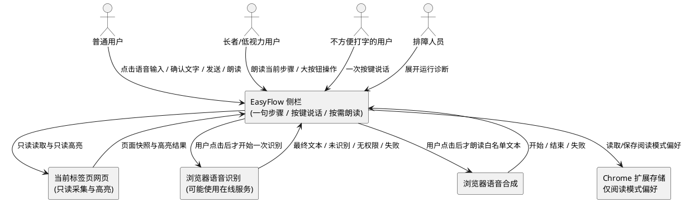
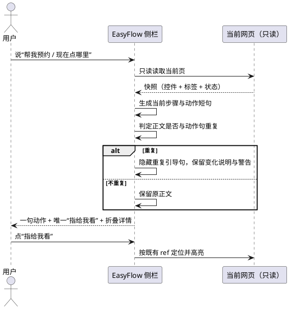
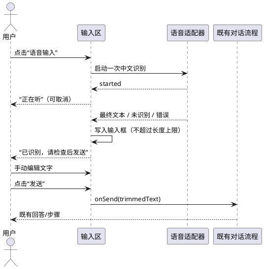
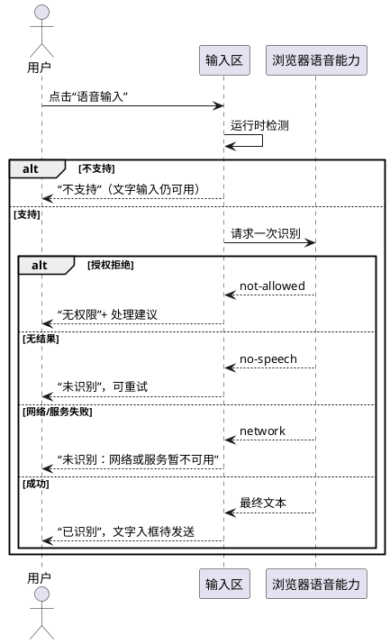
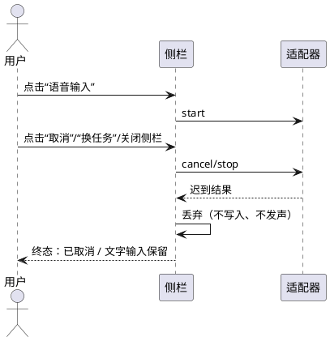
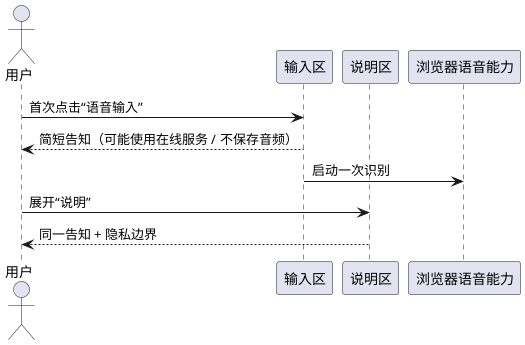
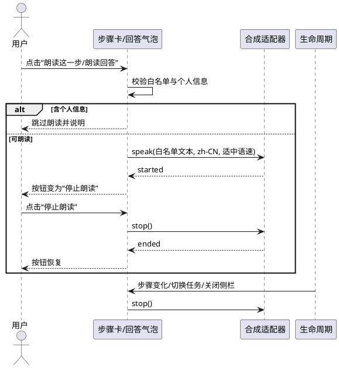
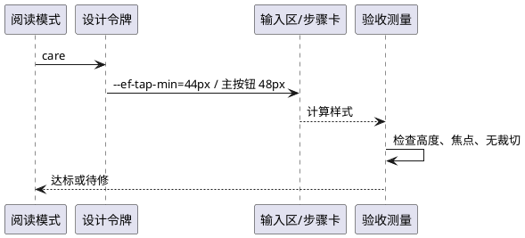
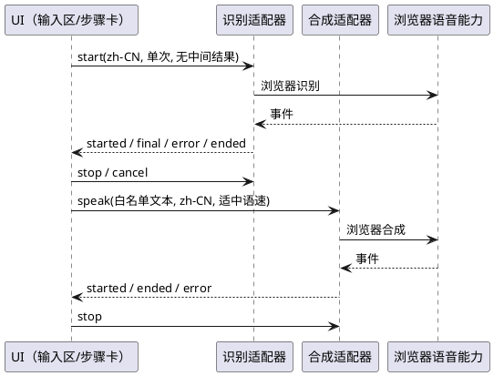

# EasyFlow 当前步骤只说一遍、按键说话与按需朗读需求规格（第五轮增量）

> 本文件是 `easyflow_page_guide` 特性的第五轮增量规格，不替代第一轮 `spec.md`、第二轮 `iteration2-spec.md`、第三轮 `iteration3-spec.md`、第四轮 `iteration4-spec.md`。
>
> 本轮只做三件事：**当前步骤只重复说一遍（去重与首屏）**、**按键说话且先确认文字再人工发送**、**按需朗读并可停止**；同时定义可替换的语音适配器边界，便于自测与后续替换。全程不创建真实预约、不代填、不代提交。
>
> 验收条件采用 EARS 标准英文触发词（When / If / While / Where）+ 中文正文的写法，与前四轮文档语义一致。本文件只描述“要什么、怎么算做到”，不描述类结构、函数签名、文件划分与打包方式（适配器章节只写能力契约，命名与落地形态在设计阶段确定）。
>
> **本阶段声明**：只产出需求规格。未修改任何源码、未修改前四轮文档、未运行 `npm run typecheck` / `npm run build` / `npm run selftest` / `npm run verify`、未创建 `codearts_proof` 实绩日志、未创建真实预约、未调用真实麦克风。

---

## 0. 背景与现状盘点

### 0.1 本轮用户目标（三项，范围封顶）

1. **当前步骤只说一遍**：活动步骤卡保留一句明确动作 + 唯一的“指给我看”；与步骤卡重复的上方引导句（如“先做这一步 / 现在这一步 / 现在请点”）合并或隐藏；警告、页面依据、完成状态不得隐藏；关怀模式约 400px 宽时，当前动作与主按钮在首屏可见；短句中的日期与时刻仍只来自最新页面快照。
2. **按键说话，先确认文字再发送**：输入框旁新增“语音输入”，**用户点击后**才开始一次中文识别；界面清楚显示“正在听 / 已识别 / 未识别 / 无权限 / 不支持”；识别结果只填入可编辑输入框，**不自动发送、不点击网页、不提交**，只有用户点“发送”才走既有 `onSend`；支持取消；关闭侧栏或切换任务时停止；输入长度仍受 `MAX_TURN_CHARS` 限制；识别不可用、网络失败或麦克风被拒绝时，完整文字输入能力保留。
3. **按需朗读**：当前步骤卡提供“朗读这一步”，直接回答卡可提供“朗读回答”，用户点击才朗读，另有“停止朗读”；使用浏览器内置语音合成接口，中文优先、适中语速；离开当前步骤、切换任务、关闭侧栏时停止旧朗读；不自动朗读整页、诊断、原始控件标签与个人信息；朗读中不得重复同一句；关怀模式按钮至少 44px 高。

### 0.2 已核实基线（2026-11-14 只读核查，主工程 `D:\hwproject\translator`）

| 核查项 | 实际结果 | 对本轮规格的约束 |
|---|---|---|
| 应用骨架 | `src/sidepanel/App.tsx:26-69`：`ChatHeader` → `PageStatusLine` → 慢提示 → `main.ef-chat-main`（`MessageList` + `AboutPanel`）→ `ChatComposer` → `DiagnosticsPanel`；第四轮已移除顶部“规则演示”整条横幅 | 语音按钮应加在既有输入区；朗读按钮应加在既有卡片内；不新增独立页面/面板 |
| 输入区 | `ChatComposer.tsx:22-54`：`textarea`（`rows={2}`、`maxLength={MAX_TURN_CHARS}`、`aria-describedby`）+ 提示“Enter 发送 · Shift+Enter 换行”+ 发送按钮；发送前 `text.trim()`，`busy` 或空文本不发送；第四轮已删除“语音未开放”死按钮 | 语音按钮紧邻输入框新增；不得改变 `onSend(text)` 契约、不改变 Enter/Shift+Enter 语义、不改变空文本与 `busy` 判定 |
| 输入长度 | `shared/constants.ts:17` `MAX_TURN_CHARS = 500`；输入框 `maxLength` 与发送逻辑均依赖该常量 | 识别结果填入必须复用同一上限，不得另设第二套长度 |
| 当前步骤卡 | `StepCard.tsx:77-141` 当前态结构：`ef-step-label` 内 `ef-step-state`（文案“现在这一步”）→ `ef-step-goal`（`copy.shortText`）→ 唯一 `ef-step-primary`（“指给我看”）→ `StepDetails`（默认折叠）→ `ef-step-more`（默认折叠 4 个动作） | 去重目标是“现在这一步”状态行与上方助手正文；主按钮唯一性、详情与更多操作结构须保留 |
| 助手正文重复来源 | `RuleEngine.ts:196` 把 `step.goal` 追加进气泡正文（调用点 `435-436`、`517-518` 的“先做这一步：”）；`useConversation.ts:196-200` 重排提示“目前可选的最早时段是…。现在这一步：”“现在这一步是…。”；步骤卡自身再显示 `现在请点 …` | 同一动作在“气泡正文 + 状态行 + 卡片短句”可能重复 2—3 次；必须收敛为 1 次，且不同时删掉“页面变了/时段变了”等有效信息 |
| 短句来源 | `stepCardCopy.ts:385-447`：`buildStepCardCopy` 只用 `activeStep.targetControl` + 最新 `snapshot`，时刻/日期从标签解析，禁止写死；`MessageList.tsx:62-70` 当前卡使用 `activeStep + snapshot`，旧卡 `copy=null` | 本轮去重不得新增时刻/日期字面量；不得改变 `targetRef` 与定位链路 |
| 旧卡与成功态 | `StepCard.tsx:51-62` 非当前态只渲染 `stepCardLabel` + 一行 hint（“已过期/已结束”），不渲染目标、完成条件、详情、按钮；`MessageList.tsx:109-110` 成功态 `ended` | 本轮不得破坏；朗读/语音按钮也不得出现在旧卡与成功态 |
| 既有语音能力 | `src/` 全文检索 `SpeechRecognition|webkitSpeechRecognition|speechSynthesis|SpeechSynthesisUtterance|getUserMedia|MediaRecorder` → **0 命中**；`types.ts:232` 仅保留 `VoiceState` 类型；`conversationReducer.ts:24、100` 只有 `voiceState` 字段且恒为 `"disabled"`；`AboutPanel.tsx:6` 文案“语音暂未开放。” | 本轮是**从零新增**，不是改造既有实现；必须运行时检测，不得假设每台 Chrome 都支持；`voiceState` 字段与既有 `voice-disabled` 通知本轮不改语义 |
| 权限清单 | `public/manifest.json:7` 仅 `activeTab / scripting / sidePanel / storage`；`selftest.mjs:1727` 与 `verify-manifest.mjs` 有断言 | 不得新增 `permissions` / `host_permissions` / `content_scripts`；麦克风授权由浏览器在用户点击后自行弹出，不写入清单 |
| 说明区 | `AboutPanel.tsx:3-8` 默认折叠“说明”，含“本地规则演示，未接入在线模型。”与“语音暂未开放。” | 本轮必须把“语音暂未开放”更新为真实能力与隐私说明；**该文案被 `selftest.mjs:1715` 断言**，需显式调整断言口径（见 4.5、9） |
| 关怀尺寸 token | `sidepanel.css:891-933`：普通 `--ef-tap-min: 28px`、`--ef-primary-min-h: 32px`；`html[data-ui-mode="care"]` 下 `--ef-tap-min: 44px`、`--ef-primary-min-h: 48px`；`--ef-font-body: 18px`、`--ef-font-current: 22px`；`100dvh`、`:focus-visible`、`prefers-reduced-motion` 已就位 | “关怀按钮 ≥44px”在 token 层已有底座；新增按钮**必须消费既有 token**，不得自带更小尺寸，也不得为塞进新按钮缩小字号 |
| 首屏容量 | `.ef-chat-main` 为唯一纵向滚动区；`MessageList.tsx:148-157` 当前卡变化时 `scrollIntoView({block:"nearest"})`；care 下 22px 当前步骤 + 18px 正文会显著增高 | 去重是首屏达标的主要手段；仍需定义“无需手动滚动即可看到动作句 + 主按钮”的验收红线 |
| 既有测试结构 | `selftest.mjs` 用 esbuild `stdin.contents` 导出一组纯函数（`16-49`），用例 `AT-01`—`AT-50`；`AT-38`（1243-1304）断言当前卡唯一与源码字符串；`AT-45`/`AT-50` 扫描 `src/**` 禁止 `02:00|02:15|03:00` 字面量、真实域名与邮箱样式；`AT-50` 断言 `ChatComposer` 不含“语音未开放”、`AboutPanel` 含“语音暂未开放”、CSS 不含 `ef-voice-btn|ef-mode-notice` | 新增语音纯逻辑必须加入同一导出列表才能被断言；`AT-50` 中“语音暂未开放”一行必须显式改写为新文案断言，不得删用例；新增控件不得复用 `ef-voice-btn` 类名 |
| 留痕现状 | `codearts_proof/` 已有 `iteration4-typecheck/build/selftest/verify.log` 与 `23-iteration4-implementation.md` | 本轮沿用同一命名习惯，新增 `iteration5-*` 日志与 `24-iteration5-implementation.md` |

### 0.3 三项需求与现状的差距

| 用户目标 | 现状缺口 | 本轮规格落点 |
|---|---|---|
| 当前步骤只说一遍 | 卡片状态行“现在这一步”与短句“现在请点…”语义重复；气泡正文再追加“先做这一步：{原始目标}”；重排提示再复述“现在这一步是…” | 5.1、6.4 |
| 首屏可见 | 重复文案把当前卡与主按钮推低；care 字号增大后未验证 400px 首屏 | 5.1、5.7、7.2 |
| 按键说话 | 无任何识别代码；`voiceState` 恒为 disabled；无按钮、无状态、无取消 | 5.2、5.3、5.4、5.8 |
| 人工发送边界 | 现状发送为纯文本 `onSend`，天然满足“不自动发送”，但缺少“识别结果不触发发送”的显式约束与可测用例 | 5.2、7.1 |
| 降级 | 只有“语音暂未开放”静态文案，没有不支持/无权限/未识别/网络失败的可感知状态 | 5.3、6.2 |
| 告知与隐私 | 说明区把语音写成“暂未开放”，与新增能力矛盾；无“可能使用在线识别服务”的告知 | 5.5、6.5 |
| 按需朗读 | 无任何合成代码与按钮；无停止；无范围限制 | 5.6 |
| 关怀尺寸 | token 已存在，但新增控件尚未受约束 | 5.7 |

---

## 1. 组件定位

### 1.1 核心职责

本组件负责在用户正在办理的真实网页旁，**用一句不重复的可执行当前步骤 + 唯一“指给我看”**，并让用户**自己决定**是否用语音说出需求、是否朗读当前步骤或回答，最终仍由用户本人确认文字、点击发送并在网页上自行操作。

### 1.2 核心输入

1. **当前标签页只读页面快照**：可见文本条目、可交互控件（含标签、类型、可见/禁用/选中、语义 `date/time/next/form/generic`）、采集时刻与 `snapshotId`。
2. **当前陪办计划与当前步骤**：计划状态、`currentIndex`、当前步骤的 `targetControl`（含 `ref` 与原始标签）、`completionCondition`。
3. **会话与回答**：助手消息正文、限制建议、引用锚点、步骤卡、完成系统提示。
4. **用户操作**：输入文字、点击“语音输入”、点击取消识别、点击“发送”、点击“指给我看”、点击“朗读这一步 / 朗读回答 / 停止朗读”、展开详情与更多操作、切换任务。
5. **浏览器语音能力信号**：识别构造器是否存在、麦克风授权结果、识别结束/出错、合成接口是否存在、朗读结束/出错（均来自运行时检测，不预设）。
6. **生命周期信号**：当前卡变化、计划变化、成功态成立、切换任务、侧栏卸载/关闭。

### 1.3 核心输出

1. **当前步骤卡**：一句动作短句、唯一“指给我看”、次级“朗读这一步”、默认折叠的“详细信息 / 网页依据”、默认折叠的“遇到问题 / 更多操作”。
2. **输入区**：文字输入框、语音输入按钮与可见状态文案、取消识别入口、发送按钮。
3. **直接回答区**：回答正文、可选的“朗读回答 / 停止朗读”、默认折叠“网页依据”。
4. **降级与告知**：不支持 / 无权限 / 未识别 / 识别失败的可读提示；语音能力的简短告知（可能使用在线识别服务、不保存音频）。
5. **保持不变的既有输出**：页面高亮、运行诊断、旧卡与成功态收口。

### 1.4 职责边界

1. 本组件**禁止**自动发送、自动点击网页、自动提交表单、自动选择日期/时段；语音与朗读都只是“填充文字”和“读出已展示文字”。
2. 本组件**禁止**把识别结果直接写入对话流水线或直接调用对话引擎；只能写入输入框，由用户点击“发送”触发既有 `onSend`。
3. 本组件**禁止**保存音频、识别中间结果、语音日志、识别原文到任何存储或诊断。
4. 本组件**禁止**调用外部语音 API、引入语音 SDK；只使用浏览器运行时提供的识别/合成能力。
5. 本组件**禁止**新增权限、扩大网站通配权限；不得把麦克风使用写成“离线”。
6. 本组件**禁止**朗读整页正文、诊断、原始控件标签、`elementId/domPath/score/role`、姓名/邮箱/证件号/手机号等个人信息。
7. 本组件**禁止**改变页面采集、动态时段重规划、成功页判定、本人填写/提交边界与高亮 `ref`。
8. 本组件**禁止**把语音不可用作为阻断条件；任何降级下文字输入与既有指引必须完整可用。
9. 本组件不负责跨设备同步、不负责语音模型训练、不负责自定义音色、不负责离线识别承诺。

---

## 2. 领域术语

**当前步骤动作句**
: 当前可执行步骤卡首行唯一的那一句可执行短句，说明“现在做什么”，不超过约 24 个汉字（或英文等价长度），时刻/日期只能来自最新页面快照。

**重复引导句**
: 与当前步骤动作句表达同一动作的上方文字，例如“先做这一步：”“现在这一步”“现在这一步是…”“现在请点…”。同一动作在侧栏可见区域内只允许出现一次。

**有效附加信息**
: 步骤卡未覆盖且用户需要知道的信息，包括页面变化说明、时段被替换说明、限制/警告建议、失败原因。

**按键说话**
: 用户主动点击“语音输入”后才开始的一次中文语音识别；不做常驻监听、不做唤醒词、不在页面加载时启动。

**识别结果**
: 一次识别会话最终交付的文本；只有该最终文本可以填入输入框，识别过程中的临时/中间文本不得填入、不得进入消息流、不得留存。

**人工发送**
: 用户在看到并确认输入框文字后，自己点击“发送”（或按 Enter）触发的既有发送流程；语音输入不产生任何隐式发送。

**语音输入状态**
: 输入区可感知的语音输入阶段，必备可见状态为：正在听、已识别、未识别、无权限、不支持；允许在其上附加“已取消”“识别失败”等说明性文字，但不得用技术错误码替代用户可读文案。

**朗读**
: 用户点击后，由浏览器内置语音合成朗读**当前步骤动作句**或**直接回答正文**；不朗读页面、不朗读诊断、不朗读原始控件标签与个人信息。

**朗读范围**
: 朗读文本的白名单：当前步骤动作句、直接回答正文。白名单之外的内容（网页依据原文、详情里原文标签、完成条件、诊断、按钮标签、姓名邮箱等）一律不朗读。

**语音能力告知**
: 首次由用户主动点击语音输入时给出的简短说明：识别由浏览器提供、可能使用浏览器厂商的在线服务、本扩展不保存音频。

**适配器**
: 把“浏览器语音识别/合成”与侧栏 UI 隔开的一层能力契约；UI 只依赖契约，测试用假适配器替换，替换后不改变 UI 行为与文案。

**降级**
: 语音识别或朗读不可用（不支持/无权限/未识别/网络失败/朗读失败）时，保留完整文字输入与其他既有功能，并给出可读说明。

---

## 3. 角色与边界

### 3.1 核心角色

1. **普通用户**：用键盘或语音说出需求，确认文字后自行发送；自行在网页上填写与提交。
2. **长者 / 低视力用户**：需要更大的字号与按钮、可朗读的当前步骤、更少的重复文字；不一定能快速阅读长句。
3. **不方便打字的用户**：用一次按键说话替代输入法，但仍需确认文字后再发送。
4. **排障人员（开发/测试）**：需要折叠运行诊断确认“识别不可用/朗读不可用”的类别，但不得看到识别原文或音频。

### 3.2 外部系统

1. **当前标签页网页**：只读采集与只读高亮；语音与朗读均不写页面。
2. **浏览器语音识别能力**：运行时检测；可能依赖浏览器厂商的在线服务；是否可用、是否允许麦克风由浏览器决定。
3. **浏览器语音合成能力**：运行时检测；本地或系统语音引擎；不产生本扩展的网络请求。
4. **Chrome 扩展运行时**：侧栏承载、既有消息通道、既有 `storage`（仅阅读模式偏好，本轮不新增键）。
5. **系统显示与动效设置**：`prefers-reduced-motion` 与页面缩放影响排版与可达性。

### 3.3 交互上下文

图中禁止出现侧栏内部组件划分、函数名、接口参数、数据库与表结构。

---

## 4. DFX 约束

### 4.1 性能

1. **开始反馈**：When 用户点击“语音输入”，the system shall 在 300 毫秒内给出“正在听”或明确的不可用反馈，不得出现点击后无反应。
2. **填入时延**：When 识别会话交付最终文本，the system shall 在 500 毫秒内把文本写入输入框并显示“已识别”，不追加消息、不触发发送。
3. **朗读启动**：When 用户点击朗读，the system shall 在 500 毫秒内开始朗读或给出不可用/失败提示。
4. **停止时延**：When 用户点击“停止朗读”或触发停止条件，the system shall 在 300 毫秒内停止发声。
5. **首屏**：去重后，当前步骤动作句与“指给我看”shall 不需要用户手动滚动即可进入可视区（约 400px 宽、关怀模式）。
6. **无额外采集**：语音与朗读 shall 不触发页面重新读取、不新增页面采集、不新增本扩展的网络请求。

### 4.2 可靠性

1. **单会话**：While 任一识别会话进行中，the system shall 最多只有一个活动会话；重复点击不得产生并行识别。
2. **单朗读**：While 任一朗读进行中，the system shall 最多只有一段朗读；再次朗读必须先停止旧朗读。
3. **终态收敛**：When 识别或朗读结束（含成功、取消、错误、超时），the system shall 进入确定终态并恢复按钮可用状态，不得停留在“正在听/正在朗读”。
4. **迟到结果丢弃**：If 会话已被取消、切换任务或卸载，the system shall 丢弃随后到达的识别结果与朗读回调，不得写入输入框或继续发声。
5. **降级不阻断**：If 语音识别或朗读不可用，the system shall 保持文字输入、发送、“指给我看”、更多操作、诊断完全可用。
6. **幂等**：When 用户连续快速点击取消或重复点击朗读，the system shall 不报错、不叠加会话、不产生重复朗读。

### 4.3 安全性

1. **权限不变**：本轮 shall 不新增任何 `permissions` / `host_permissions` / `content_scripts`；麦克风授权只由浏览器在用户点击后自行请求。
2. **不采集音频**：the system shall 不录音、不保存音频、不做音频转写留档，不把音频或识别中间结果发送给除浏览器语音能力之外的任何一方。
3. **不落盘**：the system shall 不把识别结果、识别状态、语音错误写进 `storage`、消息历史、诊断条目或页面。
4. **只填输入框**：识别结果只允许出现在输入框；不得进入 `AssistantMessage`、`UserMessage`、`DialogueRequest`，除非用户点击发送。
5. **不代操作**：语音与朗读 shall 不点击、不聚焦、不填写、不提交网页元素。
6. **朗读白名单**：朗读文本必须来自白名单；命中个人信息模式（姓名、邮箱、证件号、手机号、银行卡号、验证码）时不得朗读该句。
7. **诊断清洁**：诊断只允许记录“识别不可用类别/朗读不可用类别”等枚举，不得记录识别原文、音频、完整 URL 查询串与页面正文。
8. **告知真实**：不得把浏览器语音识别描述为“离线”“本地完成”“不上传”；告知文案必须说明可能使用在线服务。

### 4.4 可维护性

1. **文案单源**：语音输入五类状态文案、取消/停止文案、告知文案、朗读按钮文案 shall 各只有一处来源；组件不得各写一份。
2. **常量命名**：语速、语言、状态超时、按钮尺寸相关取值 shall 使用命名常量或既有 CSS token，不得散落魔法数。
3. **适配器隔离**：UI 不得直接依赖浏览器语音全局对象；必须通过可替换的能力契约访问，以便用假适配器自测。
4. **可诊断**：新增的不可用/失败 shall 有可枚举的错误类别，进入折叠诊断时只显示类别，不显示原文。
5. **可回滚**：移除语音与朗读入口后，短句、去重、发送、指给我看、旧卡与成功态行为应保持不变。

### 4.5 兼容性

1. **运行时检测**：the system shall 在每次打开侧栏时检测识别/合成能力，不得假设“Chrome 一定支持中文识别”。
2. **旧状态字段**：`ConversationState.voiceState`、`NoticeKind` 中的 `voice-disabled`、`DialogueCapabilities.voiceEnabled` 既有语义不得改变；本轮语音输入状态为侧栏临时 UI 状态，不写入会话状态机、不跨会话恢复。
3. **发送契约**：`ChatComposer` 对外的 `onSend(text)`、`disabled` 语义保持不变；不得新增“语音专用发送通道”。
4. **既有样式类**：新增控件不得复用第四轮已删除的 `ef-voice-btn`、`ef-mode-notice`（`AT-50` 明确断言其不存在）。
5. **既有测试口径**：`AT-50` 中 `AboutPanel` 含“语音暂未开放”的断言必须显式改写为新的告知文案断言，并保留同用例其他断言；`AT-45`/`AT-50` 的“源码无测试时刻字面量、无真实域名、无邮箱样式”约束继续有效。
6. **消息协议**：本轮不新增跨进程消息类型；语音与朗读不经过后台路由与 content 脚本。
7. **第三方页面**：不修改网页 DOM 与样式；不注入可见内容；高亮仍只在独立覆盖层。

---

## 5. 核心能力

## 5.1 当前步骤只说一遍

### 5.1.1 业务规则

1. **R-101 同一动作只出现一次**：While 存在当前可执行步骤，the system shall 使用户可见区域内“现在做什么”的动作句只出现 1 次，并且该句只位于当前步骤卡内。
   a. 验收条件：产生当前步骤后，从顶部到卡片底部逐条检查 → “现在这一步”“先做这一步”“现在这一步是…”与卡片短句合计只表达一次动作。
2. **R-102 上方重复引导句隐藏或合并**：If 助手消息正文与当前步骤动作句表达同一动作（含“先做这一步：”“现在这一步是…”“现在请点…”），the system shall 隐藏该重复句或合并进步骤卡，不得两处同时出现。
   a. 验收条件：新产生的下一步消息 → 气泡正文不出现“先做这一步”“现在这一步是”；卡片短句仍完整可读。
3. **R-103 有效附加信息必须保留**：When 隐藏重复引导句，the system shall 保留页面变化说明、时段被替换说明、限制/警告建议与失败原因。
   a. 验收条件：时段被替换后 → 用户仍能看到“原来要点的…现在不在页面上”“现在最早是…”等变化说明；限制回答中的 `advice` 仍可见。
4. **R-104 页面依据不得隐藏**：The system shall 保留助手回答下的“网页依据（N 处）”折叠入口与“在网页中查看”定位能力。
   a. 验收条件：津贴问答 → 去重后仍可展开依据并定位原文。
5. **R-105 完成状态不得隐藏**：While 成功态成立，the system shall 保留完成提示与“已结束”状态，不得因去重把完成消息隐藏。
   a. 验收条件：成功页 → 完成提示可见；旧卡显示“这一步已结束”。
6. **R-106 关怀模式首屏可见**：While 侧栏宽度约 400px 且处于长者关怀模式，the system shall 使用户无需手动滚动即可看到当前步骤动作句全文与“指给我看”主按钮（完整高度）。
   a. 验收条件：care 模式、约 400px 宽、存在 1—3 条历史消息 → 打开侧栏后动作句与主按钮完整位于首屏；主按钮高度不小于 48px。
7. **R-107 动态日期时刻来源不变**：When 当前步骤动作句包含日期或时刻，the system shall 只使用最新快照中当前步骤目标控件的值，沿用第四轮 `buildStepCardCopy` 语义。
   a. 验收条件：时段被重排后 → 动作句使用新时段；旧时段不再作为当前指引；源码不新增演示时刻/日期字面量。
8. **R-108 去重不得削弱定位**：The system shall 使去重只影响文字呈现，不改变 `targetRef`、`elementId`、`domPath`、`textHash`，不改变“指给我看”的定位结果。
   a. 验收条件：去重前后点击“指给我看” → 高亮落在同一网页元素。
9. **R-109 旧卡与成功态不新增指令**：While 卡片处于过期/结束态，the system shall 不显示动作句、不显示“指给我看”、不显示朗读按钮。
   a. 验收条件：历史卡 → 只有“已过期/已结束”状态行；成功页所有卡均无动作与朗读。
10. **R-110 禁止项**：The system shall 禁止通过删除警告、依据、完成状态或隐藏卡片来“实现去重”，也禁止把同一动作改写成两句近义词继续重复。
    a. 验收条件：去重后逐项核对警告/依据/完成状态均存在；卡片动作句数量仍为 1。

### 5.1.2 交互流程

### 5.1.3 异常场景

1. **正文全部是重复句**
   a. 触发条件：助手正文只有“先做这一步：{目标}”，没有其他有效信息。
   b. 系统行为：隐藏整段正文，只显示步骤卡与系统状态行；不得留空气泡占位。
   c. 用户感知：只看到一句动作，界面无空洞。
2. **正文同时含重复句与变化说明**
   a. 触发条件：重排提示“原来要点的…不在页面上了。现在这一步是…”同时出现。
   b. 系统行为：保留前半段变化说明，隐藏“现在这一步是…”尾句。
   c. 用户感知：知道“页面变了”，但不会读到第二遍动作。
3. **去重后首屏仍不够**
   a. 触发条件：care 模式 + 400px + 多条历史。
   b. 系统行为：自动把当前卡滚入视口，并压缩非关键说明（输入提示、说明区、诊断摘要）；不得隐藏动作句、主按钮、警告。
   c. 用户感知：无需手动滚动即可看到动作与主按钮。
4. **短句回退为通用句**
   a. 触发条件：标签不可解析或已被截断。
   b. 系统行为：卡片显示通用回退句；上方正文仍不得复述同一句。
   c. 用户感知：只有一句通用指引，仍可“指给我看”。
5. **旧消息重新渲染**
   a. 触发条件：切换阅读模式或新增消息导致历史重绘。
   b. 系统行为：历史正文按原样保留（历史语义），但当前动作句仍只出现一次；旧卡不可操作。
   c. 用户感知：不会看到两张“当前步骤”。

## 5.2 按键说话与人工发送

### 5.2.1 业务规则

1. **R-111 入口位置**：The system shall 在输入框旁提供“语音输入”按钮，带可见文字与可读名称，键盘可达。
   a. 验收条件：侧栏输入区 → 可见“语音输入”按钮；Tab 可聚焦，Enter/Space 可触发。
2. **R-112 仅点击后启动**：The system shall 只在用户点击“语音输入”后启动一次识别，不得在侧栏打开、页面加载、页面变化、消息发送时自动启动。
   a. 验收条件：仅打开侧栏并等待 → 无麦克风请求、无“正在听”；点击后才进入“正在听”。
3. **R-113 一次一个会话**：While 识别进行中，the system shall 禁止再启动第二个识别；重复点击应被忽略或先取消再重新开始，且不得并行。
   a. 验收条件：连续点击 3 次 → 活动会话数不超过 1；按钮状态一致；无重复结果写入。
4. **R-114 五类可见状态**：The system shall 在输入区清楚显示“正在听”“已识别”“未识别”“无权限”“不支持”五类状态，任一状态均有可见文字（不得只用颜色/图标）。
   a. 验收条件：逐一触发五种情形 → 对应中文文案可见；状态文字与按钮可读名称一致。
5. **R-115 结果只入输入框**：When 一次识别会话交付最终文本，the system shall 只把该文本写入输入框，并保留用户继续编辑的能力（可修改、可删除、可全选替换）。
   a. 验收条件：识别后 → 输入框出现识别文字；消息条数不变；对话轮次不变。
6. **R-116 不自动发送**：The system shall 在识别结果写入后保持“未发送”状态，不得自动调用发送、不得模拟 Enter、不得触发对话请求。
   a. 验收条件：识别结束后等待 5 秒 → 无用户消息、无助手回复、无页面动作；必须由用户点击“发送”才产生消息。
7. **R-117 发送走既有链路**：When 用户点击“发送”，the system shall 调用既有 `onSend(text)`，沿用空文本/纯空白不发、`busy` 时禁用、Enter 发送与 Shift+Enter 换行的既有语义。
   a. 验收条件：识别文字 + 点击发送 → 产生 1 条用户消息并进入既有对话流程；`busy` 时发送按钮禁用；Shift+Enter 仍换行。
8. **R-118 不改写输入内容**：The system shall 不对识别文本做自动纠错、自动补全、自动加标点以外的改写，也不得在用户未确认前替换既有输入。
   a. 验收条件：用户已输入“帮我预约” → 识别结果写入后可完整看到原有文字与新增文字，且可手动编辑。
9. **R-119 输入长度上限**：The system shall 使写入后的输入文本长度不超过 `MAX_TURN_CHARS`；超长时不得自动发送、不得截断成半句造成歧义。
   a. 验收条件：输入框已有 480 字 + 识别到 40 字 → 不发生越界写入与自动发送；界面给出“内容较长，请先精简”的可读提示，原文字保留。
10. **R-120 中间结果不入框**：While 识别进行中，the system shall 不把临时/中间识别文本写入输入框、消息流、诊断或存储。
    a. 验收条件：识别过程中输入框内容不变；“正在听”期间无新增消息；结束后只有一份最终文本。
11. **R-121 禁止项**：The system shall 禁止把语音按钮做成“一键发送”、禁止识别后自动聚焦并触发发送、禁止用语音直接调用网页控件。
    a. 验收条件：源码中不存在“识别结果 → 直接发送/点击/提交”的调用路径；人工验证识别后页面无变化。

### 5.2.2 交互流程

### 5.2.3 异常场景

1. **识别为空**
   a. 触发条件：用户未说话或环境太静，浏览器返回“未识别”。
   b. 系统行为：保持输入框原文；显示“未识别到语音，请再试或直接打字”；恢复按钮可用。
   c. 用户感知：可立即重试或继续打字。
2. **识别超时**
   a. 触发条件：会话长时间无最终结果。
   b. 系统行为：主动结束会话并进入终态（归入“未识别”并说明原因），不得永久“正在听”。
   c. 用户感知：状态回到可重试。
3. **输入框已有内容**
   a. 触发条件：用户先打字再语音。
   b. 系统行为：默认追加到末尾并保留原文；若追加会超过上限，则不写入并提示精简。
   c. 用户感知：原有文字不丢失。
4. **识别期间用户手动发送**
   a. 触发条件：用户一边识别一边点击发送。
   b. 系统行为：按既有 `busy` 与文本判空规则发送既有文字；识别会话继续，最终结果仍只填入输入框，不追加到已发送消息。
   c. 用户感知：发送内容与识别内容边界清晰。
5. **识别期间切换任务**
   a. 触发条件：用户点击“换一个任务”或新任务开始。
   b. 系统行为：立即停止识别，丢弃迟到结果；输入框保留现有文字。
   c. 用户感知：不会把上一个任务的语音混入新任务。

## 5.3 识别不可用与降级

### 5.3.1 业务规则

1. **R-122 运行时检测**：The system shall 在每次侧栏打开时检测识别能力；If 构造器不存在，the system shall 进入“不支持”。
   a. 验收条件：模拟无识别构造器 → 不发起任何麦克风调用；显示“不支持”；无控制台异常。
2. **R-123 无权限**：If 用户拒绝麦克风或浏览器未授权，the system shall 进入“无权限”，并给出可理解的下一步建议（在浏览器地址栏/站点设置中允许麦克风，或直接打字）。
   a. 验收条件：拒绝授权 → “无权限”可见；不反复自动弹出授权框；文字输入可用。
3. **R-124 未识别**：If 一次识别没有可用结果，the system shall 进入“未识别”并允许直接重试。
   a. 验收条件：静音识别 → “未识别”；再次点击可重新进入“正在听”。
4. **R-125 网络/服务失败**：If 识别因网络或浏览器语音服务失败，the system shall 在“未识别”状态内给出“网络或服务暂不可用”的具体说明，不得显示技术错误码。
   a. 验收条件：模拟网络类错误 → 可见中文说明；无 `NotAllowedError`/`network` 等原始字符串出现在主界面。
5. **R-126 无麦克风设备**：If 系统没有可用麦克风，the system shall 归入“无权限/不可用”一类并说明，不得伪装成“未识别”。
   a. 验收条件：模拟 `audio-capture` → 文案说明“没有检测到麦克风”；仍可打字。
6. **R-127 降级保留完整文字能力**：While 处于任一不可用/失败状态，the system shall 保持输入框原内容、可编辑、可发送，且“指给我看”、更多操作、朗读、诊断可用。
   a. 验收条件：五种降级状态下逐一验证 → 均可打字并成功发送一条消息。
7. **R-128 可恢复**：When 用户设备/权限状态改变（例如重新允许麦克风），the system shall 允许再次点击重试并重新检测，不得永久锁定。
   a. 验收条件：先拒绝 → 允许后再次点击 → 可进入“正在听”。
8. **R-129 禁止项**：The system shall 禁止在不可用状态下把按钮做成看起来可用的可点击“死按钮”，也禁止用“语音暂未开放”掩盖真实错误类别。
   a. 验收条件：不可用状态 → 按钮显示禁用态或明确的不可用形态，并有文字说明；无“点击无反应”。

### 5.3.2 交互流程

### 5.3.3 异常场景

1. **授权弹窗被忽略**
   a. 触发条件：用户不点允许也不点拒绝，弹窗关闭。
   b. 系统行为：按“无权限”处理，进入终态，不循环弹窗。
   c. 用户感知：状态明确，可打字。
2. **识别中途被系统打断**
   a. 触发条件：来电、系统占用麦克风、用户切换应用。
   b. 系统行为：结束会话，保留已有文字，给出“识别已中断”的可读说明。
   c. 用户感知：不会卡在“正在听”。
3. **浏览器支持但中文识别不可用**
   a. 触发条件：构造器存在但中文语言不被支持。
   b. 系统行为：按“不支持/未识别”降级并说明；不得退化为英文识别后填入英文。
   c. 用户感知：不会出现莫名英文结果。
4. **隐私模式/受限环境**
   a. 触发条件：侧栏处于受限环境导致无法访问麦克风。
   b. 系统行为：降级为文字输入，提示受限；不尝试绕过。
   c. 用户感知：可继续办事。

## 5.4 识别与朗读的生命周期

### 5.4.1 业务规则

1. **R-130 可取消**：While 处于“正在听”，the system shall 提供可点击的“取消”入口；取消后立即进入终态且不写入任何结果。
   a. 验收条件：点击“取消” → 状态不再显示“正在听”；随后到达的结果不进入输入框。
2. **R-131 切换任务停止**：When 用户点击“换一个任务”、开始新计划或新任务被确认，the system shall 停止识别与朗读。
   a. 验收条件：识别中切换任务 → 无后续结果写入；朗读中切换任务 → 立即停止发声。
3. **R-132 步骤变化停止**：When 当前步骤卡切换到新步骤、计划结束或成功态成立，the system shall 停止旧朗读，并按需停止识别。
   a. 验收条件：朗读当前步骤 A → 页面重排到步骤 B → A 的朗读不再继续；新步骤可重新点朗读。
4. **R-133 关闭侧栏停止**：When 侧栏被关闭或组件卸载，the system shall 立即停止识别与朗读，不得在后台继续录音或发声。
   a. 验收条件：卸载监听被触发 → 适配器收到停止/取消调用；无残留发声。
5. **R-134 迟到结果丢弃**：If 会话已停止或已切换到其他任务，the system shall 丢弃随后到达的识别最终结果与朗读结束回调。
   a. 验收条件：取消后延迟 2 秒人工触发“最终结果” → 输入框不变化。
6. **R-135 事件幂等**：When 停止条件被重复触发（切换任务 + 卸载同时发生），the system shall 只执行一次停止，不报错、不重复计数。
   a. 验收条件：连续两次停止 → 适配器停止调用不超过两次且无异常；状态稳定。
7. **R-136 禁止项**：The system shall 禁止在侧栏关闭后继续持有麦克风会话，也禁止在页面切换后继续朗读已失效的旧步骤。
   a. 验收条件：关闭侧栏 → 浏览器麦克风指示消失；切换页面 → 旧朗读停止。

### 5.4.2 交互流程

### 5.4.3 异常场景

1. **停止失败**
   a. 触发条件：适配器停止调用抛错。
   b. 系统行为：忽略错误，仍标记终态并丢弃后续结果；记录不含原文的诊断类别。
   c. 用户感知：界面已停止，不出现错误码。
2. **卸载时仍有朗读队列**
   a. 触发条件：连续朗读多句后立即关闭侧栏。
   b. 系统行为：清空队列并停止当前朗读。
   c. 用户感知：关闭后无声。
3. **重复取消**
   a. 触发条件：用户连点取消。
   b. 系统行为：幂等，状态不再变化。
   c. 用户感知：无闪烁、无报错。

## 5.5 语音能力告知与隐私

### 5.5.1 业务规则

1. **R-137 首次告知**：When 用户首次点击“语音输入”，the system shall 在启动识别前给出简短告知：识别由浏览器提供、可能使用浏览器厂商的在线服务、本扩展不保存音频。
   a. 验收条件：首次点击 → 可见一行简短中文告知；告知不妨碍继续操作，不出现长模态。
2. **R-138 可再次查看**：The system shall 在既有“说明”折叠区保留同一告知与隐私边界，用户可随时查看。
   a. 验收条件：展开“说明” → 可见语音告知与“不保存音频/不代填不代提交”。
3. **R-139 不宣称离线**：The system shall 禁止在任何界面或文档中把浏览器语音识别描述为“离线”“纯本地”“不上传音频”。
   a. 验收条件：全文检索界面文案 → 无“离线语音”类表述。
4. **R-140 不保存语音数据**：The system shall 不保存音频、中间结果、语音日志、识别原文（识别原文仅在输入框内存在，随用户发送或关闭侧栏消失）。
   a. 验收条件：识别后检查 `chrome.storage.local`、消息历史、诊断 → 只有输入框存在文本；关闭重开侧栏后不恢复该文本。
5. **R-141 不调用外部语音 API**：The system shall 不引入语音 SDK、不向自建或第三方语音接口发送音频/文本。
   a. 验收条件：源码与构建产物检索 → 无语音 API 端点、无新增网络请求代码路径。
6. **R-142 权限不扩大**：The system shall 保持清单权限集合不变；麦克风授权仅由浏览器在用户点击后请求。
   a. 验收条件：`manifest.json` 权限仍为四项；无 `host_permissions`；无 `<all_urls>`。
7. **R-143 朗读不外发**：The system shall 使朗读只调用浏览器内置合成能力，不把朗读文本发送给任何服务。
   a. 验收条件：朗读期间无本扩展网络请求。
8. **R-144 告知不得反复打断**：While 同一侧栏会话内，the system shall 最多自动显示一次简短告知，后续点击不再重复弹出；说明区仍可主动查看。
   a. 验收条件：同一会话第 2、3 次点击 → 不再出现新告知条，直接进入“正在听”。

### 5.5.2 交互流程

### 5.5.3 异常场景

1. **告知被跳过**
   a. 触发条件：用户快速连点语音按钮。
   b. 系统行为：首次仍必须出现告知（至少 1 次渲染），但不得因此启动两次识别。
   c. 用户感知：看到一次告知，只有一次识别。
2. **用户质疑“是否录音”**
   a. 触发条件：用户问语音是否被保存。
   b. 系统行为：按事实回答：不保存音频、不保存识别原文、仅输入框内存在；可能使用浏览器在线服务。
   c. 用户感知：获得明确边界，不被夸大承诺。
3. **说明区被折叠**
   a. 触发条件：用户从未展开说明。
   b. 系统行为：首次点击仍给简短告知，不依赖用户先展开。
   c. 用户感知：被告知一次。

## 5.6 按需朗读

### 5.6.1 业务规则

1. **R-145 当前步骤朗读入口**：While 存在当前可执行步骤，the system shall 在步骤卡内提供“朗读这一步”按钮（次级，不抢“指给我看”主按钮位置）。
   a. 验收条件：当前卡 → 可见“朗读这一步”；主按钮仍只有“指给我看”1 个。
2. **R-146 直接回答朗读入口**：Where 助手消息为直接回答且含正文，the system shall 在回答气泡内提供“朗读回答”按钮。
   a. 验收条件：政策问答 → 可见“朗读回答”；步骤卡、旧卡、成功态无此按钮。
3. **R-147 仅点击才朗读**：The system shall 只在用户点击后朗读，禁止自动朗读、禁止在消息到达时朗读、禁止朗读整页。
   a. 验收条件：收到回答后等待 → 无发声；点击后才发声。
4. **R-148 朗读范围白名单**：The system shall 使“朗读这一步”只读当前步骤动作句；“朗读回答”只读回答正文；不得读网页依据原文、详情中的原始控件标签、完成条件、诊断、按钮标签、系统状态行。
   a. 验收条件：展开详情后朗读回答 → 不读出原始标签；朗读步骤 → 不读出“完成条件：…”与引用原文。
5. **R-149 停止朗读**：While 正在朗读，the system shall 把入口切换为“停止朗读”，点击后立即停止。
   a. 验收条件：朗读中点“停止朗读” → 300 毫秒内无声；按钮恢复“朗读…”。
6. **R-150 中文优先与适中语速**：The system shall 优先选择中文（`zh-CN`）语音，语速取适中的命名常量（约 1.0，允许 0.9—1.1），不得使用过快/过慢极端值。
   a. 验收条件：朗读 → 中文发音；语速听感适中；常量集中声明。
7. **R-151 同一句不重复**：The system shall 保证同一句在一次点击中只朗读一次；重复点击“朗读”时不得排队重复朗读同一文本。
   a. 验收条件：连续点击朗读同一句 3 次 → 最多 1 次完整朗读；无叠音、无重复。
8. **R-152 离开即停止**：When 离开当前步骤、切换任务、计划结束、成功态成立或侧栏关闭，the system shall 停止旧朗读，不得继续读已失效内容。
   a. 验收条件：朗读 A 时页面重排/切任务 → 立即停止。
9. **R-153 个人信息不朗读**：If 待朗读文本命中个人信息模式（姓名、邮箱、证件号、手机号、银行卡号、验证码），the system shall 跳过朗读并给出可读说明。
   a. 验收条件：构造含邮箱/手机号的回答 → 点击朗读 → 不发声，显示“这段内容含个人信息，未朗读”。
10. **R-154 不可用降级**：If 浏览器不支持语音合成或朗读失败，the system shall 不显示可点击的正常朗读按钮，改为“当前浏览器不支持朗读”的不可用说明；不阻断其他功能。
    a. 验收条件：模拟无合成接口 → 无朗读按钮或无发声音的死按钮；文字与步骤功能正常。
11. **R-155 禁止项**：The system shall 禁止朗读诊断、禁止朗读页面原文整段、禁止朗读原始 `aria-label`、禁止在朗读中插入营销/提示语。
    a. 验收条件：朗读文本与白名单逐字比对一致；无附加口号。

### 5.6.2 交互流程

### 5.6.3 异常场景

1. **朗读中途被浏览器打断**
   a. 触发条件：系统语音被其他应用抢占。
   b. 系统行为：进入终态，按钮恢复；给出“朗读已中断”的可读说明。
   c. 用户感知：可再次点击朗读。
2. **长文本朗读**
   a. 触发条件：回答正文较长。
   b. 系统行为：按白名单完整朗读或按既有回答长度上限结束；不得拼接依据原文延长朗读。
   c. 用户感知：读的是回答，不是整页。
3. **快速反复点击**
   a. 触发条件：1 秒内点击朗读/停止多次。
   b. 系统行为：单实例队列，先停止再开始；不叠加音轨。
   c. 用户感知：声音不重叠。
4. **切换阅读模式后朗读**
   a. 触发条件：朗读中切换普通/关怀。
   b. 系统行为：朗读继续或停止均可，但不得改变已读文本与范围；不得因模式切换重启朗读。
   c. 用户感知：无重复开头。

## 5.7 关怀模式按钮尺寸与可达性

### 5.7.1 业务规则

1. **R-156 新增按钮尺寸**：While 处于长者关怀模式，the system shall 使新增的“语音输入”“取消”“朗读这一步”“朗读回答”“停止朗读”按钮高度不小于 44px，主要按钮（“指给我看”“发送”）不小于 48px。
   a. 验收条件：care 模式测量 → 新增按钮计算高度 ≥44px；主按钮 ≥48px。
2. **R-157 复用既有 token**：The system shall 使新增控件消费既有尺寸与字号 token，不得自带更小尺寸覆盖。
   a. 验收条件：新增控件样式中出现既有 `--ef-tap-min` / `--ef-primary-min-h` 等变量；无独立写死的小高度。
3. **R-158 不挤占首屏**：The system shall 使新增按钮不把当前动作句与“指给我看”挤出首屏；空间不足时压缩提示文字而不是缩小按钮。
   a. 验收条件：care 400px → 动作句与主按钮在首屏；语音/朗读按钮仍 ≥44px。
4. **R-159 窄栏与 200% 缩放**：While 侧栏约 400px 或页面缩放 200%，the system shall 保持纵向滚动、无横向滚动条、按钮文字不裁切。
   a. 验收条件：400px 与 200% 下 → 语音/朗读/停止按钮完整可见、可点，无横向滚动。
5. **R-160 焦点与语义**：The system shall 为新增控件提供可见焦点与可读名称，状态变化通过文字表达（不只靠颜色）。
   a. 验收条件：键盘 Tab 依次经过语音输入、取消、朗读、停止 → 每步有可见焦点；读屏名称与状态一致。
6. **R-161 禁止项**：The system shall 禁止为放入新按钮而降低字号、裁切文字或隐藏主按钮。
   a. 验收条件：care 模式 → 文字完整、字号不小于既有关怀 token。

### 5.7.2 交互流程

### 5.7.3 异常场景

1. **关怀模式窄宽下按钮换行**
   a. 触发条件：400px + care + 三个按钮同行。
   b. 系统行为：允许换行与增高，优先保证 ≥44px 与文字完整。
   c. 用户感知：按钮变高仍可点。
2. **200% 缩放导致输入区拥挤**
   a. 触发条件：缩放 200% + 诊断展开。
   b. 系统行为：输入区内部滚动与换行，不遮挡发送；语音按钮仍可达。
   c. 用户感知：可滚动到并发送。
3. **普通模式按钮过小**
   a. 触发条件：普通模式 token 较小。
   b. 系统行为：允许小于 44px，但不得小于既有可用尺寸，且不得低于可点最小尺寸；关怀模式必须达标。
   c. 用户感知：普通模式仍可点。

## 5.8 语音适配器能力契约

> 本节只定义“能力与行为契约”，用于替换实现与自动化自测；不规定函数名、文件位置与内部结构（设计阶段确定）。

### 5.8.1 业务规则

1. **R-162 UI 不直连浏览器全局对象**：The system shall 通过可替换的识别适配器与合成适配器访问浏览器语音能力，UI 不直接调用浏览器语音构造器。
   a. 验收条件：替换为假适配器后 → 界面行为与文案完全一致；源码检索 UI 组件不直接出现浏览器语音构造器名。
2. **R-163 识别适配器输入**：The system shall 使识别适配器接收：中文语言偏好、单次会话标志、是否允许中间结果（固定不允许）、停止/取消指令。
   a. 验收条件：启动参数包含中文语言与“单次”；中间结果开关为关闭。
3. **R-164 识别适配器输出**：The system shall 使识别适配器只输出四类事件：已开始、最终文本、错误（带错误类别）、已结束；不得输出音频、不得输出中间文本给 UI。
   a. 验收条件：假适配器注入四类事件 → UI 分别进入对应状态；中间事件不改变输入框。
4. **R-165 合成适配器输入输出**：The system shall 使合成适配器接收：白名单文本、中文优先、适中语速；输出：已开始、已结束、错误（含不支持）；并提供停止。
   a. 验收条件：假适配器记录调用参数 → 语言为中文、语速在适中范围、文本与白名单一致。
5. **R-166 错误类别统一映射**：The system shall 把适配器错误映射为统一类别：不支持、无权限、无麦克风、未识别、网络/服务失败、已取消、未知；界面文案由类别统一生成。
   a. 验收条件：逐一注入类别 → 对应可见文案；未知类别回退到“未识别/识别失败”且不暴露技术字符串。
6. **R-167 适配器幂等与取消语义**：The system shall 保证适配器在已停止/已取消后不再交付最终结果；重复停止不报错。
   a. 验收条件：取消后注入结果 → UI 无变化；停止两次 → 无异常。
7. **R-168 可注入、可断言**：The system shall 使适配器可在测试中注入假实现，且不触发真实麦克风、不产生真实发声、不产生真实预约。
   a. 验收条件：自测运行期间无麦克风权限请求、无音频输出、无网络请求。
8. **R-169 禁止项**：The system shall 禁止在适配器内做自动发送、自动点击网页、自动保存音频、自动重试无限循环。
   a. 验收条件：适配器实现检索无上述调用；重试次数有上限。

### 5.8.2 交互流程

### 5.8.3 异常场景

1. **适配器构造失败**
   a. 触发条件：运行时检测抛错。
   b. 系统行为：按“不支持”降级，记录类别，不影响文字输入。
   c. 用户感知：“不支持”，可打字。
2. **事件乱序**
   a. 触发条件：先到 ended 后到 final。
   b. 系统行为：以终态为准，迟到事件丢弃；不得在终态后改回“正在听”。
   c. 用户感知：状态稳定。
3. **重复开始**
   a. 触发条件：UI 连续调用 start。
   b. 系统行为：适配器内部保证单会话，第二次忽略或先停再起。
   c. 用户感知：只有一次识别。

---

## 6. 数据约束

### 6.1 语音输入状态模型

1. **state**：枚举，允许值 `idle | listening | recognized | no-speech | permission-denied | unsupported | failed | cancelled`。
2. **requiredVisibleStates**：必备可见类别为 `listening`（正在听）、`recognized`（已识别）、`no-speech`（未识别）、`permission-denied`（无权限）、`unsupported`（不支持）；`failed` 必须归入“未识别/识别失败”文案族，不得显示技术错误码。
3. **transcript**：识别最终文本；只在输入框内存在；不得写入存储、消息、诊断；长度受 `MAX_TURN_CHARS` 约束。
4. **sessionId**：每次点击生成的新会话标识，用于丢弃迟到结果；不持久化。
5. **startedAt / endedAt**：用于判断超时与终态，不写入诊断明细（可记录耗时数字，不含原文）。
6. **persistence**：以上状态均为侧栏内存临时状态；关闭侧栏即丢弃，不跨会话恢复。
7. **禁止字段**：不得包含音频、音频片段、中间文本数组、原始错误对象、麦克风设备 ID。

### 6.2 语音错误类别

1. **unsupported**：运行时不存在识别/合成能力。
2. **permission-denied**：用户拒绝或浏览器未授权麦克风。
3. **no-audio-device**：没有可用麦克风。
4. **no-speech**：会话正常结束但无可用结果。
5. **network**：浏览器语音服务或网络失败。
6. **aborted**：用户取消、切换任务、卸载导致的主动中止。
7. **unknown**：未归类错误。
8. **映射规则**：`permission-denied`/`no-audio-device` → “无权限/麦克风不可用”；`unsupported` → “不支持”；`no-speech`/`unknown` → “未识别”；`network` → “未识别：网络或服务暂不可用”；`aborted` → “已取消”（不得显示为失败）。

### 6.3 朗读状态模型

1. **state**：`idle | speaking | unsupported | failed`。
2. **textKind**：`step-action | direct-answer`，决定按钮文案与白名单来源。
3. **spokenText**：实际交给合成的文本；必须与白名单来源逐字一致，不含拼接说明。
4. **语言与语速**：语言中文优先；语速为命名常量，取适中值。
5. **生命周期**：`speaking` 必须在结束、失败、停止、步骤变化、切换任务、卸载时终止。
6. **禁止字段**：不得包含诊断文本、原始控件标签、引用原文、页面正文、个人信息原文（命中个人信息时整句不朗读）。

### 6.4 输入文本与长度

1. **MAX_TURN_CHARS**：沿用既有 500 上限，不得新增第二套长度。
2. **写入策略**：输入框为空 → 直接写入；已有文字 → 默认追加到末尾并保留原文；若追加会超限 → 不写入并提示精简。
3. **发送前处理**：沿用既有 `trim()` 与空文本不发；语音不得跳过该校验。
4. **可编辑性**：写入后必须是普通可编辑文本，不引入只读片段或不可删除标记。
5. **清除**：发送成功后输入框清空（沿用现状）；取消识别不清空用户已输入文字。

### 6.5 文案唯一来源

| 文案组 | 必须包含 | 单一来源要求 |
|---|---|---|
| 当前步骤动作句 | 现有 `buildStepCardCopy` 输出 | 只允许该来源；去重逻辑不得另拼第二句 |
| 语音输入按钮 | “语音输入” | 一处常量 |
| 语音状态 | 正在听 / 已识别 / 未识别 / 无权限 / 不支持 / 已取消 / 识别失败说明 | 同一处集中映射，组件只取用 |
| 取消/停止 | “取消识别”“停止朗读” | 同一处 |
| 朗读按钮 | “朗读这一步”“朗读回答”“停止朗读” | 同一处 |
| 告知 | 浏览器提供、可能使用在线服务、不保存音频 | 首次提示与说明区共用同一文案来源 |
| 步骤卡状态 | “当前步骤 / 已过期 / 已结束” | 沿用 `stepCardLabel` 语义；不得与动作句重复 |

### 6.6 存储、日志与留痕

1. **不新增存储键**：本轮不新增 `chrome.storage` 键；阅读模式偏好键不变。
2. **不写语音数据**：诊断只允许记录错误类别与耗时数字；不得记录识别文本、音频、设备信息。
3. **门禁留痕**：实现阶段必须保存 `iteration5-typecheck.log`、`iteration5-build.log`、`iteration5-selftest.log`、`iteration5-verify.log` 与 `24-iteration5-implementation.md`。
4. **人工验收留痕**：真实 Chrome 语音/朗读行为必须单列“已执行/未执行”，未执行写“人工验收待用户执行”，不得写“已通过”。

---

## 7. 验收标准

### 7.1 自动化自测用例矩阵（假适配器，不触发真实麦克风）

| 编号 | 用例 | 断言要点 | 对应需求 |
|---|---|---|---|
| AT-51 | 开始 → 识别 → 填入但未发送 | 点击后进入“正在听”；注入最终文本后输入框出现该文本；消息条数与对话轮次不变；未调用发送 | R-111—R-116 |
| AT-52 | 取消识别 | 取消后进入终态；随后注入结果不写入输入框；状态不再显示“正在听” | R-130、R-134 |
| AT-53 | 权限拒绝 | 注入 `permission-denied` → 文案“无权限”；输入框原内容保留；仍可发送 | R-123、R-127 |
| AT-54 | 不支持 | 无识别构造器 → “不支持”；无麦克风调用；文字输入与发送正常 | R-122、R-127 |
| AT-55 | 未识别与网络失败 | `no-speech` → “未识别”；`network` → 说明“网络或服务暂不可用”；两者均不出现技术错误码 | R-124、R-125、6.2 |
| AT-56 | 重复点击 | 连续 3 次点击 → 活动会话不超过 1；无重复结果写入；按钮状态一致 | R-113、R-135 |
| AT-57 | 切换任务/卸载停止 | 触发切换任务与卸载 → 适配器收到停止；迟到结果被丢弃 | R-131—R-134 |
| AT-58 | 输入长度 | 已有 480 字 + 40 字结果 → 不超 `MAX_TURN_CHARS`、不自动发送、提示精简；原文保留 | R-119、6.4 |
| AT-59 | 朗读/停止 | 点击朗读 → 合成适配器恰好 1 次调用，参数为中文与适中语速；点击停止 → 停止调用 1 次；文本与白名单一致 | R-145—R-150 |
| AT-60 | 同一句不重复 | 连续点击朗读 3 次 → 同一文本不排队重复；无叠加 | R-151 |
| AT-61 | 朗读范围与个人信息 | 步骤朗读不包含原始标签/完成条件/引用；含邮箱或手机号的文本 → 不朗读并说明 | R-148、R-153 |
| AT-62 | 文案去重 | 构造“先做这一步：{目标}”的下一步消息 → 渲染后动作句只出现 1 次；变化说明、警告、网页依据、完成状态仍存在 | R-101—R-105 |
| AT-63 | 关怀尺寸与存量回归 | 新增按钮消费既有 token（`--ef-tap-min`/`--ef-primary-min-h`）；`AT-50` 的 `AboutPanel` 断言更新为新告知文案并保留其他断言；`AT-38/AT-44/AT-45/AT-49` 不回退 | R-156—R-161、4.5 |

用例设计约束：

1. 自测必须使用可注入的假识别/假合成适配器；**禁止**在自测中请求真实麦克风、播放真实音频、访问真实语音服务。
2. 不得在 `src/` 写入演示时刻字面量（`02:00|02:15|03:00`）、真实站点域名、邮箱样式；新增测试可复用既有 fixture 构造数据。
3. 断言以“行为与文案类别”为主，避免对整段长文案做易碎匹配；状态文案断言应引用单一文案来源。
4. 不得删除既有 `AT-01`—`AT-50`；`AT-50` 中“语音暂未开放”一行必须显式改写，其余断言保留。
5. 需要新增到 `selftest.mjs` 的纯逻辑（状态映射、错误类别映射、长度策略、去重判定、朗读白名单）必须加入既有 esbuild 导出列表，否则视为未被测试。

### 7.2 真实 Chrome 人工验收最短步骤

> 以下步骤必须由用户在真实 Chrome 中执行；未执行时在留痕中写“人工验收待用户执行”。

1. **短句首屏**：侧栏约 400px，切到长者关怀模式，打开一个含可预约流程的只读页面，产生当前步骤 → 不手动滚动即可看到**一句动作**与完整“指给我看”，且页面上没有第二遍相同动作句。
2. **语音输入 + 人工发送**：点击“语音输入” → 允许麦克风 → 说一句中文（如“帮我看看现在点哪里”）→ 看到“已识别”与可编辑文字 → **确认没有任何自动发送** → 手动点“发送” → 出现用户消息与回答/步骤。
3. **朗读与停止**：点击“朗读这一步” → 听到中文步骤 → 点击“停止朗读” → 立即停止；切到新步骤 → 旧朗读不再继续。
4. **拒绝麦克风仍可打字**：在浏览器站点设置中拒绝麦克风 → 再次点击“语音输入” → 显示“无权限/不可用” → 仍能打字并成功发送一条消息。
5. **暂停与切换**：识别中说“换一个任务”或关闭侧栏 → 麦克风指示消失，无迟到文字写入。
6. **告知**：首次点击语音输入 → 看到“可能使用在线服务 / 不保存音频”的简短告知；展开“说明”仍可查看同一告知。
7. **尺寸**：关怀模式下测量“语音输入”“朗读这一步”“停止朗读”高度 ≥44px，“指给我看”“发送”≥48px；200% 缩放无横向滚动、按钮不裁切。

**不通过判定**：识别后自动发送/自动点网页；识别结果进入消息流；关闭侧栏仍在录音或朗读；未执行却写“语音已通过”；朗读原始标签、诊断或个人信息；新增权限。

### 7.3 门禁与留痕

1. 实现阶段必须执行并留痕：`npm run typecheck` → `npm run selftest` → `npm run build` → `npm run verify`，四条命令分别保存日志到 `codearts_proof/iteration5-*.log`。
2. `codearts_proof/24-iteration5-implementation.md` 至少包含：需求摘要、修改文件清单、测试结果、浏览器行为“已执行/待用户执行”分栏、已知限制。
3. 与真实页相关的结论必须区分“假适配器通过”与“真实 Chrome 待验”；不得用假适配器结果替代真实语音验证。
4. 失败日志必须保留，不得手工编造；修复后另存一份，不覆盖失败记录。
5. 截图（如产出）不得包含姓名、邮箱、证件号等个人信息；不得记录完整 URL 查询串。

### 7.4 本轮通过判定

满足以下全部条件方可判“本轮通过”：

1. 三项需求的 R-101—R-169 均有实现证据（代码位置 + 自测用例或人工步骤记录）。
2. `typecheck` / `selftest` / `build` / `verify` 全绿，既有 `AT-01`—`AT-50` 未被削弱（`AT-50` 仅按 4.5 显式改写一处文案断言）。
3. 语音与朗读在假适配器下完成全部状态与生命周期用例；真实 Chrome 行为已执行或明确标注“人工验收待用户执行”。
4. 未新增权限、未接入外部语音 API、未保存音频或识别中间结果、未创建真实预约。
5. 当前步骤动作句在界面只出现一次；关怀模式 400px 下动作与主按钮首屏可见（或标注待用户执行）。

---

## 8. 现有能力保留与非目标

### 8.1 必须保留的现有能力

1. **当前步骤短句与动态时刻**：`buildStepCardCopy` 的快照来源、短名称、歧义回退、`labelTruncated` 处理全部不变。
2. **唯一“指给我看”与真实 `ref` 定位**：定位链路、重读复核、重排提示语义不变。
3. **详情与原文分层**：`StepDetails` 的原始标签、截断标注、完成条件、引用定位不变。
4. **操作收纳**：`ef-step-more` 内 4 个动作语义不变且无死按钮。
5. **旧卡与成功态收口**：旧卡只有状态行；成功页只显示完成状态；不复活计划。
6. **动态时段重规划与成功页判定**：`reconcileBookingPlan`、`bookingSuccess` 判定不变。
7. **只读与隐私边界**：不读输入值、不代填/代选/代提交、脱敏、诊断不含正文。
8. **阅读模式与关怀 token**：普通/关怀切换、字号、对比度、焦点、`prefers-reduced-motion`、200% 缩放可达性不变。
9. **既有构建与自测门禁**：`scripts/build.mjs`、`scripts/selftest.mjs`、`verify-manifest.mjs` 结构与用途不变。
10. **消息协议与状态机**：本轮不新增跨进程消息，不改变 `ConversationState` 既有字段语义。

### 8.2 非目标

1. 不重写第三方网页布局，不注入可见内容，不隐藏协议/费用/提交说明。
2. 不新增权限、不接入在线模型、不接入外部语音 API、不引入语音 SDK。
3. 不做常驻监听、唤醒词、连续多轮语音对话、语音指令控制页面。
4. 不自动发送、不自动点击、不自动提交、不创建真实预约；验收只用虚构 fixture 或用户只读页面。
5. 不实现自定义音色、语速滑杆、朗读整页、朗读诊断、朗读网页原文。
6. 不把识别中间结果展示给用户，不做“边说边改输入框”。
7. 不做跨设备同步、语音历史、语音设置面板。
8. 不修改第一至第四轮文档；不在本阶段修改源码或运行构建。

---

## 9. 需用户拍板的取舍点与默认选择

| 编号 | 取舍点 | 默认选择 | 理由与影响 | 需要用户确认的问题 |
|---|---|---|---|---|
| T5-01 | 上方重复引导句的处理 | 直接隐藏重复动作句，只保留步骤卡那一句；变化说明、警告、依据、完成状态原样保留 | 最彻底地满足“只说一遍”；不丢失关键信息 | 是否接受助手气泡正文有时只剩一句变化说明（甚至为空）？ |
| T5-02 | 卡片状态行“现在这一步” | 改为弱化的“当前步骤”短标签（非句子），或与卡内视觉线索合并 | 消除与动作句的语义重复，同时保留“这是当前卡”的识别 | 是否接受去掉“现在这一步”这句话？ |
| T5-03 | 识别结果写入方式 | 输入框为空→填入；已有文字→追加到末尾，不覆盖 | 不丢失用户已输入内容 | 是否希望每次识别都替换整个输入框？ |
| T5-04 | 是否展示识别中间结果 | 不展示；只在最终结果时一次性填入 | 隐私最小、状态简单；代价是看不到“边听边出字” | 是否要求实时显示识别过程文字？ |
| T5-05 | 超长识别文本 | 不覆盖、提示“内容较长，请先精简”；不自动发送 | 避免截断造成语义错误 | 是否允许自动截断到 500 字并提示？ |
| T5-06 | 语音告知的呈现 | 首次点击时输入区下方一行小字（会话内一次）+ 说明区常驻 | 不打断操作、满足“启动前告知” | 是否接受首次点击才出现告知（而非进入页面就显示）？ |
| T5-07 | 朗读“回答”的范围 | 只读回答正文；不读限制建议 `advice`、依据原文、详情 | 避免长文本与原文噪声；边界清晰 | 是否希望把“限制建议”一起读出来？ |
| T5-08 | 朗读语速 | 命名常量取适中（约 1.0，0.9—1.1） | 长者听感适中；可后续调整一处常量 | 是否希望更慢（如 0.85）？ |
| T5-09 | 含个人信息的朗读 | 命中个人信息模式时整句跳过并说明 | 避免把姓名/邮箱读给旁人 | 是否接受“跳过”而非“脱敏后朗读”？ |
| T5-10 | 不支持朗读时的按钮形态 | 不显示正常朗读按钮，显示“当前浏览器不支持朗读”的不可用说明 | 避免死按钮；说明清晰 | 是否希望保留禁用按钮而不是替换为说明文字？ |
| T5-11 | 识别不可用时的按钮形态 | 保留按钮并显示禁用态 + 原因文字 | 用户能找到入口并理解原因 | 是否希望直接隐藏按钮？ |
| T5-12 | 是否新增权限 | 不新增；麦克风授权由浏览器在点击后请求 | 权限面不变，用户可见影响仅首次点击时浏览器弹窗 | 是否接受首次点击出现浏览器麦克风授权弹窗？ |
| T5-13 | `AT-50` 中“语音暂未开放”断言 | 显式改写为新的语音告知文案断言，其余断言保留 | 避免测试与事实矛盾，也不删除回归保护 | 是否同意调整这一处既有断言？ |
| T5-14 | 朗读按钮位置 | 放在“指给我看”下方、详情入口上方，次级样式 | 保持唯一主按钮的视觉层级 | 是否要把朗读做成图标按钮以节省首屏高度？ |
| T5-15 | 识别状态文案落点 | 在输入框下方一行状态文字 + 按钮文字变化 | 不占用主视觉，又不依赖颜色 | 是否希望状态显示在按钮内部？ |

---

## 附录 A：用户验收目标追踪

| 用户验收目标 | 对应需求 | 验收场景 |
|---|---|---|
| 1. 当前步骤只说一遍、首屏可见 | R-101—R-110、R-156—R-158 | 7.1 AT-62、7.2 步骤 1 |
| 2. 按键说话、先确认文字再发送 | R-111—R-121 | 7.1 AT-51、7.2 步骤 2 |
| 3. 五类可见状态与降级 | R-122—R-129、6.2 | 7.1 AT-53—AT-55、7.2 步骤 4 |
| 4. 取消/切换/卸载停止 | R-130—R-136 | 7.1 AT-52、AT-56、AT-57、7.2 步骤 5 |
| 5. 输入长度仍受限 | R-119、6.4 | 7.1 AT-58 |
| 6. 告知与隐私 | R-137—R-144 | 7.1 AT-51/AT-63、7.2 步骤 6 |
| 7. 按需朗读与停止 | R-145—R-155 | 7.1 AT-59—AT-61、7.2 步骤 3 |
| 8. 关怀按钮 ≥44px | R-156—R-161 | 7.1 AT-63、7.2 步骤 7 |
| 9. 适配器可替换、可自测 | R-162—R-169 | 7.1 全量用例（假适配器） |

## 附录 B：与既有规格/实现的一致性说明

1. 第四轮 R-01—R-10（一句话当前步骤）与 R-56—R-63（旧卡/成功页）继续有效；本轮只做**去重与呈现收敛**，不改变短句生成算法与 `ref` 语义。
2. 第四轮 R-37—R-43（字号/对比度/触控/焦点）继续有效；本轮新增按钮必须落在既有 token 体系内，属于保护性约束。
3. 第二轮“一次只给一个下一步、只在对话内操作”继续有效；语音输入与朗读都在既有输入区与既有卡片内，不新增独立页面。
4. 第二轮/第三轮“不实现语音”属于当时阶段的边界；本轮显式解除该边界，但仍**不新增权限、不接入外部语音 API、不保存音频**，并不得把浏览器识别描述为离线。
5. 既有 `VoiceState`（`disabled|available|unsupported|denied`）与 `ConversationState.voiceState` 保留原语义，本轮语音输入状态是侧栏临时 UI 状态，不写入该字段。
6. 既有 `DialogueCapabilities.voiceEnabled` 仍为 `false`：本轮语音只影响**输入方式**，不改变对话引擎能力与出站载荷。
7. `AT-50` 的三处语音相关断言需显式对齐：`ChatComposer` 不含“语音未开放”（仍成立）、`AboutPanel` 含“语音暂未开放”（必须改写为新告知）、CSS 不含 `ef-voice-btn`（新增控件不得复用该类名）。
8. 本轮不修改 `iteration4-spec.md`、`iteration4-design.md`、`iteration4-tasks.md` 与更早文档。

## 附录 C：本阶段声明与下一步

1. 本阶段只生成 `iteration5-spec.md`；未修改 `src/`、`scripts/`、`public/`，未修改第一至第四轮文档，未运行 `npm run typecheck` / `build` / `selftest` / `verify`，未创建 `codearts_proof` 实绩文件，未调用真实麦克风或语音合成。
2. 需求确认后，下一步进入设计阶段（由 `spec-design-agent` 产出 `iteration5-design.md`），再进入任务规划与实现；实现阶段才允许改代码、跑门禁、补日志与人工验收记录。
3. 设计阶段需重点回答：去重判定放在消息生成还是渲染层、状态行与动作句的最终形态、识别/合成适配器的注入方式与错误映射、写入长度策略的落地、朗读白名单的取值来源、首屏与 200% 缩放的排版约束、`AT-50` 断言的具体改写方式。