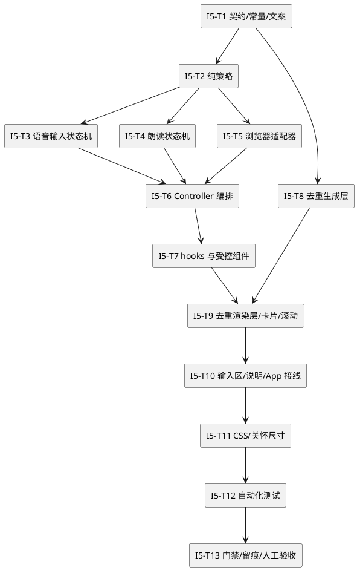

# EasyFlow 当前步骤只说一遍、按键说话与按需朗读（第五轮）— 编码任务清单

**输入依据**

- `.codeartsdoer/specs/easyflow_page_guide/iteration5-spec.md`（R-101—R-169、T5-01—T5-19、AT-51—AT-63）
- `.codeartsdoer/specs/easyflow_page_guide/iteration5-design.md`（重点：1.2.1 重复文案链路、1.2.3 滚动、2.4 去重与首屏、2.5 适配器、2.6 语音输入状态机、2.7 朗读、2.8 关怀尺寸、2.10 测试、2.11 逐文件改动、2.13 风险、2.14 验证、2.15 人工验收、2.16 取舍）
- `.codeartsdoer/specs/easyflow_page_guide/iteration4-spec.md`、`iteration4-design.md`、`iteration4-tasks.md`（任务编号、门禁、留痕与“人工验收待用户执行”口径）
- `.codeartsdoer/specs/easyflow_page_guide/iteration3-spec.md`、`iteration3-design.md`、`iteration3-tasks.md`、`iteration2-*`、`spec.md`、`design.md`、`tasks.md`
- 现有实现（只读核对）：`src/sidepanel/**`、`src/shared/**`、`scripts/selftest.mjs`、`src/sidepanel/styles/sidepanel.css`、`package.json`、`tsconfig.json`

**阶段声明**

- 本文件只是第五轮**编码任务规划**，不包含任何实现，不修改源码。
- 编写本文件时**未执行** `npm run typecheck`、`npm run selftest`、`npm run build`、`npm run verify`，未创建 `codearts_proof/iteration5-*` 实绩日志，未调用真实麦克风或语音合成。
- 实现阶段必须真实执行门禁并留痕；未在真实 Chrome 侧栏验证的项目一律写“**人工验收待用户执行**”，语音/朗读的浏览器行为一律另注“**浏览器语音行为未在本环境验证**”，不得写“已通过”。
- 预约类验证只使用虚构 fixture 或用户已有只读页面，**不得提交新预约、不得代填、不得代选、不得代提交**。

---

## 0. 使用说明与全局约束

### 0.1 基线事实（2026-11-14 只读核查）

| 核查项 | 实测结果（位置） | 对任务的要求 |
|---|---|---|
| 应用骨架 | `src/sidepanel/App.tsx:26-69`：`ChatHeader` → `PageStatusLine` → 慢提示 → `main.ef-chat-main`（`MessageList` + `AboutPanel`）→ `ChatComposer` → `DiagnosticsPanel` | 语音入口只加在既有 `ChatComposer` 内；朗读入口只加在既有当前卡/回答气泡内；不新增页面或路由 |
| 输入区 | `ChatComposer.tsx:4-56`：`textarea`（`rows={2}`、`maxLength={MAX_TURN_CHARS}`、`aria-describedby`）+ 提示行 + 发送按钮；`submit()` 内 `trim()`，空文本或 `disabled` 直接返回 | `onSend(text)`、Enter/Shift+Enter、空文本判定、`disabled` 语义不改 |
| 长度上限 | `src/shared/constants.ts:17` `MAX_TURN_CHARS = 500` | 识别写入复用同一常量；不新增第二套长度 |
| 当前步骤卡 | `StepCard.tsx:51-62` 非当前态仅状态行 + hint；`77-141` 当前态：`ef-step-state`“现在这一步” → `ef-step-goal`（`copy.shortText`）→ 唯一 `ef-step-primary` → `StepDetails` → `ef-step-more`（4 动作） | 只改受控文本与新增次级按钮；保留结构顺序与唯一主按钮 |
| 重复文案来源 1 | `RuleEngine.ts:186-209`，关键 `196`：`text.includes(step.goal) ? text : \`${text}${step.goal}。\``；调用点 `398-402`、`433-438`、`465-474`、`481-485`、`515-520`、`539` | 移除追加；6 个调用点文案去复述 |
| 重复文案来源 2 | `useConversation.ts:474-491`，关键 `482` 同样追加；调用点 `564-572`、`597-608`、`620-630`、`781-789`、`1123-1131` | 同步移除追加 |
| 重复文案来源 3 | `useConversation.ts:181-202`：`196`“目前可选的最早时段是“Y”。现在这一步：”、`199`“现在这一步是“Y”。”；`prefix`（`186-189`）说明页面变化 | 保留 `prefix` 与时段结果；删除“现在这一步”句式 |
| 重复文案来源 4 | `StepCard.tsx:83-85` `<span className="ef-step-state">现在这一步</span>` | 当前卡可见标签改“当前步骤”；`stepCardLabel("current")` 保持原值（AT-44） |
| 短句来源 | `stepCardCopy.ts:385-447`；`GENERIC_FALLBACK_TEXT` 在 `57`；`shortText`/`rawLabel`/`completionText`/`targetRef` 在 `28-35` 附近 | 不改短句算法；去重不新增日期/时刻字面量 |
| 消息与卡片认定 | `MessageList.tsx:62-70` `cardActive` 与当前卡 `copy`；`109-110` `expired={!cardActive}` / `ended={bookingCompleted}`；`144-157` 两条滚动 effect | 去重只作用于 `cardActive && responseType === "next-step"`；滚动合并为单一 effect |
| 语音能力现状 | `src/` 无 `SpeechRecognition`/`webkitSpeechRecognition`/`speechSynthesis`/`SpeechSynthesisUtterance`/`getUserMedia`/`MediaRecorder` 命中；`types.ts` 仅保留 `VoiceState`；`conversationReducer.ts` 的 `voiceState` 恒为 `"disabled"` | 从零新增；运行时探测；不写会话状态机 |
| 既有告知 | `AboutPanel.tsx:6`“语音暂未开放。”；`selftest.mjs:1715` 断言该串 | 替换为真实告知；AT-50 仅显式改写这一行 |
| 隐私能力 | `src/shared/privacy/detect.ts:40-54` `detectSensitive`/`containsSensitive`（身份证/手机/银行卡/邮箱/验证码/密码） | 朗读前只读复用；不新增正则 |
| 权限清单 | `public/manifest.json` 四项：`activeTab / scripting / sidePanel / storage`；无 `host_permissions` | 不新增权限；麦克风授权由浏览器在点击后请求 |
| 关怀 token | `sidepanel.css:891-933`：普通 `--ef-tap-min: 28px` / `--ef-primary-min-h: 32px`；care `44px` / `48px`；`--ef-font-small: 14px` | 新控件只消费 token；不写死更小高度 |
| 步骤卡样式 | `sidepanel.css:977-1034`：`.ef-step-primary { width:100%; min-height:var(--ef-primary-min-h) }`；`summary`/`.ef-step-action` 用 `--ef-tap-min` | 同行容器内主按钮改 `flex:1 1 auto`，作用域限定新容器 |
| 输入区布局 | `sidepanel.css:1183-1215`：`.ef-composer { max-height:40vh; overflow-y:auto }`；输入框、发送按钮均消费 token | 新增行由 `.ef-composer` 自身滚动吸收 |
| 测试结构 | `selftest.mjs:16-40` esbuild 导出；AT-38（`1243-1283`）源码字符串断言；AT-44（`1430-1451`）`stepCardLabel("current") === "现在这一步"`；AT-45（`1467-1536`）源码清洁 + 权限深比较；AT-50（`1685-1727`）token/文案/类名断言 | 新增纯逻辑必须加入同一导出列表；不得删除既有用例 |
| TS 严格度 | `tsconfig.json`：`strict`、`exactOptionalPropertyTypes`、`noUncheckedIndexedAccess`、`noImplicitOverride` | 新增代码不得用 `any`/`@ts-ignore`；可选属性显式 `| undefined`；数组索引先判空 |
| 门禁脚本 | `package.json`：`typecheck`/`build`/`verify`/`selftest` 四项 | 顺序固定 `typecheck → selftest → build → verify` |

> 行号仅作定位参考，实现时以文件内函数名、props 名与 CSS 选择器为准。

### 0.2 全局硬约束（每个任务都必须遵守）

1. **只改主工程**：只改 `D:\hwproject\translator`；不使用 `apps/extension`、不运行 `pnpm dev:web`、不新建网站。
2. **权限不变**：不新增 `permissions` / `host_permissions` / `content_scripts`；不调用 `getUserMedia` / `MediaRecorder`；麦克风授权只由浏览器在用户点击后请求。
3. **只读边界**：语音与朗读不点击、不聚焦、不填写、不勾选、不提交、不导航网页元素；高亮链路不变。
4. **识别结果只入输入框**：不进入 `AssistantMessage` / `UserMessage` / `DialogueRequest` / 消息历史 / `chrome.storage` / 诊断正文 / 页面；只有用户点击“发送”才走既有 `onSend`。
5. **朗读白名单**：只读 `copy.shortText`（步骤）或 `message.text`（直接回答）；不读 `rawLabel`、`completionText`、`citations[].text`、`limitation.advice`、`clarify.*`、诊断。
6. **会话状态不变**：`ConversationState.voiceState`、`NoticeKind.voice-disabled`、`DialogueCapabilities.voiceEnabled` 语义不改；语音/朗读是侧栏临时 UI 状态。
7. **文案单源**：语音按钮名、状态行、告知、朗读按钮、停止、不可用/敏感说明只允许出现在 `src/shared/speech/copy.ts`；组件不内联中文。
8. **常量化**：语言、语速、音高、超时、重复窗口、停止验收时延均为命名常量；不散落魔法数。
9. **每步可构建**：每个任务结束时 `npm run typecheck` 必须 0 error；不得留下未接线的受控组件导致编译失败。
10. **不新增依赖**：不引入语音 SDK、不新增 `fetch`/`XMLHttpRequest`、不新增跨进程消息类型。
11. **测试不改写事实**：不删除 `AT-01`—`AT-50`；`AT-50` 仅按设计 2.10.4 显式改写 `AboutPanel` 一处断言；其余断言逐条保留。
12. **文档不改**：第一至第四轮文档（`spec.md`、`design.md`、`tasks.md`、`iteration2-*`、`iteration3-*`、`iteration4-*`）不改。
13. **如实留痕**：未执行的命令与人工验收必须单列；失败日志保留、不覆盖、不编造。

### 0.3 明确“不改文件”清单

以下文件本轮**不得修改**：

- `src/sidepanel/state/conversationReducer.ts`
- `src/shared/types.ts`
- `src/shared/constants.ts`
- `src/shared/messages.ts`
- `src/sidepanel/dialogue/validate/validator.ts`
- `src/sidepanel/guide/stepPlanner.ts`
- `src/sidepanel/guide/completion.ts`
- `src/sidepanel/guide/bookingSuccess.ts`
- `src/sidepanel/components/chat/stepCardCopy.ts`
- `src/sidepanel/components/chat/StepDetails.tsx`
- `src/sidepanel/components/chat/EvidencePanel.tsx`
- `src/shared/privacy/detect.ts`、`src/shared/privacy/redact.ts`
- `src/sidepanel/dialogue/intent/**`、`retrieval/**`、`context/**`、`answer/**`、`ModelEngine.ts`
- `src/background/**`
- `src/content/**`
- `public/manifest.json`
- `scripts/build.mjs`
- `scripts/verify-manifest.mjs`
- 第一至第四轮全部规格/设计/任务文档

**允许新增**：`src/shared/speech/**`（6 个文件）、`src/sidepanel/speech/**`（4 个文件）、`src/sidepanel/hooks/useVoiceInput.ts`、`useSpeechSynthesis.ts`、`src/sidepanel/components/chat/VoiceInputControl.tsx`、`StepCardSpeech.tsx`、`messageText.ts`。

**允许修改**：`src/sidepanel/dialogue/rule/RuleEngine.ts`、`src/sidepanel/hooks/useConversation.ts`（仅文案与 `nextStepMessage`）、`src/sidepanel/components/chat/stepCardModel.ts`、`StepCard.tsx`、`MessageList.tsx`、`ChatComposer.tsx`、`AboutPanel.tsx`、`DiagnosticsPanel.tsx`、`src/sidepanel/App.tsx`、`src/sidepanel/styles/sidepanel.css`、`scripts/selftest.mjs`、`codearts_proof/iteration5-*`、`codearts_proof/24-iteration5-implementation.md`。

> 说明：`src/shared/constants.ts` 在“不改文件”清单内，因此 `MAX_TURN_CHARS` 通过既有导出复用，**不新增任何常量到该文件**；语音常量全部放 `src/shared/speech/constants.ts`。

### 0.4 任务编号与追溯约定

- 本轮编码任务编号为 `I5-T1`—`I5-T13`；需求/设计阶段取舍点仍写作 `T5-01`—`T5-19`，两者不混用。
- 测试用例沿用 `AT-xx`；本轮新增 `AT-51`—`AT-63`；仅调整 `AT-50` 的一处 `AboutPanel` 断言。
- “设计 2.4.4”指 `iteration5-design.md` 的对应小节。
- 每个任务的自验命令在**实现阶段**执行；本文件编写阶段不执行任何命令。
- 任务完成标准里的“临时 node 断言”指用 esbuild 打包目标模块后直接 `node` 运行的一次性脚本，放系统临时目录、不提交主工程；正式断言统一进 `I5-T12` 的 `selftest.mjs`。

### 0.5 执行顺序总览

| 顺序 | 编号 | 标题 | 依赖 | 主要产物 | 构建检查点 |
|---|---|---|---|---|---|
| 1 | I5-T1 | 共享语音契约、命名常量与文案单源 | 无 | `shared/speech/types.ts`、`constants.ts`、`copy.ts` | `typecheck` 0 error |
| 2 | I5-T2 | 纯策略：长度合并、朗读白名单、语音选择、能力探测、错误映射 | I5-T1 | `shared/speech/policy.ts` | `typecheck`；临时断言 |
| 3 | I5-T3 | 语音输入纯状态机（五类状态 / 幂等 / 迟到丢弃） | I5-T1、I5-T2 | `shared/speech/voiceMachine.ts` | `typecheck`；引用相等断言 |
| 4 | I5-T4 | 朗读纯状态机（单实例 / 重复窗口 / 敏感跳过） | I5-T1、I5-T2 | `shared/speech/speakMachine.ts` | `typecheck`；引用相等断言 |
| 5 | I5-T5 | 浏览器识别/合成适配器（可注入、四/三类事件） | I5-T1、I5-T2 | `sidepanel/speech/recognition.ts`、`synthesis.ts` | `typecheck`；源码边界检索 |
| 6 | I5-T6 | 可注入 `VoiceController` / `SpeechController` | I5-T2—I5-T5 | `sidepanel/speech/voiceController.ts`、`speechController.ts` | `typecheck`；调用次数断言 |
| 7 | I5-T7 | `useVoiceInput` / `useSpeechSynthesis` 与两个受控语音组件 | I5-T1、I5-T6 | `hooks/useVoiceInput.ts`、`useSpeechSynthesis.ts`、`VoiceInputControl.tsx`、`StepCardSpeech.tsx` | `typecheck` |
| 8 | I5-T8 | 文案去重生成层（`RuleEngine` + `useConversation`） | I5-T1 | `RuleEngine.ts`、`useConversation.ts` | `typecheck`；`AT-31/32` 回归 |
| 9 | I5-T9 | 文案去重渲染层、状态标签与首屏滚动 | I5-T7、I5-T8 | `messageText.ts`、`stepCardModel.ts`、`StepCard.tsx`、`MessageList.tsx` | `typecheck`；八变体断言 |
| 10 | I5-T10 | 输入区、说明、诊断与 `App` 生命周期接线 | I5-T7、I5-T9 | `ChatComposer.tsx`、`AboutPanel.tsx`、`DiagnosticsPanel.tsx`、`App.tsx` | `typecheck`；源码断言 |
| 11 | I5-T11 | 关怀尺寸与新控件 CSS（400px / 200% / token） | I5-T9、I5-T10 | `sidepanel.css` | `typecheck`；CSS 断言 |
| 12 | I5-T12 | 自动化测试 `AT-51`—`AT-63` 与 `AT-50` 显式改写 | I5-T1—I5-T11 | `scripts/selftest.mjs` | `npm run selftest` |
| 13 | I5-T13 | 门禁执行、清洁检索、实现留痕与真实 Chrome 人工验收 | I5-T12 | `codearts_proof/iteration5-*.log`、`24-iteration5-implementation.md` | 四命令全绿；人工验收待用户执行 |

### 0.6 依赖图

```text
I5-T1 ──> I5-T2 ──┬──> I5-T3 ──┐
  │               ├──> I5-T4 ──┤
  │               └──> I5-T5 ──┤
  │                            ├──> I5-T6 ──> I5-T7 ──┬──> I5-T9 ──> I5-T10 ──> I5-T11 ──> I5-T12 ──> I5-T13
  └──> I5-T8 ──────────────────────────────────────────┘
```



**硬性顺序**

1. `I5-T1` 必须最先：类型、常量与文案是后续全部模块的编译基础。
2. `I5-T2` 先于 `I5-T3`/`I5-T4`/`I5-T5`：`mergeTranscript`/`checkSpeakText` 是状态机入参类型来源。
3. `I5-T3`/`I5-T4`/`I5-T5` 先于 `I5-T6`：controller 依赖 reducer 与适配器契约。
4. `I5-T6` 先于 `I5-T7`：hook 只订阅 controller，不内嵌编排。
5. `I5-T8` 与语音链并行，但必须先于 `I5-T9`：渲染层去重需要生成层已不再追加。
6. `I5-T9` 先于 `I5-T10`：`App` 需要 `MessageList`/`StepCard` 的 `speech`/`stepKey` props。
7. `I5-T10` 先于 `I5-T11`：CSS 选择器依赖新 DOM 类名。
8. `I5-T12` 在全部实现之后：测试同时校验纯函数、调用次数与静态源码。
9. `I5-T13` 在 `I5-T12` 全绿之后：先有自测结果，再跑四道门禁并留痕。

### 0.7 阶段门禁与留痕

| 时点 | 命令/检查 | 通过标准 | 留痕 |
|---|---|---|---|
| 每个任务结束 | `npm run typecheck` | 退出码 0，0 error，无 `any`/`@ts-ignore` | 汇总到 `codearts_proof/iteration5-typecheck.log` |
| I5-T2—I5-T7 后 | 临时 node 断言 | 纯函数/状态机/调用次数断言通过 | 可并入 `iteration5-selftest.log` |
| I5-T8、I5-T9 后 | `npm run selftest`（既有用例） | `AT-01`—`AT-50` 不回退（AT-50 除外，见 I5-T12） | `iteration5-selftest.log` |
| I5-T11、I5-T12 后 | `npm run build` | 退出码 0，`dist/` 产物齐全 | `codearts_proof/iteration5-build.log` |
| I5-T13 | `npm run selftest` | `AT-01`—`AT-63` 全通过 | `codearts_proof/iteration5-selftest.log` |
| I5-T13 | `npm run verify` | 退出码 0，权限四项不变 | `codearts_proof/iteration5-verify.log` |
| I5-T13 | 源码清洁检索 | 0 命中或逐处说明 | `iteration5-clean-*.log` |
| I5-T13 | 真实 Chrome 人工验收 | 7 步逐项记录或“人工验收待用户执行” | `24-iteration5-implementation.md` |

> 门禁顺序固定为 `npm run typecheck` → `npm run selftest` → `npm run build` → `npm run verify`。四条命令分别留痕，不以 `build` 内含的检查替代。

---

## 1. I5-T1 共享语音契约、命名常量与文案单源

**编号与标题**：I5-T1 / 共享语音契约、命名常量与文案单源。

**目标**：在不接入任何浏览器语音能力、不改任何既有组件的前提下，一次性落位语音识别/合成的类型契约、命名常量与全部中文文案，保证后续任务只依赖稳定契约，且文案只有一处来源。

**对应需求/设计条目**：R-111、R-114、R-137—R-144、R-150、R-162—R-166；设计 2.1.2、2.2.2 接口 A、2.3.2、2.5.1、2.5.2、2.5.3、2.5.5、2.6.1、2.6.6、2.7.3、2.11.1；T5-08、T5-12。

**涉及文件与函数/类型/常量**（按设计 2.11.1）

- 新增 `src/shared/speech/types.ts`（纯类型，无 React / 无 `window` / 无 chrome）：
  - `SpeechErrorKind = "unsupported" | "permission-denied" | "no-audio-device" | "no-speech" | "network" | "aborted" | "unknown"`。
  - `SpeechStartOptions { lang: "zh-CN"; singleShot: true; interimResults: false }`。
  - `RecognitionEvent = { type:"started" } | { type:"final"; text:string } | { type:"error"; kind:SpeechErrorKind } | { type:"ended" }`。
  - `RecognitionAdapter { start(options): void; cancel(): void; subscribe(listener): () => void; dispose(): void }`。
  - `RecognitionLike`、`RecognitionResultLike`、`RecognitionErrorLike`：浏览器对象的最小结构化类型（禁止 `any`）。
  - `SpeakOptions { text: string; lang: "zh-CN"; rate: number }`。
  - `SynthesisEvent = { type:"started" } | { type:"ended" } | { type:"error"; kind:"unsupported" | "unknown" }`。
  - `SynthesisAdapter { speak(options): void; stop(): void; subscribe(listener): () => void; dispose(): void }`。
  - `VoiceInputPhase = "idle" | "listening" | "recognized" | "no-speech" | "permission-denied" | "unsupported" | "failed" | "cancelled"`。
  - `VoiceInputIssue = "no-audio-device" | "network" | "timeout" | "too-long" | "interrupted"`。
  - `SpeakTextKind = "step-action" | "direct-answer"`；`SpeakRequest { kind; text }`。
  - `SpeakPhase = "idle" | "speaking" | "unsupported" | "failed" | "sensitive-skipped"`；`SpeakIssue = "sensitive" | "interrupted" | "start-failed"`。
  - 类型层不得出现音频、音频片段、中间文本数组、原始 `Error`、设备 ID。
- 新增 `src/shared/speech/constants.ts`：
  - `SPEECH_LANG = "zh-CN"`、`SPEECH_RATE = 1.0`、`SPEECH_PITCH = 1.0`。
  - `SPEECH_NO_RESULT_TIMEOUT_MS = 8000`、`SPEECH_REPEAT_WINDOW_MS = 1200`、`SPEECH_STOP_ACK_MS = 300`、`SPEECH_VOICE_RETRY_MS = 0`。
  - 文件内不得出现 `02:00`/`02:15`/`03:00`、真实域名、邮箱样式。
- 新增 `src/shared/speech/copy.ts`（唯一文案来源）：
  - `VOICE_INPUT_LABEL = "语音输入"`、`VOICE_CANCEL_LABEL = "取消识别"`。
  - `VOICE_BUTTON_TEXT: Record<VoiceInputPhase, string>`：`idle/recognized/no-speech/permission-denied/unsupported/failed/cancelled → "语音输入"`；`listening → "取消识别"`。
  - `VOICE_STATUS_TEXT: Record<VoiceInputPhase, string>`：`idle → ""`；`listening → "正在听，请说一句中文…"`；`recognized → "已识别，请检查文字后自己点发送。"`；`no-speech → "未识别到语音，请再说一次，或直接打字。"`；`permission-denied → "没有麦克风权限。请在浏览器站点设置里允许麦克风，或直接打字。"`；`unsupported → "当前浏览器不支持中文语音输入，可以直接打字。"`；`failed → "识别失败，可以再试或直接打字。"`；`cancelled → "已取消识别。"`。
  - `VOICE_ISSUE_TEXT: Record<VoiceInputIssue, string>`：`no-audio-device → "没有检测到可用的麦克风，可以直接打字。"`；`network → "未识别：网络或语音服务暂不可用，可以直接打字。"`；`timeout → "没有听到内容，可以再试或直接打字。"`；`too-long → "内容较长，请先精简后再试，原文已保留。"`；`interrupted → "识别已中断，可以再试或直接打字。"`。
  - `SPEECH_DISCLOSURE_TEXT = "语音识别由浏览器提供，可能使用浏览器厂商的在线服务；本扩展不保存音频，也不保存识别原文。"`。
  - `SPEAK_LABELS { step:"朗读这一步"; answer:"朗读回答"; stop:"停止朗读" }`。
  - `SPEAK_UNAVAILABLE_TEXT = "当前浏览器不支持朗读，可以直接看文字。"`。
  - `SPEAK_NOTE_TEXT { sensitive:"这段内容含个人信息，未朗读。"; failed:"朗读失败，可以再试。"; interrupted:"朗读已中断，可以再试。" }`。
  - `VOICE_DISALLOWED_WORDS`：禁用表述表。**落地要求**：为避免与“源码不得出现‘离线’”的断言冲突，该表用 Unicode 转义构造（如 `"\u79bb\u7ebf"`），并在代码注释说明“转义写法用于同时满足禁用词表与源码清洁断言”。
  - `copy.ts` 的**文案值**（`VOICE_STATUS_TEXT`/`VOICE_ISSUE_TEXT`/`SPEECH_DISCLOSURE_TEXT`/`SPEAK_*`）不得包含 `NotAllowedError`、`no-speech`、`audio-capture`、`network`、`NotReadableError` 等原始错误串；不得出现“离线/纯本地/不上传”（禁用词表除外，且已转义）。
  - 断言不得采用“`copy.ts` 全文不含 `no-speech`”这种写法：`VOICE_STATUS_TEXT` 的**键**必须包含 `no-speech` 等 phase 字面量。正确断言见 I5-T12（遍历 `Object.values`）。

**实现要点与前置依赖**

- [ ] 先写类型与常量，再写文案表；文案表的键与设计 2.6.1 的 12 行状态一一对应（8 个 phase + 4 个 issue 覆盖）。
- [ ] `VOICE_STATUS_TEXT` 只放 phase 级基础文案，issue 覆盖由 `VOICE_ISSUE_TEXT` 提供；组合逻辑在 `describeVoiceInput`（I5-T3），本任务不实现组合。
- [ ] 常量值不得偏离设计 2.7.3：`SPEECH_RATE` 必须在 0.9—1.1 区间内。
- [ ] 文案必须说明“可能使用在线服务”和“不保存音频”（R-137、R-139、R-140）。
- [ ] 前置依赖：无；本任务是所有后续任务的第一块编译基础。

**明确不做事项**

- 不实现 `policy.ts`、状态机、controller、适配器、hook、组件。
- 不改 `AboutPanel.tsx`、`ChatComposer.tsx`、`App.tsx`、`sidepanel.css`。
- 不改 `src/shared/constants.ts`、`src/shared/types.ts`、`conversationReducer.ts`。
- 不新增权限、不新增网络请求、不写 `chrome.storage`。
- 不使用 `any`/`@ts-ignore`；不为了省事把类型写成 `unknown` 后在下游强转。

**完成标准与自验方式**

- [ ] `npm run typecheck` 退出码 0，0 error。
- [ ] 临时 node 断言（esbuild 打包 `types.ts`/`constants.ts`/`copy.ts`）：
  - `SPEECH_LANG === "zh-CN"`、`SPEECH_RATE === 1.0`、`SPEECH_NO_RESULT_TIMEOUT_MS === 8000`、`SPEECH_REPEAT_WINDOW_MS === 1200`；
  - `VOICE_STATUS_TEXT.listening` 含“正在听”、`recognized` 含“已识别”、`no-speech` 含“未识别”、`permission-denied` 含“麦克风”、`unsupported` 含“不支持”；
  - `VOICE_ISSUE_TEXT.network` 含“网络或语音服务暂不可用”、`too-long` 含“精简”、`no-audio-device` 含“麦克风”；
  - `SPEECH_DISCLOSURE_TEXT` 含“可能使用”与“不保存音频”，不含“离线”；
  - `SPEAK_LABELS.step === "朗读这一步"`、`answer === "朗读回答"`、`stop === "停止朗读"`；
  - `Object.values(VOICE_STATUS_TEXT)` 与 `Object.values(VOICE_ISSUE_TEXT)` 拼接后不含 `NotAllowedError`/`no-speech`/`audio-capture`/`network`/`离线`。
- [ ] 静态断言：`src/shared/speech/` 目录**仅**这 3 个文件；`rg "SpeechRecognition|webkitSpeechRecognition|speechSynthesis|getUserMedia|MediaRecorder|fetch\(|chrome\.storage" src/shared/speech/` 为 0 命中。
- [ ] `rg "离线" src/` 为 0 命中（转义写法保证）。

**风险与回滚点**

- **风险**：文案表与设计 2.6.1 的 12 行不一致，导致后续 `describeVoiceInput` 断言失败。缓解：T1 完成时用临时断言逐键比对。
- **风险**：`VOICE_DISALLOWED_WORDS` 与“源码无‘离线’”断言冲突。缓解：转义构造 + 注释；断言只检查拼接后的文案值。
- **风险**：`copy.ts` 键含 `no-speech` 被误判为“原始错误串泄漏”。缓解：测试改断言语义值（见 I5-T12），并在本文件与 `24-iteration5-implementation.md` 记录该口径澄清。
- **回滚**：删除 `src/shared/speech/` 三个文件即可完全恢复；无任何既有文件被引用。

---

## 2. I5-T2 纯策略：长度合并、朗读白名单、语音选择、能力探测、错误映射

**编号与标题**：I5-T2 / 纯策略函数。

**目标**：新增无 React、无 DOM、无 chrome 依赖的纯函数层，覆盖识别文本合并与长度策略、朗读白名单与个人信息拦截、中文语音选择、识别/合成能力探测、浏览器错误统一映射，供 controller 与 selftest 直接调用。

**对应需求/设计条目**：R-115、R-118—R-120、R-122—R-126、R-148、R-150、R-153、R-162—R-166；设计 2.2.2 接口 B、2.5.2、2.5.4、2.5.5、2.6.3、2.7.1、2.7.3、2.7.4、2.10.2；T5-04、T5-05、T5-09。

**涉及文件与函数**（按设计 2.11.1）

- 新增 `src/shared/speech/policy.ts`：
  - `mergeTranscript(current: string, incoming: string, limit: number): { ok:true; text:string } | { ok:false; reason:"too-long" }`。
  - `checkSpeakText(request: SpeakRequest): { allowed:true; text:string } | { allowed:false; reason:"empty" | "sensitive" }`。
  - `pickChineseVoice(voices: readonly SpeechVoiceLike[]): { voice: SpeechVoiceLike | null; matched: "zh-CN" | "zh" | "default" | "none" }`。
  - `detectRecognitionSupport(scope: unknown): "supported" | "unsupported"`。
  - `detectSynthesisSupport(scope: unknown): "supported" | "unsupported"`。
  - `mapRecognitionError(raw: string | undefined): SpeechErrorKind`。
  - 允许 import：`shared/speech/types.ts`、`shared/speech/constants.ts`、`shared/privacy/detect.ts`、`shared/domPath.ts`（如需 `normalizeWhitespace`）。
  - 禁止 import：React、chrome、`window`、`sidepanel/**`。

**实现要点与前置依赖**

- [ ] `mergeTranscript`：
  - `incoming` 归一：`replace(/\s+/g, " ").trim()`；不改字词、不加标点、不纠错、不补全（R-118）。
  - `current` **不归一**（保留换行与用户原样输入）。
  - 分隔符：仅当 `current` 末字符与 `incoming` 首字符都是 ASCII 字母/数字时插入 1 个空格；中文与中文之间不插空格。
  - 长度按 `merged.length`（UTF-16 code unit）判断，与 `textarea.maxLength` 一致；**不要**改用 code point。
  - `incoming` 归一后为空 → 返回 `{ ok:true, text:current }`（不改变输入）。
  - 超长 → `{ ok:false, reason:"too-long" }`；不截断、不返回部分文本（R-119）。
  - 不抛异常（空串、空白串、超长串均覆盖）。
- [ ] `checkSpeakText`：
  - `text.trim() === ""` → `{ allowed:false, reason:"empty" }`。
  - `detectSensitive(text).length > 0` → `{ allowed:false, reason:"sensitive" }`，**不返回脱敏文本、不返回命中位置**（R-153、T5-09）。
  - 通过 → `{ allowed:true, text }`，`text` 原样（不拼接说明、不截断）。
  - 只对传入文本检测，不读取页面、不读取其他消息。
- [ ] `pickChineseVoice`：
  - `lang` 归一化为小写并把 `_` 替换为 `-`；优先级：严格 `zh-cn` → 以 `zh` 开头 → `default === true` → `null`。
  - 无 `zh` 语音时返回 `{ voice:null, matched:"default" | "none" }`，**不得**退化为英文朗读（语言仍由 controller 设 `zh-CN`）。
  - 空数组返回 `{ voice:null, matched:"none" }`。
- [ ] `detectRecognitionSupport`：
  - `typeof scope.SpeechRecognition === "function"` 或 `typeof scope.webkitSpeechRecognition === "function"` → `supported`。
  - 只读属性探测，**不构造实例、不请求权限**；`scope` 为 `{}`、`null`、`undefined`、非对象时安全返回 `unsupported`。
  - 实现上先把 `scope` 收窄为 `Record<string, unknown>`，禁止 `any`。
- [ ] `detectSynthesisSupport`：
  - `typeof scope.speechSynthesis === "object"` 且 `scope.speechSynthesis !== null` 且 `typeof scope.SpeechSynthesisUtterance === "function"` → `supported`；否则 `unsupported`。
  - 不调用 `getVoices()`（避免异步与副作用）。
- [ ] `mapRecognitionError`：
  - `"not-allowed"`/`"service-not-allowed"` → `permission-denied`；
  - `"audio-capture"` → `no-audio-device`；
  - `"no-speech"`/`"bad-grammar"` → `no-speech`；
  - `"network"` → `network`；
  - `"aborted"` → `aborted`；
  - `"language-not-supported"` → `unsupported`；
  - 其他/`undefined` → `unknown`；
  - 原始串只在此函数内出现，不向 UI 传播（R-166）。
- [ ] 前置依赖：I5-T1 的类型、常量与 `detectSensitive` 既有实现。

**明确不做事项**

- 不实现状态机、controller、适配器；不调用 `speechSynthesis`/`SpeechRecognition`。
- 不新增个人信息正则（姓名不在 `detectSensitive` 覆盖范围，见 T5-09 确认项）。
- 不读取页面快照、不写存储、不发网络请求。
- 不把 `MAX_TURN_CHARS` 复制成新常量；`limit` 由调用方传入。

**完成标准与自验方式**

- [ ] `npm run typecheck` 退出码 0。
- [ ] 临时 node 断言（esbuild 打包 `policy.ts`）覆盖：
  - `mergeTranscript("", "帮我看看现在点哪里", 500)` → `ok:true` 且 `text` 等于原文；
  - `mergeTranscript("帮我预约", "明天下午", 500)` → `"帮我预约明天下午"`；
  - `mergeTranscript("help me", "book", 500)` → `"help me book"`；
  - `mergeTranscript("a".repeat(480), "b".repeat(40), 500).ok === false` 且 `reason === "too-long"`；
  - `mergeTranscript("", "b".repeat(501), 500).ok === false`；
  - `mergeTranscript("x".repeat(500), "", 500)` → `ok:true` 且 `text` 仍 500 字；
  - `checkSpeakText({kind:"step-action",text:"现在请点一个时段"})` → `allowed:true`；
  - 用字符串拼接构造含邮箱/手机号的文本（如 `"联系 " + "a" + "@" + "example.test"`、`"电话 " + "138" + "0000" + "0000"`）→ `allowed:false, reason:"sensitive"`；
  - `checkSpeakText({kind:"direct-answer",text:"   "})` → `reason:"empty"`；
  - `pickChineseVoice([{name:"A",lang:"zh-CN",default:false}]).matched === "zh-CN"`；`zh-TW` → `"zh"`；`en-US` + `default:true` → `"default"`；空数组 → `"none"`；
  - `detectRecognitionSupport({}) === "unsupported"`；`detectRecognitionSupport({SpeechRecognition: () => {}}) === "supported"`；`detectRecognitionSupport({webkitSpeechRecognition: () => {}}) === "supported"`；
  - `detectSynthesisSupport({}) === "unsupported"`；`detectSynthesisSupport({speechSynthesis:{}, SpeechSynthesisUtterance: () => {}}) === "supported"`；
  - `mapRecognitionError("not-allowed") === "permission-denied"`、`"audio-capture"` → `"no-audio-device"`、`"network"` → `"network"`、`"aborted"` → `"aborted"`、`"language-not-supported"` → `"unsupported"`、`"unknown-xyz"` → `"unknown"`、`undefined` → `"unknown"`。
- [ ] 静态断言：`rg "React|chrome\.|window\.|speechSynthesis\." src/shared/speech/policy.ts` 为 0 命中；`rg "fetch\(" src/shared/speech/policy.ts` 为 0 命中。

**风险与回滚点**

- **风险 R5-06**：超长文本被静默丢弃导致用户困惑。缓解：返回 `too-long` 专用 reason，由状态机给出“内容较长，请先精简，原文已保留”。
- **风险**：`mergeTranscript` 用 code point 计数，导致与 `maxLength` 不一致。缓解：明确使用 `merged.length`，测试覆盖 480+40。
- **风险**：`detectSynthesisSupport` 调用 `getVoices()` 触发异步。缓解：只做属性探测；语音选择由适配器在 `speak()` 时调用。
- **回滚**：删除 `policy.ts`；状态机与 controller 尚未接入时无行为影响。

---

## 3. I5-T3 语音输入纯状态机

**编号与标题**：I5-T3 / 语音输入纯状态机。

**目标**：用纯 reducer 表达语音输入 8 个 phase、issue 覆盖、幂等开始、迟到丢弃、超时收敛与告知只显示一次；`describeVoiceInput` 成为按钮名与状态行的唯一派生入口。

**对应需求/设计条目**：R-112—R-114、R-119—R-120、R-122—R-130、R-134—R-135、R-137、R-144；设计 2.1.3（2）、2.2.2 接口 C、2.3.2、2.6.1、2.6.2、2.6.7；T5-06、T5-11。

**涉及文件与函数**（按设计 2.11.1）

- 新增 `src/shared/speech/voiceMachine.ts`：
  - `VoiceInputState { phase; issue: VoiceInputIssue | null; revision: number; pendingText: string | null; disclosureShown: boolean }`。
  - `VoiceInputEvent`：`start-requested{supported}`、`adapter-started`、`adapter-final{merge}`、`adapter-error{kind, cancelledByUser}`、`adapter-ended`、`timeout`、`cancel-requested`、`composer-consumed`、`invalidate`。
  - `createVoiceInputState()`。
  - `voiceInputReducer(state, event)`。
  - `describeVoiceInput(state): VoiceInputView { phase; statusText; buttonLabel; canStart; canCancel; showDisclosure; pendingText; revision }`。
  - 文案只从 `copy.ts` 取。

**实现要点与前置依赖**

- [ ] 事件映射严格按设计 2.6.2：
  - `start-requested{supported:false}` → `unsupported`，`pendingText:null`，`disclosureShown:true`。
  - 非 `listening` 的 `start-requested{supported:true}` → `listening`（`issue:null`），`disclosureShown:true`。
  - **`listening` + `start-requested` → 返回同一个 state 对象引用**（AT-56 用 `===` 断言）。
  - `listening` + `adapter-final{merge.ok}` → `recognized`，`pendingText = merge.text`，`revision + 1`。
  - `listening` + `adapter-final{merge.too-long}` → `failed`，`issue:"too-long"`，`pendingText:null`。
  - `listening` + `adapter-error{no-speech|unknown}` → `no-speech`；`permission-denied|no-audio-device` → `permission-denied`（issue 按 kind）；`unsupported` → `unsupported`；`network` → `failed(issue:"network")`；`aborted` + `cancelledByUser:true` → `cancelled`（issue:null）；`aborted` + `false` → `cancelled(issue:"interrupted")`。
  - `listening` + `cancel-requested` → `cancelled`（issue:null），`pendingText:null`。
  - `listening` + `invalidate` → `idle`（清 issue/pending）。
  - `listening` + `timeout` → `no-speech(issue:"timeout")`。
  - `recognized` + `composer-consumed` → `recognized`，`pendingText:null`，`revision` 不变。
  - 任意终态 + `adapter-final` / `adapter-started` → **返回同一个 state 对象引用**（迟到丢弃）。
  - 任意 + `adapter-ended`：`listening` → `no-speech`；否则不变。
  - `invalidate` 不回退 `disclosureShown`（会话内只提示一次）。
- [ ] `describeVoiceInput`：
  - `idle` → `statusText === ""`、`buttonLabel === "语音输入"`、`canStart:true`、`canCancel:false`。
  - `listening` → `statusText` 含“正在听”、`buttonLabel === "取消识别"`、`canStart:true`（语义为取消）、`canCancel:true`。
  - `permission-denied`/`no-audio-device` → `statusText` 取 issue 覆盖，`canStart:true`（可重试）。
  - `unsupported` → `canStart:false`（按钮禁用）。
  - 其余终态 → `canStart:true`。
  - `showDisclosure === state.disclosureShown`。
- [ ] 纯函数：不调用适配器、不启动定时器、不读写存储、不抛异常；不 import React。
- [ ] 前置依赖：I5-T1 的文案/类型、I5-T2 的 `TranscriptMerge` 类型与 `checkSpeakText` 无关。

**明确不做事项**

- 不实现 controller、超时定时器、适配器事件绑定（I5-T6）。
- 不渲染 UI、不内联中文、不改 `ChatComposer`。
- 不在 reducer 内做长度合并（由 controller 调 `mergeTranscript` 后把结果作为事件传入）。
- 不把 `phase` 写进 `ConversationState`。

**完成标准与自验方式**

- [ ] `npm run typecheck` 退出码 0。
- [ ] 临时 node 断言覆盖：
  - `describeVoiceInput(createVoiceInputState()).statusText === ""`；
  - `start-requested{supported:true}` → `phase==="listening"`、`disclosureShown===true`、`statusText` 含“正在听”、`buttonLabel==="取消识别"`；
  - `const listening = ...; deepEqual(voiceInputReducer(listening, {type:"start-requested",supported:true}), listening)` 且引用相等；
  - `adapter-final{ok:true,text:"帮我看看"}` → `recognized`、`pendingText==="帮我看看"`、`revision===1`；
  - 再发一次 `adapter-final` → 引用相等、`revision` 仍 1；
  - `cancel-requested` → `cancelled`；随后 `adapter-final` → 引用相等、`pendingText===null`；
  - `adapter-error{kind:"permission-denied"}` → `permission-denied`、`canStart===true`；
  - `adapter-error{kind:"no-audio-device"}` → `permission-denied` 且 `statusText` 含“麦克风”；
  - `adapter-error{kind:"unsupported"}` → `unsupported`、`canStart===false`、`statusText` 含“不支持”；
  - `adapter-error{kind:"network"}` → `failed(issue:"network")`、`statusText` 含“网络或语音服务暂不可用”；
  - `adapter-final{ok:false,reason:"too-long"}` → `failed(issue:"too-long")`、`statusText` 含“精简”；
  - `timeout` → `no-speech(issue:"timeout")`；
  - `adapter-ended`（listening）→ `no-speech`；
  - `invalidate` → `idle`、`pendingText===null`、`disclosureShown` 保持 `true`；
  - `composer-consumed` → `pendingText===null`、`revision` 不变。
- [ ] 静态断言：`rg "React|chrome\.|window\.|setTimeout|SpeechRecognition" src/shared/speech/voiceMachine.ts` 为 0 命中；中文仅通过 `copy.ts` 间接出现（组件文件内无中文字面量）。

**风险与回滚点**

- **风险**：reducer 返回新对象导致引用相等断言失败。缓解：所有“无变化”分支显式 `return state`。
- **风险**：`adapter-ended` 在已有 `final` 后再次触发，误把 `recognized` 改回 `no-speech`。缓解：仅 `phase==="listening"` 时收敛。
- **回滚**：删除 `voiceMachine.ts`；控制器尚未接入时无行为影响。

---

## 4. I5-T4 朗读纯状态机

**编号与标题**：I5-T4 / 朗读纯状态机。

**目标**：用纯 reducer 表达朗读的 `idle/speaking/unsupported/failed/sensitive-skipped`、同一句重复窗口、先停后起、停止幂等与失效清空，使“同一句不重复”和“敏感整句跳过”可被断言。

**对应需求/设计条目**：R-145—R-155；设计 2.1.3（3）、2.2.2 接口 D、2.3.2、2.7.1、2.7.2、2.7.4、2.7.5；T5-07、T5-09、T5-10。

**涉及文件与函数**（按设计 2.11.1）

- 新增 `src/shared/speech/speakMachine.ts`：
  - `SpeakState { phase; key: string | null; kind: SpeakTextKind | null; text: string | null; issue: SpeakIssue | null; lastCompletedKey: string | null; lastCompletedAt: number }`。
  - `SpeakEvent`：`speak-requested{request, check, supported, now}`、`adapter-started`、`adapter-ended{now}`、`adapter-error{kind}`、`stop-requested`、`invalidate`。
  - `createSpeakState()`、`speakReducer(state, event)`、`speakKeyOf(request): string`。
  - `describeSpeak(state): SpeakView { phase; speakingKey; note; canSpeak }`。
  - 文案只从 `copy.ts` 的 `SPEAK_NOTE_TEXT` 取。

**实现要点与前置依赖**

- [ ] `speakKeyOf({kind, text})` → `` `${kind}:${text}` ``；不得包含页面 id、时间戳。
- [ ] `speak-requested` 判定顺序：
  1. `check.allowed === false && reason === "sensitive"` → `sensitive-skipped`，`issue:"sensitive"`，`key:null`，**不调用适配器**。
  2. `check.allowed === false && reason === "empty"` → 返回同一 state（无内容可读）。
  3. `supported === false` → `unsupported`，`key:null`。
  4. `phase === "speaking" && key === speakKeyOf(request)` → **返回同一个 state 对象引用**（程序化重复；AT-60）。
  5. `phase === "speaking" && key !== 新 key` → 允许进入 `speaking`，`key` 为新 key（由 controller 先 `adapter.stop()`）。
  6. `lastCompletedKey === 新 key && now - lastCompletedAt < SPEECH_REPEAT_WINDOW_MS` → **返回同一个 state 对象引用**（窗口内不重复）。
  7. 否则 → `speaking`，`key` 为新 key，`kind/text` 为新请求，`issue:null`。
- [ ] `adapter-started`：仅 `speaking` 保持；其他状态返回同一 state。
- [ ] `adapter-ended`：`speaking` → `idle`，`lastCompletedKey = key`、`lastCompletedAt = now`，清 `key/kind/text`；其他状态不变。
- [ ] `adapter-error`：`speaking` → `failed`，`issue:"start-failed"`（或由 controller 传 `interrupted`），清 `key`；其他状态不变。
- [ ] `stop-requested`：`speaking` → `idle`，清 `key/kind/text`，**不更新** `lastCompletedKey/At`（停止后可立即重读同一句）。
- [ ] `invalidate`：任意 → `idle`，清 `key/kind/text/issue`，保留 `lastCompletedKey/At`。
- [ ] `describeSpeak`：
  - `speakingKey === state.phase === "speaking" ? state.key : null`。
  - `note`：`sensitive-skipped → SPEAK_NOTE_TEXT.sensitive`；`failed → SPEAK_NOTE_TEXT.failed` 或 `interrupted`；`unsupported → SPEAK_UNAVAILABLE_TEXT`；其他 `null`。
  - `canSpeak === state.phase !== "unsupported"`。
  - 按钮文字不在此处返回：由组件按 `kind + phase` 从 `SPEAK_LABELS` 取值（`speaking → stop`，`idle/failed/sensitive-skipped → step | answer`）。
- [ ] 前置依赖：I5-T1 的类型/常量/文案、I5-T2 的 `SpeakTextCheck`。

**明确不做事项**

- 不调用适配器、不创建 utterance、不读 `speechSynthesis`。
- 不做文本截断、不做脱敏朗读、不拼接“这段内容含个人信息”以外的说明。
- 不把朗读状态写进 `ConversationState` 或诊断正文。
- 不因阅读模式切换而改变已读文本或重启朗读。

**完成标准与自验方式**

- [ ] `npm run typecheck` 退出码 0。
- [ ] 临时 node 断言覆盖：
  - `speakKeyOf({kind:"step-action",text:"现在请点一个时段"}) === "step-action:现在请点一个时段"`；
  - `allowed:true, supported:true` → `speaking` 且 `key` 正确；
  - `const speaking = ...; deepEqual(speakReducer(speaking,{type:"speak-requested",同 key,...}), speaking)` 且引用相等；
  - 同 key 在 `now = lastCompletedAt + 1000` 时 → 引用相等；`+1200` 时 → 允许（新状态 `speaking`）；
  - `check.allowed:false, reason:"sensitive"` → `sensitive-skipped`、`note` 含“个人信息”、`key===null`；
  - `supported:false` → `unsupported`；
  - `adapter-ended{now}` → `idle`、`lastCompletedKey` 等于原 key、`lastCompletedAt === now`；
  - `stop-requested` → `idle`、`key===null`、`lastCompletedAt` 不变；
  - 连续两次 `stop-requested` → 第二次返回同一 state；
  - `invalidate` → `idle` 且清空 `key/kind/text/issue`。
- [ ] 静态断言：`rg "React|chrome\.|window\.|speechSynthesis|SpeechSynthesisUtterance" src/shared/speech/speakMachine.ts` 为 0 命中。

**风险与回滚点**

- **风险 C5-09**：重复窗口过短导致快速连点叠音。缓解：`SPEECH_REPEAT_WINDOW_MS = 1200` + 先停后起（I5-T6）。
- **风险**：`stop-requested` 被误记为“已完成”，导致停止后 1.2 秒内不能重读。缓解：停止不更新 `lastCompletedAt`，测试覆盖。
- **风险**：`describeSpeak` 返回按钮文字导致与 `SPEAK_LABELS` 双源。缓解：`describeSpeak` 只返回 `note/speakingKey/canSpeak`，按钮文字由组件统一取 `SPEAK_LABELS`。
- **回滚**：删除 `speakMachine.ts`；朗读入口未接线时无行为影响。

---

## 5. I5-T5 浏览器识别/合成适配器

**编号与标题**：I5-T5 / 浏览器识别与合成适配器。

**目标**：新增仅依赖 `shared/speech/types.ts` 的两个适配器工厂，把浏览器语音能力包成单会话、只输出约定事件、可幂等取消、可丢弃迟到回调的实现；这是产品代码中**唯一**允许出现浏览器语音全局对象的两个文件。

**对应需求/设计条目**：R-112、R-113、R-120、R-122—R-126、R-130、R-133—R-136、R-141、R-143、R-147、R-150、R-154、R-162—R-169；设计 2.5.1、2.5.2、2.5.3、2.5.4、2.5.6、2.5.7、2.7.3、2.13.2；T5-12。

**涉及文件与函数**（按设计 2.11.1）

- 新增 `src/sidepanel/speech/recognition.ts`：
  - `createRecognitionAdapter(scope?: unknown): RecognitionAdapter`。
  - 内部 `BrowserRecognitionAdapter` 实现 `start/cancel/subscribe/dispose`。
  - 运行时从 `scope`（默认 `globalThis`）读取 `SpeechRecognition` / `webkitSpeechRecognition`；**不构造**探测函数、不使用 `any`。
- 新增 `src/sidepanel/speech/synthesis.ts`：
  - `createSynthesisAdapter(scope?: unknown): SynthesisAdapter`。
  - 内部 `BrowserSynthesisAdapter` 实现 `speak/stop/subscribe/dispose`。
  - 运行时读取 `speechSynthesis` 与 `SpeechSynthesisUtterance`。

**实现要点与前置依赖**

- [ ] 识别适配器（设计 2.5.2）：
  - 启动参数固定：`lang = SPEECH_LANG`、`continuous = false`、`interimResults = false`、`maxAlternatives = 1`。
  - `start()` **同步**派发 `started`（不等待 `onstart`），保证 300ms 内 UI 可见“正在听”。
  - `onresult` 只取 `resultIndex` 起第一条 `isFinal === true` 的 `results[0][0].transcript`；非 final 一律丢弃、不缓存、不派发。
  - 每类事件最多一次：`settled` 标志；`final`/`error` 后 `ended` 只派发一次。
  - 构造器缺失或 `new Ctor()` 抛错 → `error{unsupported}` → `ended`，不请求麦克风。
  - `onerror` → `mapRecognitionError(event.error)` → `error{kind}`。
  - `onend` 时若既无 `final` 也无 `error` → `error{no-speech}` → `ended`。
  - `cancel()` → `abort()`；已 `settled` 直接返回；二次 `cancel()` 不派发、不抛错。
  - 每次 `start()` 新建实例并解绑旧实例全部处理器；`instanceToken` 递增；旧实例回调直接丢弃（R-134）。
  - `dispose()` 后不再派发任何事件。
  - 不保存音频、不读取设备 ID、不发网络请求、不自动重试。
- [ ] 合成适配器（设计 2.5.3）：
  - `speak({text, lang, rate})`：`lang = SPEECH_LANG`、`rate = SPEECH_RATE`、`pitch = SPEECH_PITCH`。
  - 语音选择：`pickChineseVoice(speechSynthesis.getVoices())`；命中则 `utterance.voice = voice`；未命中不设置 `voice`，仍设 `lang = "zh-CN"`；`getVoices()` 为空时不等待、不重播。
  - 每次 `speak()` 前 `cancel()` 旧 utterance（先停再起）；单实例。
  - `onstart → started`、`onend → ended`、`onerror → error{unknown}`。
  - `stop()` → `speechSynthesis.cancel()`；300ms 目标由 `SPEECH_STOP_ACK_MS` 表达（不新增定时器）。
  - 合成能力缺失（`detectSynthesisSupport === "unsupported"`）→ `error{unsupported}`，不构造 utterance。
  - 代次 token：`stop()` 后旧 utterance 的 `onend`/`onerror` 不再派发。
  - 不修改页面、不写存储、不发网络请求。
- [ ] 前置依赖：I5-T1 的类型/常量、I5-T2 的 `mapRecognitionError`/`pickChineseVoice`/能力探测。

**明确不做事项**

- 不实现 controller、状态机、hook、UI。
- 不调用 `getUserMedia`/`MediaRecorder`；不读取音频、不保存音频。
- 不新增权限、不设置 `host_permissions`、不绕过浏览器授权。
- 不自动重试、不做无限循环、不引入语音 SDK。
- 不在其他文件出现 `SpeechRecognition`/`webkitSpeechRecognition`/`speechSynthesis`/`SpeechSynthesisUtterance`（UI 层由 I5-T12 断言）。

**完成标准与自验方式**

- [ ] `npm run typecheck` 退出码 0。
- [ ] 临时 node 断言（用普通对象伪造 scope，不构造真实实例）：
  - 传入 `{}` 作为 scope → `start()` 后收到 `error{unsupported}` 与 `ended`，且未访问麦克风；
  - 传入带 `SpeechRecognition` 构造器的假类 → `start()` 后**同步**收到 `started`；`lastOptions.lang === "zh-CN"`、`interimResults === false`、`continuous === false`、`maxAlternatives === 1`；
  - `cancel()` 二次调用 → 第二次不派发事件、不抛错；
  - `dispose()` 后 `emit` 不派发；
  - 合成适配器用假 `speechSynthesis`/`SpeechSynthesisUtterance` → `speak()` 收到 `lang/rate/pitch` 与文本；`stop()` 二次调用幂等；`stop()` 后旧 utterance 回调不派发。
- [ ] 静态断言：
  - `rg "SpeechRecognition|webkitSpeechRecognition|speechSynthesis|SpeechSynthesisUtterance" src/` 只命中 `src/sidepanel/speech/recognition.ts` 与 `src/sidepanel/speech/synthesis.ts`（以及 `policy.ts` 的探测字符串与 `types.ts` 的结构化类型名）；
  - `rg "getUserMedia|MediaRecorder|fetch\(|XMLHttpRequest|chrome\.storage" src/sidepanel/speech/` 为 0 命中；
  - `rg "onSend|dispatch|\.click\(|\.submit\(" src/sidepanel/speech/{recognition,synthesis}.ts` 为 0 命中。

**风险与回滚点**

- **风险 C5-08**：`onend` 与 `onerror` 顺序差异导致重复终态。缓解：`settled` 标志 + 每类事件最多一次。
- **风险**：TS `lib.dom` 未声明 `SpeechRecognition`，实现时用最小结构化类型；禁止 `any` 或 `@ts-ignore`。
- **风险 C5-06**：`getVoices()` 延迟导致首句音色非中文。缓解：`lang="zh-CN"` + 不等待、不重播、下一句再选。
- **回滚**：删除两个适配器文件；`App` 不接线即可完全恢复（语音入口不渲染）。

---

## 6. I5-T6 可注入 `VoiceController` / `SpeechController`

**编号与标题**：I5-T6 / 可注入控制器编排。

**目标**：把“适配器事件 → 状态机 → 待写入文本/朗读状态”的编排放进无 React 的 controller 类，注入假适配器即可断言“恰好一次 start/speak/stop”“取消后迟到结果不写入”“超时收敛”；这是 T5-17 的落地。

**对应需求/设计条目**：R-113、R-119—R-121、R-128—R-136、R-146—R-152、R-154、R-162—R-169；设计 2.1.3（4）、2.2.2 接口 E/F、2.5.6、2.5.7、2.6.2、2.6.3、2.6.4、2.7.2、2.7.6、2.10.3；T5-03、T5-04、T5-17。

**涉及文件与函数**（按设计 2.11.1）

- 新增 `src/sidepanel/speech/voiceController.ts`：
  - `VoiceControllerDeps { adapter: RecognitionAdapter | null; detect?: () => RecognitionSupport; limit: number; now: () => number }`。
  - `VoiceControllerView extends VoiceInputView { revision; pendingText }`。
  - `class VoiceController { subscribe; getView; setComposerText; start; cancel; invalidate; consumePending; dispose }`。
- 新增 `src/sidepanel/speech/speechController.ts`：
  - `SpeechControllerDeps { adapter: SynthesisAdapter | null; now: () => number }`。
  - `SpeechControllerView extends SpeakView { speakingKey; note }`。
  - `class SpeechController { subscribe; getView; speak; stop; invalidate; dispose }`。

**实现要点与前置依赖**

- [ ] `VoiceController`：
  - 内部 `state`（`VoiceInputState`）+ `composerText` + `sessionToken` + `timeoutTimer` + `viewCache`。
  - `setComposerText(text)` 只更新内部值，不通知订阅者（避免每次输入触发重渲染）。
  - `start()`：
    - `phase === "listening"` → 直接返回，**不调用适配器**（AT-56）。
    - 先调用 `deps.detect?.()`（若提供）；返回 `unsupported` → `start-requested{supported:false}`，不调用适配器。
    - `adapter === null` → `start-requested{supported:false}`。
    - 否则 `start-requested{supported:true}` → `sessionToken++` → `adapter.start({lang:"zh-CN", singleShot:true, interimResults:false})` → 启动 `SPEECH_NO_RESULT_TIMEOUT_MS` 定时器。
  - 适配器事件处理器（订阅一次，回调内检查 `sessionToken` 与 `disposed`）：
    - `final` → `mergeTranscript(composerText, text, limit)` → `adapter-final{merge}` → 清除定时器。
    - `error` → `adapter-error{kind, cancelledByUser}`，`cancelledByUser` 由 `cancelRequested` 标记决定。
    - `ended` → `adapter-ended` → 清除定时器。
  - `cancel()`：
    - `phase === "listening"` → `cancelRequested = true`、`sessionToken++`、`adapter?.cancel()`、`cancel-requested`。
    - 其他 phase → no-op（幂等，不调用适配器）。
  - `invalidate()`：`sessionToken++`、清定时器、`adapter?.cancel()`（try/catch 吞错）、`invalidate` 事件。
  - `timeout`：`adapter?.cancel()` → `timeout` 事件。
  - `consumePending()` → `composer-consumed`。
  - `dispose()`：`invalidate()` 一次、退订、`disposed = true`；之后所有事件丢弃。
  - `getView()`：状态未变时返回**同一对象引用**；状态变化时重建并缓存。
  - 不 import React、不读 `window`、不 `dispatch` 会话 action、不调用 `onSend`。
- [ ] `SpeechController`：
  - `speak(request)`：
    - `checkSpeakText(request)` 预计算。
    - `adapter === null` → `speak-requested{check, supported:false}`。
    - 否则 `speak-requested{check, supported:true, now}`。
    - 若 reducer 返回同一 state 引用（重复/窗口内/敏感/空文本）→ **不调用适配器**。
    - 若 `next.phase === "speaking"` 且 `next.key !== previous.key`：若 `previous.phase === "speaking"` 先 `adapter.stop()`；再 `adapter.speak({text, lang:SPEECH_LANG, rate:SPEECH_RATE})`。
  - `stop()`：`phase === "speaking"` → `adapter.stop()` 一次、`stop-requested`；其他 phase → no-op（AT-59 `stopCalls === 1`）。
  - `invalidate()`：若 `phase === "speaking"` 调 `adapter.stop()`；`invalidate` 事件；清 `viewCache`。
  - `dispose()`：`invalidate()`、退订、`disposed = true`。
  - 适配器事件：`started → adapter-started`、`ended → adapter-ended{now}`、`error → adapter-error{kind}`；`disposed` 后丢弃。
  - 不 import React、不读 DOM。
- [ ] 接口落地补充（需在实现时注释说明，不改变 UI 契约）：
  - `VoiceControllerDeps.detect` 为可选字段（设计接口 E 的落地细化，用于“每次点击前重新探测”，落实 R-128）。
  - `VoiceController.invalidate()` 为公开方法（设计 2.6.4 事件表已定义 `invalidate`，但接口 E 未列出；本任务补为公开方法，语义为“取消但不显示已取消”）。
  - `SpeechControllerDeps.adapter` 允许为 `null`（表示合成能力不支持，对应设计 2.5.3“不构造、不调用，直接 unsupported”）。
- [ ] 前置依赖：I5-T2 的纯策略、I5-T3/I5-T4 的 reducer、I5-T5 的适配器契约。

**明确不做事项**

- 不实现 hook、组件、CSS。
- 不把 controller 状态写入 `ConversationState`/`storage`/诊断正文。
- 不做自动重试、不做循环启动；重试只能来自用户再次点击。
- 不在 controller 内做中文文案拼接（全部走 `describeVoiceInput`/`describeSpeak`）。
- 不因步骤变化停止识别（设计 2.6.4 的显式决策）；切任务/成功态/卸载才停止。

**完成标准与自验方式**

- [ ] `npm run typecheck` 退出码 0。
- [ ] 临时 node 断言（`FakeRecognition`/`FakeSynthesis` 为测试内局部类）：
  - `controller.start()` 后 `view.phase==="listening"`、`fake.startCalls===1`、`fake.lastOptions.lang==="zh-CN"`、`interimResults===false`；
  - 连续 `start()` ×3 → `fake.startCalls===1`，第三次后 `view` 与第二次引用相等；
  - `fake.emit({type:"final",text:"帮我看看"})` → `view.pendingText` 非空、`revision===1`、`fake.startCalls===1`；
  - `controller.cancel()` 后 `fake.cancelCalls===1`、`phase==="cancelled"`；再 `emit(final)` → `view` 不变；
  - `controller.cancel()` 二次 → `fake.cancelCalls` 仍为 1；
  - `controller.invalidate()` 后 `phase==="idle"`、`pendingText===null`；
  - `deps.detect = () => "unsupported"` → `start()` 不调用适配器、`phase==="unsupported"`；
  - `SpeechController.speak(step)` → `fake.speakCalls===1`、`lastOptions.lang==="zh-CN"`、`rate===SPEECH_RATE`、`text` 与传入一致；
  - 再 `speak(同 key)` → `speakCalls` 仍 1；
  - `stop()` → `fake.stopCalls===1`；再 `stop()` → 仍 1；
  - `speak(sensitive)` → `speakCalls===0`、`view.note` 含“个人信息”；
  - `invalidate()` → `stopCalls` 增加 1、`phase==="idle"`。
- [ ] 静态断言：`rg "React|useState|dispatch\(|onSend|chrome\." src/sidepanel/speech/{voiceController,speechController}.ts` 为 0 命中。

**风险与回滚点**

- **风险 R5-05**：适配器事件乱序/重复导致卡在“正在听”。缓解：`sessionToken` + reducer 终态 + 超时收敛。
- **风险 R5-14**：订阅泄漏。缓解：`dispose()` 退订并在 hook cleanup 调用（I5-T7）。
- **风险**：`getView()` 每次新建对象导致 `useSyncExternalStore` 死循环。缓解：`viewCache` 引用复用，测试断言连续两次 `getView() ===`。
- **回滚**：删除两个 controller；UI 不接线即可恢复；不影响去重。

---

## 7. I5-T7 `useVoiceInput` / `useSpeechSynthesis` 与两个受控语音组件

**编号与标题**：I5-T7 / hooks 与受控语音组件。

**目标**：提供只读 controller 视图的两个 hook（含卸载停止），以及只消费视图的 `VoiceInputControl`、`StepCardSpeech`；保证 UI 不直接触碰浏览器语音全局对象，也不内联任何中文文案。

**对应需求/设计条目**：R-111、R-114、R-137、R-144、R-145、R-148—R-150、R-153—R-155、R-160、R-162；设计 2.1.2、2.2.2 接口 G、2.6.5、2.6.6、2.7.5、2.8.4、2.11.1；T5-10、T5-11、T5-14、T5-15。

**涉及文件与函数/props/选择器**（按设计 2.11.1）

- 新增 `src/sidepanel/hooks/useVoiceInput.ts`：
  - `useVoiceInput(): { view: VoiceInputView; start; cancel; invalidate; consumePending; onComposerTextChange }`。
  - 懒创建 `VoiceController`；`createRecognitionAdapter()` + `detectRecognitionSupport`；`useSyncExternalStore`。
- 新增 `src/sidepanel/hooks/useSpeechSynthesis.ts`：
  - `SpeechUi { supported; speakingKey; note; isSpeaking(key); speak(request); stop() }`。
  - `useSpeechSynthesis(): SpeechUi`；懒创建 `SpeechController`；`createSynthesisAdapter()`；卸载 `stop + dispose`。
- 新增 `src/sidepanel/components/chat/VoiceInputControl.tsx`：
  - props：`{ view: VoiceInputView; onStart: () => void; onCancel: () => void }`。
  - DOM（设计 2.6.5）：`div.ef-speech-row > button.ef-speech-btn` → `div.ef-speech-status#ef-speech-status[role=status][aria-live=polite]` → `p.ef-speech-disclosure`。
- 新增 `src/sidepanel/components/chat/StepCardSpeech.tsx`：
  - `StepCardSpeech`：props `{ speech: SpeechUi; stepKey: string; text: string }`；只传 `{kind:"step-action", text}`。
  - `AnswerSpeechButton`：props `{ speech: SpeechUi; answerKey: string; text: string }`；只传 `{kind:"direct-answer", text}`。
  - 两个组件共用同一套按钮/说明渲染，避免第二套文案。

**实现要点与前置依赖**

- [ ] `useVoiceInput`：
  - controller 只在首次渲染创建（`useRef`），依赖 `MAX_TURN_CHARS` 作为 `limit`。
  - `useSyncExternalStore(controller.subscribe, controller.getView, controller.getView)`；`getView` 必须返回稳定引用（由 I5-T6 保证）。
  - `useEffect` cleanup：退订 + `controller.dispose()`（内含 `invalidate`/`cancel`）。
  - 不自动 `start()`；不在挂载时探测权限；不读写存储。
- [ ] `useSpeechSynthesis`：
  - `supported = detectSynthesisSupport(globalThis) === "supported"`。
  - `SpeechController` 的 `adapter` 在 `supported` 为 false 时传 `null`。
  - `isSpeaking(key)` 为纯比较 `view.speakingKey === key`。
  - cleanup：`controller.stop()` + `controller.dispose()`（幂等）。
- [ ] `VoiceInputControl`：
  - 按钮文字取 `view.buttonLabel`；`listening` 时点击调用 `onCancel`，否则调用 `onStart`。
  - `disabled={!view.canStart}`（仅 `unsupported`）；`permission-denied`/`no-audio-device` 保持可点。
  - `aria-describedby` 仅在状态行渲染时指向 `ef-speech-status`。
  - 状态行：`view.statusText` 非空才渲染，`role="status"`、`aria-live="polite"`；不只用颜色表达。
  - 告知行：`view.showDisclosure === true` 时渲染 `SPEECH_DISCLOSURE_TEXT`；不是模态、不阻塞按钮。
  - 按钮 `type="button"`；不新增 `autoFocus`。
  - 组件内不出现中文字面量（全部来自 `view`/常量）。
- [ ] `StepCardSpeech` / `AnswerSpeechButton`：
  - `speech.supported === false` → 渲染 `span.ef-speak-unavailable[role="status"]`，文字 `SPEAK_UNAVAILABLE_TEXT`，不渲染按钮（R-154）。
  - 否则渲染 `button.ef-speak-btn[type=button]`：`speech.isSpeaking(key)` → 文字 `SPEAK_LABELS.stop`、点击 `speech.stop()`；否则文字按 kind 取 `SPEAK_LABELS.step|answer`、点击 `speech.speak({kind, text})`。
  - `speech.note !== null` → 渲染 `span.ef-speak-note[role="status"]`。
  - **只接收字符串 `text`**，不接收 `StepCardCopy`/`AssistantMessage` 整体；不读 `rawLabel`/`completionText`/`citations`。
- [ ] 前置依赖：I5-T1 的文案、I5-T6 的 controller 与视图。

**明确不做事项**

- 不接线 `App`/`ChatComposer`/`StepCard`/`MessageList`（I5-T9/I5-T10）。
- 不新增 CSS（I5-T11）；不使用 `ef-voice-btn`/`ef-mode-notice` 类名。
- 不在组件内 `import` `recognition.ts`/`synthesis.ts`；不出现 `SpeechRecognition`/`speechSynthesis` 字面量。
- 不自动朗读、不自动聚焦、不自动发送、不调用 `onSend`。
- 不对 `text` 做截断、拼接、脱敏（拦截在 `checkSpeakText`）。

**完成标准与自验方式**

- [ ] `npm run typecheck` 退出码 0。
- [ ] 静态断言：
  - `rg "SpeechRecognition|webkitSpeechRecognition|speechSynthesis|SpeechSynthesisUtterance" src/sidepanel/components/` 为 0 命中；
  - `rg "autoFocus|\.focus\(\)|onSend|submit\(" src/sidepanel/components/chat/{VoiceInputControl,StepCardSpeech}.tsx` 为 0 命中；
  - `rg "rawLabel|completionText|citation" src/sidepanel/components/chat/StepCardSpeech.tsx` 为 0 命中；
  - `VoiceInputControl.tsx` 与 `StepCardSpeech.tsx` 不含中文字面量（中文只来自 `copy.ts`）。
- [ ] 源码断言：`useVoiceInput.ts`/`useSpeechSynthesis.ts` 的 `useEffect` 返回清理函数，且含 `cancel(`/`dispose(`/`stop(`（AT-57）。
- [ ] 临时渲染断言（可选，若引入轻量测试工具则不需要新增依赖）：不引入新依赖；以源码结构断言代替。
- [ ] `rg "ef-voice-btn|ef-mode-notice" src/` 为 0 命中。

**风险与回滚点**

- **风险 R5-14**：`useSyncExternalStore` 订阅泄漏。缓解：cleanup 退订 + `dispose`。
- **风险**：组件内中文重复导致文案双源。缓解：全部走 `view`/`copy.ts`；静态断言无中文字面量。
- **风险**：`StepCardSpeech` 接收整体对象导致误传 `rawLabel`。缓解：props 只有 `text: string`，类型层阻断。
- **回滚**：删除 hook 与两个组件；`App` 不接线即可恢复。

---

## 8. I5-T8 文案去重生成层

**编号与标题**：I5-T8 / 文案去重生成层（`RuleEngine` + `useConversation`）。

**目标**：从源头停止把 `step.goal` 追加进下一步正文，并把 6 个 `nextStepResponse` 调用点与 `nextStepMessage` 的引导句改为“只说明状态、不复述动作”的文案；`replanNoticeText` 删除“现在这一步”句式但保留页面变化与时段结果。必须保证正文非空以满足 `validator.ts`。

**对应需求/设计条目**：R-101—R-105、R-107、R-108、R-110；设计 1.2.1、2.4.2、2.4.3、2.11.2、2.13.1；T5-01。

**涉及文件与函数/常量**（按设计 2.11.2）

- 修改 `src/sidepanel/dialogue/rule/RuleEngine.ts`：
  - 顶部常量：`NEXT_STEP_LEAD = "我按当前页面接着来。"`、`NEXT_STEP_CREATED_LEAD = "我按当前页面找到了下一步。"`。
  - `nextStepResponse`（`186-209`）：删除 `textWithGoal` 与 `includes(step.goal)`；`response.text = text`；保留 `patch` 逻辑。
  - 调用点：
    - `398-402`“我重新找到了这个入口。你可以点下面的‘指给我看’。”：文案保留（去追加后已不重复）。
    - `433-438` → `"好，我按当前页面重新规划了一下。"`。
    - `465-474` → `"这一步完成了。"` / `"按你的确认继续，页面未能验证。"`。
    - `481-485` → `NEXT_STEP_LEAD`。
    - `515-520` → `NEXT_STEP_CREATED_LEAD`。
    - `539` → `NEXT_STEP_LEAD`。
- 修改 `src/sidepanel/hooks/useConversation.ts`：
  - `replanNoticeText`（`181-202`）：
    - 时段场景 → `${prefix}目前可选的最早时段是“${nextLabel}”。`（删“现在这一步：”）。
    - 一般场景（`nextLabel` 非空）→ `${prefix}我按当前页面重新看了一遍。`（删“现在这一步是“X””）。
    - 无 `nextLabel` → 不变。
    - `prefix` 原样保留（`186-189`）。
  - `nextStepMessage`（`474-491`）：`text` 原样作为 `response.text`，删除 `includes(step.goal)` 追加。
  - `597-608`、`620-630`：`"这一步完成了。下一步："` → `"这一步完成了。"`。
  - `564-572`、`781-789`、`1123-1131`：只传 `replanNoticeText(reconciled)`，不再由 `nextStepMessage` 追加。
  - `return`（`1164-1174`）不改（不新增语音字段）。

**实现要点与前置依赖**

- [ ] 顺序：先改 `nextStepResponse`，再改调用点文案，最后改 `replanNoticeText`；否则中间状态可能出现空正文。
- [ ] `NEXT_STEP_LEAD`/`NEXT_STEP_CREATED_LEAD` 不得包含“先 / 点 / 选择 / 现在请”等动作引导词（R-110）；主语是助手，不是用户操作。
- [ ] 每个 next-step 返回值必须非空（`validator.ts:161-163`）；`replanNoticeText` 的三条分支都非空。
- [ ] 保留“页面变了/时段变了/完成/未验证”等有效信息（R-103、R-105）。
- [ ] 不改 `step.goal`、`targetRef`、`planPatch` 类型与语义。
- [ ] 前置依赖：I5-T1（如需引用文案常量；本任务常量可放 `RuleEngine.ts` 顶部，若放 `copy.ts` 需保证不引入 UI 层循环依赖）。

**明确不做事项**

- 不改 `validator.ts`、`stepPlanner.ts`、`completion.ts`、`bookingSuccess.ts`、`conversationReducer.ts`。
- 不改 `replanNoticeText` 的 `prefix` 文案与截断策略。
- 不改 `RuleEngine` 的意图分支、`step.goal` 生成、`planPatch`。
- 不在正文里新增第二句近义动作句（R-110）。
- 不改 `useConversation` 的返回值与语音无关逻辑。

**完成标准与自验方式**

- [ ] `npm run typecheck` 退出码 0。
- [ ] 静态断言：
  - `rg "text\.includes\(step\.goal\)" src/` 为 0 命中；
  - `rg "先做这一步：|先完成这一步：|继续下一步：|下一步：" src/sidepanel/dialogue/rule/RuleEngine.ts src/sidepanel/hooks/useConversation.ts` 为 0 命中（注意 `NEXT_STEP_*` 常量不含这些句式）；
  - `rg "现在这一步是|现在这一步：" src/sidepanel/hooks/useConversation.ts` 为 0 命中；
  - `RuleEngine.ts` 含 `NEXT_STEP_LEAD` 与 `NEXT_STEP_CREATED_LEAD`；
  - `useConversation.ts` 的 `replanNoticeText` 含“目前可选的最早时段是”与“我按当前页面重新看了一遍”。
- [ ] 临时 node 断言（esbuild 打包 `RuleEngine` + `validateResponse`）：
  - 构造预约计划后 `ruleEngine.respond` 的 next-step 正文不含 `step.goal`、`trim()` 非空、`validateResponse(...).status === "passed"`；
  - 构造重规划结果（可用既有 fixture 辅助）→ `replanNoticeText` 不含“现在这一步”，含“原来要点的”或“页面变化了”，时段场景含“最早时段”；
  - 构造“这一步完成后推进” → 正文含“这一步完成了”，不含 `step.goal`。
- [ ] `npm run selftest`：`AT-31`/`AT-32`/`AT-37`/`AT-38` 不回退（若既有断言依赖旧文案，先定位再按设计允许范围调整；**不得**改断言，应调整实现以兼容）。

**风险与回滚点**

- **风险 C5-02**：去掉追加后正文过短，用户感觉回答变少。缓解：`NEXT_STEP_LEAD`/`NEXT_STEP_CREATED_LEAD` + 保留完成/变化说明；`hidden` 时不渲染空节点（I5-T9）。
- **风险**：漏改某个调用点，仍出现“先做这一步：”。缓解：源码检索 + AT-62 源码断言。
- **风险**：`replanNoticeText` 删除后正文变成空串。缓解：三条分支均返回非空句；`validateResponse` 临时断言。
- **回滚**：恢复 `nextStepResponse` 的追加与调用点文案（回到重复，不推荐）；仅回退 `replanNoticeText` 会保留时段复述。

---

## 9. I5-T9 文案去重渲染层、状态标签与首屏滚动

**编号与标题**：I5-T9 / 文案去重渲染层、状态标签与首屏滚动。

**目标**：新增 `stripDuplicateStepText` 作为历史消息防线（只处理 `cardActive && next-step`），把当前卡状态行改为弱化的“当前步骤”标签（`stepCardLabel` 保持原值），把朗读入口与主按钮放在同一行，并把两条滚动 effect 合并为“有当前卡顶部对齐、无当前卡滚到底”。

**对应需求/设计条目**：R-101—R-110、R-106、R-145、R-146、R-148、R-152、R-158；设计 2.4.4、2.4.5、2.4.6、2.4.7、2.4.8、2.7.5、2.11.2、2.16；T5-01、T5-02、T5-07、T5-14、T5-16。

**涉及文件与函数/props/CSS 选择器**（按设计 2.11.1/2.11.2）

- 新增 `src/sidepanel/components/chat/messageText.ts`：
  - `StepDedupeInput { text; stepGoal; shortText; responseType; cardActive }`。
  - `StepDedupeResult { text; hidden; removed }`。
  - `stripDuplicateStepText(input): StepDedupeResult`。
  - `STEP_LEAD_PATTERNS: readonly string[]`；变化信号词常量（如 `STEP_CHANGE_SIGNALS`）。
- 修改 `src/sidepanel/components/chat/stepCardModel.ts`：
  - 新增 `stepCardStateTag(mode): "当前步骤" | "这一步已过期" | "这一步已结束"`。
  - `StepCardLayout` 新增 `showSpeak: boolean`（`current → true`，其余 `false`）。
  - `stepCardLabel` 保持原值并加注释“既有测试兼容值，不再驱动当前卡渲染”。
- 修改 `src/sidepanel/components/chat/StepCard.tsx`：
  - props 新增可选 `speech?: SpeechUi`、`stepKey?: string`；未传则不渲染朗读入口。
  - 当前态状态行：`<span className="ef-step-state ef-step-state-tag">{stepCardStateTag("current")}</span>`。
  - 主按钮与 `StepCardSpeech` 放入 `div.ef-step-actions-line`。
  - 旧卡分支（`51-62`）不改，保留“已过期”与 `expired` 字面量。
- 修改 `src/sidepanel/components/chat/MessageList.tsx`：
  - props 新增 `speech: SpeechUi`、`answerKeyOf: (messageId: string) => string`。
  - `AssistantBubble` 计算 `dedupe = stripDuplicateStepText({text: message.text, stepGoal: activeStep?.goal ?? "", shortText: copy?.shortText ?? "", responseType: message.responseType, cardActive})`。
  - `dedupe.hidden` → 不渲染 `.ef-assistant-text`，气泡加 `ef-bubble-card-only`。
  - 直接回答且 `speech.supported` 时，在正文之后、`EvidencePanel` 之前渲染 `AnswerSpeechButton`。
  - 当前卡传 `speech`、`stepKey = step:${message.messageId}:${copy.shortText}`。
  - 滚动合并为单一 effect，依赖 `[currentCardMessageId, messages.length]`：有当前卡且未滚过 → `scrollIntoView({ block:"start", behavior:"auto" })`；无当前卡 → `endRef.scrollIntoView({ block:"end" })`。

**实现要点与前置依赖**

- [ ] `stripDuplicateStepText` 短路条件（任一成立即原样返回）：
  - `cardActive !== true`；
  - `responseType !== "next-step"`；
  - `stepGoal.trim() === ""` 或 `shortText.trim() === ""`；
  - `text.trim() === ""`。
- [ ] 归一化只用于比较：`normalizeWhitespace` 后去首尾标点与引号（`。！？；：、“”"`）；输出保留原文。
- [ ] 按 `。！？；` 切句并保留分隔符；**不按逗号切**。
- [ ] 判定“动作复述句”四条：
  - a. 归一化后 === 归一化 `shortText`；
  - b. 归一化后 === 归一化 `stepGoal`；
  - c. 以归一化 `stepGoal` 结尾且前缀 ∈ `STEP_LEAD_PATTERNS`；
  - d. 以归一化 `shortText` 结尾且前缀 ∈ `STEP_LEAD_PATTERNS`。
- [ ] `STEP_LEAD_PATTERNS`：`先做这一步`、`先完成这一步`、`现在这一步`、`现在这一步是`、`现在请`、`下一步`、`继续下一步`、`好，我按当前页面重新规划了一下。先做这一步`（比较前先剥标点）。
- [ ] **信号词保护**：句子若含 `原来`/`变化`/`不在页面`/`最早` 等变化信号词，**不判为复述**（C5-01）。
- [ ] 输出：删除命中句并计 `removed`；剩余为空 → `{text:"", hidden:true, removed}`；否则按原顺序拼接，`hidden:false`。
- [ ] 八变体必须逐一满足设计 2.4.4 表（见 I5-T12 的断言清单）。
- [ ] `hidden` 时不渲染 `.ef-assistant-text`，但 `advice`、`retry`、`clarify`、`EvidencePanel`、`StepCard` 正常渲染；气泡不出现空白占位。
- [ ] `stepCardStateTag` 不改 `stepCardLabel`；`stepCardLayout` 只新增 `showSpeak`，不改旧字段语义。
- [ ] 滚动：
  - 只在 `currentCardMessageId` 变化时滚一次，不持续抢滚动；
  - `behavior:"auto"`（非 smooth）；
  - 有当前卡时不再执行“滚到底”；
  - 无当前卡时仍滚到底。
- [ ] 前置依赖：I5-T8（生成层已不再追加）、I5-T7（`SpeechUi` 与 `StepCardSpeech`/`AnswerSpeechButton`）。

**明确不做事项**

- 不改 `stepCardCopy.ts`、`EvidencePanel.tsx`、`StepDetails.tsx`、`conversationReducer.ts`。
- 不修改 `targetRef`/`elementId`/`domPath`/`textHash`；不改变“指给我看”定位。
- 不在旧卡渲染动作句、主按钮、朗读按钮；不给旧卡加 `ef-step-actions-line`。
- 不删除“已过期”文字或 `expired` 变量名（AT-38）。
- 不把 `stepCardLabel("current")` 改成“当前步骤”（AT-44）。
- 不通过隐藏建议/依据/完成状态来“减少重复”（R-110）。
- 不新增 `smooth` 滚动、不监听 `scroll` 事件改变卡片状态。

**完成标准与自验方式**

- [ ] `npm run typecheck` 退出码 0。
- [ ] 临时 node 断言：`stripDuplicateStepText` 八变体全部符合设计 2.4.4 表；`STEP_LEAD_PATTERNS` 导出且长度为 8。
- [ ] 静态断言：
  - `stepCardStateTag("current") === "当前步骤"`、`stepCardStateTag("expired") === "这一步已过期"`、`stepCardStateTag("ended") === "这一步已结束"`；
  - `stepCardLabel("current") === "现在这一步"`（兼容）；
  - `stepCardLayout("current").showSpeak === true`；`expired/ended` 为 `false`；
  - `StepCard.tsx` 含 `ef-step-state-tag`、`ef-step-actions-line`、`已过期`、`expired`；
  - `MessageList.tsx` 含 `stripDuplicateStepText`、`ef-bubble-card-only`、`block: "start"`、`answerKeyOf`；
  - `App.tsx` 仍含 `planActive`（AT-38）。
- [ ] 结构断言（I5-T12 落地）：
  - 当前卡 `.ef-step-primary` 仍只有 1 个；
  - `expired/ended` 不含 `button`、`ef-step-details`、`ef-speak-btn`；
  - `hidden` 时无 `.ef-assistant-text` 节点。
- [ ] `npm run selftest`：`AT-37`/`AT-38`/`AT-44`/`AT-49` 不回退。

**风险与回滚点**

- **风险 R5-01/C5-01**：误删有效说明。缓解：信号词保护 + 只处理 next-step + `cardActive`；八变体。
- **风险 R5-03**：`block:"start"` 把上一条历史消息滚出视口。缓解：只在 id 变化时滚一次；用户滚动不被强制拉回。
- **风险 R5-09**：朗读按钮挤压首屏。缓解：与主按钮同行 + `flex-wrap`；T5-14 待确认。
- **风险**：`hidden` 后气泡只有卡片，用户感觉回答消失。缓解：`ef-bubble-card-only` 减少内边距；保留 `advice`/依据/完成状态；T5-01 待确认。
- **回滚**：`MessageList` 直接渲染 `message.text`；`StepCard` 状态行回“现在这一步”、朗读入口不渲染；滚动回 `block:"nearest"`。

---

## 10. I5-T10 输入区、说明、诊断与 `App` 生命周期接线

**编号与标题**：I5-T10 / 输入区、说明、诊断与 `App` 生命周期接线。

**目标**：把语音与朗读接入真实界面：`ChatComposer` 消费 `pendingText`（只写输入框、不发送、不聚焦），`AboutPanel` 换成真实告知，`DiagnosticsPanel` 只显示不可用类别，`App` 负责“切任务/换 tab/成功态/步骤变化/新消息/卸载”的停止矩阵。

**对应需求/设计条目**：R-111—R-121、R-130—R-144、R-145—R-155、R-160；设计 1.2.4、2.4.7、2.6.3、2.6.4、2.6.6、2.6.7、2.7.5、2.7.6、2.11.2、2.13.1；T5-06、T5-12、T5-18、T5-19。

**涉及文件与函数/props/选择器**（按设计 2.11.2）

- 修改 `src/sidepanel/App.tsx`：
  - import `useVoiceInput`、`useSpeechSynthesis`；`activeStep` 已有。
  - 计算 `speechScopeKey = activeStep === null ? "" : \`${activeStep.id}:${state.plan?.status ?? ""}:${state.snapshot?.snapshotId ?? ""}\``。
  - `answerKeyOf = (messageId) => \`answer:${messageId}\``。
  - effects（依赖精确、幂等）：
    - `state.tabId` 变化 → `voice.invalidate()` + `speech.invalidate()`；
    - `state.plan?.status` 变为 `completed`/`superseded` → `voice.invalidate()` + `speech.invalidate()`；
    - `state.pageSuccess === "confirmed"` → `voice.invalidate()` + `speech.invalidate()`；
    - `activeStep?.id` 变化 → `speech.invalidate()`（识别保持）；
    - `state.messages.length` 变化 → `speech.stop()`；
    - 组件卸载由 hooks cleanup 处理。
  - `onSwitchTask` 包装：`voice.cancel()` → `speech.stop()` → `switchTask()`。
  - `MessageList` 传 `speech`、`answerKeyOf`；保留 `planActive={state.plan?.status === "active"}` 字面。
  - `ChatComposer` 传 `voice` 与 `uiMode`。
  - `DiagnosticsPanel` 传 `speechIssue`（见下）。
- 修改 `src/sidepanel/components/chat/ChatComposer.tsx`：
  - props：`{ onSend; disabled; voice: ChatComposerVoice; uiMode: UiMode }`。
  - `ChatComposerVoice { view; start; cancel; invalidate?; consumePending; onComposerTextChange }`。
  - `textarea` `onChange`：`setText(next)` + `voice.onComposerTextChange(next)`；`maxLength`/`aria`/`rows` 不变；**不加** `autoFocus`/`focus()`。
  - 新增消费 effect（`submit` 之前）：依赖 `voice.view.revision` 与 `voice.view.pendingText`；`pendingText === null` 直接返回；`setText(pendingText)` 后 `voice.consumePending()`；effect 内**禁止** `submit()`/`focus()`。
  - `submit()` 成功后 `setText("")` 并 `voice.onComposerTextChange("")`。
  - 插入 `<VoiceInputControl view={voice.view} onStart={voice.start} onCancel={voice.cancel} />`；`ef-composer-row` 保持不变。
  - care 模式提示压缩为“Enter 发送”（T5-19）；普通模式保持“Enter 发送 · Shift+Enter 换行”。
- 修改 `src/sidepanel/components/chat/AboutPanel.tsx`：
  - 删除“语音暂未开放。”。
  - 新增 `<p className="ef-about-note">{SPEECH_DISCLOSURE_TEXT}</p>`。
  - 新增 `<p>我不代填、不代提交，最终由你自己操作。</p>`。
  - 保留“本地规则演示，未接入在线模型。”。
- 修改 `src/sidepanel/components/chat/DiagnosticsPanel.tsx`：
  - props 新增可选 `speechIssue?: string | null`（只显示枚举类别，不显示原文/音频/URL）。
  - 在诊断头部或正文增加一行“语音不可用类别：{speechIssue ?? "无"}”；默认折叠，不影响首屏。
  - 不新增 `ConversationDiagnostics` 字段，不改 `entries` 结构。

**实现要点与前置依赖**

- [ ] `voice.view.pendingText` 消费**只写输入框**：不调用 `onSend`、不模拟 Enter、不调用 `submit()`、不 `focus()`。
- [ ] 识别期间用户发送：`submit()` 按当前 `text` 工作；发送后清空并同步 `onComposerTextChange("")`；稍后识别结果写入空框（5.2.3 异常 4）。
- [ ] 长度上限仍由 `textarea.maxLength` 与 `runTurn` 复检；语音路径不绕过。
- [ ] `voice.invalidate()` 用于切 tab/成功态/计划结束；`voice.cancel()` 用于“换一个任务”。
- [ ] 步骤变化只停朗读，不停识别（设计 2.6.4 显式决策）；新助手消息到达停朗读，避免旧回答继续读。
- [ ] `speechIssue` 只取 phase 枚举（如 `unsupported`/`sensitive-skipped`/`failed`），不得放 `note` 原文、识别文本、完整 URL。
- [ ] 前置依赖：I5-T7（hooks/组件）、I5-T9（`MessageList`/`StepCard` props）。

**明确不做事项**

- 不改 `useConversation` 返回结构、不改 `ConversationState`、不改 reducer。
- 不改 `ChatComposer` 的 `onSend`/`disabled`/Enter/Shift+Enter/空文本语义。
- 不自动发送、不自动聚焦、不点击网页、不提交表单。
- 不在 `AboutPanel` 写“离线/纯本地/不上传”。
- 不在诊断里显示识别原文、音频、设备信息、完整 URL 查询串。
- 不移动 `AboutPanel` 位置（保持 `MessageList` 之后，避免滚动锚点变化）。
- 不新增 `ef-voice-btn`/`ef-mode-notice`。

**完成标准与自验方式**

- [ ] `npm run typecheck` 退出码 0。
- [ ] 静态断言：
  - `ChatComposer.tsx` 含 `voice.view.revision`、`consumePending`、`onComposerTextChange`；消费 effect 块不含 `submit`/`focus`（截取 `useEffect` 到 `}, [` 之间断言）；
  - `ChatComposer.tsx` 不含 `autoFocus`、不含“语音未开放”；
  - `AboutPanel.tsx` 含 `SPEECH_DISCLOSURE_TEXT`、不含“语音暂未开放”、保留“本地规则演示，未接入在线模型”；
  - `App.tsx` 含 `useVoiceInput`、`useSpeechSynthesis`、`invalidate()`、`speech.stop()`、`planActive`；
  - `DiagnosticsPanel.tsx` 含 `speechIssue` 且不含 `message.text`/识别文本字段。
- [ ] 行为断言（I5-T12 落地）：
  - 识别结果写入后 `onSend` 调用次数为 0；
  - 识别期间“发送”仍可用（`disabled` 只由 `state.busy` 决定）；
  - 切任务时 `fake.cancelCalls` 增加、`fakeSynth.stopCalls` 增加；
  - 卸载时 hooks cleanup 调用 `cancel`/`stop`/`dispose`。
- [ ] `npm run selftest`：`AT-31/32`、`AT-33`、`AT-36/39—45`、`AT-37/38`、`AT-44`、`AT-46—49` 不回退。

**风险与回滚点**

- **风险 C5-05**：识别期间发送后结果写回空框，用户误以为被自动发送。缓解：状态行“已识别，请检查文字后自己点发送”；不发送、不聚焦。
- **风险 R5-15**：阅读模式切换触发 `speechScopeKey` 变化导致重启朗读。缓解：`speechScopeKey` 不含 `uiMode`；切换不触发 `invalidate`。
- **风险**：effect 依赖不稳导致重复停止/重复渲染。缓解：依赖用 `tabId`/`status`/`pageSuccess`/`activeStep?.id`/`messages.length` 等稳定值；停止方法幂等。
- **风险**：`DiagnosticsPanel` 显示原文。缓解：props 只接收枚举字符串；源码断言无 `text`/`transcript`。
- **回滚**：`App` 不传 `voice`/`speech` → 语音行与朗读入口不渲染；`AboutPanel` 恢复旧文案（但同时需回退 I5-T12 的 AT-50 改写，不推荐）。

---

## 11. I5-T11 关怀尺寸与新控件 CSS

**编号与标题**：I5-T11 / 关怀尺寸与新控件 CSS。

**目标**：用既有关怀 token 驱动新增控件尺寸；朗读按钮与“指给我看”同行不新增行高；400px 与 200% 缩放下纵向滚动、无横向滚动、按钮文字不裁切；不缩小字号、不隐藏主按钮。

**对应需求/设计条目**：R-106、R-156—R-161、R-158；设计 2.4.7、2.8.1—2.8.4、2.9.2；T5-14、T5-19。

**涉及文件与选择器/新增类**（按设计 2.8.1）

- 修改 `src/sidepanel/styles/sidepanel.css`（文件末尾新增段落，不改既有 token 值与既有类名）：
  - `.ef-speech-row { display:flex; gap:var(--ef-space-3); flex-wrap:wrap; margin-top:var(--ef-space-3) }`。
  - `.ef-speech-btn { min-height:var(--ef-tap-min); font-size:var(--ef-font-small); padding:6px 12px }`。
  - `.ef-speech-btn[disabled] { cursor:not-allowed; opacity:.6 }`。
  - `.ef-speech-status { font-size:var(--ef-font-small); color:var(--ef-muted); overflow-wrap:anywhere }`。
  - `.ef-speech-disclosure { margin:var(--ef-space-3) 0 0; font-size:var(--ef-font-small); color:var(--ef-muted) }`。
  - `.ef-step-actions-line { display:flex; gap:var(--ef-space-3); align-items:stretch; flex-wrap:wrap; margin-top:var(--ef-space-3) }`。
  - `.ef-step-actions-line > .ef-step-primary { flex:1 1 auto; min-height:var(--ef-primary-min-h); width:auto }`。
  - `.ef-speak-btn { min-height:var(--ef-tap-min); font-size:var(--ef-font-small); padding:6px 12px; background:#fff; border:1px solid var(--ef-step-accent); color:var(--ef-step-accent) }`。
  - `.ef-speak-unavailable { align-self:center; font-size:var(--ef-font-small); color:var(--ef-muted) }`。
  - `.ef-speak-note { margin-top:4px; font-size:var(--ef-font-small); color:var(--ef-muted) }`。
  - `.ef-step-state-tag { font-size:var(--ef-font-small); font-weight:700; color:var(--ef-step-accent) }`。
  - `.ef-bubble-card-only { padding:6px 8px }`。
  - 当前卡包裹容器 `scroll-margin-block-start: var(--ef-space-3)`（选择器限定 `.ef-message-assistant` 或当前卡容器，避免影响历史）。
- 媒体查询：
  - `@media (max-width:420px)`：`.ef-step-actions-line { flex-wrap:wrap }`；`.ef-speech-row` 允许换行；不产生横向滚动。
  - `@media (max-width:320px)`：`.ef-step-actions-line` 单列；`.ef-composer-hint` 可隐藏（既有行为），但语音按钮与发送按钮不隐藏。
  - 200% 缩放（等效窄宽）：所有新容器 `min-width:0`；文字 `overflow-wrap:anywhere`；不使用固定 `width`。
- 不新增 `ef-voice-btn`、`ef-mode-notice`。

**实现要点与前置依赖**

- [ ] 所有新控件 `min-height` 消费 `--ef-tap-min`（44px in care）或 `--ef-primary-min-h`（48px in care）；不得写死 `height: 28px`。
- [ ] 字号只用 `--ef-font-small`/`--ef-font-body`；不写死 `10px`/`11px`。
- [ ] 主按钮在同行容器内 `flex:1 1 auto`，但作用域限定 `.ef-step-actions-line > .ef-step-primary`，不影响旧卡与普通场景。
- [ ] 窄宽允许换行增高；优先保证 ≥44px 与文字完整，不缩字号、不 `text-overflow: ellipsis`。
- [ ] 新控件新增高度预算：当前卡同行方案 ≤ 0（换行时 ≤ 56px）；输入区 ≤ 96px（care），由既有 `.ef-composer { max-height:40vh; overflow-y:auto }` 吸收。
- [ ] 不改 `--ef-tap-min`/`--ef-primary-min-h`/`--ef-font-*` 的既有值。
- [ ] 前置依赖：I5-T9/I5-T10 的新 DOM 类名已存在。

**明确不做事项**

- 不改第三方页面样式、不改高亮层。
- 不新增主题、字号滑杆、暗色模式。
- 不用固定像素高度锁死内容区；不隐藏主按钮或语音按钮换取布局。
- 不重命名既有 `.ef-step-*`/`.ef-composer-*` 类。
- 不在 CSS 中出现 `ef-voice-btn`/`ef-mode-notice`。

**完成标准与自验方式**

- [ ] `npm run typecheck` 退出码 0（CSS 不影响类型，但保持门禁习惯）。
- [ ] 静态断言：
  - CSS 含 `--ef-tap-min`、`--ef-primary-min-h`、`--ef-font-small`、`--ef-space-3`；
  - `.ef-speech-btn`、`.ef-speak-btn` 块内出现 `min-height: var(--ef-tap-min)`；
  - `.ef-step-actions-line > .ef-step-primary` 块内出现 `min-height: var(--ef-primary-min-h)`；
  - `@media (max-width:420px)` 内出现 `.ef-step-actions-line`；
  - `rg "ef-voice-btn|ef-mode-notice" src/sidepanel/styles/sidepanel.css` 为 0 命中；
  - `rg "height: 28px|font-size: 10px|font-size: 11px" src/sidepanel/styles/sidepanel.css` 为 0 命中（新增段）。
- [ ] 保留既有断言：`html[data-ui-mode="care"]`、`--ef-font-body: 18px`、`--ef-font-current: 22px`、`--ef-primary-min-h: 48px`、`--ef-tap-min: 44px`、`prefers-reduced-motion`、`max-height: 40vh`、`100dvh`、`:focus-visible`（AT-50 原样）仍通过。
- [ ] 人工测量（I5-T13，标“人工验收待用户执行”）：care 下语音/朗读/停止 ≥44px；指给我看/发送 ≥48px；400px 与 200% 无横向滚动、文字不裁切。

**风险与回滚点**

- **风险 R5-09/C5-04**：400px + 200% + 诊断展开导致输入区拥挤。缓解：既有 `max-height:40vh` 内部滚动；不做固定高度；窄宽换行。
- **风险 R5-10**：新类名触发 AT-50。缓解：只用 `.ef-speech-*`/`.ef-speak-*`/`.ef-step-actions-line`/`.ef-step-state-tag`/`.ef-bubble-card-only`；AT-63 显式断言。
- **风险**：`flex:1 1 auto` 作用域过宽挤压旧卡。缓解：只作用于 `.ef-step-actions-line > .ef-step-primary`。
- **回滚**：删除新增 CSS 段与媒体查询，尺寸回到既有 token 默认；DOM 结构保留（朗读按钮会换行，首屏余量下降）。

---

## 12. I5-T12 自动化测试 `AT-51`—`AT-63` 与 `AT-50` 显式改写

**编号与标题**：I5-T12 / 自动化测试新增与既有断言显式改写。

**目标**：为语音五类状态、写入策略、单会话、取消/卸载、长度、朗读调用参数、重复窗口、白名单/个人信息、去重八变体、关怀 token 建立可执行断言；全部使用假适配器，不触发真实麦克风、发声、预约；仅显式改写 `AT-50` 中 `AboutPanel` 一处断言。

**对应需求/设计条目**：spec 7.1、7.3、7.4；设计 2.10.1—2.10.5、2.13、2.14；T5-13。

**涉及文件与改动**

- 修改 `scripts/selftest.mjs`：
  - `stdin.contents`（`16-40`）追加导出（不改既有导出行）：
    - `src/shared/speech/policy.ts`：`mergeTranscript`、`checkSpeakText`、`pickChineseVoice`、`detectRecognitionSupport`、`detectSynthesisSupport`、`mapRecognitionError`。
    - `src/shared/speech/voiceMachine.ts`：`createVoiceInputState`、`voiceInputReducer`、`describeVoiceInput`。
    - `src/shared/speech/speakMachine.ts`：`createSpeakState`、`speakReducer`、`speakKeyOf`、`describeSpeak`。
    - `src/sidepanel/speech/voiceController.ts`：`VoiceController`。
    - `src/sidepanel/speech/speechController.ts`：`SpeechController`。
    - `src/sidepanel/components/chat/messageText.ts`：`stripDuplicateStepText`、`STEP_LEAD_PATTERNS`。
    - `src/shared/speech/copy.ts`：`VOICE_STATUS_TEXT`、`VOICE_ISSUE_TEXT`、`VOICE_BUTTON_TEXT`、`SPEECH_DISCLOSURE_TEXT`、`SPEAK_LABELS`、`SPEAK_NOTE_TEXT`、`VOICE_DISALLOWED_WORDS`。
    - `src/shared/speech/constants.ts`：`SPEECH_LANG`、`SPEECH_RATE`、`SPEECH_REPEAT_WINDOW_MS`、`SPEECH_NO_RESULT_TIMEOUT_MS`。
    - `src/shared/constants.ts`：`MAX_TURN_CHARS`（用于 AT-58 的“引用常量”断言；不修改该文件）。
  - 既有第 31 行导出追加 `stepCardStateTag`。
  - AT-50（`1710-1715`）按设计 2.10.4 显式改写（见下）。
  - 文件末尾新增 `AT-51`—`AT-63` 与假适配器类。
- 新增测试夹具（只放 `scripts/selftest.mjs` 内，不进 `src/`）：
  - `FakeRecognition`：`startCalls`、`cancelCalls`、`lastOptions`、`emit(event)`、`subscribe`。
  - `FakeSynthesis`：`speakCalls`、`stopCalls`、`lastOptions`、`emit(event)`、`subscribe`。
  - `fakeNow`：闭包时间 + `tick(ms)`。
  - 邮箱/手机号用字符串拼接构造（如 `"a" + "@" + "example.test"`）。

**用例矩阵（必须逐条实现）**

| 编号 | 驱动 | 必需断言 |
|---|---|---|
| AT-51 | `VoiceController` + `FakeRecognition` | `start()` → `phase==="listening"`、`statusText` 含“正在听”、`startCalls===1`；`emit(final)` → `pendingText` 非空、`revision===1`；controller 不产生消息（无 `dispatch`/`onSend`）；`ChatComposer.tsx` 消费 effect 块不含 `submit`/`focus`；`AboutPanel.tsx` 含 `SPEECH_DISCLOSURE_TEXT`；第二次 `start()` 后 `showDisclosure` 仍为 true 但告知不重复渲染（会话内一次） |
| AT-52 | 同上 | `cancel()` → `phase==="cancelled"`、`statusText` 含“已取消”、`cancelCalls===1`；取消后 `emit(final)` → `pendingText===null`、`getView()` 与取消时引用相等；二次 `cancel()` → `cancelCalls` 仍 1 |
| AT-53 | 同上 | `emit(error{permission-denied})` → `phase==="permission-denied"`、`statusText` 含“麦克风”、`canStart===true`；`mergeTranscript("原文", "新内容", MAX_TURN_CHARS)` 仍以 `"原文"` 开头；发送 `disabled` 表达式不依赖语音状态（源码断言 `disabled={disabled \|\| ...}`） |
| AT-54 | `detectRecognitionSupport` + reducer + 源码 | `detectRecognitionSupport({}) === "unsupported"`；`start-requested{supported:false}` → `unsupported`、`canStart===false`、`statusText` 含“不支持”；`src/sidepanel/components/**` 不含 `SpeechRecognition`/`webkitSpeechRecognition`；`VoiceInputControl` 的按钮在 `unsupported` 下 `disabled` |
| AT-55 | `mapRecognitionError` + reducer + copy 值 | `"no-speech"` → `no-speech` 且 `statusText` 含“未识别”；`"network"` → `failed(issue:"network")` 且 `statusText` 含“网络或语音服务暂不可用”；`Object.values(VOICE_STATUS_TEXT)`/`VOICE_ISSUE_TEXT` 不含 `NotAllowedError`/`no-speech`/`audio-capture`/`network`；`timeout` → `no-speech(issue:"timeout")` 且文案含“没有听到” |
| AT-56 | `VoiceController` 连续 `start()` ×3 + reducer | `fake.startCalls===1`；`voiceInputReducer(listening, {type:"start-requested",supported:true}) === listening`（**引用相等**）；`emit(final)` 后 `pendingText` 只有一份、`revision` 只 +1；连续 3 次 `getView()` 在无状态变化时引用相等 |
| AT-57 | `VoiceController.cancel()` + `invalidate()` + 卸载源码 | `cancel()` 后 `phase==="cancelled"`；`invalidate()` 后 `phase==="idle"`、`pendingText===null`；重复 `cancel()`+`invalidate()` 后 `fake.cancelCalls <= 2`；随后 `emit(final)` 不改变 view；`useVoiceInput.ts`/`useSpeechSynthesis.ts` 的 `useEffect` 含清理函数并调用 `dispose(`/`stop(`；`SpeechController.invalidate()` 调 `stop` |
| AT-58 | `mergeTranscript` + reducer + `MAX_TURN_CHARS` | `mergeTranscript("a".repeat(480), "b".repeat(40), MAX_TURN_CHARS).ok===false`；`mergeTranscript("", "b".repeat(501), MAX_TURN_CHARS).ok===false`；reducer 收到 `merge.too-long` → `failed(issue:"too-long")`、`pendingText===null`、`statusText` 含“精简”；`MAX_TURN_CHARS===500` 且 `textarea.maxLength` 引用同一常量（源码断言） |
| AT-59 | `SpeechController` + `FakeSynthesis` | `speak({kind:"step-action",text:"现在请点一个时段"})` → `speakCalls===1`、`lastOptions.lang==="zh-CN"`、`lastOptions.rate===SPEECH_RATE`、`lastOptions.text` 与传入完全一致；`stop()` → `stopCalls===1`；再 `stop()` → 仍 1；`SPEAK_LABELS.step==="朗读这一步"`、`SPEAK_LABELS.stop==="停止朗读"`；`describeSpeak(speaking).speakingKey` 非空 |
| AT-60 | 同一 `SpeechController` 连续 `speak` ×3（`now` 递增） | 第 1 次 `speakCalls===1`；第 2、3 次 `speakCalls` 仍 1（`speakReducer(speaking, 同 key) === speaking` 引用相等）；`adapter-ended` 后窗口内同 key 再点仍 1；`tick(SPEECH_REPEAT_WINDOW_MS)` 后再点 → `speakCalls===2` |
| AT-61 | `checkSpeakText` + `SpeechController` + 源码 | `step-action` 通过；含邮箱/手机号文本 → `allowed:false, reason:"sensitive"`；`SpeechController` 因此 `speakCalls===0`、`note` 含“个人信息”；`StepCardSpeech.tsx` 的 `speak` 参数只含 `text` 且来源为 `copy.shortText`；`MessageList.tsx` 的 `AnswerSpeechButton` 只传 `message.text`；源码不出现把 `rawLabel`/`completionText`/`citations[].text`/`limitation.advice` 传给 `speak` |
| AT-62 | `stripDuplicateStepText` 八变体 + 源码 | 八变体见下；`hidden`/保留句符合预期；`RuleEngine.ts` 不含 `text.includes(step.goal)`、`先做这一步：`、`现在这一步是`；`useConversation.ts` 不含 `text.includes(step.goal)`；`stepCardStateTag("current")==="当前步骤"`；`stepCardLabel("current")==="现在这一步"`；`StepCard.tsx` 含“已过期”/`expired`；`App.tsx` 含 `planActive` |
| AT-63 | CSS + AboutPanel + 回归 | CSS 含 `--ef-tap-min`/`--ef-primary-min-h` 且新类使用；不含 `ef-voice-btn`/`ef-mode-notice`；`AboutPanel` 断言改写；`AT-31/33/37/38/44/45/46/49` 全部保留并通过；`SPEECH_DISCLOSURE_TEXT` 含“可能使用”“不保存音频”；`Object.values` 文案不含“离线” |

**AT-62 八变体（逐条断言）**

| # | 输入 | `stepGoal`/`shortText` | 期望 |
|---|---|---|---|
| 1 | `"先做这一步：现在请点 09:30。"` | 同 `"现在请点 09:30"` | `hidden:true`，`removed >= 1` |
| 2 | `"原来要点的“09:00”现在已经不在页面上了。现在这一步是“09:30”。"` | `"现在请点 09:30"` | `"原来要点的“09:00”现在已经不在页面上了。"` |
| 3 | `"这一步完成了。下一步：现在请点 09:30。"` | 同上 | `"这一步完成了。"` |
| 4 | `"我按当前页面重新看了一遍。现在请点 09:30。"` | 同上 | `"我按当前页面重新看了一遍。"` |
| 5 | `"先做这一步：我想预约这个会议。"` | `stepGoal="我想预约这个会议"`、`shortText="现在请点 09:30"` | `hidden:true` |
| 6 | 同 1 但 `cardActive:false` | — | 原样返回，`hidden:false, removed:0` |
| 7 | `"当前页面没有找到这项信息。"`（`direct-answer`） | — | 原样返回 |
| 8 | `"现在请点 09:30"` 但 `shortText=""` | — | 原样返回（无基准，保守） |

**AT-50 显式改写（唯一允许改动的既有断言）**

改写原则：不删除用例、不放宽其他断言，只把“语音暂未开放”一行替换为“新的真实告知 + 旧口径禁止”。

```js
const about = await readFile(join(root, "src", "sidepanel", "components", "chat", "AboutPanel.tsx"), "utf8");
assert.ok(about.includes("本地规则演示，未接入在线模型"));
assert.ok(about.includes("SPEECH_DISCLOSURE_TEXT"));      // 告知走单一来源常量
assert.ok(!about.includes("语音暂未开放"));                // 禁止旧口径
const speechCopy = await readFile(join(root, "src", "shared", "speech", "copy.ts"), "utf8");
assert.ok(speechCopy.includes("可能使用"));                 // R-139：说明可能在线
assert.ok(speechCopy.includes("不保存音频"));               // R-140：说明不保存音频
```

必须逐条保留：`composer` 不含“语音未开放”；CSS token 九项；CSS 不含 `ef-voice-btn|ef-mode-notice`；`messages.ts` 的 `mode?: "normal" | "care"`；`highlight.ts` 的 `HIGHLIGHT_CARE_BORDER_WIDTH`；`src/**` 无测试时刻字面量。

**新增源码清洁断言（并入 AT-54/AT-55/AT-61/AT-63）**

- [ ] `src/sidepanel/components/**` 不含 `SpeechRecognition`/`webkitSpeechRecognition`/`speechSynthesis`/`SpeechSynthesisUtterance`。
- [ ] `src/shared/speech/**`、`src/sidepanel/speech/**` 不含 `fetch(`/`XMLHttpRequest`/`chrome.storage`/`localStorage`。
- [ ] `src/**` 不含 `getUserMedia`/`MediaRecorder`。
- [ ] `src/**` 不含“离线”（`copy.ts` 的禁用词表用转义构造，源码检索 0 命中）。
- [ ] `manifest.json` 权限仍为四项（AT-45 已断言，AT-63 复验）。

**实现要点与前置依赖**

- [ ] 假适配器只在 `selftest.mjs` 内定义，不放进 `src/`。
- [ ] 断言引用 `copy.ts` 的常量/关键字，不对整段长文案做完全匹配（spec 7.1 约束 3）。
- [ ] 测试数据不写入 `src/**`；邮箱/手机号用拼接构造。
- [ ] 不请求真实麦克风、不播放音频、不访问真实语音服务、不创建预约。
- [ ] 既有 `AT-01`—`AT-50` 不删除、不放宽；`AT-50` 仅上述一处改写。
- [ ] 回归红线逐项保留：`AT-31/32`（追问与预约阶段）、`AT-33`（日历语义与 fixture）、`AT-36/39—45`（成功判定）、`AT-37/38`（动态重指与当前卡）、`AT-44`（过期/结束语义）、`AT-46`（阅读模式）、`AT-47/48`（短句与回退）、`AT-49`（旧卡/成功态结构）。
- [ ] 前置依赖：I5-T1—I5-T11 全部完成，结构与样式稳定。

**明确不做事项**

- 不删除既有用例、不修改 `AT-38`/`AT-44`/`AT-45` 的既有断言。
- 不在 `src/**` 写测试时刻/真实域名/邮箱样式。
- 不对整句短句做脆弱逐字断言（固定通用句除外）。
- 不用真实浏览器 API 做“单元测试”；`selftest.mjs` 运行环境本身无 `window`。
- 不加载 `chrome` API 做语音测试。

**完成标准与自验方式**

- [ ] `npm run selftest` 退出码 0；`AT-01`—`AT-63` 全部通过（含新增 13 例）。
- [ ] 新增用例输出中可见：`startCalls`/`speakCalls`/`stopCalls`/`cancelCalls` 计数、`pendingText` 内容、引用相等结果、八变体结果。
- [ ] `AT-50` 仅一处改写；其余断言原样存在（可用 `git diff`/文件对比确认）。
- [ ] 日志写入 `codearts_proof/iteration5-selftest.log`（I5-T13 汇总）。
- [ ] `npm run typecheck` 退出码 0。

**风险与回滚点**

- **风险 R5-11**：AT-50 改写被误读为“放宽测试”。缓解：只替换一行 + 新增三条更严格断言 + 文档留痕；其余断言逐条保留。
- **风险**：断言脆弱（整段文案逐字匹配）。缓解：引用常量与关键字；只断言行为与类别。
- **风险**：导出遗漏导致“纯逻辑未被测试”。缓解：按 2.10.1 清单逐项核对；`MAX_TURN_CHARS` 额外导出。
- **回滚**：仅回退新增 `AT-51`—`AT-63` 与 AT-50 改写（不推荐，违反 R-137/R-140）。

---

## 13. I5-T13 门禁执行、清洁检索、实现留痕与真实 Chrome 人工验收

**编号与标题**：I5-T13 / 门禁执行、清洁检索、实现留痕与真实 Chrome 人工验收。

**目标**：按固定顺序真实执行四道门禁并保留原始日志；完成源码/权限/文案清洁检索；形成可追溯的实现记录；真实 Chrome 的语音与朗读行为单列“人工验收待用户执行”，不伪造结论。

**对应需求/设计条目**：spec 6.6、7.3、7.4；设计 2.13.1、2.13.2、2.14、2.15；T5-12、T5-13。

**涉及文件与产物**

- `codearts_proof/iteration5-typecheck.log`
- `codearts_proof/iteration5-selftest.log`
- `codearts_proof/iteration5-build.log`
- `codearts_proof/iteration5-verify.log`
- `codearts_proof/iteration5-clean-clock.log`、`-clean-domain.log`、`-clean-email.log`、`-clean-manifest.log`、`-clean-voice.log`
- `codearts_proof/24-iteration5-implementation.md`

**实现要点与前置依赖**

- [ ] 严格按 `npm run typecheck` → `npm run selftest` → `npm run build` → `npm run verify` 顺序执行；每条命令单独重定向输出到对应日志。
- [ ] 源码清洁检索：
  - `rg "02:00|02:15|03:00" src/` → 0 命中；
  - `rg "cal\.com|calendar\.google\.com|outlook\.com|teams\.microsoft\.com" src/` → 0 命中；
  - 邮箱样式正则 → 0 命中；
  - `rg "getUserMedia|MediaRecorder" src/` → 0 命中；
  - `rg "离线" src/` → 0 命中；
  - `rg "fetch\(|XMLHttpRequest" src/shared/speech/ src/sidepanel/speech/` → 0 命中；
  - `rg "ef-voice-btn|ef-mode-notice" src/` → 0 命中。
- [ ] 权限核对：`manifest.json` 仍为 `activeTab/scripting/sidePanel/storage`；无 `host_permissions`；无 `<all_urls>`；`verify-manifest` 通过。
- [ ] `24-iteration5-implementation.md` 至少包含：
  - 需求摘要（R-101—R-169 三段）；
  - 修改文件清单（新增/修改/未改）；
  - 测试结果（AT-51—AT-63 逐条 + 回归红线）；
  - 浏览器行为“已执行/待用户执行”分栏；
  - 已知限制（姓名类不自动检测、`getVoices()` 异步、识别可用性依赖环境、真实准确率/听感未验证、关闭侧栏麦克风指示待验）；
  - 失败日志与修复过程（若发生）。
- [ ] 真实 Chrome 人工验收 7 步（逐项记录，未执行写“人工验收待用户执行”，语音相关再注“浏览器语音行为未在本环境验证”）：
  1. 短句首屏：400px + care → 一句动作 + 完整“指给我看”，无第二遍动作句。
  2. 语音输入 + 人工发送：点击 → 允许麦克风 → 说中文 → “已识别” → 等待 5 秒无自动发送 → 手动发送 → 出现用户消息与回答。
  3. 朗读与停止：朗读这一步 → 中文 → 停止 → 300ms 内无声 → 切新步骤旧朗读不继续。
  4. 拒绝麦克风仍可打字：站点设置拒绝 → 再点 → “无权限/不可用” → 仍能打字并发送。
  5. 暂停与切换：识别中说“换一个任务”或关闭侧栏 → 麦克风指示消失、无迟到文字写入。
  6. 告知：首次点击看到“可能使用在线服务 / 不保存音频”；展开“说明”可见同一告知。
  7. 尺寸：care 下语音/朗读/停止 ≥44px、指给我看/发送 ≥48px；200% 缩放无横向滚动、文字不裁切。
- [ ] “不能在码道/自测环境验证”清单（必须原样列入留痕，不得判“通过”）：
  1. 真实麦克风授权弹窗与拒绝后恢复；
  2. 中文识别准确率、延迟、方言/口音差异；
  3. `SpeechRecognition` 在不同 Chrome 版本/平台的存在性；
  4. 系统/其他应用抢占麦克风导致的 `aborted`；
  5. TTS 实际音色、语速听感、`getVoices()` 差异；
  6. 关闭侧栏后麦克风指示是否消失；
  7. 200% 缩放下真实 400px 侧栏排版；
  8. 无麦克风设备环境的 `audio-capture`。
- [ ] 结论必须区分“假适配器/自测通过”与“真实 Chrome 待验”；不得用假适配器结果替代真实语音验证。
- [ ] 失败日志保留，不覆盖；修复后另存。
- [ ] 截图（如产出）不含姓名/邮箱/证件号；不记录完整 URL 查询串。
- [ ] 前置依赖：I5-T12 全绿。

**明确不做事项**

- 不伪造日志、不只写“已检查”、不跳过失败命令。
- 不通过修改 `build.mjs`/`verify-manifest.mjs` 绕过校验。
- 不新增权限、不改 `manifest.json`。
- 不把 fixture/假适配器通过写成“真实语音已通过”。
- 不宣称“长者实测通过”“语音准确率达标”。

**完成标准与自验方式**

- [ ] 四条命令退出码均为 0；四个日志文件存在且含真实输出。
- [ ] `typecheck` 0 error；`selftest` `AT-01`—`AT-63` 全通过；`build` 产物齐全；`verify` 权限四项。
- [ ] 清洁检索 0 命中（或逐处说明且不影响门禁）。
- [ ] `24-iteration5-implementation.md` 含“假适配器/自测通过”与“真实 Chrome 待验/人工验收待用户执行”的区分。
- [ ] 7 步人工验收逐项有“已执行/待用户执行”标记；8 项不可验证行为全部列出。

**风险与回滚点**

- **风险 R5-12**：真实 Chrome 未验收。缓解：明确标注；不伪造；由用户执行并提供结果。
- **风险**：构建/自测回归。缓解：保留失败日志，按失败用例修复后重跑，保留前后两份。
- **风险**：清洁检索命中旧代码。缓解：逐处定位；若为 `scripts/` 测试侧则说明不在 `src/**` 扫描范围。
- **回滚**：按最近一次全绿日志的提交状态回退；不删除失败日志。

---

## 14. 需求到任务追踪矩阵（R-101—R-169）

| 需求 | 主责任务 | 证据/验收 |
|---|---|---|
| R-101 同一动作只出现一次 | I5-T8、I5-T9、I5-T12 | AT-62 八变体 + 源码断言 + 人工步骤 1 |
| R-102 重复引导句隐藏/合并 | I5-T8、I5-T9 | AT-62；`RuleEngine`/`useConversation` 源码断言 |
| R-103 有效附加信息保留 | I5-T8、I5-T9 | AT-62 变体 2/3/4；信号词保护 |
| R-104 页面依据不隐藏 | I5-T9、I5-T12 | AT-31 回归；`EvidencePanel` 不改 |
| R-105 完成状态不隐藏 | I5-T8、I5-T9 | AT-62 变体 3；系统提示独立渲染 |
| R-106 关怀首屏可见 | I5-T9、I5-T11、I5-T13 | 滚动 `block:"start"`；人工步骤 1/7 |
| R-107 动态日期时刻来源不变 | I5-T8、I5-T9 | `stepCardCopy.ts` 不改；AT-37/47/48 回归 |
| R-108 去重不削弱定位 | I5-T9 | 不改 `targetRef`；AT-38/47 回归；人工“指给我看” |
| R-109 旧卡/成功态不新增指令 | I5-T9 | `showSpeak` 默认 false；AT-49/44；旧卡无朗读按钮 |
| R-110 去重禁止项 | I5-T8、I5-T9、I5-T12 | 2.4.8 不通过清单；AT-62 源码断言 |
| R-111 语音入口位置 | I5-T7、I5-T10 | `VoiceInputControl` 结构；AT-51 |
| R-112 仅点击后启动 | I5-T5、I5-T6、I5-T10 | 无自动 `start()`；源码断言 |
| R-113 一次一个会话 | I5-T3、I5-T6、I5-T12 | AT-56 引用相等 + `startCalls===1` |
| R-114 五类可见状态 | I5-T1、I5-T3、I5-T7 | AT-51/53/54/55 |
| R-115 结果只入输入框 | I5-T2、I5-T6、I5-T10 | AT-51；consumed 后不再写入 |
| R-116 不自动发送 | I5-T10、I5-T12 | 消费 effect 无 `submit`；AT-51 |
| R-117 发送走既有链路 | I5-T10 | `onSend`/`disabled`/Enter 语义不变；AT-53 |
| R-118 不改写输入内容 | I5-T2 | `mergeTranscript` 只归一空白；AT-58 |
| R-119 长度上限 | I5-T2、I5-T3、I5-T12 | AT-58；`too-long` 文案 |
| R-120 中间结果不入框 | I5-T5 | `interimResults:false`、只取 final；AT-51/56 |
| R-121 禁止项 | I5-T5、I5-T6、I5-T10 | 源码断言无 `onSend`/`click`/`submit` |
| R-122 运行时检测 | I5-T2、I5-T5、I5-T6 | AT-54；每次点击前 `detect` |
| R-123 无权限 | I5-T2、I5-T3、I5-T7 | AT-53；可重试、不循环弹窗 |
| R-124 未识别 | I5-T2、I5-T3 | AT-55；`no-speech` 可重试 |
| R-125 网络/服务失败 | I5-T1、I5-T2、I5-T3 | AT-55；`network` 专用文案 |
| R-126 无麦克风设备 | I5-T2、I5-T3 | AT-53 的 `audio-capture` 分支 |
| R-127 降级保留文字能力 | I5-T7、I5-T10 | 五种降级下仍可打字/发送（AT-53/54） |
| R-128 可恢复 | I5-T6 | 每次点击 `detect`；`permission-denied` 可重试 |
| R-129 不可用按钮形态 | I5-T7 | `unsupported` disabled + 原因；非死按钮 |
| R-130 可取消 | I5-T3、I5-T6、I5-T7 | AT-52；`cancel()` 幂等 |
| R-131 切换任务停止 | I5-T6、I5-T10 | `onSwitchTask` 包装；AT-57 |
| R-132 步骤变化停止 | I5-T9、I5-T10 | `speechScopeKey` → `invalidate`；识别保持 |
| R-133 关闭侧栏停止 | I5-T7 | hooks cleanup → `dispose`/`stop`；AT-57 源码断言 |
| R-134 迟到结果丢弃 | I5-T3、I5-T5、I5-T6 | 双 token；AT-52/57 |
| R-135 事件幂等 | I5-T6、I5-T12 | AT-56/57；`cancelCalls <= 2` |
| R-136 禁止项 | I5-T5、I5-T7 | `dispose` + 不持有会话 |
| R-137 首次告知 | I5-T1、I5-T7、I5-T10 | `SPEECH_DISCLOSURE_TEXT`；AT-51 |
| R-138 可再次查看 | I5-T10 | `AboutPanel` 引用同一常量；AT-63 |
| R-139 不宣称离线 | I5-T1、I5-T12 | `VOICE_DISALLOWED_WORDS`；文案值断言 |
| R-140 不保存语音数据 | I5-T1、I5-T6、I5-T13 | 禁止字段；无 `chrome.storage`；人工检查 |
| R-141 不调用外部语音 API | I5-T5、I5-T13 | 无 `fetch`/`XMLHttpRequest`；清洁检索 |
| R-142 权限不扩大 | I5-T13 | `verify` 四项；AT-45 回归 |
| R-143 朗读不外发 | I5-T5 | 只调用浏览器合成；无网络 |
| R-144 告知不反复打断 | I5-T3、I5-T7 | `disclosureShown` 会话内一次 |
| R-145 步骤朗读入口 | I5-T7、I5-T9 | `StepCardSpeech`；AT-59 |
| R-146 回答朗读入口 | I5-T9 | `AnswerSpeechButton`；AT-61 |
| R-147 仅点击才朗读 | I5-T6、I5-T7 | 无自动 `speak`；AT-59 |
| R-148 朗读白名单 | I5-T2、I5-T7、I5-T9 | `checkSpeakText`；AT-61 源码断言 |
| R-149 停止朗读 | I5-T4、I5-T6、I5-T7 | `stop-requested`；AT-59 |
| R-150 中文优先与适中语速 | I5-T1、I5-T2、I5-T5 | `SPEECH_LANG`/`SPEECH_RATE`；AT-59 参数 |
| R-151 同一句不重复 | I5-T4、I5-T6 | 重复窗口；AT-60 |
| R-152 离开即停止 | I5-T9、I5-T10 | 步骤/切任务/成功态/新消息；AT-57 |
| R-153 个人信息不朗读 | I5-T2、I5-T4、I5-T12 | AT-61；整句跳过 |
| R-154 不可用降级 | I5-T2、I5-T7 | `ef-speak-unavailable`；AT-63 |
| R-155 禁止项 | I5-T2、I5-T7、I5-T9 | 白名单逐字一致；无附加口号 |
| R-156 新增按钮尺寸 | I5-T11 | AT-63 CSS 断言；人工步骤 7 |
| R-157 复用既有 token | I5-T11 | 新类 `min-height: var(--ef-tap-min)` |
| R-158 不挤占首屏 | I5-T9、I5-T11 | 同行方案；人工步骤 1/7 |
| R-159 400px 与 200% | I5-T11、I5-T13 | CSS 断点；人工步骤 7 |
| R-160 焦点与语义 | I5-T7、I5-T11 | `role=status`/`aria-live`/`:focus-visible` |
| R-161 禁止项 | I5-T11 | 不缩字号、不裁切、不隐藏主按钮 |
| R-162 UI 不直连全局对象 | I5-T5、I5-T7、I5-T12 | AT-54 源码断言 |
| R-163 识别适配器输入 | I5-T5、I5-T6 | `lastOptions` 断言 |
| R-164 识别适配器输出 | I5-T5 | 四类事件；无中间文本 |
| R-165 合成适配器输入输出 | I5-T5 | AT-59 参数断言 |
| R-166 错误类别统一映射 | I5-T2、I5-T3 | AT-53/55；原始串不出主界面 |
| R-167 适配器幂等与取消 | I5-T5、I5-T6 | AT-52/56/57 |
| R-168 可注入、可断言 | I5-T6、I5-T12 | 假适配器；无真实麦克风/发声 |
| R-169 禁止项 | I5-T5、I5-T6 | 源码断言无自动发送/点击/保存/无限重试 |

## 15. 回归红线逐项核对表

| 红线 | 断言位置 | 本轮为何不破坏 | 复核任务 |
|---|---|---|---|
| AT-31/AT-32 追问话题与预约阶段 | `selftest.mjs:677、696` | 不改 `topic.ts`、意图分支、`stepPlanner`；只改 next-step 正文 | I5-T8、I5-T12 |
| AT-33 日历控件语义与 fixture | `selftest.mjs:860` | 不改 `content/controls.ts`、`semantic.ts`、fixture | I5-T12 |
| AT-36/AT-39—AT-45 成功判定 | `selftest.mjs:1045、1305-1536` | 不改 `bookingSuccess.ts`、`booking-success` 分支 | I5-T12 |
| AT-37/AT-38 动态重指与当前卡 | `selftest.mjs:1126、1243` | 不改 `reconcileBookingPlan`/`currentCardMessageId`；保留 `StepCard.tsx`“已过期”与 `App.tsx` `planActive` | I5-T9、I5-T12 |
| AT-44 过期/结束语义 | `selftest.mjs:1430` | `stepCardLabel` 原值不变；`stepCardActions` 不变；只新增 `stepCardStateTag`/`showSpeak` | I5-T9、I5-T12 |
| AT-45 源码清洁 | `selftest.mjs:1467-1536` | 新增源码无测试时刻/真实域名/邮箱样式；语音常量只含 `zh-CN` 与数字 | I5-T1、I5-T12 |
| AT-46 阅读模式偏好 | `selftest.mjs:1537` | 不改 `uiMode.ts`/`useUiMode.ts` | I5-T10 |
| AT-47/AT-48 短句与回退 | `selftest.mjs:1557、1582` | 不改 `stepCardCopy.ts`；`shortText` 仍唯一 | I5-T9、I5-T12 |
| AT-49 旧卡/成功态结构 | `selftest.mjs:1673` | `showSpeak` 默认 false；`speech` props 可选；旧卡分支不加按钮 | I5-T9、I5-T12 |
| AT-50 样式/文案/类名 | `selftest.mjs:1685-1727` | token 不删；新类避开禁用名；**仅显式改写 `AboutPanel` 一处断言** | I5-T10、I5-T11、I5-T12 |

## 16. 风险汇总与回滚粒度

| 编号 | 风险 | 影响 | 缓解 | 回滚点 |
|---|---|---|---|---|
| R5-01 | 去重误删有效说明 | 用户不知页面变了/为何失败 | 信号词保护 + 只处理 `next-step && cardActive`；AT-62 八变体 | `stripDuplicateStepText` 恒返回原样 |
| R5-02 | 生成层文案过短 | 气泡“只有卡片” | `NEXT_STEP_LEAD`/`NEXT_STEP_CREATED_LEAD`；保留完成/变化说明；`hidden` 不渲染空节点 | 恢复追加（回到重复，不推荐） |
| R5-03 | 当前卡 `block:"start"` 顶掉历史 | 回看成本增加 | 只在 id 变化时滚一次；不持续抢滚动 | 回 `block:"nearest"`（首屏可能不达标） |
| R5-04 | 识别在受限环境不可用 | 用户以为坏了 | 明确“不支持/无权限”+ 文字输入完整保留 | 移除语音入口（props 可选） |
| R5-05 | 适配器事件乱序/重复 | 卡在“正在听” | `settled` + token 双过滤 + 超时收敛 | 移除超时定时器（违反 5.2.3 异常 2） |
| R5-06 | 超长识别被静默丢弃 | 用户困惑 | `too-long` 文案“请先精简，原文已保留” | 允许截断（违反 R-119，不采纳） |
| R5-07 | TTS 首句音色非中文 | 听感下降 | `lang="zh-CN"` + 下一句再选；不等待 `voiceschanged` | 等待 `voiceschanged`（违反 4.1.3） |
| R5-08 | 朗读个人信息 | 旁人听到隐私 | `detectSensitive` 整句跳过 + 说明；不脱敏朗读 | 关闭朗读入口 |
| R5-09 | 朗读按钮挤压首屏 | 主按钮不可见 | 与主按钮同行 + `flex-wrap`；既有滚动兜底 | 朗读移入“更多操作”（发现性下降，需确认） |
| R5-10 | 新类名触发 AT-50 | 测试失败 | 避开 `ef-voice-btn`/`ef-mode-notice`；AT-63 断言 | 改名（成本低） |
| R5-11 | AT-50 改写被误读为放宽 | 回归可信度下降 | 只替换一行 + 新增三条更严断言 + 留痕 | 恢复旧断言（与事实矛盾，不可取） |
| R5-12 | 真实 Chrome 未验收 | 结论不可信 | 留痕分栏“已执行/待用户执行” | — |
| R5-13 | 识别原文进诊断/存储 | 隐私违规 | 类型层禁止字段；源码断言无 `chrome.storage`；诊断只存类别 | 删除诊断类别行（T5-18 可退） |
| R5-14 | `useSyncExternalStore` 订阅泄漏 | 内存/重复渲染 | cleanup 退订 + `dispose`；`getView` 引用复用 | 退回 `useState` + 事件回调（需重做竞态） |
| R5-15 | 阅读模式切换重启朗读 | 重复开头 | `speechScopeKey` 不含 `uiMode` | 加入 `uiMode`（违反 5.6.3 异常 4） |
| R5-T1 | 任务顺序导致中间不可构建 | 无法逐任务验证 | I5-T1 先落契约；I5-T8 与语音链解耦；I5-T10 最后接线 | 按任务回滚到上一构建点 |
| R5-T2 | AT-38/AT-44 字符串被删 | 回归失败 | 保留 `StepCard.tsx`“已过期”/`expired`、`App.tsx` `planActive`、`stepCardLabel("current")` 原值 | 恢复对应字符串/函数值 |
| R5-T3 | `copy.ts` 键含 `no-speech` 被误判 | AT-55 误报 | 断言改查 `Object.values` 文案值；文档记录口径 | 把映射移到状态机（不推荐） |
| R5-T4 | `VOICE_DISALLOWED_WORDS` 与“无离线”冲突 | AT-63 误报 | Unicode 转义构造 + 注释 | 禁用词表移入 `selftest.mjs` |
| R5-T5 | `stepCardStateTag` 与 `stepCardLabel` 双轨被误删 | 文案回退或 AT-44 失败 | 注释标明“既有测试兼容值”；AT-62 同时断言两者 | 恢复单轨（会破坏 AT-44） |
| R5-T6 | `selftest` 导出遗漏 | 纯逻辑“未测试” | 按 2.10.1 清单逐项核对；额外导出 `MAX_TURN_CHARS` | 补导出并重跑 |

**回滚粒度**

1. **语音层**：`App` 不传 `voice`/`speech` → 输入区无语音行、卡片/回答无朗读入口；其余不变（4.4.5）。
2. **去重渲染层**：`MessageList` 直接渲染 `message.text`（保留生成层修复）。
3. **去重生成层**：恢复 `nextStepResponse` 追加（回到本轮前体验，不推荐）。
4. **卡片层**：状态行回“现在这一步”、朗读入口不渲染、滚动回 `block:"nearest"`。
5. **样式层**：删除 2.8.1 新增类与媒体查询，尺寸回到既有 token 默认。
6. **测试层**：仅回退新增 AT-51—AT-63 与 AT-50 改写（不推荐）。

## 17. 需用户拍板的任务级取舍（对齐 T5-01/T5-03/T5-07/T5-13/T5-14/T5-16/T5-17/T5-18）

| 任务 | 取舍点 | 本任务已按此展开的默认选择 | 影响 | 需要确认的问题 |
|---|---|---|---|---|
| I5-T8/I5-T9 | **T5-01** 上方重复引导句处理 | 生成层不再生成重复句；历史消息在渲染层删除“仅复述动作”的句子；变化说明/警告/依据/完成状态全部保留 | 当前卡消息正文可能只剩一句变化说明，甚至（历史消息）无正文，气泡只剩卡片 | 接受“当前卡消息正文可能只有一句变化说明/不显示正文”吗？ |
| I5-T6 | **T5-03** 识别结果写入方式 | 输入框为空 → 填入；已有文字 → 追加到末尾，不覆盖 | 不丢用户输入；可能产生长句 | 是否希望每次识别都替换整个输入框？ |
| I5-T9/I5-T10 | **T5-07** 朗读“回答”的范围 | 只读 `message.text` 正文；不读 `limitation.advice`、依据原文、详情 | 边界清晰、避免长文本噪声 | 是否希望把“限制建议”一起读出来？ |
| I5-T12 | **T5-13** `AT-50` 中“语音暂未开放”断言 | 显式改写为 `SPEECH_DISCLOSURE_TEXT` 引用 + 禁止旧口径 + “可能使用/不保存音频”三条更严断言，其余断言逐条保留 | 测试与事实一致，不丢失回归保护 | 同意调整这一处既有断言吗？ |
| I5-T9/I5-T11 | **T5-14** 朗读按钮位置 | 与“指给我看”**同行**（次级样式），窄宽换行；主按钮仍唯一 | 最省首屏高度；400px 下可能换行增高 ≤56px | 是否改为“主按钮下方独立一行”或图标按钮？ |
| I5-T9 | **T5-16** 当前卡滚动对齐 | 当前卡出现时 `scrollIntoView({block:"start", behavior:"auto"})`，同一 id 只滚一次 | 首屏达标最可靠；可能把上一条历史消息滚出视口 | 接受“新步骤出现时自动把卡片顶到视口顶部”吗？ |
| I5-T5/I5-T6 | **T5-17** 编排位置 | 语音/朗读编排放在无 React 的 `Controller` 类，hook 只订阅视图 | 可在 `selftest` 断言“恰好 1 次调用”；代码多一层 | 同意该结构吗？ |
| I5-T10 | **T5-18** 诊断类别行 | 在 `DiagnosticsPanel` 增加一行“语音不可用类别”（仅枚举），默认折叠 | 满足可诊断；需扩展 props | 是否需要这一行？ |

**关联确认（未单列但会影响实现）**

- **T5-02**：当前卡可见标签改“当前步骤”，`stepCardLabel("current")` 仍返回“现在这一步”仅作测试兼容。若要求函数也改“当前步骤”，需同步改写 `AT-44`，属于放宽既有红线，**默认不做**，需用户明确同意。
- **T5-19**：care 下输入提示压缩为“Enter 发送”（隐藏 Shift+Enter 说明）。默认按此实现；若要求保留完整提示，输入区高度增加约 1 行。

## 18. 任务级完成定义（DoD）与下一步

一个任务只有同时满足以下条件才算完成：

- [ ] 该任务“完成标准与自验方式”的 checkbox 全部勾选，或有明确“人工验收待用户执行/浏览器语音行为未在本环境验证”的区分。
- [ ] `npm run typecheck` 退出码 0，且没有用 `any`/`@ts-ignore`/`as unknown as` 绕过。
- [ ] 未修改 0.3 节“不改文件”清单中的任何文件。
- [ ] 未新增权限、未新增网络请求、未新增语音 SDK、未写死时刻/站点/预约编号。
- [ ] 未删除既有测试用例，未放宽回归断言（`AT-50` 的唯一显式改写除外）。
- [ ] 变更点能在 `iteration5-design.md` 2.11 中找到对应文件/函数/选择器；超出部分已在本文件“接口落地补充”或“风险”中记录原因。
- [ ] 若涉及真实页/浏览器语音/朗读，已标注“假适配器通过”与“真实 Chrome 待验/人工验收待用户执行”的区别。

**下一步**

1. 用户审阅本任务清单，确认或调整第 17 节的 8 项任务级取舍（T5-01/T5-03/T5-07/T5-13/T5-14/T5-16/T5-17/T5-18），以及关联的 T5-02/T5-19。
2. 确认后按 `I5-T1 → I5-T13` 顺序进入任务执行阶段；每个任务结束执行 `npm run typecheck`，`I5-T12` 起执行完整门禁。
3. 任务执行阶段才允许修改源码、运行构建/自测、创建 `codearts_proof/iteration5-*` 实绩文件与截图；本阶段到此为止。