# 一、需求与存量功能关系分析

## 1.0 分析前提（只读基线核实，2026-11-14）

本文件是 `easyflow_page_guide` 第六轮增量设计，输入为 `iteration6-spec.md`（R-170—R-246、T6-01—T6-14、AT-64—AT-80），并沿用第五轮的适配器、状态机、文案、测试与门禁结构。

本阶段只做设计：**未修改任何源码**，未修改 `public/manifest.json`、`scripts/build.mjs`、`scripts/verify-manifest.mjs`、`scripts/selftest.mjs`、`src/sidepanel/styles/sidepanel.css`，未运行 `npm run typecheck` / `npm run build` / `npm run selftest` / `npm run verify`，未调用真实麦克风、语音识别或语音合成，未新增 `codearts_proof` 实绩文件。

| 核实项 | 只读结论（文件:行号） | 对本设计的硬约束 |
|---|---|---|
| 语音按钮与状态行 | `src/sidepanel/components/chat/VoiceInputControl.tsx:10-37`：单按钮 `ef-speech-btn` + 状态行 `ef-speech-status` + 告知 `ef-speech-disclosure` | 只能**新增并列入口**，不得改“语音输入/取消识别”语义与既有类名 |
| 启动链路 | `src/sidepanel/hooks/useVoiceInput.ts:17-58` 构造 `VoiceController` 并注入 `createRecognitionAdapter()`、`detectRecognitionSupport(globalThis)` | 权限查询与打开授权页必须是**可注入依赖**，自测可替换；不得让 hook 直连 `navigator`/`chrome` 业务分支 |
| 启动判定 | `src/sidepanel/speech/voiceController.ts:69-94`：`detect()` 只看构造器，随后同步 `adapter.start()` | 必须插入“先查权限 → 已授权才 start”的前置判定，且**保持同步快速路径**以不破坏既有 54 项断言 |
| 错误映射（问题根因） | `src/shared/speech/policy.ts:94-113`：`not-allowed` 与 `service-not-allowed` 合并为 `permission-denied`；`audio-capture` → `no-audio-device` | 必须拆分 `service-limited`、新增 `device-unavailable`，映射表改为唯一口径 |
| 文案（问题根因） | `src/shared/speech/copy.ts:26`：“没有麦克风权限。请在浏览器站点设置里允许麦克风，或直接打字。” | 必须改写为**扩展来源**口径，并保证五类失败文案两两不同 |
| 状态机 | `src/shared/speech/voiceMachine.ts:9-15` 状态字段；`49-151` reducer；`153-165` 视图 | 允许扩字段与事件，但 `revision/pendingText/listening/recognized/no-speech/cancelled` 分支必须原样保留 |
| 适配器 | `src/sidepanel/speech/recognition.ts:59-121` 单会话 `start`；`123-142` 幂等 `cancel`/`dispose` | 适配器**不得**感知权限、不得在 `start()` 内隐式请求权限 |
| 结果写入 | `src/sidepanel/components/chat/ChatComposer.tsx:27-35` 依赖 `view.revision/pendingText` + `consumePending()`；`17-25` 仅 `submit()` 发送 | 只入框、不自动发送、不自动聚焦的机制原样保留（AT-51/AT-76） |
| 朗读 | `src/sidepanel/speech/speechController.ts` 全文、`src/shared/speech/speakMachine.ts`、`src/sidepanel/components/chat/StepCardSpeech.tsx:12-48`、`App.tsx:50-56` | 零改动；不得插入权限分支（R-220—R-224） |
| 权限清单 | `public/manifest.json:7`：`["activeTab","scripting","sidePanel","storage"]`，无 `host_permissions`/`content_scripts`/`web_accessible_resources` | 四项逐项不变；不新增 `tabs` |
| 后台边界 | `src/background/index.ts:51-67` 只处理 `WATCH_TICK` 与 `routeSidePanelMessage`；`79-89` 只用 `tabId/status` | 新增消息必须在后台**被识别并校验**，不得变成开放式广播 |
| 消息协议 | `src/shared/messages.ts:9-24` 固定 `MSG` 常量；`src/background/router.ts:68-88` 严格白名单，未知类型返回既有错误码 | 授权页→侧栏只允许固定类型 + 枚举 + 时间戳 |
| 构建 | `scripts/build.mjs:16-62` 三个入口；`64-67` 只复制 `manifest.json`、`sidepanel.html`；`85-94` 输出产物清单 | 授权页必须有独立入口 + 静态页复制，否则 `getURL` 404 |
| 门禁 | `scripts/verify-manifest.mjs:71-83` 全局禁 `getUserMedia`/`MediaRecorder`；`118-120` 全量扫 `dist/**/*.js`、`src/**/*.ts(x)`、`public/**/*.json` | 必须改**逐条枚举的路径限定例外**，并打印清单；其余禁令一条不减 |
| 自测 | `scripts/selftest.mjs:14-60` 导出列表；`1746-1822` `FakeRecognition`/`FakeSynthesis`；`1831-2230` AT-51—AT-63（共 54 项，`iteration5-selftest.log` 末行 `1..54/pass 54/fail 0`） | 新增纯逻辑必须进导出列表；禁止真实设备；AT-51—AT-63 不得删，只允许按 6.2 显式改写 AT-53/AT-55 的文案断言 |
| 类型基线 | `tsconfig.json`：`strict`、`noUncheckedIndexedAccess`、`exactOptionalPropertyTypes`；`types: ["chrome"]` | 新接口不得使用 `any`；可选属性写法必须兼容 `exactOptionalPropertyTypes` |
| 关键类型缺口 | `node_modules/typescript/lib/lib.dom.d.ts:28010`：`PermissionName` **不含** `microphone` | `navigator.permissions.query({name:"microphone"})` 必须走**自有结构化接口窄化**，不得 `as any`、不得反射 `PermissionName` |
| `getContexts` 可用性 | `node_modules/@types/chrome/index.d.ts:8300`（`getContexts`，Chrome 116+）、`7716-7726`（`ContextFilter.documentUrls`）、`7692-7698`（`ContextType.TAB`） | 去重查询可用，且只匹配固定页路径；返回结果**只取数量**，不读 `documentUrl/tabId` 等字段 |
| 样式基线 | `src/sidepanel/styles/sidepanel.css:893-923`：normal `--ef-tap-min: 28px`，care `44px`；语音区 `1278-1389` | 授权页复用同一 token 来源；44px 基线用 `max(44px, var(--ef-tap-min))` 保证 |

**结论**：本轮不需要新框架、不需要新存储、不需要新权限，属于“在既有语音输入链路上补一层权限前置 + 一个新扩展页 + 一个门禁例外”的**增量改造**。真正的难点不在功能，而在三处一致性：① 同步快速路径不能破坏 AT-51—AT-63；② 文案与错误类别必须单源且五类互异；③ 门禁例外必须精确到文件且仍能拦住侧栏产物。

## 1.1 需求功能与存量功能对比

### 1.1.1 已实现功能（可直接复用，不改语义）

| 需求功能 | 存量功能 | 代码位置 | 匹配度 |
|---|---|---|---|
| R-164/R-175 单次中文识别启动与事件契约 | `RecognitionAdapter.start/subscribe/dispose` 四类事件、单会话、同步 `started` | `src/sidepanel/speech/recognition.ts:38-159`；`src/shared/speech/types.ts:18-29` | 100% |
| R-209/R-214 取消幂等与迟到结果丢弃 | `cancel()` 幂等 + `settled`/`token` 双过滤 | `src/sidepanel/speech/recognition.ts:123-142`；`voiceController.ts:140-173` | 100% |
| R-205/R-214 结果只入输入框、不自动发送 | `pendingText` + `revision` + `consumePending()`；发送仅由 `submit()` 触发 | `ChatComposer.tsx:17-35`；`voiceMachine.ts:68-81,134-138` | 100% |
| R-204 用户界面不出现原始错误串 | 文案表 + AT-55 断言 | `copy.ts:21-38`；`selftest.mjs:1946-1973` | 75%（新类别需补） |
| R-220—R-224 朗读入口、白名单、停止、生命周期 | 合成适配器 + `speakMachine` + `StepCardSpeech` | `speechController.ts:49-102`；`speakMachine.ts`；`StepCardSpeech.tsx:12-48` | 100% |
| R-231/R-232/R-245 四项权限与清单断言 | manifest 四项 + verify 断言 + AT-63 断言 | `public/manifest.json:7`；`verify-manifest.mjs:28-43`；`selftest.mjs:2228-2230` | 100% |
| R-234 后台不读其他标签页敏感字段 | 只用 `tabId`/`status` | `src/background/index.ts:79-89` | 100% |
| R-239 侧栏产物不含 `getUserMedia` | 现状全局无 `getUserMedia` | `verify-manifest.mjs:71-83`（全量扫描） | 100%（但需改为限定例外后仍成立） |
| R-243 例外可审阅（打印） | `notes`/`failures` 已有打印框架 | `verify-manifest.mjs:9-18,130-133` | 50%（需改造为路径表结构） |
| R-241（只会发生在授权页路径） | 现状无授权页路径 | — | 0% |

### 1.1.2 需要扩展的功能（部分匹配，需在既有基础上改造）

| 需求功能 | 存量功能 | 差异说明 | 扩展方向 |
|---|---|---|---|
| R-171/R-174 权限五态模型 | 无权限状态概念，只有“识别构造器是否存在” | 输入：无；输出：需 `unknown/granted/prompt/denied/unsupported`；边界：查询抛错/未知值必须归一 | 新增纯映射函数 + 权限查询适配器；状态进入 `VoiceInputState`，不写 storage |
| R-172/R-177 查询时机与禁止轮询 | 仅每次点击前做 `detect()` | 差异：需在打开侧栏、点击、返回/焦点时查询；不得轮询 | `useVoiceInput` 挂载时查询 + `focus`/`visibilitychange` 触发（带最小间隔常量）；无定时器 |
| R-175/R-176 已授权直达 / 未授权先引导 | `start()` 一律启动识别 | 差异：`start()` 需要“权限前置”；未授权时不得调用适配器 | `VoiceController.start(): Promise<void>`，在第一个 `await` 之前完成旧同步路径（兼容 AT-51—AT-58）；未授权时只发 reducer 事件 |
| R-178—R-186 侧栏入口 + 打开固定授权页 | 只有一个按钮 | 差异：需新增次级按钮、打开标签页、失败提示、去重 | `VoiceInputControl` 新增 props 与按钮（新类 `ef-speech-open-btn`）；`voiceController.openMicPermissionPage()`；opener 适配器注入 |
| R-197—R-207 错误分类 | 7 类 `SpeechErrorKind`，`service-not-allowed` 被合并 | 差异：需 9 类 + 5 类失败文案互异；`audio-capture` 与 `device-unavailable` 边界 | `SpeechErrorKind` 增 2 值；`VoiceInputIssue` 增 2 值；`mapRecognitionError` 改表；新增 `mapMicRequestError` |
| R-208/R-211—R-214 重试与去重 | 无授权页概念 | 差异：重试前复核、会话内授权页 ≤1、关闭后可再开 | `VoiceController` 内 `permission`/`pageOpen` 内存状态 + opener 的 in-flight/contexts 双去重 |
| R-215—R-219 扩展来源设置说明 | 文案指向“浏览器站点设置”（错误口径） | 差异：路径、版本差异限定、不是当前网页 | `copy.ts` 新增 `MIC_SETTING_HELP_TEXT` 单源常量，denied 时渲染 |
| R-237—R-244 构建与门禁 | 三入口 + 全局禁令 + 固定产物清单 | 差异：需第四入口、静态页复制、路径限定例外、轨道停止断言 | `build.mjs` 新增 `buildMicPermission()`/复制；`verify-manifest.mjs` 重构例外表 + 正向断言 |
| AT-53/AT-55 既有断言 | 断言 `statusText.includes("麦克风")`、`network` 文案含“网络或语音服务暂不可用” | 差异：拒绝文案改写、新增两类 | 仅按 6.2 显式改写这两条的相关行；新文案仍保留“麦克风”与“网络或语音服务暂不可用”关键词以减小改动面 |

### 1.1.3 需要新增的功能或接口

按模块分组（每组给出输入、输出、核心逻辑与依赖）：

**A. 权限能力（`src/shared/speech` + `src/sidepanel/speech/microphone.ts`）**
- 输入：运行环境（`navigator.permissions`、`chrome.runtime`、`chrome.tabs`）；输出：`MicPermissionState`、`MicPermissionProbe`。核心逻辑：结构化窄化 + 归一 + 降级；依赖：无 React、无 storage。
- 新增类型：`MicPermissionState`、`MicPermissionProbeQuery`（`() => Promise<MicPermissionState>`）、`MicPermissionOutcome`（授权页结果枚举）。

**B. 授权页打开（`src/sidepanel/speech/micPage.ts`）**
- 输入：注入的 `MicRuntimeLike`（`getURL` / `countContexts` / `createTab`）；输出：`MicPageOpenResult`（`opened` / `already-open` / `failed`）。核心逻辑：固定路径、in-flight 去重、contexts 查询去重、降级窗口去重；依赖：常量 `MIC_PERMISSION_PAGE_PATH`。

**C. 授权页（`public/mic-permission.html`、`src/mic-permission/**`）**
- 输入：用户点击“允许麦克风”；输出：五种 `MicPermissionOutcome` + 页面状态；核心逻辑：仅点击后 `getUserMedia({audio:true})`，成功立即 `getTracks().forEach(stop)` 并丢弃流；失败映射；不自动关闭/跳转；卸载清理；结果用固定消息回传。依赖：`shared/speech/copy.ts` 文案、`shared/messages.ts` 消息常量。

**D. 状态机扩展（`src/shared/speech/voiceMachine.ts`）**
- 输入：新增事件（权限刷新、入口点击、打开结果、消息结果、打开失败）；输出：扩展后的 `VoiceInputView`（`permission`、`showMicEntry`、`micEntryText`、`settingHelpText`、`pageOpenFailed`）。核心逻辑：`issue` 文案优先级 > 权限引导 > phase 文案；`invalidate` 不清权限；`revision/pendingText` 不变。

**E. 门禁例外（`scripts/verify-manifest.mjs`）**
- 输入：扫描范围 + 精确例外表；输出：通过/失败 + 例外清单打印；核心逻辑：命中豁免仅当“文件名 + 模式 + 精确相对路径”三者同时匹配；未使用的例外条目视为失败。

**F. 构建（`scripts/build.mjs`）**
- 输入：`src/mic-permission/main.tsx`；输出：`dist/mic-permission.js`、`dist/mic-permission.css`、`dist/mic-permission.html`；核心逻辑：独立入口、不压缩（便于静态断言）、与既有静态复制同一阶段。

## 1.2 存量功能详细分析

### 1.2.1 `VoiceController` 的接口契约与扩展点

| 维度 | 现状 | 约束/可扩展点 |
|---|---|---|
| 入参 | `VoiceControllerDeps { adapter: RecognitionAdapter \| null; detect?: () => RecognitionSupport; limit?: number }`（`voiceController.ts:20-24`） | 新增依赖必须是**可选**，不注入即退化为第五轮行为（AT-51—AT-58 依赖这一点） |
| 出参 | `getView(): VoiceInputView`（缓存引用，`58-63`）；`subscribe` | 视图新增字段只能**追加**；引用相等语义（AT-56）必须保留 |
| `start()` 前置条件 | `!disposed && phase !== "listening"`（`69-72`） | 新增权限前置后，必须仍满足“连续点击 3 次 → `adapter.startCalls === 1`” |
| `start()` 副作用 | 同步 `apply(start-requested)` → `adapter.start()` → 定时器（`73-93`） | 定时器与 `sessionToken` 逻辑不得改；超时仍走 `timeout` 事件 |
| `cancel()`/`invalidate()` | `96-123`：`phase !== "listening"` 时 no-op；`invalidate` 递增 token 并取消 | 权限引导态下 `cancel()` 应为 no-op；`invalidate()` 必须清 `pendingText`/`issue` 但**不清 `permission`** |
| 事件处理 | `onAdapterEvent`（`140-173`）用 `token !== sessionToken` 丢弃迟到结果 | 授权页消息同样需要“迟到丢弃”（页面关闭后迟到的回传） |
| 资源释放 | `dispose()`（`129-138`）`invalidate` + 取消订阅 + 适配器 `dispose` | 新增订阅（`chrome.runtime.onMessage`、`window.focus`）必须由 hook 清理 |

**关键扩展点**：`detect` 已经是注入函数，权限查询应沿用同一模式（注入 `probe`），**不把 `navigator` 引入 controller**。

### 1.2.2 `voiceInputReducer` 的业务规则与不可破坏分支

| 事件 | 现状结果 | 本轮处理 |
|---|---|---|
| `start-requested{supported:false}` | `unsupported`，`disclosureShown:true` | 保留 |
| `start-requested{supported:true}` | `listening`，`issue:null` | 保留；仅当权限已授权时由 controller 发出 |
| `listening` 时再 `start-requested` | **返回同一引用**（AT-56 断言） | 保留 |
| `adapter-final{ok}` | `recognized`，`pendingText`，`revision+1` | 保留 |
| `adapter-final{too-long}` | `failed` + `issue:"too-long"` | 保留 |
| `adapter-error{permission-denied}` | `permission-denied` | 保留；文案改写 |
| `adapter-error{no-audio-device}` | `permission-denied` + `issue` | 保留（spec 6.2 要求 `phase` 仍为 `permission-denied`） |
| `adapter-error{network}` | `failed` + `issue:"network"` | 保留 |
| `adapter-error{aborted,cancelledByUser:true}` | `cancelled` | 保留 |
| `timeout` | `no-speech` + `issue:"timeout"` | 保留 |
| `composer-consumed` | 清 `pendingText` | 保留 |
| `invalidate` | 全清为 `idle`（含 `issue`/`pendingText`） | 保留，但**新增不清 `permission`** |

**边界条件**：`describeVoiceInput` 中 `issueText` 优先于 `phase` 文案（`voiceMachine.ts:153-164`）。新增 `service-limited`/`device-unavailable` 必须走 `issue` 通道，否则会被 `permission-denied` 的通用句覆盖（spec 6.2 映射规则 5）。

### 1.2.3 识别适配器的契约与“不得感知权限”

| 契约项 | 现状实现 | 本轮影响 |
|---|---|---|
| 单会话 | `start()` 先 `detach()` 再新建实例（`recognition.ts:63-80`） | 不改 |
| 同步 `started` | `120` 行在 `instance.start()` 后同步 `emit({type:"started"})` | 不改（4.1.1 的 300ms 反馈依赖它） |
| 错误映射 | `onerror → mapRecognitionError(event.error)`（`100`） | 映射表改口径，适配器代码不动 |
| `onend` 兜底 | 无 `final`/`error` → `no-speech`（`102-111`） | 不改 |
| 取消 | `abort()` + `settled`（`123-135`） | 不改 |
| 禁止 | 无 `getUserMedia`、无 storage、无网络（第五轮 2.5.7） | **继续保持**：权限请求只在授权页 |

### 1.2.4 文案与隐私口径的现状约束

| 文案 | 现状（`copy.ts`） | 本轮约束 |
|---|---|---|
| `VOICE_STATUS_TEXT["permission-denied"]` | “没有麦克风权限。请在浏览器站点设置里允许麦克风，或直接打字。” | 必须改写；不得出现“当前网站/站点设置”作为唯一指引（R-218） |
| `VOICE_ISSUE_TEXT["no-audio-device"]` | “没有检测到可用的麦克风，可以直接打字。” | 保留（AT-71 复用） |
| `VOICE_ISSUE_TEXT["network"]` | “未识别：网络或语音服务暂不可用，可以直接打字。” | 保留主体句；AT-55 只断言关键词“网络或语音服务暂不可用” |
| `SPEECH_DISCLOSURE_TEXT` | “语音识别由浏览器提供，可能使用浏览器厂商的在线服务；本扩展不保存音频，也不保存识别原文。” | 授权页必须复用同一句（R-230），不得写“不发送音频” |
| `VOICE_DISALLOWED_WORDS` | 转义的“离线/纯本地/不上传” | 新增文案不得违反 |
| AT-55 清洁断言 | `VOICE_STATUS_TEXT + VOICE_ISSUE_TEXT` 不匹配 `NotAllowedError\|no-speech\|audio-capture\|network` | 新文案中不得出现这些英文串；`EasyFlow` 不受影响 |

### 1.2.5 构建与门禁的既有机制（必须沿用的结构）

| 机制 | 现状 | 本轮必须保持 |
|---|---|---|
| 入口并行构建 | `build.mjs:88` `Promise.all([...])` | 新增第四入口并入并行，不改变既有三入口的输出文件名 |
| CSS 产物命名 | `outfile: dist/sidepanel.js` + `loader.css` → `dist/sidepanel.css` | 授权页用 `outfile: dist/mic-permission.js` → 自动得 `dist/mic-permission.css` |
| 清空 `dist` | `resetDist()`（`10-14`） | 授权页必须可从干净目录复现（R-246） |
| 产物清单打印 | `listFiles()`（`69-94`） | 新产物自动进入日志 |
| 扫描器 | `scanDirectory(dir, extensions, patterns, label)`（`verify-manifest.mjs:93-116`） | 改造为带例外表，但保留“命中即失败”的默认行为 |
| 检查函数 | `check(condition, message)`（`12-18`） | 新增断言全部使用 `check()`，保证 `verify-log` 行数可审计 |
| 退出码 | `failures.length > 0 → exit 1`（`122-128`） | 例外不生效、例外未被使用、产物缺失都必须 `exit 1` |

### 1.2.6 自测结构（假适配器 + esbuild 打包 + 纯逻辑导出）

| 机制 | 现状 | 本轮约束 |
|---|---|---|
| 打包方式 | `esbuild stdin.contents` 拼接导出行（`selftest.mjs:16-60`） | 新增导出必须逐行加入，否则视为未测试（spec 7.1 约束 3） |
| 运行环境 | `platform: "node"`，无 `window`/`navigator` | 权限查询与 `getUserMedia` 必须接受**注入的 scope**，否则无法测 |
| 假对象位置 | `selftest.mjs:1746-1822` 内局部类 | 新假对象同样放测试文件内，不进 `src/` |
| 既有断言 | AT-51（同步 `listening`）、AT-56（引用相等）、AT-53/AT-55（文案关键词） | `start()` 改 `Promise<void>` 后，第一个 `await` 之前必须同步完成旧逻辑，否则 AT-51/AT-56 失败 |
| 源码清洁 | AT-50 扫描 `src/**` 禁 `02:00|02:15|03:00`；AT-63 检查 CSS token；AT-54 禁组件直接接触语音全局对象 | 授权页源码/样式不得含这些时刻字面量；`src/mic-permission/**` 不得被 AT-54 的 `components/**` 扫描命中（目录不同，天然满足） |

### 1.2.7 现有消息/权限边界

| 边界 | 现状 | 本轮落点 |
|---|---|---|
| 后台只做路由 | `background/index.ts:63-66` 交给 `routeSidePanelMessage` | 新增通知型消息在后台**先校验后忽略**（不进入 `routeSidePanelMessage`，避免被当成未知请求返回错误） |
| 严格白名单 | `router.ts:68-88` 未知 `type` → `false` → 既有错误码 | 通知型消息不参与请求白名单，但必须有独立守卫函数（可单测） |
| 无 `tabs` 权限 | 清单四项 | `tabs.create` 不需要该权限；`getContexts` 也不需要 |
| 不与网页交互 | 无 content script 注入权限之外的行动 | 打开授权页不触碰第三方网页 DOM/URL/设置 |

### 1.2.8 现有语音“立即失败”的完整链路（问题复现结论）

1. 用户点击“语音输入” → `VoiceController.start()`（`voiceController.ts:69`）。
2. `detect()` 返回 `supported`（构造器存在）→ `apply(start-requested)` → `phase = listening` → 界面显示“正在听”。
3. `adapter.start()` → 浏览器在 `chrome-extension://` 侧栏发起识别 → 因侧栏无法呈现首次麦克风授权弹窗，`onerror` 直接给出 `not-allowed`（真实 Chrome 实测行为）。
4. `mapRecognitionError("not-allowed")` → `permission-denied`（`policy.ts:96-98`）。
5. `voiceInputReducer` → `phase=permission-denied`，视图取 `VOICE_STATUS_TEXT["permission-denied"]`（`copy.ts:26`）→ “没有麦克风权限。请在浏览器站点设置里允许麦克风…”。

**结论**：错误文案的根因是“权限归因错误 + 缺前置授权”，不是识别能力缺失。因此本轮不改适配器、不改识别参数，只在①前置权限判定、②授权页授权、③错误分类与文案三处下刀。

### 1.2.9 存量约束清单（设计不得违反）

1. `VoiceInputState` 不进入 `ConversationState`（`useConversation.ts:1164-1174` 不新增语音字段；`conversationReducer.ts:24,100` 的 `voiceState` 语义不变）。
2. 不新增 `chrome.storage` 键（T6-10 默认）；权限状态只在侧栏内存与授权页内存。
3. 不新增 manifest 权限与网站范围（R-231/R-232）。
4. 授权页不得加载远程资源（4.1.4）；CSP 已禁远程（`manifest.json:30-32`）。
5. 后台不得读取 `url/title/favIconUrl`（R-234）。
6. `MAX_TURN_CHARS=500` 与 UTF-16 计数一致性不得改动（第五轮 2.6.3 决策 4）。
7. 文案单源：组件/页面/测试不得各写一份（6.4）。
8. 门禁不得放宽：`MediaRecorder`、`fetch(`、`XMLHttpRequest`、`sendBeacon`、`WebSocket`、`apiKey`、`API_KEY`、`Authorization` 在授权页路径内**仍然禁止**（R-242）。
# 二、增量设计方案

## 2.1 实现模型

### 2.1.1 上下文视图

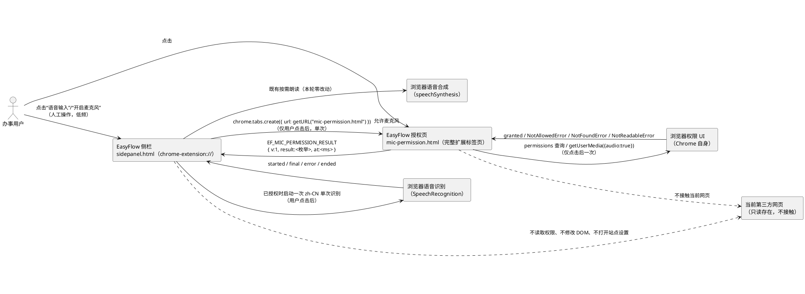

| 交互 | 协议 | 频率 | 备注 |
|---|---|---|---|
| 侧栏 → 浏览器权限查询 | `navigator.permissions.query`（Promise） | 侧栏打开 1 次；每次点击语音/入口各 1 次；focus 事件节流后 ≤1 次/秒 | 查询不触发弹窗（R-173） |
| 侧栏 → 授权页 | `chrome.tabs.create`（Promise） | 会话内 ≤1 个活动页 | 不需 `tabs` 权限（R-233） |
| 授权页 → 侧栏 | `chrome.runtime.sendMessage`（固定通知） | 每次授权尝试 ≤1 条 | 仅枚举 + 时间戳（R-228） |
| 侧栏 → 识别 | 既有适配器 `start()` | 每次用户点击 ≤1 次 | 契约不变 |
| 侧栏 → 合成 | 既有 `speechSynthesis` | 用户点击 | 不变 |

### 2.1.2 组件/服务总体架构

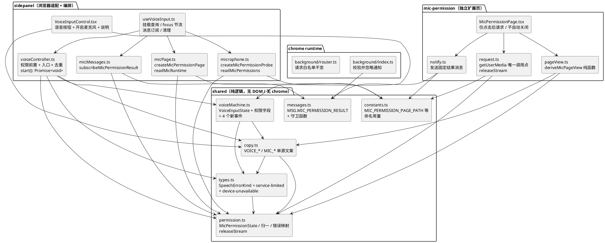

**依赖方向规则（沿用第五轮 2.5.1，扩展三行）**

| 层 | 文件 | 允许依赖 | 禁止依赖 |
|---|---|---|---|
| 契约 | `shared/speech/types.ts` | 无 | React、chrome、window |
| 权限纯逻辑 | `shared/speech/permission.ts` | `types.ts` | React、chrome、navigator、window |
| 文案 | `shared/speech/copy.ts` | `types.ts`、`permission.ts`（仅类型） | 浏览器 API |
| 状态机 | `shared/speech/voiceMachine.ts` | `types.ts`、`copy.ts`、`permission.ts` | 浏览器 API |
| 浏览器适配（侧栏） | `sidepanel/speech/microphone.ts`、`micPage.ts` | `shared/speech/*`、`chrome`（仅 `micPage.ts`） | React、组件 |
| 浏览器适配（授权页） | `mic-permission/request.ts` | `shared/speech/permission.ts` | React、chrome（除 notify） |
| 编排 | `sidepanel/speech/voiceController.ts` | 上述全部 | React、`window`、`chrome` |
| Hook | `sidepanel/hooks/useVoiceInput.ts` | controller + 适配器 + React + `chrome`（订阅） | 组件 |
| 页面 | `mic-permission/*.tsx` | 纯逻辑 + copy + React + `chrome`（仅 notify） | 侧栏组件 |

**唯一性约束**：

1. `getUserMedia` 字面量只允许出现在 `src/mic-permission/request.ts`（源码）与 `dist/mic-permission.js`（产物）。
2. `chrome.tabs.create`、`chrome.runtime.getContexts` 只允许出现在 `src/sidepanel/speech/micPage.ts`。
3. `navigator.permissions` 只允许出现在 `src/sidepanel/speech/microphone.ts`（`readMicPermissions` 内）。
4. `chrome.runtime.onMessage` 的语音订阅只允许出现在 `src/sidepanel/speech/micMessages.ts`（与 `useConversation`/`usePageSession` 的既有订阅并列，互不干扰）。
5. 所有 MIC 文案只允许出现在 `src/shared/speech/copy.ts`。

### 2.1.3 实现设计文档

#### （1）权限查询时序（侧栏）

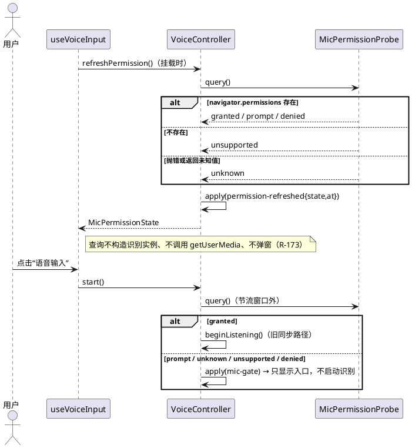

**节流规则**：`MIC_PERMISSION_RECHECK_MIN_MS = 1000`。同一 `VoiceController` 内 `lastRefreshAt` 记录；窗口内直接返回缓存状态（不发新查询），保证 DFX 4.1.3 的“单次 ≤100ms、不阻塞输入”。

**触发点矩阵（R-172、R-177）**

| 触发 | 是否查询 | 备注 |
|---|---|---|
| 侧栏打开（hook mount） | 是，1 次 | 无定时器、无轮询 |
| 点击“语音输入” | 是（节流窗口外） | 未授权只显示入口 |
| 点击“开启麦克风”前后 | 打开前 1 次 | 打开后不查（无意义） |
| 从授权页返回（`focus` / `visibilitychange`） | 是（节流） | 只刷新状态，不自动识别（R-214） |
| 收到授权页消息 | 否（消息本身即状态） | `at` 早于最近查询则丢弃 |
| 静置 60 秒 | 否 | 无 `setInterval`/`setTimeout` 轮询 |

#### （2）`start()` 的异步兼容时序（关键设计点）

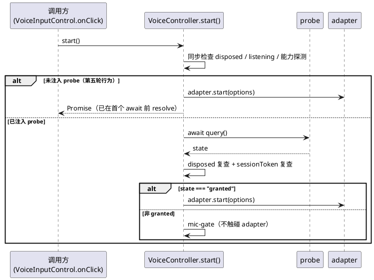

**为什么改成 `start(): Promise<void>`**：
- 调用方（`useVoiceInput` 的 `start` 包装）无需等待，`void controller.start()`；
- `async` 函数在首个 `await` 之前**同步执行**，因此未注入 probe 时 AT-51/AT-56 的“`start()` 后立即 `phase==="listening"`”“连续 3 次只 1 次 `adapter.start`”断言仍然成立；
- 注入 probe 且状态为 `granted` 时，`phase` 在 `await` 之后才变 `listening`，测试用 `await controller.start()` 即可确定性断言（AT-68）。

**风险控制**：`await` 之后必须两重校验：`this.disposed` 与 `this.sessionToken === token`，否则“点击后立刻关闭侧栏”会在卸载后启动识别。

#### （3）授权页请求状态机

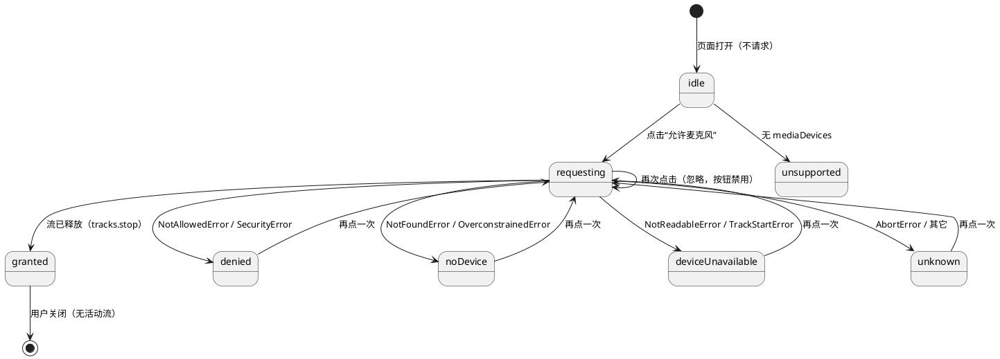

**分支规则**

| 分支 | 触发条件 | 处理策略 | 用户可见 |
|---|---|---|---|
| `idle` | 打开、刷新、聚焦、从后台返回 | **不请求**（R-188） | 标题 + 目的 + 隐私 + 按钮 |
| `requesting` | 按钮点击（仅一次） | `requestingRef` 锁；按钮 `disabled`；状态区“正在请求…”（≤300ms 可见） | 不可重复点击 |
| `granted` | `getUserMedia` resolve | 立即 `releaseStream()`；`streamRef=null`；**不关闭、不跳转、不识别** | “已允许，请回 EasyFlow 再点语音输入” |
| `permission-denied` | `NotAllowedError` / `SecurityError` | 映射后显示；回传枚举 | “麦克风权限未开启…”+ 可回 EasyFlow 打字 |
| `no-audio-device` | `NotFoundError` / `OverconstrainedError` | 同上 | “没有检测到可用的麦克风…” |
| `device-unavailable` | `NotReadableError` / `TrackStartError` | 同上 | “麦克风被系统关闭或被其他应用占用…” |
| `unknown` | `AbortError` / 未列出 | 同上 | “授权没有完成，可以再试…” |
| `unsupported` | 无 `navigator.mediaDevices` | 不调用 | “当前环境不能请求麦克风，可回 EasyFlow 打字” |

**卸载清理**：`useEffect` 返回清理函数，置 `mountedRef=false`；`getUserMedia` resolve 后若 `mountedRef===false` → 先 `releaseStream(stream)` 再直接 return（不 `setState`、不发消息）。保证 R-194“无活动麦克风会话”。

#### （4）授权页去重判定

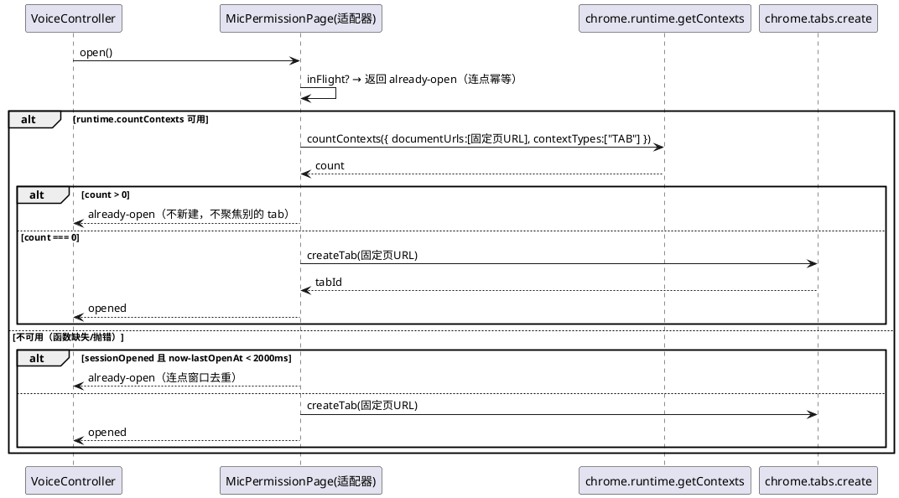

**去重三要素**：
1. **in-flight 锁**：单次 `open()` 未结算前，重复点击返回 `already-open`（R-212 连点幂等）。
2. **上下文本查询**：`getContexts` 只传 `documentUrls: [getURL(MIC_PERMISSION_PAGE_PATH)]` 与 `contextTypes: ["TAB"]`，**只取 `length`**，不读任何返回字段（R-234/R-235）。
3. **降级窗口**：`getContexts` 不可用时用内存 `sessionOpened + lastOpenAt`，`MIC_PAGE_DEDUPE_GUARD_MS = 2000`；窗口外允许再开（R-213 关闭后可再开）。

**为什么不带 query 参数**：`mic-permission.html?from=sidepanel` 会导致 `documentUrls` 精确匹配失效，进而破坏去重；因此**不使用 URL 参数**（与 T6-04 的“可选”项相反，选择更稳的实现）。

#### （5）错误分类判定（两来源 → 一类别 → 一文案）

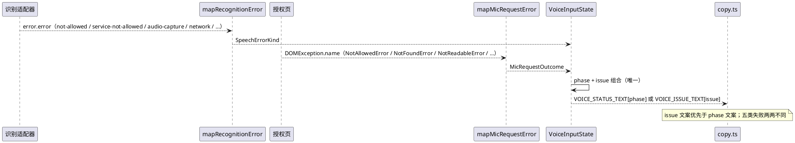

**边界明确**：
- `audio-capture`（识别侧）与 `NotFoundError`/`OverconstrainedError`（授权页侧）→ 同一 `no-audio-device`；
- `NotReadableError`/`TrackStartError`（授权页侧）→ `device-unavailable`，**不**降级为 `no-audio-device`，也**不**归 `permission-denied`；
- `service-not-allowed` → `service-limited`，**不再**是 `permission-denied`；
- `SecurityError` → `permission-denied`（环境不允许，但仍给设置路径与重试）。

#### （6）状态管理与保存策略

| 状态 | 存放层 | 生命周期 | 是否持久化 |
|---|---|---|---|
| `permission` / `permissionCheckedAt` | `VoiceInputState`（侧栏内存） | 侧栏打开至关闭 | 否（T6-10） |
| `pageOpened` / `micPageFailed` | `VoiceInputState` | 同上 | 否 |
| `pendingText` / `revision` | `VoiceInputState`（既有） | 同上 | 否 |
| 授权页 `phase` | `MicPermissionPage` 组件状态 | 页面打开至关闭/刷新 | 否（刷新即重置） |
| `MediaStream` 引用 | 授权页局部变量 + `streamRef` | `getUserMedia` resolve → 立即清空 | 否（R-190/R-194） |
| 识别原文 | 侧栏 `pendingText` → 输入框 | 消费后清空 | 否（R-226） |

**明确不新增**：不新增 `chrome.storage` 键、不新增 `ConversationState` 字段、不新增诊断条目中的文本内容（诊断只允许类别与耗时）。

## 2.2 接口设计

### 2.2.1 总体设计

| 分组 | 接口 | 稳定性 | 说明 |
|---|---|---|---|
| 类型契约 | `MicPermissionState`、`MicRequestOutcome`、`MicPageOpenResult`、`MicPermissionProbe`、`MicPermissionPage`、`MicRuntimeLike`、`MediaDevicesLike`、`MediaStreamLike`、`MediaStreamTrackLike` | 稳定 | 纯类型，无浏览器依赖 |
| 纯函数 | `mapPermissionState`、`mapMicRequestError`、`toPermissionState`、`releaseStream`、`deriveMicPageView`、`isMicPermissionResult` | 稳定 | 全部可单测 |
| 侧栏编排 | `VoiceController.start/refreshPermission/requestMicPermission/applyMicResult` | 稳定（扩展） | `start()` 由 `void` 改为 `Promise<void>`，语义兼容 |
| 状态机 | `voiceInputReducer` 新事件 4 个；`describeVoiceInput` 新字段 6 个 | 稳定（扩展） | 旧字段与旧分支不变 |
| 跨页消息 | `MSG.MIC_PERMISSION_RESULT` + `MicPermissionResultNotification` | 版本化（`v:1`） | 只有枚举 + 时间戳 |
| 构建产物 | `mic-permission.html` / `.js` / `.css` | 稳定 | 路径即契约，与 `getURL` 一致 |
| 门禁例外 | `getUserMedia` 路径表（2 条） | 稳定（逐条枚举） | 不使用通配 |

**接口变更策略**：`start()` 的返回类型由 `void` → `Promise<void>` 属于**兼容扩展**（调用方忽略返回值即可）；`VoiceInputView` 只增字段；`VoiceInputEvent` 只增类型；`SpeechErrorKind` 只增值（`switch` 均有 `default` 兜底，`voiceMachine.ts:115-117` 与 `policy.ts:110-111` 已确认）。

### 2.2.2 接口清单

#### 接口 A：权限领域类型与纯映射（新增）

```ts
// src/shared/speech/permission.ts
export type MicPermissionState =
  | "unknown" | "granted" | "prompt" | "denied" | "unsupported";

export type MicRequestOutcome =
  | "granted" | "permission-denied" | "no-audio-device"
  | "device-unavailable" | "unknown" | "unsupported";

export type MicPageOpenResult = "opened" | "already-open" | "failed";

export interface MicPermissionProbe {
  query(): Promise<MicPermissionState>;
}

export interface MicPermissionPage {
  open(): Promise<MicPageOpenResult>;
}

export interface MediaStreamTrackLike { stop(): void; }
export interface MediaStreamLike { getTracks(): readonly MediaStreamTrackLike[]; }
export interface MediaDevicesLike {
  getUserMedia(constraints: { audio: true }): Promise<MediaStreamLike>;
}

export function mapPermissionState(raw: unknown): MicPermissionState;
export function mapMicRequestError(raw: unknown): MicRequestOutcome;
export function toPermissionState(outcome: MicRequestOutcome): MicPermissionState | null;
export function releaseStream(stream: MediaStreamLike): { stopped: number; failed: number };
```

| 项 | 说明 |
|---|---|
| 业务用途 | 把“浏览器返回的权限状态/错误名”收敛为 UI 可用的稳定枚举，保证文案单源与两来源一致性 |
| 前置条件 | 纯函数，无前置；`raw` 允许任意 `unknown` |
| 后置条件 | 无副作用；不读取设备、不发请求 |
| 异常映射 | `mapPermissionState`：`"granted"/"prompt"/"denied"` → 原值；缺省/未知/非字符串 → `unknown`。`mapMicRequestError`：见 2.7 表 |
| 调用示例 | `const state = mapPermissionState(status.state);` / `const outcome = mapMicRequestError(errorName);` |

**`releaseStream` 语义**：对 `getTracks()` 每条调用 `stop()`，单条抛错计入 `failed` 并继续；返回计数用于自测断言（AT-69）。函数不保留任何引用。

#### 接口 B：权限查询适配器（新增，可注入）

```ts
// src/sidepanel/speech/microphone.ts
export interface MicPermissionsLike {
  query(descriptor: { name: string }): Promise<{ state: string }>;
}

export function readMicPermissions(scope: unknown): MicPermissionsLike | null;
export function createMicPermissionProbe(
  permissions: MicPermissionsLike | null,
): MicPermissionProbe;
```

| 项 | 说明 |
|---|---|
| 业务用途 | 侧栏侧唯一的权限查询入口；查询不触发弹窗、不构造识别实例 |
| 前置条件 | `permissions` 可为 `null`（环境缺失） |
| 后置条件 | `query()` 永不 reject：缺失 → `unsupported`；抛错/超时/未知值 → `unknown` |
| 异常映射 | `query` 抛 `TypeError`（未知 name）→ `unknown`（不显示“不支持”，R-174） |
| 调用示例 | `const probe = createMicPermissionProbe(readMicPermissions(globalThis));` |

**类型安全要点**：`lib.dom.d.ts` 的 `PermissionName` 不含 `microphone`，因此 `readMicPermissions` 通过 `unknown` → 结构化守卫（`typeof permissions.query === "function"`）取值，再以 `{ name: "microphone" }` 调用自有接口。**不使用 `any`、不使用 `as PermissionName`、不使用 `@ts-expect-error`**。

#### 接口 C：授权页打开适配器（新增，可注入）

```ts
// src/sidepanel/speech/micPage.ts
export interface MicRuntimeLike {
  getURL(path: string): string;
  countContexts?(filter: {
    documentUrls: readonly string[];
    contextTypes: readonly string[];
  }): Promise<number>;
  createTab?(url: string): Promise<number | null>;
}

export function readMicRuntime(scope: unknown): MicRuntimeLike | null;
export function createMicPermissionPage(deps: {
  runtime: MicRuntimeLike;
  now?: () => number;
}): MicPermissionPage;
```

| 项 | 说明 |
|---|---|
| 业务用途 | 只打开本扩展固定页；提供连点/上下文/降级三层去重 |
| 前置条件 | `runtime.getURL` 必须存在；`countContexts`/`createTab` 可选 |
| 后置条件 | 返回 `opened`/`already-open`/`failed`；**不读** 其它 tab 的 `url/title/favIconUrl`；`createTab` 返回值只判 `typeof id === "number"` |
| 异常映射 | `getURL` 抛错、`createTab` 缺失/抛错/返回非数字 → `failed`；`countContexts` 抛错 → 走降级窗口 |
| 调用示例 | `const page = createMicPermissionPage({ runtime }); const r = await page.open();` |

**`readMicRuntime` 实现约束**：内部只取 `chrome.runtime.getURL`、`chrome.runtime.getContexts`、`chrome.tabs.create` 三个函数并包成 `MicRuntimeLike`；`countContexts` 内部 `return contexts.length`（不接触返回字段）；`createTab` 内部 `const tab = await chrome.tabs.create({ url }); return typeof tab?.id === "number" ? tab.id : null;`。

#### 接口 D：`VoiceController` 扩展（修改）

```ts
export interface VoiceControllerDeps {
  adapter: RecognitionAdapter | null;
  detect?: () => RecognitionSupport;
  limit?: number;
  probe?: MicPermissionProbe;      // 新增：不注入即第五轮行为
  micPage?: MicPermissionPage;     // 新增：不注入则“开启麦克风”不可用
  now?: () => number;              // 新增：消息时间戳/去重窗口，便于测试
}

export class VoiceController {
  start(): Promise<void>;
  cancel(): void;
  invalidate(): void;
  consumePending(): void;
  dispose(): void;
  refreshPermission(): Promise<MicPermissionState>;      // 新增
  requestMicPermission(): Promise<void>;                 // 新增
  applyMicResult(result: MicRequestOutcome, at: number): void; // 新增
  getPermission(): MicPermissionState;                   // 新增（只读）
}
```

| 项 | 说明 |
|---|---|
| `start()` 前置 | `!disposed && phase !== "listening"`；能力探测为 `supported` |
| `start()` 后置 | `granted` → `phase="listening"` 且 `adapter.start` 恰好 1 次；非 `granted` → `phase` 不变、`micGate=true`、`adapter.start` 0 次 |
| `requestMicPermission()` 前置 | `!disposed && !opening` |
| `requestMicPermission()` 后置 | `granted` → 不打开页；否则 `micPage.open()` 结果落到 `pageOpened`/`micPageFailed` |
| `applyMicResult()` 后置 | 只更新 `permission`（`granted→granted`、`permission-denied→denied`、其余保持）；`at < permissionCheckedAt` 丢弃；**不启动识别、不发送** |
| 异常映射 | `probe.query` reject → 内部按 `unknown`；`micPage.open` reject → `failed` |
| 调用示例 | `await controller.start();` / `controller.applyMicResult("granted", Date.now());` |

#### 接口 E：状态机扩展（修改）

```ts
export interface VoiceInputState {
  phase: VoiceInputPhase;          // 不变
  issue: VoiceInputIssue | null;   // 新增值 service-limited / device-unavailable
  revision: number;                // 不变
  pendingText: string | null;      // 不变
  disclosureShown: boolean;        // 不变
  permission: MicPermissionState;      // 新增，初始 "unknown"
  permissionCheckedAt: number | null;  // 新增
  pageOpened: boolean;                 // 新增
  micPageFailed: boolean;              // 新增
  micGate: boolean;                    // 新增（用户点过语音输入/入口且未授权）
}

export type VoiceInputEvent =
  // 既有 9 类事件保持不变：start-requested / adapter-started / adapter-final /
  // adapter-error / adapter-ended / timeout / cancel-requested / composer-consumed / invalidate
  | { type: "permission-refreshed"; state: MicPermissionState; at: number }
  | { type: "mic-gate" }
  | { type: "mic-page-opened"; at: number }
  | { type: "mic-page-failed" };

export interface VoiceInputView {
  /* 既有 8 字段不变 */
  permission: MicPermissionState;
  permissionCheckedAt: number | null;
  showMicEntry: boolean;
  micEntryLabel: string;
  micEntryPurpose: string;
  settingHelpText: string | null;
  micPageFailed: boolean;
}
```

| 项 | 说明 |
|---|---|
| 业务规则 | `mic-gate` 只在 `permission !== "granted"` 时生效；`invalidate` 清 `issue`/`pendingText`/`micGate`，**不清** `permission`/`permissionCheckedAt`/`pageOpened` |
| 前置条件 | 事件由 controller 发出，视图仅供组件读取 |
| 后置条件 | `describeVoiceInput` 的 `statusText` 优先级：`issue` > `micPageFailed` > `pageOpened && 非 granted` > `denied` > `micGate` > `phase` |
| 调用示例 | `const view = describeVoiceInput(state); view.showMicEntry ? … : …` |

#### 接口 F：跨页通知（新增）

```ts
// src/shared/messages.ts
export const MSG = { /* 既有 14 项 */, MIC_PERMISSION_RESULT: "EF_MIC_PERMISSION_RESULT" } as const;

export interface MicPermissionResultNotification {
  type: typeof MSG.MIC_PERMISSION_RESULT;
  v: 1;
  result: MicRequestOutcome;
  at: number;
}

export const MIC_RESULT_KINDS: readonly MicRequestOutcome[];

export function isMicPermissionResult(value: unknown): value is MicPermissionResultNotification;
export function createMicPermissionResult(
  result: MicRequestOutcome,
  at: number,
): MicPermissionResultNotification;
```

| 项 | 说明 |
|---|---|
| 业务用途 | 授权页在用户操作后即时告知侧栏结果，作为“重新查询”的辅助 |
| 前置条件 | `result` 必须是 `MIC_RESULT_KINDS` 之一；`at` 必须有限正数；`v` 必须为 `1` |
| 后置条件 | 侧栏只更新权限状态与提示（不识别、不发送、不聚焦） |
| 异常映射 | 校验失败 → `isMicPermissionResult === false`；后台与侧栏均忽略；未知类型仍走既有请求白名单错误码 |
| 调用示例 | `const n = createMicPermissionResult("granted", Date.now()); void chrome.runtime.sendMessage(n).catch(() => undefined);` |

**为什么放 `shared/messages.ts`**：项目既有“所有跨进程消息集中在 `messages.ts` + 后台白名单校验”的结构（`messages.ts:9-24`、`router.ts:68-88`）。另建模块会造成两套消息源，与 6.4 单源原则冲突；代价是 `messages.ts` 增加约 30 行，可接受。

#### 接口 G：侧栏消息订阅与 Hook（新增/修改）

```ts
// src/sidepanel/speech/micMessages.ts
export function subscribeMicPermissionResult(
  listener: (result: MicRequestOutcome, at: number) => void,
): () => void;

// src/sidepanel/hooks/useVoiceInput.ts
export interface VoiceInputHandle {
  view: VoiceControllerView;
  start: () => void;
  cancel: () => void;
  invalidate: () => void;
  consumePending: () => void;
  onComposerTextChange: (text: string) => void;
  requestMicPermission: () => void;   // 新增
}
```

| 项 | 说明 |
|---|---|
| 业务规则 | 订阅只在 `chrome.runtime.onMessage` 可用时注册；`sender` 不读取任何字段；卸载时 `removeListener` |
| 前置条件 | 无（无 chrome 环境返回空清理函数） |
| 后置条件 | 收到合法通知 → `controller.applyMicResult(result, at)` |
| 调用示例 | `const off = subscribeMicPermissionResult((r, at) => controller.applyMicResult(r, at));` |

#### 接口 H：授权页请求与视图（新增）

```ts
// src/mic-permission/request.ts
// 三个媒体类型（MediaStreamTrackLike / MediaStreamLike / MediaDevicesLike）
// 统一定义在 src/shared/speech/permission.ts（接口 A），此处只声明函数，避免两份类型。
export function readMediaDevices(scope: unknown): MediaDevicesLike | null;
export function requestMicrophone(media: MediaDevicesLike | null): Promise<MicRequestOutcome>;

// src/mic-permission/pageView.ts
export type MicPagePhase =
  | "idle" | "requesting" | "granted" | "permission-denied"
  | "no-audio-device" | "device-unavailable" | "unknown" | "unsupported";

export interface MicPageView {
  heading: string;
  body: string;
  buttonLabel: string;
  canRequest: boolean;
  statusText: string;
}

export function deriveMicPageView(phase: MicPagePhase): MicPageView;
```

| 项 | 说明 |
|---|---|
| `requestMicrophone` 前置 | `media === null` → 立即返回 `unsupported`，不调用任何 API |
| `requestMicrophone` 后置 | `granted` 时流已 `stop()` 且引用丢弃；失败时返回映射类别 |
| 异常映射 | 见 2.7 授权页列；`getUserMedia` 抛非对象/无 name → `unknown` |
| 调用示例 | `const outcome = await requestMicrophone(readMediaDevices(window));` |

**唯一 `getUserMedia` 语句形态**（门禁依赖）：`const stream = await media.getUserMedia({ audio: true });` —— 参数对象只含 `audio`，不含 `video`；构建不压缩以保证该字面量在产物中稳定存在。

## 2.3 数据模型

### 2.3.1 设计目标

1. **支持场景**：侧栏权限五态展示、入口引导、授权页一次请求、返回重试、五类失败可区分、结果只入框。
2. **容量与性能**：状态对象为常量级（≤10 个标量字段）；权限查询单次 ≤100ms，不阻塞输入；授权页状态 ≤300ms 可见。
3. **与存量数据兼容**：`VoiceInputState` 只增字段，旧字段语义与引用相等语义不变；不进入 `ConversationState`；不新增 storage 键；`pendingText` 仍为唯一识别文本载体。
4. **隐私**：数据模型中不存在音频、设备、URL、识别原文的持久字段；`MediaStream` 只在授权页局部变量中存在，且生命周期 ≤ 一次 `await` 之后立即释放。

### 2.3.2 模型实现

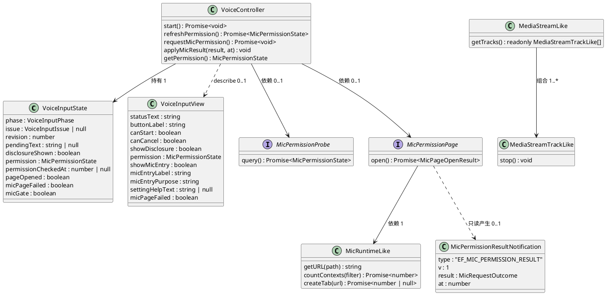

**对象生命周期**

| 对象 | 创建 | 销毁 | 说明 |
|---|---|---|---|
| `VoiceInputState` | 侧栏挂载（`createVoiceInputState`） | 侧栏卸载（`dispose`） | 每次 reducer 返回新对象，视图缓存按引用失效 |
| `MicPermissionProbe` | hook 首次渲染 | 侧栏卸载 | 无内部状态，仅包函数 |
| `MicPermissionPage` | hook 首次渲染 | 侧栏卸载 | 内部 `inFlight`/`sessionOpened`/`lastOpenAt` 为内存 |
| `MediaStream` | 授权页按钮点击后 | `releaseStream` 后置 `null`；页面卸载时兜底 | **不交给任何其他组件**（R-190） |
| `MicPermissionResultNotification` | 授权页每次尝试 | 发送后丢弃 | 只含枚举与时间戳 |

**状态流转约束**

1. `permission` 只能由 `permission-refreshed` 改变；`denied → granted` 必须经查询或授权页消息，不允许本地猜测。
2. `pageOpened` 只增不减（会话内），用于“授权页已打开”提示；不用于阻止再次打开（阻止由适配器判定）。
3. `micGate` 在 `invalidate` 时清空，避免切任务后仍显示旧引导；`permission` 不清空（权限与任务无关）。
4. `issue` 与 `permission` 相互独立：`issue="service-limited"` 可以同时 `permission="granted"`（5.4.3 异常 3）。
5. `pendingText` 与权限完全无关，任何权限事件都不得触碰。
## 2.4 权限能力与五态（R-170—R-177）

### 2.4.1 五态定义与文案

| 状态 | 触发来源 | 界面文案（`MIC_PERMISSION_STATE_TEXT`） | 显示“开启麦克风” | 点击“语音输入”行为 |
|---|---|---|---|---|
| `unknown` | 查询不存在 / 抛错 / 返回未知值 | “需要开启麦克风才能语音输入；也可以直接打字。” | 是 | 不启动识别，只显示入口 |
| `granted` | `PermissionStatus.state === "granted"` 或授权页 `granted` | “已允许 EasyFlow 使用麦克风。”（不渲染入口，仅在状态区短暂确认） | 否 | 直接启动一次识别 |
| `prompt` | `state === "prompt"` | “需要开启麦克风才能语音输入；点“开启麦克风”完成一次授权。” | 是 | 不启动识别，只显示入口 |
| `denied` | `state === "denied"` 或授权页 `permission-denied` | 拒绝文案 + `MIC_SETTING_HELP_TEXT`（见 2.9） | 是 | 不启动识别，显示设置说明 |
| `unsupported` | `navigator.permissions` 缺失 | “当前环境无法查询麦克风权限；仍可点“开启麦克风”试一次，或直接打字。” | 是 | 不启动识别，只显示入口 |

**关键取舍**：`unsupported`（查询能力缺失）**不等于**识别能力不支持。前者仍显示入口、`canStart` 仍为 `true`；后者（`detectRecognitionSupport === "unsupported"`）走既有 `unsupported` phase 且按钮禁用（AT-54 不变）。

### 2.4.2 扩展来源判定（R-170）

1. 查询对象固定为当前扩展页的 `navigator.permissions`（来源即 `chrome-extension://<扩展 ID>`）。
2. 不读取当前网页 origin，不做按网页的查询分支；源码检索不得出现 `location.hostname`/`document.referrer` 参与权限判断。
3. 切换第三方网页不触发权限重算（`App.tsx:31-34` 的 `state.tabId` effect 只做 `voice.invalidate()`，不清权限）。
4. 文案中出现的“EasyFlow 扩展”即来源标识，不使用网页域名。

### 2.4.3 查询不触发弹窗（R-173）

| 检查项 | 设计保证 |
|---|---|
| 不调用 `getUserMedia` | `microphone.ts` 不含该字面量；门禁保证 |
| 不构造识别实例 | `probe.query()` 只调用 `permissions.query` |
| 不触发 `SpeechRecognition` | 同一保证 |
| 连续点击不弹窗 | 查询为 Promise，浏览器不会因 `query` 弹窗 |

### 2.4.4 接入位置（不破坏适配器契约）

| 关注点 | 落点 | 理由 |
|---|---|---|
| 权限查询 | `VoiceController` 内 `refreshPermission()`，依赖注入 `probe` | 可单测、可注入假对象；`VoiceController` 仍不触碰 `navigator` |
| 启动前置 | `VoiceController.start()` 的 `await probe.query()` 分支 | 适配器契约（四事件、单会话、幂等取消）完全不变 |
| 定时查询（focus） | `useVoiceInput` 的 `window.addEventListener("focus")` + `document.visibilitychange` | 属浏览器事件，不进纯逻辑层 |
| 消息订阅 | `useVoiceInput` → `micMessages.ts` | 属浏览器边界 |
| UI 呈现 | `describeVoiceInput` + `VoiceInputControl` | 文案单源、组件零分支逻辑 |

**为什么权限状态不写 storage（T6-10）**：权限是浏览器外部状态，写盘会与真实状态脱节（用户可能在设置里改动）；重开侧栏重新查询成本 <100ms。因此状态只存在于 `VoiceInputState`，`dispose` 即丢失。

### 2.4.5 异常场景处理

| 场景 | 处理 | 用户感知 |
|---|---|---|
| 权限查询抛错 | 归 `unknown`；`permissionCheckedAt` 仍记录；入口保留 | 看到“需要开启麦克风”，可继续操作 |
| 查询返回意外值（如 `"limited"`） | 归 `unknown` | 同上 |
| 网页切换后状态被误读 | 不按网页判定；`invalidate` 不清权限 | 状态不因换页面变成“无权限” |
| 权限刚在设置中改回 | 下次点击/返回侧栏时重查（节流 1 秒） | 多试一次即可恢复 |

## 2.5 侧栏入口与打开授权页（R-178—R-186）

### 2.5.1 DOM 结构与 props

```text
.ef-speech-row
├─ button.ef-speech-btn            （既有：语音输入 / 取消识别）
├─ button.ef-speech-open-btn       （新增：开启麦克风，条件渲染）
├─ div.ef-speech-status            （既有：状态行，role=status, aria-live=polite）
├─ p.ef-speech-mic-purpose         （新增：仅用于 EasyFlow 语音输入…）
├─ p.ef-speech-setting-help        （新增：拒绝时的扩展来源设置说明）
└─ p.ef-speech-disclosure          （既有：告知，条件渲染）
```

```ts
interface VoiceInputControlProps {
  view: VoiceInputView;
  onStart: () => void;
  onCancel: () => void;
  onRequestMic: () => void;   // 新增
}
```

| 要求 | 实现约束 |
|---|---|
| 不改变既有按钮语义 | `listening` 时仍是“取消识别”；`disabled={!view.canStart}` 保留（AT-54 断言 `disabled={!view.canStart}`） |
| 入口可聚焦、可读名称 | `type="button"` + 文本“开启麦克风”；不使用图标按钮 |
| 与主按钮不混淆 | 次级样式（描边、非填充）；`ef-speech-open-btn` 与 `ef-speech-btn` 并列但视觉层级不同 |
| care 模式 ≥44px | `.ef-speech-open-btn { min-height: var(--ef-tap-min); }`（care 下 `--ef-tap-min: 44px`，normal 下 28px 与语音按钮一致） |
| 状态文本可读 | 复用 `.ef-speech-status` 的 `overflow-wrap: anywhere` |
| 键盘可达 | 原生按钮，Tab/Enter/Space 天然支持；不加自定义 keydown |
| 不内联中文 | 所有文字来自 `view` 或 `copy.ts` 常量 |

### 2.5.2 打开流程与失败处理

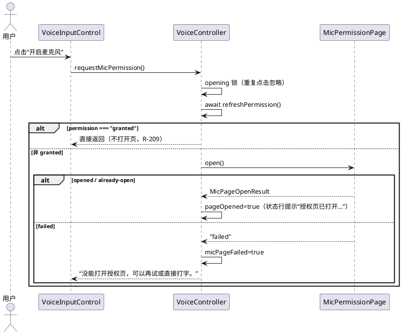

| 异常 | 处理 | 文案来源 |
|---|---|---|
| `chrome.tabs.create` 抛错 / 不存在 | `failed`；不申请权限、不改用网页跳转 | `MIC_PAGE_OPEN_FAILED_TEXT` |
| `chrome.runtime.getURL` 抛错 | `failed` | 同上 |
| 已存在授权页 | `already-open`；不新建、不聚焦其他 tab | `MIC_PAGE_OPENED_TEXT` |
| 用户关闭授权页后再点 | `getContexts` 返回 0 → `opened` 新页 | 无额外文案 |
| 用户误以为网页站点设置可解决 | 文案明确“这不是当前网页的站点设置” | `MIC_SETTING_HELP_TEXT` |

### 2.5.3 权限边界（R-181/R-182/R-234/R-236）

| 禁止项 | 设计保证 |
|---|---|
| 打开外部 URL | 目标只能是 `getURL(MIC_PERMISSION_PAGE_PATH)` 的常量结果；函数签名不接受外部 URL 参数 |
| 打开 `chrome://settings` | 源码无该字符串；不给用户自动打开设置 |
| 注入/修改第三方网页 | 无 `scripting.executeScript` 调用、无 content script 消息 |
| 读其他标签页敏感字段 | 只用 `countContexts`（返回数字）与 `createTab` 返回的 `id` |
| `tabs.update/reload/remove` | 不使用 |
| 新增 `tabs` 权限 | 不新增（`create` 不需要该权限） |

### 2.5.4 首次点击与二次点击的区分（R-176/R-179/R-210）

| 用户动作 | 当前权限 | 结果 |
|---|---|---|
| 点击“语音输入”（第 1 次） | `prompt`/`unknown` | 发起查询 → `mic-gate` → 只显示入口与目的说明；`adapter.startCalls === 0` |
| 点击“语音输入”（第 2 次） | 仍非 `granted` | 重新查询 → 仍只显示入口；**不打开授权页**（打开只由“开启麦克风”触发） |
| 点击“开启麦克风” | 非 `granted` | 打开固定授权页（会话内 ≤1） |
| 点击“语音输入” | `granted` | 直接 `beginListening()`，入口消失（`showMicEntry=false`） |

## 2.6 授权页（R-187—R-196）

### 2.6.1 文件与构建

| 文件 | 职责 |
|---|---|
| `public/mic-permission.html` | 静态页；`<script type="module" src="mic-permission.js">`；`<link rel="stylesheet" href="mic-permission.css">`；`lang="zh-CN"`；无远程资源 |
| `src/mic-permission/main.tsx` | 入口：`createRoot` + 渲染 `MicPermissionPage`；`import "../sidepanel/styles/sidepanel.css"` + `import "./mic-permission.css"` |
| `src/mic-permission/MicPermissionPage.tsx` | UI 与点击编排；请求锁；卸载清理 |
| `src/mic-permission/request.ts` | **唯一** `getUserMedia({ audio: true })` 调用点；`readMediaDevices`；`releaseStream` 调用 |
| `src/mic-permission/pageView.ts` | `MicPagePhase` → `MicPageView` 纯映射（文案单源） |
| `src/mic-permission/notify.ts` | 发送 `MicPermissionResultNotification`（仅枚举 + 时间戳） |
| `src/mic-permission/mic-permission.css` | 授权页布局类（`ef-mic-*`），复用既有 token |

**样式策略（T6-11）**：授权页 `import` 既有 `sidepanel.css`（token 单一来源，normal 值直接可用），再叠加 `mic-permission.css` 的布局类。**不复制 token 值、不引入新框架、不新建第二套主题**。授权页按钮用 `min-height: max(44px, var(--ef-tap-min))` 保证任何模式下 ≥44px。

### 2.6.2 页面内容与状态

| 区域 | 内容 | 来源 |
|---|---|---|
| 标题（`h1`） | “允许 EasyFlow 使用麦克风” | `MIC_PAGE_TEXTS.heading` |
| 目的 | “这一步只为让 EasyFlow 的语音输入能工作。” | `MIC_PAGE_TEXTS.purpose` |
| 隐私 | `SPEECH_DISCLOSURE_TEXT` + “麦克风只在这一次请求中使用，获得后立即停止，不会录音。” | 同一文件（`copy.ts`） |
| 按钮 | “允许麦克风”（`type="button"`，`min-height: max(44px, var(--ef-tap-min))`） | `MIC_PAGE_TEXTS.button` |
| 状态区 | `role="status"` `aria-live="polite"`；`idle` 为空；`requesting` “正在请求麦克风…”；其余按类别 | `deriveMicPageView` |
| 说明 | “这个页面不会自动关闭，也不会自动开始识别。” | `MIC_PAGE_TEXTS.keepOpenNote` |

**状态映射（`deriveMicPageView`）**

| phase | 按钮 | 状态文字 | 可再次点击 |
|---|---|---|---|
| `idle` | “允许麦克风” | 空 | 是 |
| `requesting` | “正在请求…”（disabled） | 空（按钮文字即反馈） | 否 |
| `granted` | “已允许” | “已允许，请回 EasyFlow 再点语音输入。” | 否（成功态不再请求） |
| `permission-denied` | “再试一次” | 拒绝文案 + “可回 EasyFlow 直接打字。” | 是 |
| `no-audio-device` | “再试一次” | 无设备文案 | 是 |
| `device-unavailable` | “再试一次” | 系统禁用/被占用文案 | 是 |
| `unknown` | “再试一次” | “授权没有完成，可以再试…” | 是 |
| `unsupported` | “允许麦克风”（disabled） | 环境不支持文案 | 否 |

### 2.6.3 请求与轨道释放时序

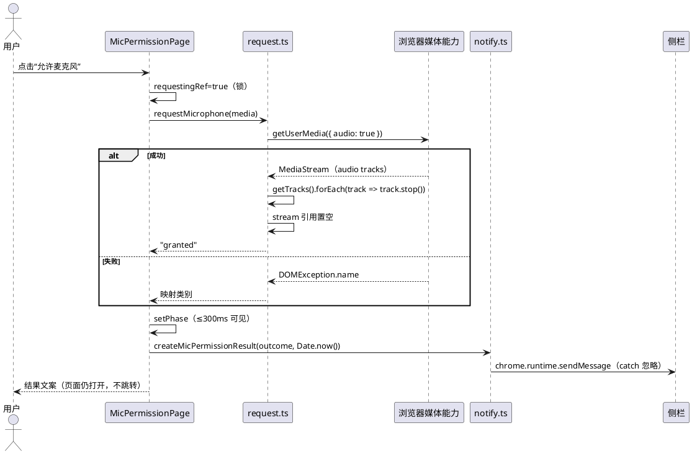

| 约束 | 实现 |
|---|---|
| 仅点击后请求（R-188） | `useEffect` 内**不调用** `requestMicrophone`；只绑定 `onClick` |
| 请求中防重（R-189） | `requestingRef.current` 检查 + `phase === "requesting"` 禁用按钮 |
| 立即停轨（R-190） | `requestMicrophone` 内 `releaseStream(stream)` 后立即返回；不 `setStream` |
| 不自动关闭（R-191） | 不调用 `window.close()`、无 `location.*` 赋值、无识别调用 |
| 不录音（R-192） | 无 `MediaRecorder`、无网络 API、`getUserMedia` 参数只含 `audio` |
| 卸载清理（R-194） | `mountedRef` + `streamRef` 兜底；resolve 后若已卸载先释放再返回 |
| 可访问性（R-195） | `h1` 唯一、`button` 原生、`:focus-visible` 复用既有样式、`max-width` + `overflow-wrap` 防横向滚动 |

### 2.6.4 授权页与侧栏的状态传递

| 通道 | 是否采用 | 说明 |
|---|---|---|
| 侧栏重新查询（主） | 是 | 返回侧栏/点击时重查；不依赖消息 |
| 固定 runtime 消息（辅） | 是 | `EF_MIC_PERMISSION_RESULT`，仅 `{v:1, result, at}` |
| URL 查询参数 | **否** | 会破坏 `getContexts` 的 `documentUrls` 精确匹配，且刷新后残留 |
| `chrome.storage` | **否** | 新增持久键与清理责任，且可能与真实权限脱节 |

**消息校验（侧栏与后台双侧）**

1. `isMicPermissionResult` 检查：`type` 精确、`v === 1`、`result ∈ MIC_RESULT_KINDS`、`at` 为有限正数。
2. 后台 `onMessage`：命中该通知 → `return false`（不转发、不进入 `routeSidePanelMessage`），避免被当成未知请求返回错误码。
3. 侧栏 `micMessages`：命中 → `applyMicResult`；`at < permissionCheckedAt` 丢弃（迟到保护）。
4. 不读取 `sender` 的任何字段；不校验也不记录 URL。

## 2.7 错误分类（R-197—R-207）

### 2.7.1 类别集合与类型扩展

```ts
// types.ts
export type SpeechErrorKind =
  | "unsupported" | "permission-denied" | "service-limited"
  | "no-audio-device" | "device-unavailable"
  | "no-speech" | "network" | "aborted" | "unknown";

export type VoiceInputIssue =
  | "no-audio-device" | "service-limited" | "device-unavailable"
  | "network" | "timeout" | "too-long" | "interrupted";
```

`VoiceInputPhase` **不新增值**（保持 8 值），因为 spec 6.2 要求服务受限与系统禁用落到 `failed + issue`，无设备继续落到 `permission-denied + issue`。

### 2.7.2 映射表（唯一判定口径）

| 来源 | 原始错误 | `SpeechErrorKind` / `MicRequestOutcome` | `phase` + `issue` | 文案（单一来源） | 显示入口 | 显示设置说明 |
|---|---|---|---|---|---|---|
| 识别 | `not-allowed` | `permission-denied` | `permission-denied` + `null` | “麦克风权限未开启。请允许 EasyFlow 扩展使用麦克风，或直接打字。” | 是 | 是 |
| 识别 | `service-not-allowed` | `service-limited` | `failed` + `"service-limited"` | “语音服务不可用或被浏览器限制，可以再试或直接打字。” | 否 | 否 |
| 识别 | `audio-capture` | `no-audio-device` | `permission-denied` + `"no-audio-device"` | “没有检测到可用的麦克风，可以直接打字。” | 否 | 否 |
| 识别 | `no-speech` / `bad-grammar` | `no-speech` | `no-speech` + `null` | 既有“未识别到语音…” | 否 | 否 |
| 识别 | `network` | `network` | `failed` + `"network"` | “网络或语音服务暂不可用，可以直接打字。” | 否 | 否 |
| 识别 | `language-not-supported` | `unsupported` | `unsupported` + `null` | 既有“当前浏览器不支持中文语音输入…” | 否 | 否 |
| 识别 | `aborted`（用户取消） | `aborted` | `cancelled` + `null` | 既有“已取消识别。” | 否 | 否 |
| 授权页 | `NotAllowedError` | `permission-denied` | 侧栏 `permission-denied`（经消息/查询） | 同上拒绝文案 | 是 | 是 |
| 授权页 | `SecurityError` | `permission-denied` | 同上 | 同上 | 是 | 是 |
| 授权页 | `NotFoundError` / `OverconstrainedError` | `no-audio-device` | `permission-denied` + `"no-audio-device"` | 无设备文案 | 否 | 否 |
| 授权页 | `NotReadableError` / `TrackStartError` | `device-unavailable` | `failed` + `"device-unavailable"` | “麦克风被系统关闭或被其他应用占用，可在系统声音设置中检查，或直接打字。” | 否 | 否 |
| 授权页 | `AbortError` / 未列出 | `unknown` | `failed` + `null` | “识别失败，可以再试或直接打字。” | 否 | 否 |
| 授权页 | 无 `mediaDevices` | `unsupported` | 授权页 `unsupported` | “当前环境不能请求麦克风…” | — | — |
| 权限查询 | 缺失 / 抛错 / 未知值 | （权限状态）`unknown` | 不改变 `phase` | “需要开启麦克风才能语音输入…” | 是 | 否 |

**五类失败文案两两不同（R-203）**：

| 类别 | 首句 |
|---|---|
| `permission-denied` | 麦克风权限未开启 |
| `service-limited` | 语音服务不可用或被浏览器限制 |
| `no-audio-device` | 没有检测到可用的麦克风 |
| `device-unavailable` | 麦克风被系统关闭或被其他应用占用 |
| `network` | 网络或语音服务暂不可用 |

两条**硬边界**：
1. `service-not-allowed` 只映射到 `service-limited`，源码中不得再出现 `case "service-not-allowed": ... return "permission-denied"`。
2. `audio-capture` 仍走 `permission-denied` 的 **phase**，但 `issue` 文案优先覆盖，因此用户看到的是“没有检测到可用的麦克风”，不是“权限未开启”（`voiceMachine.ts:153-157` 的既有优先级正好满足）。

### 2.7.3 不暴露原始错误（R-204）

| 保障 | 方式 |
|---|---|
| 类型层 | 原始错误名只进入两个映射函数，返回枚举；UI 只接收枚举 |
| 文案层 | `copy.ts` 不含 `NotAllowedError`/`NotFoundError`/`NotReadableError`/`no-speech`/`audio-capture`/`service-not-allowed`/`network`（AT-55 + AT-74 断言） |
| 消息层 | 消息 `result` 为枚举；`at` 为数字；无 `message`/`name`/`stack` 字段 |
| 诊断层 | 只允许“类别 + 是否打开过授权页 + 耗时”，不新增原始错误字段 |

### 2.7.4 文字输入替代与可恢复（R-205/R-206）

| 要求 | 落地 |
|---|---|
| 输入框在任何失败下可用 | 失败状态不改变 `ChatComposer` 的 `disabled`（只与 `state.busy` 有关） |
| 发送可用 | 发送按钮 `disabled={disabled \|\| text.trim().length === 0}` 不变（AT-53 断言保留） |
| 状态文字含替代路径 | 五类失败文案均以“或直接打字/可以再试或直接打字”收尾 |
| 可恢复 | 每次点击都重新查询；不缓存“永久拒绝”；`invalidate` 不清权限，允许下一次重试 |

## 2.8 重试与去重（R-208—R-214）

### 2.8.1 事件与状态矩阵

| 事件 | 前置状态 | 结果 | 是否触碰适配器 | 是否打开页 |
|---|---|---|---|---|
| `permission-refreshed{granted}` | 任意 | `permission=granted`，`micGate` 保持 | 否 | 否 |
| `permission-refreshed{denied}` | 任意 | `permission=denied` | 否 | 否 |
| `mic-gate` | `permission !== granted` | `micGate=true`，`phase` 不变 | 否 | 否 |
| `mic-page-opened{at}` | 任意 | `pageOpened=true`，`micPageFailed=false`，`permissionCheckedAt=at` | 否 | 是（已发生） |
| `mic-page-failed` | 任意 | `micPageFailed=true` | 否 | 否（失败） |
| `start-requested{supported:true}` | `permission === granted` | `listening` | 是，1 次 | 否 |
| `invalidate` | 任意 | `idle`，清 `issue`/`pendingText`/`micGate`/`micPageFailed`；保 `permission`/`pageOpened` | 仅 listening 时 cancel | 否 |

### 2.8.2 去重与幂等（R-211/R-212/R-213）

| 场景 | 判定 | 结果 |
|---|---|---|
| 1 秒内点 5 次“开启麦克风” | `opening` 锁 + `inFlight` | `open()` 实际执行 1 次；页面 ≤1 |
| 页面已存在（`getContexts` 命中） | `countContexts() > 0` | `already-open`；不新建 |
| 页面被关闭后再点 | `countContexts() === 0` | `opened`（新页 1 个） |
| `getContexts` 不可用，2 秒内重复点 | 窗口去重 | `already-open` |
| `getContexts` 不可用，2 秒后再点 | 窗口过期 | `opened`（允许重开） |
| 已授权连点“语音输入” 3 次 | `phase === "listening"` 短路 | `adapter.start` 1 次；页 0 次 |

### 2.8.3 返回侧栏不自动开始（R-214）

| 触发 | 行为 | 断言 |
|---|---|---|
| `focus` / `visibilitychange` | 只 `refreshPermission()`，不 `start()`、不 `focus()` 输入框 | 等待 10 秒：`adapter.startCalls === 0`、消息条数不变 |
| 收到 `granted` 消息 | 只 `applyMicResult` | 同上 |
| 切回任务（`tabId` 变化） | `voice.invalidate()`（既有） | `phase=idle`、`pendingText=null` |

### 2.8.4 迟到事件与重试复核

| 场景 | 处理 |
|---|---|
| 授权页关闭后消息迟到 | `at < permissionCheckedAt` → 丢弃 |
| 识别取消后 `final` 迟到 | 既有 `sessionToken`/`settled`（不改） |
| 重试时权限已改回 | 重新查询 → 按最新状态走识别/入口/说明 |
| 重试时权限仍 `prompt` | 只显示入口；若用户再点“开启麦克风”且页已存在 → `already-open`，不叠加页 |

## 2.9 扩展来源设置说明（R-215—R-219）

### 2.9.1 文案（`MIC_SETTING_HELP_TEXT`，单一来源）

> 怎么改：在浏览器“设置 → 隐私和安全 → 网站设置 → 麦克风”里找到 EasyFlow 扩展并允许；或先打开一次 EasyFlow 授权页，再点地址栏左侧的权限图标改为允许。设置入口位置可能因浏览器版本略有不同。

| 要求 | 文案对应部分 |
|---|---|
| R-215 指向扩展来源 | “找到 EasyFlow 扩展并允许” |
| R-215 明确不是网页 | 拒绝主句含“这不是当前网页的站点设置” |
| R-216 两条路径 | ①内容设置→麦克风；②授权页→地址栏权限图标 |
| R-217 版本差异 | “可能因浏览器版本略有不同” |
| R-218 不指去网页 | 无“当前网站/此网站/网页站点设置”作为解决步骤（仅否定式对照一处） |
| R-219 仍可重试 | 入口保留 + 输入框可用 + 发送可用 |

### 2.9.2 显示条件

| 状态 | `showMicEntry` | `settingHelpText` |
|---|---|---|
| `granted` | `false` | `null` |
| `prompt` / `unknown` / `unsupported` | `true` | `null` |
| `denied` | `true` | `MIC_SETTING_HELP_TEXT` |
| `issue` 为 `service-limited`/`device-unavailable`/`network`（权限可能 granted） | 按 `permission` 决定 | 按 `permission` 决定 |

**注意**：`denied` 说明与 `micGate` 说明不会同时渲染两条——`statusText` 只取一个（优先级见 2.2.2 接口 E），`settingHelpText` 是独立段落。

### 2.9.3 异常场景

| 场景 | 处理 | 用户感知 |
|---|---|---|
| 用户找不到扩展条目 | 文案给出“先打开一次授权页，再回设置页查找”的顺序 | 仍有可执行路径 |
| 企业策略锁定麦克风 | 不改文案结构；`SecurityError` → 拒绝类 + 设置路径 | 理解限制，仍可打字 |
| 用户已在网页设置里改过 | 主句明确“不是当前网页的站点设置” | 不再在错误位置反复尝试 |
## 2.10 朗读零改动（R-220—R-224）

### 2.10.1 为什么权限失败不影响朗读

| 事实 | 依据 |
|---|---|
| 朗读走独立适配器与独立控制器 | `synthesis.ts`（`speechSynthesis`）、`speechController.ts`、`speakMachine.ts`，与 `recognition.ts`/`voiceController.ts` 无共享状态 |
| 两个 Hook 独立实例 | `useSpeechSynthesis.ts:18-39` 与 `useVoiceInput.ts:17-58` 各自 `useRef` 构造，互不引用 |
| 朗读不查询权限 | `speechController.speak()` 只做 `checkSpeakText` + `adapter.speak`（`speechController.ts:49-85`），无权限调用 |
| 权限状态不进朗读状态 | `SpeakState` 字段为 `phase/key/note/last*`，本设计未新增任何字段 |
| 失败文案不共用语料 | 语音输入文案在 `VOICE_*`，朗读在 `SPEAK_*`，本设计只改前者 |

### 2.10.2 回归断言（并入 AT-77、AT-80）

1. `SpeechController` 在 `permission` 为 `denied`/`unsupported`/`failed(device-unavailable)` 时 `speak()` 仍 `speakCalls === 1`，`stop()` 仍 `stopCalls === 1`。
2. 语音输入状态变化不改变 `speak` 视图：先 `speak` 后注入权限失败，`speech.getView().phase === "speaking"`。
3. 朗读过程中注入权限失败，朗读不中断（`stopCalls === 0`）。
4. 源码断言：`StepCardSpeech.tsx`、`StepCard.tsx`、`MessageList.tsx`、`speechController.ts`、`speakMachine.ts` 不含 `permission`/`MIC_`/`micPermission` 字样。
5. `SPEAK_LABELS`/`SPEAK_NOTE_TEXT`/`SPEAK_UNAVAILABLE_TEXT` 文本与第五轮完全一致（AT-59—AT-61 全绿）。
6. 朗读期间权限查询次数不增加：`micPage.openCalls === 0`、`probe.queryCalls` 不因 `speak()` 增长。

## 2.11 隐私、权限与构建门禁（R-225—R-246）

### 2.11.1 隐私约束落地

| 约束 | 落地方式 | 可验证点 |
|---|---|---|
| R-225 不保存音频 | 授权页只保留局部 `stream`，`releaseStream` 后置空；无 `MediaRecorder` | AT-69、AT-79 |
| R-226 不保存识别原文 | `pendingText` 只在内存；消费后清空；不写 storage | AT-80、AT-76 |
| R-227 不保存设备信息 | 不读取 `label`/`groupId`/`deviceId`；授权页不展示设备名 | 源码检索 + AT-80 |
| R-228 状态最小化 | 消息字段仅 `type/v/result/at` | AT-80（拦截载荷断言） |
| R-229 不接第三方接口 | 无 `fetch/XMLHttpRequest/sendBeacon/WebSocket`；无语音 SDK | AT-79（verify） |
| R-230 告知一致 | 授权页复用 `SPEECH_DISCLOSURE_TEXT` + 同文件补充句 | AT-80、AT-50 |

**消息载荷断言形态**：`createMicPermissionResult("granted", 1234)` 的结果键集合必须恰为 `["type","v","result","at"]`，且 `JSON.stringify` 长度 < 120，不含中文字符。

### 2.11.2 `verify-manifest.mjs` 改造设计（路径限定例外）

**结构**（逐条枚举，不用通配）：

```js
const MIC_PERMISSION_PAGE = "mic-permission.html";
const MIC_PERMISSION_SCRIPT = "mic-permission.js";
const MIC_PERMISSION_STYLE = "mic-permission.css";

// 通用禁令（任何路径都禁止）
const runtimeForbidden = ["fetch(", "XMLHttpRequest", "sendBeacon", "WebSocket",
  "MediaRecorder", "apiKey", "API_KEY", "Authorization"];

// 唯一例外：getUserMedia，逐条枚举精确路径（源码 + 产物）
const getUserMediaExemptions = [
  { scope: "src", path: "src/mic-permission/request.ts" },
  { scope: "dist", path: "mic-permission.js" },
];
```

| 检查 | 规则 | 失败行为 |
|---|---|---|
| 例外路径合法性 | 不含 `*`/`?`，不以 `/` 结尾，必须是文件相对路径，且 `stat` 存在 | `FAIL` + `exit 1` |
| 例外生效 | 命中 `getUserMedia` 且相对路径精确匹配 → `notes` 打印“例外” | 通过 |
| 例外未使用 | 某条例外在本次扫描未命中 → `FAIL 例外条目未被使用：…` | `exit 1`（防例外表腐烂/写宽） |
| 侧栏产物 | `background.js`/`content.js`/`sidepanel.js` 命中 `getUserMedia` → 无豁免 → `FAIL` | `exit 1` |
| 授权页其余禁令 | `mic-permission.js` 仍按 `runtimeForbidden` 全量检查（含 `MediaRecorder`/`fetch(`） | `exit 1` |
| 打印 | `[verify] 路径限定例外清单（共 2 条）` + 每条 `路径 ← 模式` | 每次运行都打印 |

**新增正向断言（R-240/R-244）**

| 断言 | 实现 |
|---|---|
| 授权页 HTML 存在非空 | `stat(MIC_PERMISSION_PAGE).size > 0` |
| HTML 引用脚本与样式 | 文本含 `src="mic-permission.js"` 与 `href="mic-permission.css"` |
| HTML 无远程资源 | 不含 `http://`/`https://` |
| 脚本存在非空 | `stat(MIC_PERMISSION_SCRIPT).size > 0` |
| 样式存在非空 | `stat(MIC_PERMISSION_STYLE).size > 0` |
| `getUserMedia` 参数只含 audio | 提取产物中所有 `getUserMedia(...)` 的参数，逐处断言只匹配 `{ audio: true }`（正则允许空白：`getUserMedia\(\s*\{\s*audio:\s*true\s*\}\s*\)`），且整份产物不含 `video` |
| 停轨逻辑 | 产物含 `getTracks()` 与 `.stop()` |
| 路径常量一致 | `src/shared/speech/constants.ts` 文本含 `"mic-permission.html"` |
| 仍无敏感权限 | 四项 permissions + 无 `host_permissions`/`content_scripts`/`web_accessible_resources`/`externally_connectable`（既有断言全部保留） |

**为什么授权页构建不压缩**：`minify: true` 会把 `{ audio: true }` 变成 `{audio:!0}`，门禁只能断言脆弱片段；`minify: false` 让“参数只含 audio”成为**可读、可审**的断言，产物体积增加只影响本地加载（无网络下载）。

### 2.11.3 `build.mjs` 改造

| 改动 | 内容 |
|---|---|
| 新增 `buildMicPermission()` | `entryPoints: ["src/mic-permission/main.tsx"]`；`outfile: dist/mic-permission.js`；`esm`/`chrome116`/`jsx: automatic`/`loader: {".css":"css"}`/`minify: false` |
| 并入并行 | `Promise.all([buildBackground(), buildContent(), buildSidePanel(), buildMicPermission()])` |
| 静态复制 | `copyStatic()` 追加 `public/mic-permission.html → dist/mic-permission.html` |
| 日志 | 既有 `listFiles` 自动打印新产物（R-238“复制步骤在日志中可见”由产物清单体现） |

**`dist/` 期望产物清单（新增 3 项）**

```
background.js / content.js / sidepanel.html / sidepanel.js / sidepanel.css
mic-permission.html / mic-permission.js / mic-permission.css      ← 新增
icons/icon16.png … icons/icon128.png / manifest.json
```

### 2.11.4 权限四项不变（R-231/R-232）

| 项 | 现状 | 本轮 |
|---|---|---|
| `permissions` | `["activeTab","scripting","sidePanel","storage"]` | 不变（不加 `tabs`） |
| `host_permissions` | 无 | 无 |
| `content_scripts` | 无 | 无 |
| `web_accessible_resources` | 无 | 无 |
| `externally_connectable` | 无 | 无 |
| CSP | `script-src 'self'; object-src 'self'; base-uri 'self'` | 不变（授权页脚本走 `self`，无需放宽） |

**麦克风不是 manifest 权限**：浏览器按来源授予，不写入清单（写入反而无效并污染清单）。

### 2.11.5 源码清洁清单（并入 AT-80 断言）

| 断言 | 范围 |
|---|---|
| 无 `MediaRecorder` | `src/**`、`dist/**` |
| 无 `fetch(`/`XMLHttpRequest`/`sendBeacon`/`WebSocket` | `src/**`、`dist/**` |
| `getUserMedia` 只在 `src/mic-permission/request.ts` | `src/**` |
| 无 `chrome.storage` 新增调用 | `src/shared/speech/**`、`src/mic-permission/**` |
| 无 `tabs.update/reload/remove`、`tabs.query` | `src/**` |
| 无 `url`/`title`/`favIconUrl`/`pendingUrl` 读取（语音相关文件） | `src/sidepanel/speech/**`、`src/mic-permission/**` |
| 无 `chrome://settings`/`chrome://extensions` 字符串 | `src/**` |
| 文案无“当前网站” | `copy.ts` |
| 文案无 `NotAllowedError`/`NotFoundError`/`NotReadableError`/`service-not-allowed`/`audio-capture` | `copy.ts` |

## 2.12 测试设计（AT-64—AT-80 + 既有 54 项回归）

### 2.12.1 `selftest.mjs` 新增导出

在 `scripts/selftest.mjs:16-60` 的 `stdin.contents` 数组追加：

| 来源 | 导出 | 服务的用例 |
|---|---|---|
| `src/shared/speech/permission.ts` | `mapPermissionState`、`mapMicRequestError`、`toPermissionState`、`releaseStream`、`MIC_PERMISSION_STATES`、`MIC_REQUEST_OUTCOMES` | AT-64、AT-69、AT-70—AT-74 |
| `src/sidepanel/speech/microphone.ts` | `createMicPermissionProbe`、`readMicPermissions` | AT-64、AT-65、AT-68 |
| `src/sidepanel/speech/micPage.ts` | `createMicPermissionPage`、`readMicRuntime` | AT-66、AT-67 |
| `src/shared/speech/constants.ts`（既有行追加） | `MIC_PERMISSION_PAGE_PATH`、`MIC_PAGE_DEDUPE_GUARD_MS`、`MIC_PERMISSION_RECHECK_MIN_MS` | AT-66、AT-67 |
| `src/shared/speech/copy.ts`（既有行追加） | `MIC_ENTRY_LABEL`、`MIC_ENTRY_PURPOSE_TEXT`、`MIC_PERMISSION_STATE_TEXT`、`MIC_SETTING_HELP_TEXT`、`MIC_PAGE_TEXTS`、`MIC_PAGE_OPEN_FAILED_TEXT`、`MIC_PAGE_OPENED_TEXT` | AT-64、AT-70—AT-74、AT-80 |
| `src/shared/messages.ts` | `MSG`、`isMicPermissionResult`、`createMicPermissionResult`、`MIC_RESULT_KINDS` | AT-66、AT-80 |
| `src/mic-permission/pageView.ts` | `deriveMicPageView` | AT-69—AT-73 |
| `src/mic-permission/request.ts` | `readMediaDevices`、`requestMicrophone` | AT-69 |

**约束**：`pageView.ts`/`request.ts` 不得在导入时触碰 `window`/`navigator`/`chrome`（顶层只定义函数与常量），否则 node 环境会失败。

### 2.12.2 假对象设计（全部放在 `selftest.mjs` 内）

| 假对象 | 形态 | 记录字段 |
|---|---|---|
| `FakePermissionProbe` | `query()` 返回预设状态；可设 `throwMode` | `queryCalls`、`states[]` |
| `FakePermissionPage` | `open()` 返回预设结果；可设 `inFlight` | `openCalls`、`results[]` |
| `FakeMicRuntime` | `getURL` 返回固定串；`countContexts` 返回预设计数或抛错；`createTab` 返回 id 或抛错 | `countCalls`、`createCalls`、`createdUrls[]` |
| `FakeMediaDevices` | `getUserMedia(constraints)` 返回 `FakeStream` 或抛 `{name}` | `calls`、`lastConstraints` |
| `FakeStream` | `getTracks()` 返回 `FakeTrack[]` | `tracks` |
| `FakeTrack` | `stop()` 计数；可设 `throwOnStop` | `stopCalls` |
| `fakeNow` | 闭包变量 + `tick(ms)` | 控制去重窗口 |

**禁止**：`new SpeechRecognition()`、`speechSynthesis.speak`、真实 `navigator.mediaDevices`、真实 `chrome.*`、真实定时器等待秒级。

### 2.12.3 用例矩阵

| 编号 | 驱动方式 | 关键断言 | 需求 |
|---|---|---|---|
| AT-64 五态映射 | `mapPermissionState` + `describeVoiceInput` | `granted/prompt/denied/`未知/缺省 → 五态稳定；`permission` 五种取值下 `MIC_PERMISSION_STATE_TEXT` 五句可读且互不相同；无原始错误串 | R-171、R-174 |
| AT-65 未授权首次点击 | `VoiceController` + 假 probe(`prompt`/`unknown`) + 假 adapter | `await start()` → `phase !== "listening"`；`adapter.startCalls === 0`；`view.showMicEntry === true`；`view.statusText` 含“开启麦克风” | R-173、R-176、R-179 |
| AT-66 二次点击打开固定页 | `requestMicPermission()` + 假 page + 假 runtime | `runtime.createdUrls` 恰为 `[getURL("mic-permission.html")]`；`createCalls === 1`；`view.pageOpened === true` | R-180、R-181、R-182、R-234 |
| AT-67 去重与再开 | 连续 `requestMicPermission()` ×5 + 关闭后（`countContexts→0` / 窗口过期） | 5 次 → `createCalls ≤ 1`；`countContexts` 抛错时窗口内 ≤1、窗口外可再开 1 次 | R-211—R-213 |
| AT-68 已授权不重复弹窗 | 假 probe(`granted`) + 假 page | `await start()` → `phase === "listening"`；`page.openCalls === 0`；`showMicEntry === false` | R-175、R-209 |
| AT-69 成功停轨 | `requestMicrophone(假 media)` + `releaseStream` | 2 条 track → 每条 `stopCalls === 1`；返回 `{stopped:2, failed:0}`；`getUserMedia` 只收 `{audio:true}` | R-190、R-192、R-194 |
| AT-70 拒绝 | `not-allowed` + 授权页 `NotAllowedError` + `denied` 视图 | 两来源同类别；文案含“麦克风权限未开启”与“EasyFlow”；含“不是当前网页”；`settingHelpText` 非空；不含“当前网站” | R-198、R-215—R-219 |
| AT-71 无设备 | `audio-capture` + `NotFoundError`/`OverconstrainedError` | 同 `no-audio-device` 文案；与拒绝文案不同；`phase === "permission-denied"` + issue | R-200、R-203、R-205 |
| AT-72 系统禁用 | `NotReadableError`/`TrackStartError` | `failed` + `device-unavailable`；与拒绝、无设备、服务受限、网络文案两两不同 | R-201、R-203 |
| AT-73 服务受限 | `service-not-allowed`（注入 `probe = granted`） | `mapRecognitionError → "service-limited"`；`failed` + issue；文案含“语音服务不可用或被浏览器限制”；不含“权限未开启”；`showMicEntry === false` | R-199、R-207 |
| AT-74 网络 | `network` | 独立文案；五类集合 `new Set([...]).size === 5`；文案无 `NotAllowedError|no-speech|audio-capture|network` 英文串 | R-202—R-204 |
| AT-75 重试与迟到 | 授权后重试、取消后迟到 final、连点 | 重试 `page.openCalls === 0`；`adapter.startCalls ≤ 1`；取消后 `final` 不改 `view`；`at` 过期消息被丢弃 | R-208、R-210、R-212、R-214 |
| AT-76 只入框不发送 | `adapter-final` + 源码断言 | `pendingText` 非空；`ChatComposer` 消费 effect 不含 `submit`/`focus`；`onSend` 未被调用（纯逻辑层） | R-205、AT-51 |
| AT-77 朗读不受影响 | `SpeechController` + 五类失败状态 | `speakCalls === 1`；`stopCalls === 1`；权限状态变化不改变 `speak` 视图；朗读文件无 `permission` 字样 | R-220—R-224 |
| AT-78 授权页产物与参数 | 源码断言 + `verify` 执行 | `build.mjs` 含 `mic-permission` 入口与复制；`public/mic-permission.html` 引用脚本/样式；**产物与参数断言由 `verify` 执行**（存在、非空、`getUserMedia({ audio: true })`、无 `video`） | R-237—R-240 |
| AT-79 路径限定例外 | `verify` 执行 + 源码断言 | 侧栏/后台/内容产物不含 `getUserMedia`；授权页路径含例外；例外清单 2 条且无通配；`MediaRecorder`/`fetch(` 在授权页亦禁止 | R-241—R-244、R-246 |
| AT-80 隐私与原文案 | 源码/常量/消息断言 | 消息键集合恰为 4 个；无 `chrome.storage` 新增；文案单源（组件不含内联中文）；CSS token 断言不回退 | R-225—R-230、6.4 |

**AT-78/AT-79 的执行载体说明**：spec 7.1 把它们列入自动测试矩阵，但其断言对象是**构建产物**。设计上以 `verify-manifest.mjs` 为主载体（结果写入 `iteration6-verify.log`），`selftest.mjs` 补充“构建脚本与源码侧”断言，两者合起来覆盖，不降低强度。

### 2.12.4 既有 54 项回归红线

| 红线 | 保障 |
|---|---|
| `1..54 / pass 54 / fail 0` | 全部保留；新增用例追加在文件末尾，编号 AT-64 起 |
| AT-51/AT-56 同步语义 | `start(): Promise<void>` 在首个 `await` 前完成旧路径；未注入 `probe` 时完全走旧代码 |
| AT-52/AT-57 取消与迟到 | `sessionToken`/`settled` 双过滤不改 |
| AT-53 拒绝可重试 | 文案保留“麦克风”关键词；`canStart === true` |
| AT-54 不支持禁用 | `detectRecognitionSupport` 逻辑不改；`disabled={!view.canStart}` 与 `view.canStart` 计算不变（`unsupported` phase 仍 false） |
| AT-55 网络文案 | 保留“网络或语音服务暂不可用”关键词 |
| AT-58 长度上限 | `mergeTranscript` 与 `MAX_TURN_CHARS` 不改 |
| AT-59—AT-61 朗读 | 零改动 |
| AT-62 去重与卡片 | 不在本轮范围 |
| AT-63 CSS/告知 | 既有 token 与告知常量不改；新增类不改既有选择器 |
| AT-38/AT-44/AT-45/AT-49/AT-50 | 不触碰相关文件；新增产物不影响 `dist` 内既有断言 |

**结论**：本设计预期 **AT-51—AT-63 零改写**（新文案刻意保留旧断言依赖的关键词）。若实现时因文案微调导致 AT-53/AT-55 失败，只允许按 spec 7.2.3 显式改写这两处，并在 `25-iteration6-implementation.md` 记录原因。

### 2.12.5 自动测试的禁止项

1. 不调用真实 `navigator.mediaDevices.getUserMedia`、真实麦克风、真实 `SpeechRecognition`、真实 `speechSynthesis`。
2. 不访问真实 `chrome.*`（全部走 `MicRuntimeLike`/`probe` 注入）。
3. 不写真实域名、邮箱样式、设备名、时刻字面量（`02:00|02:15|03:00` 仍被 AT-50 扫描）。
4. 不对整段长文案做全等匹配；关键词 + 两两不同即可。
5. 不新增网络请求、不新增 storage。

### 2.12.6 留痕与人工验收计划

| 文件 | 内容 |
|---|---|
| `codearts_proof/iteration6-typecheck.log` | `npm run typecheck` 输出 |
| `codearts_proof/iteration6-build.log` | `npm run build`（tsc + build + verify）输出，含新产物清单 |
| `codearts_proof/iteration6-selftest.log` | `npm run selftest`，末行应为 `1..<总数>` / `pass` / `fail 0`，总数 = 54 + 新增（17 项 → 71） |
| `codearts_proof/iteration6-verify.log` | 四项权限、无敏感字段、授权页产物、例外清单、轨道停止、网络禁令 |
| `codearts_proof/25-iteration6-implementation.md` | 需求摘要、修改文件清单、测试结果（总数/新增）、真实 Chrome“已执行/待用户执行”分栏、已知限制、失败记录 |

**真实 Chrome 人工验收（用户执行，最短步骤）**

1. 扩展管理页重新加载 EasyFlow → 关闭并重开侧栏。
2. 第三方网页打开侧栏 → 点“语音输入” → 出现“开启麦克风”与“仅用于 EasyFlow 语音输入”；**无授权弹窗**；网页无变化。
3. 点“开启麦克风” → 打开 `chrome-extension://…/mic-permission.html`；页面有目的、隐私说明与“允许麦克风”；仍未弹窗。
4. 点“允许麦克风” → 浏览器弹窗 → 允许 → 页面显示“已允许，请回 EasyFlow 再点语音输入”；**页面不自动关闭**。
5. 回侧栏 → 再点“语音输入” → 进入“正在听”；无重复授权页。
6. 说“我想了解办理条件” → 文字只进可编辑输入框；等 5 秒无自动发送；手动点“发送”才出现消息。
7. 在扩展来源改为拒绝 → 重试 → 显示拒绝文案与设置方法；不提示“当前网站设置”；仍可打字发送。
8. 自然出现服务受限/网络时 → 文字与拒绝文案不同；不显示“没权限”。
9. 点“朗读这一步” → 正常发声 → “停止朗读”立即停止；权限失败下朗读仍可用。
10. 在浏览器设置重新允许 → 回侧栏重试 → 无需重载扩展即可识别。

**未执行时**：留痕写“人工验收待用户执行”，不得写“已通过”。

**失败记录**：只记“浏览器原始错误类别 + 扩展来源权限状态（granted/prompt/denied/unknown）+ Chrome 版本与平台”，不记音频、识别原文、设备名称、网页 URL。

## 2.13 逐文件改动清单

### 2.13.1 新增文件

| 文件 | 内容 | 备注 |
|---|---|---|
| `src/shared/speech/permission.ts` | `MicPermissionState`、`MicRequestOutcome`、`MicPageOpenResult`、`MicPermissionProbe`、`MicPermissionPage`、`MediaStreamLike`/`TrackLike`、`mapPermissionState`、`mapMicRequestError`、`toPermissionState`、`releaseStream`、`MIC_PERMISSION_STATES`、`MIC_REQUEST_OUTCOMES` | 纯逻辑，无任何浏览器 API |
| `src/sidepanel/speech/microphone.ts` | `MicPermissionsLike`、`readMicPermissions`、`createMicPermissionProbe` | 唯一 `navigator.permissions` 访问点 |
| `src/sidepanel/speech/micPage.ts` | `MicRuntimeLike`、`readMicRuntime`、`createMicPermissionPage` | 唯一 `chrome.tabs.create`/`getContexts` 访问点 |
| `src/sidepanel/speech/micMessages.ts` | `subscribeMicPermissionResult` | 唯一语音消息订阅点 |
| `src/mic-permission/main.tsx` | React 入口 | 引入两份 CSS |
| `src/mic-permission/MicPermissionPage.tsx` | 授权页组件（锁、卸载清理、状态渲染） | 仅点击后请求 |
| `src/mic-permission/request.ts` | `readMediaDevices`、`requestMicrophone`、唯一 `getUserMedia({ audio: true })` | 门禁例外路径 1 |
| `src/mic-permission/pageView.ts` | `MicPagePhase`、`MicPageView`、`deriveMicPageView` | 纯函数 |
| `src/mic-permission/notify.ts` | `notifyMicPermissionResult` | 固定消息；catch 忽略 |
| `src/mic-permission/mic-permission.css` | `ef-mic-page`/`ef-mic-card`/`ef-mic-action`/`ef-mic-status`/`ef-mic-note` | 复用 token；`max(44px, var(--ef-tap-min))` |
| `public/mic-permission.html` | 静态授权页 | 引用 `mic-permission.js`/`.css`；无远程资源 |

### 2.13.2 修改文件（逐位置）

| 文件 | 位置 | 改动 |
|---|---|---|
| `src/shared/speech/types.ts` | `SpeechErrorKind`（3-10） | 增加 `service-limited`、`device-unavailable` |
| 同上 | `VoiceInputIssue`（137-142） | 增加 `service-limited`、`device-unavailable` |
| `src/shared/speech/constants.ts` | 文件末尾 | 增加 `MIC_PERMISSION_PAGE_PATH`、`MIC_PERMISSION_MESSAGE_VERSION`、`MIC_PERMISSION_RECHECK_MIN_MS`、`MIC_PAGE_DEDUPE_GUARD_MS`、`MIC_REQUEST_VISIBLE_MS` |
| `src/shared/speech/copy.ts` | `VOICE_STATUS_TEXT["permission-denied"]`（26） | 改为扩展来源口径 |
| 同上 | `VOICE_ISSUE_TEXT`（32-38） | 调整 `network` 前缀；新增 `service-limited`、`device-unavailable` |
| 同上 | 文件末尾 | 新增 `MIC_*` 文案常量（入口、目的、五态、设置说明、授权页、打开失败/已打开） |
| `src/shared/speech/policy.ts` | `mapRecognitionError`（94-113） | `service-not-allowed` → `service-limited`；其余不变 |
| `src/shared/speech/voiceMachine.ts` | `VoiceInputState`（9-15） | 增加 5 个权限字段 |
| 同上 | `VoiceInputEvent`（17-26） | 增加 4 个事件 |
| 同上 | `createVoiceInputState`（39-47） | 初始 `permission:"unknown"`、`permissionCheckedAt:null`、`pageOpened:false`、`micPageFailed:false`、`micGate:false` |
| 同上 | `voiceInputReducer`（49-151） | 新增 4 个 case；`adapter-error` 增加 `service-limited`/`device-unavailable` 分支；`invalidate` 保留 `permission` |
| 同上 | `describeVoiceInput`（153-165） | 计算 `showMicEntry`/`micEntryLabel`/`micEntryPurpose`/`settingHelpText`；`statusText` 优先级扩展 |
| `src/sidepanel/speech/voiceController.ts` | `VoiceControllerDeps`（20-24） | 增加可选 `probe`/`micPage`/`now` |
| 同上 | `start()`（69-94） | 改为 `async`；提取 `beginListening()`；插入权限前置与 `mic-gate` |
| 同上 | 类体 | 新增 `refreshPermission`/`requestMicPermission`/`applyMicResult`/`getPermission` |
| `src/sidepanel/hooks/useVoiceInput.ts` | 全文 | 构造 probe/micPage；挂载查询；focus/visibility 节流刷新；消息订阅与清理；`start` 包装 `void`；返回 `requestMicPermission` |
| `src/sidepanel/components/chat/VoiceInputControl.tsx` | props（4-8）与结构（12-37） | 新增 `onRequestMic`；新增入口按钮、目的说明、设置说明段落 |
| `src/sidepanel/components/chat/ChatComposer.tsx` | `VoiceInputControl` 调用（72-76） | 传 `onRequestMic={voice.requestMicPermission}` |
| `src/background/index.ts` | `onMessage` 监听（51-67） | 顶部增加“授权页通知校验并忽略”（不进入 router） |
| `src/shared/messages.ts` | `MSG`（9-24）与文件末尾 | 增加 `MIC_PERMISSION_RESULT`、通知类型、`MIC_RESULT_KINDS`、`isMicPermissionResult`、`createMicPermissionResult` |
| `src/sidepanel/styles/sidepanel.css` | 附录段落（1389 后） | 新增 `.ef-speech-open-btn`、`.ef-speech-mic-purpose`、`.ef-speech-setting-help`；`max-width:420px` 内换行 |
| `scripts/build.mjs` | 入口区（16-62） | 新增 `buildMicPermission()` |
| 同上 | `copyStatic`（64-67） | 复制 `mic-permission.html` |
| 同上 | 主流程（85-94） | `Promise.all` 加第四入口 |
| `scripts/verify-manifest.mjs` | 常量区（71-91） | 拆分通用禁令/`getUserMedia` 例外表；新增页面/脚本/样式常量 |
| 同上 | `scanDirectory`（93-120） | 增加豁免参数与“未使用例外即失败” |
| 同上 | 主流程（122-133） | 新增正向断言与例外清单打印 |
| `scripts/selftest.mjs` | `stdin.contents`（16-60） | 追加 2.12.1 的导出行 |
| 同上 | 文件末尾 | 新增假对象与 AT-64—AT-80 |

### 2.13.3 明确不修改

| 文件/区域 | 原因 |
|---|---|
| `src/sidepanel/speech/recognition.ts` | 适配器契约不变（R-164） |
| `src/sidepanel/speech/synthesis.ts`、`speechController.ts`、`speakMachine.ts` | 朗读零改动（R-220—R-224） |
| `src/sidepanel/components/chat/StepCardSpeech.tsx`、`StepCard.tsx`、`MessageList.tsx` | 朗读入口与卡片结构不变 |
| `src/sidepanel/components/chat/AboutPanel.tsx` | 沿用 `SPEECH_DISCLOSURE_TEXT`，不加权限分支 |
| `src/sidepanel/state/conversationReducer.ts`、`src/shared/types.ts` | 权限状态不进会话（附录 B.9） |
| `src/sidepanel/guide/**`、`src/sidepanel/dialogue/**`、`src/content/**` | 与权限无关 |
| `src/background/router.ts` | 请求白名单不变；通知在 `index.ts` 前置拦截 |
| `src/shared/constants.ts` | `MAX_TURN_CHARS` 等复用，不新增第二套 |
| `public/manifest.json` | 四项权限与 CSP 不变（R-231/R-232） |
| `public/sidepanel.html` | 结构不变 |
| `iteration2-*`—`iteration5-*`、`spec.md`、`design.md`、`tasks.md` | 前五轮文档不动 |

## 2.14 状态与数据流（端到端）

### 2.14.1 首次授权（主流程）

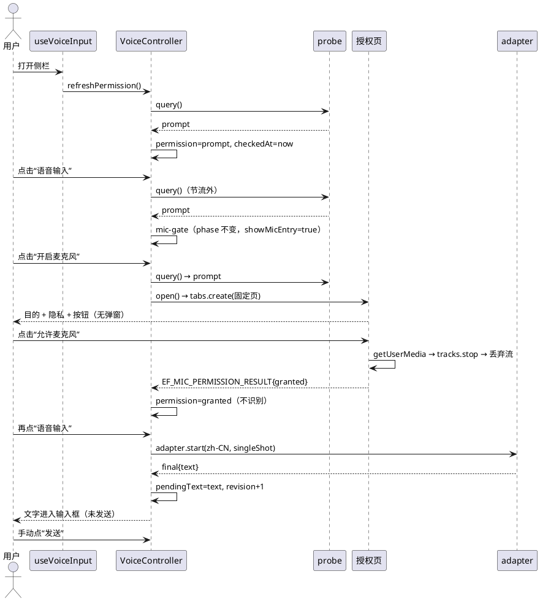

### 2.14.2 失败与恢复

| 阶段 | 失败 | 侧栏表现 | 恢复路径 |
|---|---|---|---|
| 打开授权页 | `createTab` 失败 | “没能打开授权页，可以再试或直接打字。” | 再点入口 / 打字 |
| 授权页请求 | 拒绝 / 无设备 / 系统禁用 / 中止 | 页面显示对应文案；回传枚举 | 详情页再点 / 回侧栏重试 / 打字 |
| 回侧栏重试 | 权限仍 `prompt`/`denied` | 入口 + 设置说明 | 改设置后重试 |
| 识别 | `service-not-allowed` | “语音服务不可用或被浏览器限制…” | 重试 / 打字 / 朗读 |
| 识别 | `audio-capture` | “没有检测到可用的麦克风…” | 插设备后重试 |
| 识别 | `network` | “网络或语音服务暂不可用…” | 重试 / 打字 |

### 2.14.3 朗读并行（零改动）

| 时序 | 行为 |
|---|---|
| 语音输入失败状态 + 点击“朗读这一步” | `SpeechController.speak()` 正常调用合成 1 次 |
| 朗读中收到权限消息 | 只更新 `VoiceInputState`，`SpeakState` 不变 |
| 切任务 | 既有 `voice.cancel()` + `speech.stop()`（`App.tsx:94-98`）不变 |
| 卸载 | 两个 hook 各自 `dispose` |

## 2.15 风险与回滚点

### 2.15.1 风险清单

| # | 风险 | 影响 | 缓解 |
|---|---|---|---|
| R1 | `start()` 改异步后，`await` 之后未复查 `disposed` | 卸载后启动识别、隐私越界 | `await` 后双重复查（`disposed` + `sessionToken`）；AT-75 覆盖 |
| R2 | `permissions.query` 在部分 Chrome 返回 `prompt` 即使实际已授权 | 用户被多引导一次 | 进入授权页即完成一次授权；返回 `granted` 后不再引导；文案不承诺“一定已授权” |
| R3 | `getContexts` 不可用 | 可能出现第 2 个授权页 | 2 秒窗口去重；`pageOpened` 状态提示“已打开”；写入已知限制 |
| R4 | 授权页构建不压缩 | 产物变大（约 +150KB 本地文件） | 只影响本地加载；换取门禁断言可读、可审 |
| R5 | 门禁例外被写宽 | 隐私边界失守 | “精确路径 + 禁止通配 + 未使用即失败”三重约束 |
| R6 | `dist` 缺静态页 | 运行期 404 | `verify` 正向断言（存在、非空、被引用） |
| R7 | 文案过长导致侧栏拥挤 | 可读性下降 | `overflow-wrap: anywhere`；设置说明独立段落；care 模式字号单独验证 |
| R8 | React StrictMode 双调用点击处理 | 重复请求 | `requestingRef` 锁（不是 state） |
| R9 | 授权页发送消息时侧栏未打开 | `sendMessage` reject | `.catch(() => undefined)`；以重新查询为主 |
| R10 | 消息与查询结果倒序 | 状态回退 | `at` 与 `permissionCheckedAt` 比较丢弃旧消息 |
| R11 | `MessageType` 联合新增值影响既有穷尽 switch | typecheck 失败 | 实现前检索 `MessageType` 使用点；若存在穷尽 switch，补 `default` 分支 |
| R12 | AT-54 组件扫描命中新组件 | 断言失败 | 新入口组件不出现 `SpeechRecognition`/`speechSynthesis` 字面量（只读 `view`） |
| R13 | AT-50 时刻字面量扫描 | 断言失败 | 新文件不写 `02:00/02:15/03:00` |
| R14 | `deepEqual` 权限数组断言 | 失败 | manifest 不动 |

### 2.15.2 回滚点

| 层级 | 回滚动作 | 影响范围 |
|---|---|---|
| 功能层 | 不注入 `probe`/`micPage`（`useVoiceInput` 不构造） | 立即回到第五轮“点击即识别”行为；新状态字段保持初始值，UI 不显示入口 |
| 文件层 | 删除 `src/mic-permission/**`、`public/mic-permission.html` | 需同步回滚 `build.mjs` 入口与复制、`verify` 正向断言 |
| 门禁层 | 删除 2 条例外并恢复 `getUserMedia` 到 `runtimeForbidden` | 门禁回到“全局禁止” |
| 状态层 | 无持久化，无需迁移 | 无 |

**最小回滚单元**：`useVoiceInput` 是否注入新依赖 = 功能开关；`voiceMachine` 的新字段均有默认值，不注入时 `permission="unknown"` 且 `showMicEntry` 为 `false`（因 `permissionCheckedAt === null`），因此侧栏不会出现空入口。

## 2.16 需用户拍板的设计取舍点（对齐 T6-01—T6-14）

| 编号 | 设计选择 | 备选与代价 | 需要用户确认 |
|---|---|---|---|
| T6-01 | 以 `navigator.permissions.query({name:"microphone"})` 为主；缺失/抛错 → `unknown`，但仍显示入口 | 若 `unknown` 也隐藏入口，用户无从授权（否决） | 接受“`unknown` 时仍显示入口、可能多开一次授权页”？ |
| T6-02 | 授权页**不自动关闭**，显示“已允许，请回 EasyFlow 再点语音输入” | 提供“关闭此页”按钮（用户点击）可作为增强，但本轮不做 | 是否需要额外“关闭此页”按钮？默认不做 |
| T6-03 | 只给文字指引，不做“返回 EasyFlow”按钮、不 `sidePanel.open` | 自动聚焦侧栏需 tabId/用户手势，且可能打开错误窗口 | 接受只给文字？ |
| T6-04 | 重新查询为主 + 固定消息为辅；**不写 storage；不使用 URL 参数** | URL 参数会破坏 `getContexts` 精确匹配并残留 | 同意“零 storage、无 URL 参数”？ |
| T6-05 | 内存 in-flight + `getContexts`（只取数量）+ 2 秒降级窗口 | 仅内存会因为“关闭后无法再开”，仅 contexts 在不可用时无去重 | 接受降级窗口方案？ |
| T6-06 | 授权页不显示设备名称 | 显示泛化“已连接麦克风”也可，但价值低 | 接受不显示设备名？ |
| T6-07 | “系统关闭/被其他应用占用”合并为一条 | 浏览器无法稳定区分 | 接受合并文案？ |
| T6-08 | 主按钮仍为“语音输入”，旁置次级“开启麦克风” | 直接改主按钮会破坏既有语义与 AT-54 断言 | 接受旁置入口？ |
| T6-09 | `denied` 仍保留入口（可重试） | 只给说明会让用户无法在浏览器 UI 改回后重试 | 接受保留入口？ |
| T6-10 | 不新增 `chrome.storage` 键 | 记住“会话已允许”可少查一次，但可能与真实状态脱节 | 同意零新增键？ |
| T6-11 | 授权页 `import` 既有 `sidepanel.css` + 新增 `mic-permission.css` | 复制 token 会产生第二套主题；抽 `tokens.css` 会破坏 AT-50 文本断言 | 接受复用侧栏 token？ |
| T6-12 | 侧栏永不 `getUserMedia` | 在侧栏直接请求可少一个页面，但会重新落入原问题 | 接受“永不直接请求”？ |
| T6-13 | 例外**逐条枚举 2 条**（`src/mic-permission/request.ts`、`mic-permission.js`），禁止目录通配，打印清单 | 目录级例外会放宽边界 | 同意精确到文件？ |
| T6-14 | 自动测试全绿但真实 Chrome 未执行时写“人工验收待用户执行” | 无替代 | 接受需你本人做一次真实授权？ |
| 新增 Q1 | 授权页构建 `minify: false` | 体积增大换取门禁可读断言 | 接受？ |
| 新增 Q2 | `start()` 返回 `Promise<void>`（同步兼容） | 改用独立 `startWithPermission()` 可完全不动旧签名，但调用方多一层分支 | 接受签名扩展？ |
| 新增 Q3 | 消息常量放 `shared/messages.ts` | 独立模块会产生两套消息源 | 接受集中放置？ |

## 2.17 验证与留痕计划（实现阶段执行，本阶段不执行）

| 顺序 | 命令 | 日志 |
|---|---|---|
| 1 | `npm run typecheck` | `codearts_proof/iteration6-typecheck.log` |
| 2 | `npm run build`（含 build + verify） | `codearts_proof/iteration6-build.log` |
| 3 | `npm run selftest` | `codearts_proof/iteration6-selftest.log` |
| 4 | `npm run verify` | `codearts_proof/iteration6-verify.log` |

**通过判定（对齐 spec 7.5）**：
1. R-170—R-246 均有代码位置 + 用例或人工步骤记录。
2. 四项门禁全绿；既有 54 项不退化。
3. 自动测试证明：未授权打开固定页、授权成功停轨、五类失败文案互异、重试不叠页、已授权不重复弹窗、结果不自动发送。
4. 权限四项；无 `tabs`/网站通配/内容脚本；`getUserMedia` 仅授权页路径；`MediaRecorder` 全局不存在。
5. 真实 Chrome 已执行或明确标注“待用户执行”。
6. 不保存音频/识别原文/设备信息；朗读未回退。

## 附录 A：需求追踪矩阵

| 需求 | 设计落点 | 自动验证 | 人工步骤 |
|---|---|---|---|
| R-170—R-174 权限五态与探测 | 2.4、2.2.2 接口 A/B | AT-64、AT-65 | 7.3 步骤 2、10 |
| R-175—R-177 直达/引导/禁止项 | 2.4.4、2.2.2 接口 D | AT-65、AT-68 | 步骤 2、5 |
| R-178—R-186 入口与打开页 | 2.5 | AT-65、AT-66、AT-80 | 步骤 2、3 |
| R-187—R-196 授权页 | 2.6 | AT-69、AT-78、AT-80 | 步骤 3、4 |
| R-197—R-207 错误分类 | 2.7 | AT-70—AT-74 | 步骤 7、8 |
| R-208—R-214 重试与去重 | 2.8 | AT-67、AT-68、AT-75 | 步骤 5、7 |
| R-215—R-219 设置说明 | 2.9 | AT-70 | 步骤 7 |
| R-220—R-224 朗读零改动 | 2.10 | AT-77、AT-80 | 步骤 9 |
| R-225—R-230 隐私 | 2.11.1 | AT-69、AT-76、AT-80 | 步骤 4、6 |
| R-231—R-236 权限与 tabs 边界 | 2.5.3、2.11.4 | AT-66、AT-63（既有） | 步骤 3 |
| R-237—R-246 构建与门禁 | 2.11.2/2.11.3 | AT-78、AT-79（verify 载体） | 构建日志 |
| AT-64—AT-80 | 2.12.3 | 全部 | — |
| 既有 54 项 | 2.12.4 | AT-51—AT-63 全绿 | 步骤 9 |

## 附录 B：与既有设计与规格的一致性

1. 第五轮的适配器契约（四事件、单会话、幂等取消、同步 `started`）完全保留；本设计**不修改** `recognition.ts`。
2. 第五轮的 `revision/pendingText` 写入机制与“只入框、不自动发送”保留；本设计**不修改** `ChatComposer` 的消费 effect。
3. 第五轮的分层约束（shared 无浏览器 API）保留；新增 `permission.ts` 为纯逻辑，浏览器访问集中在 `microphone.ts`/`micPage.ts`/`request.ts`/`notify.ts`。
4. 第五轮 6.2 的三类失败扩展为九类；`service-not-allowed` 从 `permission-denied` 拆出属**显式修订**，已在上表标注唯一映射。
5. 第四轮 R-22“无效死按钮不得占显著位置”仍成立：新入口是真实可用入口（点击必打开授权页或给出可理解失败）。
6. 本轮不修改第一至第五轮文档；本文件为新增增量设计。
7. 本设计未产生任何源码改动、未执行任何构建/验证/测试、未调用真实麦克风。
8. 下一步由 `spec-task-agent` 依据本文件生成 `iteration6-tasks.md`（建议任务编号 T6-15 起，避免与 spec 的取舍点 T6-01—T6-14 混淆）。