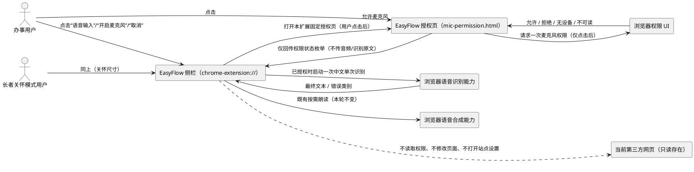
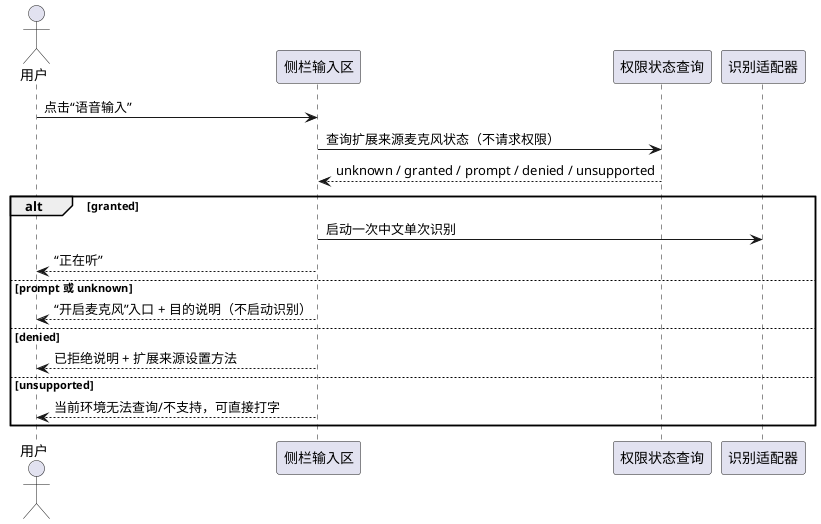
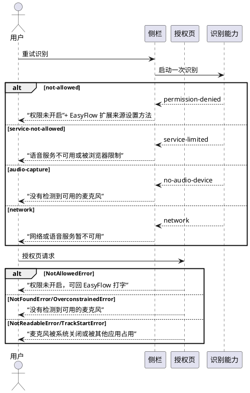
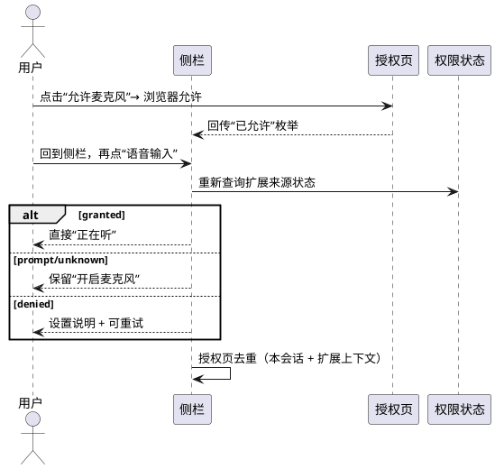
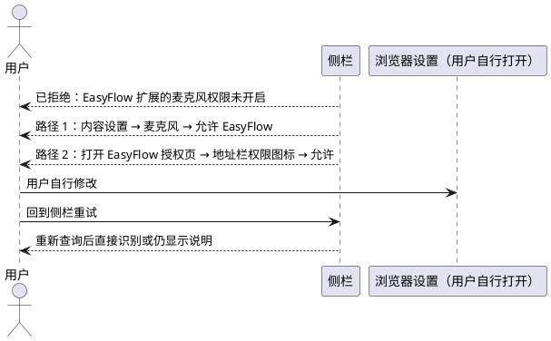
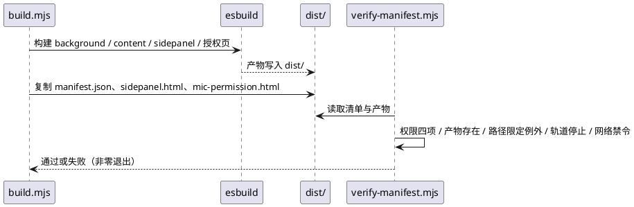

# EasyFlow 麦克风权限引导与扩展来源授权需求规格（第六轮增量）

> 本文件是 `easyflow_page_guide` 特性的第六轮增量规格，不替代 `spec.md`、`iteration2-spec.md`、`iteration3-spec.md`、`iteration4-spec.md`、`iteration5-spec.md`。
>
> 本轮只做一件事：**修好“点了语音输入就说没有麦克风权限、还被指去当前网站站点设置”的真实 Chrome 问题**，用“侧栏入口 → EasyFlow 自己的扩展授权页 → 回侧栏重试”的最小可用流程完成一次授权，并把“拒绝 / 无设备 / 系统禁用 / 语音服务受限 / 网络”区分为不同可感知状态。识别结果仍只填入可编辑输入框，由用户手动发送；朗读功能不受影响。
>
> 验收条件采用 EARS 标准英文触发词（When / If / While / Where）+ 中文正文的写法，与前五轮文档语义一致。本文件只描述“要什么、怎么算做到”，不描述类结构、函数签名、文件划分与打包实现细节（涉及构建与门禁的部分只写必须满足的外部结果）。
>
> **本阶段声明**：只产出需求规格。未修改任何源码，未修改 `public/manifest.json`、`scripts/build.mjs`、`scripts/verify-manifest.mjs`、`scripts/selftest.mjs`，未修改前五轮文档，未运行 `npm run typecheck` / `npm run build` / `npm run selftest` / `npm run verify`，未创建 `codearts_proof` 实绩日志，未调用真实麦克风、未调用语音识别或语音合成。

---

## 0. 背景与现状盘点

### 0.1 本轮用户目标（最小可用流程，范围封顶）

用户在真实 Chrome 中遇到的原始问题：**点击侧栏“语音输入”后立即看到“没有麦克风权限”，并被提示去“当前网站”的站点设置**。语音识别运行在 EasyFlow 的 `chrome-extension://` 侧栏页，当前第三方网页的权限不是 EasyFlow 的权限；Chromium 扩展场景下，侧栏可能无法显示首次麦克风授权弹窗，需要从**完整扩展标签页**请求一次授权。

本轮只实现以下四步：

1. **侧栏入口**：点击“语音输入”；若麦克风权限尚未授予，显示清楚的“开启麦克风”入口；用户再点击时，打开一个 **EasyFlow 自己的完整扩展标签页**（如 `chrome.runtime.getURL('mic-permission.html')`）。**不修改当前第三方网页，不让用户去第三方站点设置。**
2. **授权页**：说明“仅为让 EasyFlow 语音输入工作而请求麦克风；语音识别可能使用浏览器厂商服务；本扩展不录音、不保存音频”。页面提供“允许麦克风”按钮，**只有点击后**才调用 `navigator.mediaDevices.getUserMedia({audio:true})` 触发浏览器权限弹窗。获准后**立即停止所有 audio tracks**，不保留 MediaStream、不录制、不发送音频、不自动关闭页面；明确显示“已允许，请回 EasyFlow 再点语音输入”。拒绝、无设备、系统禁用分别显示可理解状态和文字输入替代。
3. **回侧栏重试**：侧栏重试时重新查询/使用当前扩展来源的权限，已授权就开始一次识别；识别结果仍只填入可编辑输入框，不自动发送。`not-allowed`、`service-not-allowed`、`audio-capture`、`network` **不得**都显示同一种“没权限”；`service-not-allowed` 若无法准确判断，说明“语音服务不可用或被浏览器限制”。已明确拒绝时给出 **EasyFlow 扩展来源**的设置方法。朗读功能不受影响。
4. **权限与构建边界**：保持现有四项 manifest 权限，不加 `tabs` 或网站通配权限。若用 `chrome.tabs.create`，只打开本扩展内的固定授权页；不查询其他标签页敏感信息。构建脚本复制/打包新页面，并在 `verify-manifest.mjs` 中只对授权页的必要 `getUserMedia` 做**路径限定例外**，仍禁止其他源码使用、录音、网络上传和新增权限。

### 0.2 已核实基线（2026-11-14 只读核查，主工程 `D:\hwproject\translator`）

| 核查项 | 实际结果（文件与位置） | 对本轮规格的约束 |
|---|---|---|
| 语音输入入口 | `src/sidepanel/components/chat/VoiceInputControl.tsx:14-22`：单个 `ef-speech-btn`，`onClick` 在“取消识别/语音输入”间切换；状态行 `ef-speech-status`；告知 `ef-speech-disclosure` | 新增“开启麦克风”入口应在同一行内、同一组件体系内；不得改动“取消识别”语义 |
| 启动链路 | `src/sidepanel/hooks/useVoiceInput.ts:20-24`：构造 `VoiceController`，注入 `createRecognitionAdapter()` 与 `detectRecognitionSupport(globalThis)` | 权限探测需在“点击 → 启动识别”之间插入一次可注入的权限状态查询；自测必须可替换 |
| 能力探测现状 | `src/shared/speech/policy.ts:70-79` `detectRecognitionSupport` 只判断 `SpeechRecognition` / `webkitSpeechRecognition` 构造器是否存在；`src/sidepanel/speech/voiceController.ts:69-94` 只在启动前做该探测 | 现有可能“构造器存在但麦克风权限未授予”，因此仍进入识别并以错误收场；本轮必须新增**权限能力探测**，且探测本身不得触发权限请求 |
| 权限错误链路（问题根因） | `src/sidepanel/speech/recognition.ts:95-101` 把 `onerror` 交给 `mapRecognitionError`；`policy.ts:94-99` 将 `not-allowed` 与 `service-not-allowed` **合并**为 `permission-denied`；`voiceMachine.ts:82-117` 进入 `permission-denied`；`copy.ts:26` 文案为“没有麦克风权限。请在浏览器站点设置里允许麦克风，或直接打字。” | 这正是“立即说没权限 + 指去当前网站站点设置”的完整链路；本轮必须拆分错误类别、改写文案，并让文案明确指向**扩展来源** |
| 侧栏环境限制 | 侧栏页面来源是 `chrome-extension://<扩展 ID>`；Chromium 扩展场景下，侧栏可能**无法显示首次麦克风授权弹窗**，而是直接以 `not-allowed` 结束识别；浏览器权限 UI 归因到来源，侧栏本身不提供完整的权限设置界面 | 必须先由用户从**完整扩展标签页**发起一次授权；侧栏只负责显示权限状态、给出“开启麦克风”入口、打开授权页与重试，不得在侧栏内直接请求权限 |
| 无麦克风现状 | `policy.ts:99-100` `audio-capture` → `no-audio-device`；`voiceMachine.ts:97-103` 归入 `permission-denied` 并带 `issue:"no-audio-device"`；`copy.ts:33` 文案“没有检测到可用的麦克风，可以直接打字。” | “无设备”已有独立文案，但状态仍是“无权限”族；本轮要求拒绝、无设备、系统禁用**三类状态与文案都不同** |
| 网络现状 | `policy.ts:103-105` `network` → `network`；`voiceMachine.ts:106-107` 进入 `failed` + `issue:"network"`；`copy.ts:34` 文案“未识别：网络或语音服务暂不可用，可以直接打字。” | 网络已有独立文案；本轮需把它与“语音服务受限”分开，且四类不得混同 |
| 状态机现状 | `src/shared/speech/voiceMachine.ts:9-15` 状态含 `phase/issue/revision/pendingText/disclosureShown`；`83-117` 错误分支；`153-165` 生成视图 | 本轮可在同一状态机内扩充权限态与 issue 类别，或新增并列的权限状态机；不得破坏既有 `listening/recognized/no-speech/cancelled` 分支与 `revision/pendingText` 机制 |
| 适配器现状 | `src/sidepanel/speech/recognition.ts:38-159` 单会话适配器；`start()` 直接构造并 `instance.start()`（112-120）；`cancel()` 幂等（123-135）；`dispose()` 清理（137-142） | 适配器不感知权限；本轮不得让适配器在 `start()` 内隐式请求权限，权限请求必须由用户点击授权页按钮触发 |
| 识别结果写入 | `ChatComposer.tsx:27-35` 用 `voice.view.revision/pendingText` 写入 `textarea` 并 `consumePending()`；`17-25` 发送只由 `submit()` 触发 | “识别结果只入框、不自动发送”的既有机制必须原样保留并继续可断言 |
| 朗读现状 | `src/sidepanel/speech/speechController.ts`、`src/shared/speech/speakMachine.ts`、`AboutPanel.tsx:9`、`copy.ts:40-55`；`App.tsx:27-28、54-56` 生命周期接线 | 本轮**不修改**朗读链路；语音输入授权失败不得影响朗读入口与停止行为 |
| 说明区现状 | `AboutPanel.tsx:3-11`：`SPEECH_DISCLOSURE_TEXT` 只有“识别由浏览器提供，可能使用浏览器厂商的在线服务；本扩展不保存音频，也不保存识别原文。” | 授权页需给出与说明区**同源**的隐私句子；不得出现与既有告知矛盾的新说法 |
| 权限清单现状 | `public/manifest.json:7`：`["activeTab","scripting","sidePanel","storage"]`；无 `host_permissions`、无 `content_scripts`、无 `web_accessible_resources` | 本轮权限集合必须**逐项不变**；不得新增 `tabs`；麦克风不写入 manifest 权限 |
| 后台现状 | `src/background/index.ts:51-67` 只处理 `WATCH_TICK` 与既有侧栏消息路由；`79-89` 监听 `chrome.tabs.onActivated/onUpdated` 只用 `tabId` 与 `status` | 现有后台**未申请 `tabs` 权限**也不读 `url/title`；本轮打开授权页同样不得读其他标签页敏感字段 |
| 消息协议现状 | `src/shared/messages.ts:9-24` 固定 `MSG` 常量；`src/background/router.ts:68-88、323-347` 有严格白名单，未知类型返回 `EF-E005` | 若授权页需要与侧栏通信，必须使用**新增的固定消息类型**并纳入校验；禁止开放式广播任意载荷 |
| 构建现状 | `scripts/build.mjs:16-62` 三个 esbuild 入口（background/content/sidepanel）；`64-67` 只复制 `manifest.json` 与 `sidepanel.html`；`88` 并行构建 | 新授权页必须有独立入口与静态页复制，否则 `chrome.runtime.getURL('mic-permission.html')` 会 404 |
| 门禁现状 | `scripts/verify-manifest.mjs:71-83` `runtimeForbidden` 含 `getUserMedia`、`MediaRecorder`；`118-119` **全量扫描** `dist/**/*.js` 与 `src/**/*.ts(x)`；`45-55` 校验产物清单；`35-37` 禁止 `host_permissions` 等字段 | 现状**全局禁止** `getUserMedia`，新增授权页必然被拦；本轮必须改为**路径限定例外**，并保持其余禁令 |
| 自测现状 | `scripts/selftest.mjs:14-51` 用 esbuild `stdin.contents` 导出纯函数与控制器；语音相关导出在 `34-40`；用例覆盖 `AT-51`—`AT-63`；`codearts_proof/iteration5-selftest.log` 末行为 `1..54` / `pass 54` / `fail 0` | 本轮新增纯逻辑（权限状态、错误分类、去重判定、文案映射）必须加入同一导出列表；**禁止**在自测中调用真实 `getUserMedia`、真实麦克风、真实 `SpeechRecognition` |
| 留痕现状 | `codearts_proof/` 已有 `iteration5-typecheck.log`、`iteration5-build.log`、`iteration5-selftest.log`（54 项）、`iteration5-verify.log`、`24-iteration5-implementation.md` | 本轮沿用同一命名，新增 `iteration6-*.log` 与 `25-iteration6-implementation.md` |
| 真实 Chrome 状态 | 用户已实测“点击后立即无权限、并被提示去当前网站设置”；**真实授权页链路尚未存在**，无法在本阶段验证 | 本阶段不得声称真实 Chrome 已通过；实现在下一阶段完成后再由用户执行 7.3 步骤 |

### 0.3 现状缺口与本轮落点

| 用户目标 | 现状缺口 | 本轮规格落点 |
|---|---|---|
| 不再把用户指去第三方站点设置 | `copy.ts:26` 明确写“浏览器站点设置”，未区分扩展来源与网页来源 | 5.4、5.6、6.2、6.4 |
| 未授权时给出“开启麦克风”入口 | 只有“语音输入”一个按钮，点击即启动识别 | 5.1、5.2 |
| 从完整扩展页请求授权 | 无授权页、无构建产物、无打开路径 | 5.2、5.3、5.10 |
| 获准后立即停止所有 audio tracks | 现状不使用 `getUserMedia`，无轨道生命周期约束 | 5.3、5.8 |
| 错误类别不得混同 | `not-allowed` 与 `service-not-allowed` 已合并；无“系统禁用”类别 | 5.4、6.2 |
| 重试去重、已授权不重复弹窗 | `VoiceController.start()` 每次都直接启动识别；无权限前置判断 | 5.5、6.1 |
| 扩展来源设置说明 | 无任何扩展来源设置路径 | 5.6 |
| 朗读不受影响 | 语音输入与朗读共用 `App` 生命周期，但无“权限失败不得影响朗读”的显式红线 | 5.7 |
| 权限与构建边界 | 四项权限已稳定；`verify` 全局禁 `getUserMedia`，无例外机制 | 5.9、5.10 |

---

## 1. 组件定位

### 1.1 核心职责

本组件负责在**用户点击语音输入但 EasyFlow 扩展来源尚未获得麦克风权限**时，用侧栏入口 + EasyFlow 自己的授权页完成一次最小授权，并把拒绝、无设备、系统禁用、语音服务受限、网络失败区分为不同可感知状态。

### 1.2 核心输入

1. **侧栏用户操作**：点击“语音输入”、点击“开启麦克风”、点击“取消识别”、切换任务、关闭侧栏。
2. **侧栏运行时能力**：浏览器是否提供语音识别构造器；扩展来源的麦克风权限状态（未知/已授权/待询问/已拒绝/不可查询）。
3. **授权页用户操作**：点击“允许麦克风”；关闭或刷新授权页。
4. **授权页浏览器结果**：`getUserMedia({audio:true})` 成功并返回 audio tracks；拒绝、无设备、设备不可读/被占用、环境受限等失败类别。
5. **识别适配器事件**：已开始、最终文本、错误类别、已结束。
6. **既有页面/对话状态**：`ConversationState`、`MAX_TURN_CHARS`、当前任务与页面快照（只用于既有识别结果写入，不在本轮改动）。

### 1.3 核心输出

1. **侧栏可见状态**：权限状态说明、“开启麦克风”入口、打开授权页结果、拒绝/无设备/系统禁用/服务受限/网络的可读文案、扩展来源设置说明。
2. **授权页可见状态**：请求目的与隐私说明、“允许麦克风”按钮、允许成功/拒绝/无设备/系统禁用的结果文字。
3. **对浏览器的请求**：仅在授权页按钮点击后请求一次 `getUserMedia({audio:true})`；获得后立即停止全部 audio tracks。
4. **对识别适配器的请求**：仅在权限已授权且用户点击“语音输入”后启动一次中文单次识别。
5. **写入输入框的最终文本**：只写入可编辑输入框，不自动发送、不进入消息流、不写入存储。

### 1.4 职责边界

1. **不负责**修改当前第三方网页、注入内容、打开第三方站点设置页、修改第三方站点权限。
2. **不负责**在侧栏内直接调用 `getUserMedia` 请求权限；`getUserMedia` 只允许出现在 EasyFlow 授权页。
3. **不负责**录音、保存音频、保存识别原文、保存中间结果、保存设备 ID、保存设备名称。
4. **不负责**新的语音识别/合成实现；识别仍走既有适配器，朗读仍走既有合成适配器。
5. **不负责**新增权限、新增网站访问范围、读取其他标签页 `url/title/favIconUrl`。
6. **不负责**自动发送、自动点击网页、自动提交、创建真实预约。
7. **不负责**自动关闭授权页、自动切回侧栏、自动开始识别。
8. **不负责**改变既有对话引擎、消息协议语义、`ConversationState` 字段含义、朗读白名单与朗读生命周期。

---

## 2. 领域术语

**扩展来源（Extension Origin）**
: 指本扩展页面所在的 `chrome-extension://<扩展 ID>` 来源。麦克风权限按来源授予，本轮的权限判断、授权请求与设置说明都必须针对该来源，而不是用户当前浏览的第三方网页来源。

**当前网页来源（Page Origin）**
: 指用户正在浏览的第三方网页的站点来源。本规格明确：当前网页来源的麦克风权限与本扩展能否使用麦克风无关，禁止用其状态解释或替代扩展来源状态。

**麦克风权限状态（Microphone Permission State）**
: 本扩展来源在浏览器中的麦克风授权状态，取值 `unknown | granted | prompt | denied | unsupported`。`unknown` 表示无法查询但可能仍可请求；`unsupported` 表示运行环境不提供必要的媒体或权限查询能力。

**授权页（Mic Permission Page）**
: 本扩展内一个完整的扩展标签页（固定路径 `mic-permission.html`），用于在用户点击后触发一次浏览器麦克风授权弹窗。它不是第三方网页，也不是侧栏本身。

**授权页打开（Open Permission Page）**
: 由侧栏在用户点击“开启麦克风”后发起，只打开本扩展内的固定授权页。它不等同于“请求权限”：打开页面本身不得触发权限弹窗。

**轨道停止（Tracks Stop）**
: 在 `getUserMedia` 成功返回后，对返回的每条 audio track 调用 `stop()`，随后丢弃对 `MediaStream` 的引用。它是“获得权限后立即释放麦克风”的唯一允许方式。

**语音服务受限（Service Limited）**
: 浏览器语音识别服务不可用、被浏览器策略限制、或被扩展环境限制。它与“用户拒绝麦克风权限”不是同一类问题，文案必须区分；若无法准确判断具体原因，只说明“语音服务不可用或被浏览器限制”，不得断言是权限问题。

**系统禁用（System Disabled）**
: 操作系统层面关闭了麦克风，或麦克风被其他应用独占导致无法读取。浏览器通常只能给出“设备不可读”一类错误，无法稳定区分“系统关闭”与“被占用”；界面必须如实说明二者可能，不得断言唯一原因。

**权限去重（Permission Page Dedup）**
: 在同一侧栏会话内，用户重复点击“开启麦克风”时不得创建第二个授权页；已有授权页时只复用或聚焦，不叠加窗口。

**文案单源（Single Copy Source）**
: 每一类权限状态、错误类别与按钮文字只在一处定义，侧栏与授权页共同取用；组件、页面与测试不得各写一份。

**路径限定例外（Path-Scoped Exception）**
: 在门禁脚本中，仅允许**指定文件路径**出现 `getUserMedia`，其余路径仍按禁用处理。本轮例外范围只包含授权页源码与其构建产物，不包含任何通配目录。

---

## 3. 角色与边界

### 3.1 核心角色

1. **办事用户**：点击“语音输入”和“开启麦克风”，在授权页点击“允许麦克风”，回到侧栏重试，并自行决定是否发送识别文字。
2. **长者关怀模式用户**：同上，但要求新增入口与状态文字在关怀字号与触控尺寸下仍可用。

### 3.2 外部系统

1. **浏览器权限 UI（Chrome）**：在授权页按钮点击后显示麦克风授权弹窗；向扩展页暴露权限状态查询结果；在系统层面返回设备与权限错误。
2. **浏览器语音识别能力**：接收一次中文单次识别请求，返回最终文本或错误类别；可能使用浏览器厂商的在线服务。
3. **当前第三方网页**：仅作为用户正在办理的页面存在。本组件**不读取、不修改、不打开其站点设置**，也不用其权限状态解释扩展来源状态。
4. **浏览器语音合成能力**：既有朗读链路使用，本轮不改变调用方式与文本范围。

### 3.3 交互上下文



---

## 4. DFX 约束

### 4.1 性能

1. 侧栏点击“开启麦克风”到授权页开始显示内容：在普通桌面环境不超过 **1.5 秒**（不含浏览器自身启动标签页的耗时）。
2. 授权页点击“允许麦克风”到出现可见“请求中/已允许/失败”状态：不超过 **300 毫秒**；浏览器授权弹窗的等待时间不计入该上限。
3. 侧栏权限状态查询（打开侧栏、点击语音输入、重试）单次不超过 **100 毫秒**；不得阻塞输入框打字与发送。
4. 授权页不得加载远程脚本、外部字体、外部图片或分析脚本；页面可在无网络时显示完整说明与按钮。

### 4.2 可靠性

1. 同一侧栏会话内，授权页最多存在 1 个；重复点击不产生叠页。
2. 打开授权页失败、权限查询失败、`getUserMedia` 失败均不得使侧栏不可用；文字输入、发送、定位、朗读、诊断保持可用。
3. 所有权限相关操作幂等：重复点击“允许麦克风”、重复重试、授权页重复刷新不得产生多个活动媒体流。
4. 迟到事件（授权页已关闭后的回传、识别会话取消后的最终结果）必须被丢弃，不得改变当前状态或写入输入框。
5. 权限状态不得因单次错误被永久锁定；用户在浏览器设置中改变状态后，下一次重试必须可恢复。

### 4.3 安全性

1. 麦克风请求只允许发生在 EasyFlow 授权页，且只在用户点击“允许麦克风”后发生；侧栏、后台、内容脚本、其他源码路径一律禁止。
2. 获得权限后必须立即停止全部 audio tracks，不得保留 `MediaStream`、不得录音、不得使用 `MediaRecorder`。
3. 不得采集/保存音频、视频、设备 ID、设备名称、识别原文、中间识别文本；诊断只允许记录错误类别与耗时数字。
4. 不得向自建或第三方语音接口发送音频或文本；不得引入语音 SDK。
5. 不得新增 `tabs`、`host_permissions`、`<all_urls>`、`content_scripts`、`web_accessible_resources`。
6. 授权页与侧栏之间的状态传递只允许枚举值与时间戳，不得携带音频、识别文本、页面内容、URL 查询串或设备信息。
7. 授权页不得读取当前活动网页的内容；不得使用 `chrome.tabs.query` 读取其他标签页的 `url/title/favIconUrl`。

### 4.4 可维护性

1. 权限状态、错误类别与全部用户可见文案必须来自**单一文案来源**；侧栏与授权页不得各写一份。
2. 错误类别映射必须以**表格**形式固定（见 6.2），新增类别必须先改表再改文案。
3. 门禁必须打印“路径限定例外”的实际路径与模式，便于审阅；例外规则不得使用目录通配或空模式。
4. 自测必须使用可注入的假权限查询、假 `getUserMedia`、假 tabs 打开、假识别适配器；不得依赖真实设备。
5. 新增常量（页面路径、状态超时、按钮文案）必须命名，不得散落魔法值。

### 4.5 兼容性

1. 目标环境：Chrome / Chromium MV3，`minimum_chrome_version` 保持 `116`。
2. 权限状态查询能力可能缺失或抛错：必须降级为 `unknown`，并仍提供“开启麦克风”入口；不得因查询失败而直接显示“不支持”。
3. `chrome.runtime.getContexts`（用于识别本扩展授权页是否已存在）在目标版本可用；若运行环境不提供，必须降级为内存去重，且不得改用需要 `tabs` 权限的查询。
4. 授权页的浏览器权限弹窗外观、设置入口位置随 Chrome 版本与平台略有差异；文案不得写死仅在某版本成立的唯一路径。
5. 既有 `AT-01`—`AT-63`（当前 54 项）不得删除、不得削弱；仅允许按本规格显式改写与“权限错误文案”直接相关的断言。

---

## 5. 核心能力

## 5.1 麦克风权限能力探测与状态

### 5.1.1 业务规则

1. **R-170 扩展来源判定**：The system shall 只以 EasyFlow 扩展来源（`chrome-extension://<扩展 ID>`）判断麦克风权限状态，不得使用当前第三方网页来源的状态。
   a. 验收条件：在任意第三方网页打开侧栏 → 权限状态与文案不引用该网页域名或站点设置；切换网页后权限状态不因网页变化而改变。
2. **R-171 五态模型**：The system shall 把权限状态归为 `unknown | granted | prompt | denied | unsupported` 五类，并在界面用文字表达，不得只用颜色或图标。
   a. 验收条件：逐一注入五种状态 → 界面分别出现“可开启麦克风 / 已授权 / 需要开启 / 已拒绝 / 当前环境不支持查询”五类可读文字。
3. **R-172 查询时机**：The system shall 在侧栏打开、用户点击“语音输入”、用户点击“开启麦克风”前后、用户从授权页返回侧栏重试、以及侧栏窗口重新获得焦点时重新查询权限状态。
   a. 验收条件：在浏览器设置中改变权限后回到侧栏重试 → 状态更新，不需要重新加载扩展或重开侧栏。
4. **R-173 探测不请求权限**：The system shall 使权限查询本身不调用 `getUserMedia`、不构造识别实例、不触发浏览器授权弹窗。
   a. 验收条件：仅打开侧栏并多次点击“语音输入”（未授权时）→ 无麦克风请求、无授权弹窗；仅出现“开启麦克风”入口。
5. **R-174 查询失败降级**：If 权限查询接口不存在或抛错，the system shall 归为 `unknown`，仍显示“开启麦克风”入口与可读说明，不得显示“不支持语音输入”或“没有权限”。
   a. 验收条件：移除权限查询能力 → 状态为 `unknown`；入口可用；点击后仍能打开授权页。
6. **R-175 已授权直达识别**：Where 权限状态为 `granted`，the system shall 在用户点击“语音输入”时直接开始一次识别，不显示“开启麦克风”入口、不打开授权页、不再次请求权限。
   a. 验收条件：注入 `granted` → 点击“语音输入” → 进入“正在听”；无授权页打开、无 `getUserMedia` 调用。
7. **R-176 未授权先引导**：Where 权限状态为 `prompt` 或 `unknown`，the system shall 在用户第一次点击“语音输入”时显示“开启麦克风”入口与目的说明，不启动识别。
   a. 验收条件：注入 `prompt`/`unknown` → 点击“语音输入” → 显示入口与说明；识别适配器零调用；输入框可用。
8. **R-177 禁止项**：The system shall 禁止在后台定时轮询权限、禁止页面加载时自动请求权限、禁止用第三方网页的权限查询结果冒充扩展来源状态。
   a. 验收条件：打开侧栏静置 60 秒 → 无权限请求、无轮询日志增长；源码检索无“按网页 origin 查询麦克风”的路径。

### 5.1.2 交互流程



### 5.1.3 异常场景

1. **权限查询抛错**
   a. 触发条件：浏览器拒绝查询或接口异常。
   b. 系统行为：归入 `unknown`，保留“开启麦克风”入口；记录错误类别（不含页面与设备信息）。
   c. 用户感知：看到“需要开启麦克风”，可继续操作。
2. **网页切换后状态被误读**
   a. 触发条件：用户从网页 A 切到网页 B。
   b. 系统行为：权限状态不重新按网页判断；仅按扩展来源复核一次。
   c. 用户感知：状态不因换页面而变成“无权限”。
3. **查询接口返回意外值**
   a. 触发条件：返回值不在 `granted/prompt/denied` 内。
   b. 系统行为：按 `unknown` 处理。
   c. 用户感知：仍可点“开启麦克风”。

## 5.2 侧栏“开启麦克风”入口与打开扩展页

### 5.2.1 业务规则

1. **R-178 入口可见性**：While 权限状态为 `prompt`、`unknown` 或 `denied`，the system shall 在侧栏输入区显示“开启麦克风”入口，并说明“仅用于 EasyFlow 语音输入”。
   a. 验收条件：三种状态下 → 可见“开启麦克风”与目的说明；`granted` 时不显示该入口。
2. **R-179 首次点击不启动识别**：When 权限状态不是 `granted` 且用户点击“语音输入”，the system shall 不启动识别，只显示“开启麦克风”入口与说明。
   a. 验收条件：未授权点击“语音输入” → 识别适配器零调用；无授权弹窗；界面出现入口。
3. **R-180 二次点击打开授权页**：When 用户点击“开启麦克风”，the system shall 打开本扩展内的固定授权页（`chrome.runtime.getURL('mic-permission.html')`）。
   a. 验收条件：点击 → 新标签页 URL 以 `chrome-extension://` 开头且路径为 `/mic-permission.html`；当前第三方网页 URL 不变。
4. **R-181 只打开扩展固定页**：The system shall 只允许打开本扩展内的授权页，不得接受外部 URL、当前网页 URL、站点设置 URL 或任意字符串作为打开目标。
   a. 验收条件：源码检索打开调用 → URL 为常量或 `getURL` 结果；无参数化网页 URL；无 `chrome://settings`、`chrome://extensions` 自动打开行为。
5. **R-182 不改第三方网页**：The system shall 在打开授权页时不注入脚本、不修改页面内容、不改变网页焦点与滚动、不打开网页的站点设置。
   a. 验收条件：打开前后第三方网页 DOM 无新增节点、无滚动变化；页面 URL 不变。
6. **R-183 打开失败可理解**：If 打开授权页失败（接口抛错、返回失败、页面不存在），the system shall 显示“没能打开授权页，可以再试或直接打字”，并保留文字输入。
   a. 验收条件：注入打开失败 → 可见中文说明；输入框可编辑、可发送；不出现原始异常字符串。
7. **R-184 入口可达性**：The system shall 使“开启麦克风”为可聚焦按钮，带可读名称；在长者关怀模式下高度不小于 44px，且不与“语音输入”“取消识别”混淆。
   a. 验收条件：键盘 Tab 可达；Enter/Space 可触发；care 模式测量高度 ≥44px；读屏名称唯一。
8. **R-185 拒绝后仍给入口**：While 权限状态为 `denied`，the system shall 保留“开启麦克风”入口，并在旁边给出扩展来源设置方法；入口可再次打开授权页。
   a. 验收条件：`denied` 状态下 → 入口与设置说明同时可见；再次点击可打开授权页。
9. **R-186 禁止项**：The system shall 禁止在侧栏内直接调用 `getUserMedia`，禁止提示用户“去当前网站设置”，禁止把“打开授权页”等同于“已经请求权限”。
   a. 验收条件：侧栏源码无 `getUserMedia`；全部权限文案不含“当前网站站点设置”作为唯一指引；打开授权页后未点击按钮前无授权弹窗。

### 5.2.2 交互流程

```plantuml
@startuml
actor "用户" as U
participant "侧栏" as S
participant "权限状态" as Q
participant "扩展授权页" as P
participant "当前网页" as W

U -> S : 点击“语音输入”
S -> Q : 查询扩展来源状态
alt 已是 granted
  S --> U : 进入“正在听”
else 未授权
  S --> U : 显示“开启麦克风”
  U -> S : 再次点击“开启麦克风”
  S -> S : 去重检查（本会话是否已开）
  S -> P : 打开 chrome-extension://…/mic-permission.html
  P --> U : 目的与隐私说明 + “允许麦克风”
  S -.-> W : 不修改、不读取、不打开站点设置
end
@enduml
```

### 5.2.3 异常场景

1. **授权页已存在**
   a. 触发条件：用户重复点击“开启麦克风”。
   b. 系统行为：不创建第二个页面；可聚焦已有页面或保持当前状态。
   c. 用户感知：只看到一个授权页。
2. **授权页被用户关闭**
   a. 触发条件：打开后立即关闭。
   b. 系统行为：侧栏保留“开启麦克风”入口与原状态；不自动重新打开。
   c. 用户感知：可再次点击打开。
3. **打开接口不可用**
   a. 触发条件：运行环境限制标签页创建。
   b. 系统行为：显示失败说明；保留文字输入；不尝试其他越权方式。
   c. 用户感知：知道没打开，但仍可打字。
4. **用户误以为已在网页上授权**
   a. 触发条件：用户先去第三方网页站点设置里改权限。
   b. 系统行为：说明该操作不影响 EasyFlow 扩展来源；引导使用“开启麦克风”。
   c. 用户感知：不会在错误位置反复尝试。

## 5.3 授权页生命周期与 tracks.stop

### 5.3.1 业务规则

1. **R-187 页面内容**：The system shall 使授权页显示：页面标题、请求目的（仅为让 EasyFlow 语音输入工作）、隐私说明（识别可能使用浏览器厂商服务；本扩展不录音、不保存音频）、“允许麦克风”按钮。
   a. 验收条件：打开授权页 → 四项内容均可见；无营销文案、无技术错误码、无第三方链接。
2. **R-188 仅点击后请求**：The system shall 只在用户点击“允许麦克风”后调用一次 `getUserMedia({audio:true})`；页面加载、刷新、获得焦点均不得自动请求。
   a. 验收条件：打开并等待 10 秒 → 无权限弹窗；点击后才出现请求；刷新后不自动请求。
3. **R-189 请求中防重**：While 一次请求尚未结束，the system shall 禁用“允许麦克风”按钮并显示“正在请求…”，不得发起第二个请求。
   a. 验收条件：连续点击 3 次 → 请求次数恰好 1；按钮状态可见。
4. **R-190 立即停止轨道**：When `getUserMedia` 成功返回，the system shall 立即对返回的每条 audio track 调用 `stop()`，随后丢弃对 `MediaStream` 的引用，不得把流交给其他组件。
   a. 验收条件：假 `getUserMedia` 返回 2 条 track → 每条 `stop()` 恰好调用 1 次；页面不再持有流引用；无录制调用。
5. **R-191 允许后不自动关闭**：When 轨道已停止，the system shall 保持授权页打开，显示“已允许，请回 EasyFlow 再点语音输入”，不得自动关闭页面、不得自动跳转、不得自动启动识别。
   a. 验收条件：允许成功 → 页面仍在前台；无 `window.close()`、无导航、无识别请求。
6. **R-192 不录音不保存**：The system shall 在授权页禁止使用 `MediaRecorder`、禁止保存音频、禁止把音频或设备信息发送到任何地址、禁止读取识别原文。
   a. 验收条件：授权页源码与产物检索 → 无 `MediaRecorder`、无网络请求 API、无音频数据持久化；`getUserMedia` 调用参数只含 `audio`。
7. **R-193 结果分类显示**：If 请求失败，the system shall 按 6.2 的类别显示不同可理解状态（拒绝 / 无设备 / 系统禁用或被占用 / 环境受限），并说明“可以回 EasyFlow 直接打字”。
   a. 验收条件：逐一注入四类失败 → 四种不同文案；均含文字输入替代说明；无原始错误名。
8. **R-194 页面卸载清理**：When 授权页关闭或刷新，the system shall 释放所有已获取的轨道与流引用；不得留下活动的麦克风会话。
   a. 验收条件：允许成功后关闭页面 → 无 `MediaStreamTrack` 处于 `live` 状态；再次打开页面不继承旧流。
9. **R-195 页面可访问性**：The system shall 使授权页文字对比度、字体缩放、键盘焦点、按钮可读名称满足既有可访问性基线；页面不依赖横向滚动。
   a. 验收条件：200% 缩放 → 无横向滚动；Tab 可达按钮；焦点可见；文字不被裁切。
10. **R-196 禁止项**：The system shall 禁止在授权页自动关闭、自动返回侧栏、自动聚焦侧栏、自动开始识别、显示设备名称或设备 ID、保存任何识别原文。
    a. 验收条件：允许后页面仍在；无自动跳转/自动识别；界面无设备名；无文本存储。

### 5.3.2 交互流程

```plantuml
@startuml
actor "用户" as U
participant "授权页" as P
participant "浏览器权限 UI" as B
participant "浏览器媒体能力" as M
participant "侧栏" as S

U -> P : 打开授权页（由侧栏“开启麦克风”）
P --> U : 目的 + 隐私说明 + “允许麦克风”
U -> P : 点击“允许麦克风”
P -> M : getUserMedia({audio:true})
M -> B : 请求授权
B --> U : 允许 / 拒绝
alt 允许
  M --> P : MediaStream（audio tracks）
  P -> P : 对每条 track 调用 stop()
  P -> P : 丢弃流引用
  P --> U : “已允许，请回 EasyFlow 再点语音输入”
  P --> S : 仅回传“已允许”枚举
else 拒绝/无设备/不可读
  M --> P : 错误类别
  P --> U : 对应说明 + “可回 EasyFlow 直接打字”
  P --> S : 仅回传错误类别枚举
end
P -.-> U : 不自动关闭、不自动跳转
@enduml
```

### 5.3.3 异常场景

1. **用户不点允许也不点拒绝**
   a. 触发条件：关闭弹窗或让弹窗失去焦点。
   b. 系统行为：按钮恢复可用，显示“还没完成授权，可以再试”；不循环弹窗。
   c. 用户感知：可再次点击或回侧栏打字。
2. **权限已授予但设备消失**
   a. 触发条件：授权状态为 `granted`，但无可用输入设备。
   b. 系统行为：按无设备类别显示；不显示“已允许”。
   c. 用户感知：知道是设备问题，而非权限。
3. **轨道停止失败**
   a. 触发条件：某条 track 的 `stop()` 抛错。
   b. 系统行为：逐条容错，仍视为已释放并显示“已允许”；记录类别，不暴露异常字符串。
   c. 用户感知：看到已允许，回到侧栏可重试。
4. **重复点击导致并发**
   a. 触发条件：用户快速连点。
   b. 系统行为：请求前加锁，第二次点击被忽略。
   c. 用户感知：只有一个弹窗、一次结果。
5. **页面刷新后误以为已授权**
   a. 触发条件：允许后刷新授权页。
   b. 系统行为：不自动请求；从头显示说明与按钮。
   c. 用户感知：需要重新点击才会请求，符合“只有点击后”约束。
6. **隐私说明被忽略**
   a. 触发条件：用户直接点按钮。
   b. 系统行为：说明仍在页面上可见；不增加长模态或二次确认。
   c. 用户感知：在授权前能看到目的与边界。

## 5.4 拒绝、无设备、系统禁用、服务受限与网络分类

### 5.4.1 业务规则

1. **R-197 类别集合**：The system shall 把权限与识别失败归入以下类别：`permission-denied`（用户拒绝/未授权）、`service-limited`（语音服务不可用或被浏览器限制）、`no-audio-device`（无可用麦克风）、`device-unavailable`（系统禁用或被其他应用占用）、`network`（网络失败）、`no-speech`（未识别到语音）、`unsupported`（能力不存在）、`aborted`（主动取消）、`unknown`（未归类）。
   a. 验收条件：逐一注入九类 → 每类有稳定内部类别；界面文案按 6.2 映射；无类别被静默归并。
2. **R-198 拒绝独立**：If 识别返回 `not-allowed` 或授权页返回 `NotAllowedError`，the system shall 归为 `permission-denied`，显示“麦克风权限未开启”，并给出 EasyFlow 扩展来源设置方法。
   a. 验收条件：注入拒绝 → 文案含“权限未开启”与“EasyFlow”；不含“当前网站”。
3. **R-199 服务受限独立**：If 识别返回 `service-not-allowed`，the system shall 归为 `service-limited`，显示“语音服务不可用或被浏览器限制”，不得显示“麦克风权限未开启”。
   a. 验收条件：注入 `service-not-allowed` → 文案与拒绝文案不同；不含“没有权限”表述；仍可重试与打字。
4. **R-200 无设备独立**：If 识别返回 `audio-capture` 或授权页返回 `NotFoundError`/`OverconstrainedError`，the system shall 归为 `no-audio-device`，显示“没有检测到可用的麦克风”。
   a. 验收条件：注入两类来源 → 同一类文案；文案不含“权限”与“被拒绝”。
5. **R-201 系统禁用独立**：If 授权页返回 `NotReadableError` 或 `TrackStartError`，the system shall 归为 `device-unavailable`，显示“麦克风被系统关闭或被其他应用占用”，并说明“可在系统声音设置中检查，或直接打字”。
   a. 验收条件：注入两类错误 → 独立文案；不把原因断言为唯一一项；仍可打字。
6. **R-202 网络独立**：If 识别返回 `network`，the system shall 归为 `network`，显示“网络或语音服务暂不可用”，不得与拒绝、无设备、系统禁用共用同一句。
   a. 验收条件：注入 `network` → 独立文案；不含“权限未开启”。
7. **R-203 四类必须互不相同**：The system shall 使 `permission-denied`、`service-limited`、`no-audio-device`、`device-unavailable`、`network` 的用户可见文案两两不同（不得只差标点）。
   a. 验收条件：对比五类文案 → 两两不全等；可在界面上区分。
8. **R-204 不暴露原始错误**：The system shall 在任何用户可见位置禁止出现 `NotAllowedError`、`NotFoundError`、`NotReadableError`、`no-speech`、`audio-capture`、`service-not-allowed`、`network` 等原始字符串与技术码。
   a. 验收条件：五类状态逐一看 → 无上述字符串；仅中文说明。
9. **R-205 文字输入替代**：While 处于上述任一失败类别，the system shall 保留完整文字输入能力，并在状态文字中给出“可以直接打字”的替代。
   a. 验收条件：五类状态逐一验证 → 输入框可编辑、可发送；发送后产生消息。
10. **R-206 可恢复**：When 用户改变浏览器/系统权限设置后再次点击语音输入或重试，the system shall 重新查询并按最新状态执行，不得永久停留失败类别。
    a. 验收条件：先拒绝 → 改为允许 → 再点“语音输入” → 可进入“正在听”。
11. **R-207 禁止项**：The system shall 禁止把所有识别错误统一显示为“没有麦克风权限”，禁止把 `service-not-allowed` 断言为“用户拒绝”，禁止把无法区分的系统原因断言为唯一原因。
    a. 验收条件：源码与文案检索 → 单一“没权限”兜底不存在；`service-not-allowed` 映射唯一指向 `service-limited`。

### 5.4.2 交互流程



### 5.4.3 异常场景

1. **同一错误在两个来源出现**
   a. 触发条件：授权页与识别适配器都返回权限类错误。
   b. 系统行为：共用同一内部类别与同一文案来源；状态不重复堆叠。
   c. 用户感知：看到一条清晰说明。
2. **浏览器只给未知错误**
   a. 触发条件：错误名不在映射表内。
   b. 系统行为：归为 `unknown`，显示“识别失败，可以再试或直接打字”；保留重试。
   c. 用户感知：不会看到错误码。
3. **服务受限但权限已授予**
   a. 触发条件：权限状态 `granted`，识别仍返回 `service-not-allowed`。
   b. 系统行为：不重新显示“开启麦克风”；显示服务受限文案。
   c. 用户感知：不会误以为没授权。
4. **系统禁用但权限已授予**
   a. 触发条件：权限状态 `granted`，`getUserMedia` 返回 `NotReadableError`。
   b. 系统行为：显示系统禁用/被占用文案；不降级为无权限。
   c. 用户感知：知道检查系统声音设置。

## 5.5 重试与去重

### 5.5.1 业务规则

1. **R-208 重试先复核**：When 用户从授权页回到侧栏并再次点击“语音输入”或“开启麦克风”，the system shall 先重新查询扩展来源权限，再决定“直接识别 / 打开授权页 / 显示设置说明”。
   a. 验收条件：授权页允许后重试 → 不打开授权页、不重复弹窗；直接进入“正在听”。
2. **R-209 已授权不重复请求**：Where 权限状态为 `granted`，the system shall 不打开授权页、不调用 `getUserMedia`、不触发浏览器授权弹窗。
   a. 验收条件：`granted` 下连续点击 3 次 → 授权页打开 0 次、`getUserMedia` 调用 0 次。
3. **R-210 未授权二次点击才开页**：Where 权限状态为 `prompt` 或 `unknown`，the system shall 只在用户点击“开启麦克风”时打开授权页；点击“语音输入”本身不得打开授权页。
   a. 验收条件：首次点“语音输入” → 只显示入口；点“开启麦克风” → 才打开。
4. **R-211 授权页去重**：While 同一侧栏会话内已存在授权页，the system shall 不创建第二个授权页；已有页面保持，重复点击不叠加。
   a. 验收条件：连续点击 5 次 → 授权页数量 ≤1；无重复标签页；无错误。
5. **R-212 连点幂等**：When 用户快速连续点击“语音输入”“开启麦克风”，the system shall 保证识别会话最多 1 个、授权页最多 1 个、状态不闪烁。
   a. 验收条件：1 秒内点击 5 次 → 活动识别会话 ≤1；授权页 ≤1；最终状态稳定。
6. **R-213 关闭后可再开**：When 用户关闭授权页且权限仍非 `granted`，the system shall 允许再次点击“开启麦克风”打开一个新页面。
   a. 验收条件：打开→关闭→再点 → 新页面打开 1 次；不残留旧页面引用。
7. **R-214 返回不自动开始**：When 用户从授权页返回侧栏，the system shall 不自动开始识别、不自动发送、不自动聚焦输入框；必须由用户再次点击“语音输入”。
   a. 验收条件：允许后等待 10 秒 → 无识别、无消息、无输入框变化；点击后才开始。

### 5.5.2 交互流程



### 5.5.3 异常场景

1. **授权页已存在但已被最小化**
   a. 触发条件：用户找不到授权页。
   b. 系统行为：不叠加新页；状态行提示“授权页已打开，请切换到该标签页”。
   c. 用户感知：知道去哪里找，不会开出一堆页面。
2. **回传丢失**
   a. 触发条件：授权页消息未送达侧栏。
   b. 系统行为：侧栏以重新查询权限为准；不依赖回传才可用。
   c. 用户感知：重试仍能识别。
3. **权限状态滞后**
   a. 触发条件：浏览器刚授予但查询仍返回旧值。
   b. 系统行为：重试时再查一次；允许用户连续重试（有去重，不会叠加页面）。
   c. 用户感知：多试一次即可。
4. **用户在侧栏未激活时点击**
   a. 触发条件：侧栏失焦。
   b. 系统行为：不自动打开页面；需用户回到侧栏点击。
   c. 用户感知：操作可控。

## 5.6 扩展来源设置说明

### 5.6.1 业务规则

1. **R-215 拒绝时给扩展来源说明**：Where 权限状态为 `denied`，the system shall 显示“在 EasyFlow 扩展的麦克风权限中改为允许”，并说明“不是当前网页的站点设置”。
   a. 验收条件：拒绝状态 → 文案含“EasyFlow 扩展”与“不是当前网页”；不含“当前网站站点设置”作为唯一指引。
2. **R-216 两条可行路径**：The system shall 给出两条可执行路径：在浏览器内容设置中查找麦克风并允许 EasyFlow 扩展；或在打开 EasyFlow 授权页后使用地址栏的权限图标改为允许。
   a. 验收条件：文案同时包含“内容设置/麦克风”与“地址栏权限图标”；用户可据此找到入口。
3. **R-217 版本差异声明**：The system shall 说明设置入口位置可能随浏览器版本略有差异，不得声称只有唯一入口。
   a. 验收条件：文案含“可能因浏览器版本略有不同”一类限定；无“只能在这里设置”的绝对表述。
4. **R-218 不指去网页**：The system shall 禁止把第三方网页的站点设置、地址栏站点权限、网页弹窗权限作为解决 EasyFlow 麦克风问题的主要指引。
   a. 验收条件：全部权限相关文案检索 → “当前网站/此网站/网页站点设置”不作为解决步骤出现。
5. **R-219 仍可重试**：While 显示设置说明，the system shall 保留“开启麦克风”入口与“直接打字”替代，不得只给说明而无操作。
   a. 验收条件：拒绝状态 → 入口可点、输入框可用、发送可用。

### 5.6.2 交互流程



### 5.6.3 异常场景

1. **用户找不到扩展条目**
   a. 触发条件：内容设置列表未显示扩展名。
   b. 系统行为：提供“先打开一次 EasyFlow 授权页，再回设置页查找”的顺序说明。
   c. 用户感知：仍有可执行路径。
2. **企业策略禁止修改**
   a. 触发条件：浏览器策略锁定麦克风。
   b. 系统行为：说明“当前浏览器策略可能限制麦克风”，保留文字输入；不引导绕过策略。
   c. 用户感知：理解限制，可继续办事。
3. **用户已在网页设置中改过**
   a. 触发条件：用户报告“网页已允许但还是不行”。
   b. 系统行为：说明网页权限与扩展权限是两套来源；引导看 EasyFlow 扩展来源。
   c. 用户感知：不再在错误位置反复尝试。

## 5.7 朗读不受影响

### 5.7.1 业务规则

1. **R-220 不修改朗读链路**：The system shall 在本轮保持既有朗读入口、白名单、语速、停止、个人信息跳过与生命周期语义不变。
   a. 验收条件：`AT-59`—`AT-61` 全绿；朗读按钮位置与文案不变。
2. **R-221 权限失败不影响朗读**：While 麦克风权限为 `denied`、`unsupported`、`device-unavailable` 或识别失败，the system shall 保持“朗读这一步”“朗读回答”“停止朗读”可用。
   a. 验收条件：逐类失败状态下点击朗读 → 合成适配器恰好调用 1 次；可停止。
3. **R-222 朗读不请求麦克风**：The system shall 使朗读只调用浏览器语音合成，不得查询或请求麦克风权限、不得打开授权页。
   a. 验收条件：朗读期间权限查询次数不增加、授权页不打开、`getUserMedia` 调用 0 次。
4. **R-223 状态互不污染**：The system shall 不把麦克风权限状态写入朗读状态，也不把朗读状态写入语音输入状态。
   a. 验收条件：注入权限失败 → 朗读 `phase` 不变化；朗读进行中注入权限失败 → 语音输入状态独立变化。
5. **R-224 禁止项**：The system shall 禁止因麦克风授权问题隐藏朗读按钮、禁用朗读或改写朗读文案。
   a. 验收条件：源码与界面检查 → 朗读组件不含权限分支。

### 5.7.2 交互流程

```plantuml
@startuml
actor "用户" as U
participant "语音输入" as V
participant "朗读" as T
participant "合成能力" as S

U -> V : 点击“语音输入”
V --> U : 权限未开启（说明 + 入口）
U -> T : 点击“朗读这一步/朗读回答”
T -> S : speak(白名单文本)
T --> U : 正常朗读，可停止
V -.-> T : 不共享权限状态、不阻塞
@enduml
```

### 5.7.3 异常场景

1. **权限查询抛错同时朗读中**
   a. 触发条件：两个能力同时被使用。
   b. 系统行为：朗读继续；权限状态降级为 `unknown`；互不打断。
   c. 用户感知：朗读不中断。
2. **授权页打开期间朗读**
   a. 触发条件：用户先朗读，再点开启麦克风。
   b. 系统行为：朗读按既有生命周期继续或停止由既有规则决定；授权页不影响朗读状态。
   c. 用户感知：无叠音、无错误提示。

## 5.8 隐私与不保存音频

### 5.8.1 业务规则

1. **R-225 不保存音频**：The system shall 不保存、不缓存、不转存任何音频数据；授权页获准后立即停止轨道并丢弃流。
   a. 验收条件：授权页允许后检查存储与内存引用 → 无音频对象、无 `Blob` 音频、无 `MediaRecorder`。
2. **R-226 不保存识别原文**：The system shall 不把识别原文写入存储、消息历史、诊断、日志、授权页或跨页面状态；原文只存在于侧栏输入框内。
   a. 验收条件：识别后检查 `chrome.storage`、诊断、授权页状态 → 无原文；关闭重开侧栏不恢复。
3. **R-227 不保存设备信息**：The system shall 不保存设备 ID、设备名称、`label`、`groupId`；授权页不展示设备名称。
   a. 验收条件：状态与存储检索 → 无设备字段；授权页无设备名称文本。
4. **R-228 状态数据最小化**：The system shall 使授权页与侧栏之间只传递权限状态枚举、错误类别与时间戳；不传递音频、文本、页面内容、完整 URL。
   a. 验收条件：拦截消息与状态 → 字段仅为枚举/类别/时间；无文本与 URL。
5. **R-229 不接第三方语音接口**：The system shall 不引入语音 SDK、不向自建或第三方接口发送音频或识别文本、不新增网络请求代码路径。
   a. 验收条件：源码与产物检索 → 无 `fetch/XMLHttpRequest/sendBeacon/WebSocket`；无语音 API 端点。
6. **R-230 告知一致**：The system shall 使授权页的隐私句子与侧栏“说明”区共用同一文案来源，禁止出现“本扩展不发送音频”这类与事实冲突的绝对承诺。
   a. 验收条件：两处文案一致；不含禁用表述；含“语音识别可能使用浏览器厂商服务”。

### 5.8.2 交互流程

```plantuml
@startuml
participant "授权页" as P
participant "浏览器媒体能力" as M
participant "侧栏输入框" as C
participant "存储/诊断" as D

P -> M : getUserMedia({audio:true})
M --> P : audio tracks
P -> P : stop 全部 tracks 并丢弃流
P --> C : 仅权限状态枚举
C -> C : 识别原文只入输入框
C -.-> D : 不写音频、不写原文、不写设备信息
@enduml
```

### 5.8.3 异常场景

1. **误把错误对象整体回传**
   a. 触发条件：授权页直接传递原始异常。
   b. 系统行为：只映射类别后回传；丢弃原始对象与 message。
   c. 用户感知：界面无技术字符串。
2. **诊断需要记录**
   a. 触发条件：用户展开诊断。
   b. 系统行为：只显示权限类别与耗时数字；无识别文本与设备信息。
   c. 用户感知：可诊断但不泄露内容。
3. **页面刷新残留**
   a. 触发条件：授权页刷新。
   b. 系统行为：不恢复旧状态、不恢复旧流。
   c. 用户感知：需重新点击，符合最小化原则。

## 5.9 权限清单与 `tabs.create` 边界

### 5.9.1 业务规则

1. **R-231 权限四项不变**：The system shall 保持 manifest 权限集合恰为 `activeTab / scripting / sidePanel / storage`，逐项与顺序无关但不增不减。
   a. 验收条件：清单解析 → 四项；深比较通过；`iteration6-verify.log` 打印四项。
2. **R-232 不加敏感权限**：The system shall 不新增 `tabs`、`host_permissions`、`content_scripts`、`web_accessible_resources`、`externally_connectable`、`<all_urls>`。
   a. 验收条件：清单字段检查 → 均不存在；门禁失败即阻断。
3. **R-233 打开授权页不依赖敏感权限**：The system shall 使用 `chrome.tabs.create({url: <本扩展固定授权页>})` 打开页面；该调用不得要求也不得申请 `tabs` 权限。
   a. 验收条件：清单无 `tabs`；打开功能可用（真实 Chrome 人工确认）。
4. **R-234 不读其他标签页敏感信息**：The system shall 不读取、不记录、不比较任何标签页的 `url`、`title`、`favIconUrl`、`pendingUrl`；不得使用 `chrome.tabs.query` 按 URL 查找网页。
   a. 验收条件：源码检索 → 无上述字段读取；无 `tabs.query` 的 URL 条件；仅使用返回的 `id` 或本扩展上下文判断。
5. **R-235 去重查询只限本扩展**：If 需要判断授权页是否已存在，the system shall 只查询本扩展自身的页面上下文（如 `chrome.runtime.getContexts`），并只匹配固定授权页路径；不得查询其他扩展或网页。
   a. 验收条件：查询参数只含扩展页类型与固定路径；返回结果不含网页；无 `tabs` 权限。
6. **R-236 禁止项**：The system shall 禁止使用 `chrome.tabs.update`、`chrome.tabs.reload`、`chrome.tabs.remove` 操作第三方网页；禁止自动打开 `chrome://settings` 或 `chrome://extensions` 页面。
   a. 验收条件：源码检索 → 无上述调用；打开目标只有本扩展授权页。

### 5.9.2 交互流程

```plantuml
@startuml
participant "侧栏" as S
participant "chrome.tabs.create" as T
participant "本扩展授权页" as P
participant "第三方网页" as W

S -> S : 校验目标为固定授权页（getURL）
S -> T : create({ url: 固定授权页 })
T --> P : 新标签页（chrome-extension://）
S -.-> W : 不读取 url/title、不修改、不 reload
S -> S : 仅用返回 id 做去重（可选）
@enduml
```

### 5.9.3 异常场景

1. **`tabs.create` 不可用**
   a. 触发条件：环境限制或接口缺失。
   b. 系统行为：显示可理解失败说明；不申请权限；不降级为网页跳转。
   c. 用户感知：知道没打开，可打字。
2. **返回对象含字段**
   a. 触发条件：`create` 返回完整 Tab 对象。
   b. 系统行为：只取 `id`；不读取也不打印其他字段。
   c. 用户感知：无隐私影响。
3. **已有网页标签页与授权页混淆**
   a. 触发条件：用户已有多个标签页。
   b. 系统行为：去重只匹配扩展固定路径，不把网页当授权页。
   c. 用户感知：不会误判为“已打开”而不打开。

## 5.10 构建复制与 verify 路径限定例外

### 5.10.1 业务规则

1. **R-237 构建产出授权页**：The system shall 在构建产物中生成授权页 HTML、其脚本与必要样式，且路径与 `chrome.runtime.getURL` 使用的固定路径一致。
   a. 验收条件：`dist/` 存在 `mic-permission.html` 与其脚本；HTML 引用脚本路径存在且非空；页面可离线打开。
2. **R-238 构建复制静态页**：The system shall 在构建时复制授权页静态 HTML（与既有 `sidepanel.html` 同一复制阶段），不得依赖手工拷贝。
   a. 验收条件：清空 `dist/` 后重新构建 → 授权页仍存在；复制步骤在构建日志中可见。
3. **R-239 授权页独立打包**：The system shall 为授权页提供独立构建入口，不得把 `getUserMedia` 逻辑打入侧栏或后台产物。
   a. 验收条件：`dist/sidepanel.js`、`dist/background.js`、`dist/content.js` 不含 `getUserMedia`；仅授权页产物含。
4. **R-240 verify 正向断言**：The system shall 在门禁中校验授权页存在、非空、被正确引用，并校验其调用 `getUserMedia` 的参数只含 `audio`、不含 `video`。
   a. 验收条件：`npm run verify` 输出授权页产物条目；参数断言失败即退出非零。
5. **R-241 路径限定例外**：The system shall 使 `getUserMedia` 的禁用规则只对**授权页源码目录**与**授权页构建产物文件**放行，其余 `src/**` 与 `dist/**` 继续禁止。
   a. 验收条件：在侧栏源码写入 `getUserMedia` → `verify` 失败；在授权页路径写入 → 通过且日志打印例外路径。
6. **R-242 例外不覆盖其他禁令**：The system shall 在授权页路径内仍禁止 `MediaRecorder`、`fetch(`、`XMLHttpRequest`、`sendBeacon`、`WebSocket`、`apiKey`、`API_KEY`、`Authorization`。
   a. 验收条件：在授权页加入 `MediaRecorder` 或 `fetch(` → `verify` 失败。
7. **R-243 例外可审阅**：The system shall 在 `verify` 输出中打印例外清单（路径 + 允许的模式），不得使用目录通配、`**/*`、空模式或“跳过整个目录”的实现。
   a. 验收条件：日志含例外路径；源码检索例外配置 → 无通配符；例外条目数固定且可枚举。
8. **R-244 轨道停止断言**：The system shall 在门禁中校验授权页存在“获取后停止全部 audio tracks”的逻辑（例如对 `getTracks()` 结果调用 `stop()`），不得只校验 `getUserMedia` 字符串。
   a. 验收条件：移除 `stop()` → `verify` 失败；保留则通过。
9. **R-245 权限清单断言保留**：The system shall 保留现有“权限恰为四项”“无 host_permissions / content_scripts / web_accessible_resources / externally_connectable”“CSP 无远程域名”的断言。
   a. 验收条件：任一断言被移除或放宽 → 视为回归失败。
10. **R-246 禁止项**：The system shall 禁止为了让构建通过而降低门禁强度、删除既有断言、把授权页放到 `public/` 之外的手工复制路径、或在 `dist` 中手工放文件。
    a. 验收条件：构建从干净 `dist` 可复现；`verify` 断言数量不减少。

### 5.10.2 交互流程



### 5.10.3 异常场景

1. **授权页产物缺失**
   a. 触发条件：忘记复制 HTML 或漏掉构建入口。
   b. 系统行为：`verify` 失败并指出缺失路径；构建不得静默成功。
   c. 用户感知：开发阶段即发现，不会出现运行期 404。
2. **例外范围写宽**
   a. 触发条件：误把整个 `src/` 或 `dist/` 设为例外。
   b. 系统行为：门禁必须失败（例外条目必须精确）。
   c. 用户感知：权限与隐私边界不被悄悄放宽。
3. **侧栏产物被卷入**
   a. 触发条件：授权页逻辑被打进 sidepanel bundle。
   b. 系统行为：门禁失败，提示 `getUserMedia` 出现在非授权页产物。
   c. 用户感知：侧栏不会请求麦克风。
4. **手工放置产物**
   a. 触发条件：开发者手工把文件放进 `dist`。
   b. 系统行为：干净构建后验证失败，暴露复制步骤缺失。
   c. 用户感知：构建可复现。

---

## 6. 数据约束

### 6.1 权限状态模型

1. **state**：枚举，允许值 `unknown | granted | prompt | denied | unsupported`；必须由 5.1 的查询结果或授权页结果映射得到。
2. **originKind**：固定为 `extension`；不得出现 `page` 取值，防止把网页权限混入。
3. **checkedAt**：最近一次查询时间戳（毫秒）；只用于判断是否需要复核，不写入历史。
4. **lastIssue**：最近一次失败类别，取值见 6.2；成功开始识别后清空；不保存原始错误对象与 message。
5. **pageOpen**：本次侧栏会话内是否已打开授权页；仅内存，不持久化。
6. **mediaSession**：授权页内是否存在活动流；允许成功后必须为“无”；不得保存 `MediaStream`、`MediaStreamTrack`、设备 `label/groupId`。
7. **禁止字段**：音频、视频、音频片段、中间识别文本、识别原文、设备 ID、设备名称、页面 URL、页面内容、`chrome.storage` 中的任何音频或文本。

### 6.2 错误类别映射表（唯一判定口径）

| 来源 | 原始错误 / 触发条件 | 内部类别 | 侧栏可见状态 | 文案口径 | 显示“开启麦克风” | 显示扩展来源设置 |
|---|---|---|---|---|---|---|
| 识别适配器 | `not-allowed` | `permission-denied` | `permission-denied` | 麦克风权限未开启；请允许 EasyFlow 扩展使用麦克风 | 是 | 是 |
| 识别适配器 | `service-not-allowed` | `service-limited` | `failed` + `issue:"service-limited"` | 语音服务不可用或被浏览器限制；可再试或直接打字 | 否（权限未必缺失） | 否 |
| 识别适配器 | `audio-capture` | `no-audio-device` | `permission-denied` + `issue:"no-audio-device"` | 没有检测到可用的麦克风；可直接打字 | 否 | 否 |
| 授权页 | `NotAllowedError`（含用户拒绝/弹窗关闭） | `permission-denied` | `permission-denied` | 麦克风权限未开启；按 5.6 在 EasyFlow 扩展来源中允许 | 是 | 是 |
| 授权页 | `NotFoundError` / `OverconstrainedError` | `no-audio-device` | `permission-denied` + `issue:"no-audio-device"` | 没有检测到可用的麦克风；可直接打字 | 否 | 否 |
| 授权页 | `NotReadableError` / `TrackStartError` | `device-unavailable` | `failed` + `issue:"device-unavailable"` | 麦克风被系统关闭或被其他应用占用；检查系统声音设置或直接打字 | 否 | 否 |
| 授权页 | `SecurityError` | `permission-denied` | `permission-denied` | 当前环境不允许使用麦克风；可按 EasyFlow 扩展来源检查或直接打字 | 是（可重试） | 是 |
| 授权页 | `AbortError` | `unknown` | `failed` | 授权没有完成，可以再试或直接打字 | 是 | 否 |
| 识别适配器 | `network` | `network` | `failed` + `issue:"network"` | 网络或语音服务暂不可用；可直接打字 | 否 | 否 |
| 识别适配器 | `no-speech` / `bad-grammar` | `no-speech` | `no-speech` | 未识别到语音，请再说一次或直接打字 | 否 | 否 |
| 识别适配器 | `language-not-supported` | `unsupported` | `unsupported` | 当前浏览器不支持中文语音识别；可直接打字 | 否 | 否 |
| 识别适配器 | `aborted`（用户取消） | `aborted` | `cancelled` | 已取消识别 | 否 | 否 |
| 权限查询 | 接口不存在 / 抛错 / 返回未知值 | `unknown`（权限状态） | 权限状态 `unknown`（不改变识别 phase） | 需要开启麦克风才能语音输入；也可直接打字 | 是 | 否 |
| 运行时 | 无 `mediaDevices` 或 `SpeechRecognition` | `unsupported` | `unsupported` | 当前环境不支持语音输入；可直接打字 | 否 | 否 |

映射规则：

1. 同一原始错误只允许映射到一个内部类别；映射表之外的值统一进入 `unknown`。
2. `service-not-allowed` **不得**映射为 `permission-denied`；`audio-capture` **不得**映射为 `permission-denied` 的纯权限文案。
3. 用户可见文案只由内部类别生成，不得直接使用原始错误名。
4. 侧栏与授权页对同一内部类别使用同一文案来源；允许因页面语境补充一句“请回 EasyFlow”，但不得改变类别含义。
5. `phase + issue` 组合必须唯一对应内部类别；`issue` 文案优先于 `phase` 通用文案，禁止用 `permission-denied` 的通用句子覆盖服务受限、无设备或系统禁用说明。

### 6.3 授权页与侧栏之间的状态传递

可选方式与取舍：

| 方式 | 内容 | 优点 | 风险 | 默认 |
|---|---|---|---|---|
| 重新查询权限 | 侧栏在重试时直接查询扩展来源状态 | 无需跨页通信；最不容易泄露数据 | 查询可能有短暂滞后 | **采用（主）** |
| `chrome.runtime` 消息 | 授权页发送固定消息：`{type:"EF_MIC_PERMISSION_RESULT", v:1, result:"granted"|类别, at:number}` | 可即时更新侧栏提示 | 需要新增固定消息类型与后台/侧栏校验；不得携带文本 | **采用（辅，仅枚举）** |
| URL 查询参数 | `mic-permission.html?from=sidepanel` | 明确来源 | 刷新后仍在；不得携带结果与文本；不用于回传权限结果 | 仅用于来源标识，可选 |
| `chrome.storage` | 存 `micPermission` 枚举 | 跨页面持久 | 新增存储键与清理责任；可能残留状态 | **不采用（除非用户选择 T6-10）** |

约束：

1. 消息载荷只允许：固定类型、版本号 `1`、结果枚举、时间戳；禁止音频、文本、URL、设备信息、页面内容。
2. 侧栏收到消息后只更新权限状态与提示，**不得**据此自动开始识别、自动发送、自动聚焦。
3. 消息类型必须纳入既有消息白名单校验；未知类型仍返回既有“未知的消息类型”错误。
4. 页面来源标识只允许固定常量值，不得携带网页 URL 或查询串。

### 6.4 文案唯一来源

| 文案组 | 必须包含 | 单一来源要求 |
|---|---|---|
| 侧栏语音按钮 | “语音输入”“取消识别” | 沿用既有常量，不新增第二份 |
| 开启麦克风入口 | “开启麦克风”+“仅用于 EasyFlow 语音输入” | 一处常量，侧栏与测试共用 |
| 权限状态 | 需要开启 / 已授权 / 已拒绝 / 当前环境无法查询 / 不支持 | 同一映射表生成，组件只取用 |
| 错误类别 | 拒绝 / 服务受限 / 无设备 / 系统禁用或被占用 / 网络 / 未识别 / 已取消 / 未知 | 与 6.2 一一对应；五类失败文案两两不同 |
| 扩展来源设置 | EasyFlow 扩展、不是当前网页、内容设置/麦克风、地址栏权限图标、版本差异 | 一处集中文案；拒绝状态与授权页共用同一来源 |
| 授权页 | 标题、目的、隐私说明、允许按钮、请求中、已允许、四类失败 | 授权页与侧栏共用隐私句；页面内部只有一份 |
| 隐私说明 | 可能使用浏览器厂商服务、不录音、不保存音频；不保存识别原文 | 沿用既有 `SPEECH_DISCLOSURE_TEXT` 语义并扩展为同源句 |
| 朗读 | “朗读这一步”“朗读回答”“停止朗读” | 沿用既有常量，本轮不改 |

禁止：

1. 禁止在 JSX/HTML 中硬编码与上表重复的新句子。
2. 禁止在测试中另写一份期望文案；断言必须引用同一来源。
3. 禁止出现“离线”“纯本地”“不上传音频”等与事实冲突的表述。

### 6.5 存储、日志与留痕

1. **不新增持久存储**：默认不新增 `chrome.storage` 键；权限状态只存在侧栏内存与授权页内存。
2. **诊断限制**：只允许记录权限类别、错误类别、耗时数字、是否打开过授权页（布尔）；不得记录识别原文、音频、设备信息、网页 URL。
3. **门禁留痕**：实现阶段必须保存 `codearts_proof/iteration6-typecheck.log`、`iteration6-build.log`、`iteration6-selftest.log`、`iteration6-verify.log`，并新增 `25-iteration6-implementation.md`。
4. **人工验收留痕**：真实 Chrome 授权必须单列“已执行/未执行”；未执行写“人工验收待用户执行”，不得写“已通过”。
5. **失败记录**：若真实 Chrome 仍失败，记录“浏览器原始错误类别 + 扩展来源权限状态（granted/prompt/denied/unknown）”，**不得记录音频或识别原文**，不得记录网页 URL。
6. **截图限制**：如产出截图，不得包含姓名、邮箱、证件号、完整 URL 查询串或识别原文。

---

## 7. 验收标准

### 7.1 自动化自测用例矩阵（假权限/假媒体/假适配器，不使用真实麦克风）

| 编号 | 场景 | 断言要点 | 对应需求 |
|---|---|---|---|
| AT-64 | 权限五态映射 | 注入 `unknown/granted/prompt/denied/unsupported` → 五个稳定内部状态；界面文案分别可读；无原始错误串 | R-171、R-174、6.1 |
| AT-65 | 未授权首次点击 | `prompt`/`unknown` 下点击“语音输入” → 显示“开启麦克风”；识别适配器 0 调用；`getUserMedia` 0 调用 | R-173、R-176、R-179 |
| AT-66 | 二次点击打开授权页 | 点击“开启麦克风” → 打开目标恰为 `getURL('mic-permission.html')`；第三方网页 URL 未变；不读 tab 敏感字段 | R-180、R-181、R-182、R-234 |
| AT-67 | 授权页去重 | 连续点击 5 次 / 已存在上下文 → 创建次数 ≤1；关闭后可再创建 1 次 | R-211—R-213 |
| AT-68 | 已授权不重复弹窗 | `granted` 下点击“语音输入” → 直接进入 `listening`；授权页 0 次；`getUserMedia` 0 次 | R-175、R-209 |
| AT-69 | 授权成功停止轨道 | 假 `getUserMedia` 返回 2 条 track → 每条 `stop()` 1 次；页面不保留流；无 `MediaRecorder` | R-190、R-192、R-194 |
| AT-70 | 拒绝状态 | `NotAllowedError` / `not-allowed` → 拒绝文案；含“EasyFlow”设置说明；不含“当前网站”；文字输入可用 | R-198、R-215—R-219 |
| AT-71 | 无设备状态 | `audio-capture` / `NotFoundError` → 无设备文案；与拒绝文案不同；可打字 | R-200、R-203、R-205 |
| AT-72 | 系统禁用状态 | `NotReadableError` / `TrackStartError` → 系统禁用/占用文案；与拒绝、无设备均不同；可打字 | R-201、R-203 |
| AT-73 | 服务受限状态 | `service-not-allowed` → `service-limited`；文案“语音服务不可用或被浏览器限制”；不显示“没权限”；不显示“开启麦克风” | R-199、R-207 |
| AT-74 | 网络状态 | `network` → 网络文案；与拒绝/服务受限/无设备/系统禁用两两不同；无技术串 | R-202、R-203、R-204 |
| AT-75 | 重试与迟到丢弃 | 授权后重试 → 不打开授权页、不重复请求；取消后注入最终结果 → 输入框不变；连点幂等 | R-208、R-210、R-212、R-214、5.5.3 |
| AT-76 | 结果只入框不自动发送 | 授权路径下注入最终文本 → 输入框出现文本；消息条数与对话轮次不变；等待后无发送 | R-205、5.2.1（沿用 AT-51） |
| AT-77 | 朗读不受影响 | 五类失败状态下点击朗读 → 合成适配器 1 次调用；可停止；权限状态不污染朗读状态 | R-220—R-224 |
| AT-78 | 授权页产物与参数 | 产物存在；授权页只请求 `{audio:true}`；不含 `video`；HTML 引用脚本存在 | R-237—R-240 |
| AT-79 | 路径限定例外 | 侧栏写 `getUserMedia` → 失败；授权页路径写 → 通过；授权页写 `MediaRecorder`/`fetch(` → 失败；例外清单无通配 | R-241—R-244、R-246 |
| AT-80 | 隐私与原文案回归 | 存储/诊断/消息无音频与识别原文；`VOICE_STATUS_TEXT` 等文案来源仍为单一来源；既有 CSS token 断言不回退 | R-225—R-230、6.4、6.5 |

用例设计约束：

1. 自测必须注入假权限查询、假 `getUserMedia`、假 tabs 打开、假识别/假合成适配器；**禁止**在自测中调用真实 `navigator.mediaDevices.getUserMedia`、真实麦克风、真实 `SpeechRecognition`、真实 `speechSynthesis`。
2. 自测运行环境应不带 `navigator`/`window` 的真实媒体能力；若测试桩提供，必须是纯假实现且可断言调用次数。
3. 新增纯逻辑（权限状态映射、错误类别拆分、文案选择、去重判定、消息载荷校验）必须加入 `selftest.mjs` 既有 esbuild 导出列表，否则视为未被测试。
4. 断言以“类别与行为”为主，避免对整段长文案做易碎的全等匹配；但“五类文案两两不同”必须是显式断言。
5. 不得删除 `AT-01`—`AT-63`；与权限文案直接相关的旧断言（`AT-53`、`AT-55`）允许按本轮映射表显式改写，其余断言保留。
6. 测试中不得写入真实域名、真实邮箱样式、真实设备名或时刻字面量。

### 7.2 既有 54 项回归

1. `codearts_proof/iteration5-selftest.log` 记录的 54 项（`1..54` / `pass 54` / `fail 0`）必须全部继续通过。
2. `AT-51`—`AT-63` 的语音/朗读行为不得回退：开始→识别→只填框、取消、权限拒绝、不支持、未识别与网络、重复点击、切换/卸载、长度上限、朗读与停止、同一句不重复、朗读范围与个人信息、文案去重、关怀尺寸。
3. `AT-38`、`AT-44`、`AT-45`、`AT-49`、`AT-50` 的既有断言不得删除；`AT-53`/`AT-55` 仅按 6.2 调整权限/服务受限文案断言。
4. 原有 `npm run build` 中“`tsc --noEmit` + build + verify”三段结构保持；`npm run verify` 仍可单独执行。

### 7.3 真实 Chrome 人工验收最短步骤

> 以下步骤必须由用户在真实 Chrome 中执行；未执行时在留痕中写“人工验收待用户执行”。不得把自动测试结果写成真实 Chrome 通过。

1. **重新加载扩展**：打开扩展管理页 → 重新加载 EasyFlow → 关闭并重新打开侧栏。
2. **首次点击**：在任意第三方网页打开侧栏 → 点击“语音输入” → 看到“开启麦克风”入口与“仅用于 EasyFlow 语音输入”的说明；**不出现浏览器授权弹窗**；当前网页无变化。
3. **打开授权页**：点击“开启麦克风” → 打开一个 `chrome-extension://…/mic-permission.html` 标签页；页面显示目的、隐私说明与“允许麦克风”；此时仍未出现授权弹窗。
4. **点击允许**：在授权页点击“允许麦克风” → 浏览器出现麦克风授权弹窗 → 选择允许 → 页面显示“已允许，请回 EasyFlow 再点语音输入”；页面**不自动关闭**。
5. **回侧栏重试**：切回侧栏 → 再点“语音输入” → 进入“正在听”；允许过程中不再出现重复授权页。
6. **说一句话**：说“我想了解办理条件” → 文字只出现在可编辑输入框；等待 5 秒，**没有任何自动发送**；用户手动点“发送”后才出现用户消息与回答/步骤。
7. **拒绝路径**：在 EasyFlow 扩展来源中改为拒绝 → 重试 → 显示拒绝文案与扩展来源设置方法；不提示“当前网站站点设置”；仍可打字并发送。
8. **服务受限/网络路径**（可在自然出现时记录）：出现 `service-not-allowed` 时显示“语音服务不可用或被浏览器限制”，不得显示“没权限”；出现 `network` 时显示网络文案；两者不得与拒绝文案相同。
9. **朗读回归**：点击“朗读这一步” → 正常发声 → “停止朗读”立即停止；上述权限失败状态下朗读仍可用。
10. **权限复核**：在浏览器设置中重新允许 → 回侧栏重试 → 不需要重新加载扩展即可进入识别。

**不通过判定**：仍把用户指去第三方网站站点设置；打开授权页即弹权限（未点按钮）；允许后未停止轨道或页面自动关闭；拒绝/无设备/系统禁用/服务受限/网络显示同一文案；重试创建多个授权页；已授权仍重复弹窗；识别结果自动发送；朗读被禁用；新增权限或新增 `tabs`。

**失败记录要求**：若第 4/5/6 步仍失败，只记录“浏览器原始错误类别（如 `NotAllowedError` / `service-not-allowed` / `NotReadableError`）+ 扩展来源权限状态（granted/prompt/denied/unknown）+ Chrome 版本与平台”；**不得记录音频、识别原文、设备名称或网页 URL**。

### 7.4 门禁与执行留痕

1. 实现阶段按用户给定顺序执行并分别保存日志：
   - `npm run typecheck` → `codearts_proof/iteration6-typecheck.log`
   - `npm run build` → `codearts_proof/iteration6-build.log`
   - `npm run selftest` → `codearts_proof/iteration6-selftest.log`
   - `npm run verify` → `codearts_proof/iteration6-verify.log`
2. `codearts_proof/25-iteration6-implementation.md` 至少包含：需求摘要、修改文件清单、自动测试结果（含总数与新增用例）、真实 Chrome “已执行/待用户执行”分栏、已知限制、失败记录（如有）。
3. 失败日志必须保留，不得覆盖或编造；修复后另存。
4. `iteration6-verify.log` 必须包含：四项权限、无敏感字段、授权页产物、路径限定例外清单、轨道停止断言、网络禁令结果。
5. 构建与验证必须在干净 `dist` 下可复现；不得手工放置产物。

### 7.5 本轮通过判定

满足以下全部条件方可判“本轮通过”：

1. R-170—R-246 均有实现证据（代码位置 + 自测用例或人工步骤记录）。
2. `typecheck` / `build` / `selftest` / `verify` 全绿；既有 54 项不退化（仅允许按 6.2 显式改写与权限文案直接相关的断言）。
3. 自动测试证明：未授权 → 打开本扩展授权页；授权成功 → 所有 tracks 停止；拒绝/无设备/系统禁用/服务受限/网络文案不同；重试不创建重复授权页；已授权不重复弹窗；识别结果不自动发送。
4. 权限清单仍为四项；无 `tabs`、无网站通配、无内容脚本；`getUserMedia` 仅出现在授权页路径；`MediaRecorder` 全局不存在。
5. 真实 Chrome 行为已执行或明确标注“人工验收待用户执行”；未执行时不得宣称通过。
6. 不保存音频、识别原文、设备信息；不接入第三方语音服务；朗读功能未回退。

---

## 8. 现有能力保留与非目标

### 8.1 必须保留的现有能力

1. **语音输入基本行为**：点击才启动、一次一个会话、取消、超时、迟到结果丢弃、长度上限、结果只入框、不自动发送。
2. **既有识别适配器契约**：四类事件（started/final/error/ended）、单会话、幂等取消、`dispose()` 清理。
3. **既有语音状态机**：`listening/recognized/no-speech/cancelled` 等分支与 `revision/pendingText` 写入机制不变；本轮只扩充权限态与错误类别。
4. **既有朗读能力**：入口、白名单、中文优先、适中语速、同一句不重复、个人信息跳过、停止与生命周期不变。
5. **隐私与告知**：识别由浏览器提供、可能使用厂商服务、不保存音频与识别原文的边界不变；“说明”区仍可查看。
6. **对话与页面能力**：当前步骤短句、`指给我看`、定位/高亮、详情分层、旧卡与成功态、动态时段重规划、诊断与脱敏全部不变。
7. **阅读模式与关怀 token**：字号、对比度、焦点、`prefers-reduced-motion`、200% 缩放、44px/48px 基线不变。
8. **权限与后台边界**：四项权限、无内容脚本、无网站通配、后台只用既有 `tabId/status` 语义。
9. **构建与门禁结构**：`scripts/build.mjs`、`scripts/selftest.mjs`、`scripts/verify-manifest.mjs` 的用途与执行顺序不变；只允许按本规格新增授权页与路径限定例外。

### 8.2 非目标

1. 不新建网站、不新建独立 Web 应用、不引入其他工程结构。
2. 不修改第三方网页、不注入可见内容、不打开或修改第三方站点设置。
3. 不新增权限、不申请 `tabs`、不申请 `<all_urls>`、不申请麦克风 manifest 权限（麦克风由浏览器授权）。
4. 不接入第三方语音服务、语音 SDK、在线模型；不发送音频或识别文本。
5. 不录音、不使用 `MediaRecorder`、不保存音频/识别原文/设备信息。
6. 不做常驻监听、唤醒词、连续多轮语音对话、语音控制网页。
7. 不自动发送、不自动点击、不自动提交、不创建真实预约。
8. 不做语音设置面板、不做设备选择器、不做授权页自动关闭或自动跳回。
9. 不修改前五轮文档；本阶段不改源码、不运行构建、不调用真实麦克风。

---

## 9. 需用户拍板的取舍点与默认选择

| 编号 | 取舍点 | 默认选择 | 理由与影响 | 需要用户确认的问题 |
|---|---|---|---|---|
| T6-01 | 权限状态查询 API | 以 `navigator.permissions.query({name:'microphone'})` 为主；不支持或抛错时归 `unknown`；`getUserMedia` 只在授权页点击后调用 | 查询本身不弹窗；可支持“已授权不重复弹窗” | 是否接受 `unknown` 时仍显示“开启麦克风”（可能多一次授权页打开）？ |
| T6-02 | 授权页允许后是否自动关闭 | **不自动关闭**，显示“已允许，请回 EasyFlow 再点语音输入” | 符合用户指定流程，避免授权页与侧栏抢焦点；代价是用户需手动切回 | 是否希望提供“关闭此页”按钮（仍由用户点击）？ |
| T6-03 | “回侧栏”的方式 | 只给文字指引，不自动聚焦/跳转/`chrome.sidePanel.open` | 最稳、最少权限；避免在错误窗口打开侧栏 | 是否希望增加“返回 EasyFlow”按钮（可能需要 tabId 与用户手势）？ |
| T6-04 | 授权页→侧栏状态传递 | **重新查询为主 + 固定 runtime 消息为辅**（仅枚举+时间戳）；不写 storage；URL 参数只标识来源 | 不泄露文本、无持久残留；查询滞后时消息可即时提示 | 是否同意不新增任何 storage 键？ |
| T6-05 | 授权页去重实现 | 侧栏内存标志 + `chrome.runtime.getContexts` 只匹配本扩展固定路径；不可用时降级内存 | 不申请 `tabs`、不读其他标签页 | 是否接受 `getContexts` 不可用时仅内存去重？ |
| T6-06 | 授权页是否显示设备名称 | **不显示**；成功只显示“已允许”，失败只显示类别 | 避免设备枚举与隐私风险；设备名对用户决策帮助有限 | 是否希望显示“已连接：麦克风”这类泛化文字（不含名称）？ |
| T6-07 | 系统禁用与“被占用”是否合并 | 合并为一条“麦克风被系统关闭或被其他应用占用”，并说明两种可能 | 浏览器无法稳定区分；避免虚假断言 | 是否接受合并文案？ |
| T6-08 | 未授权时主按钮形态 | 主按钮仍为“语音输入”，旁边新增次级“开启麦克风” | 不改变既有按钮语义与回归断言；入口清晰 | 是否希望未授权时直接把主按钮改为“开启麦克风”？ |
| T6-09 | `denied` 后是否允许再开授权页 | 允许；先显示扩展来源设置说明，再由用户点击“开启麦克风” | 用户可能在设置中改回；不自动打开、不循环弹窗 | 是否希望在 `denied` 时隐藏入口、只给设置说明？ |
| T6-10 | 是否新增 `chrome.storage` 键 | **不新增**；权限状态仅内存 | 最小化数据；关闭侧栏后重新查询即可 | 是否希望记住“本会话已允许”以减少查询？ |
| T6-11 | 授权页样式来源 | 复用 `src/sidepanel/styles/sidepanel.css` 的既有主题变量与命名常量；不引入新样式框架 | 与现有视觉一致、可维护；避免第二套主题 | 是否接受授权页沿用侧栏主题（含关怀模式变量）？ |
| T6-12 | 是否允许侧栏直接 `getUserMedia` | **禁止**；只允许授权页路径 | 保持门禁强约束，符合“完整扩展页请求一次授权” | 是否接受侧栏永不直接请求麦克风？ |
| T6-13 | 门禁例外粒度 | 只允许授权页源码目录 + 授权页构建产物文件；逐条枚举并打印 | 防止例外范围蔓延；可审阅 | 是否同意例外不使用任何通配目录？ |
| T6-14 | 真实 Chrome 未执行时的判定 | 写“人工验收待用户执行”，不写通过 | 遵守证据规则 | 是否接受本轮自动测试全绿但仍需你本人做一次真实授权？ |

---

## 附录 A：用户验收目标追踪

| 用户验收目标 | 对应需求 | 验收场景 |
|---|---|---|
| 1. 未授权显示“开启麦克风”入口，再点打开本扩展授权页 | R-170—R-186 | AT-64—AT-67、7.3 步骤 2—3 |
| 2. 授权页只点击后请求、获准立即停止全部 tracks、不自动关闭 | R-187—R-196 | AT-69、AT-78、7.3 步骤 4 |
| 3. 拒绝/无设备/系统禁用/服务受限/网络分类与不同文案 | R-197—R-207、6.2 | AT-70—AT-74、7.3 步骤 7—8 |
| 4. 重试去重、已授权不重复弹窗 | R-208—R-214 | AT-67、AT-68、AT-75 |
| 5. 已拒绝给 EasyFlow 扩展来源设置方法 | R-215—R-219 | AT-70、7.3 步骤 7 |
| 6. 识别结果只入框、不自动发送 | R-205、5.2 既有约束 | AT-76、7.3 步骤 6 |
| 7. 朗读不受影响 | R-220—R-224 | AT-77、7.3 步骤 9 |
| 8. 权限四项、无 `tabs`、只打开本扩展页 | R-231—R-236 | AT-66、AT-79、7.3 步骤 3 |
| 9. 构建复制、verify 路径限定例外 | R-237—R-246 | AT-78、AT-79 |
| 10. 不保存音频/识别原文/设备信息 | R-225—R-230 | AT-80 |

## 附录 B：与既有规格/实现的一致性说明

1. 第五轮 R-111—R-136（按键说话、人工发送、五类状态、生命周期）继续有效；本轮只把“五类状态”中的“无权限”细化为权限五态与五类失败，不改变“点击才启动、结果只入框、不自动发送”。
2. 第五轮 R-137—R-144（告知与隐私、不新增权限）继续有效；本轮新增授权页，必须复用同一隐私口径，且不新增 manifest 权限。
3. 第五轮 R-145—R-155（按需朗读）继续有效；本轮不改朗读代码路径，只增加“权限失败不得影响朗读”的红线。
4. 第五轮 6.2 的 `permission-denied / no-audio-device / network` 三类在本轮扩展为九类；`service-not-allowed` 从 `permission-denied` 中拆出，属于对既有映射的**显式修订**，需同步改写 `AT-53`/`AT-55` 的相关断言。
5. 第五轮 6.6“不新增存储键”在本轮默认继续成立（T6-10）；若用户选择新增，必须限定为一个枚举键，且不得包含音频、文本、设备信息。
6. 第四轮 R-22 约束的是“不可工作的‘语音未开放’死按钮不得占显著位置”；第五轮已用真实可用的语音输入取代该死按钮。本轮新增“开启麦克风”是同一真实能力的前置入口，不属于死按钮，不回退 R-22 的“禁止无效占位”本意。
7. 第一至第四轮的页面采集、定位、高亮、对话、阅读模式、成功页与诊断能力不受影响。
8. 本轮不修改 `iteration2-spec.md`、`iteration3-spec.md`、`iteration4-spec.md`、`iteration5-spec.md` 及更早文档。
9. 现有 `VoiceState`、`ConversationState.voiceState`、`DialogueCapabilities.voiceEnabled` 语义不变；权限状态是侧栏临时 UI 状态，不写入会话状态机。

## 附录 C：本阶段声明与下一步

1. 本阶段只生成 `iteration6-spec.md`；未修改 `src/`、`scripts/`、`public/`，未修改第一至第五轮文档，未运行 `npm run typecheck` / `build` / `selftest` / `verify`，未创建 `codearts_proof` 实绩文件，未调用真实麦克风、语音识别或语音合成。
2. 需求确认后，下一步进入设计阶段（由 `spec-design-agent` 产出 `iteration6-design.md`），再进入任务规划与实现；实现阶段才允许改代码、跑门禁、补日志与真实 Chrome 人工验收记录。
3. 设计阶段需重点回答：权限状态查询与降级的具体接口；授权页与侧栏的消息类型与校验；授权页去重的上下文查询方式；文案单源的模块边界；`verify-manifest.mjs` 路径限定例外的具体结构（路径表、正向断言、日志格式）；`selftest.mjs` 新增导出与 `AT-64`—`AT-80` 的假对象形态；`AT-53`/`AT-55` 的改写范围；授权页样式对既有 token 的复用方式。
4. 实现阶段必须遵守用户既定验收口径：自动测试不得使用真实麦克风；真实 Chrome 未执行时写“人工验收待用户执行”；失败时只记录错误类别与扩展来源权限状态，不记录音频或识别原文。