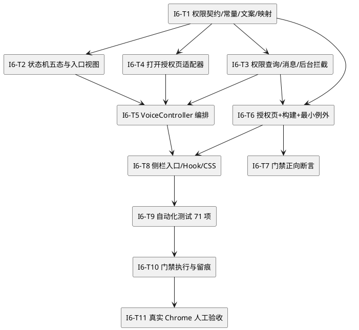

# EasyFlow 麦克风权限引导与扩展来源授权（第六轮）— 编码任务清单

**输入依据**

- `.codeartsdoer/specs/easyflow_page_guide/iteration6-spec.md`（R-170—R-246、T6-01—T6-14、AT-64—AT-80）
- `.codeartsdoer/specs/easyflow_page_guide/iteration6-design.md`（重点：1.2.1 接口扩展点、1.2.9 存量约束、2.1.3(2) `start(): Promise<void>` 同步兼容、2.2 接口清单、2.4 五态、2.5 入口/打开页、2.6 授权页、2.7 错误映射、2.8 去重、2.9 门禁、2.11 接口/文件、2.13 逐文件改动、2.14 测试、2.15 风险、2.16 取舍）
- `iteration5-spec.md`、`iteration5-design.md`、`iteration5-tasks.md`（第五轮 54 项、`AT-51`—`AT-63`、假适配器与导出列表结构）
- `iteration4-spec.md`、`iteration4-design.md`、`iteration4-tasks.md`、`iteration3-*`、`iteration2-*`、`spec.md`、`design.md`、`tasks.md`（任务编号、门禁、留痕与“人工验收待用户执行”口径）
- 现有实现（2026-11-14 只读核对）：`src/shared/speech/**`、`src/sidepanel/speech/**`、`src/sidepanel/hooks/useVoiceInput.ts`、`src/sidepanel/components/chat/{VoiceInputControl,ChatComposer,AboutPanel,DiagnosticsPanel}.tsx`、`src/sidepanel/App.tsx`、`src/background/index.ts`、`src/background/router.ts`、`src/shared/messages.ts`、`public/manifest.json`、`public/sidepanel.html`、`src/sidepanel/styles/sidepanel.css`、`scripts/{build,verify-manifest,selftest}.mjs`、`tsconfig.json`、`package.json`

**阶段声明**

- 本文件只是第六轮**编码任务规划**，不包含任何实现，不修改源码、不修改前五轮文档。
- 编写本文件时**未执行** `npm run typecheck`、`npm run build`、`npm run selftest`、`npm run verify`，未创建 `codearts_proof/iteration6-*` 实绩日志，未调用真实麦克风、真实语音识别或真实语音合成。
- 实现阶段的自动测试**一律使用假权限、假 `getUserMedia`、假 tabs、假 page、假 runtime、假识别/假合成适配器**；不得出现真实 `navigator.mediaDevices.getUserMedia`、真实麦克风、真实 `SpeechRecognition`、真实 `speechSynthesis`。
- 真实 Chrome 侧栏与授权页行为一律标“**人工验收待用户执行 / 浏览器麦克风行为未在本环境验证**”，不得写“已通过”。

---

## 0. 使用说明与全局约束

### 0.1 基线事实（2026-11-14 只读核对）

| 核查项 | 实测结果（位置） | 对任务的要求 |
|---|---|---|
| 语音入口 | `VoiceInputControl.tsx:10-37`：单按钮 `ef-speech-btn` + `ef-speech-status` + `ef-speech-disclosure` | 只能**并列新增**入口，不改“语音输入/取消识别”语义与既有类名 |
| 启动链路 | `useVoiceInput.ts:17-58` 构造 `VoiceController({adapter, detect, limit})`；`App.tsx:27` 只调用 hook | 权限查询、打开授权页、消息订阅必须是**可注入依赖**，hook 不写业务分支 |
| 启动判定 | `voiceController.ts:69-94`：`start()` 为同步 `void`，先 `detect()` 再 `adapter.start()` | 改为 `Promise<void>` 时，**首个 `await` 之前必须完成旧同步路径**（AT-51/AT-56 依赖） |
| 错误映射（问题根因） | `policy.ts:94-113`：`not-allowed` 与 `service-not-allowed` 合并为 `permission-denied`；`audio-capture` → `no-audio-device` | 必须拆出 `service-limited`、新增 `device-unavailable`，映射表唯一 |
| 文案（问题根因） | `copy.ts:26`：“没有麦克风权限。请在浏览器站点设置里允许麦克风，或直接打字。” | 必须改为**扩展来源**口径；五类失败文案两两不同 |
| 状态机 | `voiceMachine.ts:9-15` 5 字段；`49-151` reducer；`153-165` 视图 | 只增字段/事件，`listening/recognized/no-speech/cancelled` 与 `revision/pendingText` 原样保留 |
| 适配器 | `recognition.ts:38-163` 单会话；`95-101` 调 `mapRecognitionError`；`123-142` 幂等取消 | **不改** `recognition.ts`；适配器不感知权限 |
| 结果写入 | `ChatComposer.tsx:27-35` 依赖 `voice.view.revision/pendingText` + `consumePending()`；`17-25` 仅 `submit()` 发送 | 只入框、不自动发送、不自动聚焦的机制原样保留（AT-51/AT-76） |
| 朗读 | `speechController.ts` 全文、`speakMachine.ts`、`StepCardSpeech.tsx`、`App.tsx:50-56` | 零改动，不插入权限分支（R-220—R-224） |
| 权限清单 | `public/manifest.json:7`：`["activeTab","scripting","sidePanel","storage"]`；无 `host_permissions`/`content_scripts`/`web_accessible_resources` | 四项逐项不变；**不新增 `tabs`**；麦克风不写清单 |
| 后台边界 | `background/index.ts:51-67` 只处理 `WATCH_TICK` 与 `routeSidePanelMessage`；`79-89` 只用 `tabId/status` | 新增通知在 `index.ts` **前置校验并忽略**，不进入 router |
| 消息协议 | `messages.ts:9-26` 固定 `MSG` 与 `MessageType`；`router.ts:68-88` 白名单 `default: false`；`router.ts:323-347` `default` 返回 `EF-E005` | 已核实**无穷尽 switch**，新增 `MSG` 值不需改 `router.ts`；通知必须有独立守卫 |
| 构建 | `build.mjs:16-62` 三入口；`64-67` 只复制 `manifest.json`、`sidepanel.html`；`88` 并行；`90-93` 打印产物清单 | 新增第四入口 + 静态页复制；`minify:false` |
| 门禁 | `verify-manifest.mjs:71-83` 全局禁 `getUserMedia`/`MediaRecorder`；`93-120` 全量扫描；`122-133` 非零退出 | 改为**逐条枚举的路径限定例外**并打印；其余禁令一条不减 |
| 自测 | `selftest.mjs:16-60` esbuild 导出；`1746-1822` `FakeRecognition`/`FakeSynthesis`；`1831-2230` AT-51—AT-63；`iteration5-selftest.log` 末行 `1..54 / pass 54 / fail 0` | 新纯逻辑必须进导出列表；新增 17 项后总数 **71** |
| 严格度 | `tsconfig.json`：`strict`、`noUncheckedIndexedAccess`、`exactOptionalPropertyTypes`、`noImplicitOverride` | 不用 `any`/`@ts-ignore`；可选属性显式 `| undefined` |
| 关键类型缺口 | `lib.dom.d.ts` 的 `PermissionName` 不含 `microphone` | 用 `unknown` + 结构化守卫，不使用 `as PermissionName` |
| 样式基线 | `sidepanel.css:891-933` token；`1278-1389` 语音区；`1369-1389` 窄屏 | 新类只消费 token；care 下入口 ≥44px |

> 行号仅作定位参考，实现以函数名、props 名与 CSS 选择器为准。

### 0.2 全局硬约束（每个任务都必须遵守）

1. **只改主工程**：只改 `D:\hwproject\translator`；不新建网站、不使用 `apps/extension`、不运行 `pnpm dev:web`。
2. **权限不变**：`permissions` 恰为四项；不新增 `tabs`、`host_permissions`、`<all_urls>`、`content_scripts`、`web_accessible_resources`、`externally_connectable`。
3. **麦克风只在授权页请求**：`getUserMedia` 字面量只允许出现在 `src/mic-permission/request.ts` 与产物 `dist/mic-permission.js`；侧栏、后台、内容脚本一律禁止。
4. **不读其他标签页敏感字段**：不读取/记录/比较 `url`、`title`、`favIconUrl`、`pendingUrl`；不使用 `chrome.tabs.query`；不使用 `chrome.tabs.update/reload/remove`。
5. **不录音不保存**：无 `MediaRecorder`，无网络请求 API（`fetch(`/`XMLHttpRequest`/`sendBeacon`/`WebSocket`），不保存音频、识别原文、设备 ID/名称。
6. **只入框不发送**：识别结果仍只写入可编辑输入框；`ChatComposer` 的消费 effect 不得出现 `submit`/`focus`。
7. **朗读零改动**：`recognition.ts`、`synthesis.ts`、`speechController.ts`、`speakMachine.ts`、`StepCardSpeech.tsx`、`StepCard.tsx`、`MessageList.tsx`、`AboutPanel.tsx` 不得出现 `permission`/`MIC_`/`micPermission` 字样。
8. **文案单源**：所有 `MIC_*` 文案只在 `src/shared/speech/copy.ts`；组件与页面不内联中文；测试断言引用同一常量来源。
9. **常量化**：页面路径、节流窗口、去重窗口、消息版本均为命名常量；不散落魔法数。
10. **每步可构建**：除 `I6-T6` 规定的“授权页 + 构建入口 + 最小例外”原子边界外，每个任务结束时 `npm run typecheck` 必须 0 error；`I6-T6`/`I6-T7` 结束时 `npm run build` 必须全绿。
11. **测试不改写事实**：不删除 `AT-01`—`AT-63`；`AT-53`/`AT-55` 仅允许按 spec 7.2.3 与设计 2.7.2 显式改写相关文案断言；`AT-32`/`AT-50` 口径保持不变。
12. **文档不改**：`spec.md`、`design.md`、`tasks.md`、`iteration2-*`、`iteration3-*`、`iteration4-*`、`iteration5-*`、`iteration6-spec.md`、`iteration6-design.md` 不改。
13. **如实留痕**：未执行的命令与人工验收必须单列；失败日志保留、不覆盖、不编造。

### 0.3 明确“不改文件”清单

以下文件本轮**不得修改**（逐项核对，改动即视为越界）：

- `src/sidepanel/speech/recognition.ts`
- `src/sidepanel/speech/synthesis.ts`
- `src/sidepanel/speech/speechController.ts`
- `src/shared/speech/speakMachine.ts`
- `src/sidepanel/components/chat/StepCardSpeech.tsx`
- `src/sidepanel/components/chat/StepCard.tsx`
- `src/sidepanel/components/chat/MessageList.tsx`
- `src/sidepanel/components/chat/AboutPanel.tsx`
- `src/sidepanel/components/chat/DiagnosticsPanel.tsx`
- `src/sidepanel/state/conversationReducer.ts`
- `src/shared/types.ts`（**会话/页面类型**；注意与 `src/shared/speech/types.ts` 不是同一文件）
- `src/shared/constants.ts`（`MAX_TURN_CHARS` 等复用，不新增第二套）
- `src/background/router.ts`
- `src/background/injector.ts`
- `src/content/**`
- `src/sidepanel/guide/**`、`src/sidepanel/dialogue/**`、`src/sidepanel/match/**`
- `src/shared/privacy/**`
- `src/sidepanel/App.tsx`
- `public/manifest.json`
- `public/sidepanel.html`
- `package.json`、`tsconfig.json`
- `scripts/gen-icons.mjs`
- 前五轮全部规格/设计/任务文档与本轮 `iteration6-spec.md`、`iteration6-design.md`

### 0.4 允许新增/修改清单

**新增**

- `src/shared/speech/permission.ts`
- `src/sidepanel/speech/microphone.ts`
- `src/sidepanel/speech/micPage.ts`
- `src/sidepanel/speech/micMessages.ts`
- `src/mic-permission/main.tsx`
- `src/mic-permission/MicPermissionPage.tsx`
- `src/mic-permission/request.ts`
- `src/mic-permission/pageView.ts`
- `src/mic-permission/notify.ts`
- `src/mic-permission/mic-permission.css`
- `public/mic-permission.html`

**修改**

- `src/shared/speech/types.ts`（语音契约，**允许**增加两个错误类别）
- `src/shared/speech/constants.ts`
- `src/shared/speech/copy.ts`
- `src/shared/speech/policy.ts`
- `src/shared/speech/voiceMachine.ts`
- `src/sidepanel/speech/voiceController.ts`
- `src/sidepanel/hooks/useVoiceInput.ts`
- `src/sidepanel/components/chat/VoiceInputControl.tsx`
- `src/sidepanel/components/chat/ChatComposer.tsx`
- `src/shared/messages.ts`
- `src/background/index.ts`
- `src/sidepanel/styles/sidepanel.css`
- `scripts/build.mjs`
- `scripts/verify-manifest.mjs`
- `scripts/selftest.mjs`
- `codearts_proof/**`（新增 `iteration6-*` 与 `25-iteration6-implementation.md`）

### 0.5 任务编号与追溯约定

- 本轮编码任务编号为 **`I6-T1`—`I6-T11`**；需求/设计阶段的取舍点仍写 `T6-01`—`T6-14` 与 `Q1`/`Q2`，两者不混用。
- 测试用例沿用 `AT-xx`；本轮新增 `AT-64`—`AT-80`（17 项），既有 54 项保留，总数 **71**。
- “设计 2.x”指 `iteration6-design.md` 的对应小节；“spec 5.x/6.x/7.x”指 `iteration6-spec.md`。
- 每个任务的自验命令在**实现阶段**执行；本文件编写阶段不执行任何命令。
- 任务完成标准里的“临时 node 断言”指用 esbuild 打包目标模块后直接 `node` 运行的一次性脚本，放系统临时目录、不提交主工程；正式断言统一进 `I6-T9` 的 `selftest.mjs`。
- **合并说明**：`I6-T6` 把“授权页全部文件 + `build.mjs` 第四入口/复制 + `verify-manifest.mjs` 最小例外表”放在同一任务，原因是三者互为前置——只加授权页会让 `verify` 全局禁令失败，只加例外而不加产物会让“例外未被使用即失败”。这是本轮**唯一**的原子边界，之后的 `I6-T7` 才补正向断言。

### 0.6 执行顺序总览

| 顺序 | 编号 | 标题 | 依赖 | 主要产物 | 构建检查点 |
|---|---|---|---|---|---|
| 1 | I6-T1 | 权限契约、命名常量、错误映射与文案单源 | 无 | `shared/speech/{permission,types,constants,copy,policy}.ts` | `npm run typecheck` |
| 2 | I6-T2 | 语音输入状态机的权限五态与入口视图 | I6-T1 | `shared/speech/voiceMachine.ts` | `typecheck`；引用相等断言 |
| 3 | I6-T3 | 权限查询适配器、跨页消息与后台前置拦截 | I6-T1 | `sidepanel/speech/{microphone,micMessages}.ts`、`shared/messages.ts`、`background/index.ts` | `typecheck`；假 probe/node 断言 |
| 4 | I6-T4 | 授权页打开适配器（固定页 + 三层去重） | I6-T1 | `sidepanel/speech/micPage.ts` | `typecheck`；假 runtime 断言 |
| 5 | I6-T5 | `VoiceController` 权限前置与 `start(): Promise<void>` 同步兼容 | I6-T1—I6-T4 | `sidepanel/speech/voiceController.ts` | `typecheck`；AT-51/56 同语义断言 |
| 6 | I6-T6 | 授权页页面、请求/停轨、构建入口与最小路径例外 | I6-T1、I6-T3 | `src/mic-permission/**`、`public/mic-permission.html`、`build.mjs`、`verify-manifest.mjs` | `npm run build` 全绿；`dist` 新增 3 产物 |
| 7 | I6-T7 | 门禁正向断言与例外清单可审阅 | I6-T6 | `scripts/verify-manifest.mjs` | `npm run build` 全绿；例外 2 条打印 |
| 8 | I6-T8 | 侧栏入口、Hook 接线与样式 | I6-T2—I6-T5、I6-T6 | `VoiceInputControl.tsx`、`ChatComposer.tsx`、`useVoiceInput.ts`、`sidepanel.css` | `typecheck`；源码结构断言 |
| 9 | I6-T9 | 自动化测试 AT-64—AT-80 与 54 项回归 | I6-T1—I6-T8 | `scripts/selftest.mjs` | `npm run selftest`；`1..71 / pass 71 / fail 0` |
| 10 | I6-T10 | 四道门禁执行、清洁检索与实现留痕 | I6-T9 | `codearts_proof/iteration6-*.log`、`25-iteration6-implementation.md` | 四命令全绿 |
| 11 | I6-T11 | 真实 Chrome 人工验收记录（用户执行） | I6-T10 | `25-iteration6-implementation.md` 人工分栏 | “人工验收待用户执行” |

### 0.7 依赖图

```text
I6-T1 ──┬──> I6-T2 ──┐
        ├──> I6-T3 ──┤
        └──> I6-T4 ──┤
                     ├──> I6-T5 ──> I6-T8 ──> I6-T9 ──> I6-T10 ──> I6-T11
        ┌──> I6-T6 ──┴──> I6-T7 ──┘
        └── (I6-T1)
```



**硬性顺序**

1. `I6-T1` 必须最先：`MicPermissionState`/`MicRequestOutcome`/文案表/映射是全部后续模块的编译基础。
2. `I6-T2` 依赖 `I6-T1` 的 `MicPermissionState` 与 `MIC_*` 文案；`I6-T3`/`I6-T4` 依赖 `I6-T1` 的类型与常量，三者可并行。
3. `I6-T5` 依赖 `I6-T2`（视图字段）、`I6-T3`（probe/消息）、`I6-T4`（page）。
4. `I6-T6` 必须在 `I6-T3` 之后（`notify.ts` 复用 `createMicPermissionResult`），并且**必须与构建入口、最小例外同任务完成**，否则中间态 `npm run build` 必红。
5. `I6-T7` 只补正向断言，不改变例外表语义；必须在 `I6-T6` 产物可生成之后。
6. `I6-T8` 依赖 `I6-T5`（`requestMicPermission`/`refreshPermission`）与 `I6-T6`（入口可打开）；不依赖 `I6-T7`，但为保持“先门禁后 UI”的顺序，建议在 `I6-T7` 之后执行。
7. `I6-T9` 在全部实现之后；`I6-T10` 在 `I6-T9` 全绿之后；`I6-T11` 只在用户真实执行后记录。

### 0.8 阶段门禁与留痕

| 时点 | 命令/检查 | 通过标准 | 留痕 |
|---|---|---|---|
| I6-T1—I6-T5、I6-T8 | `npm run typecheck` | 退出码 0，0 error，无 `any`/`@ts-ignore` | 汇总到 `iteration6-typecheck.log` |
| I6-T6、I6-T7 | `npm run build` | 退出码 0；`dist/` 含 `mic-permission.html/.js/.css`；`verify` 打印 2 条例外 | `iteration6-build.log` |
| I6-T9 | `npm run selftest` | `1..71` / `pass 71` / `fail 0`；`AT-01`—`AT-63` 不回退 | `iteration6-selftest.log` |
| I6-T10 | `npm run typecheck` → `npm run build` → `npm run selftest` → `npm run verify` | 四条独立执行、分别留痕 | `iteration6-{typecheck,build,selftest,verify}.log` |
| I6-T10 | 清洁检索 | `getUserMedia` 仅 1 处源码；无 `tabs`/`MediaRecorder`/网络 API/`chrome://settings` | `iteration6-clean-*.log` |
| I6-T11 | 真实 Chrome 10 步 | 逐项记录或“人工验收待用户执行” | `25-iteration6-implementation.md` |

> 门禁顺序固定为 `typecheck → build → selftest → verify`。不得以 `build` 内含的检查替代单独 `verify`。

---

## 1. I6-T1 权限契约、命名常量、错误映射与文案单源

**编号与标题**：I6-T1 / 权限契约、命名常量、错误映射与文案单源。

**目标**：一次性落位麦克风权限领域类型、五态/结果枚举、纯映射函数、命名常量与全部新增中文文案，使后续任务只依赖稳定契约，且“侧栏与授权页对同一类别只有一份文案”。

**对应需求/设计条目**：R-171、R-174、R-197—R-204、R-215—R-230；设计 2.1.2、2.2.2 接口 A、2.4.1、2.6.2、2.7.1、2.7.2、2.9.1、2.13.1/2.13.2；6.4 文案单源。

**涉及文件与函数/类型/常量**（按设计 2.13）

- 新增 `src/shared/speech/permission.ts`（纯逻辑，无 React/chrome/navigator/window）：
  - `MicPermissionState = "unknown" | "granted" | "prompt" | "denied" | "unsupported"`。
  - `MicRequestOutcome = "granted" | "permission-denied" | "no-audio-device" | "device-unavailable" | "unknown" | "unsupported"`。
  - `MicPermissionProbe { query(): Promise<MicPermissionState> }`、`MicPermissionPage { open(): Promise<MicPageOpenResult> }`、`MicPageOpenResult = "opened" | "already-open" | "failed"`。
  - `MediaStreamTrackLike { stop(): void }`、`MediaStreamLike { getTracks(): readonly MediaStreamTrackLike[] }`、`MediaDevicesLike { getUserMedia(constraints: { audio: true }): Promise<MediaStreamLike> }`。
  - `MIC_PERMISSION_STATES`、`MIC_REQUEST_OUTCOMES`（`as const` 数组，类型由数组派生）。
  - `mapPermissionState(raw: unknown): MicPermissionState`：仅认 `"granted"|"prompt"|"denied"`，缺省/非字符串/其他值 → `"unknown"`。
  - `mapMicRequestError(raw: unknown): MicRequestOutcome`：接受字符串或 `{ name?: unknown }`；`NotAllowedError`/`SecurityError` → `permission-denied`；`NotFoundError`/`OverconstrainedError` → `no-audio-device`；`NotReadableError`/`TrackStartError` → `device-unavailable`；`AbortError`/其他 → `unknown`。
  - `toPermissionState(outcome): MicPermissionState | null`：`granted→granted`、`permission-denied→denied`、其余 `null`。
  - `releaseStream(stream): { stopped: number; failed: number }`：`getTracks()` 每条 `stop()`，单条抛错计入 `failed` 并继续；`getTracks()` 本身抛错时返回 `{ stopped: 0, failed: 1 }`；函数**不保留任何引用**。
- 修改 `src/shared/speech/types.ts`：
  - `SpeechErrorKind` 增加 `"service-limited"`、`"device-unavailable"`。
  - `VoiceInputIssue` 增加 `"service-limited"`、`"device-unavailable"`。
- 修改 `src/shared/speech/policy.ts`：
  - `mapRecognitionError`：删除 `"service-not-allowed"` 与 `"not-allowed"` 共用分支，改为 `"service-not-allowed" → "service-limited"`；`"not-allowed" → "permission-denied"`；其余不变；`default → "unknown"` 保留。
- 修改 `src/shared/speech/constants.ts`（追加 5 个命名常量）：
  - `MIC_PERMISSION_PAGE_PATH = "mic-permission.html"`
  - `MIC_PERMISSION_MESSAGE_VERSION = 1`
  - `MIC_PERMISSION_RECHECK_MIN_MS = 1000`
  - `MIC_PAGE_DEDUPE_GUARD_MS = 2000`
  - `MIC_REQUEST_VISIBLE_MS = 300`
- 修改 `src/shared/speech/copy.ts`（唯一文案来源）：
  - 定义 `MIC_PERMISSION_DENIED_TEXT = "麦克风权限未开启。请在 EasyFlow 扩展的麦克风权限中改为允许（这不是当前网页的站点设置），或直接打字。"`。
  - `VOICE_STATUS_TEXT["permission-denied"] = MIC_PERMISSION_DENIED_TEXT`（不再有第二份拒绝句）。
  - `VOICE_ISSUE_TEXT.network = "网络或语音服务暂不可用，可以直接打字。"`（去掉“未识别：”前缀，保留 AT-55 关键词）。
  - `VOICE_ISSUE_TEXT["service-limited"] = "语音服务不可用或被浏览器限制，可以再试或直接打字。"`
  - `VOICE_ISSUE_TEXT["device-unavailable"] = "麦克风被系统关闭或被其他应用占用，可在系统声音设置中检查，或直接打字。"`
  - `MIC_ENTRY_LABEL = "开启麦克风"`；`MIC_ENTRY_PURPOSE_TEXT = "仅用于 EasyFlow 语音输入；不录音、不保存音频。"`
  - `MIC_PERMISSION_STATE_TEXT: Record<MicPermissionState, string>`：
    - `unknown`：“需要开启麦克风才能语音输入；可点“开启麦克风”试一次，也可以直接打字。”
    - `granted`：“已允许 EasyFlow 使用麦克风。”
    - `prompt`：“需要开启麦克风才能语音输入；点“开启麦克风”完成一次授权。”
    - `denied`：引用 `MIC_PERMISSION_DENIED_TEXT`。
    - `unsupported`：“当前环境无法查询麦克风权限；仍可点“开启麦克风”试一次，或直接打字。”
  - `MIC_SETTING_HELP_TEXT = "怎么改：在浏览器“设置 → 隐私和安全 → 网站设置 → 麦克风”里找到 EasyFlow 扩展并允许；或先打开一次 EasyFlow 授权页，再点地址栏左侧的权限图标改为允许。设置入口位置可能因浏览器版本略有不同。"`
  - `MIC_PAGE_OPEN_FAILED_TEXT = "没能打开授权页，可以再试或直接打字。"`
  - `MIC_PAGE_OPENED_TEXT = "授权页已打开，请切换到该标签页完成一次授权。"`
  - `MIC_PAGE_TEXTS`：`heading`、`purpose`、`privacyExtra`、`button`、`keepOpenNote`、`requesting`、`granted`、`noDevice`、`deviceUnavailable`、`unknown`、`unsupported`（逐项取设计 2.6.2 与 2.7.2 的口径）。
  - 全部新增文案不得含 `NotAllowedError`/`NotFoundError`/`NotReadableError`/`no-speech`/`audio-capture`/`service-not-allowed`/`network`；不得含“当前网站/此网站/网页站点设置”作为解决步骤（仅拒绝句一处否定式对照）；不得含“离线/纯本地/不上传”。

**实现要点与前置依赖**

- [ ] 先写类型与常量，再写文案；`Record<MicPermissionState,string>` 与 `Record<VoiceInputIssue,string>` 的键必须齐全，否则 typecheck 失败。
- [ ] `mapMicRequestError` 必须同时接受 `"NotAllowedError"` 字符串与 `{ name: "NotAllowedError" }` 对象；测试两种形态都覆盖。
- [ ] `releaseStream` 采用逐条 `try/catch`；禁止把 `stream` 存入模块级变量或返回。
- [ ] `MIC_PERMISSION_DENIED_TEXT` 只定义一次，`VOICE_STATUS_TEXT` 与 `MIC_PERMISSION_STATE_TEXT.denied` 都引用它。
- [ ] 前置依赖：无。

**明确不做事项**

- 不实现 `voiceMachine.ts`、`microphone.ts`、`micPage.ts`、`voiceController.ts`、任何组件或授权页。
- 不改 `src/shared/constants.ts`、`src/shared/types.ts`、`conversationReducer.ts`。
- 不新增权限、不写 storage、不新增网络请求、不写 `getUserMedia`。
- 不删除或改写 `VOICE_DISALLOWED_WORDS` 的转义写法。

**完成标准与自验方式**

- [ ] `npm run typecheck` 退出码 0。
- [ ] 临时 node 断言（esbuild 打包 `permission.ts`/`policy.ts`/`copy.ts`/`constants.ts`）：
  - `mapPermissionState("granted"|"prompt"|"denied")` 返回原值；`mapPermissionState(undefined)`、`"limited"` 返回 `"unknown"`；
  - `mapMicRequestError("NotAllowedError") === "permission-denied"`；`"NotFoundError" === "no-audio-device"`；`"NotReadableError" === "device-unavailable"`；`"TrackStartError" === "device-unavailable"`；`"AbortError" === "unknown"`；
  - `mapRecognitionError("service-not-allowed") === "service-limited"`；`mapRecognitionError("not-allowed") === "permission-denied"`；
  - `new Set(Object.values(MIC_PERMISSION_STATE_TEXT)).size === 5`；
  - `VOICE_STATUS_TEXT["permission-denied"]` 含“麦克风权限未开启”“EasyFlow”“不是当前网页”，不含“当前网站”；
  - `VOICE_ISSUE_TEXT["service-limited"]`、`["device-unavailable"]`、`network` 三者互不相同，且均不含英文错误串；
  - `MIC_PERMISSION_PAGE_PATH === "mic-permission.html"`、`MIC_PAGE_DEDUPE_GUARD_MS === 2000`。

**风险与回滚点**

- 风险：拒绝句同时承载“不是当前网页”，可能被误读为指路；缓解：设置方法单独放 `MIC_SETTING_HELP_TEXT`，拒绝句只做否定式对照。
- 风险：`VOICE_ISSUE_TEXT.network` 去前缀后 AT-55 关键词仍保留，但若误删“网络或语音服务暂不可用”会导致回归；自验必须显式断言该关键词。
- 回滚点：本任务只改纯逻辑与文案；回滚即恢复 `policy.ts` 映射与 `copy.ts` 原文，不影响 UI。

---

## 2. I6-T2 语音输入状态机的权限五态与入口视图

**编号与标题**：I6-T2 / 语音输入状态机的权限五态与入口视图。

**目标**：在不触碰 `listening/recognized/no-speech/cancelled` 与 `revision/pendingText` 机制的前提下，把权限五态、入口显隐、设置说明、打开页结果纳入同一状态机，并定义 `statusText` 的唯一优先级。

**对应需求/设计条目**：R-171、R-172、R-175—R-179、R-184—R-186、R-208、R-211、R-214；设计 1.2.2、2.2.2 接口 E、2.3.2、2.4.1、2.5.4、2.8.1、2.9.2；AT-64、AT-65、AT-66、AT-68、AT-73。

**涉及文件与函数/类型/常量**

- 修改 `src/shared/speech/voiceMachine.ts`：
  - `VoiceInputState` 追加：`permission: MicPermissionState`（初始 `"unknown"`）、`permissionCheckedAt: number | null`（初始 `null`）、`pageOpened: boolean`（初始 `false`）、`micPageFailed: boolean`（初始 `false`）、`micGate: boolean`（初始 `false`）。
  - `VoiceInputEvent` 追加 4 个：`{type:"permission-refreshed"; state; at}`、`{type:"mic-gate"}`、`{type:"mic-page-opened"; at}`、`{type:"mic-page-failed"}`。
  - `VoiceInputView` 追加：`permission`、`permissionCheckedAt`、`showMicEntry`、`micEntryLabel`、`micEntryPurpose`、`settingHelpText`、`pageOpened`、`micPageFailed`（`pageOpened`/`permissionCheckedAt` 为 AT-66/AT-64 所需只读补全）。
  - `voiceInputReducer` 新增 4 个 case：
    - `permission-refreshed`：写 `permission`/`permissionCheckedAt`；`permission === "granted"` 时清 `issue`；`micGate` 保持不变。
    - `mic-gate`：仅当 `state.permission !== "granted"` 时置 `micGate: true`；`phase` 不变。
    - `mic-page-opened`：`pageOpened: true`、`micPageFailed: false`、`permissionCheckedAt: event.at`。
    - `mic-page-failed`：`micPageFailed: true`。
  - `adapter-error` 增加：`"service-limited" → {phase:"failed", issue:"service-limited"}`；`"device-unavailable" → {phase:"failed", issue:"device-unavailable"}`。
  - `invalidate`：清 `issue`/`pendingText`/`micGate`/`micPageFailed`，**保留** `permission`/`permissionCheckedAt`/`pageOpened`；短路条件加入 `!state.micGate && !state.micPageFailed`（否则引导态无法复位）。
  - `describeVoiceInput`：
    - `micEntryLabel = MIC_ENTRY_LABEL`；`micEntryPurpose = MIC_ENTRY_PURPOSE_TEXT`；`settingHelpText = permission === "denied" ? MIC_SETTING_HELP_TEXT : null`。
    - `showMicEntry = permissionCheckedAt !== null && permission !== "granted" && phase !== "listening"`（未查询时不显示入口，保证不注入 probe 的第五轮回退路径 UI 零变化）。
    - `statusText` 优先级：`issue` 文案 > `micPageFailed` → `MIC_PAGE_OPEN_FAILED_TEXT` > `pageOpened && permission !== "granted"` → `MIC_PAGE_OPENED_TEXT` > `permission === "denied"` → `MIC_PERMISSION_DENIED_TEXT` > `micGate && permission !== "granted"` → `MIC_PERMISSION_STATE_TEXT[permission]` > 既有 `VOICE_STATUS_TEXT[phase]`。
    - `canStart`/`canCancel`/`buttonLabel`/`showDisclosure`/`pendingText`/`revision` 语义不变。

**实现要点与前置依赖**

- [ ] `permission` 只能由 `permission-refreshed` 改变；不得根据 `phase` 反推权限。
- [ ] `mic-gate` 不得改 `phase`；`listening` 中不得因迟到 `mic-gate` 覆盖状态。
- [ ] `invalidate` 保留权限是“切任务不丢授权状态”的关键；自验必须断言 `permission` 在 `invalidate` 前后相同。
- [ ] `start-requested{supported:true}` 在 `listening` 时仍返回**同一引用**（AT-56）。
- [ ] 前置依赖：I6-T1。

**明确不做事项**

- 不新增 `VoiceInputPhase` 取值（保持 8 值）。
- 不改 `revision/pendingText/disclosureShown` 的写入时机。
- 不在状态机内调用 `navigator`/`chrome`/`getUserMedia`。
- 不把权限状态写入 `ConversationState`。

**完成标准与自验方式**

- [ ] `npm run typecheck` 退出码 0。
- [ ] 临时 node 断言：
  - `createVoiceInputState().permission === "unknown"`、`permissionCheckedAt === null`、`showMicEntry === false`；
  - `permission-refreshed{prompt,1}` 后 `showMicEntry === true`、`statusText` 为空（未点 `mic-gate`）；
  - `mic-gate` 后 `statusText` 含“开启麦克风”；
  - `permission-refreshed{denied,2}` 后 `settingHelpText === MIC_SETTING_HELP_TEXT`、`statusText` 含“不是当前网页”；
  - `adapter-error{service-limited}` → `failed + issue:"service-limited"`；`{device-unavailable}` → `failed + issue:"device-unavailable"`；
  - `mic-page-failed` 后 `statusText` 含“没能打开授权页”；
  - `mic-page-opened` 后 `statusText` 含“授权页已打开”；
  - `invalidate` 后 `phase === "idle"`、`permission` 不变、`micGate === false`；
  - `start-requested{supported:true}` 对 `listening` 返回同一引用。

**风险与回滚点**

- 风险：`statusText` 优先级若把 `pageOpened` 放在 `issue` 之前，会覆盖识别失败说明；自验必须覆盖“先失败再打开页”的组合。
- 风险：`invalidate` 短路条件漏加 `micGate` 会导致“切任务后仍显示旧引导”；自验必须断言。
- 回滚点：`VoiceInputView` 新字段均为只读派生；回滚只需恢复 reducer 与 describe，不影响 controller。

---

## 3. I6-T3 权限查询适配器、跨页消息与后台前置拦截

**编号与标题**：I6-T3 / 权限查询适配器、跨页消息与后台前置拦截。

**目标**：建立侧栏唯一权限查询入口（查询不弹窗、永不 reject）、授权页→侧栏固定通知协议（仅枚举 + 时间戳）、以及后台“校验后忽略”的前置守卫，保证通知不会被当成未知请求返回错误码。

**对应需求/设计条目**：R-170、R-172—R-174、R-177、R-228、R-235；设计 2.1.2、2.2.2 接口 B/F/G、2.4.2—2.4.5、2.6.4、2.11.1；AT-64、AT-66、AT-75、AT-80。

**涉及文件与函数/类型/常量**

- 新增 `src/sidepanel/speech/microphone.ts`（唯一 `navigator.permissions` 访问点）：
  - `MicPermissionsLike { query(descriptor: { name: string }): Promise<{ state: string }> }`。
  - `readMicPermissions(scope: unknown): MicPermissionsLike | null`：`scope.navigator.permissions.query` 为函数时返回包装；调用时用 `permissions.query.call(permissions, descriptor)` 保留 receiver（避免 Illegal invocation）；不使用 `any`/`as PermissionName`。
  - `createMicPermissionProbe(permissions: MicPermissionsLike | null): MicPermissionProbe`：`permissions === null → "unsupported"`；`try/catch` + `mapPermissionState(status?.state)`；**永不 reject**。
- 修改 `src/shared/messages.ts`：
  - `MSG.MIC_PERMISSION_RESULT = "EF_MIC_PERMISSION_RESULT"`。
  - `MicPermissionResultNotification { type; v: 1; result: MicRequestOutcome; at: number }`。
  - `MIC_RESULT_KINDS: readonly MicRequestOutcome[]`。
  - `createMicPermissionResult(result, at)`：返回恰好 4 个键。
  - `isMicPermissionResult(value): value is MicPermissionResultNotification`：校验 `type` 精确、`v === 1`、`result ∈ MIC_RESULT_KINDS`、`Number.isFinite(at) && at > 0`。
- 新增 `src/sidepanel/speech/micMessages.ts`：
  - `subscribeMicPermissionResult(listener: (result, at) => void): () => void`。
  - 只在 `chrome.runtime.onMessage` 可用时注册；handler **不读取 `sender` 任何字段**；非法消息直接返回；返回清理函数调用 `removeListener`。
- 修改 `src/background/index.ts`：
  - `chrome.runtime.onMessage` 顶部：`if (isMicPermissionResult(message)) return false;`（不移交给 `routeSidePanelMessage`，不 `sendResponse`）。
  - 不修改 `isWatchTick` 既有分支与 `routeSidePanelMessage` 调用。

**实现要点与前置依赖**

- [ ] 已核实 `MessageType` 只在 `messages.ts` 定义、`router.ts` 两处 `switch` 均有 `default`，新增 `MSG` 值不会造成穷尽性 typecheck 失败；本任务仍不得改 `router.ts`。
- [ ] `isMicPermissionResult` 必须是纯函数，可在 node 环境直接调用；不得引用 `chrome`。
- [ ] `subscribeMicPermissionResult` 顶层不得访问 `chrome`（函数体内守卫即可），否则 selftest 打包会失败。
- [ ] 通知载荷不得包含 `message`/`name`/`stack`/URL/设备字段。
- [ ] 前置依赖：I6-T1（`MicRequestOutcome` 与 `MIC_RESULT_KINDS` 的类型来源）。

**明确不做事项**

- 不改 `src/background/router.ts`、`injector.ts`。
- 不使用 `chrome.tabs.query`、不读取 `sender.tab`/`sender.url`。
- 不新增 storage 键、不写 storage。
- 不在 `microphone.ts` 内调用 `getUserMedia` 或构造识别实例。

**完成标准与自验方式**

- [ ] `npm run typecheck` 退出码 0。
- [ ] 临时 node 断言：
  - `probe(null).query()` → `"unsupported"`；
  - 假 permissions 返回 `{state:"granted"}` → `"granted"`；返回 `{state:"limited"}` → `"unknown"`；`query` 抛错 → `"unknown"`；
  - `createMicPermissionResult("granted", 1234)` 的 `Object.keys().sort()` 恰为 `["at","result","type","v"]`；
  - `isMicPermissionResult({...合法}) === true`；`v:2`、`result:"ok"`、`at:0`、`at:NaN`、缺字段均为 `false`；
  - `isMicPermissionResult({type:"EF_GET_CONTEXT",v:1,requestId:"x"}) === false`。

**风险与回滚点**

- 风险：`permissions.query.call` 写法若被误改成 `permissions.query(descriptor)` 的解构赋值，会丢 `this`；自验需用带 receiver 断言的假对象（`this === permissions`）。
- 风险：后台若把通知交给 router，`isSidePanelRequest` 返回 false 后不响应，授权页 `sendMessage` 可能 reject；`.catch` 已兜底，但必须在后台前置拦截以免日志噪声。
- 回滚点：消息常量与订阅为独立增量；回滚即移除 `MSG` 新值与 `micMessages.ts`，后台恢复原监听。

---

## 4. I6-T4 授权页打开适配器（固定页 + 三层去重）

**编号与标题**：I6-T4 / 授权页打开适配器（固定页 + 三层去重）。

**目标**：实现“只打开本扩展固定授权页”的可注入适配器，并在**不申请 `tabs`、不读其他标签页敏感字段**的前提下完成 in-flight 锁、`getContexts` 数量查询与 2 秒降级窗口。

**对应需求/设计条目**：R-180—R-183、R-211—R-213、R-233—R-236；设计 2.1.2、2.2.2 接口 C、2.5.2、2.5.3、2.8.2；AT-66、AT-67。

**涉及文件与函数/类型/常量**

- 新增 `src/sidepanel/speech/micPage.ts`（唯一 `chrome.tabs.create`/`chrome.runtime.getContexts` 访问点）：
  - `MicRuntimeLike { getURL(path): string; countContexts?(filter:{documentUrls: readonly string[]; contextTypes: readonly string[]}): Promise<number>; createTab?(url: string): Promise<number | null> }`。
  - `readMicRuntime(scope: unknown): MicRuntimeLike | null`：
    - 仅取 `chrome.runtime.getURL`、`chrome.runtime.getContexts`、`chrome.tabs.create` 三个函数。
    - `countContexts` 内部 `return contexts.length`，**不接触任何返回字段**；`contextTypes` 用 `chrome.runtime.ContextType.TAB`。
    - `createTab` 内部 `const tab = await chrome.tabs.create({ url }); return typeof tab?.id === "number" ? tab.id : null;`。
  - `createMicPermissionPage(deps: { runtime: MicRuntimeLike; now?: () => number }): MicPermissionPage`：
    1. `inFlight === true` → `"already-open"`（同步返回）。
    2. `getURL(MIC_PERMISSION_PAGE_PATH)` 抛错/非字符串/空串 → `"failed"`。
    3. `countContexts` 可用：`await countContexts({documentUrls:[url], contextTypes:["TAB"]})`；`count > 0 → "already-open"`；`count === 0 → 进入创建`。
    4. `countContexts` 缺失或抛错：`sessionOpened && now() - lastOpenAt < MIC_PAGE_DEDUPE_GUARD_MS → "already-open"`，否则进入创建。
    5. `createTab` 缺失/抛错/返回非数字 → `"failed"`。
    6. 成功 → `sessionOpened = true`、`lastOpenAt = now()`、返回 `"opened"`。
    7. `finally` 释放 `inFlight`。
  - 不使用 URL 查询参数（会破坏 `documentUrls` 精确匹配）。

**实现要点与前置依赖**

- [ ] `in-flight` 锁必须是**普通变量**而非 React state，保证并发调用同步短路。
- [ ] `countContexts` 可用且 `count === 0` 时**不得**再被 2 秒窗口拦截（R-213 关闭后可再开）。
- [ ] `createTab` 返回值只做 `typeof id === "number"` 判断，不读取 `url/title/favIconUrl/pendingUrl`。
- [ ] 前置依赖：I6-T1（`MIC_PERMISSION_PAGE_PATH`/`MIC_PAGE_DEDUPE_GUARD_MS`/类型）。

**明确不做事项**

- 不接受外部 URL 参数；不打开 `chrome://settings`/`chrome://extensions`。
- 不使用 `chrome.tabs.query/update/reload/remove`，不新增 `tabs` 权限。
- 不聚焦/切换已有授权页（仅返回 `already-open`）。
- 不在本任务实现 controller 的 `opening` 锁（属于 I6-T5）。

**完成标准与自验方式**

- [ ] `npm run typecheck` 退出码 0。
- [ ] 临时 node 断言（假 `MicRuntimeLike`）：
  - `getURL` 返回 `"chrome-extension://test/mic-permission.html"`；`countContexts → 0`；`createTab` 记录 URL：首次 `open()` → `"opened"`，`createdUrls === [getURL("mic-permission.html")]`；
  - `countContexts → 1` → `"already-open"`、`createCalls === 0`；
  - 5 个未 await 的 `open()` 并发 → `createCalls === 1`；
  - `countContexts` 抛错 + `now()` 未推进 → 第 2 次 `"already-open"`；`tick(2001)` 后再开 → `"opened"` 且 `createCalls === 2`；
  - `createTab` 抛错 → `"failed"`；`createTab` 返回 `null` → `"failed"`；
  - `getURL` 抛错 → `"failed"`；
  - 源码断言 `micPage.ts` 不含 `tabs.query`、`tabs.update`、`tabs.remove`、`url`/`title`/`favIconUrl`/`pendingUrl` 读取。

**风险与回滚点**

- 风险：`getContexts` 在目标版本可用但 `ContextType` 运行时缺失会抛错；已由 `try/catch` 降级到窗口，不得再改其他降级方式。
- 风险：窗口去重过短会造成重复页，过长会阻止关闭后重开；`2000ms` 为设计常量，不得私自调整。
- 回滚点：删除 `micPage.ts` 与 `useVoiceInput` 注入即可回到“无入口”状态；不影响既有识别链路。

---

## 5. I6-T5 `VoiceController` 权限前置与 `start(): Promise<void>` 同步兼容

**编号与标题**：I6-T5 / `VoiceController` 权限前置与 `start(): Promise<void>` 同步兼容。

**目标**：在第一个 `await` 之前保留第五轮全部同步语义（未注入 probe 时零行为变化），注入 probe 后实现“已授权直达识别 / 未授权只显示入口 / 打开授权页去重 / 迟到结果丢弃”，且不触碰适配器契约。

**对应需求/设计条目**：R-172、R-175—R-179、R-183、R-185、R-208—R-214；设计 1.2.1、2.1.3(2)、2.2.2 接口 D、2.8.1—2.8.4；AT-51、AT-56、AT-65、AT-68、AT-75。

**涉及文件与函数/类型/常量**

- 修改 `src/sidepanel/speech/voiceController.ts`：
  - `VoiceControllerDeps` 追加可选 `probe?: MicPermissionProbe`、`micPage?: MicPermissionPage`、`now?: () => number`。
  - `start(): Promise<void>`（实现为 `async`）：
    1. **同步段**：`disposed`/`phase === "listening"` → `return`；`starting === true` → `return`；`supported = detect() === "supported" && adapter !== null`。
    2. **无 probe**：完全走旧路径（`apply(start-requested)` → `beginListening()` 或 `return`），不出现任何 `await`（保证 AT-51/AT-56 同步成立）。
    3. **有 probe**：`starting = true`；`const token = ++this.sessionToken`；`const state = await this.refreshPermission()`；`if (disposed || token !== this.sessionToken || state.phase === "listening") return`；`state === "granted"` → `beginListening()`；否则 `apply({type:"mic-gate"})`；`finally { starting = false }`。
    4. 能力不支持时仍先 `apply(start-requested{supported:false})` 再返回（旧行为）。
  - 提取 `private beginListening()`：原 `69-94` 的 `sessionToken += 1`、`cancelRequested = false`、`clearTimer`、`setTimeout`、`adapter.start`、`catch → adapter-error{unknown}` 原样搬入。
  - `refreshPermission(): Promise<MicPermissionState>`：
    - 无 probe → 返回 `"unknown"`（不写状态）。
    - 节流：`lastRefreshAt === null || now() - lastRefreshAt >= MIC_PERMISSION_RECHECK_MIN_MS` 才查询；否则返回当前 `state.permission`。
    - 查询后 `apply({type:"permission-refreshed", state, at: now()})`，并更新 `lastRefreshAt`；`disposed` 时不写状态但返回结果。
    - **初始 `lastRefreshAt` 必须为 `null`**（不能用 `0`，否则测试 `now()` 从 0 起会被误节流）。
  - `requestMicPermission(): Promise<void>`：`disposed || opening` → return；`opening = true`；`await refreshPermission()`；`disposed` → return；`granted` → return（不打开页）；无 `micPage` → `apply(mic-page-failed)`；`await micPage.open()`；`failed → mic-page-failed`；`opened/already-open → mic-page-opened{at: now()}`；`finally { opening = false }`。
  - `applyMicResult(result, at)`：`disposed` → return；`permissionCheckedAt !== null && at < permissionCheckedAt` → 丢弃；`toPermissionState(result)` 非 `null` → `apply(permission-refreshed{state, at})`；`null` 时**只保留现有 permission**（不启动识别、不发送、不聚焦）。
  - `getPermission(): MicPermissionState`。
  - `invalidate()`/`cancel()`/`consumePending()`/`dispose()` 既有语义不变；`dispose()` 需清 `starting`/`opening` 锁。

**实现要点与前置依赖**

- [ ] `await` 之后必须**双重校验** `disposed` 与 `sessionToken === token`（R1 风险）。
- [ ] `starting` 锁是 AT-68/AT-75 “连续 3 次只 1 次 `adapter.start`”的关键；无 probe 路径不得因锁改变行为。
- [ ] `applyMicResult` 严格按设计接口 D 只更新 permission；`no-audio-device`/`device-unavailable` 的侧栏文案由识别重试（`adapter-error`）覆盖，授权页内由 `deriveMicPageView` 覆盖。
- [ ] 不把 `navigator`/`chrome` 引入 controller；全部通过注入依赖。
- [ ] 前置依赖：I6-T2（视图字段/reducer 事件）、I6-T3（probe/消息）、I6-T4（page）。

**明确不做事项**

- 不改 `recognition.ts`；不在 `start()` 内调用 `getUserMedia`；不在 controller 内注册 `chrome.runtime.onMessage`（由 hook 订阅）。
- 不改超时 `SPEECH_NO_RESULT_TIMEOUT_MS` 与 `mergeTranscript` 长度逻辑。
- 不在权限引导态调用 `adapter.start()`；不在 `mic-gate` 时打开授权页。
- 不自动开始识别、不自动发送、不自动聚焦。

**完成标准与自验方式**

- [ ] `npm run typecheck` 退出码 0。
- [ ] 临时 node 断言（复用 `FakeRecognition` 形态）：
  - **未注入 probe**：`controller.start()` 返回 Promise，但调用后**同步** `phase === "listening"`、`startCalls === 1`；连续 3 次 → `startCalls === 1`（AT-51/AT-56 同语义）；
  - **probe granted**：`await controller.start()` → `phase === "listening"`、`page.openCalls === 0`、`showMicEntry === false`；
  - **probe prompt**：`await controller.start()` → `phase !== "listening"`、`startCalls === 0`、`showMicEntry === true`、`statusText` 含“开启麦克风”；
  - `await controller.requestMicPermission()` ×5 → `page.openCalls <= 1`、`view.pageOpened === true`；
  - `applyMicResult("granted", 100)` → `getPermission() === "granted"`；`applyMicResult("permission-denied", 50)`（`checkedAt=100`）→ permission 不变；
  - `dispose()` 后 `await start()` → `startCalls` 不增加；
  - 点击后立刻 `dispose()`（probe resolve 前）→ `startCalls === 0`。

**风险与回滚点**

- 风险 R1：`await` 后漏检 `disposed` 会在侧栏关闭后启动识别；自验必须覆盖“resolve 前 dispose”。
- 风险 R2：`lastRefreshAt` 初始为 `0` 会节流首次查询；实现必须用 `null`。
- 风险 R11：已核实无穷尽 switch，但实现后仍需 `typecheck` 确认。
- 回滚点：`useVoiceInput` 不注入 `probe`/`micPage` 即回到第五轮行为；controller 内新字段不影响旧路径。

---

## 6. I6-T6 授权页页面、请求/停轨、构建入口与最小路径例外

**编号与标题**：I6-T6 / 授权页页面、请求/停轨、构建入口与最小路径例外。

**目标**：交付一个可离线打开的授权页：仅在用户点击后请求一次 `getUserMedia({audio:true})`，成功立即停止全部 tracks 并丢弃流，失败按类别显示，不自动关闭/跳转/识别；同时让构建产出该页，并让门禁只对两条精确路径放行 `getUserMedia`。

**对应需求/设计条目**：R-187—R-196、R-237—R-243、R-246；设计 1.2.9、2.1.2、2.2.2 接口 A/H、2.6.1—2.6.4、2.7.2、2.11.2、2.11.3、2.13.1；AT-69、AT-78、AT-79。

**涉及文件与函数/类型/常量**

- 新增 `public/mic-permission.html`：`lang="zh-CN"`；`<link rel="stylesheet" href="mic-permission.css">`；`<script type="module" src="mic-permission.js">`；无 `http(s)://`、无远程字体/图片/分析脚本。
- 新增 `src/mic-permission/main.tsx`：`createRoot(document.getElementById("root")!).render(<MicPermissionPage />)`；`import "../sidepanel/styles/sidepanel.css"` + `import "./mic-permission.css"`。
- 新增 `src/mic-permission/request.ts`（**唯一 `getUserMedia` 调用点**）：
  - `readMediaDevices(scope: unknown): MediaDevicesLike | null`（`scope.navigator.mediaDevices.getUserMedia` 为函数）。
  - `requestMicrophone(media: MediaDevicesLike | null): Promise<MicRequestOutcome>`：
    - `media === null → "unsupported"`（不调用任何 API）；
    - `const stream = await media.getUserMedia({ audio: true })`（**参数对象只含 `audio`**）；
    - `releaseStream(stream)` 后立即 `return "granted"`；不 `setState`、不返回流、不存 `streamRef`；
    - 失败：读取 `error.name`（结构化守卫）→ `mapMicRequestError(...)`。
  - 顶层不得触碰 `window`/`navigator`（只在函数内）。
- 新增 `src/mic-permission/pageView.ts`：`MicPagePhase`（8 值）、`MicPageView { heading; body; buttonLabel; canRequest; statusText }`、`deriveMicPageView(phase)`。
- 新增 `src/mic-permission/notify.ts`：`notifyMicPermissionResult(result, at)`；`typeof chrome !== "undefined"` 守卫；`void chrome.runtime.sendMessage(...).catch(() => undefined)`。
- 新增 `src/mic-permission/MicPermissionPage.tsx`：
  - 初始 `phase = readMediaDevices(window) === null ? "unsupported" : "idle"`（**不请求**）。
  - `requestingRef`（普通 ref）防重；`mountedRef` 卸载清理。
  - `onClick`：`requestingRef.current` 为真 → return；置真；`setPhase("requesting")`；`await requestMicrophone(media)`；`mountedRef.current === false` → return（不 setState/不发消息）；置 `phase`；`notifyMicPermissionResult(outcome, Date.now())`。
  - 渲染 `h1` + 目的 + 隐私（`SPEECH_DISCLOSURE_TEXT` + `MIC_PAGE_TEXTS.privacyExtra`）+ 按钮 + `role="status" aria-live="polite"` 状态区 + “不会自动关闭”说明。
  - 不调用 `window.close()`、无 `location.*` 赋值、无识别调用。
- 新增 `src/mic-permission/mic-permission.css`：`ef-mic-page`/`ef-mic-card`/`ef-mic-action`/`ef-mic-status`/`ef-mic-note`；按钮 `min-height: max(44px, var(--ef-tap-min))`；`max-width` + `overflow-wrap: anywhere`；只消费既有 token，不复制颜色值。
- 修改 `scripts/build.mjs`：
  - 新增 `buildMicPermission()`：`entryPoints:["src/mic-permission/main.tsx"]`、`outfile: dist/mic-permission.js`、`bundle:true`、`format:"esm"`、`platform:"browser"`、`target:"chrome116"`、`jsx:"automatic"`、`loader:{".css":"css"}`、`sourcemap:false`、**`minify:false`**。
  - `copyStatic()` 追加 `public/mic-permission.html → dist/mic-permission.html`。
  - `Promise.all([buildBackground(), buildContent(), buildSidePanel(), buildMicPermission()])`。
- 修改 `scripts/verify-manifest.mjs`（**最小例外**）：
  - `const MIC_PERMISSION_PAGE/SCRIPT/STYLE = "mic-permission.html"/".js"/".css"`。
  - `runtimeForbidden` 移除 `"getUserMedia"`；新增：
    ```js
    const getUserMediaExemptions = [
      { scope: "src", path: "src/mic-permission/request.ts" },
      { scope: "dist", path: "mic-permission.js" },
    ];
    ```
  - `scanDirectory(dir, extensions, patterns, label)` 增加 `exemptions` 参数：仅当 `pattern === "getUserMedia"` 且 `scope + relativePath` 精确匹配某条例外时 `notes.push("例外 ...")` 放行；其余仍 `failures.push`。
  - 例外合法性：路径不含 `*`/`?`、不以 `/` 结尾、`stat` 存在；否则 `FAIL`。
  - 扫描结束后：从未命中的例外 → `FAIL 例外条目未被使用`。
  - 打印 `[verify] 路径限定例外清单（共 2 条）` + 每条 `路径 ← 模式`。
  - `runtimeForbidden` 其余 7 项（`fetch(`、`XMLHttpRequest`、`sendBeacon`、`WebSocket`、`MediaRecorder`、`apiKey`、`API_KEY`、`Authorization`）保持全量生效。

**实现要点与前置依赖**

- [ ] `getUserMedia` 调用必须写成 `await media.getUserMedia({ audio: true })`，不得使用变量解构或 `video`；构建不压缩以保证字面量可审。
- [ ] 成功路径必须先 `releaseStream` 再返回；不得把 `stream` 传给组件或全局变量。
- [ ] `requestingRef` 必须是 ref，不能用 `phase === "requesting"` 单独防重（React 批处理下可能双触发）。
- [ ] 授权页初始化不得调用 `requestMicrophone`；`useEffect` 只做挂载标记与清理。
- [ ] 前置依赖：I6-T1（`releaseStream`/`mapMicRequestError`/文案/常量）、I6-T3（`createMicPermissionResult`）。
- [ ] **原子边界**：本任务必须同时完成“授权页文件 + 构建入口/复制 + 最小例外表”，否则 `npm run build` 必红；完成后 `npm run build` 必须全绿。

**明确不做事项**

- 不新增 `tabs`/`host_permissions`/`web_accessible_resources`；不改 `manifest.json`。
- 不使用 `MediaRecorder`；不使用 `fetch`/`XMLHttpRequest`/`sendBeacon`/`WebSocket`。
- 不自动关闭、不自动跳转、不自动聚焦侧栏、不自动开始识别、不显示设备名称/ID。
- 不在授权页读取当前网页内容或 URL。
- 不在本任务补“产物存在/参数只含 audio/停轨”的正向断言（属于 I6-T7）。

**完成标准与自验方式**

- [ ] `npm run typecheck` 退出码 0。
- [ ] `npm run build` 退出码 0；`dist/` 新增 `mic-permission.html`、`mic-permission.js`、`mic-permission.css`，三者非空。
- [ ] `node scripts/verify-manifest.mjs` 退出码 0，输出“路径限定例外清单（共 2 条）”。
- [ ] 临时 node 断言（假 media/stream/track）：
  - 2 条 track → `requestMicrophone(fakeMedia)` 返回 `"granted"`，每条 `stopCalls === 1`，`lastConstraints` 深等 `{audio:true}`；
  - `requestMicrophone(null) === "unsupported"` 且无调用；
  - `media.getUserMedia` 抛 `{name:"NotAllowedError"}` → `"permission-denied"`；`NotFoundError → no-audio-device`；`NotReadableError → device-unavailable`；`AbortError → unknown`；
  - `deriveMicPageView("idle").canRequest === true`；`"requesting"`/`"granted"`/`"unsupported"` 为 `false`；8 个 phase 的 `statusText` 与设计 2.6.2 一致且不含英文错误串。
- [ ] 源码断言：`src/mic-permission` 内 `getUserMedia` 仅出现在 `request.ts`；`request.ts` 不含 `video`；`MicPermissionPage.tsx` 不含 `window.close`/`location.`/`MediaRecorder`。

**风险与回滚点**

- 风险 R4：不压缩使产物变大（约 +150KB 本地文件）；只影响本地加载，换取门禁可读断言。
- 风险 R8：StrictMode 双调用点击处理；已用 `requestingRef` 规避，自验需覆盖“连续 3 次点击只 1 次请求”。
- 风险 R6：漏复制 HTML 会导致运行期 404；`npm run build` 产物清单必须包含 3 项。
- 回滚点：删除 `src/mic-permission/**` 与 `public/mic-permission.html`，同时回滚 `build.mjs` 入口/复制与 `verify-manifest.mjs` 两条例外，即可回到第五轮门禁。

---

## 7. I6-T7 门禁正向断言与例外清单可审阅

**编号与标题**：I6-T7 / 门禁正向断言与例外清单可审阅。

**目标**：在不放宽任何既有断言的前提下，补齐授权页“存在、非空、被引用、参数只含 audio、调用 `getTracks()`+`stop()`、路径常量一致”的正向断言，并让例外清单每次运行都可审阅。

**对应需求/设计条目**：R-237—R-246；设计 2.11.2、2.11.3、2.11.5；AT-78、AT-79、AT-80。

**涉及文件与函数/类型/常量**

- 修改 `scripts/verify-manifest.mjs`（仅追加断言与日志，不改例外语义）：
  - `requiredFiles` 追加 `"mic-permission.html"`、`"mic-permission.js"`、`"mic-permission.css"`（复用既有 `stat` 非空检查）。
  - HTML 文本断言：含 `src="mic-permission.js"`、`href="mic-permission.css"`；不含 `http://`/`https://`。
  - 授权页脚本：`getUserMedia` 参数匹配 `/getUserMedia\(\s*\{\s*audio:\s*true\s*\}\s*\)/` 至少 1 处；整份不含 `video`。
  - 授权页脚本：含 `getTracks()` 与 `.stop()`。
  - `src/shared/speech/constants.ts` 文本含 `"mic-permission.html"`。
  - 例外清单打印格式：`[verify] 路径限定例外清单（共 2 条）` + `  src/mic-permission/request.ts ← getUserMedia` + `  dist/mic-permission.js ← getUserMedia`。
  - 保留：四项权限、四个禁字段、CSP、`minimum_chrome_version`、既有产物清单、`runtimeForbidden` 其余 7 项、`sourceForbidden` 全量。

**实现要点与前置依赖**

- [ ] 新增断言全部用既有 `check(condition, message)`，保证 `iteration6-verify.log` 行数可审计。
- [ ] 例外表必须“逐条枚举、无通配、未使用即失败”；本任务不得改宽。
- [ ] `getUserMedia` 参数断言只针对 `dist/mic-permission.js`，不得对 `src` 全量做正则（源码可能有注释）。
- [ ] 前置依赖：I6-T6（产物存在）。

**明确不做事项**

- 不删除或放宽“权限恰为四项”“无 `host_permissions`/`content_scripts`/`web_accessible_resources`/`externally_connectable`”“CSP 无远程域名”。
- 不把例外改为目录级；不使用 `**/*`、空模式或“跳过整个目录”。
- 不手工往 `dist` 放文件。

**完成标准与自验方式**

- [ ] `npm run build` 退出码 0。
- [ ] `npm run verify` 退出码 0，日志含：
  - 四项权限一行；
  - 3 个授权页产物“存在且非空”；
  - “路径限定例外清单（共 2 条）”及两条路径；
  - 参数只含 audio、`getTracks()`/`.stop()`、路径常量一致各一行。
- [ ] 反向自验（在临时副本中操作、验证后恢复，不留在主工程）：
  - 在 `dist/sidepanel.js` 追加 `getUserMedia` → `verify` 必须失败；
  - 在 `src/mic-permission/request.ts` 追加 `MediaRecorder` → `verify` 必须失败；
  - 删除产物 `dist/mic-permission.js` → `verify` 必须失败。

**风险与回滚点**

- 风险 R5：例外被写宽是隐私边界失守；三重约束（精确路径 + 禁通配 + 未使用即失败）不得弱化。
- 风险：`video` 断言若用整份产物匹配，可能被无关字符串误伤；当前设计只有授权页产物，且不含 `video`，若出现误伤应定位到具体字符串而非放宽断言。
- 回滚点：仅回滚本任务新增断言，保留 I6-T6 例外表；但回滚后不得宣称 AT-78/AT-79 完成。

---

## 8. I6-T8 侧栏入口、Hook 接线与样式

**编号与标题**：I6-T8 / 侧栏入口、Hook 接线与样式。

**目标**：在既有输入区内并列新增“开启麦克风”入口与目的/设置说明，把 controller 的权限查询、打开页、消息订阅接到 Hook，并用既有 token 完成样式；不改变主按钮语义与 `ChatComposer` 的发送/写入机制。

**对应需求/设计条目**：R-178—R-186、R-214、R-215—R-219；设计 2.5.1、2.5.2、2.9.2、2.13.2；AT-65、AT-66、AT-70、AT-80。

**涉及文件与函数/props/CSS 选择器**

- 修改 `src/sidepanel/components/chat/VoiceInputControl.tsx`：
  - props 追加 `onRequestMic: () => void`。
  - DOM：`.ef-speech-row` 内依次 `button.ef-speech-btn`（既有）→ `button.ef-speech-open-btn`（`view.showMicEntry` 时渲染，`type="button"`，文本 `view.micEntryLabel`）→ `div.ef-speech-status` → `p.ef-speech-mic-purpose`（`view.showMicEntry` 时）→ `p.ef-speech-setting-help`（`view.settingHelpText !== null` 时）→ `p.ef-speech-disclosure`（既有）。
  - 保留 `disabled={!view.canStart}`；`onClick={listening ? onCancel : onStart}` 不变。
- 修改 `src/sidepanel/components/chat/ChatComposer.tsx`：
  - `<VoiceInputControl ... onRequestMic={voice.requestMicPermission} />`。
- 修改 `src/sidepanel/hooks/useVoiceInput.ts`：
  - `VoiceInputHandle` 追加 `requestMicPermission: () => void`。
  - 构造 controller 时注入 `probe: createMicPermissionProbe(readMicPermissions(globalThis))`、`micPage: (() => { const runtime = readMicRuntime(globalThis); return runtime === null ? undefined : createMicPermissionPage({ runtime }); })()`、`now: () => Date.now()`。
  - 挂载时 `void controller.refreshPermission()`（1 次，无定时器）。
  - `window.addEventListener("focus", handler)` 与 `document.addEventListener("visibilitychange", handler)`：`visibilityState === "visible"` 时 `void controller.refreshPermission()`（controller 内 1 秒节流）；**不调用 `start()`、不 `focus()` 输入框**。
  - `subscribeMicPermissionResult((result, at) => controller.applyMicResult(result, at))`。
  - 卸载：移除两个监听、调用订阅清理、`controller.cancel()` + `controller.dispose()`。
  - `start: () => { void controller.start(); }`；`requestMicPermission: () => { void controller.requestMicPermission(); }`。
- 修改 `src/sidepanel/styles/sidepanel.css`（追加段落，不改既有选择器）：
  - `.ef-speech-open-btn { min-height: var(--ef-tap-min); padding: 6px 12px; border: 1px solid var(--ef-step-accent); border-radius: 8px; background: #ffffff; color: var(--ef-step-accent); font-size: var(--ef-font-small); cursor: pointer; }`
  - `.ef-speech-open-btn[disabled] { cursor: not-allowed; opacity: 0.6; }`
  - `.ef-speech-mic-purpose, .ef-speech-setting-help { flex: 1 1 100%; margin: 0; color: var(--ef-muted); font-size: var(--ef-font-small); line-height: var(--ef-line-body); overflow-wrap: anywhere; }`
  - `@media (max-width: 320px)` 的 100% 宽度列表追加 `.ef-speech-open-btn`。
  - **不复制 token 值**，只引用 `--ef-tap-min`/`--ef-step-accent`/`--ef-font-small`/`--ef-muted`/`--ef-line-body`。

**实现要点与前置依赖**

- [ ] `VoiceInputControl` 只读 `view`，不出现 `SpeechRecognition`/`speechSynthesis`/`navigator`/`chrome` 字面量（AT-54 扫 `components/**`）。
- [ ] 入口与主按钮视觉层级不同；不得把主按钮改成“开启麦克风”（T6-08）。
- [ ] `useVoiceInput` 顶层不得直接 `new VoiceController` 之外的副作用；`refreshPermission` 只在 effect 内调用，避免渲染期查询。
- [ ] `focus` 监听必须只刷新状态；自验需断言 hook 源码不含 `controller.start()` 于监听回调中。
- [ ] 前置依赖：I6-T2（视图字段）、I6-T5（controller 方法）、I6-T6（入口可打开）。

**明确不做事项**

- 不改 `App.tsx`、`AboutPanel.tsx`、`DiagnosticsPanel.tsx`、`ChatComposer` 的 `submit`/消费 effect/`maxLength`。
- 不改 `ef-speech-btn` 既有规则的语义（仍 `min-height: var(--ef-tap-min)`）。
- 不在侧栏调用 `getUserMedia`；不新增 `tabs` 权限；不写 storage。
- 不把目的说明写进组件 JSX 中文字面量（必须来自 `view`/`copy.ts`）。

**完成标准与自验方式**

- [ ] `npm run typecheck` 退出码 0。
- [ ] 源码断言：
  - `VoiceInputControl.tsx` 含 `onRequestMic`、`ef-speech-open-btn`、`ef-speech-mic-purpose`、`ef-speech-setting-help`、`disabled={!view.canStart}`；
  - 不含 `SpeechRecognition|webkitSpeechRecognition|speechSynthesis|SpeechSynthesisUtterance|navigator|chrome`;
  - `ChatComposer.tsx` 含 `onRequestMic={voice.requestMicPermission}`，且消费 effect 不含 `submit`/`focus`；
  - `useVoiceInput.ts` 含 `createMicPermissionProbe`、`createMicPermissionPage`、`subscribeMicPermissionResult`、`refreshPermission`、`visible`、`removeEventListener`、`dispose(`；
  - `sidepanel.css` 含 `.ef-speech-open-btn`、`.ef-speech-mic-purpose`、`.ef-speech-setting-help`，且 `.ef-speech-open-btn` 规则内含 `min-height: var(--ef-tap-min)`。
- [ ] 结构核对（不启动浏览器）：`showMicEntry=false` 时只渲染主按钮；`showMicEntry=true` 时入口在状态行之前；`settingHelpText !== null` 时设置说明在目的说明之后。
- [ ] 关怀模式核对：`html[data-ui-mode="care"]` 下 `--ef-tap-min: 44px`，入口 `min-height` 继承为 44px（静态 CSS 推导，真实渲染待人工验收）。

**风险与回滚点**

- 风险 R7：文案过长导致侧栏拥挤；`overflow-wrap: anywhere` + 独立段落缓解，care 字号需人工验收。
- 风险 R12：AT-54 扫描 `components/**`；新入口不得出现语音全局对象字面量。
- 回滚点：`VoiceInputControl` 移除入口与两个段落、`ChatComposer` 移除 `onRequestMic`、`useVoiceInput` 移除注入与订阅，即回到第五轮 UI；CSS 新增类可保留但不再被引用（建议一并删除）。

---

## 9. I6-T9 自动化测试 AT-64—AT-80 与 54 项回归

**编号与标题**：I6-T9 / 自动化测试 AT-64—AT-80 与 54 项回归。

**目标**：用假权限、假媒体、假 tabs/page、假 runtime、假适配器覆盖 17 个新场景，证明“未授权不识别、授权页只点击后请求、成功停轨、五类文案互异、重试不叠页、已授权不重复弹窗、结果不自动发送”，并保持 54 项全绿。

**对应需求/设计条目**：spec 7.1、7.2、7.4；设计 2.12.1—2.12.6；AT-64—AT-80；既有 `AT-01`—`AT-63`。

**涉及文件与函数/假对象**

- 修改 `scripts/selftest.mjs`：
  - `stdin.contents` 追加导出：
    - `permission.ts`：`mapPermissionState`、`mapMicRequestError`、`toPermissionState`、`releaseStream`、`MIC_PERMISSION_STATES`、`MIC_REQUEST_OUTCOMES`；
    - `microphone.ts`：`createMicPermissionProbe`、`readMicPermissions`；
    - `micPage.ts`：`createMicPermissionPage`、`readMicRuntime`；
    - `constants.ts`：`MIC_PERMISSION_PAGE_PATH`、`MIC_PAGE_DEDUPE_GUARD_MS`、`MIC_PERMISSION_RECHECK_MIN_MS`；
    - `copy.ts`：`MIC_ENTRY_LABEL`、`MIC_ENTRY_PURPOSE_TEXT`、`MIC_PERMISSION_STATE_TEXT`、`MIC_SETTING_HELP_TEXT`、`MIC_PAGE_TEXTS`、`MIC_PAGE_OPEN_FAILED_TEXT`、`MIC_PAGE_OPENED_TEXT`；
    - `messages.ts`：`MSG`、`isMicPermissionResult`、`createMicPermissionResult`、`MIC_RESULT_KINDS`；
    - `pageView.ts`：`deriveMicPageView`；
    - `request.ts`：`readMediaDevices`、`requestMicrophone`。
  - 文件末尾新增假对象：`FakePermissionProbe`（`queryCalls`/`states[]`/`throwMode`）、`FakePermissionPage`（`openCalls`/`results[]`）、`FakeMicRuntime`（`getURL`/`countContexts`/`createTab` + `countCalls`/`createCalls`/`createdUrls[]`）、`FakeMediaDevices`（`calls`/`lastConstraints`）、`FakeStream`、`FakeTrack`（`stopCalls`/`throwOnStop`）、`fakeNow` + `tick(ms)`。
  - 新增 `AT-64`—`AT-80` 共 17 个 `test(...)`，追加在 `AT-63` 之后。

**用例矩阵（每条至少一组断言）**

| 编号 | 驱动 | 关键断言 | 需求 |
|---|---|---|---|
| AT-64 | `mapPermissionState` + `MIC_PERMISSION_STATE_TEXT` | `unknown/granted/prompt/denied/unsupported` 五值稳定；五句 `Set.size === 5`；无原始错误串 | R-171、R-174 |
| AT-65 | controller + 假 probe(`prompt`/`unknown`) + 假 adapter | `await start()` → 非 `listening`；`startCalls === 0`；`showMicEntry === true`；`statusText` 含“开启麦克风”；侧栏源码无 `getUserMedia` | R-173、R-176、R-179 |
| AT-66 | `requestMicPermission` + 假 page/runtime | `createdUrls` 恰为 `[getURL("mic-permission.html")]`；`createCalls === 1`；`view.pageOpened === true`；`micPage.ts` 无敏感字段读取 | R-180—R-182、R-234 |
| AT-67 | 5 次并发 + `countContexts` 抛错/0 | 并发 → `createCalls <= 1`；窗口内 0、窗口外 1；关闭后（count 0）可再开 1 次 | R-211—R-213 |
| AT-68 | 假 probe(`granted`) + 假 page | `await start()` → `listening`；`openCalls === 0`；`showMicEntry === false` | R-175、R-209 |
| AT-69 | `requestMicrophone` + 假 media（2 track） | 每条 `stopCalls === 1`；`releaseStream` 返回 `{stopped:2,failed:0}`；`lastConstraints` 深等 `{audio:true}`；无 `MediaRecorder` | R-190、R-192、R-194 |
| AT-70 | `not-allowed` + `NotAllowedError` + denied 视图 | 两来源同类别；文案含“麦克风权限未开启”“EasyFlow”“不是当前网页”；`settingHelpText` 非空；不含“当前网站”；输入/发送不变 | R-198、R-215—R-219 |
| AT-71 | `audio-capture` + `NotFoundError`/`OverconstrainedError` | 同 `no-audio-device`；`phase === "permission-denied" + issue`；与拒绝文案不同；不含“权限” | R-200、R-203、R-205 |
| AT-72 | `NotReadableError`/`TrackStartError` | `failed + device-unavailable`；与拒绝/无设备/服务受限/网络四句均不同 | R-201、R-203 |
| AT-73 | `service-not-allowed` + probe(`granted`) | `mapRecognitionError → "service-limited"`；`failed + issue`；文案含“语音服务不可用或被浏览器限制”；不含“权限未开启”；`showMicEntry === false` | R-199、R-207 |
| AT-74 | `network` | 独立文案；五类 `Set.size === 5`；文案无 `NotAllowedError|NotFoundError|NotReadableError|no-speech|audio-capture|service-not-allowed|network` | R-202—R-204 |
| AT-75 | 重试、取消后迟到、连点、迟到消息 | 授权后重试 `openCalls === 0`、`startCalls <= 1`；取消后 `final` 不改 view；`at` 过期消息丢弃；5 次并发 `openCalls <= 1` | R-208、R-210、R-212、R-214 |
| AT-76 | `adapter-final` + 源码 | `pendingText` 非空；`ChatComposer` effect 不含 `submit`/`focus`；`onSend` 未被调用（纯逻辑层） | R-205、AT-51 |
| AT-77 | `SpeechController` + 五类失败 | 每类 `speakCalls === 1`、`stopCalls === 1`；权限变化不改 `speak` view；朗读文件无 `permission`/`MIC_`/`micPermission` | R-220—R-224 |
| AT-78 | 源码/常量断言 + verify 载体 | `build.mjs` 含 `mic-permission` 入口/复制/`minify:false`；HTML 引用脚本/样式；`constants.ts` 含路径；产物断言由 `verify` 覆盖 | R-237—R-240 |
| AT-79 | 源码断言 + verify 载体 | 例外表恰 2 条精确路径、无 `*`/`?`；`runtimeForbidden` 仍含 `MediaRecorder`/`fetch(`；侧栏产物不含 `getUserMedia` | R-241—R-244、R-246 |
| AT-80 | 消息/常量/CSS/源码 | 消息键恰 4 个、`JSON < 120`、无中文；无 `chrome.storage` 新增；文案单源；`.ef-speech-open-btn` 消费 `--ef-tap-min` | R-225—R-230、6.4 |

**实现要点与前置依赖**

- [ ] 新导出必须逐行加入 `stdin.contents`，否则视为未测试。
- [ ] `pageView.ts`/`request.ts` 顶层不得访问 `window`/`navigator`/`chrome`，否则 node 打包失败。
- [ ] 断言以“类别 + 行为”为主；仅“五类文案两两不同”“消息键集合”做显式全等。
- [ ] 不得删除 `AT-01`—`AT-63`；`AT-53`/`AT-55` 若因文案微调失败，只允许按设计 2.7.2 显式改写相关行；`AT-32`/`AT-50` 口径不变。
- [ ] 前置依赖：I6-T1—I6-T8。

**明确不做事项**

- 不调用真实 `navigator.mediaDevices.getUserMedia`、真实麦克风、真实 `SpeechRecognition`、真实 `speechSynthesis`。
- 不访问真实 `chrome.*`（全部走注入）。
- 不写真实域名、邮箱样式、设备名、`02:00|02:15|03:00` 时刻字面量。
- 不对整段长文案做易碎全等匹配。

**完成标准与自验方式**

- [ ] `npm run selftest` 退出码 0；末行 `1..71` / `pass 71` / `fail 0`。
- [ ] `AT-51`、`AT-52`、`AT-53`、`AT-54`、`AT-55`、`AT-56`、`AT-57`、`AT-58`、`AT-59`、`AT-60`、`AT-61`、`AT-62`、`AT-63` 全部仍通过。
- [ ] 新增 17 条用例全部出现在输出中（按名称可检索 `AT-64`—`AT-80`）。
- [ ] 任一断言若需改写 `AT-53`/`AT-55`，必须在测试文件中以注释注明“按 iteration6 6.2 映射表显式改写”，并记入 `25-iteration6-implementation.md`。

**风险与回滚点**

- 风险：新增导出若引入顶层 `chrome` 访问，会导致整个自测 bundle 失败；必须先在 `microphone.ts`/`micPage.ts` 用函数内守卫。
- 风险：`getContexts` 假对象签名与 `@types/chrome` 不一致会 typecheck 失败（测试文件是 `.mjs`，不参与 typecheck，但 esbuild 需能打包）。
- 回滚点：删除新增导出与 17 条用例即回到 54 项；不得删除既有用例。

---

## 10. I6-T10 四道门禁执行、清洁检索与实现留痕

**编号与标题**：I6-T10 / 四道门禁执行、清洁检索与实现留痕。

**目标**：真实执行四条命令并分别留痕，完成源码清洁检索，写出 `25-iteration6-implementation.md`，如实区分“自动测试通过”与“真实 Chrome 待用户执行”。

**对应需求/设计条目**：spec 7.4、7.5、6.5；设计 2.12.6、2.17；R-231—R-246。

**涉及文件与产物**

- 新增 `codearts_proof/iteration6-typecheck.log`（`npm run typecheck` 原始输出）。
- 新增 `codearts_proof/iteration6-build.log`（`npm run build` 原始输出，含 3 个新产物）。
- 新增 `codearts_proof/iteration6-selftest.log`（`npm run selftest`，`1..71 / pass 71 / fail 0`）。
- 新增 `codearts_proof/iteration6-verify.log`（四项权限、无敏感字段、3 个产物、2 条例外、参数只含 audio、`getTracks()`+`stop()`、网络禁令）。
- 新增清洁日志：`iteration6-clean-getusermedia.log`、`iteration6-clean-tabs.log`、`iteration6-clean-network.log`、`iteration6-clean-privacy.log`、`iteration6-clean-manifest.log`。
- 新增 `codearts_proof/25-iteration6-implementation.md`。

**清洁检索清单（命令与判定）**

```powershell
# 1. getUserMedia 唯一性（源码应仅 1 处）
Get-ChildItem -Path src -Recurse -File -Include *.ts,*.tsx | Select-String -Pattern "getUserMedia"
# 2. 无 tabs 权限/敏感字段/禁用 API
Get-ChildItem -Path src,public -Recurse -File | Select-String -Pattern "tabs\.query|tabs\.update|tabs\.reload|tabs\.remove|favIconUrl|pendingUrl|chrome://settings|chrome://extensions"
# 3. 无录音与网络 API
Get-ChildItem -Path src,dist -Recurse -File | Select-String -Pattern "MediaRecorder|XMLHttpRequest|sendBeacon|WebSocket"
# 4. 无 storage 新增（speech/mic-permission 目录）
Get-ChildItem -Path src\shared\speech,src\mic-permission,src\sidepanel\speech -Recurse -File | Select-String -Pattern "chrome\.storage"
# 5. manifest 权限四项
Get-Content public\manifest.json
```

- 判定：1 命中路径恰为 `src/mic-permission/request.ts`；2 命中 0（`tabs.create` 不算）；3 命中 0；4 命中 0；5 为四项。
- 任何非预期命中必须逐处记录原因；不得用“排除目录”掩盖。

**`25-iteration6-implementation.md` 必含**

1. 需求摘要（R-170—R-246 一段话）。
2. 修改文件清单（新增/修改，逐项）。
3. 自动测试结果：总数 71、新增 17、`pass 71 / fail 0`；如改写了 `AT-53`/`AT-55`，写明改写原因。
4. 门禁结果：四条命令退出码、`verify` 例外清单 2 条。
5. **真实 Chrome 分栏**：“已执行”为空；“待用户执行”列 10 步（见 I6-T11）。
6. 已知限制：`unknown` 可能多开一次授权页；`getContexts` 不可用时 2 秒窗口；授权页不自动关闭；授权页设备类失败不即时同步侧栏（见第 13 章 Q5）。
7. 失败记录（如有）：只写“浏览器原始错误类别 + 扩展来源权限状态（granted/prompt/denied/unknown）+ Chrome 版本与平台”，**不写音频、识别原文、设备名称、网页 URL**。

**实现要点与前置依赖**

- [ ] 四条命令必须分别执行、分别保存原始输出；不得用 `build` 内含检查替代单独 `verify`。
- [ ] 失败日志必须保留，不得覆盖或编造；修复后另存新文件名。
- [ ] 前置依赖：I6-T9 全绿。

**明确不做事项**

- 不修改源码以“让日志好看”；不放宽门禁。
- 不写“真实 Chrome 已通过”“浏览器麦克风已验证”。
- 不上传日志、不粘贴识别原文。

**完成标准与自验方式**

- [ ] 五个日志文件存在且非空；`iteration6-selftest.log` 含 `1..71`/`pass 71`/`fail 0`。
- [ ] `iteration6-verify.log` 含四项权限、3 个产物、2 条例外、参数只含 audio、停轨断言。
- [ ] `25-iteration6-implementation.md` 含上述 7 项，且“真实 Chrome”分栏为“待用户执行”。
- [ ] 清洁检索 5 项结果与判定一致。

**风险与回滚点**

- 风险：日志被后续命令覆盖；每次命令使用独立文件名，修复轮次加序号。
- 风险：把自动测试结果误写成真实浏览器通过；文档模板固定“待用户执行”。
- 回滚点：本任务只新增留痕文件；回滚即删除本轮日志与 md，不影响代码。

---

## 11. I6-T11 真实 Chrome 人工验收记录（用户执行）

**编号与标题**：I6-T11 / 真实 Chrome 人工验收记录（用户执行）。

**目标**：由用户按最短 10 步在真实 Chrome 完成一次授权与重试，验证侧栏/授权页/识别的真实行为；本环境不执行、不伪造结果。

**对应需求/设计条目**：spec 7.3、7.5；设计 2.12.6；T6-14；R-187—R-196、R-208—R-219。

**验收步骤（写进 `25-iteration6-implementation.md` 的“待用户执行”分栏）**

1. 扩展管理页重新加载 EasyFlow → 关闭并重新打开侧栏。
2. 第三方网页打开侧栏 → 点“语音输入” → 看到“开启麦克风”与“仅用于 EasyFlow 语音输入”；**不出现授权弹窗**；当前网页无变化。
3. 点“开启麦克风” → 打开 `chrome-extension://…/mic-permission.html`；页面有目的、隐私说明与“允许麦克风”；**仍未弹窗**。
4. 点“允许麦克风” → 浏览器弹窗 → 允许 → 页面显示“已允许，请回 EasyFlow 再点语音输入”；**页面不自动关闭**。
5. 回侧栏 → 再点“语音输入” → 进入“正在听”；**无重复授权页**。
6. 说“我想了解办理条件” → 文字只进可编辑输入框；等 5 秒**无自动发送**；手动点“发送”后才出现用户消息与回答/步骤。
7. 在 EasyFlow 扩展来源改为拒绝 → 重试 → 显示拒绝文案与扩展来源设置方法；**不提示“当前网站站点设置”**；仍可打字发送。
8. 自然出现服务受限/网络时 → 文案与拒绝不同；**不显示“没权限”**。
9. 点“朗读这一步” → 正常发声 → “停止朗读”立即停止；上述权限失败状态下朗读仍可用。
10. 在浏览器设置重新允许 → 回侧栏重试 → **无需重载扩展**即可进入识别。

**失败记录口径**

- 若第 4/5/6 步失败，只记录：**浏览器原始错误类别**（如 `NotAllowedError` / `service-not-allowed` / `NotReadableError`）+ **扩展来源权限状态**（granted/prompt/denied/unknown）+ Chrome 版本与平台。
- **不得记录**音频、识别原文、设备名称、网页 URL；不得截图含个人信息或完整查询串。
- 未执行时写“**人工验收待用户执行 / 浏览器麦克风行为未在本环境验证**”，不得写“已通过”。

**实现要点与前置依赖**

- [ ] 本任务不改任何源码；只补记录。
- [ ] 前置依赖：I6-T10 四条门禁全绿。
- [ ] 若用户未执行，`25-iteration6-implementation.md` 的“已执行”分栏保持为空，并在“已知限制”注明。

**明确不做事项**

- 不在本环境启动 Chrome、不调用真实麦克风、不伪造截图或日志。
- 不把“自动测试全绿”说成“真实授权链路已验证”。

**完成标准与自验方式**

- [ ] `25-iteration6-implementation.md` 同时存在“已执行（空）”“待用户执行（10 步）”两栏。
- [ ] 若用户已执行，逐项记录“通过/不通过 + 现象”，失败项按上述口径记录。
- [ ] 文档不含音频、识别原文、设备名、网页 URL。

**风险与回滚点**

- 风险：真实 Chrome 版本的权限 UI 位置差异导致步骤 7/10 描述不完全一致；文案已含“可能因浏览器版本略有不同”，记录时不得断言唯一路径。
- 风险：用户误在第三方网页站点设置中改权限；记录时注明“网页权限与扩展来源是两套”。
- 回滚点：无需回滚代码；若真实链路失败，回到 I6-T6/I6-T8 定位，失败记录保留。

---

## 12. 风险汇总与回滚点

### 12.1 风险汇总

| # | 风险 | 影响 | 缓解 | 覆盖任务/用例 |
|---|---|---|---|---|
| R1 | `start()` 改异步后，`await` 之后未复查 `disposed`/`sessionToken` | 卸载后启动识别、隐私越界 | 双重校验；`starting` 锁 | I6-T5、AT-75 |
| R2 | `lastRefreshAt` 初始为 `0` 导致首次查询被节流 | 已授权也被引导 | 初始 `null`；首次必查 | I6-T5、AT-64/68 |
| R3 | `getContexts` 不可用 | 可能第 2 个授权页 | 2 秒窗口 + `pageOpened` 提示 | I6-T4、AT-67 |
| R4 | 授权页不压缩 | 产物约 +150KB | 只影响本地加载，换门禁可读 | I6-T6、I6-T7 |
| R5 | 门禁例外被写宽 | 隐私边界失守 | 精确路径 + 禁通配 + 未使用即失败 | I6-T6/T7、AT-79 |
| R6 | `dist` 缺静态页 | 运行期 404 | `verify` 正向断言 | I6-T7、AT-78 |
| R7 | 文案过长侧栏拥挤 | 可读性下降 | 独立段落 + `overflow-wrap` | I6-T8 |
| R8 | StrictMode 双调用点击 | 重复请求 | `requestingRef` 锁 | I6-T6、AT-69 |
| R9 | 授权页发消息时侧栏未打开 | `sendMessage` reject | `.catch(() => undefined)`；以重查询为主 | I6-T3/T6 |
| R10 | 消息与查询倒序 | 状态回退 | `at < permissionCheckedAt` 丢弃 | I6-T5、AT-75 |
| R11 | `MessageType` 新增值影响穷尽 switch | typecheck 失败 | 已核实 `router.ts` 有 `default`；实现后 typecheck | I6-T3 |
| R12 | AT-54 组件扫描命中新组件 | 断言失败 | 新入口不出现语音全局对象字面量 | I6-T8、AT-64 |
| R13 | AT-50 时刻字面量扫描 | 断言失败 | 新文件不写 `02:00/02:15/03:00` | I6-T9 |
| R14 | `manifest` 深比较 | 断言失败 | 不动 `manifest.json` | I6-T9/T10 |
| R15 | 授权页设备类失败不即时同步侧栏 | 用户需回侧栏重试才看到无设备/系统禁用文案 | 授权页内已显示；回侧栏重试走 `audio-capture` 同类文案 | I6-T5、Q5 |

### 12.2 回滚点

| 层级 | 回滚动作 | 影响范围 |
|---|---|---|
| 功能层 | `useVoiceInput` 不注入 `probe`/`micPage` | 立即回到第五轮“点击即识别”；`permission="unknown"` 且 `permissionCheckedAt=null`，不显示入口 |
| UI 层 | `VoiceInputControl` 移除入口与两个段落、`ChatComposer` 移除 `onRequestMic` | 输入区恢复第五轮外观；CSS 新类可保留但无引用 |
| 状态层 | 恢复 `voiceMachine.ts` 字段/事件/describe | 视图回 8 字段；不影响 controller 旧路径 |
| 页面层 | 删除 `src/mic-permission/**`、`public/mic-permission.html` | 需同步回滚 `build.mjs` 入口/复制、`verify` 例外与正向断言 |
| 门禁层 | 删除 2 条例外并把 `getUserMedia` 放回 `runtimeForbidden` | 门禁回到“全局禁止”；`verify` 恢复原强度 |
| 消息层 | 移除 `MSG.MIC_PERMISSION_RESULT`、`micMessages.ts`、后台前置拦截 | 回到无跨页通知；权限仍可由重新查询获得 |
| 持久层 | 无 | 本轮不新增 storage，无需数据迁移 |

**最小回滚单元**：`useVoiceInput` 是否注入新依赖 = 本轮功能开关；其余新增文件可独立删除，不影响既有 54 项。

---

## 13. 需用户拍板的任务级取舍

| 编号 | 取舍点 | 任务默认 | 备选与代价 | 需要用户确认 |
|---|---|---|---|---|
| T6-01 | `unknown` 时是否仍显示“开启麦克风” | **显示**；查询失败归 `unknown`，入口可用 | 隐藏入口会让用户无从授权（否决） | 接受“可能多开一次授权页”？ |
| T6-02 | 授权页允许后是否自动关闭 | **不自动关闭**，显示“已允许，请回 EasyFlow 再点语音输入” | 增加“关闭此页”按钮（用户点击）可作为增强，本轮不做 | 是否需要额外“关闭此页”按钮？默认不做 |
| T6-03 | “回侧栏”方式 | **只给文字指引**，不自动聚焦/跳转/`sidePanel.open` | 自动聚焦需 tabId/用户手势，可能打开错误窗口 | 接受只给文字？ |
| T6-05 | 授权页去重 | **内存 in-flight + `getContexts` 只取数量 + 2 秒降级窗口** | 仅内存会“关闭后无法再开”；仅 contexts 在不可用时无去重 | 接受降级窗口方案？ |
| T6-10 | 是否新增 `chrome.storage` 键 | **不新增**，权限状态仅内存 | 记住“会话已允许”可少查一次，但可能与真实状态脱节 | 同意零新增键？ |
| T6-11 | 授权页样式来源 | **`import` 既有 `sidepanel.css` + 新增 `mic-permission.css`** | 复制 token 会产生第二套主题；抽 `tokens.css` 会破坏 AT-50 文本断言 | 接受复用侧栏 token（含关怀模式变量）？ |
| Q1 | 授权页构建 `minify:false` | **不压缩** | 体积增大换取门禁可读断言；压缩后 `{audio:!0}` 无法审阅 | 接受？ |
| Q2 | `start()` 返回 `Promise<void>` | **签名扩展，同步兼容** | 新增 `startWithPermission()` 可不动旧签名，但调用方多分支 | 接受签名扩展？ |
| Q4（新增） | `VoiceInputView` 补 `pageOpened`/`permissionCheckedAt` | **补两个只读字段**（AT-66/AT-64 需要） | 不补则无法断言“授权页已打开”与“是否已查询” | 接受？ |
| Q5（新增） | 授权页设备类失败是否即时同步侧栏 | **只更新 permission，不新增第 5 个事件**；侧栏由重试识别覆盖 | 即时同步需新增 `mic-result` 事件并改 `applyMicResult` 后置条件 | 接受“回侧栏重试才看到无设备/系统禁用”？ |

> 以上默认值已写入任务；用户未另行确认时，实现阶段按默认执行，并在 `25-iteration6-implementation.md` 记录“按默认取舍”。

---

## 14. 需求—任务—用例追踪

| 需求 | 设计落点 | 任务 | 自动验证 | 人工步骤 |
|---|---|---|---|---|
| R-170—R-174 权限五态与探测 | 2.4、2.2.2 接口 A/B | I6-T1、I6-T3 | AT-64、AT-65 | 步骤 2、10 |
| R-175—R-177 直达/引导/禁止项 | 2.4.4、2.2.2 接口 D | I6-T2、I6-T5 | AT-65、AT-68 | 步骤 2、5 |
| R-178—R-186 入口与打开页 | 2.5 | I6-T4、I6-T8 | AT-65、AT-66、AT-80 | 步骤 2、3 |
| R-187—R-196 授权页 | 2.6 | I6-T6 | AT-69、AT-78、AT-80 | 步骤 3、4 |
| R-197—R-207 错误分类 | 2.7 | I6-T1、I6-T2 | AT-70—AT-74 | 步骤 7、8 |
| R-208—R-214 重试与去重 | 2.8 | I6-T4、I6-T5 | AT-67、AT-68、AT-75 | 步骤 5、7 |
| R-215—R-219 设置说明 | 2.9 | I6-T1、I6-T8 | AT-70 | 步骤 7 |
| R-220—R-224 朗读零改动 | 2.10 | 不改文件 | AT-77、AT-80 | 步骤 9 |
| R-225—R-230 隐私 | 2.11.1 | I6-T1、I6-T6 | AT-69、AT-76、AT-80 | 步骤 4、6 |
| R-231—R-236 权限与 tabs 边界 | 2.5.3、2.11.4 | I6-T4、I6-T6、I6-T7 | AT-66、AT-63（既有） | 步骤 3 |
| R-237—R-246 构建与门禁 | 2.11.2/2.11.3 | I6-T6、I6-T7、I6-T10 | AT-78、AT-79（verify 载体） | 构建日志 |
| AT-64—AT-80 | 2.12.3 | I6-T9 | 17 项 | — |
| 既有 54 项 | 2.12.4 | I6-T9 | AT-01—AT-63 全绿 | — |

### 14.1 关键验收点（本轮必须同时成立）

1. **未授权不识别**：`prompt`/`unknown` 下点“语音输入” → 识别适配器 0 调用、`getUserMedia` 0 调用、只出现入口。
2. **只打开固定页**：打开目标恰为 `getURL("mic-permission.html")`；第三方网页 URL/DOM 不变；无 `tabs` 权限。
3. **只点击后请求**：授权页加载/刷新/聚焦不请求；点击后恰好 1 次 `getUserMedia({audio:true})`。
4. **立即停轨**：成功返回 2 条 track → 每条 `stop()` 1 次；不保留流；无 `MediaRecorder`。
5. **不自动关闭/跳转/识别**：允许后页面仍在，无 `window.close`、无导航、无识别。
6. **五类文案互异**：拒绝 / 服务受限 / 无设备 / 系统禁用或被占用 / 网络 两两不同，均不含原始错误串。
7. **重试去重**：并发 5 次只 1 页；关闭后可再开 1 页；已授权连点 3 次只 1 次识别。
8. **结果只入框**：`pendingText`/`revision` 生效，`ChatComposer` effect 无 `submit`/`focus`。
9. **朗读零改动**：五类失败下 `speakCalls === 1`、`stopCalls === 1`；朗读文件无权限字样。
10. **权限四项不变**：`activeTab/scripting/sidePanel/storage`；无 `tabs`、无网站通配、无内容脚本；`getUserMedia` 仅 1 处源码 + 1 处产物。
11. **既有 54 项不回退**：`AT-32`/`AT-50` 口径不变；仅允许 `AT-53`/`AT-55` 按 6.2 显式改写文案断言。

### 14.2 必须保持不变的既有口径

- `AT-32`（津贴多轮问答）：相关 `RuleEngine`/`useConversation`/对话引擎不改，断言不变。
- `AT-50`（源码清洁 + token/文案/类名）：`02:00|02:15|03:00` 扫描、真实域名/邮箱样式扫描、`--ef-tap-min`/`--ef-primary-min-h` 断言、`ef-voice-btn`/`ef-mode-notice` 不含断言全部保留。
- `AT-44`：`stepCardLabel("current") === "现在这一步"` 不变。
- `AT-51`/`AT-56`：未注入 probe 时 `start()` 同步进入 `listening`、连续点击只 1 次 `adapter.start`、`listening` 时 `start-requested` 返回同一引用。
- `AT-53`/`AT-55`：文案保留“麦克风”“网络或语音服务暂不可用”关键词，确保最小改写或零改写。

---

## 15. 下一步

1. 请先确认本任务清单的范围、任务拆分与第 13 章取舍（尤其 T6-02/T6-03/T6-05/T6-10/T6-11、Q1/Q2/Q4/Q5）。
2. 确认后进入**实现阶段**，严格按 `I6-T1 → I6-T11` 顺序执行；`I6-T6` 的“授权页 + 构建 + 最小例外”不得拆开单独提交。
3. 实现阶段每一步结束即跑 `npm run typecheck`；`I6-T6`/`I6-T7` 结束跑 `npm run build`；`I6-T9` 结束跑 `npm run selftest`；`I6-T10` 四条命令分别留痕。
4. 真实 Chrome 10 步由用户执行；未执行前，所有留痕统一写“人工验收待用户执行 / 浏览器麦克风行为未在本环境验证”。