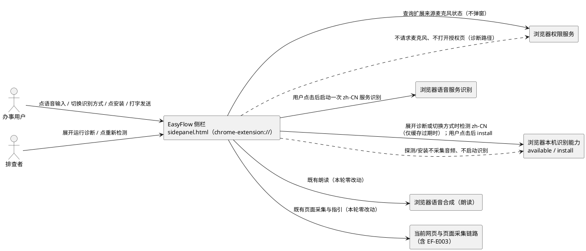
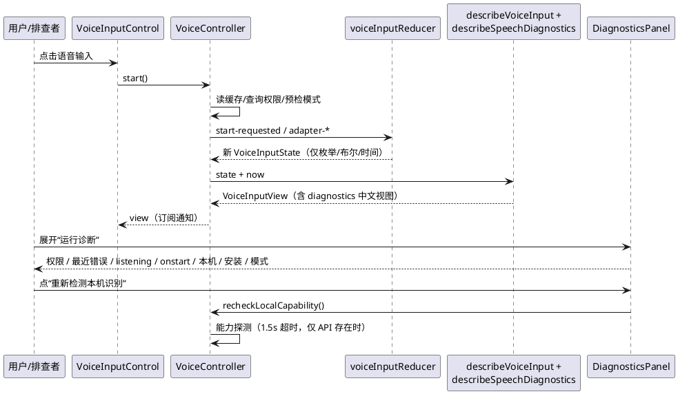
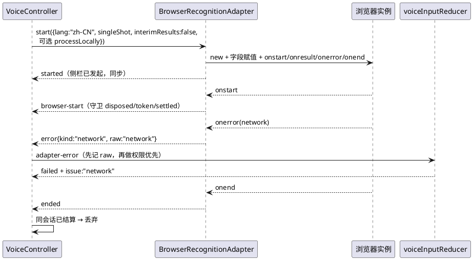
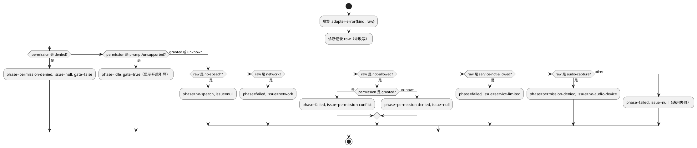
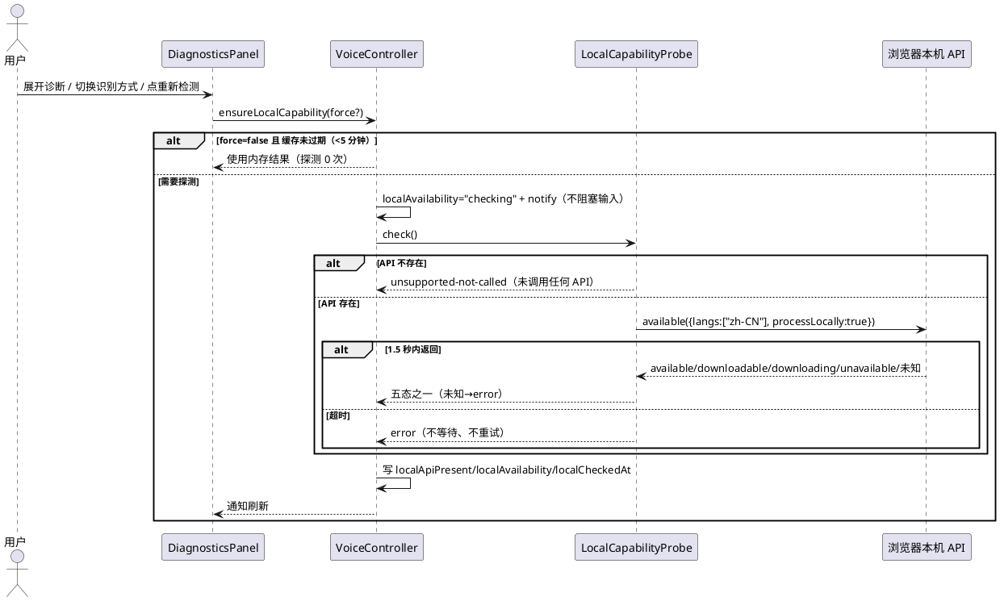
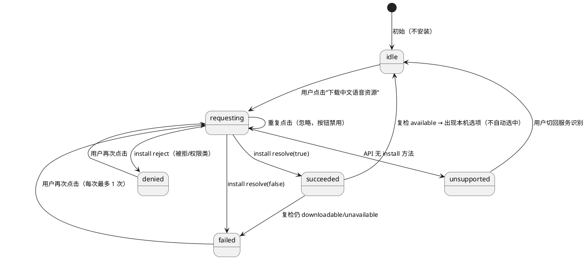
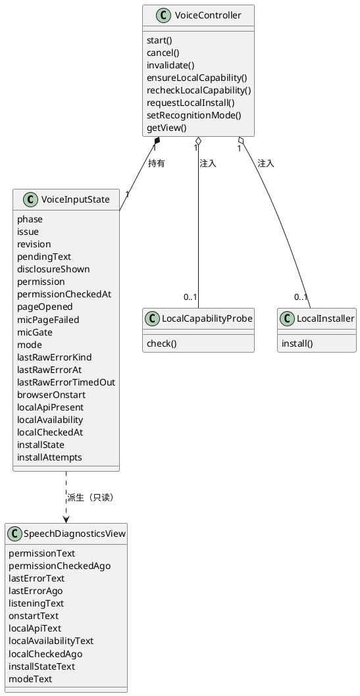
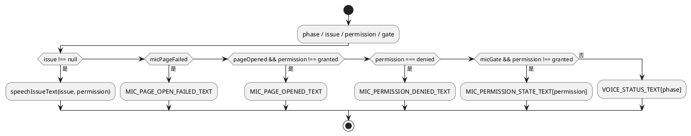

# 一、需求与存量功能关系分析

## 1.0 分析前提（只读基线核实，2026-11-14）

本文件是 `easyflow_page_guide` 特性的第七轮增量设计，输入为 `iteration7-spec.md`（R-247—R-335、T7-01—T7-14、AT-81—AT-96），并沿用第一至第六轮的语音适配器、状态机、文案单源、诊断面板、自测与门禁结构。

**阶段声明**：本阶段只做设计。未修改任何源码，未修改 `public/manifest.json`、`scripts/**`、`src/sidepanel/styles/sidepanel.css`，未运行 `npm run typecheck` / `build` / `selftest` / `verify`，未调用真实麦克风、真实识别、真实合成、真实 `SpeechRecognition.available` / `install`，未创建 `codearts_proof` 实绩文件。

| 核实项 | 只读结论（文件:行号） | 对本设计的硬约束 |
|---|---|---|
| 权限五态 | `src/shared/speech/permission.ts:1-9` 定义 `unknown/granted/prompt/denied/unsupported`；`src/sidepanel/speech/microphone.ts:46-61` 缺失→`unsupported`、抛错→`unknown` | 诊断与文案只复用这五态，**禁止**第二套权限枚举 |
| 授权页链路 | `src/sidepanel/speech/micPage.ts:76-135` 只打开固定 `mic-permission.html`；`src/mic-permission/request.ts` 是唯一 `getUserMedia` 调用点；`releaseStream` 停轨 | 本轮**不改**授权页、停轨、去重；只引用其结果 |
| 错误映射 | `src/shared/speech/policy.ts:94-113`：`not-allowed→permission-denied`、`service-not-allowed→service-limited`、`audio-capture→no-audio-device`、`no-speech/bad-grammar→no-speech`、`network→network`、其余 `unknown` | 六类“原始错误类别”必须与同一张表对齐；新增映射函数不得另立口径 |
| 状态机合并点 | `src/shared/speech/voiceMachine.ts:116-125`：`no-speech` 与 `unknown` **同归** `no-speech` 且 `issue:null`；`149-150` `network→failed+issue`；`162-166` `adapter-ended` 在 `listening` 时转 `no-speech`；`167-171` `timeout→no-speech+issue:timeout` | 必须拆开 `unknown`；必须区分“未听到/超时/会话结束”，且一次失败只产出一个主提示 |
| onstart 可观测性 | `src/sidepanel/speech/recognition.ts:85-111` 只注册 `onresult/onerror/onend`，**未给 `instance.onstart` 赋值**；`120` 在 `start()` 返回后同步 `emit({type:"started"})`；`144-152` `detach()` 已包含 `onstart = null` | “侧栏 listening”≠“浏览器 onstart”；必须新增可观测事件，且不改变既有 `started` 语义 |
| `onend` 兜底 | `recognition.ts:102-111`：未 settled 时先发 `error(no-speech)` 再发 `ended`；`voiceMachine.ts:162-166` 收到 `ended` 又转 `no-speech` | 保留兜底，但控制器须保证同会话只结算一次、诊断只记一次 |
| `SpeechStartOptions` | `src/shared/speech/types.ts:14-18` 仅 `lang/singleShot/interimResults`；`RecognitionLike`（`59-70`）无 `processLocally`；`RecognitionEvent`（`20-24`）无 onstart 事件 | 需**可选扩展**，不得破坏 `FakeRecognition` 与 AT-51—AT-63 |
| 网络文案 | `src/shared/speech/copy.ts:69-78` `network`＝“网络或语音服务暂不可用，可以直接打字。” | 缺少“已授权”与“本机识别”指引，是用户重复授权的直接诱因；需按权限状态分模板 |
| 未识别文案 | `copy.ts:58-67` `no-speech`＝“未识别到语音，请再说一次，或直接打字。”；`failed`＝“识别失败，可以再试或直接打字。” | `no-speech` 需单句化；`unknown` 必须走 `failed` 通用句 |
| 诊断现状 | `src/sidepanel/components/chat/DiagnosticsPanel.tsx:66` `<details>` 默认折叠；`77` “页面采集诊断”；`127` “语音不可用类别：{speechIssue}”；`App.tsx:59-62` 的 `speechIssue` 来自**朗读** `phase`（`useSpeechSynthesis.ts:11`） | 必须物理分区、改名“朗读不可用类别”；不得把朗读状态当识别诊断 |
| 诊断折叠渲染 | `DiagnosticsPanel.tsx:66-68`：折叠时子内容仍被 React 渲染（`details` 仅隐藏） | R-259 要求“折叠不渲染敏感值”，需改为受控 `open` + 条件渲染 |
| 输入框消费 | `ChatComposer.tsx:27-35` 按 `revision/pendingText` 写入并 `consumePending()`；`17-25` 仅 `submit()` 发送；`63-70` 发送按钮按 `disabled || 空文本` 禁用 | 双模式共用这一条路径；只加断言，不改语义 |
| 本机识别 API | 全仓库检索 `available(` / `install(` / `processLocally` 在 `src/` **0 命中**；`lib.dom.d.ts` 的 `SpeechRecognition` 类型不含这些成员 | 属**新增能力**：必须结构化窄化、先检测后显示、未知归 `error`，禁止用 `any` |
| 朗读链路 | `src/sidepanel/speech/speechController.ts`、`synthesis.ts`、`src/shared/speech/speakMachine.ts:142-157`；`AT-77` 已断言合成/朗读状态机不含权限字段 | 零改动；只改诊断标签与中文映射 |
| 页面采集错误 | `src/shared/errors.ts:43-47` `EF-E003`＝“未获得当前页面访问授权”；`src/sidepanel/hooks/useConversation.ts:228-229` 显示“我还没拿到这个页面的访问许可…” | 与语音输入无任何关系；只在页面采集区出现 |
| 权限清单 | `public/manifest.json`：`["activeTab","scripting","sidePanel","storage"]`，无 `host_permissions`/`content_scripts`/`web_accessible_resources` | 逐项不变；麦克风与语言包均不写清单 |
| 门禁 | `scripts/verify-manifest.mjs:110-119` 禁止 `fetch(`/`XMLHttpRequest`/`sendBeacon`/`WebSocket`/`MediaRecorder`/`apiKey`/`API_KEY`/`Authorization`；`129-142` 两条 `getUserMedia` 路径例外；`200-211` 全量扫描 | 不得新增外部语音接口、密钥、代理、网络上传；例外不扩 |
| 构建 | `scripts/build.mjs:47-62` 侧栏入口打包（`src/sidepanel/main.tsx`）；`106-115` 并行构建 + 产物清单 | 新增模块被侧栏入口引用即自动打包，**不需要新入口** |
| 自测基线 | `codearts_proof/iteration6-selftest.log` 末行 `1..71 / pass 71 / fail 0`；`selftest.mjs:16-60` 导出列表；`1555-1619` 假权限/页面/媒体；`1621-2064` AT-64—AT-80；`2263-2346` `FakeRecognition`/`listeningState`；`2348-2747` AT-51—AT-63 | 新纯逻辑必须进导出列表；只用假对象；不得删 71 项 |
| 严格类型 | `tsconfig.json`：`strict`、`noUncheckedIndexedAccess`、`exactOptionalPropertyTypes` | 可选属性不得赋 `undefined`，新事件字段必须可选或必填一致 |
| 样式基线 | `sidepanel.css:847-858` 诊断容器；`1201-1205` 最大高度与滚动；`1219-1224` 换行；`1279-1339` 语音区；`1396-1409` 窄屏 | 沿用现有 token 与形态，不引入样式框架；诊断滚动不挤压输入区 |

**结论**：本轮不需要新框架、新权限、新存储或新入口，属于“在既有语音链路上补一层**可观测诊断** + **权限优先文案** + **可选本机识别分支**”的增量改造。真正难点有三处：① 诊断字段必须单一来源且不落盘；② `onstart` 与 `started` 必须分离且不破坏既有适配器事件；③ 本机能力探测/安装必须“先检测、仅点击、不自动重试”，且 `processLocally` 只作用于新建实例。

## 1.1 需求功能与存量功能对比

### 1.1.1 已实现功能（可直接复用，不改语义）

| 需求功能 | 存量功能 | 代码位置 | 匹配度 |
|---|---|---|---|
| R-248 权限五态数据源 | `MicPermissionState` + 查询探测（缺失→unsupported，抛错→unknown） | `shared/speech/permission.ts:1-9`；`sidepanel/speech/microphone.ts:18-61` | 100% |
| R-250（部分）侧栏 listening 可观测 | 状态机 `phase==="listening"` | `shared/speech/voiceMachine.ts:98-101,226-263` | 100% |
| R-253/R-260 诊断展开不触发识别/安装 | 诊断面板当前不持有任何语音副作用 | `DiagnosticsPanel.tsx:54-223` | 100%（需保持） |
| R-247/R-254 页面采集区独立标题 | “页面采集诊断” | `DiagnosticsPanel.tsx:77` | 100% |
| R-310—R-314 结果只入框、不发送、失败可打字 | `pendingText/revision/consumePending`；发送按钮判空 | `ChatComposer.tsx:27-35,63-70`；`voiceMachine.ts:102-115` | 100% |
| R-315/R-318 单会话、取消语义 | `starting` 锁、`sessionToken`、`cancelRequested` | `voiceController.ts:93-96,218-227` | 100% |
| R-316 迟到结果丢弃 | `token !== sessionToken` 过滤 | `voiceController.ts:264-297`；`recognition.ts:85-111` | 75%（`error/ended` 分支未比较 token，需补） |
| R-320—R-325 朗读与页面指引 | 合成适配器 + 步骤卡 + `EF-E003` | `speechController.ts`、`speakMachine.ts`、`useConversation.ts:228-229` | 100%（保持零改动） |
| R-326—R-333 不落盘、不新增权限 | 无 `chrome.storage`、清单四项、无网络 API | `verify-manifest.mjs:110-119,36-45` | 100% |
| R-279（前置）识别构造器探测 | `detectRecognitionSupport` | `policy.ts:70-79` | 100%（仅“是否支持”，不含本机能力） |

### 1.1.2 需要扩展的功能（部分匹配，需在既有基础上改造）

| 需求功能 | 存量功能 | 差异说明 | 扩展方向 |
|---|---|---|---|
| R-261—R-267 权限真实状态优先 | 权限状态只用于“要不要启动识别/显示入口”；错误到达后不读权限 | 输入：错误类别 + `permission` 快照；输出：主提示；边界：`permission==="unknown"` 时不得声称“已授权” | reducer 在 `adapter-error` 分支读取 `state.permission` 决定 phase/issue；文案由单一选择函数产出 |
| R-268/R-269/R-271 网络/未听到/未知文案 | `network` 单模板；`no-speech/unknown` 合并 | 输入输出差异：`granted+network` 需四要素；`unknown` 需走 `failed`；边界：同一会话只留一条 | 新增文案常量与 `resolveSpeechFeedback`；拆分 reducer 的 `unknown` 分支 |
| R-270/R-275/R-277 一次一个主提示 | `adapter-ended` 与 `adapter-error` 可能连发；`timeout` 独立 | 需“同会话仅结算一次”，且诊断只记一次 | `VoiceController` 增加会话结算标记；`onAdapterEvent` 统一先判结算 |
| R-250 浏览器 `onstart` 可观测 | 适配器未接 `onstart`，`started` 是本地事件 | 需新增事件，且既有 `started` 语义不变 | `RecognitionEvent` 增可选/独立事件；`RecognitionLike.onstart` 赋值 |
| R-251/R-252/R-289 本机能力与缓存 | 无 API、无探测、无缓存 | 需可注入探测、结构化五态、5 分钟缓存、手动复检 | 新增 `shared/speech/localCapability.ts`（纯映射）+ `sidepanel/speech/localCapability.ts`（探测/安装适配器）+ 常量 |
| R-291—R-299 安装生命周期 | 无安装入口 | 需“仅点击、幂等、复检、失败回退、不落盘” | controller 增 `requestLocalInstall()` 与 `installState/installAttempts`；UI 只读 |
| R-301—R-309 双模式与 `processLocally` | 只有单一服务识别；每次 `start` 都新建实例（`recognition.ts:63-80`） | 需模式选择、`processLocally` 仅本地、切换不自动启动、listening 中切换先取消 | `SpeechStartOptions` 增可选 `processLocally`；`VoiceInputState` 增 `mode`；UI 增单选组 |
| R-247/R-255/R-258 诊断展示 | 诊断无语音区；“语音不可用类别”实为朗读 | 需分区、改名、中文类别名、只读快照 | `VoiceInputView` 增 `diagnostics`；`DiagnosticsPanel` 增受控 `open` 与语音分区 |
| R-259 折叠不渲染 | `details` 折叠仍渲染 | 需条件渲染 | 组件内 `useState(open)` + `onToggle`；`open` 为假时不渲染分区内容 |
| R-260 重新检测入口 | 无 | 需按钮且不轮询 | 诊断区按钮 → controller `recheckLocalCapability()` |
| R-334/R-330 诊断最小化矩阵 | 无字段表 | 需字段—来源—落盘—显示矩阵 | `shared/speech/diagnostics.ts` 定义视图类型与派生函数，字段与 spec 6.2 一一对应 |

### 1.1.3 需要新增的功能或接口

**A. 语音诊断纯逻辑（`src/shared/speech/diagnostics.ts`，新增）**
- 输入：识别/权限/能力/安装/模式的枚举与时间；输出：`SpeechDiagnosticsView`（只读展示快照）。
- 核心逻辑：字段派生、相对时间格式化、六类中文类别名、五态可用状态名、安装状态名；**不读**任何浏览器对象。
- 依赖：`types.ts`、`permission.ts`、`copy.ts`、`constants.ts`。

**B. 原始错误归类（`src/shared/speech/policy.ts`，扩展）**
- 输入：浏览器 `error` 字符串（`string | undefined`）；输出：`RawSpeechErrorKind`（六类）。
- 核心逻辑：与既有 `mapRecognitionError` 同表；未知归 `other`。
- 依赖：无。

**C. 本机能力契约与映射（`src/shared/speech/localCapability.ts`，新增）**
- 输入：`available()` 原始返回值、`install()` 原始返回值；输出：`LocalAvailability`、`InstallOutcome`。
- 核心逻辑：`available/unavailable/downloadable/downloading/未知/抛错` → 五态；`true/false/reject` → 安装枚举；**纯函数**。
- 依赖：`types.ts`。

**D. 本机能力探测/安装适配器（`src/sidepanel/speech/localCapability.ts`，新增）**
- 输入：注入的 `LocalRecognitionApiLike | null`、超时值、时钟；输出：`LocalCapabilityProbe`（`check()`）、`LocalInstaller`（`install()`）。
- 核心逻辑：API 缺失不调用→`unsupported-not-called`；`check` 带 1.5 秒超时，永不 reject；`install` 单次、参数只含 `zh-CN`、永不 reject。
- 依赖：`shared/speech/localCapability.ts`、`constants.ts`、`policy.ts`。

**E. 识别适配器扩展（`src/sidepanel/speech/recognition.ts`，修改）**
- 输入：`SpeechStartOptions`（新增可选 `processLocally`）；输出：新增 `browser-start` 事件、错误事件携带可选 `raw`。
- 核心逻辑：`instance.onstart` 赋值并受 `token/settled/disposed` 守卫；`processLocally` 只在本机模式写入新实例。
- 依赖：`types.ts`、`policy.ts`。

**F. 控制器扩展（`src/sidepanel/speech/voiceController.ts`，修改）**
- 输入：既有适配器/权限/页面 + 新增 `localCapability?`、`now?`；输出：模式、诊断快照、安装与复检方法。
- 核心逻辑：会话单次结算；失败后不重启；能力缓存 TTL；安装幂等与成功后复检。
- 依赖：A—E。

**G. 诊断与输入区 UI（`DiagnosticsPanel.tsx`、`VoiceInputControl.tsx`、`App.tsx`、`sidepanel.css`，修改）**
- 输入：`VoiceInputView.diagnostics`、安装/模式回调、朗读类别中文；输出：两区诊断、单选组、安装按钮。
- 核心逻辑：折叠不渲染；不可用不显示死按钮；诊断只读。
- 依赖：F、A。

**H. 自测与留痕（`scripts/selftest.mjs`、`codearts_proof/**`，修改/新增）**
- 输入：假识别/假本机 API/假 install；输出：AT-81—AT-96 与 71 项回归。
- 核心逻辑：新增纯逻辑进导出列表；不访问真实设备/网络。
- 依赖：A—G。

## 1.2 存量功能详细分析

### 1.2.1 `VoiceController` 的接口契约与扩展点

| 维度 | 现状 | 约束/可扩展点 |
|---|---|---|
| 入参 | `VoiceControllerDeps { adapter; detect?; limit?; probe?; micPage?; now? }`（`voiceController.ts:32-39`） | 新增依赖必须**可选**；不注入即退化为第六轮行为（AT-51—AT-58/AT-64—AT-80 依赖） |
| 出参 | `getView()` 缓存引用（`82-87`）；`subscribe` 通知 | 视图只增字段；`viewCache` 失效规则必须保留（AT-56 断言同一引用） |
| `start()` | `Promise<void>`；同步段判 `disposed/listening/starting`；有 probe 时 `await refreshPermission()` 后 granted 才 `beginListening()`（`93-126`） | 需再加“模式判定”与“本机能力预检”，但**不得**引入自动重试；未授权路径仍只 `mic-gate` |
| `beginListening()` | 递增 `sessionToken`、清定时器、`setTimeout(8s)`、`adapter.start(options)`、异常→`adapter-error{unknown}`（`196-216`） | 需扩展 options（`processLocally`）并设置“活动会话标记” |
| `onAdapterEvent()` | `final` 比较 token；`error/ended` **不比较 token**，靠 reducer 的 `phase!=="listening"` 兜底（`264-297`） | 必须补“同会话已结算则丢弃”，否则诊断会被迟到事件覆盖 |
| `onTimeout()` | 只在 `phase==="listening"` 触发；`adapter.cancel()` 后 `apply(timeout)`（`299-310`） | 需写诊断“最近错误=other（等待超时）” |
| `cancel()/invalidate()` | 幂等；`invalidate` 清 `issue/pendingText/micGate/micPageFailed`，保留 `permission`（`218-245`） | 需保留 `mode` 与诊断快照；切换任务不得清空“最近一次错误类别” |
| `dispose()` | `invalidate` → 置 `disposed` → 清锁 → 退订 → 适配器 dispose（`251-262`） | 新增能力探测/安装的 in-flight 标记需一并复位 |

**关键扩展点**：`detect`/`probe`/`micPage` 已是注入函数，本机能力适配器沿用同一模式，**不把 `navigator`/`chrome` 引入 controller**。

### 1.2.2 `voiceInputReducer` 的业务规则与不可破坏分支

| 事件 | 现状结果 | 本轮处理 |
|---|---|---|
| `start-requested{supported:false}` | `unsupported`，`disclosureShown:true` | 保留 |
| `start-requested{supported:true}` | `listening`，`issue:null` | 保留；新增重置 `browserOnstart` 与“本会话结算标记” |
| `listening` 时再 `start-requested` | **返回同一引用**（AT-56） | 必须保留（新字段不得在该分支被重写） |
| `adapter-final{ok}` | `recognized`，写 `pendingText`，`revision+1` | 保留；同时标记会话已结算、清 `browserOnstart` 保持已达 |
| `adapter-final{too-long}` | `failed` + `issue:"too-long"` | 保留 |
| `adapter-error{no-speech}` | `no-speech`，`issue:null` | 保留 phase；文案改为单句“没有听到可识别内容，可以再说一次。” |
| `adapter-error{unknown}` | 与 `no-speech` **合并** → `no-speech` | **必须改**：`failed` + `issue:null`（通用失败句），诊断记 `other` |
| `adapter-error{network}` | `failed` + `issue:"network"` | 保留；文案按权限状态选择模板 |
| `adapter-error{permission-denied}` | `permission-denied` | 保留；若 `permission` 为 `granted` 则改走 `failed+permission-conflict` |
| `adapter-error{service-limited}` | `failed` + `issue:"service-limited"` | 保留；文案互异 |
| `adapter-error{no-audio-device}` | `permission-denied` + `issue:"no-audio-device"` | 保留（AT-71 断言） |
| `adapter-error{device-unavailable}` | `failed` + `issue:"device-unavailable"` | 保留 |
| `adapter-error{aborted}` | `cancelled`（用户取消时 issue null） | 保留；取消不记错误 |
| `adapter-ended` | `listening` → `no-speech` | 保留；`browserOnstart` 为 `not-started` 时改记 `ended-without-start`，文案仍只一条 |
| `timeout` | `no-speech` + `issue:"timeout"` | 保留；诊断记 `other` + 超时修饰 |
| `cancel-requested` | `cancelled` | 保留；不新增错误类别 |
| `permission-refreshed` | 写权限与时间；granted 时清 `issue` | 保留；新增“若当前是权限优先失败态且权限变 granted，则重算文案” |
| `mic-gate` / `mic-page-opened` / `mic-page-failed` | 既有 | 保留；优先级顺序不变 |
| `invalidate` | 清 `issue/pendingText/micGate/micPageFailed` | 扩展短路条件；**不清** `permission`、`mode`、诊断快照 |

**边界条件**：`describeVoiceInput` 的 `issueText` 优先于 `phase` 文案（`voiceMachine.ts:226-241`）。新增 `permission-conflict` 必须走 `issue` 通道；`unknown` 改为 `failed` 后不得再被 `no-speech` 文案覆盖。

### 1.2.3 `recognition.ts` 的 onstart 与 ended 时序（本轮核心改造点）

| 时序点 | 现状 | 问题 | 设计处理 |
|---|---|---|---|
| `start()` 同步返回后 | 立即 `emit({type:"started"})`（`120`） | 侧栏认为“已开始”，浏览器可能尚未真正开始 | 保留 `started`＝“侧栏已发起”，新增 `browser-start`＝“浏览器 onstart 到达” |
| `instance.onstart` | 从未赋值（`85-111`） | 无法区分“没开始/没听到/服务失败” | 赋值并受 `disposed/token/settled` 守卫后 `emit({type:"browser-start"})` |
| `onerror` | `settled=true` 后 `emit(error)`（`95-101`） | 丢失原始 `error` 字符串，只剩 9 类内部 kind | 事件增加可选 `raw: RawSpeechErrorKind`，由 `mapRawErrorKind(event.error)` 生成 |
| `onend` 无结果 | 先 `emit(error{no-speech})` 再 `emit(ended)`（`102-111`） | 两条事件易被误读为两次失败 | 保留兜底；控制器加会话结算标记，第二条丢弃 |
| `cancel()/dispose()` | `token += 1` + `detach()`（`123-152`） | `onstart` 迟到会污染诊断 | 守卫已含 `token`，`detach` 已清 `onstart`，无需改取消语义 |
| `start()` 抛错 | `error{unknown}` + `ended`（`112-119`） | 未记录“浏览器未启动” | 诊断可区分 `browserOnstart=ended-without-start` |

### 1.2.4 文案与诊断现状的约束

| 项目 | 现状（`copy.ts`） | 本轮约束 |
|---|---|---|
| `VOICE_STATUS_TEXT["no-speech"]` | “未识别到语音，请再说一次，或直接打字。” | 改为单句；不含网络/服务/权限/授权 |
| `VOICE_STATUS_TEXT.failed` | “识别失败，可以再试或直接打字。” | 作为 `unknown` 的唯一文案 |
| `VOICE_ISSUE_TEXT.network` | “网络或语音服务暂不可用，可以直接打字。” | `granted` 时改用含“麦克风已授权”的固定句；`unknown`/`prompt` 走权限优先或保留原句 |
| `VOICE_ISSUE_TEXT["service-limited"]` | “语音服务不可用或被浏览器限制，可以再试或直接打字。” | 保留；与网络、权限、无设备两两不同 |
| `VOICE_ISSUE_TEXT["no-audio-device"]` | “没有检测到可用的麦克风，可以直接打字。” | 保留（AT-71） |
| `VOICE_ISSUE_TEXT["device-unavailable"]` | “麦克风被系统关闭或被其他应用占用…” | 保留（AT-72） |
| `MIC_PERMISSION_DENIED_TEXT` | “麦克风权限未开启。请在 EasyFlow 扩展的麦克风权限中改为允许（这不是当前网页的站点设置），或直接打字。” | 保留；`denied` 主提示唯一来源 |
| `VOICE_DISALLOWED_WORDS` | 转义“离线/纯本地/不上传” | 新文案不得违反；不得新增“一定支持中文包” |
| 诊断标签 | “语音不可用类别”来自朗读 | 改名“朗读不可用类别”，并显示中文值而非 `unsupported` 原文 |

**单源要求**：新增文案全部落 `copy.ts`；组件/诊断/测试只引用常量或引用同一 `resolveSpeechFeedback` 函数，不得各写一份。

### 1.2.5 诊断面板与样式现状

| 机制 | 现状 | 本轮必须保持/改造 |
|---|---|---|
| 容器 | `<details className="ef-diagnostics">`（`DiagnosticsPanel.tsx:66`） | 保持类名与折叠形态；改为受控 `open` 以便“折叠不渲染” |
| 高度 | `.ef-diagnostics` `max-height: var(--ef-diag-max-h)` + `overflow-y:auto`（`sidepanel.css:1201-1205`）；窄屏 36vh/32vh（`932,1259-1263`） | 新分区在容器内滚动，不挤压输入框 |
| 换行 | `.ef-diagnostics/.ef-diag-item/.ef-page-diag-grid` `overflow-wrap:anywhere`（`1219-1224`） | 新增长文本继承 |
| 语音区 | `.ef-speech-row` 等（`1279-1339`）；窄屏 `flex-wrap`（`1396-1404`） | 新增单选/安装按钮只消费 token；care 下按钮 ≥44px（现有 `--ef-tap-min`） |
| 字体 | `font-size: 11px` 诊断（`852`）、语音区 `var(--ef-font-small)` | 不新增字号体系；诊断可读性不依赖颜色 |

### 1.2.6 自测结构（假对象 + esbuild 导出 + 纯逻辑断言）

| 机制 | 现状 | 本轮约束 |
|---|---|---|
| 打包 | `esbuild stdin.contents` 拼接导出行（`selftest.mjs:16-60`） | 新纯逻辑与文案常量必须逐行加入，否则视为未测试 |
| 运行环境 | `platform: "node"`，无 `window/navigator/chrome` | 能力探测/安装必须注入 `LocalRecognitionApiLike`；顶层不得访问 `window` |
| 假对象 | `FakePermissionProbe/Page`（`1555-1581`）、`FakeRecognition`（`2263-2300`）、`FakeSynthesis`（`2302-2339`） | 新增 `FakeLocalCapability`（记录 `available`/`install` 参数、可延迟/抛错）放测试文件内 |
| 既有断言 | AT-51 同步 `listening`；AT-56 引用相等；AT-53/55/73/74 文案关键词 | `start()` 仍是 `async`，首个 `await` 前不得新增阻塞；只按 7.2 改写允许项 |
| 源码清洁 | AT-50 扫 `src/**` 禁时刻字面量；AT-54 禁组件接触语音全局对象；AT-80 禁 `chrome.storage` | 能力适配器不得放 `components/**`；语音目录不得出现 `chrome.storage` |

### 1.2.7 构建与门禁的既有机制

| 机制 | 现状 | 本轮必须保持 |
|---|---|---|
| 侧栏打包 | `buildSidePanel()` 单入口，`minify:true`（`build.mjs:47-62`） | 新模块被 `App.tsx`/controller 引用即打包；**不新增入口** |
| 产物清单 | `listFiles()` 打印（`90-104`） | 产物数量不因本轮变化（除非新增 CSS 类，不新增文件） |
| 门禁 | 全量扫描 `dist/**/*.js`、`src/**/*.ts(x)`、`public/**/*.json`（`verify-manifest.mjs:200-206`） | 新代码不得出现 `fetch(`/`WebSocket`/`MediaRecorder`/密钥；`getUserMedia` 例外仍 2 条 |
| 权限断言 | 四项逐项比较（`36-41`） | 不变 |

### 1.2.8 存量约束清单（设计不得违反）

1. `VoiceInputState` 不进入 `ConversationState`；`conversationReducer.ts` 的 `voiceState` 语义不变。
2. 不新增 `chrome.storage` 键；诊断、模式、安装状态均为侧栏内存，重开即丢弃。
3. 不新增 manifest 权限与网站范围；不新增内容脚本与可访问资源。
4. `MAX_TURN_CHARS=500` 与 `mergeTranscript` 语义不得改动。
5. 文案单源：新增句子只在 `copy.ts`；组件/诊断/测试不得各写一份。
6. `getUserMedia` 仍只允许出现在 `src/mic-permission/request.ts` 与其产物。
7. 朗读链路（`synthesis.ts`、`speechController.ts`、`speakMachine.ts`、`StepCardSpeech.tsx`）零改动，且不得出现 `permission`/`MIC_`/`micPermission` 字段。
8. `EF-E003` 判定、文案、修复动作零改动；语音诊断不得引用网页 URL/标题。
9. 适配器事件契约的既有四类语义不变；新增事件只增不改。
10. 失败后不自动重启、不自动重开授权页、不自动安装、不自动切模式。
# 二、增量设计方案

## 2.1 实现模型

### 2.1.1 上下文视图



| 交互 | 协议 | 频率 | 本轮变化 |
|---|---|---|---|
| 侧栏 → 权限服务 | `navigator.permissions.query({name:"microphone"})`（Promise） | 挂载 1 次；点击语音前（节流 ≥1s）；focus/visibility | 不变 |
| 侧栏 → 服务识别 | 适配器 `start(options)` | 每次点击 ≤1 次 | 新增可选 `processLocally`（服务模式不设） |
| 侧栏 → 本机识别检测 | `SpeechRecognition.available({langs:["zh-CN"],processLocally:true})`（Promise） | 展开诊断/切换方式且缓存过期；手动复检 | **新增**；1.5s 超时；仅 API 存在时调用 |
| 侧栏 → 本机资源安装 | `SpeechRecognition.install({langs:["zh-CN"]})`（Promise） | **仅用户点击** | **新增**；单次、幂等、不自动重试 |
| 侧栏 → 朗读 | 既有 `speechSynthesis` | 用户点击 | 不变 |
| 侧栏 → 页面采集 | 既有后台路由 | 既有 | 不变；`EF-E003` 只在页面采集链路 |

**明确不新增**：无新权限、无新标签页入口、无新消息类型、无新存储键、无外部域名。

### 2.1.2 服务/组件总体架构

```plantuml
@startuml
skinparam componentStyle rectangle
package "shared（纯逻辑，无 DOM / 无 chrome）" {
  [types.ts\nRawSpeechErrorKind\nRecognitionMode\n+ processLocally]\n] as TY
  [policy.ts\nmapRecognitionError（既有）\nmapRawErrorKind / rawKindOfSpeechError\nresolveRecognitionFailure] as PO
  [localCapability.ts\nLocalAvailability / InstallState\nmapLocalAvailability / mapInstallResult] as LC
  [diagnostics.ts\nSpeechDiagnosticsView\ndescribeSpeechDiagnostics\nformatRelativeTime] as DG
  [copy.ts\n语音/诊断/安装文案单源\nspeechIssueText] as CP
  [voiceMachine.ts\nVoiceInputState + 诊断字段\n+ 5 个新事件\n+ describeVoiceInput] as VM
  [constants.ts\nLOCAL_CAPABILITY_TIMEOUT_MS\nLOCAL_CAPABILITY_CACHE_MS 等] as CN
}
package "sidepanel（浏览器适配 + 编排）" {
  [localCapability.ts\nreadLocalRecognitionApi\ncreateLocalCapabilityProbe\ncreateLocalInstaller] as LA
  [recognition.ts\nonstart → browser-start\n可选 raw / processLocally] as RC
  [voiceController.ts\n模式 / 诊断 / 复检 / 安装\n会话单次结算] as VC
  [useVoiceInput.ts\n注入能力适配器\n暴露新句柄] as HK
  [App.tsx\n诊断 props / 朗读类别中文] as AP
  [VoiceInputControl.tsx\n模式单选 / 安装按钮 / 说明] as UI
  [DiagnosticsPanel.tsx\n语音区 + 页面区物理分隔\n受控 open] as DP
  [sidepanel.css\n诊断网格 / 单选 / 安装按钮] as CS
}
package "既有零改动" {
  [synthesis.ts / speechController.ts\nspeakMachine.ts] as SP
  [guide/**、content/**、background/**] as EX
}

TY --> PO
PO --> TY
LC --> TY
DG --> TY
DG --> LC
DG --> CP
CP --> TY
CP --> PO
VM --> CP
VM --> PO
VM --> TY
VM --> CN
VM --> LC
LA --> LC
LA --> CN
RC --> PO
RC --> TY
VC --> VM
VC --> LA
VC --> PO
VC --> DG
HK --> VC
HK --> LA
AP --> DP
UI --> CP
UI --> VM
DP --> DG
DP --> CP
CS --> DP
@enduml
```

**依赖方向规则（沿用第五轮 2.5.1 / 第六轮 2.1.2，扩展两行）**

| 层 | 文件 | 允许依赖 | 禁止依赖 |
|---|---|---|---|
| 契约 | `shared/speech/types.ts` | 无 | React、chrome、window、navigator |
| 映射纯逻辑 | `shared/speech/policy.ts` | `types.ts` | 浏览器 API |
| 能力纯逻辑 | `shared/speech/localCapability.ts` | `types.ts` | 浏览器 API、Promise 之外的定时器 |
| 诊断纯逻辑 | `shared/speech/diagnostics.ts` | `types.ts`、`copy.ts`、`localCapability.ts` | 浏览器 API、React |
| 文案 | `shared/speech/copy.ts` | `types.ts`、`permission.ts`、`policy.ts`（仅类型） | 浏览器 API |
| 状态机 | `shared/speech/voiceMachine.ts` | `types.ts`、`copy.ts`、`permission.ts`、`policy.ts`、`localCapability.ts`、`constants.ts` | 浏览器 API、React |
| 能力适配 | `sidepanel/speech/localCapability.ts` | `shared/speech/*`、`constants.ts` | React、组件、`chrome.storage` |
| 识别适配 | `sidepanel/speech/recognition.ts` | `shared/speech/*` | React、组件、权限 |
| 编排 | `sidepanel/speech/voiceController.ts` | 上述全部 | React、`window`、`chrome` |
| Hook | `sidepanel/hooks/useVoiceInput.ts` | controller + 适配器 + React + `chrome`（既有订阅） | 组件 |
| 组件 | `sidepanel/components/chat/*.tsx` | 纯逻辑 + copy + React | `SpeechRecognition`/`speechSynthesis` 全局对象 |

**唯一性约束**

1. `SpeechRecognition.available` / `install` 的**字符串访问**只允许出现在 `src/sidepanel/speech/localCapability.ts`（`readLocalRecognitionApi` 内）；不得在组件中出现。
2. `processLocally` 的赋值只允许出现在 `src/sidepanel/speech/recognition.ts`（`start()` 内）；不得在其他文件修改实例字段。
3. `instance.onstart` 的赋值只允许出现在 `src/sidepanel/speech/recognition.ts`。
4. 语音诊断的中文类别名只允许定义在 `src/shared/speech/diagnostics.ts` 与 `copy.ts`；组件不得内联同义句。
5. 语音诊断不得写 `chrome.storage`、消息、聊天、运行日志条目（`AT-80`/`AT-96` 断言）。

### 2.1.3 实现设计文档

#### （1）诊断数据流与分区



**层级决策（回答“放哪一层”）**

| 候选 | 采用 | 理由 |
|---|---|---|
| `VoiceInputState` | **采用：全部持久于侧栏内存的字段** | 诊断与主提示必须同一真相源；避免 reducer 与诊断快照不一致；`invalidate` 后仍可显示“最近一次” |
| 新 `speechDiagnostics` 模块 | **采用：只读视图类型 + 派生函数 + 中文标签** | 组件不自行计算、不接触枚举原文；字段与 spec 6.2 一一对应，可逐项审阅 |
| `DiagnosticsPanel` props | **采用：只接收 `SpeechDiagnosticsView` 与回调** | 面板纯展示，展开不触发查询/识别/安装/网络；便于“折叠不渲染” |
| 独立第二个状态容器 | **不采用** | 会形成两套“最近错误/权限/模式”，违反单源原则 |

**写入时机（只保留最近一次）**

| 事件 | 写入字段 | 备注 |
|---|---|---|
| `start-requested` | `browserOnstart="not-started"` | 不清 `lastRawError*`（诊断保留上一次失败） |
| `browser-start` | `browserOnstart="reached"` | 仅 `listening` 时生效 |
| `adapter-error` | `lastRawErrorKind`、`lastRawErrorAt`、`lastRawErrorTimedOut=false` | **在任何权限优先改写之前**记录原始类别 |
| `timeout` | `lastRawErrorKind="other"`、`lastRawErrorTimedOut=true`、`lastRawErrorAt` | 显示“其他（等待超时）” |
| `adapter-ended` 且 `browserOnstart==="not-started"` | `browserOnstart="ended-without-start"` | 不记错误 |
| 能力探测完成 | `localApiPresent`、`localAvailability`、`localCheckedAt` | 只存内存 |
| 安装状态变化 | `installState`、`installAttempts` | `installAttempts` 只内部使用 |
| 模式切换 | `mode` | 不持久化 |
| `invalidate` | **不重置**诊断字段、`mode`、`permission` | 只清 `issue/pendingText/micGate/micPageFailed` |

**隐私红线（R-256/R-326—R-335）**

1. 诊断只允许：五态权限、六类原始错误、布尔、可用状态、安装状态、模式、相对时间。
2. 禁止：音频、识别原文、中间文本、设备名/ID、网页 URL/标题、完整 `message`、异常对象、授权页查询串。
3. 诊断视图对象的 JSON 长度必须与识别文本长度无关（AT-81 断言）。
4. 折叠时不渲染分区内容；展开时读取的全是内存值，不触发权限查询/识别/安装/网络。

#### （2）`onstart` 观测与会话“单次结算”



**适配器设计**

| 项 | 设计 |
|---|---|
| 事件 | `started`＝侧栏已发起（既有语义）；`browser-start`＝浏览器 `onstart` 真正到达（新增） |
| `onstart` 赋值 | `instance.onstart = () => { if (disposed || token !== this.token || this.settled) return; this.emit({type:"browser-start"}); }` |
| 错误原始类别 | `onerror` 中先 `const raw = mapRawErrorKind(event.error)`，再 `emit({type:"error", kind: mapRecognitionError(event.error), ...(raw === "other" ? {} : {raw})})`；`other` 也允许显式携带（实现统一用条件展开避免 `exactOptionalPropertyTypes` 冲突） |
| `processLocally` | 仅 `options.processLocally === true` 时执行 `instance.processLocally = true`；服务模式**不写该字段**；赋值抛错→`error{unknown}`+`ended` |
| 实例复用 | 现状每次 `start()` 都 `detach()` 后 `new`（`recognition.ts:63-80`），本轮保持“每次新建”，满足 R-303 |
| 取消/卸载 | `settled/token/detach` 既有逻辑不变；`detach()` 已清 `onstart` |

**控制器“单次结算”规则**

| 规则 | 实现口径 | 覆盖需求 |
|---|---|---|
| 一次会话只接受一个终态 | `beginListening()` 设 `activeSessionId`；收到 `final/error/ended/timeout/cancel` 首个终态后置 `settledSessionId = activeSessionId` | R-275、R-277 |
| 迟到事件丢弃 | `onAdapterEvent` 先判 `event.sessionId`（无则用当前 token）与 `settledSessionId`；命中则直接返回，**不写诊断、不 apply** | R-316、R-277 |
| 超时只发一次 | `onTimeout` 只从 `listening` 触发；触发后置结算标记，`adapter.cancel()` 的迟到回调被丢弃 | R-277 |
| `ended` 兜底只一条 | 适配器先 `error(no-speech)` 再 `ended`；控制器在 `error` 时结算，`ended` 被丢弃 | R-269、R-277 |
| 失败不自动重启 | 控制器无任何 `setTimeout/setInterval` 重启路径；`start()` 仅由 UI 回调触发 | R-278、R-319 |

**为什么不在适配器里删除 `error(no-speech)+ended` 兜底**：该兜底是第五轮契约（`recognition.ts:102-111`），删除会改变“无结果会话”的既有语义；在控制器加结算标记即可实现“界面只一条提示”，且对 `FakeRecognition` 无破坏。

#### （3）`no-speech` / `unknown` 拆分与“权限优先”文案选择



**规则表（唯一口径，`resolveRecognitionFailure`）**

| 原始类别 `raw` | `permission` 非 `granted` | `permission === "granted"` | `permission === "unknown"` |
|---|---|---|---|
| `no-speech` | 权限解释（denied→拒绝句；prompt/unsupported→引导） | `no-speech` + 单句“没有听到可识别内容，可以再说一次。” | `no-speech` + 同句 |
| `network` | 权限解释，**不显示网络结论** | `failed` + `network` + “麦克风已授权…” | `failed` + `network` + “网络或语音服务暂不可用…” |
| `not-allowed` | 权限解释（拒绝句/引导） | `failed` + `permission-conflict` + “麦克风已授权，但浏览器拒绝了本次识别…” | `permission-denied` + 拒绝句（既有 AT-53 兼容） |
| `service-not-allowed` | 权限解释 | `failed` + `service-limited`（既有句） | `failed` + `service-limited` |
| `audio-capture` | 权限解释 | `permission-denied` + `no-audio-device`（既有 AT-71） | 同左 |
| `other` | 权限解释 | `failed` + `NULL`（通用失败句） | `failed` + `NULL` |
| `device-unavailable`（非识别侧来源） | — | `failed` + `device-unavailable` | 同左 |
| 用户取消 | `cancelled`，不记错误 | 同左 | 同左 |

**关键取舍：`permission === "unknown"` 不得声称“已授权”**。因此网络文案拆两个模板：`granted` 用固定四要素句；`unknown` 保留既有“网络或语音服务暂不可用，可以直接打字。”。两者都由 `speechIssueText(issue, permission)` 单函数选择，仍是单源。

**“先 no-speech 后 network”的行为**：两次会话各自独立结算；第二次的 `adapter-error` 覆盖 `lastRawError`，主提示替换第一次（reducer 只在 `listening` 时接受错误，第一次已不在 `listening`，故不会被追加）；界面同一时刻只有一条 `statusText`。

#### （4）本机能力探测与缓存



| 项 | 设计 |
|---|---|
| API 读取 | `readLocalRecognitionApi(scope)` 只读构造函数的静态 `available`（`SpeechRecognition` 或 `webkitSpeechRecognition`）；`install` 可选 |
| 调用前提 | `api !== null && typeof api.available === "function"`；否则直接 `unsupported-not-called`，**0 次调用** |
| 参数 | `{ langs: ["zh-CN"], processLocally: true }`；不传其他语言、不传 locale/地区 |
| 结果映射 | `"available"→available`；`"downloadable"`/`"downloading"`→`downloadable`（T7-08）；`"unavailable"→unavailable`；其他/空值/非字符串→`error`；抛错→`error` |
| 超时 | `LOCAL_CAPABILITY_TIMEOUT_MS = 1500`；超时按 `error`，不重试、不轮询 |
| 缓存 | `LOCAL_CAPABILITY_CACHE_MS = 300000`（5 分钟）；`localCheckedAt` 判断；`force=true` 跳过缓存 |
| 触发点 | 展开诊断（缓存过期才探测）、切换识别方式（缓存过期才探测）、点击“重新检测本机识别”（强制） |
| 不触发 | 侧栏打开、点击语音输入、识别失败、安装失败、定时器；`start()` 不等待探测（DFX 4.1.3） |
| 处理中 | `localAvailability="checking"`，诊断显示“检测中…”，**不得**提前显示“可用”；本机选项不出现 |
| 探测失败 | 只把本机状态置 `error`，服务识别与打字不变；可手动复检 |
| 不按版本推断 | 源码与文案不得出现版本号判断、“一定支持”表述；`minimum_chrome_version` 不变 |

#### （5）安装生命周期



| 规则 | 设计 |
|---|---|
| 仅点击触发 | `requestLocalInstall()` 只由安装按钮 `onClick` 调用；页面加载、展开诊断、识别失败、超时均不调用 |
| 参数最小 | `{ langs: ["zh-CN"] }`；不含 URL、标题、文本、设备信息 |
| 幂等 | `installing` 普通布尔锁 + `installAttempts` 计数；`requesting` 期间按钮 `disabled`；并发 5 次 ≤1 次调用 |
| 进行中可见 | 点击后 ≤300ms 显示“正在准备中文本机语音资源…”（`MIC_REQUEST_VISIBLE_MS` 复用为可见窗口常量语义）；输入框与服务识别保持可用 |
| 成功后复检 | `force=true` 重新 `available`；只有 `available` 才出现本机选项；仍 `downloadable` 则显示“仍需要下载”说明 |
| 失败回退 | `failed/denied/unsupported` → 显示“本机识别暂不可用，可以直接打字”；服务识别保留；**不自动重试** |
| 手动重试 | 每次点击最多 1 次调用；不设总次数上限（T7-13） |
| 不启动识别 | 安装完成/失败后不自动识别、不自动切模式、不自动发送 |
| 不落盘 | 仅内存；关闭侧栏回到 `idle` / `unchecked` |
| 不在诊断区 | 安装按钮只在语音输入区（T7-03/R-300）；诊断区只显示状态 |

#### （6）双模式与 `processLocally`

| 规则 | 设计 |
|---|---|
| 默认 | `mode: "service"`；`createVoiceInputState()` 初始值；不写存储 |
| 选项可见性 | `localAvailability === "available"` 且 `localApiPresent === true` 才出现“使用本机识别”单选项；`downloadable` 只出现安装按钮；其余不出现本机项 |
| 切换 | `setRecognitionMode(mode)` 只更新 `mode` 并通知；**不启动识别**；`listening` 中先 `cancel()`（幂等），再更新，且不自动启动 |
| 启动 | `beginListening()` 构造 options：`mode==="local"` 时条件展开 `{ processLocally: true }`；`service` 不传该键 |
| 实例 | 每次启动都新建实例（既有行为）；不复用上一模式实例；`detach()` 已保证旧实例解绑 |
| 服务模式 | 不设置 `processLocally`（不写 `false`，避免造假字段）；若上一轮为 local，不影响新实例 |
| 本机失败 | 原错误→当前模式仍 `local`；不自动切回 service；服务适配器 0 次调用；用户可手动切回 |
| 能力消失 | 缓存过期后复检 `unavailable` 但用户仍选 `local`：启动前 `resolveRecognitionModeGate()` 返回“不可用”，只显示说明、不启动、建议切回（不静默失败） |
| 结果路径 | 两模式共用 `pendingText/revision/consumePending`；不新增发送路径 |
| 不持久化 | 关闭重开恢复 `service`；`chrome.storage` 无新增键 |

**`RecognitionAdapter.start` 扩展方式**：只扩展 `SpeechStartOptions` 的可选字段，不改 `start(options: SpeechStartOptions): void` 签名。`FakeRecognition.start(options)` 原样记录对象，AT-51—AT-63 的断言（`startCalls`、`lang/rate/text`）不受影响；新增 AT-92 断言 `lastOptions.processLocally === true`（local）且 `!("processLocally" in lastOptions)`（service）。

#### （7）诊断 UI 分区、折叠与可访问性

| 项 | 设计 |
|---|---|
| 容器 | 沿用 `<details className="ef-diagnostics">`；改为受控 `open`（组件内 `useState(false)` + `onToggle`） |
| 折叠 | `open===false` 时**不渲染**语音/页面分区内容（满足 R-259“折叠不渲染敏感值”） |
| 顺序 | 展开后：① 语音输入诊断 → ② 页面采集诊断 → ③ 朗读状态 → ④ 运行记录（T7-02） |
| 语音区标题 | `<div id="ef-speech-diag-title" className="ef-page-diag-title">语音输入诊断</div>`；`section aria-labelledby` |
| 页面区标题 | 保留“页面采集诊断”；`EF-E003`、页面 URL、采集计数只在此区 |
| 朗读区 | 独立小节“朗读状态”，显示“朗读不可用类别：{中文}”；不与识别错误混排（R-255/T7-11） |
| 诊断字段 | 9 行中文标签（见 2.2 接口 H 的视图字段）；不显示原始枚举串 |
| 重新检测 | 只在语音区底部一个 `ef-inline-link` 按钮；`aria-label` 明确“重新检测本机中文识别” |
| 安装按钮 | **不在**诊断区（R-300） |
| 滚动 | 沿用 `--ef-diag-max-h` + `overflow-y:auto` + `overflow-wrap:anywhere`；320px 与 200% 缩放不横向溢出 |
| 读屏 | 分区标题可读；状态不只靠颜色；按钮键盘可达；`role="radiogroup"` + `aria-label="识别方式"` |
| 减少动态 | 不新增动画；沿用 `prefers-reduced-motion` 既有规则（`sidepanel.css:1266-1277`） |

#### （8）状态管理与保存策略

| 状态 | 存放层 | 生命周期 | 是否持久化 |
|---|---|---|---|
| `permission/permissionCheckedAt` | `VoiceInputState`（既有） | 侧栏打开至关闭 | 否 |
| `lastRawErrorKind/At/TimedOut` | `VoiceInputState`（新增） | 同上；`invalidate` 保留 | 否 |
| `browserOnstart` | `VoiceInputState`（新增） | 每次会话重置开始标记 | 否 |
| `localApiPresent/localAvailability/localCheckedAt` | `VoiceInputState`（新增） | 同上；缓存在内存 | 否 |
| `installState/installAttempts` | `VoiceInputState`（新增） | 同上 | 否 |
| `mode` | `VoiceInputState`（新增） | 同上 | 否 |
| `pendingText/revision` | `VoiceInputState`（既有） | 消费后清空 | 否 |
| `SpeechDiagnosticsView` | `VoiceController.getView()` 派生缓存 | 随状态失效 | 否 |
| 安装进行中的 Promise | `VoiceController` 局部锁 | 请求结束释放 | 否 |
| 诊断/模式/安装历史 | **不保存** | — | **禁止** |

**明确不新增**：`chrome.storage` 键、`ConversationState` 字段、聊天消息、运行日志条目、URL 参数、广播消息。
## 2.2 接口设计

### 2.2.1 总体设计

| 分组 | 接口 | 稳定性 | 说明 |
|---|---|---|---|
| 类型契约 | `RawSpeechErrorKind`、`RecognitionMode`、`SpeechStartOptions.processLocally?`、`RecognitionEvent.browser-start`、`RecognitionEvent.error.raw?`、`VoiceInputIssue.permission-conflict` | 稳定（只增） | 不改既有字段语义；`exactOptionalPropertyTypes` 下只用条件展开 |
| 映射纯函数 | `mapRawErrorKind`、`rawKindOfSpeechError`、`resolveRecognitionFailure`、`mapLocalAvailability`、`mapInstallResult` | 稳定 | 全部可单测、无浏览器依赖 |
| 能力探测 | `LocalCapabilityProbe.check()`、`LocalInstaller.install()`、`readLocalRecognitionApi` | 稳定（新增） | 可注入；超时/缺失/抛错都不 reject |
| 诊断 | `describeSpeechDiagnostics`、`formatRelativeTime`、`SPEECH_DIAGNOSTICS_LABELS` | 稳定（新增） | 字段与 spec 6.2 一一对应 |
| 状态机 | `voiceInputReducer` 新增 5 类事件；`describeVoiceInput` 新增 9 个视图字段 | 稳定（扩展） | 旧分支与引用相等语义不变 |
| 编排 | `VoiceController.ensureLocalCapability/recheckLocalCapability/requestLocalInstall/setRecognitionMode` | 稳定（扩展） | `start()` 仍为 `Promise<void>` |
| UI | `VoiceInputControl` 新增 3 个回调；`DiagnosticsPanel` 新增 3 个 props | 稳定（扩展） | 组件只读视图，不查询 |
| 文案 | `SPEECH_*` 常量 + `speechIssueText` | 稳定 | 单源；组件/测试共用 |

**变更策略**：`RecognitionEvent` 只**新增** `browser-start` 类型；`error` 的 `raw` 为可选；`SpeechStartOptions` 只增可选字段；`VoiceInputView` 只增字段；`SpeechErrorKind` 不新增值（`not-allowed` 的“已授权冲突”用新 `VoiceInputIssue` 表达）。既有 `AT-51`—`AT-63` 的调用方式与断言口径不变。

### 2.2.2 接口清单

#### 接口 A：语音契约扩展（修改 `src/shared/speech/types.ts`）

```ts
export type RawSpeechErrorKind =
  | "no-speech"
  | "network"
  | "not-allowed"
  | "service-not-allowed"
  | "audio-capture"
  | "other";

export type RecognitionMode = "service" | "local";

export interface SpeechStartOptions {
  lang: "zh-CN";
  singleShot: true;
  interimResults: false;
  processLocally?: boolean;          // 仅本机模式由调用方显式传 true；服务模式不传
}

export type RecognitionEvent =
  | { type: "started" }
  | { type: "browser-start" }        // 新增：浏览器 onstart 真正到达
  | { type: "final"; text: string }
  | { type: "error"; kind: SpeechErrorKind; raw?: RawSpeechErrorKind }
  | { type: "ended" };

export interface RecognitionLike {
  /* 既有字段不变 */
  processLocally?: boolean;          // 新增：可选，避免 Fake 破损
}

export type VoiceInputIssue =
  | "no-audio-device"
  | "service-limited"
  | "device-unavailable"
  | "network"
  | "timeout"
  | "too-long"
  | "interrupted"
  | "permission-conflict";           // 新增：已授权但浏览器拒绝本次识别
```

| 项 | 说明 |
|---|---|
| 业务用途 | 让适配器把“浏览器 onstart”与“原始错误类别”上送，且让控制器只为本机模式设置 `processLocally` |
| 前置条件 | `processLocally` 只在 `mode==="local"` 时以 `{ processLocally: true }` 传入 |
| 后置条件 | 服务模式的新实例上不存在 `processLocally` 赋值 |
| 异常映射 | 实例不接受该字段（赋值抛错）→ 适配器 `error{unknown}` + `ended`，不自动回退 |
| 调用示例 | `adapter.start({ lang: "zh-CN", singleShot: true, interimResults: false, processLocally: true })` |

#### 接口 B：错误归类与失败分支（扩展 `src/shared/speech/policy.ts`）

```ts
export function mapRawErrorKind(raw: string | undefined): RawSpeechErrorKind;
export function rawKindOfSpeechError(kind: SpeechErrorKind): RawSpeechErrorKind;

export interface RecognitionFailureOutcome {
  phase: VoiceInputPhase;
  issue: VoiceInputIssue | null;
  gate: boolean;
}

export function resolveRecognitionFailure(input: {
  permission: MicPermissionState;
  kind: SpeechErrorKind;
  raw: RawSpeechErrorKind;
}): RecognitionFailureOutcome;
```

| 项 | 说明 |
|---|---|
| 业务用途 | 把“权限真实状态 + 原始类别”收敛为唯一 phase/issue 组合，避免 reducer 内两套判断 |
| 前置条件 | `raw` 已由 `mapRawErrorKind` 或 `rawKindOfSpeechError` 得到 |
| 后置条件 | 纯函数；`permission` 非 `granted` 时绝不返回 `issue:"network"`/`"service-limited"` |
| 异常映射 | `aborted` → `cancelled`；未列出 kind → `failed + null` |
| 调用示例 | `const o = resolveRecognitionFailure({ permission: "granted", kind: "network", raw: "network" });` |

**`mapRawErrorKind` 映射表（与 `mapRecognitionError` 同源）**

| 浏览器 `error` | `mapRecognitionError` | `mapRawErrorKind` |
|---|---|---|
| `no-speech` / `bad-grammar` | `no-speech` | `no-speech` |
| `network` | `network` | `network` |
| `not-allowed` | `permission-denied` | `not-allowed` |
| `service-not-allowed` | `service-limited` | `service-not-allowed` |
| `audio-capture` | `no-audio-device` | `audio-capture` |
| 未映射 / 异常 | `unknown` | `other` |

#### 接口 C：本机能力契约与映射（新增 `src/shared/speech/localCapability.ts`）

```ts
export const LOCAL_AVAILABILITY_STATES = [
  "available",
  "downloadable",
  "unavailable",
  "unsupported-not-called",
  "error",
] as const;
export type LocalAvailability = (typeof LOCAL_AVAILABILITY_STATES)[number];

export const INSTALL_STATES = [
  "idle",
  "requesting",
  "succeeded",
  "failed",
  "denied",
  "unsupported",
] as const;
export type InstallState = (typeof INSTALL_STATES)[number];

export interface LocalAvailableOptions {
  langs: readonly ["zh-CN"];
  processLocally: true;
}

export interface LocalInstallOptions {
  langs: readonly ["zh-CN"];
}

export interface LocalRecognitionApiLike {
  available(options: LocalAvailableOptions): Promise<unknown>;
  install?(options: LocalInstallOptions): Promise<unknown>;
}

export function mapLocalAvailability(raw: unknown): LocalAvailability;
export function mapInstallResult(raw: unknown): InstallState;
```

| 项 | 说明 |
|---|---|
| 业务用途 | 固定五态与安装枚举；把浏览器返回的未知值统一归 `error`，绝不静默变 `available` |
| 前置条件 | 纯函数；`raw` 允许任意 `unknown` |
| 后置条件 | 无副作用；不调用 API |
| 异常映射 | `"available"`→available；`"downloadable"/"downloading"`→downloadable（T7-08）；`"unavailable"`→unavailable；其余→error。`mapInstallResult(true)`→succeeded；`false`→failed；`{ok:true}`→succeeded；其他→failed |
| 调用示例 | `const state = mapLocalAvailability(await api.available({ langs: ["zh-CN"], processLocally: true }));` |

#### 接口 D：能力探测/安装适配器（新增 `src/sidepanel/speech/localCapability.ts`）

```ts
export interface LocalCapabilityProbe {
  check(): Promise<LocalAvailability>;
}

export interface LocalInstaller {
  install(): Promise<InstallState>;
}

export function readLocalRecognitionApi(scope: unknown): LocalRecognitionApiLike | null;

export function createLocalCapabilityProbe(
  api: LocalRecognitionApiLike | null,
  deps?: { timeoutMs?: number },
): LocalCapabilityProbe;

export function createLocalInstaller(
  api: LocalRecognitionApiLike | null,
): LocalInstaller;
```

| 项 | 说明 |
|---|---|
| 业务用途 | 侧栏唯一的能力探测/安装入口；探测不采集音频、不启动识别、不请求麦克风 |
| 前置条件 | `api` 可为 `null`（环境无 API 或静态方法缺失） |
| 后置条件 | `check()` 永不 reject：`null`→`unsupported-not-called`（**0 次调用**）；超时/抛错→`error`。`install()` 永不 reject：无 `install`→`unsupported`；抛错→`denied`（权限类）或 `failed` |
| 异常映射 | `available` 抛错→error；返回未知→error；`install` 抛 `NotAllowedError`/`SecurityError`→denied；其余抛错→failed |
| 调用示例 | `const probe = createLocalCapabilityProbe(readLocalRecognitionApi(globalThis)); const s = await probe.check();` |

**`readLocalRecognitionApi` 类型安全要点**：通过 `unknown` → `Record<string, unknown>` 读取 `SpeechRecognition`/`webkitSpeechRecognition`（构造函数），再读取其 `available`/`install` 静态方法；以 `Function.call(ctor, options)` 保留 receiver。**不使用 `any`、不使用 `as SpeechRecognition`、不使用 `@ts-expect-error`**；`langs` 以 `["zh-CN"]` 字面量传入。

#### 接口 E：诊断视图（新增 `src/shared/speech/diagnostics.ts`）

```ts
export interface SpeechDiagnosticsView {
  permissionText: string;
  permissionCheckedAgo: string;
  lastErrorText: string;
  lastErrorAgo: string;
  listeningText: string;
  onstartText: string;
  localApiText: string;
  localAvailabilityText: string;
  localCheckedAgo: string;
  installStateText: string;
  modeText: string;
}

export function describeSpeechDiagnostics(
  input: {
    permission: MicPermissionState;
    permissionCheckedAt: number | null;
    lastRawErrorKind: RawSpeechErrorKind | null;
    lastRawErrorAt: number | null;
    lastRawErrorTimedOut: boolean;
    browserOnstart: BrowserOnstartState;
    localApiPresent: boolean | null;
    localAvailability: LocalAvailability | "checking";
    localCheckedAt: number | null;
    installState: InstallState;
    mode: RecognitionMode;
  },
  now: number,
): SpeechDiagnosticsView;

export function formatRelativeTime(now: number, at: number | null): string;
```

| 项 | 说明 |
|---|---|
| 业务用途 | 把状态枚举转成中文可读视图；组件与测试共用同一派生结果 |
| 前置条件 | 输入全部为内存值；`now` 由注入时钟提供 |
| 后置条件 | 输出只含中文文本；不含 URL/文本/设备/message；JSON 长度恒定 |
| 异常映射 | `lastRawErrorKind===null`→“暂无（本次侧栏会话）”；`localApiPresent===null`→“未检测” |
| 调用示例 | `const d = describeSpeechDiagnostics(state, now());` |

**标签常量（唯一来源）**

| 常量 | 取值（中文） |
|---|---|
| `RAW_ERROR_LABEL` | 没有听到语音 / 浏览器语音服务连接失败 / 浏览器拒绝本次识别 / 语音服务被限制 / 未检测到麦克风 / 其他识别失败 |
| `LOCAL_AVAILABILITY_LABEL` | 可用 / 可下载（或正在下载）/ 暂不支持中文 / 未调用（不支持）/ 无法判断 |
| `INSTALL_STATE_LABEL` | 未开始 / 正在准备 / 已准备 / 准备失败 / 被拒绝 / 不支持 |
| `ONSTART_LABEL` | 是 / 否（未开始）/ 否（会话已结束） |
| `PERMISSION_DIAG_LABEL` | 已授权 / 待询问 / 已拒绝 / 未知 / 当前环境无法查询 |

**`formatRelativeTime` 口径（T7-07）**：`null`→“未检测”；`< 60s`→“刚刚”；`< 60min`→“N 分钟前”；其余→“较早”。不显示日期、时区、精确时间戳。

#### 接口 F：状态机扩展（修改 `src/shared/speech/voiceMachine.ts`）

```ts
export type BrowserOnstartState = "not-started" | "reached" | "ended-without-start";

export interface VoiceInputState {
  /* 既有 10 字段不变 */
  mode: RecognitionMode;                     // 初始 "service"
  lastRawErrorKind: RawSpeechErrorKind | null;   // 初始 null
  lastRawErrorAt: number | null;                 // 初始 null
  lastRawErrorTimedOut: boolean;                 // 初始 false
  browserOnstart: BrowserOnstartState;           // 初始 "not-started"
  localApiPresent: boolean | null;               // 初始 null（未检测）
  localAvailability: LocalAvailability | "checking"; // 初始 "checking"
  localCheckedAt: number | null;                 // 初始 null
  installState: InstallState;                    // 初始 "idle"
  installAttempts: number;                       // 初始 0
}

export type VoiceInputEvent =
  /* 既有 13 类事件不变 */
  | { type: "browser-start" }
  | { type: "local-capability-checking" }
  | { type: "local-capability-checked"; apiPresent: boolean; availability: LocalAvailability; at: number }
  | { type: "install-state-changed"; state: InstallState }
  | { type: "mode-changed"; mode: RecognitionMode };

export interface VoiceInputView {
  /* 既有 15 字段不变 */
  mode: RecognitionMode;
  showModeSelector: boolean;
  localOptionVisible: boolean;
  installButtonVisible: boolean;
  installInProgress: boolean;
  localNoticeText: string | null;
  diagnostics: SpeechDiagnosticsView;
}
```

| 项 | 说明 |
|---|---|
| 业务规则 | `browser-start` 只在 `listening` 时生效；`local-capability-checked` 写三字段；`install-state-changed` 写状态并累计 `installAttempts`（仅 `requesting` 时 +1） |
| 前置条件 | 事件由 controller 发出；`describeVoiceInput` 调用 `resolveRecognitionFailure` 与 `describeSpeechDiagnostics` |
| 后置条件 | `invalidate` 清 `issue/pendingText/micGate/micPageFailed`，**保留** `permission/mode/lastRawError*/browserOnstart/local*/install*/revision` 语义不变 |
| 异常映射 | 未识别事件→返回原引用 |
| 调用示例 | `voiceInputReducer(state, { type: "browser-start" })` |

**不可破坏**：`listening` 时 `start-requested{supported:true}` 仍返回**同一引用**（AT-56）；`adapter-final{ok}` 仍写 `pendingText` 且 `revision+1`；`invalidate` 的短路条件扩展后仍保证“无变化时同引用”。

#### 接口 G：控制器扩展（修改 `src/sidepanel/speech/voiceController.ts`）

```ts
export interface VoiceControllerDeps {
  /* 既有 6 项不变 */
  localCapability?: LocalCapabilityProbe;
  localInstaller?: LocalInstaller;
}

export class VoiceController {
  /* 既有方法不变 */
  ensureLocalCapability(force?: boolean): Promise<void>;
  recheckLocalCapability(): Promise<void>;          // = ensureLocalCapability(true)
  requestLocalInstall(): Promise<void>;
  setRecognitionMode(mode: RecognitionMode): void;
  getDiagnostics(): SpeechDiagnosticsView;          // 只读，供测试/调试
}
```

| 项 | 说明 |
|---|---|
| `ensureLocalCapability(false)` 前置 | `!disposed && !checkingLocal`；缓存有效（`now - localCheckedAt < 5min`）→ 直接返回，不探测 |
| `ensureLocalCapability` 后置 | 探测前 `local-capability-checking`；完成后 `local-capability-checked`；**不启动识别、不请求麦克风、不安装** |
| `recheckLocalCapability()` 后置 | 跳过缓存，探测 1 次；失败仍可再次点击 |
| `requestLocalInstall()` 前置 | `!disposed && !installing && localAvailability==="downloadable"`；无 `localInstaller`→`unsupported` |
| `requestLocalInstall()` 后置 | 写 `requesting` → 调用 1 次 → 按结果写 `succeeded/failed/denied/unsupported`；成功后 `await ensureLocalCapability(true)`；**不自动识别/不自动切模式** |
| `setRecognitionMode()` 前置 | `mode` 与当前相同→无操作 |
| `setRecognitionMode()` 后置 | `listening` 时先 `cancel()`；只写 `mode`；**不启动识别**；不持久化 |
| 异常映射 | probe/install 永不 reject；controller 仍使用 `try/finally` 释放 `checkingLocal/installing` |
| 调用示例 | `await controller.ensureLocalCapability(); controller.setRecognitionMode("local");` |

**`start()` 的增量规则**：`mode==="local"` 时若 `localAvailability !== "available"`，不启动识别，只 `apply(mode-unavailable)` 或复用 `localNoticeText` 提示（不静默、不自动切回）。`mode==="service"` 完全沿用现有路径（含未注入 probe 的同步路径）。

#### 接口 H：组件 props 扩展（修改 `VoiceInputControl.tsx`、`DiagnosticsPanel.tsx`）

```ts
interface VoiceInputControlProps {
  view: VoiceInputView;
  onStart: () => void;
  onCancel: () => void;
  onRequestMic: () => void;
  onSelectMode: (mode: RecognitionMode) => void;   // 新增
  onInstallLocal: () => void;                      // 新增
}

interface DiagnosticsPanelProps {
  entries: ConversationDiagnostics[];
  collectDiagnostics: CollectDiagnostics | null;
  lastBookingCheck: BookingCheck | null;
  bookingCompleted: boolean;
  speakUnavailableKind: string | null;             // 由 speechIssue 改名
  speechDiagnostics: SpeechDiagnosticsView;         // 新增
  onRecheckLocal: () => void;                       // 新增
  onExpand: () => void;                             // 新增：首次展开时调用（缓存过期才探测）
  onRefresh: () => void;
}
```

| 项 | 说明 |
|---|---|
| 业务用途 | 语音区承载模式/安装；诊断区只读展示；朗读类别中文显示 |
| 前置条件 | 组件不接触 `SpeechRecognition`/`navigator`/`chrome` |
| 后置条件 | 模式切换不自动启动；安装只在点击后；展开诊断不触发探测（除非缓存过期，由 App 在展开回调中调用） |
| 异常映射 | 无回调时按钮不渲染（不出现死按钮） |
| 调用示例 | `<VoiceInputControl view={voice.view} onSelectMode={voice.setMode} onInstallLocal={voice.installLocal} … />` |

#### 接口 I：文案接口（修改 `src/shared/speech/copy.ts`）

```ts
export const SPEECH_NO_SPEECH_TEXT = "没有听到可识别内容，可以再说一次。";
export const SPEECH_GENERIC_FAILED_TEXT = "识别失败，可以再试或直接打字。";
export const SPEECH_NETWORK_GRANTED_TEXT =
  "麦克风已授权，但浏览器语音服务连接失败；可以打字，或检查本机语音识别是否可用。";
export const SPEECH_NETWORK_UNKNOWN_TEXT = "网络或语音服务暂不可用，可以直接打字。";
export const SPEECH_NOT_ALLOWED_GRANTED_TEXT =
  "麦克风已授权，但浏览器拒绝了本次识别；可以再试一次，或直接打字。";

export function speechIssueText(
  issue: VoiceInputIssue,
  permission: MicPermissionState,
): string;

export const SPEECH_MODE_TEXTS = {
  groupLabel: "识别方式",
  service: "浏览器服务识别",
  local: "使用本机识别",
} as const;

export const SPEECH_LOCAL_TEXTS = {
  downloadable: "可下载中文本机语音资源",
  install: "下载中文语音资源",
  installing: "正在准备中文本机语音资源…",
  installFailed: "本机识别暂不可用，可以直接打字。",
  unavailable: "这台浏览器暂不支持中文本机识别。",
  error: "无法判断本机识别是否可用。",
  stillDownloadable: "仍需要下载中文本机语音资源，可以稍后再试。",
  modeUnavailable: "本机识别当前不可用，可以切回浏览器服务识别。",
} as const;

export const SPEECH_DIAGNOSTICS_TEXTS = {
  title: "语音输入诊断",
  pageTitle: "页面采集诊断",
  speakTitle: "朗读状态",
  speakUnavailableLabel: "朗读不可用类别",
  recheck: "重新检测本机识别",
  permissionLabel: "麦克风权限",
  lastErrorLabel: "最近错误",
  listeningLabel: "侧栏正在听",
  onstartLabel: "浏览器开始识别",
  localApiLabel: "本机识别接口",
  localStateLabel: "中文（zh-CN）本机状态",
  localCheckedLabel: "最近检测",
  installStateLabel: "安装状态",
  modeLabel: "识别方式",
  noError: "暂无（本次侧栏会话）",
  unsupportedValue: "不支持",
  noValue: "无",
} as const;

export const SPEAK_UNAVAILABLE_KIND_TEXT = {
  unsupported: "不支持",
  "sensitive-skipped": "这段内容含个人信息，未朗读",
} as const;
```

| 项 | 说明 |
|---|---|
| 业务用途 | 唯一文案来源；`speechIssueText` 是“按权限选模板”的唯一函数 |
| 前置条件 | `permission` 来自状态机快照 |
| 后置条件 | `network` 在 `granted` 时必含“麦克风已授权”“浏览器语音服务连接失败”“可以打字”“本机语音识别”；在非 `granted` 时**不**出现“已授权” |
| 异常映射 | `VOICE_ISSUE_TEXT`/`VOICE_STATUS_TEXT` 引用上述常量，不复制字符串 |
| 调用示例 | `const text = speechIssueText("network", "granted");` |

**禁止词约束**：新增文案不得含 `NotAllowedError`/`NotFoundError`/`NotReadableError`/`no-speech`/`audio-capture`/`service-not-allowed`/`network` 等原始串；不得含“离线/纯本地/不上传”（沿用转义断言）；不得含“一定支持中文包”“所有 Chrome 都支持”；不得含“页面访问许可”“点扩展图标”。

#### 接口 J：Hook 句柄扩展（修改 `src/sidepanel/hooks/useVoiceInput.ts`）

```ts
export interface VoiceInputHandle {
  /* 既有 6 项不变 */
  setMode: (mode: RecognitionMode) => void;
  installLocal: () => void;
  ensureLocalCapability: () => void;
  recheckLocalCapability: () => void;
}
```

| 项 | 说明 |
|---|---|
| 业务用途 | 组件只调用句柄，不接触能力 API |
| 前置条件 | `useVoiceInput` 注入 `createLocalCapabilityProbe(readLocalRecognitionApi(globalThis))` 与 `createLocalInstaller(...)` |
| 后置条件 | 卸载时 controller 释放 in-flight 标记；能力缓存随侧栏关闭消失 |
| 调用示例 | `onClick={() => voice.setMode("local")}` |

## 2.3 数据模型

### 2.3.1 设计目标

1. **支撑诊断可解释**：一次失败能回答“权限是否 granted、浏览器是否真的开始、原始错误是哪类、本机是否可用”。
2. **最小化**：只保留“最近一次”，不形成历史；不落盘；不随识别文本增长。
3. **与既有兼容**：`VoiceInputState` 只增字段；`ConversationState` 不变；`chrome.storage` 无新增键。
4. **可审阅**：字段与 spec 6.2 矩阵一一对应，新增字段必须先入矩阵。
5. **容量/性能**：固定字段数（≤ 13）、单次派生 O(1)、总内存 < 1 KB。

### 2.3.2 模型实现



**关系说明**

1. `VoiceInputState` 是**唯一内存写入点**；`SpeechDiagnosticsView` 是每次 `getView()` 时派生的只读快照，不反向写状态。
2. `LocalCapabilityProbe`/`LocalInstaller` 为可注入依赖；不注入时 `localApiPresent=false`、`localAvailability="unsupported-not-called"`，服务识别不受影响。
3. 对象生命周期：随 `useVoiceInput` 的 controller 创建/销毁；`dispose()` 后不再写状态。
4. 持久化：无。关闭侧栏全部丢弃。

**字段—来源—落盘—显示矩阵（与 spec 6.2 对齐）**

| 字段 | 业务含义 | 来源 | 是否落盘 | 是否显示 | 显示形式 |
|---|---|---|---|---|---|
| `permission` | 扩展来源麦克风五态 | 权限查询 / 授权页枚举 | 否 | 是 | `permissionText` |
| `permissionCheckedAt` | 最近查询时刻 | 注入时钟 | 否 | 是 | `permissionCheckedAgo`“刚刚/N 分钟前” |
| `lastRawErrorKind` | 最近一次原始错误六类 | 识别 `error` 归并 | 否 | 是 | `lastErrorText` |
| `lastRawErrorAt` | 最近错误时刻 | 注入时钟 | 否 | 是 | `lastErrorAgo` |
| `lastRawErrorTimedOut` | 超时修饰（非独立字段展示） | `timeout` 事件 | 否 | 合并进 `lastErrorText` | “其他识别失败（等待超时）” |
| `browserOnstart` | 浏览器 onstart 到达情况 | 浏览器回调 | 否 | 是 | `onstartText` |
| `localApiPresent` | 本机检测接口是否存在 | 运行时能力 | 否 | 是 | `localApiText` 存在/不存在/未检测 |
| `localAvailability` | `zh-CN` 可用状态（含内部 checking） | `available(...)` | 否 | 是 | `localAvailabilityText` 五态中文 |
| `localCheckedAt` | 最近检测时刻 | 注入时钟 | 否 | 是 | `localCheckedAgo` |
| `installState` | 安装生命周期 | 安装调用结果 | 否 | 是 | `installStateText` |
| `installAttempts` | 安装调用次数 | 侧栏计数 | 否 | **否**（仅内部幂等） | — |
| `mode` | 识别方式 | 用户选择 | 否 | 是 | `modeText` |
| `phase` | 侧栏 listening 等 | 状态机 | 否 | 是 | `listeningText`（是/否） |
| 音频/文本/设备/URL/message/查询串 | 无业务必要 | — | **禁止** | **禁止** | — |

**矩阵规则**

1. 矩阵外字段视为违规；`lastRawErrorTimedOut` 作为 `lastRawErrorKind` 的展示修饰，不单独渲染、不落盘。
2. 诊断视图 JSON 序列化长度与识别文本长度、设备数量、网页内容无关（AT-81/AT-96）。
3. `installAttempts` 不得出现在渲染文本、`aria-label`、调试输出中。
4. “未检测”由 `localApiPresent===null` + `localAvailability==="checking"` 派生，不新增第六个用户枚举。
## 2.4 文案单源与错误映射

### 2.4.1 常量落位（唯一来源）

| 文案组 | 常量（`src/shared/speech/copy.ts`） | 变化 |
|---|---|---|
| 语音按钮 | `VOICE_INPUT_LABEL`、`VOICE_CANCEL_LABEL`、`VOICE_BUTTON_TEXT` | 不变 |
| 未听到 | `SPEECH_NO_SPEECH_TEXT`；`VOICE_STATUS_TEXT["no-speech"]` 引用 | 改写为单句 |
| 通用失败 | `SPEECH_GENERIC_FAILED_TEXT`；`VOICE_STATUS_TEXT.failed` 引用 | 明确用于 `unknown` |
| 网络（已授权） | `SPEECH_NETWORK_GRANTED_TEXT` | 新增，固定四要素 |
| 网络（未确认权限） | `SPEECH_NETWORK_UNKNOWN_TEXT`；`VOICE_ISSUE_TEXT.network` 引用 | 保留旧句，避免“已授权”假承诺 |
| 已授权但被拒 | `SPEECH_NOT_ALLOWED_GRANTED_TEXT`；`VOICE_ISSUE_TEXT["permission-conflict"]` 引用 | 新增 |
| 服务受限 | `VOICE_ISSUE_TEXT["service-limited"]` | 不变 |
| 无设备 | `VOICE_ISSUE_TEXT["no-audio-device"]` | 不变 |
| 系统禁用/占用 | `VOICE_ISSUE_TEXT["device-unavailable"]` | 不变 |
| 权限五态 | `MIC_PERMISSION_STATE_TEXT`、`MIC_PERMISSION_DENIED_TEXT` | 不变 |
| 超时 | `VOICE_ISSUE_TEXT.timeout` | 保留“没有听到内容…”；诊断另记“其他（等待超时）” |
| 识别方式 | `SPEECH_MODE_TEXTS` | 新增 |
| 本机能力/安装 | `SPEECH_LOCAL_TEXTS` | 新增 |
| 诊断标签 | `SPEECH_DIAGNOSTICS_TEXTS` | 新增 |
| 朗读类别 | `SPEAK_UNAVAILABLE_KIND_TEXT` | 新增（中文值） |
| 告知 | `SPEECH_DISCLOSURE_TEXT` | 不变 |

### 2.4.2 主提示选择顺序（唯一函数）

`speechIssueText(issue, permission)` 与 `describeVoiceInput` 的优先级链合并后，最终顺序固定为：



**规则**

1. 权限优先在 `resolveRecognitionFailure` 中已落到 `phase/issue`，`describeVoiceInput` 不再二次推断。
2. `no-speech` 只对应一句；`unknown` 只对应通用失败句；两者不共用。
3. `network` 的模板只看 `permission === "granted"`；其余情况不得出现“麦克风已授权”。
4. 用户取消不新增错误记录，文案仍为“已取消识别。”
5. 任何文案不得拼接原始错误字符串、`message`、URL、设备信息。

### 2.4.3 两两不同与禁用词

| 检查 | 断言方式 |
|---|---|
| 六类失败文案两两不同 | `new Set([网络, 未听到, 权限拒绝, 服务受限, 无设备, 系统禁用]).size === 6`（AT-85） |
| 五类权限文案两两不同 | 既有 AT-64 继续断言 `MIC_PERMISSION_STATE_TEXT` 集合大小 5 |
| 五类本机状态两两不同 | 新增断言 `LOCAL_AVAILABILITY_LABEL` 集合大小 5 |
| 无原始错误串 | 对 `VOICE_STATUS_TEXT`+`VOICE_ISSUE_TEXT`+`SPEECH_*` 做正则否定（沿用 AT-74 口径） |
| 无过度承诺 | 不含“离线/纯本地/不上传/一定支持/所有 Chrome 都支持” |
| 无网页采集措辞 | 语音文案不含“页面访问许可”“点扩展图标”；`EF-E003` 文案仅在 `useConversation.ts` |

## 2.5 UI 设计

### 2.5.1 语音输入区（`VoiceInputControl`）

**结构（自上而下）**

1. 主按钮“语音输入 / 取消识别”（既有，`ef-speech-btn`）。
2. 未授权时的“开启麦克风”次级按钮（既有 `ef-speech-open-btn`，`showMicEntry` 控制）。
3. **识别方式单选组**（仅在 `showModeSelector` 时渲染）：
   - `role="radiogroup"`、`aria-label="识别方式"`；
   - “浏览器服务识别”默认选中；
   - “使用本机识别”仅在 `localOptionVisible===true`（`available`）时渲染；
   - `downloadable` 时**不渲染**本机项（避免死按钮），只显示安装按钮与说明。
4. **本机说明区**（`localNoticeText`）：`downloadable`→“可下载中文本机语音资源”；`unavailable`/`unsupported-not-called`→“这台浏览器暂不支持中文本机识别。”；`error`→“无法判断本机识别是否可用。”；安装失败→“本机识别暂不可用，可以直接打字。”；模式不可用→“本机识别当前不可用，可以切回浏览器服务识别。”
5. **安装按钮**（`installButtonVisible`）：文案“下载中文语音资源”；`requesting` 时禁用并显示“正在准备中文本机语音资源…”；仅在 `downloadable` 出现。
6. 状态行（既有 `ef-speech-status`）、麦克风用途、设置帮助、告知（既有）。

**交互规则**

| 操作 | 行为 |
|---|---|
| 点击服务/本机单选 | `onSelectMode(mode)` → controller 只更新 `mode`；`listening` 中先取消；**不启动** |
| 点击安装 | `onInstallLocal()` → controller 单次 `install`；按钮禁用；不启动识别 |
| 安装成功 | 复检 `available` → 本机项出现，但**不自动选中** |
| 本机不可用 | 不渲染可点击本机项；服务项始终可用；打字不受影响 |
| 任何失败 | 输入框可编辑、发送按钮按既有规则可用（`ChatComposer.tsx:63-70` 不变） |

**可访问性**：单选组键盘可达；选中态有文字；不做仅颜色区分；care 模式下按钮 `min-height` 沿用 `var(--ef-tap-min)`（≥44px 由既有 token 保证）。

### 2.5.2 诊断区（`DiagnosticsPanel`）

**结构**

```
运行诊断（summary，默认折叠）
├─ [open=true 才渲染]
├─ 语音输入诊断（ef-speech-diag，aria-labelledby）
│  ├─ 麦克风权限：已授权 / 待询问 / 已拒绝 / 未知 / 当前环境无法查询
│  ├─ 最近错误：暂无（本次侧栏会话）/ 没有听到语音 / … / 其他识别失败（等待超时）
│  ├─ 侧栏正在听：是/否
│  ├─ 浏览器开始识别：是/否（未开始）/否（会话已结束）
│  ├─ 本机识别接口：存在/不存在/未检测
│  ├─ 中文（zh-CN）本机状态：可用/可下载（或正在下载）/暂不支持中文/未调用（不支持）/无法判断/检测中…/未检测
│  ├─ 最近检测：刚刚/N 分钟前/未检测
│  ├─ 安装状态：未开始/正在准备/已准备/准备失败/被拒绝/不支持
│  ├─ 识别方式：浏览器服务识别/使用本机识别
│  └─ [重新检测本机识别]（ef-inline-link）
├─ 页面采集诊断（既有内容整体搬入该分区，不改字段）
├─ 朗读状态
│  └─ 朗读不可用类别：不支持 / 这段内容含个人信息，未朗读 / 无
└─ 运行记录（既有 ef-diag-list）
```

**分区隔离（R-254）**

1. 语音区不出现 `EF-E003`、页面访问许可、网页 URL/标题、采集计数。
2. 页面区不出现语音错误类别、本机状态、安装状态。
3. 聊天历史中的旧“页面访问许可”消息不参与语音诊断（诊断不读 `state.messages`）。

**折叠与展开（R-253/R-259）**

| 行为 | 设计 |
|---|---|
| 默认 | 折叠，`open=false`，子内容不渲染 |
| 展开 | `onExpand()` → `voice.ensureLocalCapability()`（缓存有效则不探测）；只读内存字段 |
| 折叠 | 不渲染任何诊断值；DOM 中无敏感文本 |
| 展开 5 次 | 识别 0 次、`getUserMedia` 0 次、安装 0 次（AT-81 断言） |
| 静置 60 秒 | 探测次数不增长（AT-86/AT-90 断言） |

**接口 H 补充**：`DiagnosticsPanelProps` 追加 `onExpand: () => void`（只由 `<details onToggle>` 在首次展开时调用；不得在折叠时调用）。

### 2.5.3 样式（`sidepanel.css`，只消费既有 token）

| 选择器 | 用途 | 约束 |
|---|---|---|
| `.ef-speech-mode` | 单选组容器 | `display:flex; flex-wrap:wrap; gap:var(--ef-space-3); flex:1 1 100%` |
| `.ef-speech-mode label` | 单选项 | `min-height: var(--ef-tap-min); font-size: var(--ef-font-small)` |
| `.ef-speech-install-btn` | 安装按钮 | `min-height: var(--ef-tap-min)`；边框/文字色复用 `--ef-step-accent`；`[disabled]` 透明度 0.6 |
| `.ef-speech-local-note` | 本机说明 | `flex:1 1 100%`；`color: var(--ef-muted)`；`overflow-wrap:anywhere` |
| `.ef-speech-diag` | 语音诊断分区 | `margin-top: var(--ef-space-3)`；`overflow-wrap:anywhere` |
| `.ef-speech-diag-grid` | 诊断字段网格 | `display:grid; grid-template-columns: repeat(auto-fit, minmax(140px, 1fr)); gap:4px 8px` |
| `.ef-diag-section-title` | 分区标题 | 字号/颜色复用 `.ef-page-diag-title` 语义（不新增字号体系） |

**不新增**：颜色变量、字号变量、动画关键帧、样式框架；不修改既有 token 值；`prefers-reduced-motion` 规则不变。

## 2.6 逐文件改动清单

### 2.6.1 新增文件

| 文件 | 职责 | 关键导出 |
|---|---|---|
| `src/shared/speech/localCapability.ts` | 本机能力五态/安装枚举与纯映射 | `LOCAL_AVAILABILITY_STATES`、`INSTALL_STATES`、`LocalRecognitionApiLike`、`mapLocalAvailability`、`mapInstallResult` |
| `src/shared/speech/diagnostics.ts` | 诊断视图类型、中文标签、相对时间、派生函数 | `SpeechDiagnosticsView`、`describeSpeechDiagnostics`、`formatRelativeTime`、`RAW_ERROR_LABEL` 等 |
| `src/sidepanel/speech/localCapability.ts` | 能力探测/安装适配器（唯一读静态方法处） | `readLocalRecognitionApi`、`createLocalCapabilityProbe`、`createLocalInstaller` |

### 2.6.2 修改文件

| 文件 | 改动点 | 不可改变的部分 |
|---|---|---|
| `src/shared/speech/types.ts` | `RawSpeechErrorKind`、`RecognitionMode`、`SpeechStartOptions.processLocally?`、`RecognitionEvent.browser-start`、`error.raw?`、`RecognitionLike.processLocally?`、`VoiceInputIssue.permission-conflict` | 既有 `SpeechErrorKind` 9 值、事件四类、`Speak*` 类型 |
| `src/shared/speech/policy.ts` | `mapRawErrorKind`、`rawKindOfSpeechError`、`resolveRecognitionFailure` | `mapRecognitionError` 现有映射（只复用同表，不改既有值语义） |
| `src/shared/speech/copy.ts` | 新常量与 `speechIssueText`；`no-speech`/`failed`/`network` 引用新常量；诊断/模式/安装/朗读类别文案 | 既有类名、五态文案、`VOICE_DISALLOWED_WORDS` 转义写法 |
| `src/shared/speech/constants.ts` | `LOCAL_CAPABILITY_TIMEOUT_MS=1500`、`LOCAL_CAPABILITY_CACHE_MS=300000`、`LOCAL_AVAILABILITY_LANGS=["zh-CN"]`（`as const`）、`INSTALL_LANGS=["zh-CN"]`（`as const`） | 既有 8 个常量值（尤其 `SPEECH_NO_RESULT_TIMEOUT_MS=8000`） |
| `src/shared/speech/voiceMachine.ts` | 9 个新状态字段、5 个新事件、视图 7 个新字段、`adapter-error` 走 `resolveRecognitionFailure`、`browser-start`/`permission-refreshed` 分支、`invalidate` 保留诊断 | `revision/pendingText/disclosureShown` 写入时机；`listening` 同引用；既有 8 个 phase 值 |
| `src/sidepanel/speech/recognition.ts` | `onstart` 观测与 `browser-start`；错误事件带 `raw`；`processLocally` 仅本机模式；赋值异常处理 | 单会话、`started` 同步语义、`onend` 兜底、`cancel/dispose` 幂等、`getUserMedia` 零出现 |
| `src/sidepanel/speech/voiceController.ts` | 注入能力适配器；会话单次结算；`ensureLocalCapability/recheckLocalCapability/requestLocalInstall/setRecognitionMode`；`start()` 模式判定 | `start()` 首个 `await` 前的同步路径；权限前置；`micPage` 去重；失败不重启 |
| `src/sidepanel/hooks/useVoiceInput.ts` | 注入 probe/installer；暴露 `setMode/installLocal/ensureLocalCapability/recheckLocalCapability` | 挂载权限查询、focus/visibility 订阅、卸载清理 |
| `src/sidepanel/components/chat/VoiceInputControl.tsx` | 模式单选组、本机说明、安装按钮、新回调 | 主按钮/开启麦克风/状态行/告知的既有类名与语义 |
| `src/sidepanel/components/chat/ChatComposer.tsx` | 只把 `voice.setMode`/`voice.installLocal` 传给 `VoiceInputControl` | `useEffect` 消费逻辑、`submit()`、发送按钮禁用规则、不聚焦/不发送 |
| `src/sidepanel/components/chat/DiagnosticsPanel.tsx` | 受控 `open` + 条件渲染；语音区；朗读区改名；`onExpand`/`onRecheckLocal` | 页面采集字段与 `EF-E003` 展示、运行记录列表、`ef-diagnostics` 类名 |
| `src/sidepanel/App.tsx` | 传 `speechDiagnostics`、`onRecheckLocal`、`onExpand`；朗读类别改中文 | `voice.invalidate`/`speech.*` 生命周期 effect |
| `src/sidepanel/styles/sidepanel.css` | 新增 7 个选择器（2.5.3） | 既有 token 值、语音区/诊断区既有规则、减少动态规则 |
| `scripts/selftest.mjs` | 导出新纯逻辑/常量；新增 `FakeLocalCapability`；AT-81—AT-96；按 7.2 改写 AT-53/55/73/74/80 | AT-01—AT-52、AT-54、AT-56—AT-72、AT-75—AT-79 不放宽 |
| `codearts_proof/**` | 新增 `iteration7-{typecheck,build,selftest,verify}.log`、`26-iteration7-implementation.md` | 既有 25 号文档不改 |

### 2.6.3 明确不改文件

| 文件 | 原因 |
|---|---|
| `src/shared/speech/permission.ts` | 五态与 `releaseStream` 已满足；不新增第二套枚举 |
| `src/mic-permission/**`、`public/mic-permission.html` | 首次授权流程、停轨、页面生命周期本轮零改动 |
| `src/sidepanel/speech/microphone.ts`、`micPage.ts`、`micMessages.ts` | 权限查询/授权页/消息既有行为不变 |
| `src/sidepanel/speech/synthesis.ts`、`speechController.ts`、`src/shared/speech/speakMachine.ts`、`StepCardSpeech.tsx` | 朗读零改动 |
| `src/shared/messages.ts`、`src/background/index.ts`、`router.ts`、`src/background/injector.ts`、`src/content/**` | 无新消息/无页面采集改动 |
| `src/shared/errors.ts`、`src/sidepanel/hooks/useConversation.ts` | `EF-E003` 判定与文案不变 |
| `src/sidepanel/state/conversationReducer.ts`、`src/shared/types.ts` | 语音诊断不进入会话状态 |
| `public/manifest.json` | 权限四项不变 |
| `scripts/build.mjs`、`scripts/verify-manifest.mjs` | 无新入口/无新例外；侧栏入口自动打包新模块 |
| `package.json`、`tsconfig.json` | 不加依赖/不改严格度 |
| 第一至第七轮规格/设计文档（除本文件） | 文档不改 |

## 2.7 测试与验证计划

### 2.7.1 新增自动化用例（AT-81—AT-96，全部使用假对象）

| 编号 | 场景 | 假对象/手法 | 断言要点 | 对应需求 |
|---|---|---|---|---|
| AT-81 | 诊断字段最小化与分区 | 直接构造 state + `describeVoiceInput` + 源码检索 | 9 项中文标签齐全；`lastRawError=null`→“暂无”；`EF-E003` 不出现在语音区；JSON 无 URL/文本/设备/message；长度不随文本增长 | R-247—R-260、6.2 |
| AT-82 | 权限状态优先 | `FakePermissionProbe` 五态 × `FakeRecognition.emit(error)` | `granted+network`→含“麦克风已授权”；`denied+network`→拒绝句；`prompt+network`→开启引导；诊断 `lastRawErrorKind==="network"` 不被改写 | R-261—R-267 |
| AT-83 | 网络文案禁止重授 | 同上 | 四要素齐全；不含“重新授权/权限未开启/开启麦克风/去设置”；`granted` 下 `showMicEntry===false`；`micPage.openCalls===0` | R-262/R-268 |
| AT-84 | 未听到独立 | `adapter-error{no-speech}` + `adapter-error{unknown}` | 前者仅单句且不含网络/服务/权限；后者为通用失败句；连续两次不叠加（`statusText` 只一条） | R-269—R-271、R-277 |
| AT-85 | 六类文案两两不同 | 构造 6 个终态视图 | 集合大小 6；无原始错误串；无英文异常名 | R-274—R-276 |
| AT-86 | 本机 API 缺失 | `readLocalRecognitionApi({})`→null；`createLocalCapabilityProbe(null)` | `check()`→`unsupported-not-called` 且 0 次外部调用；文案“这台浏览器暂不支持中文本机识别”；`localOptionVisible===false`；服务识别仍启动 | R-283/R-284/R-290 |
| AT-87 | 本机 `available` | `FakeLocalCapability("available")` | 记录 `langs=["zh-CN"]`、`processLocally===true`；`localOptionVisible===true`；未点击时 `installCalls===0`；选本机后新实例 `processLocally===true` | R-279—R-281、R-303 |
| AT-88 | 本机 `downloadable` | `FakeLocalCapability("downloadable")` | 显示“可下载中文本机语音资源”+安装按钮；未点击 `installCalls===0`；本机项不渲染 | R-282/R-291/R-294 |
| AT-89 | 安装仅点击、幂等 | `FakeLocalCapability` 延迟 resolve | 点击 1 次→1 次且参数只含 `zh-CN`；1 秒内 5 次→≤1；`requesting` 时输入框可编辑 | R-291—R-294 |
| AT-90 | 安装成功/失败生命周期 | 假 install 返回 true/false/reject/无方法 | 成功+复检 available→本机项出现且**未自动选中**；失败→回退句；30 秒内无自动重试；`installState` 正确 | R-295—R-299 |
| AT-91 | `unavailable`/未知/抛错 | 三种假返回 | 均不标记可用、无本机项；抛错显示“无法判断”；不崩溃 | R-283/R-285/R-290 |
| AT-92 | 双模式与 `processLocally` | `FakeRecognition.lastOptions` | service 无 `processLocally` 键；local 为 `true` 且每次新建实例；切换不自动启动；`listening` 中切换先 `cancelCalls+1` | R-301—R-306 |
| AT-93 | 不自动回退/不自动切模式 | 本机失败 + 服务失败 | 本机失败后服务 `startCalls===0`；`granted+available+network` 只提示，`mode` 仍 service | R-307/R-308 |
| AT-94 | 只填框（双模式） | 两模式各 emit final | `pendingText` 正确、`revision+1`、消息数不变、源码消费 effect 无 `submit/focus` | R-310—R-313 |
| AT-95 | 失败可打字、无无限重试 | 五类失败 + 假时钟 | 输入框可编辑/可发送；60 秒内 `startCalls` 不增长；无定时器重启 | R-314—R-319 |
| AT-96 | 朗读/页面/隐私回归 | `FakeSynthesis` + 源码检索 | 失败态朗读 1 次、停止 1 次；`EF-E003` 文案不变；诊断/存储无音频/文本/设备/URL/message；权限四项不变 | R-320—R-335 |

**用例约束**

1. 禁止真实 `getUserMedia`、真实 `SpeechRecognition.available/install`、真实麦克风、真实网络、真实语言包。
2. 新纯逻辑（`mapRawErrorKind`、`resolveRecognitionFailure`、`mapLocalAvailability`、`mapInstallResult`、`describeSpeechDiagnostics`、`formatRelativeTime`、`speechIssueText`）必须加入 `selftest.mjs:16-60` 导出列表。
3. 文案断言引用同一常量；关键短句用包含匹配；“两两不同”显式断言集合大小。
4. 诊断断言必须同时检查“有正确字段”和“无敏感字段”。
5. `FakeLocalCapability` 需记录 `availableCalls/installCalls/lastAvailableOptions/lastInstallOptions`，并支持 `delayMs`、`throwMode`、`installResult`。

### 2.7.2 既有 71 项回归与允许改写范围

| 范围 | 处理 |
|---|---|
| AT-01—AT-52、AT-54、AT-56—AT-63 | **不得删除、不得放宽** |
| AT-53 | 仍断言 `statusText` 含“麦克风”、可重试；新文案满足，预计无需改 |
| AT-55 | `no-speech` 断言由“未识别”改为“没有听到可识别内容”（引用 `SPEECH_NO_SPEECH_TEXT`）；`network` 在 `permission==="unknown"` 下仍含“网络或语音服务暂不可用”；`timeout` 仍含“没有听到” |
| AT-73/AT-74 | 服务受限/网络文案在 `unknown` 权限下语义不变；如需引用新常量则只改引用，不改断言强度 |
| AT-80 | 若涉及“语音不可用类别”标签，改为“朗读不可用类别”并断言中文值；其余消息最小化/尺寸断言不变 |
| 总数 | 71 + 16 = **87**（`1..87 / pass 87 / fail 0`） |

### 2.7.3 门禁执行（实现阶段，本阶段不执行）

| 顺序 | 命令 | 通过标准 | 留痕 |
|---|---|---|---|
| 1 | `npm run typecheck` | 0 error；无 `any`/`@ts-ignore` | `codearts_proof/iteration7-typecheck.log` |
| 2 | `npm run build` | 退出码 0；产物清单与第六轮一致（无新增入口文件） | `iteration7-build.log` |
| 3 | `npm run selftest` | `1..87 / pass 87 / fail 0` | `iteration7-selftest.log` |
| 4 | `npm run verify` | 权限四项、无敏感字段、无外部接口、无 `MediaRecorder`、无新增 `chrome.storage`、`getUserMedia` 例外 2 条 | `iteration7-verify.log` |

**清洁检索（额外人工核对）**

1. `src/` 中 `SpeechRecognition.available`/`install` 仅出现在 `sidepanel/speech/localCapability.ts`。
2. `processLocally` 赋值仅出现在 `recognition.ts`。
3. 语音目录与诊断模块无 `chrome.storage`、无 `fetch(`、无 `MediaRecorder`。
4. 组件目录无 `SpeechRecognition`/`speechSynthesis` 全局对象（AT-54）。
5. 语音文案无禁用词与原始错误串。

### 2.7.4 真实 Chrome 人工验收（用户只做一次）

> 未执行时留痕写“人工验收待用户执行”；自动测试通过不得写成“语音可用”。

1. 重新加载扩展 → 关闭并重开侧栏。
2. 展开“运行诊断” → 记录：权限（应 `granted`）、最近原始错误类别、`onstart` 是否到达、本机 `zh-CN` 状态。
3. 若 `available`：选“使用本机识别” → 说一句中文 → 文字只进输入框 → 手动点“发送”。
4. 若 `downloadable`：只点一次“下载中文语音资源”；失败则停止继续改麦克风权限。
5. 若不可用/无法判断：停止改权限；确认可打字并发送。
6. 朗读回归：点“朗读这一步” → 发声 → “停止朗读”立即停止。
7. 记录口径：只记权限五态、原始错误类别、`onstart`、本机可用状态、Chrome 版本与平台；不记音频/原文/设备名/URL/message。

**不通过判定**：`granted` 下仍显示“开启麦克风”；`no-speech` 与 `network` 同句；诊断含敏感字段；语音与 `EF-E003` 混区；未点击就安装；本机模式未设 `processLocally`；识别结果自动发送；失败后不能打字或自动循环；朗读/页面指引回退。

### 2.7.5 实现留痕（`codearts_proof/26-iteration7-implementation.md`）

至少包含：

1. 需求摘要与逐文件改动清单（与 2.6 对齐）。
2. 自动测试总数（87）与结果。
3. 真实 Chrome“已执行/待用户执行”分栏。
4. 三个诊断值的实际记录（若用户已执行）。
5. 已知限制与失败记录（如有）。
6. 明确写出：“真实设备上中文本机识别是否可用尚待人工验收；代码完成不等于语音可用。”

## 2.8 风险与回滚点

| 编号 | 风险 | 触发条件 | 缓解 | 回滚点 |
|---|---|---|---|---|
| R1 | 破坏 `getView()` 引用相等（AT-56） | 新增字段在 `listening` 重复 `start-requested` 时被重写 | 该分支继续返回原 state；`viewCache` 只在 `apply` 后失效 | 恢复 `voiceMachine` 分支与 `viewCache` 逻辑 |
| R2 | 权限快照滞后导致文案误判 | 刚在授权页允许，侧栏仍读到 `prompt`/`denied` | 错误到达时用当前快照；`focus/visibility` 刷新；`permission-refreshed` 清权限引导 | 回滚 `resolveRecognitionFailure` 的权限分支即可回到按错误解释 |
| R3 | `permission==="unknown"` 下假称“已授权” | 无 probe 或查询失败 | 网络文案双模板，`granted` 才用固定句 | 保留 `SPEECH_NETWORK_UNKNOWN_TEXT` |
| R4 | 破坏 AT-51—AT-63 同步语义 | `start()` 新增 `await` 探测 | `start()` 不等待能力探测；本机模式仅在 `available` 时启动；service 路径不新增 `await` | 去掉 `start()` 中的模式预检，改为 UI 层禁用 |
| R5 | 本机 API 抛错导致崩溃 | Chrome 版本差异/静态方法只读 | 全部 `try/catch`；未知→`error`；赋值失败→识别失败 | 删除 `processLocally` 赋值分支，仅保留探测 |
| R6 | 安装被页面加载/展开自动触发 | 误把 `ensureLocalCapability` 与安装绑定 | 安装只在按钮 `onClick`；`requestLocalInstall` 内部再校验 `downloadable` 与锁 | 移除安装入口，保留状态显示 |
| R7 | 诊断泄露敏感信息 | 误把 `message`/URL/文本写入诊断 | 诊断类型只允许枚举/布尔/时间；AT-81/AT-96 做否定断言 | 收缩 `SpeechDiagnosticsView` 字段 |
| R8 | `details` 受控导致无法折叠/展开抖动 | `onToggle` 与 `open` 状态不同步 | 用 `onToggle` 读取 `currentTarget.open`；不做其他 `setOpen` | 回退为既有非受控 `details`（放弃“折叠不渲染”，需用户确认） |
| R9 | 展开诊断触发探测导致 200ms 超限 | 缓存过期且 API 慢 | 探测异步、1.5s 超时、先渲染缓存/“检测中”；不阻塞输入 | 关闭“展开自动探测”，只保留手动复检 |
| R10 | 既有文案断言失败 | 改 `no-speech`/`network` 文案 | 按 7.2 允许范围改写；关键词保留（`unknown` 网络句不变） | 恢复 `copy.ts` 旧值，仅保留新增常量 |
| R11 | 诊断区与页面区互相污染 | 复用同一渲染块/变量 | 两个 `section` + 独立标题 + 不同数据来源；AT-81 显式断言 | 删除语音区，仅保留页面区（回退到第六轮） |
| R12 | 本机模式失败被静默替换为服务 | 误加自动回退 | `setRecognitionMode` 不因失败被调用；AT-93 断言服务 0 次 | 移除模式字段，回到单一服务模式 |

**统一回滚顺序**：`copy.ts` → `voiceMachine.ts` → `recognition.ts` → `voiceController.ts` → UI → `selftest.mjs`。每个回滚点都不影响授权页、朗读与页面采集。

## 2.9 需用户拍板的设计取舍

### 2.9.1 继承自 spec 的取舍（T7-01—T7-14）

| 编号 | 取舍点 | 设计默认选择 | 影响 | 需确认的问题 |
|---|---|---|---|---|
| T7-01 | “使用本机识别”控件形态 | **单选组**，仅在 `available` 时出现本机项 | 比下拉少一次点击；不可用时整项不出现，避免死按钮 | 是否接受单选而非下拉？ |
| T7-02 | 诊断默认折叠/展开与顺序 | **沿用折叠**；展开后语音诊断排在页面采集诊断**之前** | 不干扰日常输入；排查时先看到语音结论 | 是否希望默认展开语音诊断？ |
| T7-03 | 安装按钮位置 | **语音输入区、识别方式下方**；诊断区只显示状态 | 主操作路径可见；诊断保持只读 | 是否接受安装按钮不放诊断区？ |
| T7-04 | 能力探测缓存 | **内存 5 分钟 + 手动“重新检测”** | 避免每次点击等待；不会长期使用过期状态 | 5 分钟是否合适？是否希望完全不缓存？ |
| T7-05 | 网络失败后是否自动切本机 | **不自动**，只在文案提示 | 避免模式被静默改变 | 是否接受手动切换？ |
| T7-06 | 识别方式是否持久化 | **不持久化**，重开恢复服务识别 | 不新增存储键；避免“假可用” | 是否希望记住本机选择？ |
| T7-07 | 诊断时间显示 | 只显示“刚刚 / N 分钟前”，不显示日期/时区 | 足够排查，减少无关信息 | 是否需要精确时间？ |
| T7-08 | `downloading` 归类 | **并入 `downloadable`**，文案“可下载（或正在下载）” | 不新增第六态 | 是否接受合并？ |
| T7-09 | 本机启动失败是否自动切回服务 | **不自动**，显示失败并保留打字 | 失败原因可见 | 是否接受？ |
| T7-10 | `network` 是否固定含“麦克风已授权” | **是**（`granted` 时句首） | 直接阻断重复授权 | 是否接受固定句式？ |
| T7-11 | 现有“语音不可用类别”标签 | **改名“朗读不可用类别”**，独立“朗读状态”小节 | 该字段来自朗读，不改名会继续误导 | 是否同意改名与独立小节？ |
| T7-12 | 语音错误是否进入运行日志条目 | **否**，只在语音诊断保留最近一次 | 不扩大诊断历史与隐私面 | 是否接受不进入历史？ |
| T7-13 | 安装失败后点击次数 | 每次点击最多 1 次，**不设总次数上限**，不自动重试 | 尊重用户主动操作 | 是否希望限制固定次数？ |
| T7-14 | 是否显示“侧栏已进入正在听” | **显示**，与“浏览器 onstart”并列 | 区分“没开始/没听到/服务失败”的关键 | 是否接受多一行诊断？ |

### 2.9.2 设计阶段新增的取舍（Q1—Q5）

| 编号 | 取舍点 | 设计默认选择 | 理由 | 需确认的问题 |
|---|---|---|---|---|
| Q1 | 超时如何在诊断中表达 | 记 `lastRawErrorKind="other"` + 固定修饰“等待超时”，**不新增第六个用户枚举** | 符合 6.3 表；避免用户可见类别膨胀 | 是否接受“其他识别失败（等待超时）”？ |
| Q2 | 朗读状态放在哪里 | 独立“朗读状态”小节，排在页面采集诊断**之后** | 与语音识别彻底分区，又不打断语音→页面的阅读顺序 | 是否接受该位置？ |
| Q3 | 展开诊断且缓存过期时是否自动探测 | **自动探测一次**（异步、1.5s 超时、不阻塞渲染） | 满足 R-279/R-289；缓存有效时不探测 | 是否希望展开时完全不探测、只手动复检？ |
| Q4 | `permission==="unknown"` 的网络文案 | 保留“网络或语音服务暂不可用，可以直接打字。”，**不写“已授权”** | 不确认权限就不承诺，避免第二类误导 | 是否接受双模板？ |
| Q5 | 安装成功后是否自动选中本机 | **不自动选中**，只让选项出现 | 避免静默改变识别路径（与 T7-09 一致） | 是否希望自动切到本机？ |

### 2.9.3 下一步

1. 请确认 2.9.1 的 T7-01—T7-14 与 2.9.2 的 Q1—Q5；如有修改，本文件对应小节同步更新。
2. 确认后进入任务规划阶段（`spec-task-agent` 产出 `iteration7-tasks.md`），再进入实现；本阶段不编码、不跑门禁、不调用真实设备。
3. 实现阶段的通过口径仍为：四道门禁全绿、87 项自测通过、真实 Chrome 行为已执行或明确标注“人工验收待用户执行”，且不得宣称“中文本机识别已可用”。