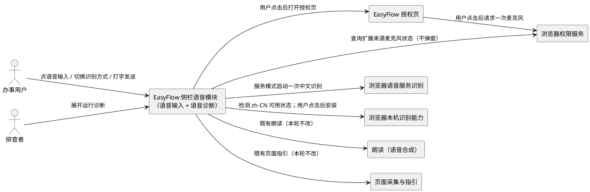
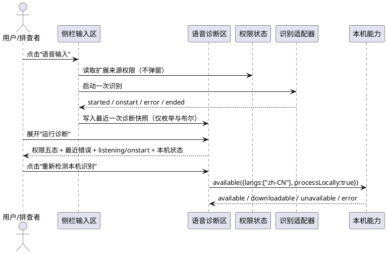
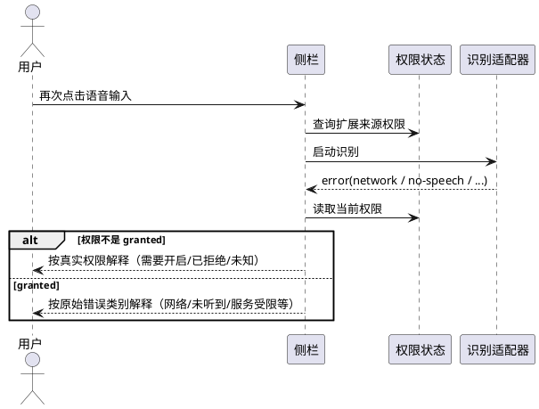
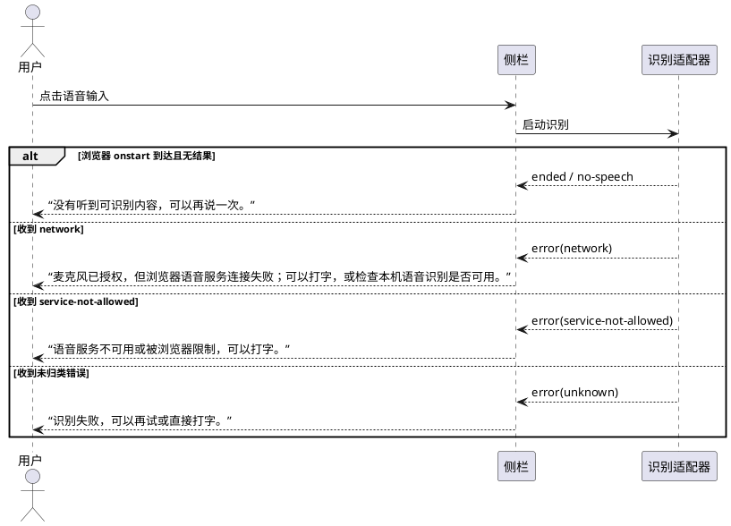
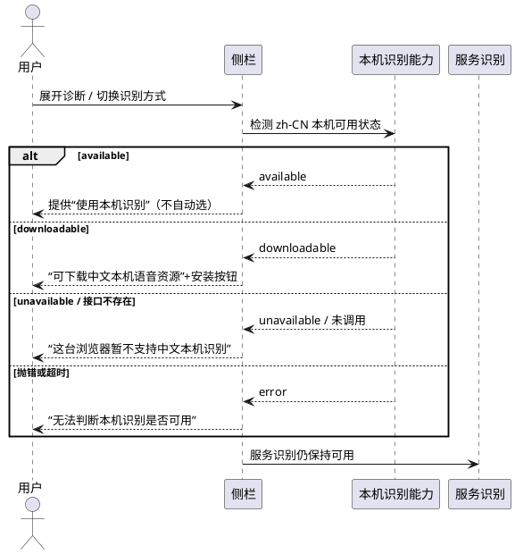
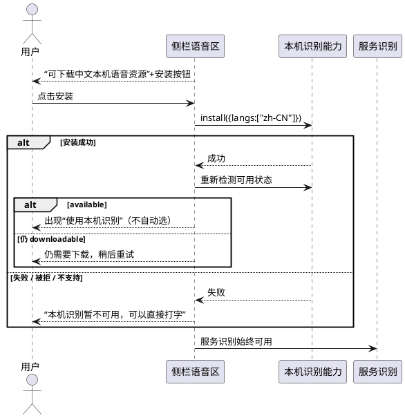
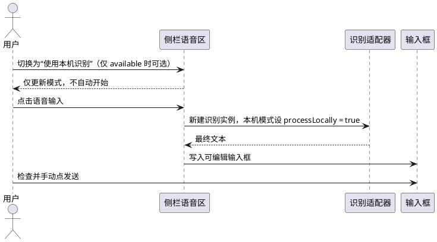
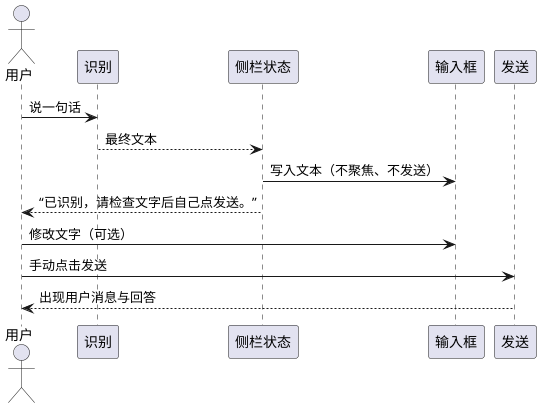
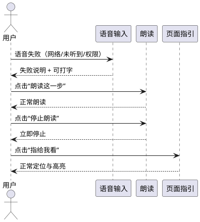
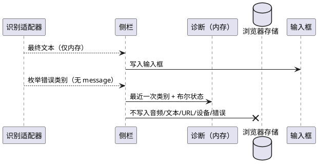

# EasyFlow 语音识别诊断、本机识别能力探测与错误文案需求规格（第七轮增量）

> 本文件是 `easyflow_page_guide` 特性的第七轮增量规格，不替代 `spec.md`、`iteration2-spec.md`、`iteration3-spec.md`、`iteration4-spec.md`、`iteration5-spec.md`、`iteration6-spec.md`。
>
> 本轮只解决一件事：**在麦克风已授权的前提下，把“识别到底走到了哪一步、失败究竟是没听到、浏览器语音服务连接失败、还是本机识别不可用”说清楚**，并新增“本机中文识别”的运行时能力探测、可选启用与按需下载。禁止把用户反复推回麦克风授权，禁止把网页采集的“页面访问许可”误当成语音错误。
>
> 验收条件沿用前六轮的写法：EARS 触发词（When / If / While / Where）+ 中文正文。本文件只描述“要什么、怎么算做到”，不描述类结构、函数签名、文件划分与打包实现细节；涉及既有模块的内容只写外部可观察结果。
>
> **本阶段声明**：只产出需求规格。未修改任何源码、未修改 `public/manifest.json`、未修改 `scripts/`、未修改前六轮文档，未运行 `npm run typecheck` / `npm run build` / `npm run selftest` / `npm run verify`，未创建 `codearts_proof` 实绩日志，未调用真实麦克风、真实语音识别、真实语音合成、真实 `SpeechRecognition.available` / `install`。

---

## 0. 背景与现状盘点

### 0.1 真实复测现象（用户提供，2026-11-14）

1. 第六轮已实现扩展来源麦克风五态、EasyFlow 授权页、“允许麦克风”后立即停止音轨、错误分类与路径限定门禁。
2. 用户已完成一次真实 Chrome 操作：**授权页已打开并完成授权**；自动测试 71 项通过。
3. 回到侧栏点击“语音输入”后，侧栏**先**提示“未识别到语音”，**随后**提示“网络或语音服务暂不可用”。
4. 用户截图中的旧聊天消息“页面访问许可”属于另一条网页采集链路（`EF-E003`），**不是**本轮语音错误。

### 0.2 已核实基线（2026-11-14 只读核查，主工程 `D:\hwproject\translator`）

| 核查项 | 实际结果（文件与位置） | 对本轮规格的约束 |
|---|---|---|
| 权限五态 | `src/shared/speech/permission.ts:1-9`：`unknown/granted/prompt/denied/unsupported`；`src/sidepanel/speech/microphone.ts:46-61` 查询失败归 `unknown`、接口缺失归 `unsupported` | 诊断区必须直接复用这五态，不得新增第二套权限枚举 |
| 授权页链路 | `src/sidepanel/speech/micPage.ts` 只打开固定 `mic-permission.html`；`src/mic-permission/request.ts` 是唯一 `getUserMedia({audio:true})` 调用点；`releaseStream` 立即停轨 | 本轮**不改**授权页与停轨逻辑；只允许诊断与文案引用其状态 |
| 错误映射 | `src/shared/speech/policy.ts:94-114`：`not-allowed → permission-denied`；`service-not-allowed → service-limited`；`audio-capture → no-audio-device`；`no-speech/bad-grammar → no-speech`；`network → network`；其余 `unknown` | 六类“原始错误类别”必须与这张映射表对齐，不得新造第二套分类 |
| 状态机 | `src/shared/speech/voiceMachine.ts:116-160`：`no-speech` 与 `unknown` **同归** `no-speech` 状态；`network` 进入 `failed + issue:"network"`；`162-166` 的 `adapter-ended` 在 `listening` 时也转 `no-speech` | “先未识别到语音、后网络失败”可由两条不同路径产生；本轮必须拆分并让诊断可区分 |
| onstart 可观测性 | `src/sidepanel/speech/recognition.ts:102-111` 注册 `onresult/onerror/onend`，但**从未给 `instance.onstart` 赋值**；`120` 在 `start()` 返回后立即发出 `started` 事件 | 现有“已开始”并不等于浏览器 `onstart` 真的到达；诊断必须分别显示“侧栏已进入正在听”和“浏览器 onstart 是否到达” |
| `onend` 兜底 | `recognition.ts:102-111`：未收到结果就 `emit no-speech` 再 `emit ended`；`voiceMachine.ts:162-166` 收到 `ended` 又转 `no-speech` | “未识别到语音”可能只是会话结束/超时，不代表说了话；不得把它升级为网络或权限解释 |
| 网络文案 | `src/shared/speech/copy.ts:74`：`network: "网络或语音服务暂不可用，可以直接打字。"` | 缺少“麦克风已授权”与“本机识别是否可用”的指引，用户会误以为还要授权；本轮必须改写 |
| 识别状态文案 | `copy.ts:58-67`：`no-speech: "未识别到语音，请再说一次，或直接打字。"`；`failed: "识别失败，可以再试或直接打字。"` | `no-speech` 要改为用户指定的单一提示；`unknown` 不得再借 `no-speech` 文案掩盖 |
| 语音诊断现状 | `src/sidepanel/components/chat/DiagnosticsPanel.tsx:127`：`语音不可用类别：{speechIssue}`；`App.tsx:59-62` 的 `speechIssue` 来自**朗读** `speech.phase` | 该字段与识别错误无关，标签容易误导；本轮必须分区并改名，不得作为语音识别诊断 |
| 诊断面板形态 | `DiagnosticsPanel.tsx:66` 使用 `
` 默认折叠；`sidepanel.css:847-858、1201-1205、1259-1260` 已有高度与可滚动约束 | 语音诊断默认折叠、展开后可滚动，沿用现有形态，不新增样式框架 |
| 本机识别 API | 全仓库检索 `SpeechRecognition.available` / `processLocally` / `install(` **0 命中**；`src/shared/speech/types.ts:59-74` 的 `RecognitionLike` 不含这些成员 | 本轮为**新增能力**：必须先检测再显示，禁止假设当前 Chrome 一定有中文包 |
| 识别结果写入 | `src/sidepanel/components/chat/ChatComposer.tsx:27-35`：按 `revision/pendingText` 写入 `textarea` 并 `consumePending()`；`17-25` 只有 `submit()` 会发送 | 两种识别模式都必须复用这一条路径；不得新增自动发送 |
| 发送按钮 | `ChatComposer.tsx:63-70`：`disabled={disabled || text.trim().length === 0}` | “失败仍能打字”可直接由该既有机制保证；本轮只加断言，不改语义 |
| 朗读链路 | `src/sidepanel/speech/synthesis.ts`、`src/sidepanel/speech/speechController.ts`、`src/shared/speech/speakMachine.ts`；`AT-77` 已断言其不含权限字段 | 本轮零改动；只允许把诊断里的朗读状态改名分区 |
| 页面采集错误 | `src/shared/errors.ts:43-47`：`EF-E003`＝“未获得当前页面访问授权”；`src/sidepanel/hooks/useConversation.ts:228-229` 显示“我还没拿到这个页面的访问许可。点一下扩展图标，我再试。” | 这是 `activeTab` 采集链路，与语音输入无任何关系；诊断与聊天都不得混为同一条 |
| manifest 权限 | `public/manifest.json`：`["activeTab","scripting","sidePanel","storage"]`；无 `host_permissions`、无 `content_scripts`、无 `web_accessible_resources` | 本轮权限集合逐项不变；麦克风与语言包均不写入 manifest |
| 门禁 | `scripts/verify-manifest.mjs`：`getUserMedia` 仅两条例外（授权页源码与产物），其余全局禁止；`MediaRecorder`、`fetch(` 等禁用 | 本轮不得新增第三方语音接口、密钥、代理或网络上传；不得扩大例外 |
| 构建脚本 | `package.json`：`build = tsc --noEmit && node scripts/build.mjs && node scripts/verify-manifest.mjs`；`verify` 单独可跑 | 实现阶段的四道门禁顺序保持；本轮不执行 |
| 自测基线 | `codearts_proof/iteration6-selftest.log` 末行 `1..71 / pass 71 / fail 0`；`AT-64`—`AT-80` 在 `scripts/selftest.mjs:1621-2064`；假对象 `FakePermissionProbe/FakePermissionPage/FakeRecognition/FakeSynthesis/FakeMediaDevices` 均在 `selftest.mjs` 内 | 新增用例必须沿用“假对象 + 可注入”结构；**禁止**在自测中调用真实麦克风、真实网络、真实 `available/install` |
| 第六轮人工留痕 | `codearts_proof/25-iteration6-implementation.md:101-116` 把真实 Chrome 列为“待用户执行”；用户现已部分执行（授权页已打开并授权） | 本轮不得把“授权成功”写成“语音识别可用”；真实本机识别能力仍待人工验收 |

### 0.3 根因判断（只读分析，未实测确认）

| 现象 | 可能来源 | 现有代码证据 | 本轮要消除的误导 |
|---|---|---|---|
| “未识别到语音” | 会话 `onend` 无最终结果，或 8 秒超时；现有 `no-speech` 与 `unknown` 共用该状态 | `recognition.ts:102-111`、`voiceMachine.ts:116-125、162-171` | 让用户知道“没听到内容”和“服务连不上”是两件事；诊断区分是否到达 `onstart` |
| 随后“网络或语音服务暂不可用” | 第二次识别收到 `network`（浏览器语音服务连接失败） | `policy.ts:103-105`、`voiceMachine.ts:149-150`、`copy.ts:74` | 文案明确“麦克风已授权”，直接阻断“再去授权”的错误动作 |
| 用户反复重授 | 网络文案未说明权限已完成，也未提供本机识别线索 | 同上 | 本轮文案与操作路径双层阻断 |
| 无法判断本机识别 | 无 `available/install/processLocally` 检测、无诊断字段 | 全仓库 0 命中 | 新增只读能力探测与最小诊断展示 |
| “页面访问许可”被误读 | `EF-E003` 是网页采集授权失败，历史聊天消息残留 | `errors.ts:43-47`、`useConversation.ts:228-229` | 在诊断中物理分区，在文案上互不引用；语音诊断不显示网页 URL |

**结论口径**：本轮规格把“先 no-speech、后 network”视为**两条独立可观测事件**；不对真实 Chrome 的底层原因下结论，只要求界面不再把它们混为一谈，并要求诊断能记录最近一次原始错误类别与 `onstart` 到达情况。

### 0.4 为什么“页面访问许可”不是语音错误

1. 它由网页采集链路的 `EF-E003` 产生，含义是“尚未获得当前网页的 `activeTab` 访问授权”，提示动作是“点一下扩展图标”。
2. 语音输入链路的权限对象是**扩展来源麦克风权限**，提示动作是“开启麦克风 / 在 EasyFlow 扩展权限中允许”。
3. 两者的错误码、权限来源、用户动作、修复路径均不同；本轮要求在诊断面板中分区显示，并禁止在语音状态文案里出现“页面访问许可”“点扩展图标”等网页采集措辞。
4. 截图里的旧聊天消息只是历史记录，**不得**据此推断语音权限状态，也不得写入语音诊断。

### 0.5 现状缺口与本轮落点

| 用户目标 | 现状缺口 | 本轮规格落点 |
|---|---|---|
| 诊断能看到语音链路 | 诊断只有“语音不可用类别”，且实为朗读状态 | 5.1、6.1、6.2 |
| 权限状态可见 | 权限状态只在语音行文案里间接出现 | 5.1、5.2 |
| 最近原始错误类别可见 | 无字段；`no-speech/unknown` 还被合并 | 5.1、5.3、6.3 |
| 是否到达 `onstart` 可见 | 适配器未接 `onstart`，`started` 是本地事件 | 5.1、5.3 |
| 本机识别可检测 | 无 API 调用、无探测、无状态 | 5.4、6.1 |
| `downloadable` 时按需安装 | 无安装入口、无生命周期 | 5.5 |
| 双模式与 `processLocally` | 只有单一服务识别 | 5.6 |
| network 不再引导重授 | 文案未说明“已授权” | 5.3、6.4 |
| no-speech 独立 | 与 unknown 合并、文案泛化 | 5.3、6.3 |
| 失败仍可打字、不无限重试 | 无显式红线 | 5.7 |
| 朗读与页面指引不受影响 | 无显式分区与回归断言 | 5.8 |
| 隐私最小化 | 无语音诊断字段清单 | 5.9、6.2 |

### 0.6 测试与留痕基线

1. **现有 71 项全部视为回归红线**：`AT-01`—`AT-80`（编号不连续但共 71 个 `test()`），不得删除、不得削弱。
2. 与语音相关且本轮**允许显式改写**的断言范围：`AT-53`、`AT-55`、`AT-73`、`AT-74` 中直接依赖 `network` / `no-speech` 文案与 `unknown` 归并的句子；改写必须在新矩阵中有对应用例，不得只改断言不改行为。
3. `AT-62`、`AT-80` 的“文案禁用词”断言继续有效：用户可见文案不得出现“离线”“纯本地”“不上传”等表述；本轮“本机识别”文案必须遵守。
4. `AT-76` 的“只入框不发送”与 `AT-77` 的“朗读不受影响”必须在新增双模式后继续成立。
5. 实现阶段留痕沿用 `codearts_proof/`：新增 `iteration7-typecheck.log`、`iteration7-build.log`、`iteration7-selftest.log`、`iteration7-verify.log`、`26-iteration7-implementation.md`。

---

## 1. 组件定位

### 1.1 核心职责

本组件负责在有/无本机中文识别能力时，向用户如实说明语音识别走到哪一步、失败属于哪一类，并把识别结果安全地放进可编辑输入框；它不负责替用户发送，也不负责替浏览器修复其语音服务。

### 1.2 核心输入

1. **侧栏用户操作**：点击“语音输入”“取消识别”“开启麦克风”、展开“运行诊断”、切换识别方式、点击“下载中文语音资源”、手动发送。
2. **扩展来源权限状态**：`unknown | granted | prompt | denied | unsupported`，来源为扩展来源的权限查询或授权页回传的枚举。
3. **识别适配器事件**：本会话是否开始、浏览器 `onstart` 是否到达、最终文本、原始错误类别、会话结束。
4. **本机识别能力结果**：API 是否存在；`zh-CN + processLocally` 的可用状态；用户点击安装后的成功/失败/被拒结果。
5. **既有页面与对话状态**：当前任务、步骤卡、朗读状态、页面采集诊断（只读引用，不在本轮改动语义）。

### 1.3 核心输出

1. **语音输入区可见状态**：权限状态说明、是否可用、是否提供“使用本机识别”、安装入口、失败原因与下一步。
2. **语音诊断区可见字段**：权限五态、最近一次原始错误类别、`listening/onstart` 到达情况、本机 API 是否存在、`zh-CN` 可用状态、安装状态。
3. **识别结果**：只写入可编辑输入框的最终文本；不自动发送、不进入消息流、不写入存储。
4. **对浏览器的请求**：仅在用户点击后启动一次识别；仅在本机模式且用户已选择时对**新建实例**设置 `processLocally = true`；仅在用户点击安装按钮后调用一次安装。
5. **对用户的诚实说明**：不宣称本机识别可用，不宣称语音服务已修复，不把网页采集错误混入语音。

### 1.4 职责边界

1. **不负责**修复浏览器语音服务、网络、代理或系统音频；不替用户改浏览器/系统设置。
2. **不负责**自动重新授权麦克风、自动打开授权页、无限重试、自动切回服务识别。
3. **不负责**新增权限、语音 SDK、外部语音接口、密钥、代理或任何音频/文本上传。
4. **不负责**录音、保存音频、保存识别原文、保存中间结果、保存设备名或设备 ID。
5. **不负责**修改网页采集链路、`EF-E003` 的判定与文案、页面定位/高亮/步骤卡。
6. **不负责**修改朗读链路；朗读仍由既有合成适配器负责。
7. **不负责**自动发送、自动点击网页、自动提交或创建真实预约。
8. **不负责**根据 Chrome 版本号猜测语言包是否存在。

---

## 2. 领域术语

**语音输入诊断（Voice Input Diagnostics）**
: 指“运行诊断”中专门描述语音识别链路的一组只读字段，包含扩展来源麦克风权限、最近一次原始错误类别、识别是否到达 `listening/onstart`、本机识别 API 是否存在、`zh-CN` 可用状态与安装状态。

**原始错误类别（Raw Error Category）**
: 指把浏览器识别回调里的 `error` 字符串按固定表归并后的六类之一：`no-speech | network | not-allowed | service-not-allowed | audio-capture | other`。它**不包含**完整 `message`，也不包含堆栈或异常对象。

**最近一次（Last Occurrence）**
: 指当前侧栏会话内、时间上最后一次发生的识别失败或本机能力检测结果；只存在于内存，不形成历史列表。

**侧栏已进入正在听（Controller Listening）**
: 指侧栏状态机接受了“开始识别”并进入 `listening`。它只代表侧栏准备接收结果，不代表浏览器已经真正开始采集。

**浏览器 onstart 到达（Browser Onstart Reached）**
: 指浏览器识别实例真正触发了 `onstart` 回调。只有它到达，才能说“浏览器已经开始识别”；此前的一切“正在听”都只是侧栏期望状态。

**本机识别（On-device Recognition）**
: 指浏览器提供的、在用户设备上完成中文语音识别的能力。它是否可用由运行时探测决定，**不得**由 Chrome 版本号、安装渠道或用户所在地区推断。

**本机中文语音资源（Chinese On-device Speech Resource）**
: 指浏览器为 `zh-CN` 本机识别所需的语言包。它可能已存在、可下载、不可下载或安装失败；规格只描述状态与用户可见结果，不描述其存储位置。

**可用状态（Availability State）**
: 指运行时探测得到的本机识别状态，取值为 `available | downloadable | unavailable | unsupported-not-called | error`。`available` 才允许向用户提供“使用本机识别”；其余状态一律不得标记为可用。

**未调用（Unsupported-Not-Called）**
: 指浏览器未提供可用的本机识别能力检测接口，因此既不能证明可用，也不能证明不可用；界面必须明确“这台浏览器暂不支持中文本机识别”，不得把“没检测”说成“可用”。

**能力探测缓存（Capability Cache）**
: 指本次侧栏会话内对本机可用状态的短期记忆，用于避免每次点击都等待异步探测。缓存只存内存，可被手动“重新检测”覆盖。

**安装（Install）**
: 指用户**明确点击**下载按钮后，浏览器为本机中文识别准备语言资源的动作。安装不由页面加载、诊断展开、识别失败或定时器自动触发。

**识别方式（Recognition Mode）**
: 指用户可选的识别路径：`service`（浏览器服务识别，沿用现状）或 `local`（本机识别，仅当探测为 `available` 时可选）。默认 `service`。

**结果只入框（Compose-Only Result）**
: 指识别最终文本只写入可编辑输入框并保持用户可修改，必须由用户手动发送；不得自动发送、自动聚焦或自动提交。

**诊断分区（Diagnostics Partition）**
: 指“语音输入诊断”和“页面采集诊断”两块互不混用的区域。`EF-E003` 与页面访问许可只属于后者；语音权限、识别错误、本机能力只属于前者。

**文案单源（Single Copy Source）**
: 指每一类状态、错误类别、按钮与说明只在一处定义，组件、诊断与测试共同取用，不得各写一份。

---

## 3. 角色与边界

### 3.1 核心角色

1. **办事用户**：在侧栏输入一句话或改用打字；会查看诊断以判断是否值得继续尝试语音。
2. **排查者（用户本人或支持人员）**：需要在不接触音频与原文的前提下，确认权限、错误类别与本机能力。

### 3.2 外部系统

1. **浏览器权限服务**：提供扩展来源麦克风权限状态查询；不因查询而弹窗。
2. **浏览器语音识别服务**：提供 `service` 模式的中文单次识别；可能因网络或服务策略失败。
3. **浏览器本机识别能力**：提供 `available` 检测与 `install` 安装；可能不存在、不可用或抛错。
4. **浏览器语音合成服务（朗读）**：既有能力，本轮只读引用，不改变。
5. **当前网页与页面采集链路**：既有能力；其 `EF-E003` 与语音诊断必须分区。
6. **EasyFlow 授权页**：既有麦克风授权入口；本轮不修改其生命周期。

### 3.3 交互上下文

图中不展示侧栏内部组件、数据库、缓存与具体接口参数。

---

## 4. DFX 约束

### 4.1 性能

1. 展开“运行诊断”到显示已缓存语音诊断字段：不超过 **200 毫秒**；不得因展开诊断而启动识别或请求麦克风。
2. 本机能力探测单次异步等待上限：**1.5 秒**；超过上限按 `error` 处理，界面显示“无法判断”，不得无限等待或阻塞输入。
3. 用户点击“语音输入”到进入 `listening` 的本地处理：不超过 **300 毫秒**，且不得因读取能力缓存而额外阻塞超过 **100 毫秒**。
4. 安装按钮点击到出现“正在准备”可见状态：不超过 **300 毫秒**；浏览器实际下载耗时不计入上限。
5. 语音诊断文本在 320px 宽度与 200% 缩放下不得横向溢出。

### 4.2 可靠性

1. 能力探测失败、安装失败、权限查询失败均不得使侧栏不可用；打字、发送、朗读、页面指引、既有诊断继续可用。
2. 同一时刻最多 1 个识别会话；同一时刻最多 1 次安装请求；重复点击必须幂等。
3. `no-speech` 与 `network` 不得在一次失败中同时作为主提示出现；因超时或 `ended` 产生的提示只能出现一次。
4. 识别会话取消或侧栏关闭后到达的最终结果/错误必须丢弃，不得写入输入框或覆盖诊断的“最近一次”。
5. 能力状态不得因一次探测失败被永久锁定；用户可手动重新检测，或在缓存过期后自动重新探测。
6. 服务模式的既有行为在未启用本机识别时保持不变。

### 4.3 安全性

1. 诊断只允许出现枚举、布尔、时间与固定说明；禁止出现音频、识别文本、设备名、网页 URL、完整错误 `message`、授权页查询串。
2. 本机能力检测与安装不得采集音频、不得启动识别、不得请求麦克风权限。
3. 不得向自建或第三方语音接口发送音频或文本；不得引入语音 SDK、密钥或代理。
4. 不得新增 `tabs`、`host_permissions`、`<all_urls>`、`content_scripts`、`web_accessible_resources`；不得使用 `MediaRecorder`。
5. 不得把语音诊断写入 `chrome.storage`、消息队列、聊天消息或运行日志条目。
6. 安装按钮必须由用户手势触发；页面加载、诊断展开、识别失败均不得触发安装。

### 4.4 可维护性

1. 错误类别、可用状态、安装状态与全部用户可见文案必须来自单一来源；组件只取用，不得各写一份。
2. 状态枚举必须以表格固定（见 6.1、6.3），新增取值必须先改表再改文案。
3. 新增常量（探测超时、缓存时长、安装状态、文案）必须命名，不得散落魔法值。
4. 自测必须使用可注入的假权限、假适配器、假 `available/install`；不得依赖真实设备、真实网络或真实语言包。
5. 诊断字段必须可按“字段—来源—是否落盘—是否显示”逐项审阅（见 6.2）。

### 4.5 兼容性

1. 目标环境：Chrome / Chromium MV3，`minimum_chrome_version` 保持 `116`；本机识别 API 在部分版本不存在，属于正常环境。
2. API 不存在时必须显示 `unsupported-not-called`，不得标记可用、不得出现可点击的“使用本机识别”。
3. `available` 返回未知字符串或抛错时归 `error`；不得崩溃、不得静默变成 `available`。
4. `downloadable` 的具体措辞与下载行为随浏览器版本略有差异；文案不得断言“所有 Chrome 都支持中文语言包”。
5. 既有 71 项自测必须继续通过；仅允许按 7.2 明确列出的范围改写相关断言。
6. 朗读按钮、页面步骤卡、定位/高亮、阅读模式、关怀模式 token 不得回退。

---

## 5. 核心能力

## 5.1 语音输入诊断区与分区显示

### 5.1.1 业务规则

1. **R-247 诊断分区存在**：When 用户展开“运行诊断”，the system shall 显示独立的“语音输入诊断”分区，并与“页面采集诊断”以标题和视觉分隔区分。
   a. 验收条件：展开诊断 → 同时存在两个分区标题；任一区的字段不出现在另一区标题之下。
2. **R-248 权限状态字段**：The system shall 在语音诊断区显示扩展来源麦克风权限的当前值：`granted | prompt | denied | unknown | unsupported`，并配中文说明。
   a. 验收条件：注入五态 → 分别显示“已授权 / 待询问 / 已拒绝 / 未知 / 当前环境无法查询”；不含网页域名。
3. **R-249 最近原始错误类别**：The system shall 显示最近一次识别失败的原始错误类别：`no-speech | network | not-allowed | service-not-allowed | audio-capture | other`；无失败时显示“暂无（本次侧栏会话）”。
   a. 验收条件：依次注入六类 → 六类可区分；`null` → 显示“暂无”；不显示完整 `message`。
4. **R-250 识别到达情况**：The system shall 分别显示“侧栏已进入正在听：是/否”和“浏览器 onstart 到达：是/否/未开始”。
   a. 验收条件：仅本地 `started` 事件 → 第一项“是”、第二项“未开始/否”；收到浏览器 `onstart` → 第二项“是”；未启动 → 两项均为“否/未开始”。
5. **R-251 本机 API 存在性**：The system shall 显示“本机识别接口：存在/不存在”。
   a. 验收条件：注入存在/不存在 → 文案分别可读；不显示 API 原始名称、版本号或异常堆栈。
6. **R-252 `zh-CN` 可用状态**：The system shall 显示 `available | downloadable | unavailable | unsupported-not-called | error` 之一，并为每类提供固定中文说明。
   a. 验收条件：五类逐一注入 → 五类文字两两不同；检测进行中只显示“检测中…”，不得提前显示“可用”。
7. **R-253 诊断只读**：The system shall 使“展开诊断”本身不启动识别、不请求麦克风、不触发安装、不访问网络。
   a. 验收条件：展开/折叠 5 次 → 识别适配器 0 调用、`getUserMedia` 0 调用、安装 0 调用。
8. **R-254 分区隔离**：The system shall 禁止把 `EF-E003`、页面访问许可、网页 URL 或页面采集计数写入语音诊断区，也禁止把语音错误写入页面采集诊断条目。
   a. 验收条件：注入 `EF-E003` → 只在页面采集区出现；语音诊断区无“访问许可”“EF-E003”；聊天中的历史旧消息不改变语音诊断。
9. **R-255 朗读状态不冒充识别**：The system shall 把现有来自朗读的“语音不可用类别”改名为“朗读不可用类别”，不得作为语音识别错误展示。
   a. 验收条件：朗读 `unsupported` → 只显示“朗读不可用类别：不支持”；语音诊断的“最近错误”仍为“暂无”或它自己的类别。
10. **R-256 诊断禁止字段**：The system shall 禁止在语音诊断区出现音频、识别文本、中间结果、设备名称/ID、网页 URL、完整错误 `message`、授权页查询串。
    a. 验收条件：源码与渲染文本检索 → 上述内容 0 命中；诊断 JSON 序列化长度不随识别文本增长。
11. **R-257 不形成历史**：The system shall 只保留“最近一次”语音诊断快照，不把语音事件写入既有运行日志条目、聊天消息或持久存储。
    a. 验收条件：连续失败 5 次 → 仅保留最后一次；运行日志条目数量不变；`chrome.storage` 无新增键。
12. **R-258 可读性**：The system shall 用中文类别名与固定说明显示诊断，不得直接显示 `no-speech`、`network`、`not-allowed` 等原始字符串。
    a. 验收条件：五类状态与六类错误逐一看 → 无原始错误串；无技术码。
13. **R-259 可访问性**：The system shall 为语音诊断分区提供可被读屏识别的标题，状态不得只用颜色表达；折叠时不渲染敏感值。
    a. 验收条件：键盘可展开；读屏可读标题；高对比度模式下文字可辨。
14. **R-260 手动重新检测**：The system shall 在语音诊断区提供“重新检测本机识别”入口；点击才重新探测，不做定时轮询。
    a. 验收条件：展开后等待 60 秒 → 探测次数不增长；点击一次 → 探测次数 +1。

### 5.1.2 交互流程

### 5.1.3 异常场景

1. **诊断展开时权限查询失败**
   a. 触发条件：权限查询抛错或接口缺失。
   b. 系统行为：显示 `unknown` 或 `unsupported`，不显示“未识别到语音”代替权限状态。
   c. 用户感知：能看到“未知/当前环境无法查询”，并仍可打字。
2. **诊断展开时本机探测超时**
   a. 触发条件：`available` 1.5 秒未返回。
   b. 系统行为：按 `error` 显示“无法判断本机识别是否可用”，保留服务识别。
   c. 用户感知：不会误以为本机可用。
3. **旧聊天消息与新诊断并存**
   a. 触发条件：聊天中残留“页面访问许可”旧消息。
   b. 系统行为：语音诊断不读取聊天内容；页面诊断照旧。
   c. 用户感知：两者分区，不再混淆。

---

## 5.2 权限真实状态优先

### 5.2.1 业务规则

1. **R-261 权限优先解释**：When 识别失败且扩展来源麦克风权限不是 `granted`，the system shall 按真实权限状态解释失败，不显示网络或服务文案。
   a. 验收条件：`denied` + 原始错误 `network` → 主提示为“麦克风权限未开启……”；诊断区仍记录原始类别 `network`。
2. **R-262 `granted` 时不得引导重授**：While 权限为 `granted`，the system shall 不显示“开启麦克风”、不显示“请重新授权”、不自动打开授权页。
   a. 验收条件：`granted` + 任意失败 → 无“开启麦克风”按钮；授权页打开 0 次；`getUserMedia` 0 次。
3. **R-263 权限状态可见**：The system shall 在语音输入区用文字说明当前权限状态，至少覆盖“已允许/需要开启/已拒绝/当前环境无法查询”。
   a. 验收条件：五态逐一注入 → 文字可读且互不相同。
4. **R-264 拒绝文案指向扩展来源**：Where 权限为 `denied`，the system shall 说明“在 EasyFlow 扩展的麦克风权限中改为允许（这不是当前网页的站点设置）”。
   a. 验收条件：文案含“EasyFlow”“不是当前网页”；不含“当前网站站点设置”。
5. **R-265 未授权不显示服务结论**：Where 权限为 `prompt` 或 `unknown`，the system shall 只说明需要开启麦克风，不得断言“语音服务不可用”。
   a. 验收条件：`prompt`/`unknown` + 原始错误 `network` → 主提示为权限引导；无“服务连接失败”。
6. **R-266 已授权确认句**：While 权限为 `granted` 且出现网络类失败，the system shall 在提示句首明确“麦克风已授权”。
   a. 验收条件：文案以“麦克风已授权”开头或紧随状态标签；用户无需猜测权限是否完成。
7. **R-267 状态刷新**：When 用户从浏览器设置返回侧栏或侧栏重新获得焦点，the system shall 重新查询权限并按最新值解释。
   a. 验收条件：`denied` 改为 `granted` 后重试 → 不再显示拒绝文案；无需重载扩展。

### 5.2.2 交互流程

### 5.2.3 异常场景

1. **权限查询结果滞后**
   a. 触发条件：刚在授权页允许，侧栏仍读到旧值。
   b. 系统行为：重试时再查一次；不重复打开授权页。
   c. 用户感知：多试一次即可，不出现“没权限”误报。
2. **原始错误为 `not-allowed` 但查询为 `granted`**
   a. 触发条件：权限与服务状态不一致。
   b. 系统行为：说明“麦克风权限显示已授权，但浏览器拒绝了本次识别”，提供再试一次、改用本机识别或打字。
   c. 用户感知：不被推回重复授权页。
3. **权限为 `unsupported`**
   a. 触发条件：环境不提供权限查询。
   b. 系统行为：说明“当前环境无法查询麦克风权限”，仍允许尝试一次授权页。
   c. 用户感知：可继续操作，不被迫放弃。

---

## 5.3 错误类别、`network` 与 `no-speech` 文案

### 5.3.1 业务规则

1. **R-268 `network` 文案（已授权）**：While 权限为 `granted` 且最近错误为 `network`，the system shall 显示：“麦克风已授权，但浏览器语音服务连接失败；可以打字，或检查本机语音识别是否可用。”
   a. 验收条件：文案含“麦克风已授权”“浏览器语音服务连接失败”“可以打字”“本机语音识别”；不含“重新授权”“权限未开启”“开启麦克风”。
2. **R-269 `no-speech` 文案**：When 最近错误为 `no-speech` 或会话无结果结束，the system shall 只显示：“没有听到可识别内容，可以再说一次。”
   a. 验收条件：文案与上述完全一致或语义等价且仅此一句；不含“网络”“服务”“权限”“授权”。
3. **R-270 两类不得合并**：The system shall 使 `no-speech` 与 `network` 在状态、文案、诊断类别与后续建议上两两不同。
   a. 验收条件：同一会话先后出现两类 → 第二次提示替换第一次，不叠加；诊断保留最近一次类别；主提示不同。
4. **R-271 不得把 `unknown` 当作 `no-speech`**：If 识别返回未归类错误，the system shall 显示“识别失败，可以再试或直接打字”，并在诊断记 `other`；不得显示“没有听到内容”。
   a. 验收条件：注入未映射错误 → 文案为通用失败；诊断原始类别 `other`。
5. **R-272 `service-not-allowed` 独立**：If 识别返回 `service-not-allowed`，the system shall 显示“语音服务不可用或被浏览器限制，可以打字”，不得显示“麦克风权限未开启”。
   a. 验收条件：文案与权限拒绝文案不同；`granted` 下不显示“开启麦克风”。
6. **R-273 `audio-capture` 独立**：If 识别返回 `audio-capture`，the system shall 显示“没有检测到可用的麦克风，可以直接打字”，不得归为网络或权限。
   a. 验收条件：文案与网络、未听到、权限文案两两不同。
7. **R-274 失败文案两两不同**：The system shall 使 `network`、`no-speech`、权限拒绝、服务受限、无设备、系统禁用/占用六类用户可见文案两两不同（不得只差标点）。
   a. 验收条件：六类文案集合大小 = 6。
8. **R-275 一次只给一个主提示**：When 一次识别失败，the system shall 只显示一个主状态句；辅助建议最多一句，且不得出现互相矛盾的操作建议。
   a. 验收条件：`network` 后 5 秒 → 无第二条“未识别到语音”；状态行文本稳定。
9. **R-276 不显示原始错误**：The system shall 禁止在用户可见位置出现 `no-speech`、`network`、`not-allowed`、`service-not-allowed`、`audio-capture`、`NotAllowedError`、`NotFoundError`、`NotReadableError`。
   a. 验收条件：六类逐一查看 → 0 命中；诊断使用中文类别名。
10. **R-277 超时与结束只产生一次提示**：If 会话因超时或 `ended` 结束且无最终文本，the system shall 只产生一次 `no-speech` 提示；不得先“未识别”再“网络”。
    a. 验收条件：假适配器连续发 `ended` 与超时 → 状态只变化一次；诊断的 `onstart` 与超时原因可区分。
11. **R-278 不无限自动重试**：The system shall 在一次识别失败后不自动重启识别、不自动重开授权页、不自动重装语言资源；只允许用户手动操作。
    a. 验收条件：等待 30 秒 → 适配器启动次数不增加；授权页打开 0 次；安装 0 次。

### 5.3.2 交互流程

### 5.3.3 异常场景

1. **先无结果后网络**
   a. 触发条件：第一次会话无结果，第二次会话网络失败。
   b. 系统行为：第一次只显示未听到；第二次替换为网络；诊断只保留 network，并记录上次的 onstart 情况。
   c. 用户感知：两次原因不同，不会以为是同一条错误。
2. **`onstart` 未到达但收到 network**
   a. 触发条件：浏览器在启动前直接返回网络错误。
   b. 系统行为：说明服务连接失败；诊断显示“浏览器 onstart：否”，提示问题在服务侧。
   c. 用户感知：不再反复点“开启麦克风”。
3. **网络恢复后重试**
   a. 触发条件：用户手动再点“语音输入”。
   b. 系统行为：正常启动识别，不要求重新授权。
   c. 用户感知：可直接继续。

---

## 5.4 本机识别能力探测

### 5.4.1 业务规则

1. **R-279 运行时探测**：When 用户展开语音诊断、切换识别方式或点击“重新检测本机识别”，the system shall 检测浏览器是否提供本机识别能力；不得按 Chrome 版本、平台或地区推断。
   a. 验收条件：同一构建在不同版本模拟环境中 → 结果只由 API 返回决定；源码无版本号分支决定可用性。
2. **R-280 探测参数**：If 本机识别接口存在，the system shall 以中文 `zh-CN` 与本机处理为前提发起一次可用状态检测。
   a. 验收条件：假 API 记录调用参数 → 语言为 `zh-CN`、本机处理为真；不传其他语言。
3. **R-281 `available` 分支**：If 检测返回 `available`，the system shall 在语音输入区提供“使用本机识别”选项，并允许用户选择本机模式。
   a. 验收条件：`available` → 出现可点击的本机选项；不显示安装按钮；不自动切换模式。
4. **R-282 `downloadable` 分支**：If 检测返回 `downloadable`，the system shall 只显示“可下载中文本机语音资源”和安装按钮，不得把本机识别标记为可用。
   a. 验收条件：`downloadable` → 本机选项不可直接使用；安装按钮可见；未点击前安装 0 次。
5. **R-283 `unavailable` 分支**：If 检测返回 `unavailable`，the system shall 显示“这台浏览器暂不支持中文本机识别”，并保留服务识别与打字。
   a. 验收条件：文案可读；无本机选项、无安装按钮；服务识别仍可启动。
6. **R-284 接口缺失分支**：If 本机识别检测接口不存在，the system shall 显示 `unsupported-not-called`，文案“这台浏览器暂不支持中文本机识别”，不得标记可用。
   a. 验收条件：移除 `available` → 状态为“未调用/不支持”；本机选项 0 个。
7. **R-285 抛错分支**：If 检测调用抛错或返回未知值，the system shall 归为 `error`，显示“无法判断本机识别是否可用”，不得标记可用。
   a. 验收条件：抛错/返回 `"weird"` → `error`；本机选项 0 个；不崩溃。
8. **R-286 不猜版本**：The system shall 禁止出现“当前 Chrome 一定支持中文语言包”一类断言或根据版本号直接启用本机选项。
   a. 验收条件：文案与源码检索 → 无版本承诺；无“一定支持”表述。
9. **R-287 探测不采集**：The system shall 使能力探测不调用 `getUserMedia`、不启动识别、不采集音频、不访问网络。
   a. 验收条件：探测 5 次 → 音频请求 0 次、识别启动 0 次。
10. **R-288 探测失败不影响服务识别**：While 本机能力为 `unavailable`、`unsupported-not-called` 或 `error`，the system shall 保持服务识别完整可用。
    a. 验收条件：三类状态下点击语音输入 → 服务适配器启动 1 次。
11. **R-289 探测缓存**：The system shall 在本次侧栏会话内缓存最近一次探测结果，默认有效期 **5 分钟**；用户点击“重新检测”时强制刷新。
    a. 验收条件：5 分钟内重复展开诊断 → 探测次数不增加；点击重新检测 → 次数 +1；超过 5 分钟后再展开 → 重新探测。
12. **R-290 无死按钮**：Where 本机识别不可用，the system shall 不在语音输入区显示可点击但无效的“使用本机识别”按钮。
    a. 验收条件：不可用分支 → 无本机按钮；只出现说明或诊断字段；服务识别按钮可用。

### 5.4.2 交互流程

### 5.4.3 异常场景

1. **检测接口存在但返回空值**
   a. 触发条件：返回值不在五态内。
   b. 系统行为：归 `error`，显示无法判断。
   c. 用户感知：不会看到“可用”。
2. **检测期间用户点击语音输入**
   a. 触发条件：探测尚未完成。
   b. 系统行为：按当前已选模式启动服务识别，或使用缓存；不得等待探测。
   c. 用户感知：输入不被阻塞。
3. **缓存过期**
   a. 触发条件：超过 5 分钟。
   b. 系统行为：后台重新探测；旧值在完成前不改变已选模式。
   c. 用户感知：状态可能短暂显示“检测中”。

---

## 5.5 本机中文语音资源的按需安装

### 5.5.1 业务规则

1. **R-291 只在点击后安装**：When 用户点击“下载中文语音资源”，the system shall 调用一次浏览器安装能力；页面加载、诊断展开、识别失败均不得触发安装。
   a. 验收条件：加载侧栏并展开诊断 5 次 → 安装 0 次；点击 1 次 → 安装 1 次。
2. **R-292 安装参数最小**：The system shall 只请求中文 `zh-CN` 的语音资源，不请求其他语言、不附加页面信息、不携带用户数据。
   a. 验收条件：假安装记录参数 → 仅含 `zh-CN`；无 URL、无文本、无设备信息。
3. **R-293 安装幂等**：While 安装请求进行中，the system shall 禁用按钮并保证最多 1 次调用；重复点击不叠加。
   a. 验收条件：1 秒内点击 5 次 → 安装调用 ≤1；按钮显示进行中。
4. **R-294 安装中状态**：While 安装进行中，the system shall 显示“正在准备中文本机语音资源…”，并保留打字与服务识别。
   a. 验收条件：状态可见；输入框可编辑；服务识别可启动。
5. **R-295 安装成功后复检**：When 安装返回成功，the system shall 重新检测 `zh-CN` 可用状态；只有得到 `available` 才提供“使用本机识别”。
   a. 验收条件：安装成功 + 复检 `available` → 本机选项出现；安装成功但复检仍 `downloadable` → 仍不提供选项。
6. **R-296 安装失败回退**：If 安装被拒、失败、抛错或接口不存在，the system shall 显示“本机识别暂不可用，可以直接打字”，并保留服务识别；不得自动重试。
   a. 验收条件：四类失败 → 无本机选项；安装调用 1 次；30 秒内不再自动调用。
7. **R-297 手动重试**：When 安装失败后用户再次明确点击，the system shall 允许发起一次新的安装请求；每次点击最多 1 次调用。
   a. 验收条件：连续点击两次 → 调用 2 次；无自动循环。
8. **R-298 安装不启动识别**：When 安装完成或失败，the system shall 不自动开始识别、不自动切换模式、不自动发送。
   a. 验收条件：安装后等待 10 秒 → 识别 0 次、消息 0 条、输入框不变。
9. **R-299 安装状态不落盘**：The system shall 只把安装状态保存在内存，关闭侧栏即丢弃；不写 `chrome.storage`。
   a. 验收条件：检索与断言 → 无新增存储键；重开侧栏状态回到“未安装/未检测”。
10. **R-300 不在诊断区放安装按钮**：The system shall 只在语音输入区提供安装按钮；语音诊断区只显示状态，避免用户把诊断当操作面板。
    a. 验收条件：诊断区无“下载/安装”按钮；语音区在 `downloadable` 时有 1 个安装按钮。

### 5.5.2 交互流程

### 5.5.3 异常场景

1. **安装无用户手势**
   a. 触发条件：非点击路径尝试安装。
   b. 系统行为：不调用安装；显示“请手动点击下载”。
   c. 用户感知：不会被自动下载。
2. **安装后页面被关闭**
   a. 触发条件：安装中关闭侧栏。
   b. 系统行为：不保留进行中状态；重开后重新检测。
   c. 用户感知：状态回到未检测。
3. **安装多次仍失败**
   a. 触发条件：浏览器持续拒绝。
   b. 系统行为：每次点击最多尝试一次；只提示文字输入与服务识别。
   c. 用户感知：不会被循环打扰。

---

## 5.6 双识别模式与 `processLocally`

### 5.6.1 业务规则

1. **R-301 默认服务识别**：The system shall 在用户未选择本机识别时继续使用浏览器服务识别，保持既有行为。
   a. 验收条件：默认打开侧栏 → 服务适配器启动；本机选项未选中。
2. **R-302 仅 `available` 可选本机**：While 本机状态不是 `available`，the system shall 不提供可用的“使用本机识别”选项。
   a. 验收条件：四类非可用状态 → 本机选项不可选中或不存在。
3. **R-303 `processLocally` 只在新建实例上设置**：When 用户选择本机识别并启动识别，the system shall 为**新建的识别实例**设置 `processLocally = true`；不得复用上一次服务模式的实例。
   a. 验收条件：假构造器记录实例 → 每次都新建；本机模式的实例标志为真；服务模式实例不为真。
4. **R-304 服务模式不设置本机标志**：While 使用服务识别，the system shall 不设置 `processLocally = true`。
   a. 验收条件：服务模式启动 → 实例标志为假或未设置；不因上一轮本机选择残留。
5. **R-305 切换不自动开始**：When 用户切换识别方式，the system shall 不自动启动识别，只更新下一次启动的模式。
   a. 验收条件：切换后等待 5 秒 → 识别 0 次；用户再点才启动。
6. **R-306 会话中切换**：While 识别处于 `listening`，the system shall 先结束或取消当前会话再允许切换，不得让同一会话混用两种模式。
   a. 验收条件：听音中切换 → 当前会话取消；新会话尚未自动启动。
7. **R-307 本机失败不自动回退**：If 本机模式启动或识别失败，the system shall 显示失败并保留打字，不自动切回服务识别。
   a. 验收条件：本机失败 → 模式仍为本机；服务适配器 0 次；用户可手动切换。
8. **R-308 `network` 后建议切换而非自动切换**：While 权限为 `granted` 且本机为 `available`，the system shall 在网络失败文案中提示“检查本机语音识别是否可用”，但不自动切换。
   a. 验收条件：文案含本机提示；模式仍为服务；无自动启动。
9. **R-309 模式不持久化**：The system shall 不把识别方式写入存储；重新打开侧栏恢复默认服务识别。
   a. 验收条件：选择本机后关闭重开 → 默认服务；无新增存储键。
10. **R-310 结果路径一致**：The system shall 使两种模式共用“最终文本只写入输入框”的同一行为，不产生第二套发送逻辑。
    a. 验收条件：两模式各注入最终文本 → 输入框均出现文本；消息数均不变。

### 5.6.2 交互流程

### 5.6.3 异常场景

1. **本机选项在探测后消失**
   a. 触发条件：缓存过期后复检为 `unavailable`。
   b. 系统行为：保留已选本机模式但启动前提示不可用；建议切回服务。
   c. 用户感知：不会静默失败。
2. **服务模式网络失败后用户切本机**
   a. 触发条件：`available` 且用户手动切换。
   b. 系统行为：下一次启动使用本机实例；不重复授权。
   c. 用户感知：路径明确。
3. **切换期间迟到结果**
   a. 触发条件：旧会话最终文本在切换后到达。
   b. 系统行为：丢弃，不写入输入框。
   c. 用户感知：输入框不被旧结果污染。

---

## 5.7 结果只入框、失败可打字、不无限重试

### 5.7.1 业务规则

1. **R-311 结果只入框**：When 任一模式返回最终文本，the system shall 只写入可编辑输入框，保留用户已输入内容并按既有追加规则合并。
   a. 验收条件：输入框已有文字 → 识别文本追加；不覆盖、不发送。
2. **R-312 不自动发送**：The system shall 禁止在识别完成后自动发送、自动按回车、自动提交或自动创建预约。
   a. 验收条件：识别后等待 10 秒 → 消息条数不变；仅手动点击“发送”后出现消息。
3. **R-313 不自动聚焦**：The system shall 不因识别结果自动把焦点移入输入框或抢走当前焦点。
   a. 验收条件：识别完成后焦点位置不变。
4. **R-314 失败仍可打字**：While 处于任一失败、未识别、不可用或安装失败状态，the system shall 保持输入框可编辑、发送按钮按既有规则可用。
   a. 验收条件：逐一验证失败态 → 输入文字后可发送；发送产生消息。
5. **R-315 一次一个会话**：The system shall 保证同一时刻最多 1 个活动识别会话；重复点击不叠加。
   a. 验收条件：1 秒内点击 5 次 → 启动 ≤1；最终状态稳定。
6. **R-316 迟到结果丢弃**：When 用户取消、切换任务、切换页面或关闭侧栏后，the system shall 丢弃旧会话的最终结果与错误。
   a. 验收条件：取消后注入结果 → 输入框不变；诊断的“最近一次”不被旧事件覆盖。
7. **R-317 长度上限沿用**：The system shall 沿用既有 `MAX_TURN_CHARS` 上限；超限时不写入并提示精简。
   a. 验收条件：超长文本 → 不写入；原文保留；提示可读。
8. **R-318 取消语义不变**：When 用户点击“取消识别”，the system shall 进入取消终态，不显示失败或网络。
   a. 验收条件：取消 → 文案“已取消识别”；诊断最近错误不新增。
9. **R-319 不无限重试**：The system shall 禁止自动循环、退避重试或定时重启识别。
   a. 验收条件：失败后 60 秒 → 启动次数不增长；无定时器触发识别。

### 5.7.2 交互流程

### 5.7.3 异常场景

1. **输入框已有长文本**
   a. 触发条件：追加会超过上限。
   b. 系统行为：不写入，保留原文并提示。
   c. 用户感知：原内容不丢。
2. **取消后浏览器仍回调**
   a. 触发条件：`abort()` 后收到 `onresult`。
   b. 系统行为：丢弃；不写入。
   c. 用户感知：无“幽灵文本”。
3. **连续失败后用户继续点击**
   a. 触发条件：网络持续失败。
   b. 系统行为：每次点击只尝试一次；不后台重试。
   c. 用户感知：可控，不被循环打扰。

---

## 5.8 朗读与页面指引不受影响

### 5.8.1 业务规则

1. **R-320 朗读零改动**：The system shall 不修改朗读入口、白名单、中文优先、语速、同一句不重复、个人信息跳过、停止与生命周期。
   a. 验收条件：AT-60、AT-61、AT-77 继续通过；朗读适配器调用次数与既有断言一致。
2. **R-321 朗读不被语音状态污染**：While 语音输入处于权限失败、网络失败、本机不可用或安装失败，the system shall 仍允许朗读当前步骤/回答，并可立即停止。
   a. 验收条件：四类状态下朗读 1 次调用；停止 1 次调用；语音诊断变化不影响 `speak` 状态。
3. **R-322 页面指引零改动**：The system shall 不修改步骤卡、当前步骤短句、定位/高亮、成功页、动态时段、旧卡与详情分层。
   a. 验收条件：既有页面相关用例全部通过；新增字段不出现在步骤卡或聊天消息中。
4. **R-323 诊断不侵入页面采集**：The system shall 不改变 `EF-E003` 的判定、文案与修复动作。
   a. 验收条件：注入 `EF-E003` → 文案与既有断言一致；语音诊断不出现该码。
5. **R-324 生命周期隔离**：The system shall 使语音输入、朗读、页面采集各自的生命周期互不触发；切换任务/页面时只按各自既有规则失效。
   a. 验收条件：切换任务 → 语音与朗读按既有规则停止；页面采集状态按既有规则更新；无交叉写入。
6. **R-325 阅读模式不退化**：The system shall 保持 44px/48px 触控基线、字号与对比度、200% 缩放、`prefers-reduced-motion` 行为。
   a. 验收条件：关怀模式与新增长文本可达；无横向溢出；减少动态下无闪烁。

### 5.8.2 交互流程

### 5.8.3 异常场景

1. **语音诊断字段很多**
   a. 触发条件：小屏展开诊断。
   b. 系统行为：诊断滚动，不挤压输入框与发送按钮。
   c. 用户感知：仍可打字与朗读。
2. **本机选项出现后朗读**
   a. 触发条件：用户切换本机模式后朗读。
   b. 系统行为：朗读行为不变；不启动识别。
   c. 用户感知：两项互不干扰。

---

## 5.9 隐私与不保存

### 5.9.1 业务规则

1. **R-326 不保存音频**：The system shall 不录音、不使用 `MediaRecorder`、不保存任何音频或音频片段。
   a. 验收条件：源码与产物检索 → 0 命中；诊断无音频字段。
2. **R-327 不保存识别文本**：The system shall 不把识别原文、中间结果、最终文本写入存储、消息、诊断或日志；仅存在于输入框。
   a. 验收条件：识别后检查 → 存储无新增；诊断无文本；消息仅在用户手动发送后出现。
3. **R-328 不保存设备信息**：The system shall 不记录设备名、设备 ID、`label`、`groupId`。
   a. 验收条件：诊断与消息检索 → 0 命中。
4. **R-329 不保存网页与查询串**：The system shall 不记录网页 URL、页面标题、授权页查询串、来源标识以外的参数。
   a. 验收条件：语音诊断与日志无 URL；授权页只允许固定来源标识，且不显示。
5. **R-330 不保存完整错误 message**：The system shall 只保存六类原始错误类别枚举，不保存 `message`、异常堆栈或原始对象。
   a. 验收条件：诊断序列化 → 只有枚举；长度不随 message 增长。
6. **R-331 不新增存储键**：The system shall 不新增 `chrome.storage` 键；诊断、模式、安装状态均为内存。
   a. 验收条件：检索语音目录 → 0 个 `chrome.storage`；既有阅读模式键不变。
7. **R-332 不新增权限**：The system shall 保持 manifest 四项权限不变；不新增 `tabs`、`host_permissions`、`content_scripts`、`web_accessible_resources`。
   a. 验收条件：`verify` 通过；权限清单逐项一致。
8. **R-333 不接外部语音**：The system shall 不接入第三方语音服务、SDK、密钥、代理或自建接口；不发送音频或文本。
   a. 验收条件：源码检索无外部域名、无 `fetch(`、无密钥字段。
9. **R-334 诊断最小化可审阅**：The system shall 使语音诊断字段可由“字段—来源—是否落盘—是否显示”矩阵逐项核对（见 6.2）。
   a. 验收条件：矩阵与实现字段一一对应；无矩阵外字段。
10. **R-335 失败记录口径**：When 真实 Chrome 仍需记录失败，the system shall 只记录权限状态、原始错误类别、`onstart` 到达情况、本机可用状态与浏览器版本/平台；不记录音频、文本、设备名、网页 URL、完整 message。
    a. 验收条件：留痕文档符合口径；未执行写“人工验收待用户执行”。

### 5.9.2 交互流程

### 5.9.3 异常场景

1. **错误对象包含长 message**
   a. 触发条件：浏览器抛出带 message 的异常。
   b. 系统行为：只取映射后的类别；丢弃 message。
   c. 用户感知：诊断不出现长文本。
2. **侧栏关闭后重开**
   a. 触发条件：内存状态丢失。
   b. 系统行为：重新查询权限与能力；不恢复旧错误/文本。
   c. 用户感知：状态从当前真实环境开始。

---

## 6. 数据约束

### 6.1 语音诊断状态模型

1. **permissionState**：枚举 `unknown | granted | prompt | denied | unsupported`；来源为扩展来源权限查询或授权页回传枚举；只存内存。
2. **permissionCheckedAt**：最近一次权限查询时间；只用于提示“刚刚/几分钟前”，不落盘。
3. **lastRawErrorKind**：枚举 `null | no-speech | network | not-allowed | service-not-allowed | audio-capture | other`；来源为识别错误回调的 `error` 字符串按 6.3 归并；不含 message。
4. **lastRawErrorAt**：最近一次错误的相对时间；只存内存。
5. **controllerListening**：布尔；本次会话侧栏是否进入 `listening`。
6. **browserOnstartReached**：枚举 `not-started | reached | ended-without-start`；来源为浏览器 `onstart` 与 `ended` 的先后关系。
7. **localApiPresent**：布尔；本机识别检测接口是否存在。
8. **localAvailability**：枚举 `available | downloadable | unavailable | unsupported-not-called | error`；来源为运行时检测结果；检测进行中允许内部过渡值 `checking`，但界面不得把 `checking` 显示为可用。
9. **localCheckedAt**：最近一次本机检测时间；用于 5 分钟缓存判断。
10. **installState**：枚举 `idle | requesting | succeeded | failed | denied | unsupported`；只存内存。
11. **installAttempts**：本次侧栏会话的安装调用次数；只用于幂等与限制，不显示具体次数。
12. **recognitionMode**：枚举 `service | local`；默认 `service`；不持久化。
13. **禁止字段**：音频、视频、音频片段、识别原文、中间文本、设备 ID/名称、网页 URL/标题、完整错误 `message`、异常对象、授权页查询串、任何外部服务响应体。

### 6.2 数据最小化矩阵

| 字段 | 业务含义 | 来源 | 是否落盘 | 是否显示 | 显示形式 |
|---|---|---|---|---|---|
| permissionState | 扩展来源麦克风权限五态 | 权限查询 / 授权页枚举 | 否（仅内存） | 是 | 中文状态名 |
| permissionCheckedAt | 最近查询时刻 | 侧栏时钟 | 否 | 是（可选） | “刚刚 / 几分钟前” |
| lastRawErrorKind | 最近一次原始错误类别 | 识别 `error` 归并 | 否 | 是 | 中文类别名 |
| lastRawErrorAt | 最近错误时刻 | 侧栏时钟 | 否 | 是（可选） | 相对时间 |
| controllerListening | 是否进入侧栏 `listening` | 侧栏状态机 | 否 | 是 | 是/否 |
| browserOnstartReached | 浏览器 `onstart` 是否到达 | 浏览器回调 | 否 | 是 | 是/否/未开始 |
| localApiPresent | 本机检测接口是否存在 | 运行时能力 | 否 | 是 | 存在/不存在 |
| localAvailability | `zh-CN` 可用状态 | `available(...)` | 否 | 是 | 五类中文说明 |
| localCheckedAt | 最近检测时刻 | 侧栏时钟 | 否 | 是（可选） | 相对时间 |
| installState | 安装生命周期 | 安装调用结果 | 否 | 是 | 未开始/准备中/成功/失败/被拒/不支持 |
| installAttempts | 安装点击次数 | 侧栏计数 | 否 | 否（仅内部） | — |
| recognitionMode | 当前识别方式 | 用户选择 | 否 | 是 | 服务识别/本机识别 |
| 音频/文本/设备/URL/message/查询串 | 无业务必要 | — | **禁止** | **禁止** | — |

矩阵规则：

1. “是否落盘”为“否”的字段在侧栏关闭后必须消失；不得通过 `chrome.storage`、URL 参数、消息广播或日志恢复。
2. “是否显示”为“否”的字段不得出现在渲染文本、`aria-label`、调试输出或错误提示中。
3. 任何新增诊断字段必须先进入本矩阵；矩阵外字段视为违规。
4. 诊断字段不得随识别文本长度、设备数量或网页内容增长。

### 6.3 原始错误类别映射表（唯一判定口径）

| 浏览器 `error` | 原始错误类别（诊断显示） | 既有内部类别 | 主提示（权限 `granted` 时） | 权限不是 `granted` 时 |
|---|---|---|---|---|
| `no-speech` / `bad-grammar` | `no-speech` | `no-speech` | “没有听到可识别内容，可以再说一次。” | 按真实权限状态解释 |
| `network` | `network` | `network` | “麦克风已授权，但浏览器语音服务连接失败；可以打字，或检查本机语音识别是否可用。” | 按真实权限状态解释 |
| `not-allowed` | `not-allowed` | `permission-denied` | “麦克风已授权，但浏览器拒绝了本次识别；可以再试一次，或直接打字。” | “麦克风权限未开启。请在 EasyFlow 扩展的麦克风权限中改为允许（这不是当前网页的站点设置），或直接打字。” |
| `service-not-allowed` | `service-not-allowed` | `service-limited` | “语音服务不可用或被浏览器限制，可以打字。” | 按真实权限状态解释 |
| `audio-capture` | `audio-capture` | `no-audio-device` | “没有检测到可用的麦克风，可以直接打字。” | 按真实权限状态解释 |
| 未映射 / 异常 | `other` | `unknown` | “识别失败，可以再试或直接打字。” | 按真实权限状态解释 |
| 用户取消 / 超时 / `ended` 无结果 | 不记为错误；超时记 `other` 并附“等待超时”固定说明 | `no-speech` / `cancelled` | 未听到：见 `no-speech`；取消：见下 | — |
| 用户主动取消 | 不记为错误 | `aborted` | “已取消识别。” | — |

映射规则：

1. 一个浏览器错误只允许对应一个原始类别；未知值统一 `other`。
2. `no-speech` 与 `network` **不得**映射到同一主提示，也不得在诊断中合并。
3. `unknown` 不再借用 `no-speech` 文案；`no-speech` 只表示“没有听到可识别内容”。
4. 主提示的选择顺序固定：**先看权限真实状态，再看原始错误类别**；诊断始终显示未改写的原始类别。
5. 用户可见文案只由类别生成，不得拼接原始错误字符串。
6. `other` 的“等待超时”说明是固定枚举，不是 message；不得显示毫秒以外的异常细节。

### 6.4 文案唯一来源

| 文案组 | 必须包含 | 单一来源要求 |
|---|---|---|
| 语音输入按钮 | “语音输入”“取消识别” | 沿用既有常量 |
| 识别方式 | “浏览器服务识别”“使用本机识别” | 一处集中定义；仅在可用时出现本机项 |
| 权限状态 | 已授权 / 待询问 / 已拒绝 / 未知 / 无法查询 | 与权限五态一一对应 |
| 网络失败 | 麦克风已授权、浏览器语音服务连接失败、可以打字、检查本机语音识别 | 一处常量；权限非 granted 时不得使用 |
| 未听到 | “没有听到可识别内容，可以再说一次。” | 一处常量；不得追加网络/权限句 |
| 服务受限 | 语音服务不可用或被浏览器限制 | 与网络、权限文案互异 |
| 无设备 / 系统禁用 | 没有检测到可用麦克风 / 被系统关闭或被其他应用占用 | 沿用既有常量 |
| 本机可用状态 | 可用 / 可下载 / 不可用 / 未调用不支持 / 无法判断 | 与五态一一对应 |
| 安装 | “可下载中文本机语音资源”“下载中文语音资源”“正在准备…”“暂不可用，可以直接打字” | 一处集中定义；诊断区只显示状态 |
| 诊断标题 | “语音输入诊断”“页面采集诊断”“朗读不可用类别” | 三处标题互相独立 |
| 诊断字段标签 | 权限、最近错误、正在听、onstart、本机接口、中文本机状态、安装状态 | 固定标签，不得在 JSX 中另写同义句 |
| 隐私说明 | 浏览器提供、可能使用厂商服务、不保存音频、不保存识别原文 | 沿用既有 `SPEECH_DISCLOSURE_TEXT` 语义 |
| 朗读 | “朗读这一步”“朗读回答”“停止朗读” | 沿用既有常量，本轮不改 |

禁止：

1. 禁止在组件或诊断中硬编码与上表重复的新句子。
2. 禁止在测试中另写一份期望文案；断言引用同一来源。
3. 禁止出现“离线”“纯本地”“不上传音频”“一定支持中文包”等与事实冲突或过度承诺的表述。
4. 禁止把“页面访问许可”“点扩展图标”等网页采集措辞用于语音状态。

### 6.5 存储、日志与留痕

1. **不新增持久存储**：语音诊断、识别方式、安装状态、最近错误全部只存侧栏内存。
2. **诊断不入历史**：不得把语音诊断写入 `ConversationDiagnostics`、聊天消息、运行日志条目、消息队列或 `chrome.storage`。
3. **门禁日志只记结果**：实现阶段日志记录命令、退出码、用例数、失败摘要；不得记录识别文本、音频、设备名、网页 URL、错误 message。
4. **人工验收日志**：允许记录权限五态、原始错误类别、`onstart` 到达情况、`zh-CN` 可用状态、Chrome 版本与平台；不得记录其他内容。
5. **真实设备结论口径**：必须写明“真实设备上中文本机识别是否可用尚待人工验收；代码完成不等于语音可用”。

---

## 7. 验收标准

### 7.1 自动化自测用例矩阵（假适配器/假能力，不使用真实麦克风与网络）

| 编号 | 场景 | 断言要点 | 对应需求 |
|---|---|---|---|
| AT-81 | 语音诊断字段最小化与分区 | 诊断渲染包含权限五态、最新错误类别、`listening/onstart`、本机接口、`zh-CN` 状态；`EF-E003` 只在页面采集区；无 URL/文本/设备/message | R-247—R-260、6.2 |
| AT-82 | 权限状态优先于网络错误 | `granted+network` → 网络文案且含“麦克风已授权”；`denied+network` → 权限文案；`prompt+network` → 引导开启；诊断始终记 `network` | R-261—R-267、6.3 |
| AT-83 | `network` 文案禁止重授 | 文案含四要素；不含“重新授权/权限未开启/开启麦克风/去设置”；`granted` 下“开启麦克风”按钮 0 个 | R-268、R-262、6.4 |
| AT-84 | `no-speech` 独立 | 文案仅“没有听到可识别内容，可以再说一次。”；不含网络/服务/权限；连续出现不叠加 | R-269—R-271、R-277 |
| AT-85 | 六类文案两两不同 | `network/no-speech/权限拒绝/服务受限/无设备/系统禁用` 文案集合大小 = 6；无原始错误串 | R-274—R-276 |
| AT-86 | 本机 API 缺失 | 移除检测接口 → `unsupported-not-called`；文案“这台浏览器暂不支持中文本机识别”；本机选项 0；服务识别仍可启动 | R-283—R-290 |
| AT-87 | 本机 `available` | 假 `available` 返回 `available` → 出现“使用本机识别”；不调用 `install`；选择后新建实例标志为真 | R-280、R-281、R-303 |
| AT-88 | 本机 `downloadable` | 显示“可下载中文本机语音资源”+安装按钮；未点击前安装 0 次；本机选项不可用 | R-282、R-291、R-294 |
| AT-89 | 安装仅点击后触发 | 点击 1 次 → 安装 1 次且参数只含 `zh-CN`；连点 5 次 → ≤1；安装中可打字 | R-291—R-294 |
| AT-90 | 安装成功/失败生命周期 | 成功 + 复检 `available` → 选项出现；失败/被拒/抛错 → 回退“暂不可用，可以直接打字”；30 秒内无自动重试 | R-295—R-299 |
| AT-91 | 本机 `unavailable`/抛错 | 两分支均不标记可用、无本机选项；抛错显示“无法判断”；不崩溃 | R-283、R-285、R-290 |
| AT-92 | 双模式与 `processLocally` | 服务模式不设本机标志；本机模式每次新建实例并设真；切换不自动启动；`listening` 中切换先取消 | R-301—R-306 |
| AT-93 | 本机失败不自动回退、网络不自动切换 | 本机失败后服务适配器 0 次；`granted+available+network` 只提示、不自动切本机 | R-307、R-308 |
| AT-94 | 识别成功仅填输入框（双模式） | 两模式最终文本均只入框；消息数/轮次不变；不聚焦、不发送 | R-310—R-313 |
| AT-95 | 所有失败仍可打字、无无限重试 | 权限/网络/未听到/本机不可用/安装失败下输入框可编辑且可发送；60 秒内识别启动次数不增长 | R-314—R-319 |
| AT-96 | 朗读与页面指引不受影响、隐私最小化 | 失败态朗读 1 次并可停止；页面诊断与 `EF-E003` 不变；存储/诊断无音频/文本/设备/URL/message；权限四项不变 | R-320—R-325、R-326—R-335 |

用例设计约束：

1. 自测必须注入假权限查询、假识别适配器（记录实例与 `processLocally`）、假 `available`、假 `install`；**禁止**在自测中调用真实 `navigator.mediaDevices.getUserMedia`、真实麦克风、真实 `SpeechRecognition.available/install`、真实网络。
2. 新增纯逻辑（原始错误归类、可用状态归类、安装状态、模式选择、诊断快照）必须加入 `scripts/selftest.mjs` 既有 esbuild 导出列表，否则视为未测试。
3. 断言以类别与行为为主；对用户指定文案的关键短句（“麦克风已授权”“浏览器语音服务连接失败”“没有听到可识别内容”）使用包含匹配；“两两不同”必须显式断言。
4. 不得删除既有 71 个用例；仅允许按 7.2 列表改写与网络/未听到文案直接相关的断言。
5. 不得在测试中写入真实语言包、真实版本号、真实设备名、真实域名或识别原文。
6. 诊断断言必须检查“无敏感字段”，而不只是检查“有正确字段”。

### 7.2 既有 71 项回归

1. `codearts_proof/iteration6-selftest.log` 记录的 71 项（`1..71 / pass 71 / fail 0`）必须全部继续通过。
2. `AT-51`—`AT-63` 的语音/朗读行为不得回退：开始→识别→只填框、取消、权限拒绝、不支持、未识别与网络、重复点击、切换/卸载、长度上限、朗读与停止、同一句不重复、朗读范围与个人信息、文案去重、关怀尺寸。
3. `AT-64`—`AT-80` 的权限五态、授权页、停轨、错误分类、去重、只入框、朗读隔离、构建与门禁例外不得回退。
4. 允许显式改写的断言仅限：
   - `AT-53`、`AT-55` 中“无权限/网络/未识别”文案断言，按 6.3 新口径改写；
   - `AT-73`、`AT-74` 中 `network` 与 `no-speech` 的文案断言，按 5.3 新口径改写；
   - `AT-80` 中“语音不可用类别”相关文案/标签断言，按 R-255 分区改写。
5. 其余用例不得删除、不得放松（不得把“必须不同”改为“存在即可”）。

### 7.3 真实 Chrome 一次检查（用户只做一次）

> 以下步骤由用户执行一次；未执行时留痕写“人工验收待用户执行”。自动测试通过不得写成“语音可用”。

1. **重新加载扩展**：扩展管理页重新加载 EasyFlow → 关闭并重新打开侧栏。
2. **看三个值**：展开“运行诊断” → 记录：
   - 扩展来源麦克风权限（应为 `granted`，若重复授权后仍为 `granted` 则不再动权限）；
   - 最近一次原始错误类别（`no-speech` / `network` / 其他）；
   - 本机 `zh-CN` 可用状态（`available` / `downloadable` / `unavailable` / 不支持 / 无法判断）。
3. **若 `available`**：在语音输入区选择“使用本机识别” → 说一句中文 → 文字只进输入框 → 手动点“发送”。
4. **若 `downloadable`**：只点一次“下载中文语音资源”；若失败或仍不可用，停止继续改麦克风权限，保留打字。
5. **若不可用/无法判断**：**停止继续改麦克风权限**；确认输入框可打字并可发送；记录三个值即可。
6. **朗读回归**：点“朗读这一步” → 正常发声 → “停止朗读”立即停止。

**不通过判定**：

- `granted` 下仍显示“开启麦克风”或被推去重授；
- `no-speech` 与 `network` 仍显示同一句；
- 诊断里出现识别原文、设备名、网页 URL、完整错误 message 或授权页查询串；
- 语音错误与 `EF-E003` 混在同一个诊断区；
- 未点击安装按钮就调用安装；
- 本机模式未设置 `processLocally` 或复用服务模式实例；
- 识别结果自动发送；
- 失败后无法打字或自动循环重试；
- 朗读或页面指引回退。

**失败记录口径**：只记录权限状态、原始错误类别、`onstart` 到达情况、本机可用状态、Chrome 版本与平台；**不得记录**音频、识别原文、设备名称、网页 URL、完整 message 或查询串。

### 7.4 门禁与执行留痕

1. 实现阶段按顺序执行并分别保存：
   - `npm run typecheck` → `codearts_proof/iteration7-typecheck.log`
   - `npm run build` → `codearts_proof/iteration7-build.log`
   - `npm run selftest` → `codearts_proof/iteration7-selftest.log`
   - `npm run verify` → `codearts_proof/iteration7-verify.log`
2. `codearts_proof/26-iteration7-implementation.md` 至少包含：
   - 需求摘要与修改文件清单；
   - 自动测试总数（预计 87 项：既有 71 + 新增 16）与结果；
   - 真实 Chrome“已执行/待用户执行”分栏；
   - 三个诊断值的实际记录（若用户已执行）；
   - 已知限制与失败记录（如有）。
3. 必须写明：“真实设备上中文本机识别是否可用尚待人工验收；代码完成不等于语音可用。”
4. 失败日志保留，不得覆盖或编造；修复后另存。
5. `iteration7-verify.log` 必须包含：权限四项、无敏感字段、无新增外部接口、无 `MediaRecorder`、无新增 `chrome.storage`、既有 `getUserMedia` 两条例外不变。

### 7.5 本轮通过判定

满足以下全部条件方可判“本轮通过”：

1. R-247—R-335 均有实现证据（代码位置 + 自测用例或人工记录）。
2. `typecheck` / `build` / `selftest` / `verify` 全绿；既有 71 项不退化（仅允许 7.2 列出的改写）。
3. 自动测试证明：
   - 诊断分区与字段最小化；
   - 权限真实状态优先；
   - `network` 文案含“麦克风已授权”且不引导重授；
   - `no-speech` 独立且不混网络；
   - 本机五态分支正确，`available` 才可选项；
   - 安装只在点击后触发；
   - 本机模式设置 `processLocally=true` 且新建实例；
   - 结果只入框、不自动发送；
   - 失败仍可打字、无无限重试。
4. 权限清单仍为四项；无 `tabs`、无网站通配、无内容脚本；无新增外部语音接口或密钥。
5. 真实 Chrome 行为已执行或明确标注“人工验收待用户执行”；未执行时不得宣称通过，更不得宣称“中文语音识别可用”。
6. 不保存音频、识别原文、设备信息、网页 URL、完整错误 message；朗读、页面指引、阅读模式未回退。

---

## 8. 现有能力保留与非目标

### 8.1 必须保留的现有能力

1. **语音输入基本行为**：点击才启动、一次一个会话、取消、超时、迟到结果丢弃、长度上限、结果只入框、不自动发送。
2. **权限五态与授权页**：扩展来源判断、五态展示、未授权先入口、授权页点击后才请求、获准立即停轨、回页重试、去重、已授权不重复弹窗。
3. **错误分类**：拒绝、服务受限、无设备、系统禁用/占用、网络、未识别、已取消、未知的可区分性；本轮只细化“网络/未听到/未知”的文案与诊断。
4. **识别适配器契约**：开始、最终文本、错误、结束四类事件；单会话；幂等取消；卸载清理；不感知权限。
5. **朗读**：入口、白名单、中文优先、适中语速、同一句不重复、个人信息跳过、停止与生命周期。
6. **页面能力**：当前步骤短句、指给我看、定位/高亮、详情分层、旧卡与成功态、动态时段、`EF-E003` 的判定与文案。
7. **阅读模式与关怀 token**：字号、对比度、焦点、`prefers-reduced-motion`、200% 缩放、44px/48px 基线。
8. **权限与构建边界**：四项 manifest 权限、无内容脚本、无网站通配、后台最小语义、`getUserMedia` 两条例外。
9. **告知与隐私**：识别由浏览器提供、可能使用厂商服务、不保存音频与识别原文；“说明”区仍可查看。

### 8.2 非目标

1. 不新建网站、不新建独立 Web 应用、不引入其他工程结构、不改队友工程。
2. 不修改第三方网页、不注入可见内容、不打开或修改第三方站点设置。
3. 不新增权限、不申请 `tabs`、不申请 `<all_urls>`、不申请麦克风 manifest 权限。
4. 不接入第三方语音服务、语音 SDK、在线模型、密钥或代理；不发送音频或识别文本。
5. 不录音、不使用 `MediaRecorder`、不保存音频/识别原文/设备信息/网页 URL/完整错误 message。
6. 不做常驻监听、唤醒词、连续多轮语音对话、语音控制网页。
7. 不自动发送、不自动点击、不自动提交、不创建真实预约。
8. 不自动重试识别、不自动重开授权页、不自动安装语言资源、不自动切回服务识别。
9. 不做语音设备选择器、不做音量可视化、不做语音设置面板。
10. 不根据 Chrome 版本号或地区猜测中文语言包是否存在。
11. 不修改前六轮文档；本阶段不改源码、不运行构建、不调用真实麦克风或真实本机识别 API。

---

## 9. 需用户拍板的取舍点与默认选择

| 编号 | 取舍点 | 默认选择 | 理由与影响 | 需要用户确认的问题 |
|---|---|---|---|---|
| T7-01 | “使用本机识别”控件形态 | **单选组**：“识别方式：浏览器服务识别 / 使用本机识别”；仅在 `available` 时出现本机项 | 比下拉更直观、少一次点击；与现有大按钮风格一致；不可用时整项不出现，避免死按钮 | 是否接受单选而不是下拉？ |
| T7-02 | 语音诊断默认展开还是折叠 | **沿用折叠**；“运行诊断”展开后，语音输入诊断排在页面采集诊断**之前** | 不干扰日常输入；排查时第一眼看到语音结论 | 是否希望默认展开语音诊断？ |
| T7-03 | 安装按钮位置 | **语音输入区、识别方式下方**；诊断区只显示状态 | 用户在主操作路径就能看到“可下载”；诊断保持只读 | 是否接受安装按钮不放诊断区？ |
| T7-04 | 本机能力探测缓存 | **内存缓存 5 分钟 + 手动“重新检测”** | 避免每次点击等待；又不会长期使用过期状态 | 5 分钟是否合适？是否希望不缓存？ |
| T7-05 | 网络失败后是否自动切本机 | **不自动**；只在文案中提示“检查本机语音识别是否可用”，由用户手动切换 | 避免模式被静默改变；符合“先诊断、再实现可行分支” | 是否接受手动切换？ |
| T7-06 | 识别方式是否持久化 | **不持久化**；重开侧栏恢复服务识别 | 不新增存储键；不同设备/版本能力不同，持久化可能带来“假可用” | 是否希望记住本机选择？ |
| T7-07 | 诊断时间显示 | 只显示“刚刚 / N 分钟前”，不显示日期、时区与精确时间戳 | 足够排查，减少无关信息 | 是否需要精确时间？ |
| T7-08 | `downloading` 归类 | **并入 `downloadable`**，文案“可下载或正在下载中文本机语音资源” | 不新增第六个用户枚举；仍不标记可用 | 是否接受合并？ |
| T7-09 | 本机识别启动失败是否自动切回服务 | **不自动**；显示失败，保留打字与手动切换 | 避免“看似成功”的静默替换；失败原因需被看见 | 是否接受？ |
| T7-10 | `network` 文案是否固定含“麦克风已授权” | **是**，固定句首 | 直接阻断重复授权；是用户本轮最关心的误导 | 是否接受固定句式？ |
| T7-11 | 现有“语音不可用类别”标签 | **改名为“朗读不可用类别”**，与语音识别诊断分区分行 | 该字段实际来自朗读；不改名会继续误导排查 | 是否同意改名？ |
| T7-12 | 语音错误是否进入运行日志条目 | **否**；只在语音诊断区保留“最近一次”内存快照 | 不扩大诊断历史与隐私面；运行日志仍只服务页面采集 | 是否接受不进入历史？ |
| T7-13 | 安装失败后允许再次点击的次数 | 每次点击最多 1 次调用，**不设总次数上限**，但不自动重试 | 尊重用户主动操作；避免自动循环 | 是否希望限制为固定次数？ |
| T7-14 | 诊断字段是否显示“侧栏已进入正在听” | **显示**，与“浏览器 onstart”并列 | 这两个值不同，正是本轮区分“没开始/没听到/服务失败”的关键 | 是否接受多一行诊断？ |

---

## 附录 A：用户验收目标追踪

| 用户目标 | 对应需求 | 验收场景 |
|---|---|---|
| 1. 语音诊断仅状态枚举、字段最小化、与 `EF-E003` 分区 | R-247—R-260、6.2 | AT-81、7.3 步骤 2 |
| 2. `network` 文案不再引导重授 | R-261—R-268、6.3 | AT-82、AT-83、7.3 步骤 2—5 |
| 3. `no-speech` 只提示再说一次 | R-269—R-271、R-274 | AT-84、AT-85 |
| 4. 权限非 granted 按真实状态解释 | R-261—R-265 | AT-82 |
| 5. 本机 API 探测五分支 | R-279—R-290 | AT-86、AT-87、AT-88、AT-91 |
| 6. `available` 才提供本机选项 | R-281、R-290、R-302 | AT-87、AT-91 |
| 7. `downloadable` 仅在点击后安装 | R-282、R-291—R-298 | AT-88、AT-89、AT-90 |
| 8. 安装失败/被拒/不支持回退打字 | R-296—R-299 | AT-90 |
| 9. 双模式与 `processLocally` | R-301—R-309 | AT-92、AT-93 |
| 10. 结果只入框、用户手动发送 | R-310—R-313 | AT-94 |
| 11. 失败仍可打字、不无限重试 | R-314—R-319 | AT-95 |
| 12. 朗读与页面指引不受影响 | R-320—R-325 | AT-96 |
| 13. 隐私与不保存 | R-326—R-335、6.2、6.5 | AT-81、AT-96 |
| 14. 71 项回归与留痕 | 7.2、7.4 | `iteration7-*.log`、`26-iteration7-implementation.md` |

## 附录 B：与既有规格/实现的一致性说明

1. 第六轮 R-170—R-246（权限五态、授权页、停轨、错误分类、去重、入口、门禁例外）继续有效；本轮只扩展**错误文案与诊断可观测性**，并把“本机识别”作为可选分支，不改变授权流程。
2. 第五轮 R-111—R-155（按键说话、结果只入框、人工发送、朗读）继续有效；本轮强化“两种模式都只入框”，不新增发送路径。
3. 第五轮 6.2 的 `no-speech`、`network` 分类在本轮保留内部类别，但**显式修订**用户文案与“`unknown` 不再并入 `no-speech`”的规则；需同步改写 `AT-53`、`AT-55`、`AT-73`、`AT-74` 的相关断言。
4. 第六轮 6.2 的映射表在本轮被扩展为“原始错误类别（诊断） + 主提示（按权限状态）”；内部类别与文案来源仍单一，不得出现两套映射。
5. 第四轮 R-22 的“禁止无效死按钮”继续有效：本机识别不可用时不得显示可点击选项；`downloadable` 时只显示安装按钮，不显示可直接使用的本机选项。
6. `EF-E003` 属于页面采集链路，本轮不修改其判定、文案与修复动作；诊断分区只是展示层隔离。
7. 现有 `VoiceState`、`ConversationState.voiceState`、`DialogueCapabilities.voiceEnabled` 语义不变；语音诊断是侧栏临时 UI 状态，不写入会话状态机。
8. 本轮不修改 `iteration2-spec.md` 至 `iteration6-spec.md` 及更早文档。

## 附录 C：本阶段声明与下一步

1. 本阶段只生成 `iteration7-spec.md`；未修改 `src/`、`scripts/`、`public/`、`dist/`，未修改第一至第六轮文档，未运行 `npm run typecheck` / `build` / `selftest` / `verify`，未创建 `codearts_proof` 实绩文件，未调用真实麦克风、真实语音识别、真实语音合成、真实 `available/install`。
2. 需求确认后，下一步进入设计阶段（由 `spec-design-agent` 产出 `iteration7-design.md`），再进入任务规划与实现；实现阶段才允许改代码、跑门禁、补日志与真实 Chrome 人工验收记录。
3. 设计阶段需重点回答：
   - 诊断快照的数据边界与“最近一次”的写入时机；
   - `onstart` 如何被安全观测且不改变既有适配器事件语义；
   - 本机能力检测/安装的可注入接口与超时、缓存、幂等；
   - `processLocally` 如何只作用于新建实例；
   - 文案单源如何容纳“按权限状态选择主提示”的优先级；
   - `selftest.mjs` 的假能力对象与 AT-81—AT-96 的具体断言；
   - `AT-53/55/73/74/80` 的最小改写范围；
   - 诊断分区在 320px 与关怀模式下的布局。
4. 实现阶段必须遵守用户既定口径：自动测试不访问真实麦克风/网络；真实 Chrome 未执行时写“人工验收待用户执行”；不得声称中文本机识别已可用；失败记录只含枚举与版本/平台，不含音频、原文、设备名、网页 URL、完整 message。