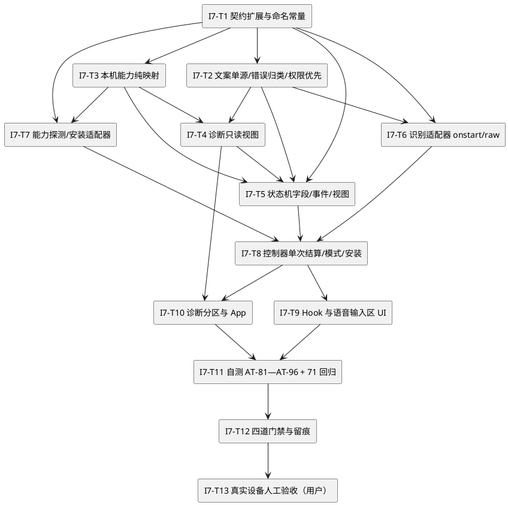

# EasyFlow 语音识别诊断、本机中文识别能力探测与错误文案（第七轮）— 编码任务清单

**输入依据**

- `.codeartsdoer/specs/easyflow_page_guide/iteration7-spec.md`（R-247—R-335、T7-01—T7-14、AT-81—AT-96、6.1—6.5、7.1—7.5）
- `.codeartsdoer/specs/easyflow_page_guide/iteration7-design.md`（重点：1.1 对比、1.2 存量分析中的 `onstart`/事件/状态、2.1 实现模型、2.2 接口 A—H（含 I/J）、2.3 数据模型、2.4 文案单源、2.5 UI、2.6 逐文件、2.7 测试、2.8 风险、2.9 取舍）
- `iteration6-spec.md`、`iteration6-design.md`、`iteration6-tasks.md`（71 项基线、假对象结构、门禁顺序与留痕口径）
- `iteration5-*`、`iteration4-*`、`iteration3-*`、`iteration2-*`、`spec.md`、`design.md`、`tasks.md`（任务编号、依赖图、追踪矩阵、人工验收口径）
- 现有实现（2026-11-14 只读核对）：`src/shared/speech/**`（`types`/`policy`/`copy`/`constants`/`permission`/`voiceMachine`/`speakMachine`）、`src/sidepanel/speech/**`（`recognition`/`voiceController`/`microphone`/`micPage`/`micMessages`/`synthesis`/`speechController`）、`src/sidepanel/hooks/useVoiceInput.ts`、`src/sidepanel/components/chat/{VoiceInputControl,ChatComposer,DiagnosticsPanel}.tsx`、`src/sidepanel/App.tsx`、`src/shared/messages.ts`、`src/shared/errors.ts`、`src/background/**`、`src/sidepanel/styles/sidepanel.css`、`scripts/selftest.mjs`、`scripts/verify-manifest.mjs`、`public/manifest.json`、`tsconfig.json`、`package.json`

**阶段声明**

- 本文件只是第七轮**编码任务规划**：未修改任何源码、未修改 `public/manifest.json`、未修改 `scripts/**`、未修改前六轮文档与本轮 `iteration7-spec.md` / `iteration7-design.md`。
- 编写本文件时**未执行** `npm run typecheck` / `npm run build` / `npm run selftest` / `npm run verify`，未创建 `codearts_proof/iteration7-*` 实绩日志，**未调用真实麦克风、真实语音识别、真实语音合成、真实 `SpeechRecognition.available` / `install`，未访问网络**。
- 实现阶段的自动测试**一律使用假权限、假识别、假本机能力、假安装**；不得出现真实 `navigator.mediaDevices.getUserMedia`、真实麦克风、真实 `SpeechRecognition`、真实 `speechSynthesis`、真实语言包与真实域名。
- 真实设备行为一律标“**人工验收待用户执行 / 真实设备中文本机识别未验证**”，不得写“已可用”。

---

## 0. 使用说明与全局约束

### 0.1 基线事实（2026-11-14 只读核对）

| 核查项 | 只读结论（文件:位置） | 对任务的要求 |
|---|---|---|
| 权限五态 | `shared/speech/permission.ts:1-9` 定义 `unknown/granted/prompt/denied/unsupported`；`sidepanel/speech/microphone.ts:46-61` 缺失→`unsupported`、抛错→`unknown` | 诊断与文案**只复用**这五态，禁止第二套权限枚举 |
| 授权页链路 | `sidepanel/speech/micPage.ts:26-135`；`src/mic-permission/request.ts` 是唯一 `getUserMedia` 调用点；`releaseStream` 立即停轨 | 本轮**不改**授权页、停轨、去重；只引用其状态 |
| 错误映射 | `shared/speech/policy.ts:94-113`：`not-allowed→permission-denied`、`service-not-allowed→service-limited`、`audio-capture→no-audio-device`、`no-speech/bad-grammar→no-speech`、`network→network`、其余 `unknown` | 六类原始类别须与同一张表对齐；不另立口径 |
| 状态机合并点 | `shared/speech/voiceMachine.ts:116-125`（`no-speech` 与 `unknown` 同归 `no-speech`）、`149-150`（`network→failed+issue`）、`162-166`（`ended→no-speech`）、`167-171`（`timeout→no-speech+timeout`） | 必须拆开 `unknown`；同会话只产出一个主提示 |
| `onstart` 可观测性 | `sidepanel/speech/recognition.ts:85-111` 未给 `instance.onstart` 赋值；`120` 在 `start()` 返回后同步发 `started` | 新增 `browser-start`，不改既有 `started` 语义 |
| `onend` 兜底 | `recognition.ts:102-111` 先发 `error(no-speech)` 再发 `ended` | 保留兜底；控制器做“单次结算”丢弃第二条 |
| 语音诊断现状 | `DiagnosticsPanel.tsx:66` `<details>` 默认折叠但子内容仍渲染；`127` “语音不可用类别：{speechIssue}”；`App.tsx:59-62` 的 `speechIssue` 来自**朗读** `speech.phase` | 必须分区、改名“朗读不可用类别”，并改为受控 `open` + 条件渲染 |
| 本机识别 API | 全仓库 `SpeechRecognition.available` / `processLocally` / `install(` **0 命中**；`types.ts:59-70` 的 `RecognitionLike` 不含这些成员 | 新增能力，必须先检测后显示，禁止假设存在 |
| 结果写入 | `ChatComposer.tsx:27-35` 按 `revision/pendingText` 写入并 `consumePending()`；`17-25` 仅 `submit()` 发送；`63-70` 发送按钮判空 | 双模式共用这一条路径；不新增发送路径 |
| 朗读链路 | `synthesis.ts`、`speechController.ts`、`speakMachine.ts`、`StepCardSpeech.tsx`；`AT-77` 已断言不含权限字段 | 零改动，只改诊断标签与中文映射 |
| 页面采集错误 | `shared/errors.ts:43-47` `EF-E003`；`useConversation.ts:228-229` 显示“我还没拿到这个页面的访问许可…” | 与语音输入无关；只在页面采集区出现 |
| 权限清单 | `public/manifest.json`：`["activeTab","scripting","sidePanel","storage"]` | 四项逐项不变 |
| 门禁 | `scripts/verify-manifest.mjs:110-119` 禁 `fetch(`/`XMLHttpRequest`/`sendBeacon`/`WebSocket`/`MediaRecorder`/密钥；`121-127` 禁 `host_permissions`/`<all_urls>`/`content_scripts`/`innerHTML`；`129-142` `getUserMedia` 两条例外；`200-211` 全量扫描 | 不新增外部接口、密钥、代理、网络上传；例外不扩 |
| 构建 | `package.json`：`build = tsc --noEmit && node scripts/build.mjs && node scripts/verify-manifest.mjs` | 四道门禁顺序保持；本轮不执行 |
| 自测基线 | `codearts_proof/iteration6-selftest.log` 末行 `1..71 / pass 71 / fail 0`；`selftest.mjs:16-60` 导出列表；`1555-1619` 假权限/页面/媒体；`2263-2340` `FakeRecognition`/`FakeSynthesis`；`2348-2747` AT-51—AT-63 | 新纯逻辑必须进导出列表；只加假对象；不得删 71 项 |
| 严格类型 | `tsconfig.json`：`strict`、`noUncheckedIndexedAccess`、`exactOptionalPropertyTypes`、`noImplicitOverride` | 不用 `any`/`@ts-ignore`/`@ts-expect-error`；可选属性不得显式赋 `undefined` |
| 样式基线 | `sidepanel.css:847-858`（诊断容器/字号）、`1201-1205`（`max-height` + 滚动）、`1219-1224`（换行）、`1267-1277`（减少动态）、`1279-1339`（语音区）、`1401-1414`（窄屏） | 新类只消费既有 token，不新增字号/颜色体系 |

> 行号仅作定位参考，实现以函数名、props 名与 CSS 选择器为准。

### 0.2 全局硬约束（每个任务都必须遵守）

1. **只改主工程**：只改 `D:\hwproject\translator`；不新建网站、不使用 `apps/extension`、不运行 `pnpm dev:web`。
2. **不动首次授权流程**：`getUserMedia` 字面量仍只允许出现在 `src/mic-permission/request.ts` 与产物 `dist/mic-permission.js`；侧栏、后台、内容脚本一律禁止；不自动打开授权页。
3. **权限不变**：`permissions` 恰为四项；不新增 `tabs`、`host_permissions`、`<all_urls>`、`content_scripts`、`web_accessible_resources`、`externally_connectable`；语言包不写 manifest。
4. **不接外部语音**：无第三方语音服务/SDK/密钥/代理；无 `fetch(`/`XMLHttpRequest`/`sendBeacon`/`WebSocket`；不上传音频或文本。
5. **不录音不保存**：无 `MediaRecorder`；不保存音频、识别原文、中间结果、设备名/ID、网页 URL/标题、完整错误 `message`、授权页查询串。
6. **只入框不发送**：识别结果只写入可编辑输入框（`pendingText`），不自动发送、不自动回车、不自动聚焦、不自动提交。
7. **失败不重试**：不自动重启识别、不自动重开授权页、不自动安装语言资源、不自动切换识别模式；只由用户手动操作。
8. **朗读/页面指引零改动**：`synthesis.ts`、`speechController.ts`、`speakMachine.ts`、`StepCardSpeech.tsx`、`EF-E003` 判定与文案不改；这些文件不得出现 `permission`/`MIC_`/`micPermission`/`recognized` 等语音输入字段。
9. **文案单源**：新增中文文案只在 `src/shared/speech/copy.ts`；组件、诊断、测试只引用常量或同一 `speechIssueText` / `describeSpeechDiagnostics` 派生结果，不得各写一份。
10. **常量化**：`LOCAL_CAPABILITY_TIMEOUT_MS`、`LOCAL_CAPABILITY_CACHE_MS`、语言参数、安装枚举均为命名常量；不散落魔法值。
11. **每步可构建**：I7-T1—I7-T10 每个任务结束时 `npm run typecheck` 必须 0 error；I7-T11 结束时 `npm run selftest` 必须 `1..87 / pass 87 / fail 0`；I7-T12 四道门禁全绿。
12. **测试不改写事实**：不删除 `AT-01`—`AT-80`；仅允许按 spec 7.2 与设计 2.7.2 改写 `AT-53/55/73/74/80` 中直接依赖 `network`/`no-speech`/标签的断言；其余不得放宽。
13. **文档不改**：`spec.md`、`design.md`、`tasks.md`、`iteration2-*`—`iteration6-*`、`iteration7-spec.md`、`iteration7-design.md` 不改。
14. **如实留痕**：未执行的命令与人工验收必须单列；失败日志保留、不覆盖、不编造。

### 0.3 明确“不改文件”清单

以下文件本轮**不得修改**（逐项核对，改动即视为越界）：

- `src/shared/speech/permission.ts`
- `src/mic-permission/**`、`public/mic-permission.html`
- `src/sidepanel/speech/microphone.ts`
- `src/sidepanel/speech/micPage.ts`
- `src/sidepanel/speech/micMessages.ts`
- `src/sidepanel/speech/synthesis.ts`
- `src/sidepanel/speech/speechController.ts`
- `src/shared/speech/speakMachine.ts`
- `src/sidepanel/components/chat/StepCardSpeech.tsx`
- `src/sidepanel/components/chat/StepCard.tsx`、`MessageList.tsx`、`AboutPanel.tsx`
- `src/shared/messages.ts`
- `src/background/**`（`index.ts`、`router.ts`、`injector.ts` 等）
- `src/content/**`、`src/sidepanel/guide/**`、`src/sidepanel/dialogue/**`、`src/sidepanel/match/**`、`src/shared/privacy/**`
- `src/shared/errors.ts`
- `src/sidepanel/hooks/useConversation.ts`
- `src/sidepanel/state/conversationReducer.ts`
- `src/shared/types.ts`（会话/页面类型，注意与 `src/shared/speech/types.ts` 不是同一文件）
- `src/shared/constants.ts`
- `public/manifest.json`
- `scripts/build.mjs`
- `scripts/verify-manifest.mjs`
- `package.json`、`tsconfig.json`
- 第一至第六轮规格/设计/任务文档与本轮 `iteration7-spec.md`、`iteration7-design.md`

### 0.4 允许新增/修改清单

**新增（3 个文件）**

- `src/shared/speech/localCapability.ts`
- `src/shared/speech/diagnostics.ts`
- `src/sidepanel/speech/localCapability.ts`

**修改（13 个文件 + 留痕）**

- `src/shared/speech/types.ts`
- `src/shared/speech/constants.ts`
- `src/shared/speech/copy.ts`
- `src/shared/speech/policy.ts`
- `src/shared/speech/voiceMachine.ts`
- `src/sidepanel/speech/recognition.ts`
- `src/sidepanel/speech/voiceController.ts`
- `src/sidepanel/hooks/useVoiceInput.ts`
- `src/sidepanel/components/chat/VoiceInputControl.tsx`
- `src/sidepanel/components/chat/ChatComposer.tsx`
- `src/sidepanel/components/chat/DiagnosticsPanel.tsx`
- `src/sidepanel/App.tsx`
- `src/sidepanel/styles/sidepanel.css`
- `scripts/selftest.mjs`
- `codearts_proof/**`（新增 `iteration7-{typecheck,build,selftest,verify}.log`、`26-iteration7-implementation.md`）

### 0.5 任务编号与追溯约定

- 本轮编码任务编号为 **`I7-T1`—`I7-T13`**；需求/设计阶段的取舍点仍写 `T7-01`—`T7-14` 与 `Q1`—`Q5`，两套编号不混用。
- 测试用例沿用 `AT-xx`；本轮新增 `AT-81`—`AT-96`（16 项），既有 71 项保留，总数 **87**。
- “设计 2.x”指 `iteration7-design.md` 的对应小节；“spec 5.x/6.x/7.x”指 `iteration7-spec.md`。
- **字段口径**：设计 2.2.2 接口 F 与 2.3.2 模型给出“9 个诊断/安装字段 + `mode`”共 10 个 `VoiceInputState` 新增字段；其中 `installAttempts` 仅内部幂等使用、不渲染。任务按设计 10 项实现，不删减 `mode`、不新增矩阵外字段。
- 每个任务的自验命令在**实现阶段**执行；本文件编写阶段不执行任何命令。
- “临时 node 断言”指用 esbuild 打包目标模块后直接 `node` 运行的一次性脚本，放系统临时目录、不提交主工程；正式断言统一进 `I7-T11` 的 `selftest.mjs`。
- 合并说明：`I7-T9` 与 `I7-T10` 分属“语音输入区”与“诊断区”两条 UI 路径，可独立验证；`I7-T11` 是全量测试收口，必须在 UI 完成后执行。

### 0.6 执行顺序总览

| 顺序 | 编号 | 标题 | 依赖 | 主要产物 | 构建检查点 |
|---|---|---|---|---|---|
| 1 | I7-T1 | 语音契约扩展与命名常量 | 无 | `shared/speech/{types,constants}.ts` | `typecheck` |
| 2 | I7-T2 | 文案单源、原始错误归类与权限优先失败分支 | I7-T1 | `shared/speech/{copy,policy}.ts` | `typecheck`；纯函数断言 |
| 3 | I7-T3 | 本机能力契约与五态/安装纯映射 | I7-T1 | `shared/speech/localCapability.ts`（新） | `typecheck`；纯函数断言 |
| 4 | I7-T4 | 语音诊断只读视图与相对时间 | I7-T1—I7-T3 | `shared/speech/diagnostics.ts`（新） | `typecheck`；纯函数断言 |
| 5 | I7-T5 | 状态机 9 诊断字段 + `mode`、5 类新事件与视图 | I7-T1—I7-T4 | `shared/speech/voiceMachine.ts` | `typecheck`；同引用断言 |
| 6 | I7-T6 | 识别适配器 `onstart`/`browser-start`/`raw`/`processLocally` | I7-T1、I7-T2 | `sidepanel/speech/recognition.ts` | `typecheck`；假构造器断言 |
| 7 | I7-T7 | 本机能力探测/安装适配器（唯一读取静态方法处） | I7-T1、I7-T3 | `sidepanel/speech/localCapability.ts`（新） | `typecheck`；假 API 断言 |
| 8 | I7-T8 | 控制器单次结算、模式、缓存、复检与安装编排 | I7-T2—I7-T7 | `sidepanel/speech/voiceController.ts` | `typecheck`；假适配器断言 |
| 9 | I7-T9 | Hook 接线、语音输入区单选/安装与样式 | I7-T8 | `useVoiceInput.ts`、`VoiceInputControl.tsx`、`ChatComposer.tsx`、`sidepanel.css`（语音区） | `typecheck`；源码结构断言 |
| 10 | I7-T10 | 诊断面板物理分区、受控折叠与 `App` 接线 | I7-T8、I7-T4 | `DiagnosticsPanel.tsx`、`App.tsx`、`sidepanel.css`（诊断区） | `typecheck`；源码结构断言 |
| 11 | I7-T11 | 自动化测试 AT-81—AT-96 与 71 项回归 | I7-T1—I7-T10 | `scripts/selftest.mjs` | `npm run selftest`；`1..87 / pass 87 / fail 0` |
| 12 | I7-T12 | 四道门禁、清洁检索与实现留痕 | I7-T11 | `codearts_proof/iteration7-*.log`、`26-iteration7-implementation.md` | 四命令全绿 |
| 13 | I7-T13 | 真实设备人工验收记录（用户执行） | I7-T12 | `26-iteration7-implementation.md` 人工分栏 | “人工验收待用户执行” |

### 0.7 依赖图

```text
I7-T1 ──┬──> I7-T2 ──┬──> I7-T4 ──┐
        │            │            │
        ├──> I7-T3 ──┴──> I7-T5 ──┼──> I7-T8 ──┬──> I7-T9 ──┐
        │                         │            │            ├──> I7-T11 ──> I7-T12 ──> I7-T13
        └──> I7-T6 ───────────────┘            └──> I7-T10 ──┘
        └──> I7-T7 ───────────────┘
```



**硬性顺序**

1. `I7-T1` 必须最先：类型与常量是全部后续模块的编译基础。
2. `I7-T2`/`I7-T3`/`I7-T6`/`I7-T7` 只依赖 `I7-T1`（`I7-T2` 与 `I7-T6` 之间是类型/映射使用关系，可并行）；`I7-T4` 依赖 `I7-T2`、`I7-T3`。
3. `I7-T5` 依赖 `I7-T2`（`resolveRecognitionFailure`、文案）、`I7-T3`（能力枚举）、`I7-T4`（诊断派生）；此任务之后状态机才能给出完整视图。
4. `I7-T8` 依赖 `I7-T5`（新事件/字段）、`I7-T6`（`browser-start`/`raw`）、`I7-T7`（探测/安装）。`start()` 仍为 `Promise<void>` 且**不得**等待能力探测（DFX 4.1.3 / AT-51）。
5. `I7-T9`、`I7-T10` 可并行（不同文件、不同断言），但都在 `I7-T8` 之后；不得先改 UI 再补控制器。
6. `I7-T11` 必须在全部实现之后；`I7-T12` 在 `I7-T11` 全绿之后；`I7-T13` 只在用户真实执行后记录。

### 0.8 阶段门禁与留痕

| 时点 | 命令/检查 | 通过标准 | 留痕 |
|---|---|---|---|
| I7-T1—I7-T10 | `npm run typecheck` | 退出码 0、0 error、无 `any`/`@ts-ignore`/`@ts-expect-error` | 汇总到 `codearts_proof/iteration7-typecheck.log` |
| I7-T11 | `npm run selftest` | `1..87` / `pass 87` / `fail 0`；71 项不回退 | `codearts_proof/iteration7-selftest.log` |
| I7-T12 | `npm run typecheck` → `npm run build` → `npm run selftest` → `npm run verify` | 四条独立执行、分别留痕；`build` 产物清单不新增入口 | `iteration7-{typecheck,build,selftest,verify}.log` |
| I7-T12 | 清洁检索 | `SpeechRecognition.available/install` 访问只在 `sidepanel/speech/localCapability.ts`；`processLocally` 赋值只在 `recognition.ts`；语音目录无 `chrome.storage`/`fetch(`/`MediaRecorder` | `iteration7-verify.log` + 检索记录 |
| I7-T13 | 真实 Chrome 6 步 | 逐项记录或“人工验收待用户执行”；真实设备中文本机识别未验证 | `26-iteration7-implementation.md` |

> 门禁顺序固定为 `typecheck → build → selftest → verify`。不得以 `build` 内含的检查替代单独 `verify`。

---

## 1. I7-T1 语音契约扩展与命名常量

**编号与标题**：I7-T1 / 语音契约扩展与命名常量。

**目标**：一次性落位本轮所需的类型契约与命名常量，使后续任务只依赖稳定契约；所有扩展均为“只增不改”，不破坏既有 71 项与 `exactOptionalPropertyTypes`。

**对应需求/设计条目**：R-249、R-250、R-279、R-280、R-301、R-303、R-304、R-330；设计 2.1.2、2.2.1、2.2.2 接口 A、2.6.2、2.7.3。

**涉及文件与函数/类型/常量**

- 修改 `src/shared/speech/types.ts`：
  - 新增 `RawSpeechErrorKind = "no-speech" | "network" | "not-allowed" | "service-not-allowed" | "audio-capture" | "other"`。
  - 新增 `RecognitionMode = "service" | "local"`。
  - `SpeechStartOptions` 增可选 `processLocally?: boolean`（服务模式不传该键）。
  - `RecognitionEvent` 增 `{ type: "browser-start" }`；`error` 分支增可选 `raw?: RawSpeechErrorKind`。
  - `RecognitionLike` 增可选 `processLocally?: boolean`（避免 `FakeRecognition` 破损）。
  - `VoiceInputIssue` 增 `"permission-conflict"`。
  - **不改**既有 `SpeechErrorKind` 9 值、`RecognitionEvent` 既有四类语义、`Speak*` 类型。
- 修改 `src/shared/speech/constants.ts`（追加 4 个常量）：
  - `LOCAL_CAPABILITY_TIMEOUT_MS = 1500`
  - `LOCAL_CAPABILITY_CACHE_MS = 300000`
  - `LOCAL_AVAILABILITY_LANGS = ["zh-CN"] as const`
  - `LOCAL_INSTALL_LANGS = ["zh-CN"] as const`
  - **不改**既有 8 个常量值（尤其 `SPEECH_NO_RESULT_TIMEOUT_MS = 8000`）。

**实现要点与前置依赖**

- [ ] 先改类型，再改常量；可选属性只写 `?`，不写 `| undefined`，不在对象字面量里显式赋 `undefined`。
- [ ] `RecognitionEvent` 用判别联合扩展，不把 `raw` 放到 `started`/`browser-start`/`final`/`ended`。
- [ ] `LOCAL_AVAILABILITY_LANGS` / `LOCAL_INSTALL_LANGS` 用 `as const`，保证 `readonly ["zh-CN"]` 可直接传入 `langs` 参数。
- [ ] 前置依赖：无。

**明确不做事项**

- 不实现任何映射函数、不写文案、不改状态机/适配器/控制器/UI。
- 不新增 `SpeechErrorKind` 值（`permission-conflict` 走 `VoiceInputIssue`）。
- 不新增 permissions、不写 storage、不新增网络请求、不出现 `getUserMedia`。

**完成标准与自验方式**

- [ ] `npm run typecheck` 退出码 0。
- [ ] 源码检索：`types.ts` 含 `RawSpeechErrorKind`、`RecognitionMode`、`browser-start`、`permission-conflict`、`processLocally`；`constants.ts` 含 4 个新常量。
- [ ] 临时 node 断言（esbuild 打包 `constants.ts`）：`LOCAL_CAPABILITY_TIMEOUT_MS === 1500`、`LOCAL_CAPABILITY_CACHE_MS === 300000`、`SPEECH_NO_RESULT_TIMEOUT_MS === 8000`、两组 `langs` 都等于 `["zh-CN"]`。
- [ ] `FakeRecognition` 与既有 AT-51—AT-63 构造事件不因新增分支报错（由 `I7-T11` 全量确认）。

**风险与回滚点**

- 风险：`exactOptionalPropertyTypes` 下可选属性写法不当导致 typecheck 失败；缓解：只在类型声明用 `?`，调用方用条件展开。
- 风险：给 `RecognitionEvent.error` 加 `raw` 后，既有事件构造缺字段；缓解：`raw` 必须可选。
- 回滚点：本任务只改类型与常量；回滚即恢复两个文件，不影响任何运行时行为。

---

## 2. I7-T2 文案单源、原始错误归类与权限优先失败分支

**编号与标题**：I7-T2 / 文案单源、原始错误归类与权限优先失败分支。

**目标**：把“权限真实状态 + 原始错误类别”收敛为唯一 `phase/issue/gate` 组合，并把本轮全部新增用户可见文案集中到 `copy.ts`；实现 `no-speech` 单句、`network` 双模板（已授权/未确认）、`unknown` 走通用失败、`no-speech` 与 `network` 互不合并。

**对应需求/设计条目**：R-261—R-278；spec 6.3、6.4；设计 1.1.2、1.2.4、2.2.2 接口 B/I、2.4.1—2.4.3。

**涉及文件与函数/常量**

- 修改 `src/shared/speech/copy.ts`（唯一定义处）：
  - `SPEECH_NO_SPEECH_TEXT = "没有听到可识别内容，可以再说一次。"`
  - `SPEECH_GENERIC_FAILED_TEXT = "识别失败，可以再试或直接打字。"`
  - `SPEECH_NETWORK_GRANTED_TEXT = "麦克风已授权，但浏览器语音服务连接失败；可以打字，或检查本机语音识别是否可用。"`
  - `SPEECH_NETWORK_UNKNOWN_TEXT = "网络或语音服务暂不可用，可以直接打字。"`
  - `SPEECH_NOT_ALLOWED_GRANTED_TEXT = "麦克风已授权，但浏览器拒绝了本次识别；可以再试一次，或直接打字。"`
  - `speechIssueText(issue: VoiceInputIssue, permission: MicPermissionState): string`：`network` 在 `granted` 时返回 `SPEECH_NETWORK_GRANTED_TEXT`，否则返回 `SPEECH_NETWORK_UNKNOWN_TEXT`；`permission-conflict` 返回 `SPEECH_NOT_ALLOWED_GRANTED_TEXT`；其余键仍取 `VOICE_ISSUE_TEXT`。
  - `SPEECH_MODE_TEXTS = { groupLabel: "识别方式", service: "浏览器服务识别", local: "使用本机识别" } as const`
  - `SPEECH_LOCAL_TEXTS = { downloadable, install, installing, installFailed, unavailable, error, stillDownloadable, modeUnavailable }`（取设计 2.2.2 接口 I 原文）。
  - `SPEECH_DIAGNOSTICS_TEXTS = { title: "语音输入诊断", pageTitle: "页面采集诊断", speakTitle: "朗读状态", speakUnavailableLabel: "朗读不可用类别", recheck: "重新检测本机识别", permissionLabel, lastErrorLabel, listeningLabel, onstartLabel, localApiLabel, localStateLabel, localCheckedLabel, installStateLabel, modeLabel, noError: "暂无（本次侧栏会话）", unsupportedValue: "不支持", noValue: "无" } as const`
  - `SPEAK_UNAVAILABLE_KIND_TEXT = { unsupported: "不支持", "sensitive-skipped": "这段内容含个人信息，未朗读" } as const`
  - `VOICE_STATUS_TEXT["no-speech"] = SPEECH_NO_SPEECH_TEXT`；`VOICE_STATUS_TEXT.failed = SPEECH_GENERIC_FAILED_TEXT`；`VOICE_ISSUE_TEXT.network = SPEECH_NETWORK_UNKNOWN_TEXT`；`VOICE_ISSUE_TEXT["permission-conflict"] = SPEECH_NOT_ALLOWED_GRANTED_TEXT`。
  - **保留** `VOICE_ISSUE_TEXT.timeout` 现有“没有听到内容…”句（诊断另记“其他识别失败（等待超时）”）。
  - **保留** `VOICE_DISALLOWED_WORDS` 的转义写法与既有五态文案。
- 修改 `src/shared/speech/policy.ts`：
  - `mapRawErrorKind(raw: string | undefined): RawSpeechErrorKind`：`no-speech`/`bad-grammar`→`no-speech`；`network`→`network`；`not-allowed`→`not-allowed`；`service-not-allowed`→`service-not-allowed`；`audio-capture`→`audio-capture`；其余（含 `aborted`/`language-not-supported`/空值）→`other`。
  - `rawKindOfSpeechError(kind: SpeechErrorKind): RawSpeechErrorKind`：`no-speech`→`no-speech`；`network`→`network`；`permission-denied`→`not-allowed`；`service-limited`→`service-not-allowed`；`no-audio-device`→`audio-capture`；其余（`unsupported`/`device-unavailable`/`aborted`/`unknown`）→`other`。
  - `resolveRecognitionFailure({ permission, kind, raw }): { phase: VoiceInputPhase; issue: VoiceInputIssue | null; gate: boolean }`：
    - `aborted` → `{ phase:"cancelled", issue:null, gate:false }`；`unsupported` → `{ phase:"unsupported", issue:null, gate:false }`。
    - `permission==="denied"` → `{ phase:"permission-denied", issue:null, gate:false }`。
    - `permission==="prompt" | "unsupported"` → `{ phase:"idle", issue:null, gate:true }`。
    - `permission==="granted"`：按 `raw` 分支——`no-speech`→`no-speech`；`network`→`failed/network`；`not-allowed`→`failed/permission-conflict`；`service-not-allowed`→`failed/service-limited`；`audio-capture`→`permission-denied/no-audio-device`；`other`→`failed/null`。
    - `permission==="unknown"`：按 `raw` 分支——`no-speech`→`no-speech`；`network`→`failed/network`；`not-allowed`→`permission-denied/null`；`service-not-allowed`→`failed/service-limited`；`audio-capture`→`permission-denied/no-audio-device`；`other`→`failed/null`。
    - `device-unavailable` → `failed/device-unavailable`（非识别侧来源，保持既有）。
    - 纯函数；`permission!=="granted"` 时绝不返回 `issue:"network"|"service-limited"`。
  - **不改** `mapRecognitionError` 的既有映射。

**实现要点与前置依赖**

- [ ] `Record<VoiceInputIssue, string>` 必须键齐全（新增 `permission-conflict`），否则 typecheck 失败。
- [ ] `speechIssueText` 是“按权限选模板”的唯一函数；`describeVoiceInput` 只调用它，不内联判断。
- [ ] 文案禁止项：不含 `NotAllowedError`/`NotFoundError`/`NotReadableError`/`no-speech`/`audio-capture`/`service-not-allowed`/`network`；不含“离线/纯本地/不上传”；不含“一定支持中文包/所有 Chrome 都支持”；不含“页面访问许可/点扩展图标”。
- [ ] `no-speech` 文案仅一句，不得追加网络/服务/权限/授权措辞。
- [ ] 前置依赖：I7-T1。

**明确不做事项**

- 不改 `voiceMachine.ts`（分支接线在 I7-T5）、不改适配器/控制器/组件。
- 不删除既有文案常量与转义写法；不改 `MIC_PERMISSION_DENIED_TEXT`。
- 不为 `unknown` 新增第二种通用句；不把 `unknown` 归为 `no-speech`。

**完成标准与自验方式**

- [ ] `npm run typecheck` 退出码 0。
- [ ] 临时 node 断言：
  - `mapRawErrorKind("no-speech") === "no-speech"`、`"bad-grammar" === "no-speech"`、`"network" === "network"`、`"not-allowed" === "not-allowed"`、`"service-not-allowed" === "service-not-allowed"`、`"audio-capture" === "audio-capture"`、`"weird"/undefined === "other"`。
  - `resolveRecognitionFailure({permission:"granted",kind:"network",raw:"network"})` → `failed/network/false`；`{denied,network}` → `permission-denied/null`；`{prompt,network}` → `idle/null/gate:true`；`{unknown,network}` → `failed/network`；`{granted,"unknown","other"}` → `failed/null`；`{granted,"permission-denied","not-allowed"}` → `failed/permission-conflict`。
  - `SPEECH_NETWORK_GRANTED_TEXT` 含“麦克风已授权”“浏览器语音服务连接失败”“可以打字”“本机语音识别”，且不含“重新授权/权限未开启/开启麦克风”。
  - `SPEECH_NO_SPEECH_TEXT` 不含“网络/服务/权限/授权”，且全文仅一句（以“。”结尾、内部无第二个“。”）。
  - 六类文案（`network`/`no-speech`/`MIC_PERMISSION_DENIED_TEXT`/`service-limited`/`no-audio-device`/`device-unavailable`）集合大小 = 6。
  - 文案合集正则否定原始错误串与过度承诺词。
- [ ] 前置断言：`VOICE_ISSUE_TEXT.timeout` 仍含“没有听到”。

**风险与回滚点**

- 风险：改写 `VOICE_STATUS_TEXT["no-speech"]` 使 AT-55 的“未识别”断言失败；缓解：按 spec 7.2 在 I7-T11 显式改写为引用 `SPEECH_NO_SPEECH_TEXT`，不放松强度。
- 风险：`permission==="unknown"` 时误用“已授权”模板；缓解：双模板 + `granted` 严格判断 + AT-82/AT-83。
- 风险：`permission!=="granted"` 仍返回 `network` issue；缓解：自验逐一断言非 granted 分支。
- 回滚点：恢复 `copy.ts`/`policy.ts` 旧值即可回到第六轮文案与归并口径；新增常量可独立删除。

---

## 3. I7-T3 本机能力契约与五态/安装纯映射

**编号与标题**：I7-T3 / 本机能力契约与五态/安装纯映射。

**目标**：固定本机可用五态与安装六态，提供无副作用的纯映射；未知值一律归 `error`/`failed`，绝不静默变成 `available`。

**对应需求/设计条目**：R-279—R-285、R-292、R-296；设计 2.1.2、2.2.2 接口 C、2.3.2、2.9.1（T7-08）。

**涉及文件与函数/类型**

- 新增 `src/shared/speech/localCapability.ts`（纯逻辑，无 React/DOM/chrome/window）：
  - `LOCAL_AVAILABILITY_STATES = ["available","downloadable","unavailable","unsupported-not-called","error"] as const`
  - `LocalAvailability`（由数组派生）
  - `INSTALL_STATES = ["idle","requesting","succeeded","failed","denied","unsupported"] as const`
  - `InstallState`（由数组派生）
  - `LocalAvailableOptions { langs: readonly ["zh-CN"]; processLocally: true }`
  - `LocalInstallOptions { langs: readonly ["zh-CN"] }`
  - `LocalRecognitionApiLike { available(options: LocalAvailableOptions): Promise<unknown>; install?(options: LocalInstallOptions): Promise<unknown> }`
  - `mapLocalAvailability(raw: unknown): LocalAvailability`：`"available"`→`available`；`"downloadable"`/`"downloading"`→`downloadable`（T7-08 合并）；`"unavailable"`→`unavailable`；其余（含 `undefined`/`null`/空串/数字/对象/`"weird"`）→`error`。
  - `mapInstallResult(raw: unknown): InstallState`：`true`→`succeeded`；`false`→`failed`；`{ ok: true }`→`succeeded`；其余→`failed`（`denied`/`unsupported` 由适配器分支决定）。

**实现要点与前置依赖**

- [ ] 只做枚举与纯映射；不读取 `SpeechRecognition`、不调用 `available`/`install`。
- [ ] 数组用 `as const` 并派生类型，避免枚举与文案键不一致。
- [ ] `processLocally: true` 用字面量类型，保证调用参数不可被改成 `false`。
- [ ] 前置依赖：I7-T1。

**明确不做事项**

- 不实现探测/安装适配器（I7-T7）、不写文案、不改状态机。
- 不新增第六个用户可见可用状态；不按版本号或地区推断。
- 不使用 `any`/`as` 强转浏览器对象。

**完成标准与自验方式**

- [ ] `npm run typecheck` 退出码 0。
- [ ] 临时 node 断言：
  - `[...LOCAL_AVAILABILITY_STATES]` 深度等于五态、`[...INSTALL_STATES]` 深度等于六态。
  - `mapLocalAvailability("available") === "available"`；`"downloadable" === "downloadable"`；`"downloading" === "downloadable"`；`"unavailable" === "unavailable"`；`"weird"`/`null`/`undefined`/`""`/`1` 均为 `"error"`。
  - `mapInstallResult(true) === "succeeded"`；`false === "failed"`；`{ok:true} === "succeeded"`；`{ok:false}`/`"x"`/`null` 均为 `"failed"`。
  - 文件内正则无 `SpeechRecognition`/`chrome`/`window`/`navigator`/`fetch(`。

**风险与回滚点**

- 风险：`downloading` 被误判为 `available`；缓解：映射表显式合并到 `downloadable` + 自验。
- 风险：返回对象（如 `{available:true}`）被误判；缓解：只认字符串字面量，其余归 `error`。
- 回滚点：删除该文件即回到“无本机能力”状态；无运行时引用前不影响任何既有功能。

---

## 4. I7-T4 语音诊断只读视图与相对时间

**编号与标题**：I7-T4 / 语音诊断只读视图与相对时间。

**目标**：把诊断状态枚举派生为纯中文只读视图，字段与 spec 6.2 矩阵一一对应；组件与测试共用同一派生函数，不各自计算。

**对应需求/设计条目**：R-247—R-260、R-334；spec 6.1、6.2；设计 2.2.2 接口 E、2.3.2、2.6.1、2.7.1（AT-81）。

**涉及文件与函数/常量**

- 新增 `src/shared/speech/diagnostics.ts`（纯逻辑）：
  - `SpeechDiagnosticsView { permissionText; permissionCheckedAgo; lastErrorText; lastErrorAgo; listeningText; onstartText; localApiText; localAvailabilityText; localCheckedAgo; installStateText; modeText }`
  - `describeSpeechDiagnostics(input, now: number): SpeechDiagnosticsView`，输入字段与设计 2.2.2 接口 E 完全一致：`permission`、`permissionCheckedAt`、`lastRawErrorKind`、`lastRawErrorAt`、`lastRawErrorTimedOut`、`browserOnstart`、`localApiPresent`、`localAvailability`、`localCheckedAt`、`installState`、`mode`。
  - `formatRelativeTime(now: number, at: number | null): string`：`null`→“未检测”；`< 60s`（含 `at > now` 的钳制）→“刚刚”；`< 60min`→“N 分钟前”；其余→“较早”；不显示日期/时区/精确时间戳。
  - 标签常量（唯一定义）：`PERMISSION_DIAG_LABEL`（已授权/待询问/已拒绝/未知/当前环境无法查询）、`RAW_ERROR_LABEL`（没有听到语音/浏览器语音服务连接失败/浏览器拒绝本次识别/语音服务被限制/未检测到麦克风/其他识别失败）、`LOCAL_AVAILABILITY_LABEL`（可用/可下载（或正在下载）/暂不支持中文/未调用（不支持）/无法判断）、`INSTALL_STATE_LABEL`（未开始/正在准备/已准备/准备失败/被拒绝/不支持）、`ONSTART_LABEL`（是/否（未开始）/否（会话已结束））。
  - 派生规则：`lastRawErrorKind===null`→`SPEECH_DIAGNOSTICS_TEXTS.noError`；`lastRawErrorTimedOut===true`→“其他识别失败（等待超时）”；`browserOnstart==="not-started"`→“否（未开始）”、`"reached"`→“是”、`"ended-without-start"`→“否（会话已结束）”；`localApiPresent===null`→“未检测”、`true`→“存在”、`false`→“不存在”；`localAvailability==="checking"`→“检测中…”；`installState` 按标签表；`mode` 取 `SPEECH_MODE_TEXTS`。
  - `listeningText`：`input` 无 `phase` 字段，由调用方传入 `listening: boolean` 或状态机截取；**实现约定**：`describeSpeechDiagnostics` 增加 `listening: boolean` 输入（与 `phase==="listening"` 同源），输出“是/否”。

**实现要点与前置依赖**

- [ ] 输入只允许枚举、布尔、数字时间；不得接收文本、`message`、URL、设备信息。
- [ ] 输出只含中文；不得出现 `no-speech`/`network`/`not-allowed`/`service-not-allowed`/`audio-capture`/`unsupported` 等原始串。
- [ ] `checking` 不得显示为“可用”。
- [ ] 前置依赖：I7-T1、I7-T2（文案常量）、I7-T3（枚举）。

**明确不做事项**

- 不写 `chrome.storage`、不写运行日志、不形成历史列表。
- 不计算/渲染权限或能力状态（只做映射）。
- 不新增矩阵外字段（如 `installAttempts`、`message`、`url`）。

**完成标准与自验方式**

- [ ] `npm run typecheck` 退出码 0。
- [ ] 临时 node 断言：
  - 完整输入 → 11 个输出字段均非空。
  - 五态权限文案集合大小 = 5；六类 `RAW_ERROR_LABEL` 集合大小 = 6；五类可用状态集合大小 = 5；六类安装状态集合大小 = 6。
  - `lastRawErrorKind=null` → “暂无（本次侧栏会话）”；`timedOut=true` → 含“等待超时”。
  - `formatRelativeTime(60_000, 0) === "1 分钟前"`、`formatRelativeTime(1000, 0) === "刚刚"`、`formatRelativeTime(0, null) === "未检测"`、`formatRelativeTime(0, 3600_000) === "刚刚"`（钳制）。
  - `JSON.stringify(view)` 不含 `http`/`url`/`audio`/`message`/`device`/`transcript`；对同一输入，`pendingText` 长度变化不改变诊断对象长度（该函数不接收 `pendingText`）。
  - 源码正则无原始错误串作为**输出**（允许出现在输入枚举类型中）。

**风险与回滚点**

- 风险：相对时间在 `at > now`（假时钟）时输出负数；缓解：钳制为“刚刚” + 自验。
- 风险：组件另写同义句导致双源；缓解：T10 只引用 `describeSpeechDiagnostics` 输出与标签常量。
- 风险：诊断对象被误加文本字段；缓解：类型只含枚举/布尔/时间派生字符串，AT-81 做否断言。
- 回滚点：删除该文件与 T5 的 `diagnostics` 视图字段即可回到“无语音诊断”；不影响识别主链路。

---

## 5. I7-T5 状态机 9 诊断字段 + `mode`、5 类新事件与视图

**编号与标题**：I7-T5 / 状态机诊断字段、模式字段、5 类新事件与视图扩展。

**目标**：让状态机成为诊断、模式与安装状态的**唯一内存写入点**；拆分 `unknown` 与 `no-speech`；实现权限优先失败分支；保证 `listening` 重复开始仍返回同一引用，`invalidate` 保留诊断与模式。

**对应需求/设计条目**：R-247—R-260、R-269—R-278、R-281、R-289、R-290、R-299、R-301—R-306；设计 1.2.2、2.1.3(1)(3)(8)、2.2.2 接口 F、2.3.2、2.4.2。

**涉及文件与函数/类型/事件**

- 修改 `src/shared/speech/voiceMachine.ts`：
  - `VoiceInputState` 新增：`mode: RecognitionMode`、`lastRawErrorKind: RawSpeechErrorKind | null`、`lastRawErrorAt: number | null`、`lastRawErrorTimedOut: boolean`、`browserOnstart: "not-started" | "reached" | "ended-without-start"`、`localApiPresent: boolean | null`、`localAvailability: LocalAvailability | "checking"`、`localCheckedAt: number | null`、`installState: InstallState`、`installAttempts: number`。
  - `createVoiceInputState()` 初始值：`mode:"service"`、`lastRawErrorKind:null`、`lastRawErrorAt:null`、`lastRawErrorTimedOut:false`、`browserOnstart:"not-started"`、`localApiPresent:null`、`localAvailability:"checking"`、`localCheckedAt:null`、`installState:"idle"`、`installAttempts:0`。
  - `VoiceInputEvent` 增：`{ type:"browser-start" }`、`{ type:"local-capability-checking" }`、`{ type:"local-capability-checked"; apiPresent:boolean; availability:LocalAvailability; at:number }`、`{ type:"install-state-changed"; state:InstallState }`、`{ type:"mode-changed"; mode:RecognitionMode }`；既有 `adapter-error` 增可选 `raw?: RawSpeechErrorKind`、`at?: number`；`timeout` 增可选 `at?: number`（保证既有测试构造不破坏）。
  - `VoiceInputView` 增：`mode`、`showModeSelector`、`localOptionVisible`、`installButtonVisible`、`installInProgress`、`localNoticeText: string | null`、`diagnostics: SpeechDiagnosticsView`。
  - reducer 规则：
    - `start-requested{supported:true}`：非 `listening` 时 `phase:"listening"`、`issue:null`、`disclosureShown:true`、`browserOnstart:"not-started"`；**`listening` 时返回同一引用**（AT-56）。
    - `browser-start`：仅 `listening` 时 `browserOnstart:"reached"`；否则返回原引用。
    - `adapter-final`：保留既有；不改 `pendingText/revision` 写入时机。
    - `adapter-error`：**先记诊断** `lastRawErrorKind = event.raw ?? rawKindOfSpeechError(kind)`、`lastRawErrorAt = event.at ?? state.lastRawErrorAt`、`lastRawErrorTimedOut:false`；再 `resolveRecognitionFailure({ permission, kind, raw })` 决定 `phase/issue/gate`；`aborted` 仍按 `cancelledByUser` 走 `cancelled`；`unsupported` 仍走 `unsupported`。
    - `adapter-ended`：`listening` 时若 `browserOnstart==="not-started"` 置 `"ended-without-start"`；`phase:"no-speech"`、`issue:null`（保留兜底）。
    - `timeout`：`listening` 时 `phase:"no-speech"`、`issue:"timeout"`、`lastRawErrorKind:"other"`、`lastRawErrorTimedOut:true`、`lastRawErrorAt:event.at ?? state.lastRawErrorAt`。
    - `permission-refreshed`：保留写权限与时间；`granted` 时清 `issue` 与 `micGate`，且若 `phase==="permission-denied"` 回到 `idle`（R-267）。
    - `local-capability-checking`：`localAvailability:"checking"`。
    - `local-capability-checked`：写 `localApiPresent/localAvailability/localCheckedAt`。
    - `install-state-changed`：写 `installState`；`state==="requesting"` 时 `installAttempts+1`。
    - `mode-changed`：写 `mode`；不启动、不持久化。
    - `invalidate`：沿用短路条件；命中时**保留** `permission/permissionCheckedAt/mode/lastRawError*/browserOnstart/local*/install*/revision`，只清 `issue/pendingText/micGate/micPageFailed` 并回 `idle`。
  - `describeVoiceInput(state, now?: number): VoiceInputView`：`issue` 文本改用 `speechIssueText(issue, permission)`；补 7 个视图字段；`diagnostics = describeSpeechDiagnostics({...}, now ?? 0)`。
  - 视图派生：`showModeSelector = localApiPresent === true`；`localOptionVisible = localApiPresent === true && localAvailability === "available"`；`installButtonVisible = localAvailability === "downloadable" || installState === "requesting"`；`installInProgress = installState === "requesting"`；`localNoticeText` 优先级：`installInProgress`→`installing`；`mode==="local" && localAvailability!=="available"`→`modeUnavailable`；`installState` 为 `failed/denied/unsupported`→`installFailed`；`installState==="succeeded" && localAvailability==="downloadable"`→`stillDownloadable`；`available`→`null`；`downloadable`→`downloadable`；否则→`unavailable`/`error` 对应文案。
  - **不可破坏**：`listening` 时 `start-requested` 同引用；`adapter-final{ok}` 仍写 `pendingText` 且 `revision+1`；无变化事件返回原引用。

**实现要点与前置依赖**

- [ ] 诊断记录必须发生在权限改写**之前**，保证 `denied+network` 的诊断仍是 `network`。
- [ ] `raw` 缺失时用 `rawKindOfSpeechError(kind)` 兜底，兼容既有事件构造。
- [ ] `now` 可选参数默认 `0`；相对时间对假时钟安全（见 T4）。
- [ ] `localNoticeText` 与诊断文案均引用 `copy.ts`，不内联。
- [ ] 前置依赖：I7-T1、I7-T2、I7-T3、I7-T4。

**明确不做事项**

- 不改 `phase` 既有 8 个值、不改 `VOICE_BUTTON_TEXT` 键集合。
- 不新增第六类可用状态、不新增 `lastRawError` 历史数组。
- 不把诊断写入 `ConversationState`、聊天消息、运行日志或 storage。
- 不实现 `resolveRecognitionFailure`（在 T2）。

**完成标准与自验方式**

- [ ] `npm run typecheck` 退出码 0。
- [ ] 临时 node 断言：
  - 初始状态 10 个新字段默认值正确（`mode:"service"`、`localAvailability:"checking"` 等）。
  - `listeningState()` 再 `start-requested{supported:true}` 返回**同一引用**。
  - `adapter-error{kind:"unknown"}` → `phase:"failed"`、`issue:null`，且 `describeVoiceInput(...).statusText === SPEECH_GENERIC_FAILED_TEXT`。
  - `adapter-error{kind:"no-speech"}` → `phase:"no-speech"`，`statusText === SPEECH_NO_SPEECH_TEXT`。
  - `permission-refreshed{denied}` + `adapter-error{network,raw:"network",at:1}` → `phase:"permission-denied"`，但 `lastRawErrorKind === "network"`。
  - `permission-refreshed{granted}` + `adapter-error{network,raw:"network"}` → `failed/network`，`statusText` 含“麦克风已授权”。
  - `browser-start` 在非 `listening` 时返回原引用；在 `listening` 后 `browserOnstart==="reached"`。
  - `adapter-ended`（未 `browser-start`）→ `browserOnstart==="ended-without-start"`。
  - `timeout{at:1}` → `lastRawErrorKind==="other"`、`lastRawErrorTimedOut===true`。
  - `install-state-changed{requesting}` 两次 → `installAttempts===2`。
  - `invalidate` 后 `mode/lastRawErrorKind/localAvailability/installState` 保持不变。
  - `describeVoiceInput(state).diagnostics` 11 字段齐全。

**风险与回滚点**

- 风险：在 `start-requested` 里无条件重置 `browserOnstart` 破坏 AT-56 同引用；缓解：仅在非 `listening` 分支重置 + 同引用断言。
- 风险：`invalidate` 短路条件未覆盖新字段导致无谓通知；缓解：短路时返回原引用即可，诊断字段本身不被清。
- 风险：`localNoticeText` 优先级混乱导致 `downloadable` 与 `modeUnavailable` 同时出现；缓解：固定优先级 + AT-88/AT-93。
- 回滚点：恢复 `voiceMachine.ts` 的字段/事件/describe；controller 未注入新事件时可退回第六轮视图。

---

## 6. I7-T6 识别适配器 `onstart`/`browser-start`/`raw`/`processLocally`

**编号与标题**：I7-T6 / 识别适配器 `onstart` 观测、原始错误类别与 `processLocally`。

**目标**：把“侧栏已发起（`started`）”与“浏览器真正开始（`browser-start`）”分开；错误事件携带六类原始类别；仅在新建实例且本机模式下写 `processLocally = true`。

**对应需求/设计条目**：R-249、R-250、R-269—R-271、R-277、R-303—R-306；设计 1.2.3、2.1.3(2)、2.2.2 接口 E、2.6.2。

**涉及文件与函数**

- 修改 `src/sidepanel/speech/recognition.ts`：
  - `start(options)` 内：`instance.onstart = () => { if (this.disposed || token !== this.token || this.settled) return; this.emit({ type:"browser-start" }); }`。
  - `onerror`：`const raw = mapRawErrorKind(event.error); this.emit({ type:"error", kind: mapRecognitionError(event.error), raw })`（`raw` 为可选字段，显式传值合法）。
  - `processLocally`：仅当 `options.processLocally === true` 时执行 `instance.processLocally = true`；服务模式**不写该字段**（不写 `false`）。
  - 赋值抛错 → `this.settled = true; emit({type:"error",kind:"unknown",raw:"other"}); emit({type:"ended"}); return;`
  - **保留**：每次 `start()` 都 `detach()` 后 `new`（不复用实例）、`started` 同步发出、`onend` 无结果兜底、`cancel/dispose` 幂等、`detach()` 清 `onstart`。
  - 文件内**不得**出现 `getUserMedia`。

**实现要点与前置依赖**

- [ ] `onstart` 守卫顺序必须是 `disposed → token → settled`，避免迟到 `onstart` 污染新会话诊断。
- [ ] `raw` 只在 `onerror` 与启动异常分支携带；`final/ended/started/browser-start` 不带。
- [ ] `processLocally` 赋值放在 `instance.start()` 之前、字段设置之后；抛错按“未启动”处理。
- [ ] 前置依赖：I7-T1（类型）、I7-T2（`mapRawErrorKind`）。

**明确不做事项**

- 不删除 `onend` 的 `error(no-speech)+ended` 兜底（单次结算由控制器负责）。
- 不改 `started` 的同步语义、不改 `cancel/dispose`、不改 `firstFinalText`。
- 不感知权限、不读写 storage、不调用 `available/install`。

**完成标准与自验方式**

- [ ] `npm run typecheck` 退出码 0。
- [ ] 临时 node 断言（假构造器 + 假实例，记录属性赋值与事件）：
  - 构造后 `instance.onstart` 为函数；触发 `onstart` 后收到 `{type:"browser-start"}`。
  - `settled` 后（收到 final）再触发 `onstart` → 无事件。
  - `onerror({error:"network"})` → 事件 `{kind:"network", raw:"network"}`；`onerror({error:"weird"})` → `{kind:"unknown", raw:"other"}`。
  - `start({...processLocally:true})` → 实例 `processLocally === true`；`start({...})`（无字段）→ 实例上不存在该属性。
  - `start()` 返回后仍立即收到 `started`（同步）。
  - 无结果 `onend` → 先 `error{no-speech}` 再 `ended`（兜底保留）。
  - `cancel()` 后迟到 `onstart/onerror/onend` 均无事件；`dispose()` 后无事件。
- [ ] 源码检索：`recognition.ts` 内 `onstart =` 仅一处；`processLocally =` 仅一处；无 `getUserMedia`/`chrome.storage`。

**风险与回滚点**

- 风险：`onstart` 迟到在新会话触发，导致新会话误报“浏览器已开始”；缓解：`token` 守卫 + `detach` 清 `onstart`。
- 风险：`processLocally` 赋值在部分浏览器只读抛错；缓解：`try/catch` → `unknown` + `ended`，不自动回退服务模式。
- 风险：给 `error` 加 `raw` 改变既有事件对象形状；缓解：可选字段，既有断言只读 `kind`。
- 回滚点：删除 `onstart` 赋值与 `processLocally` 分支即可回到第六轮适配器；`raw` 可选不影响。

---

## 7. I7-T7 本机能力探测/安装适配器

**编号与标题**：I7-T7 / 本机能力探测与安装适配器（唯一读取静态方法处）。

**目标**：提供侧栏唯一的能力探测与安装入口；API 缺失时 **0 次调用**返回 `unsupported-not-called`；探测 1.5 秒超时归 `error`；安装只在调用方点击后执行一次，参数只含 `zh-CN`，永不 reject。

**对应需求/设计条目**：R-279—R-290、R-291—R-295、R-297；设计 2.1.2（唯一性约束 1）、2.1.3(4)(5)、2.2.2 接口 D、2.7.3。

**涉及文件与函数**

- 新增 `src/sidepanel/speech/localCapability.ts`：
  - `readLocalRecognitionApi(scope: unknown): LocalRecognitionApiLike | null`：从 `scope` 的结构化记录读取 `SpeechRecognition` 或 `webkitSpeechRecognition` 构造函数；仅当 `typeof ctor === "function"` 且其 `available` 为函数时返回适配对象；`install` 仅在为函数时挂载；调用用 `Function.call(ctor, options)` 保留 receiver；无 `available` → 返回 `null`。
  - `createLocalCapabilityProbe(api, deps?: { timeoutMs?: number }): { check(): Promise<LocalAvailability> }`：`api === null` → `"unsupported-not-called"`（0 次调用）；否则 `Promise.race` 调用 `api.available({ langs: LOCAL_AVAILABILITY_LANGS, processLocally: true })` 与 `timeoutMs`（默认 `LOCAL_CAPABILITY_TIMEOUT_MS`）超时；超时/抛错 → `"error"`；返回 `mapLocalAvailability(raw)`；**清理定时器**。
  - `createLocalInstaller(api): { install(): Promise<InstallState> }`：`api === null` 或无 `install` → `"unsupported"`；否则 `api.install({ langs: LOCAL_INSTALL_LANGS })` → `mapInstallResult(raw)`；抛 `NotAllowedError`/`SecurityError` → `"denied"`；其余抛错 → `"failed"`；**永不 reject**。
- 约束：文件内是 `SpeechRecognition.available` / `.install` 字符串访问的**唯一**位置；不得出现 `chrome.storage`/`fetch(`/`MediaRecorder`/`getUserMedia`/`navigator`。

**实现要点与前置依赖**

- [ ] `readLocalRecognitionApi` 全程用 `unknown → Record<string, unknown>` 结构化窄化；禁止 `any`/`as SpeechRecognition`/`@ts-expect-error`。
- [ ] 静态方法必须用 `.call(ctor, options)`，不能脱离构造函数调用（部分实现依赖 receiver）。
- [ ] 超时定时器必须在 `finally` 清理；超时后不再重试、不轮询。
- [ ] `check()` 与 `install()` 均在 `try/catch` 内，保证调用方无需再兜底。
- [ ] 前置依赖：I7-T1（常量/类型）、I7-T3（映射）。

**明确不做事项**

- 不探测音频设备、不调用 `getUserMedia`、不启动识别、不访问网络。
- 不在页面加载/诊断展开时自动调用（由 T8 控制触发时机）。
- 不做版本号/地区判断、不缓存（缓存在 T8）。

**完成标准与自验方式**

- [ ] `npm run typecheck` 退出码 0。
- [ ] 临时 node 断言（假 scope/假 API）：
  - `readLocalRecognitionApi({}) === null`；`readLocalRecognitionApi({ SpeechRecognition: function(){} }) === null`（无 `available`）；`webkitSpeechRecognition` 同样识别。
  - `createLocalCapabilityProbe(null).check()` → `"unsupported-not-called"`，假 API 调用次数 0。
  - 假 API `available` 记录参数 → `langs === ["zh-CN"]`、`processLocally === true`；返回 `"available"`/`"downloadable"`/`"unavailable"`/`"weird"` → 对应五态（`weird`→`error`）。
  - 假 API 延迟 50ms、注入 `timeoutMs:10` → `"error"`，且 50ms 后不再改变结果（无第二次写）。
  - 假 API `available` 抛错 → `"error"`，不 reject。
  - `readLocalRecognitionApi({ SpeechRecognition: ctorWithInstall })` + `createLocalInstaller(api).install()` → 记录参数仅 `langs:["zh-CN"]`；`true`→`succeeded`；`false`→`failed`；抛 `{name:"NotAllowedError"}`→`denied`；抛其他→`failed`；无 `install`→`unsupported`。
  - 源码正则：无 `chrome.storage`/`fetch(`/`MediaRecorder`/`getUserMedia`/`navigator`。

**风险与回滚点**

- 风险：某些实现把 `available` 放在原型/实例而非静态；缓解：只认静态方法，缺失即 `unsupported-not-called`，不猜测。
- 风险：超时后底层 Promise 仍 resolve，覆盖后续状态；缓解：`check()` 内部只返回一次结果，控制器按“最近一次”写入。
- 风险：`install` 抛错名并非标准 `DOMException`；缓解：同时读 `name` 字符串与对象 `name`。
- 回滚点：不注入 probe/installer（T9）即回到“无本机能力”；文件可独立删除。

---

## 8. I7-T8 控制器单次结算、模式、能力缓存、复检与安装编排

**编号与标题**：I7-T8 / `VoiceController` 单次结算、识别模式、能力缓存与安装编排。

**目标**：保证一次识别失败只结算一次（先 `no-speech` 后 `ended`/超时不再追加提示）；把模式、能力缓存（5 分钟）、手动复检与安装（仅点击、幂等、成功后复检）落到唯一编排层；`start()` 仍不等待能力探测。

**对应需求/设计条目**：R-250、R-261—R-267、R-269—R-278、R-279—R-290、R-291—R-309、R-315、R-316；设计 1.2.1、2.1.3(2)(3)(4)(5)(6)、2.2.2 接口 G、2.3.2、2.7.1。

**涉及文件与类/方法**

- 修改 `src/sidepanel/speech/voiceController.ts`：
  - `VoiceControllerDeps` 增可选 `localCapability?: LocalCapabilityProbe`、`localInstaller?: LocalInstaller`（不注入即退化第六轮行为）。
  - 新增私有：`activeSessionId: number`、`settledSessionId: number | null`、`checkingLocal: boolean`、`installing: boolean`。
  - `start(): Promise<void>`：保持签名；同步段判 `disposed/listening/starting`；`mode==="local"` 且 `state.localAvailability!=="available"` → **不启动**（依赖 `localNoticeText` 提示，不自动切回）；`service` 路径完全沿用（含未注入 probe 的同步路径，AT-51 要求首个 `await` 前完成）。
  - `beginListening()`：`const id = (this.sessionToken += 1); this.activeSessionId = id; this.settledSessionId = null;`；options 构造：`service` 为 `{lang,singleShot,interimResults}`；`local` 为条件展开 `{ ...base, processLocally: true }`。
  - `onAdapterEvent(event)`：
    - `started` → `adapter-started`（不结算）。
    - `browser-start` → `browser-start`（不结算）。
    - `final/error/ended`：先判 `token !== this.sessionToken` → 丢弃；再判 `this.settledSessionId === this.activeSessionId` → 丢弃；命中终态后先置结算标记，再 `clearTimer()`、`apply`。
    - `error` 传 `raw: event.raw`（缺失由 reducer 兜底）与 `at: this.now()`；`ended` 不传。
  - `onTimeout()`：仅 `listening`；置结算标记；`adapter.cancel()`；`apply({type:"timeout", at:this.now()})`。
  - `cancel()`/`invalidate()`：递增 `sessionToken`、置结算标记、清定时器；语义不变；`invalidate` 不重置诊断/模式/权限。
  - `ensureLocalCapability(force = false): Promise<void>`：`disposed` 返回；`!force && localCheckedAt!==null && now-localCheckedAt < LOCAL_CAPABILITY_CACHE_MS` → 直接返回；`checkingLocal` → 返回；无 `localCapability` → 写 `{apiPresent:false, availability:"unsupported-not-called", at:now}`（0 次调用）；否则 `apply(local-capability-checking)` → `await check()` → `apply(local-capability-checked)`；`finally` 释放锁。
  - `recheckLocalCapability()`：`ensureLocalCapability(true)`。
  - `requestLocalInstall(): Promise<void>`：`disposed || installing` 返回；`localAvailability!=="downloadable"` 返回；无 `localInstaller` → `apply(install-state-changed{unsupported})`；否则 `installing=true` → `apply(requesting)` → `await install()` → 写结果；`succeeded` 后 `await ensureLocalCapability(true)`（**不自动选中模式**）；`finally` 释放锁；不自动识别/不自动重试。
  - `setRecognitionMode(mode)`：`disposed` 或与当前相同 → 返回；`phase==="listening"` → 先 `cancel()`；`apply(mode-changed)`；不启动、不持久化。
  - `getDiagnostics(): SpeechDiagnosticsView`：`describeSpeechDiagnostics({...}, this.now())`。
  - `getView()`：`describeVoiceInput(this.state, this.now())`；`viewCache` 失效规则不变（AT-56 同引用）。
  - `dispose()`：释放 `checkingLocal/installing`、清结算标记、其余不变。
  - 文件内**不得**出现 `navigator`/`chrome`/`window`/`SpeechRecognition`。

**实现要点与前置依赖**

- [ ] 结算标记必须基于**本会话**，不能用全局布尔；`adapter.cancel()` 引起的 `aborted/ended` 按既有 `cancelRequested` 语义处理，且只结算一次。
- [ ] `error` 与 `ended` 兜底：`error` 先结算，`ended` 被丢弃（R-277）。
- [ ] 能力缓存判断用注入时钟 `this.now()`；`force=true` 跳过缓存。
- [ ] 安装成功后复检必须 `force=true`；只有 `available` 才让选项出现（由视图派生）。
- [ ] `start()` 中**不得**新增 `await` 能力探测；本机模式预检只读内存。
- [ ] 前置依赖：I7-T2、I7-T3、I7-T4、I7-T5、I7-T6、I7-T7。

**明确不做事项**

- 不自动重试识别、不自动重开授权页、不自动安装、不自动切换模式、不自动发送。
- 不把能力结果/模式/安装状态写 storage；不写聊天消息/运行日志。
- 不改 `requestMicPermission`/`refreshPermission`/`applyMicResult` 的既有语义（权限五态与去重仍归第六轮）。

**完成标准与自验方式**

- [ ] `npm run typecheck` 退出码 0。
- [ ] 临时 node 断言（`FakeRecognition` + 假 probe/installer + 假时钟）：
  - 未注入 probe 时 `controller.start()` 同步进入 `listening`（不 `await` 即断言）；`startCalls===1`。
  - `probe="granted"` 时 `await start()` → `listening`；`probe="prompt"` → `idle` 且 `showMicEntry===true`。
  - `mode:"local"` 且 `localAvailability:"downloadable"` → `startCalls===0`，`localNoticeText` 非空。
  - `mode:"local"` 且已 `available` → `lastOptions.processLocally === true`；`mode:"service"` → `!("processLocally" in lastOptions)`。
  - 每次 `start()` 都新建实例（假构造器计数递增），不复用。
  - `adapter-error{kind:"network",raw:"network"}` 后 `ended` → `getView().statusText` 只一条网络句；`lastRawErrorKind==="network"`；`ended` 不再改状态。
  - `timeout` → `lastRawErrorKind==="other"`、`lastRawErrorTimedOut===true`。
  - 连续 3 次 `start()` 在 `listening` 中 → `startCalls===1`。
  - `ensureLocalCapability()` 两次（同一时钟）→ 假 probe `checkCalls===1`；`recheckLocalCapability()` → `2`；时钟推进 `LOCAL_CAPABILITY_CACHE_MS` 后再 `ensure` → `3`。
  - `install()` 延迟 resolve 时连续 5 次 `requestLocalInstall()` → `installCalls===1`；成功后复检 `checkCalls+1`，`mode` 仍 `service`。
  - 安装 `false`/`denied`/`failed` → `installState` 对应；推进 30 秒无自动调用（`installCalls` 不变）。
  - `listening` 中 `setRecognitionMode("local")` → `cancelCalls===1`、`startCalls` 不增加。
  - 本机失败后 `service` 适配器 `startCalls===0`，`mode` 仍 `local`。
  - `invalidate()` 后 `mode`/`lastRawErrorKind`/`localAvailability`/`installState` 保持。

**风险与回滚点**

- 风险：`start()` 为本地模式预检增加 `await`，破坏 AT-51 同步语义；缓解：只读内存，不加 `await`。
- 风险：`settledSessionId` 未随 `cancel/invalidate` 更新，迟到事件仍被接受；缓解：递增 `sessionToken` + token 比较。
- 风险：安装成功复检慢导致 `succeeded` 后长时间无选项；缓解：复检期间保持 `installState` 为 `succeeded`，选项出现前不显示“可用”。
- 风险：`ensureLocalCapability` 在展开时被高频调用导致重复探测；缓解：`checkingLocal` 锁 + 5 分钟缓存。
- 回滚点：`useVoiceInput` 不注入 `localCapability/localInstaller` → 退回单一服务识别；结算标记可单独回滚，不影响权限链路。

---

## 9. I7-T9 Hook 接线、语音输入区单选/安装与样式

**编号与标题**：I7-T9 / `useVoiceInput` 接线、语音输入区识别方式与安装入口、语音区样式。

**目标**：把控制器新增能力接到侧栏：暴露 `setMode/installLocal/ensureLocalCapability/recheckLocalCapability`；语音区出现“识别方式”单选组（仅 `available` 出现本机项）与安装按钮（仅 `downloadable`），不可用时不出现死按钮；所有新控件只消费既有 token。

**对应需求/设计条目**：R-281—R-284、R-290—R-294、R-300—R-308、R-311—R-314；设计 2.2.2 接口 H/J、2.5.1、2.5.3、2.6.2。

**涉及文件与函数/props/CSS 选择器**

- 修改 `src/sidepanel/hooks/useVoiceInput.ts`：
  - 引入 `readLocalRecognitionApi`、`createLocalCapabilityProbe`、`createLocalInstaller`（`src/sidepanel/speech/localCapability.ts`）。
  - `new VoiceController({ ..., localCapability: createLocalCapabilityProbe(readLocalRecognitionApi(globalThis)), localInstaller: createLocalInstaller(readLocalRecognitionApi(globalThis)) })`（两次读取可复用同一 `api` 局部变量）。
  - `VoiceInputHandle` 增：`setMode(mode: RecognitionMode): void`、`installLocal(): void`、`ensureLocalCapability(): void`、`recheckLocalCapability(): void`。
  - 保留挂载权限查询、focus/visibility 刷新、卸载清理。
- 修改 `src/sidepanel/components/chat/VoiceInputControl.tsx`：
  - props 增 `onSelectMode: (mode: RecognitionMode) => void`、`onInstallLocal: () => void`。
  - 在“开启麦克风”之后、状态行之前渲染：
    - `view.showModeSelector` 时：`<div className="ef-speech-mode" role="radiogroup" aria-label={SPEECH_MODE_TEXTS.groupLabel}>`，两个 `<label>` + `<input type="radio" name="ef-speech-mode" checked={view.mode==="service"} onChange={() => onSelectMode("service")}>`；本机项仅 `view.localOptionVisible` 时渲染。
    - `view.localNoticeText !== null` 时：`<p className="ef-speech-local-note">{view.localNoticeText}</p>`。
    - `view.installButtonVisible` 时：`<button type="button" className="ef-speech-install-btn" disabled={view.installInProgress} onClick={onInstallLocal}>{view.installInProgress ? SPEECH_LOCAL_TEXTS.installing : SPEECH_LOCAL_TEXTS.install}</button>`。
  - 保留 `ef-speech-btn`/`ef-speech-open-btn`/`ef-speech-status`/`ef-speech-mic-purpose`/`ef-speech-setting-help`/`ef-speech-disclosure` 的既有语义与类名。
  - 组件内**不得**出现 `SpeechRecognition`/`webkitSpeechRecognition`/`speechSynthesis`/`SpeechSynthesisUtterance`（AT-54）。
- 修改 `src/sidepanel/components/chat/ChatComposer.tsx`：只把 `onSelectMode={voice.setMode}`、`onInstallLocal={voice.installLocal}` 传入；**不改** `useEffect` 消费逻辑、`submit()`、发送按钮判空、不聚焦/不发送。
- 修改 `src/sidepanel/styles/sidepanel.css`（只消费 token，不新增变量/字号/动画）：
  - `.ef-speech-mode`：`display:flex; flex-wrap:wrap; gap:var(--ef-space-3); flex:1 1 100%`。
  - `.ef-speech-mode label`：`display:inline-flex; align-items:center; gap:6px; min-height:var(--ef-tap-min); font-size:var(--ef-font-small)`。
  - `.ef-speech-install-btn`：`min-height:var(--ef-tap-min); border:1px solid var(--ef-step-accent); border-radius:8px; background:#fff; color:var(--ef-step-accent); font-size:var(--ef-font-small); padding:6px 12px; cursor:pointer; white-space:normal`。
  - `.ef-speech-install-btn[disabled]`：`cursor:not-allowed; opacity:0.6`。
  - `.ef-speech-local-note`：`flex:1 1 100%; margin:0; color:var(--ef-muted); font-size:var(--ef-font-small); line-height:var(--ef-line-body); overflow-wrap:anywhere`。

**实现要点与前置依赖**

- [ ] 单选组只在 `showModeSelector===true` 时渲染；本机项只在 `localOptionVisible===true` 时渲染 → 天然满足“无死按钮”。
- [ ] 点击模式只调用回调，不调用 `start()`；`listening` 中由控制器先取消（UI 不做判断）。
- [ ] 安装按钮只在 `downloadable`（或安装进行中）出现；进行中禁用且文案为“正在准备…”。
- [ ] `downloadable` 时不渲染本机单选项；`unavailable`/`unsupported-not-called`/`error` 时不渲染本机项。
- [ ] 前置依赖：I7-T8（句柄方法）。

**明确不做事项**

- 不改主按钮“语音输入/取消识别”、不改告知/用途/设置帮助段落。
- 不新增下拉框、不新增设置面板、不新增音量可视化、不做设备选择器。
- 不在组件内查询能力、不读写 storage、不自动启动识别、不自动安装。
- 不改 `ChatComposer` 的发送/聚焦语义。

**完成标准与自验方式**

- [ ] `npm run typecheck` 退出码 0。
- [ ] 源码断言：
  - `useVoiceInput.ts` 含 `createLocalCapabilityProbe`、`createLocalInstaller`；`VoiceInputHandle` 含 4 个新方法。
  - `VoiceInputControl.tsx` 含 `role="radiogroup"`、`aria-label`（引用 `SPEECH_MODE_TEXTS.groupLabel`）、`view.localOptionVisible`、`view.installButtonVisible`、`disabled={view.installInProgress}`。
  - `ChatComposer.tsx` 含 `onSelectMode={voice.setMode}`、`onInstallLocal={voice.installLocal}`；`useEffect` 片段仍不含 `submit`/`focus`。
  - 组件目录正则不含 `SpeechRecognition|webkitSpeechRecognition|speechSynthesis|SpeechSynthesisUtterance`。
  - CSS 正则：`.ef-speech-mode`、`.ef-speech-install-btn`、`.ef-speech-local-note` 均存在且 `min-height:var(--ef-tap-min)` 出现在按钮/标签规则内。
- [ ] 前置回归：AT-51 的 `VoiceInputControl` 结构断言（`disabled={!view.canStart}`）仍成立。

**风险与回滚点**

- 风险：单选组 `name` 与页面其他控件冲突；缓解：固定 `name="ef-speech-mode"`。
- 风险：`downloadable` 时误渲染本机项（死按钮）；缓解：视图派生 + AT-88 断言“本机项 0 个”。
- 风险：新按钮在关怀模式下低于 44px；缓解：全部使用 `var(--ef-tap-min)` + AT-96/AT-63 回归。
- 回滚点：移除 3 个新增 props 与对应 JSX 即恢复第五/六轮语音区；CSS 新类可保留但无引用。

---

## 10. I7-T10 诊断面板物理分区、受控折叠与 `App` 接线

**编号与标题**：I7-T10 / 诊断面板物理分区、受控折叠、朗读类别改名与 `App` 接线。

**目标**：把“运行诊断”拆成“语音输入诊断 → 页面采集诊断 → 朗读状态 → 运行记录”四个物理分区；折叠时不渲染任何诊断值；现有“语音不可用类别”改名“朗读不可用类别”并显示中文值；`EF-E003` 仍只属于页面采集区。

**对应需求/设计条目**：R-247—R-260、R-320—R-325；设计 1.1.2、2.2.2 接口 H、2.5.2、2.5.3、2.6.2、2.9.2（Q2）。

**涉及文件与 props/CSS 选择器**

- 修改 `src/sidepanel/components/chat/DiagnosticsPanel.tsx`：
  - props：`speechIssue?: string | null` → `speakUnavailableKind: string | null`；新增 `speechDiagnostics: SpeechDiagnosticsView`、`onRecheckLocal: () => void`、`onExpand: () => void`。
  - 受控折叠：`const [open, setOpen] = useState(false);` + `<details className="ef-diagnostics" open={open} onToggle={(event) => { const next = event.currentTarget.open; setOpen(next); if (next) onExpand(); }}>`；`open===false` 时**不渲染**任何分区内容（仅 `<summary>运行诊断</summary>`）。
  - 展开后顺序：
    1. `<section className="ef-speech-diag" aria-labelledby="ef-speech-diag-title">` + `<div id="ef-speech-diag-title" className="ef-diag-section-title">语音输入诊断</div>` + `<div className="ef-speech-diag-grid">` 9 行中文标签（引用 `SPEECH_DIAGNOSTICS_TEXTS` 与 `speechDiagnostics` 字段）+ `<button type="button" className="ef-inline-link" onClick={onRecheckLocal} aria-label={SPEECH_DIAGNOSTICS_TEXTS.recheck}>{SPEECH_DIAGNOSTICS_TEXTS.recheck}</button>`。
    2. 既有“页面采集诊断”内容整体搬入 `<section aria-labelledby="ef-page-diag-title">`，标题保留“页面采集诊断”，`重新读取页面` 按钮、时间/日期候选、`成功判定`、`iframe` 提示等字段**不改语义**。
    3. `<section aria-labelledby="ef-speak-diag-title">` + `<div id="ef-speak-diag-title" className="ef-diag-section-title">{SPEECH_DIAGNOSTICS_TEXTS.speakTitle}</div>` + `<p className="ef-muted">{SPEECH_DIAGNOSTICS_TEXTS.speakUnavailableLabel}：{中文值}</p>`（`speakUnavailableKind` 为 `null` → `SPEECH_DIAGNOSTICS_TEXTS.noValue`）。
    4. 既有运行记录 `ef-diag-list`（`entries`），无条目仍显示“暂无运行记录”。
  - 诊断区**不得**出现安装按钮、`EF-E003`、网页 URL/标题、识别文本、设备信息、完整 `message`。
  - 保留类名 `ef-diagnostics`、`ef-page-diag-title`、`ef-page-diag-grid`、`ef-diag-list`、`ef-diag-item` 与 `maxHeight/overflowY/tabIndex` 的滚动约束。
- 修改 `src/sidepanel/App.tsx`：
  - `speechIssue` → `speakUnavailableKind`：`speech.phase === "unsupported" || speech.phase === "sensitive-skipped" ? SPEAK_UNAVAILABLE_KIND_TEXT[speech.phase] : null`。
  - 传 `speechDiagnostics={voice.view.diagnostics}`、`onRecheckLocal={voice.recheckLocalCapability}`、`onExpand={voice.ensureLocalCapability}`；保留 `onRefresh={() => void retry()}`。
  - 保留 `voice.invalidate()`/`speech.*` 的既有生命周期 effect，不改触发条件。
- 修改 `src/sidepanel/styles/sidepanel.css`（诊断区）：
  - `.ef-speech-diag`：`margin-top:var(--ef-space-3); overflow-wrap:anywhere`。
  - `.ef-speech-diag-grid`：`display:grid; grid-template-columns:repeat(auto-fit,minmax(140px,1fr)); gap:4px 8px`。
  - `.ef-diag-section-title`：与 `.ef-page-diag-title` 同组声明（不新增字号/颜色体系），仅允许必要的 `margin-top`。
  - 不修改 `--ef-diag-max-h`、`overflow` 既有规则与 `prefers-reduced-motion`。

**实现要点与前置依赖**

- [ ] `open` 只由 `onToggle` 的 `currentTarget.open` 写入；不做其他 `setOpen`，避免与原生折叠打架。
- [ ] `onExpand` 只在展开为真时调用；控制器缓存保证 5 分钟内不重复探测（Q3）。
- [ ] 折叠时不渲染 = DOM 中不存在诊断值；不能用 CSS 隐藏替代。
- [ ] 朗读类别显示中文值（`不支持` / `这段内容含个人信息，未朗读` / `无`），不显示 `unsupported` 原文。
- [ ] 前置依赖：I7-T4（诊断视图）、I7-T8（`getView().diagnostics`、`ensureLocalCapability/recheckLocalCapability`）。

**明确不做事项**

- 不改页面采集字段、`EF-E003` 判定/文案、`重新读取页面` 按钮语义。
- 不在诊断区放安装按钮（R-300）、不在诊断区触发识别/权限/安装/网络。
- 不读 `state.messages`（旧“页面访问许可”消息不得影响语音诊断）。
- 不改运行记录条目结构、不改朗读链路。

**完成标准与自验方式**

- [ ] `npm run typecheck` 退出码 0。
- [ ] 源码断言：
  - `DiagnosticsPanel.tsx` 含 `useState(false)`、`onToggle`、`open ?`（或等价条件渲染）、`ef-speech-diag`、`ef-speech-diag-grid`、`ef-diag-section-title`。
  - 标题顺序：`语音输入诊断` < `页面采集诊断` < `朗读状态` < `暂无运行记录`（下标比较）。
  - 含 `朗读不可用类别`，**不含** `语音不可用类别`；不含 `EF-E003`、`页面访问许可`、安装按钮文案（`下载中文语音资源`）。
  - 9 行标签齐全（权限/最近错误/侧栏正在听/浏览器开始识别/本机识别接口/中文（zh-CN）本机状态/最近检测/安装状态/识别方式）。
  - `App.tsx` 含 `SPEAK_UNAVAILABLE_KIND_TEXT`、`voice.view.diagnostics`、`voice.recheckLocalCapability`、`voice.ensureLocalCapability`。
  - CSS 正则：`.ef-speech-diag`、`.ef-speech-diag-grid`、`.ef-diag-section-title` 存在；`--ef-diag-max-h` 规则未被改写。
  - 组件目录正则不含语音全局对象（维持 AT-54）。
- [ ] 既有回归：AT-35 的 `maxHeight/overflowY/tabIndex` 断言仍成立；AT-46/AT-80 的 storage 扫描仍通过。

**风险与回滚点**

- 风险：受控 `details` 与原生 toggle 抖动；缓解：只从 `currentTarget.open` 同步，不额外 `setOpen`；失败可退回非受控（需用户确认放弃“折叠不渲染”）。
- 风险：分区标题复用类名改变字号体系；缓解：只分组声明既有 `.ef-page-diag-title` 规则，不新增 token。
- 风险：`onExpand` 在每次展开都调用导致探测；缓解：缓存 + `checkingLocal` 锁。
- 风险：整改后 `entries` 渲染位置变化影响既有断言；缓解：保留 `ef-diag-list`/`ef-diag-item` 类名与文本结构。
- 回滚点：删除语音/朗读两个小节、恢复 `speechIssue` prop 即回到第六轮诊断；页面采集区不受影响。

---

## 11. I7-T11 自动化测试 AT-81—AT-96 与 71 项回归

**编号与标题**：I7-T11 / 自动化测试 AT-81—AT-96、既有 71 项回归与允许改写项。

**目标**：用假权限、假识别、假本机能力、假安装覆盖诊断字段与分区、权限优先、`no-speech`/`network` 文案、六类互异、本机五分支、安装生命周期、`processLocally`、只填框、失败可打字、不自动重试、朗读回归；总数 87，全部通过且不访问真实设备/网络。

**对应需求/设计条目**：R-247—R-335；spec 7.1、7.2、6.2、6.3；设计 2.7.1、2.7.2。

**涉及文件与测试结构**

- 修改 `scripts/selftest.mjs`：
  - esbuild 导出列表追加：
    - `mapRawErrorKind`、`rawKindOfSpeechError`、`resolveRecognitionFailure`（`policy.ts`）
    - `LOCAL_AVAILABILITY_STATES`、`INSTALL_STATES`、`mapLocalAvailability`、`mapInstallResult`（`shared/speech/localCapability.ts`）
    - `describeSpeechDiagnostics`、`formatRelativeTime`、`PERMISSION_DIAG_LABEL`、`RAW_ERROR_LABEL`、`LOCAL_AVAILABILITY_LABEL`、`INSTALL_STATE_LABEL`、`ONSTART_LABEL`（`diagnostics.ts`）
    - `speechIssueText`、`SPEECH_NO_SPEECH_TEXT`、`SPEECH_GENERIC_FAILED_TEXT`、`SPEECH_NETWORK_GRANTED_TEXT`、`SPEECH_NETWORK_UNKNOWN_TEXT`、`SPEECH_NOT_ALLOWED_GRANTED_TEXT`、`SPEECH_MODE_TEXTS`、`SPEECH_LOCAL_TEXTS`、`SPEECH_DIAGNOSTICS_TEXTS`、`SPEAK_UNAVAILABLE_KIND_TEXT`（`copy.ts`）
    - `LOCAL_CAPABILITY_TIMEOUT_MS`、`LOCAL_CAPABILITY_CACHE_MS`、`LOCAL_AVAILABILITY_LANGS`、`LOCAL_INSTALL_LANGS`（`constants.ts`）
    - `readLocalRecognitionApi`、`createLocalCapabilityProbe`、`createLocalInstaller`（`sidepanel/speech/localCapability.ts`）
  - 新增假对象 `FakeLocalCapability`（放测试文件内）：
    - 字段：`availableCalls`、`installCalls`、`lastAvailableOptions`、`lastInstallOptions`、`result`、`installResult`、`delayMs`、`throwMode`、`installThrowMode`。
    - 方法：`available(options)` 记录参数并按配置延迟/抛错/返回；`install(options)` 同上；支持并发下调用计数。
  - 复用 `FakePermissionProbe`/`FakePermissionPage`/`FakeRecognition`/`FakeSynthesis`，不新增真实 API。
  - 新增 `AT-81`—`AT-96`（16 项），断言要点：
    - **AT-81**：构造含全部字段的 state → `describeVoiceInput(state, now).diagnostics` 11 字段齐全；`lastRawErrorKind=null` → “暂无（本次侧栏会话）”；`lastRawErrorTimedOut=true` → 含“等待超时”；`JSON.stringify` 不含 URL/文本/设备/message/audio；对同一状态改变 `pendingText` 长度，诊断对象长度不变；`DiagnosticsPanel.tsx` 含两个分区标题且语音区源码片段不含 `EF-E003`/`页面访问许可`。
    - **AT-82**：`granted+network` → 含“麦克风已授权”；`denied+network` → `permission-denied` + 拒绝句；`prompt+network` → `idle` + `micGate` + 开启引导；三例 `lastRawErrorKind==="network"`。
    - **AT-83**：四要素齐全；不含“重新授权/权限未开启/开启麦克风/去设置”；`granted` 下 `showMicEntry===false`；`FakePermissionPage.openCalls===0`。
    - **AT-84**：`no-speech` → `statusText === SPEECH_NO_SPEECH_TEXT`，不含网络/服务/权限/授权；`unknown` → `failed` + `SPEECH_GENERIC_FAILED_TEXT`；连续两次 `adapter-error` 后 `statusText` 仍只一条（字符级不叠加）。
    - **AT-85**：六类终态（网络/未听到/权限拒绝/服务受限/无设备/系统禁用）文案集合大小 = 6；合集正则不含原始错误串与英文异常名。
    - **AT-86**：`readLocalRecognitionApi({}) === null`；`probe(null).check() === "unsupported-not-called"` 且假 API 0 调用；`localOptionVisible===false`；服务识别仍 `startCalls===1`。
    - **AT-87**：`available` → `lastAvailableOptions.langs` 深度等于 `["zh-CN"]`、`processLocally===true`；`localOptionVisible===true`；未点击 `installCalls===0`；选本机后新实例 `processLocally===true`。
    - **AT-88**：`downloadable` → `localNoticeText` 含“可下载中文本机语音资源”；`installButtonVisible===true`；`installCalls===0`；`localOptionVisible===false`。
    - **AT-89**：点击 1 次 → `installCalls===1`、`lastInstallOptions.langs` 仅 `["zh-CN"]`；延迟中连点 5 次 → `installCalls===1`；`installInProgress===true`；`ChatComposer.tsx` 的 `textarea` 未被语音状态禁用。
    - **AT-90**：成功 + 复检 `available` → `localOptionVisible===true` 且 `mode==="service"`（不自动选中）；`false`/`denied`/抛错 → `SPEECH_LOCAL_TEXTS.installFailed`；推进 30 秒 `installCalls` 不增长。
    - **AT-91**：`unavailable`/`"weird"`/抛错 → 均 `localOptionVisible===false`；抛错文案“无法判断本机识别是否可用”；不崩溃（`getView()` 正常）。
    - **AT-92**：`service` → `!("processLocally" in lastOptions)`；`local` → `true` 且假实例构造计数每次 +1；`setRecognitionMode` 后等待（假时钟）`startCalls` 不变；`listening` 中切换 → `cancelCalls+1`。
    - **AT-93**：本机失败（`error`）后 `service` 适配器 `startCalls===0`、`mode==="local"`；`granted+available+network` 文案含“本机语音识别”、`mode` 仍 `service`、无自动启动。
    - **AT-94**：两模式各 emit `final` → `pendingText` 正确、`revision+1`；`ChatComposer` 消费 effect 仍不含 `submit`/`focus`；无消息/轮次增量来源。
    - **AT-95**：权限拒绝/网络/未听到/本机不可用/安装失败五种状态 → `canStart===true`（`unsupported` 除外）、发送按钮判空字符串不变；假时钟推进 60 秒 `startCalls` 不增长。
    - **AT-96**：失败态下 `FakeSynthesis` `speakCalls===1`、`stopCalls===1`；`EF-E003` 文案与既有断言一致；语音目录/诊断无 `chrome.storage`/音频/文本/设备/URL/message；manifest 权限深度等于四项。
  - 显式改写（仅允许范围）：
    - `AT-55`：`no-speech` 断言改为 `statusText === SPEECH_NO_SPEECH_TEXT`（含“没有听到可识别内容”）；`network` 在 `permission==="unknown"` 下仍含“网络或语音服务暂不可用”；`timeout` 仍含“没有听到”。
    - `AT-73`/`AT-74`：仅把字面量改为引用新常量，断言强度不变。
    - `AT-80`：新增/改写标签断言：存在“朗读不可用类别”、不存在“语音不可用类别”；其余消息最小化/尺寸/storage 扫描不变。
  - 源码清洁断言（新增）：
    - `src/` 中 `SpeechRecognition.available` / `.install` 的**访问调用**只在 `src/sidepanel/speech/localCapability.ts`。
    - `processLocally` 赋值只在 `src/sidepanel/speech/recognition.ts`。
    - 语音目录与诊断模块无 `chrome.storage`/`fetch(`/`MediaRecorder`/`getUserMedia`。
    - 组件目录无语音全局对象。

**实现要点与前置依赖**

- [ ] 断言引用同一常量来源，不另写期望文案；关键短句用包含匹配；“两两不同”显式断言集合大小。
- [ ] 诊断断言必须同时检查“有正确字段”和“无敏感字段”。
- [ ] 所有异步用例必须 `controller.dispose()`，避免定时器泄漏。
- [ ] `FakeLocalCapability` 的延迟必须用可控 Promise，不得用真实计时器长等待（可用注入 `timeoutMs` 缩短）。
- [ ] 前置依赖：I7-T1—I7-T10。

**明确不做事项**

- 不调用真实 `getUserMedia`、真实麦克风、真实 `SpeechRecognition.available/install`、真实 `speechSynthesis`、真实网络/语言包。
- 不删除/放宽 `AT-01`—`AT-52`、`AT-54`、`AT-56`—`AT-63`、`AT-64`—`AT-72`、`AT-75`—`AT-79`。
- 不在测试中写真实域名、真实设备名、真实识别原文、真实版本号。

**完成标准与自验方式**

- [ ] `npm run selftest` 输出末行 `1..87 / pass 87 / fail 0`。
- [ ] 既有 71 项全部通过；仅 `AT-55`/`AT-80` 按上述范围改写（`AT-53`/`AT-73`/`AT-74` 如无必要不改）。
- [ ] 新增 16 项分别覆盖 AT-81—AT-96 的断言要点。
- [ ] 保留失败日志（如有），修复后另存，不覆盖。

**风险与回滚点**

- 风险：改写 `AT-55` 时顺带放松网络/超时断言；缓解：只替换 `no-speech` 一句，其他断言原样保留。
- 风险：`FakeLocalCapability` 与真实适配器字段不一致导致“测试通过但实现错误”；缓解：断言参数对象与调用次数，并在 T12 做源码清洁检索。
- 风险：新增源码清洁断言的路径范围过窄；缓解：同时扫描 `src/shared/speech`、`src/sidepanel/speech`、`src/sidepanel/components`。
- 回滚点：删除 AT-81—AT-96 与新增导出即回到 71 项基线；实现代码可保留但未覆盖（不推荐）。

---

## 12. I7-T12 四道门禁、清洁检索与实现留痕

**编号与标题**：I7-T12 / 四道门禁、清洁检索与 `26-iteration7-implementation.md` 留痕。

**目标**：按固定顺序执行四道门禁并分别留痕；完成源码清洁检索；写实现记录，明确“自动测试通过 ≠ 语音可用”。

**对应需求/设计条目**：R-326—R-335；spec 7.4、7.5、6.5；设计 2.7.3、2.7.5、2.8。

**涉及文件与命令**

- 依次执行并保存日志：
  1. `npm run typecheck` → `codearts_proof/iteration7-typecheck.log`
  2. `npm run build` → `codearts_proof/iteration7-build.log`
  3. `npm run selftest` → `codearts_proof/iteration7-selftest.log`
  4. `npm run verify` → `codearts_proof/iteration7-verify.log`
- 新增 `codearts_proof/26-iteration7-implementation.md`，至少包含：
  - 需求摘要与逐文件改动清单（与设计 2.6 对齐）。
  - 自动测试总数 87 与结果（`1..87 / pass 87 / fail 0`）。
  - 真实 Chrome“已执行 / 待用户执行”分栏。
  - 三个诊断值的实际记录（若用户已执行）。
  - 已知限制与失败记录（如有）。
  - 明确写：“真实设备上中文本机识别是否可用尚待人工验收；代码完成不等于语音可用。”
- 清洁检索记录（可写入 `iteration7-verify.log` 或单独小节）：
  - `manifest.permissions` 深度等于 `["activeTab","scripting","sidePanel","storage"]`。
  - `getUserMedia` 仅 `src/mic-permission/request.ts` 与 `dist/mic-permission.js` 两处；例外条目 2 条且均被使用。
  - `SpeechRecognition.available`/`.install` 访问只在 `sidepanel/speech/localCapability.ts`；`processLocally` 赋值只在 `recognition.ts`。
  - 语音目录/诊断无 `chrome.storage`/`fetch(`/`XMLHttpRequest`/`sendBeacon`/`WebSocket`/`MediaRecorder`/`apiKey`/`Authorization`。
  - 文案无原始错误串、无“离线/纯本地/不上传”、无“一定支持中文包”。
  - 构建产物不新增入口文件（`dist` 入口清单与第六轮一致）。

**实现要点与前置依赖**

- [ ] 四条命令**独立执行**，不得用 `build` 内含的检查替代 `verify`。
- [ ] 日志记录命令、退出码、用例数、失败摘要；**不得**记录识别文本、音频、设备名、网页 URL、错误 `message`。
- [ ] 失败日志保留，修复后另存（如 `iteration7-selftest-attempt2.log`）。
- [ ] 前置依赖：I7-T11 全绿。

**明确不做事项**

- 不修改 `scripts/build.mjs`/`scripts/verify-manifest.mjs`/`manifest.json`/`package.json`/`tsconfig.json`。
- 不编造日志、不把未执行命令写成通过、不把自动测试写成真机可用。
- 不新增任何例外路径。

**完成标准与自验方式**

- [ ] 四个日志文件存在，末行分别为：typecheck 0 error；build 退出码 0；selftest `1..87 / pass 87 / fail 0`；verify 权限四项 + 例外 2 条 + 无禁用项。
- [ ] `26-iteration7-implementation.md` 含上述 6 项内容与固定声明句。
- [ ] 清洁检索 6 项全部记录为通过或列明例外。

**风险与回滚点**

- 风险：`verify` 扫描命中新代码中的禁用词（如误写 `fetch(`/`innerHTML`）；缓解：清洁检索前置 + 文案禁用词断言。
- 风险：`dist` 产物变化导致清单不一致；缓解：不新增构建入口，仅新增被侧栏引用的模块。
- 回滚点：只新增留痕文件；回滚即删除本轮日志与 md，不影响代码。

---

## 13. I7-T13 真实设备人工验收记录（用户执行）

**编号与标题**：I7-T13 / 真实设备人工验收记录（用户执行，不伪造）。

**目标**：由用户按最短 6 步在真实 Chrome 完成一次诊断与（若可用）本机识别验证；本环境不执行、不伪造结果；真实设备中文本机识别状态必须如实标注。

**对应需求/设计条目**：spec 7.3、7.5、R-335；设计 2.7.4。

**验收步骤（写入 `26-iteration7-implementation.md` 的“待用户执行”分栏）**

1. 扩展管理页重新加载 EasyFlow → 关闭并重新打开侧栏。
2. 展开“运行诊断”，记录三个值：扩展来源麦克风权限（期望 `granted`；若重复授权后仍为 `granted` 则不再动权限）、最近一次原始错误类别（`no-speech` / `network` / 其他）、本机 `zh-CN` 可用状态（`available` / `downloadable` / `unavailable` / 不支持 / 无法判断）。
3. 若 `available`：语音区选择“使用本机识别” → 说一句中文 → 文字只进输入框 → 手动点“发送”。**必须记录是否为真实设备中文本机识别成功**；未成功时写“真实设备中文本机识别未验证/不可用”，不得写“已可用”。
4. 若 `downloadable`：只点一次“下载中文语音资源”；失败或仍不可用则**停止继续改麦克风权限**，保留打字。
5. 若不可用/无法判断：**停止继续改麦克风权限**；确认输入框可打字并发送；记录三个值。
6. 朗读回归：点“朗读这一步” → 正常发声 → “停止朗读”立即停止。

**不通过判定**

- `granted` 下仍显示“开启麦克风”或被推去重授；
- `no-speech` 与 `network` 仍显示同一句；
- 诊断出现识别原文、设备名、网页 URL、完整错误 `message`、授权页查询串；
- 语音错误与 `EF-E003` 混在同一诊断区；
- 未点击安装按钮就调用安装；
- 本机模式未设置 `processLocally` 或复用服务模式实例；
- 识别结果自动发送；
- 失败后无法打字或自动循环重试；
- 朗读或页面指引回退。

**失败记录口径**

- 只记录：权限五态、原始错误类别、`browserOnstart` 到达情况、本机可用状态、Chrome 版本与平台。
- **不得记录**：音频、识别原文、设备名称/ID、网页 URL/标题、完整 `message`、授权页查询串。

**实现要点与前置依赖**

- [ ] 本任务不改任何源码；只补记录。
- [ ] 前置依赖：I7-T12 四道门禁全绿。
- [ ] 未执行时：“已执行”分栏保持空，并在“已知限制”写“**人工验收待用户执行 / 真实设备中文本机识别未验证**”。

**明确不做事项**

- 不在本环境启动 Chrome、不调用真实麦克风、不伪造截图或日志。
- 不把“自动测试全绿”说成“真实识别可用”，不把“麦克风已授权”说成“语音可用”。

**完成标准与自验方式**

- [ ] `26-iteration7-implementation.md` 同时存在“已执行（空或逐项结果）”“待用户执行（6 步）”两栏。
- [ ] 若用户已执行，逐项记录“通过/不通过 + 现象”；本机识别状态单独标注，不与权限状态混写。
- [ ] 文档不含音频、识别原文、设备名、网页 URL、完整 message。

**风险与回滚点**

- 风险：用户把“授权成功”理解为“识别成功”；缓解：文档固定声明句 + 三分栏（权限/识别/本机能力）。
- 风险：不同 Chrome 版本的本机能力 UI 差异导致步骤描述不完全一致；缓解：只记录状态值，不断言唯一路径。
- 回滚点：无需回滚代码；若真实链路失败，回到 I7-T6/I7-T8/I7-T9 定位，失败记录保留。

---

## 14. 风险汇总与回滚点

### 14.1 风险汇总

| # | 风险 | 影响 | 缓解 | 覆盖任务/用例 |
|---|---|---|---|---|
| R1 | `getView()` 引用相等被破坏（AT-56） | 既有回归失败、无谓重渲染 | `listening` 重复 `start-requested` 返回原引用；`viewCache` 只在 `apply` 后失效 | I7-T5、AT-56 |
| R2 | 权限快照滞后导致 `granted` 被当成 `prompt` | 误显示“开启麦克风” | 错误到达时读当前快照；focus/visibility 刷新；`permission-refreshed` 清引导 | I7-T2/T5/T8、AT-82 |
| R3 | `permission==="unknown"` 假称“已授权” | 第二类误导 | 网络文案双模板，`granted` 才用固定句 | I7-T2/T5、AT-82/AT-83 |
| R4 | `start()` 新增 `await` 探测 | AT-51 同步语义破坏 | 本机预检只读内存；service 路径不新增 `await` | I7-T8、AT-51/AT-92 |
| R5 | `onstart` 迟到污染新会话 | 诊断误报“浏览器已开始” | `disposed/token/settled` 守卫；`detach` 清 `onstart` | I7-T6、AT-81/AT-92 |
| R6 | `error(no-speech)+ended` 双结算 | 一次失败两条提示 | 控制器 `settledSessionId` + token 比较 | I7-T8、AT-84/AT-95 |
| R7 | 能力探测/安装被页面加载或展开自动触发 | 隐私与体验越界 | 安装只在按钮 `onClick`；探测只在缓存过期/手动复检 | I7-T8/T9、AT-86/AT-88/AT-89 |
| R8 | 安装失败自动重试 | 循环打扰 | 每次点击最多 1 次；无定时器重试；`installing` 锁 | I7-T8、AT-89/AT-90 |
| R9 | 诊断泄露敏感信息 | 隐私红线失守 | 诊断类型只允许枚举/布尔/时间派生；AT-81/AT-96 否断言 | I7-T4/T5/T10、AT-81 |
| R10 | 受控 `details` 抖动/无法折叠 | 诊断不可用 | 只从 `currentTarget.open` 同步；不回写其他状态 | I7-T10、AT-81 |
| R11 | 诊断区与页面区互相污染 | `EF-E003` 混入语音 | 两个 `section` + 独立标题 + 不同数据来源；不读 `messages` | I7-T10、AT-81/AT-96 |
| R12 | 本机模式失败被静默替换为服务 | 用户看不到失败原因 | 不自动回退；`mode` 保持；服务适配器 0 次 | I7-T8、AT-93 |
| R13 | `processLocally` 泄漏到服务模式 | 行为不可预期 | 只在 `mode==="local"` 条件展开；服务不写 `false` | I7-T6/T8、AT-92 |
| R14 | 新增文案触发禁用词/原始错误串断言 | 测试失败或事实冲突 | 文案单源 + 正则否定 + 不使用“一定支持” | I7-T2/T11、AT-85/AT-96 |
| R15 | 组件接触语音全局对象（AT-54） | 既有清洁断言失败 | 组件只读 `view`；静态方法读取只在 sidepanel 适配器 | I7-T9/T10、AT-54 |
| R16 | `verify` 扫描命中禁用内容 | 构建门禁失败 | 不写 `fetch(`/`innerHTML`/`chrome.storage`/`MediaRecorder` | I7-T12、AT-96 |
| R17 | AT-50 时刻/域名/邮箱扫描命中新源码 | 既有回归失败 | 诊断只用相对时间“刚刚/N 分钟前/较早” | I7-T4/T11、AT-50 |
| R18 | 本机能力分支按版本号推断 | 假可用 | 只认运行时返回值；未知归 `error` | I7-T3/T7、AT-91 |

### 14.2 回滚点

| 层级 | 回滚动作 | 影响范围 |
|---|---|---|
| 功能开关 | `useVoiceInput` 不注入 `localCapability`/`localInstaller` | 回到单一服务识别；本机状态显示“不支持/未调用”，诊断仍可用 |
| UI 层 | 移除 `VoiceInputControl` 单选组/安装按钮与 `DiagnosticsPanel` 新增小节 | 恢复第六轮语音区/诊断外观；控制器新方法可保留但无入口 |
| 状态层 | 恢复 `voiceMachine.ts` 字段/事件/describe | 视图回 15 字段；不影响既有 phase 语义 |
| 适配器层 | 删除 `recognition.ts` 的 `onstart`/`raw`/`processLocally` 分支 | 回到第六轮识别；`browserOnstart` 恒为 `not-started` |
| 文案层 | 恢复 `copy.ts`/`policy.ts` 旧值 | 回到第六轮文案与错误归并；AT-55/AT-80 改写需同步回滚 |
| 诊断层 | 删除 `diagnostics.ts` 与 T10 分区 | 回退到第六轮诊断；`EF-E003` 不受影响 |
| 工程层 | 删除 3 个新增文件 | 需同步移除导出与引用，否则 typecheck 失败 |
| 持久层 | 无 | 本轮不新增 storage，无需数据迁移 |

**统一回滚顺序**：`copy.ts` → `voiceMachine.ts` → `recognition.ts` → `voiceController.ts` → UI → `selftest.mjs`。每个回滚点都不影响授权页、朗读与页面采集。

---

## 15. 需用户拍板的任务级取舍（对齐 T7-01—T7-14、Q1—Q5）

| 编号 | 取舍点 | 任务默认 | 备选与代价 | 需要用户确认 |
|---|---|---|---|---|
| T7-01 | “使用本机识别”控件形态 | **单选组**，仅在 `available` 出现本机项 | 下拉少占位但多一次点击；死按钮不可接受 | 接受单选而非下拉？ |
| T7-02 | 诊断默认折叠/展开与顺序 | **沿用折叠**；展开后语音诊断在页面采集诊断**之前** | 默认展开会干扰日常输入 | 是否希望默认展开语音诊断？ |
| T7-03 | 安装按钮位置 | **语音输入区、识别方式下方**；诊断区只显示状态 | 放诊断区会让诊断变成操作面板 | 接受不放诊断区？ |
| T7-04 | 能力探测缓存 | **内存 5 分钟 + 手动“重新检测”** | 不缓存则每次展开等待；永久缓存会假可用 | 5 分钟是否合适？ |
| T7-05 | 网络失败后是否自动切本机 | **不自动**，只在文案提示 | 自动切换会静默改变路径 | 接受手动切换？ |
| T7-06 | 识别方式是否持久化 | **不持久化**，重开恢复服务识别 | 记忆选择需新增 storage 且可能假可用 | 是否希望记住本机选择？ |
| T7-07 | 诊断时间显示 | 只显示“刚刚 / N 分钟前 / 较早” | 精确时间戳增加隐私面与噪音 | 是否需要精确时间？ |
| T7-08 | `downloading` 归类 | **并入 `downloadable`** | 新增第六态会扩大用户枚举与文案面 | 接受合并？ |
| T7-09 | 本机启动失败是否自动切回服务 | **不自动**，显示失败并保留打字 | 自动回退会掩盖失败 | 接受？ |
| T7-10 | `network` 是否固定含“麦克风已授权” | **是**（`granted` 时句首） | 无此句会继续诱导重授 | 接受固定句式？ |
| T7-11 | 现有“语音不可用类别”标签 | **改名“朗读不可用类别”**，独立“朗读状态”小节 | 不改名会持续误导排查 | 同意改名与独立小节？ |
| T7-12 | 语音错误是否进入运行日志条目 | **否**，只在语音诊断保留最近一次 | 进入历史会扩大隐私面与状态同步成本 | 接受不进入历史？ |
| T7-13 | 安装失败后点击次数 | 每次点击最多 1 次，**不设总次数上限**，不自动重试 | 固定次数会让用户无法再试 | 是否希望限制固定次数？ |
| T7-14 | 是否显示“侧栏已进入正在听” | **显示**，与“浏览器 onstart”并列 | 少一行但丢失关键区分 | 接受多一行诊断？ |
| Q1 | 超时如何表达 | `other` + 固定修饰“等待超时”，**不新增第六类** | 新增枚举会与 6.3 表冲突 | 接受“其他识别失败（等待超时）”？ |
| Q2 | 朗读状态位置 | 独立小节，排在页面采集诊断**之后** | 放前面会打断“语音→页面”的排查顺序 | 接受该位置？ |
| Q3 | 展开且缓存过期是否自动探测 | **自动探测一次**（异步、1.5s 超时、不阻塞） | 完全不自动探测则需用户多点一次 | 是否希望只手动复检？ |
| Q4 | `unknown` 权限的网络文案 | 保留“网络或语音服务暂不可用…”，**不写“已授权”** | 写“已授权”会假承诺 | 接受双模板？ |
| Q5 | 安装成功后是否自动选中本机 | **不自动选中**，只让选项出现 | 自动选中会静默改变识别路径 | 是否希望自动切到本机？ |

> 以上默认值已写入任务；用户未另行确认时，实现阶段按默认执行，并在 `26-iteration7-implementation.md` 记录“按默认取舍”。

---

## 16. 需求—任务—用例追踪

| 需求 | 设计落点 | 任务 | 自动验证 | 人工步骤 |
|---|---|---|---|---|
| R-247—R-260 诊断区/分区/字段最小化 | 2.1.3(1)、2.2.2 E/F/H、2.3.2、2.5.2 | I7-T4、I7-T5、I7-T10 | AT-81、AT-96 | 步骤 2 |
| R-261—R-267 权限真实状态优先 | 1.2.2、2.1.3(3)、2.2.2 B | I7-T2、I7-T5、I7-T8 | AT-82、AT-83 | 步骤 2、5 |
| R-268—R-274 六类文案互异 | 2.4.1、2.4.3 | I7-T2 | AT-84、AT-85 | 步骤 2 |
| R-275—R-278 一次一提示/不重试 | 2.1.3(2)、2.2.2 F/G | I7-T5、I7-T6、I7-T8 | AT-84、AT-95 | 步骤 5 |
| R-279—R-285 探测五分支 | 2.1.3(4)、2.2.2 C/D | I7-T3、I7-T7 | AT-86、AT-87、AT-91 | 步骤 2 |
| R-286—R-290 不猜版本/无死按钮/缓存 | 2.1.3(4)、2.2.2 F/G | I7-T5、I7-T7、I7-T8 | AT-86、AT-91 | 步骤 2、5 |
| R-291—R-300 安装生命周期 | 2.1.3(5)、2.2.2 D/G/H | I7-T7、I7-T8、I7-T9 | AT-88、AT-89、AT-90 | 步骤 4 |
| R-301—R-309 双模式与 `processLocally` | 2.1.3(6)、2.2.2 A/F/E | I7-T1、I7-T5、I7-T6、I7-T8 | AT-87、AT-92、AT-93 | 步骤 3 |
| R-310—R-319 只填框/失败可打字 | 1.1.1、2.1.3(8) | I7-T8、I7-T9 | AT-94、AT-95 | 步骤 3—5 |
| R-320—R-325 朗读/页面/阅读模式回归 | 2.6.3、2.7.2 | I7-T10、I7-T11 | AT-96、AT-77/AT-63 | 步骤 6 |
| R-326—R-335 隐私与不保存 | 2.3.2、2.7.3 | I7-T4、I7-T5、I7-T7、I7-T10、I7-T12 | AT-81、AT-96 | 步骤 1—5 |
| AT-81—AT-96 新增 16 项 | 2.7.1 | I7-T11 | `npm run selftest` | — |
| 既有 71 项回归 | 2.7.2 | I7-T11 | `1..87 / pass 87 / fail 0` | — |
| 门禁与留痕 | 2.7.3、2.7.5 | I7-T12、I7-T13 | 四日志 | 全部分栏 |

### 16.1 关键验收点（本轮必须同时成立）

1. 诊断展开后同时存在“语音输入诊断”与“页面采集诊断”，`EF-E003`/页面访问许可只在后者；语音区 9 行字段不含 URL/文本/设备/`message`。
2. “朗读不可用类别”已独立，且不再冒充语音识别错误。
3. `granted+network` 文案含“麦克风已授权”“浏览器语音服务连接失败”“可以打字”“本机语音识别”，且不含“开启麦克风/重新授权”。
4. `no-speech` 只有一句“没有听到可识别内容，可以再说一次。”；`unknown` 走通用失败句；二者不合并。
5. 六类失败文案两两不同；无原始错误串与英文异常名。
6. 本机五态分支正确：只有 `available` 出现可点击本机项；`downloadable` 只出现安装按钮；`unavailable`/`unsupported-not-called`/`error` 无本机项。
7. 安装只在点击后触发一次，参数只含 `zh-CN`；成功复检后才出现选项，且不自动选中；失败/被拒/抛错回退“本机识别暂不可用，可以直接打字”。
8. 本机模式每次新建实例并设 `processLocally=true`；服务模式不设该字段；`listening` 中切换先取消、不自动启动。
9. 两种模式结果都只填 `pendingText`，不发送、不聚焦；失败态仍可打字发送。
10. 失败后 60 秒内识别启动次数不增长，无定时器重试；朗读与页面指引不回退。
11. 权限四项不变；无新增 storage、无外部语音接口/密钥/代理、无 `MediaRecorder`、无新增 `getUserMedia`。
12. 真实设备中文本机识别如未执行，必须写“人工验收待用户执行 / 真实设备中文本机识别未验证”。

### 16.2 必须保持不变的既有口径

- `MAX_TURN_CHARS=500`、`mergeTranscript` 语义、`pendingText/revision/consumePending` 消费路径不变。
- `VoiceInputState` 不进入 `ConversationState`；`conversationReducer.ts` 的 `voiceState` 语义不变。
- 麦克风首次授权链路（授权页、停轨、去重、回页重试）不变。
- 朗读入口/白名单/中文优先/语速/同一句不重复/个人信息跳过/停止不变。
- `EF-E003` 判定、文案、修复动作不变。
- 侧栏不使用 `tabs.query`/`tabs.update`/`tabs.reload`/`tabs.remove`。

---

## 17. 下一步

1. 请审阅本任务清单（`I7-T1`—`I7-T13`、依赖图、风险、取舍表）。如需调整任务粒度、顺序或默认取舍，请直接指出，我会更新本文件并重新出预览。
2. 确认后进入**任务执行阶段**：按 `I7-T1 → … → I7-T13` 实现，每个任务结束执行对应自验；`I7-T12` 跑四道门禁并留痕。
3. 执行阶段仍不得调用真实麦克风/网络做自动测试；真实设备验收由用户执行，未执行时一律标“人工验收待用户执行 / 真实设备中文本机识别未验证”。