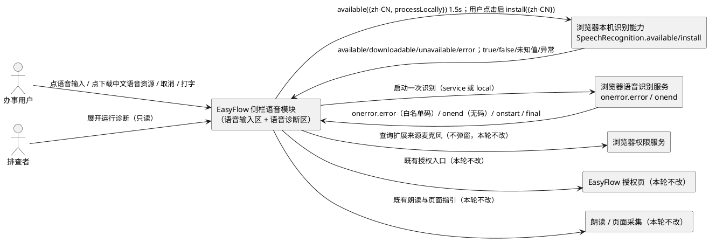
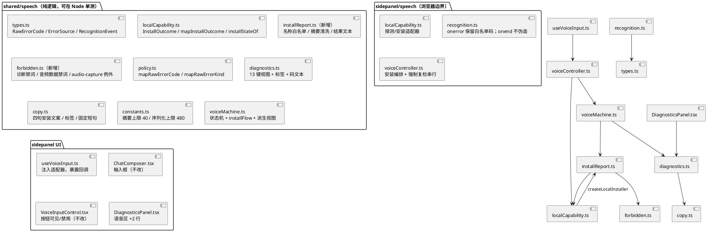
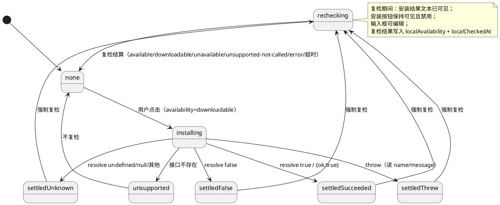
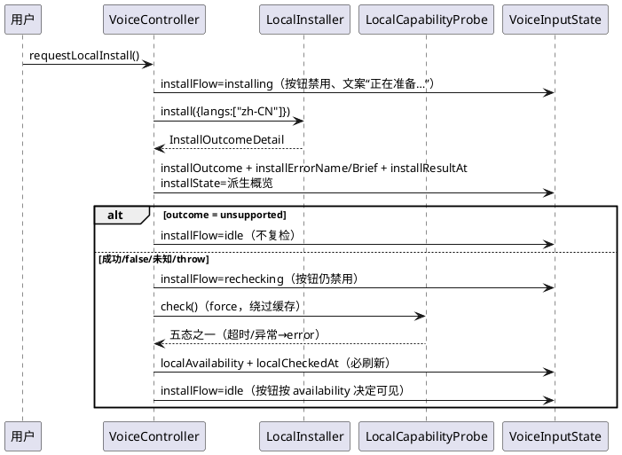
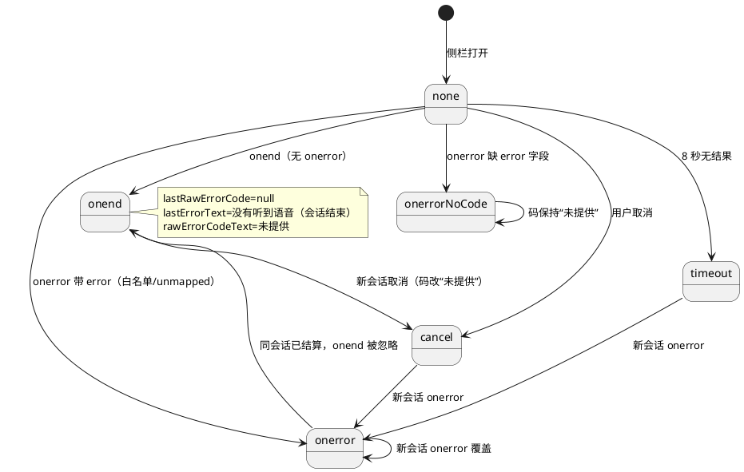
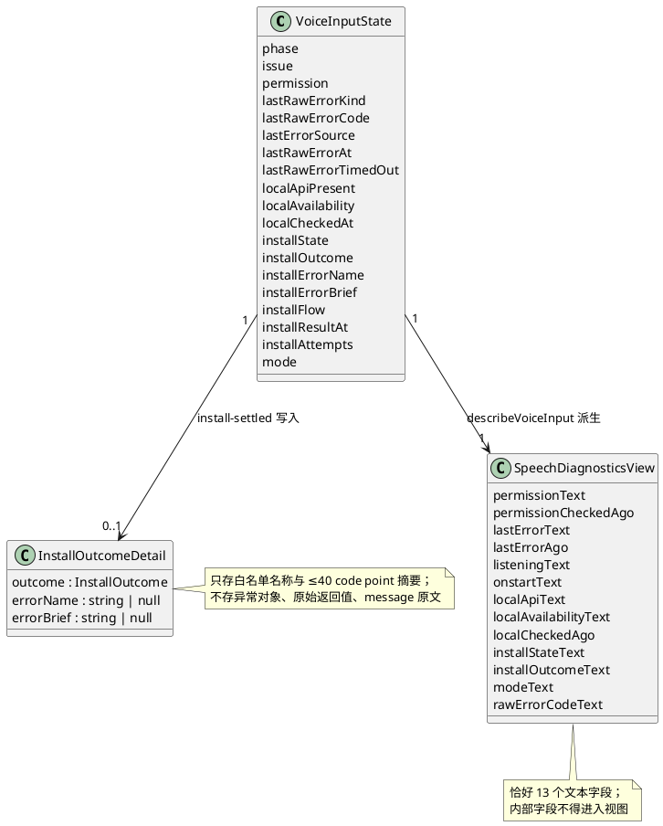
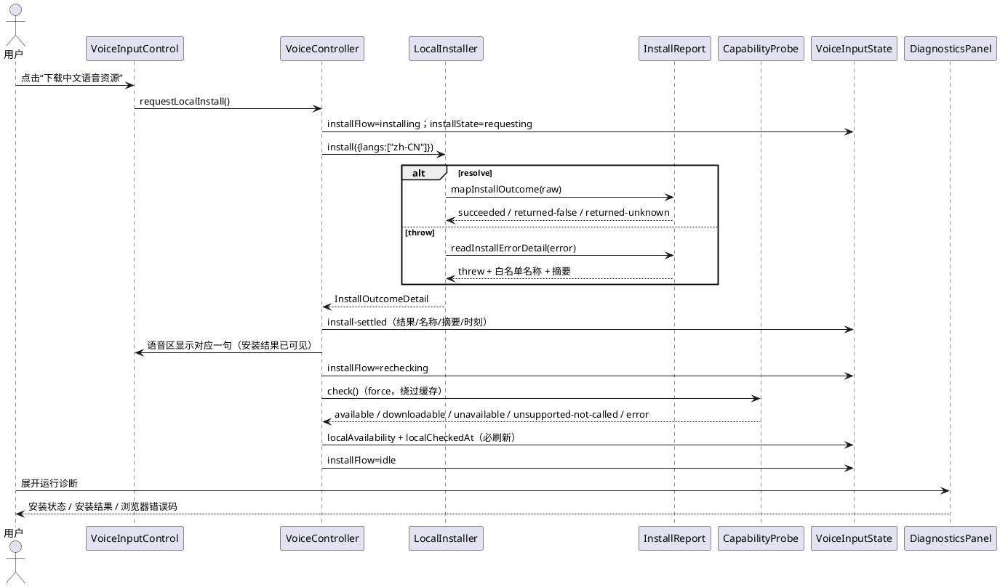
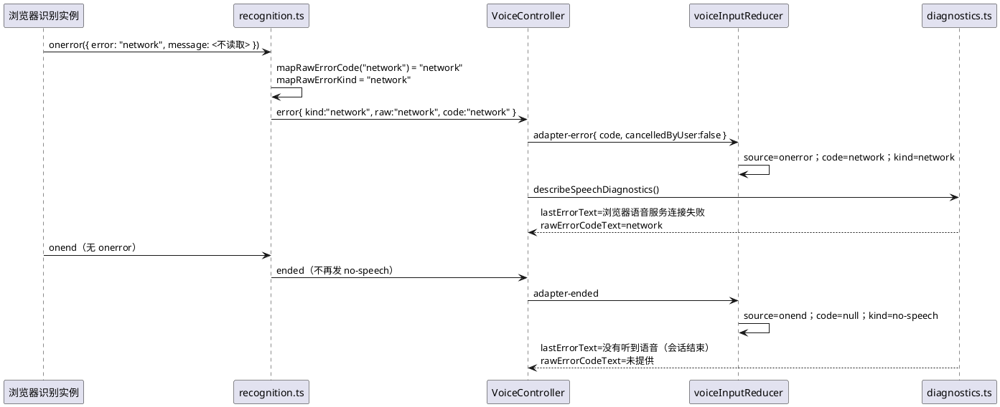

# 一、需求与存量功能关系分析

## 1.0 分析前提（只读核实，2026-11-16）

本文件是 `easyflow_page_guide` 的第八轮增量设计，输入为 `iteration8-spec.md`（v2 重试版，R-336—R-382、T8-01—T8-18、AT-97—AT-105），并沿用第一至第七轮的语音适配器、状态机、文案单源、诊断面板、自测与门禁结构。

**阶段声明**：本阶段只做设计。未修改任何源码、`public/manifest.json`、`scripts/**`、`src/sidepanel/styles/sidepanel.css`、前七轮文档；未运行 `npm run typecheck` / `npm run build` / `npm run selftest` / `npm run verify`；未调用真实麦克风、真实识别、真实合成、真实 `SpeechRecognition.available` / `install`；未创建或覆盖 `codearts_proof` 实绩文件。

| 核实项 | 只读结论（文件与行号） | 对本设计的硬约束 |
|---|---|---|
| 安装返回纯映射 | `src/shared/speech/localCapability.ts:49-59`：`true`/`{ok:true}` → `succeeded`，**其余（含 `false`/`null`/`undefined`/未知对象）一律 `failed`** | 必须新增 `mapInstallOutcome`，把 `false` 与“未知返回”拆开；旧 `mapInstallResult` 只能保留兼容，不得被新代码用于细分 |
| 安装适配器 | `src/sidepanel/speech/localCapability.ts:96-115`：`api===null` 或无 `install` → `unsupported`；`catch` 里只读 `name` 判 `NotAllowedError`/`SecurityError` → `denied`，其余 `failed`；**永不 reject**，`message` 从未读取 | 需要改为返回“结算明细”（结果类别 + 白名单名称 + 安全摘要）；读取 `name`/`message` 时自身不得再抛；不落盘 |
| 安装枚举 | `src/shared/speech/localCapability.ts:11-20` `INSTALL_STATES = idle/requesting/succeeded/failed/denied/unsupported`；`diagnostics.ts:63-70` 对应六个中文值 | 新增独立 `InstallOutcome` 细分，不改动 `installState` 的既有六态与中文概览 |
| 安装后复检 | `src/sidepanel/speech/voiceController.ts:262-288`：只有 `installed === "succeeded"` 才 `ensureLocalCapability(true)`；`failed/denied/unsupported` 不复检 | 需改为“所有实际发起的安装（成功/false/未知/throw）结算后各复检 1 次”，接口不存在或未点击 0 次 |
| 复检实现 | `voiceController.ts:219-256`：`checkingLocal` 布尔锁；非 `force` 时受 `LOCAL_CAPABILITY_CACHE_MS`（`constants.ts:14`，300000ms）短路；异常由 probe 内转为 `"error"` | 强制复检必须绕过缓存；与“展开诊断”的异步探测并发时必须串行，且最多追加 1 次 |
| 安装按钮可见性 | `voiceMachine.ts:410-412`：`localAvailability === "downloadable" \|\| installState === "requesting"`；`VoiceInputControl.tsx:82-91` 用 `installInProgress` 禁用 | 新规则需覆盖“安装中 + 复检中”两种进行态；复检 `error`/超时后按钮必须消失 |
| 安装失败文案 | `copy.ts:61-70` `SPEECH_LOCAL_TEXTS.installFailed`；`voiceMachine.ts:331-337` 对 `failed/denied/unsupported` 返回同一句 | 四类（false/未知/throw/unsupported）需四句，且都不含技术细节 |
| 诊断输入/视图 | `diagnostics.ts:9-36` 输入 11 字段、视图 11 键；`voiceMachine.ts:369-385` 组装输入 | 视图键固定 13 个，内部字段不得进入视图 |
| 诊断面板 | `DiagnosticsPanel.tsx:88-135` 语音区实际 9 行 + “重新检测本机识别”；`127-134` 按钮；`137-271` 页面采集区（含“重新读取页面”）；`273-281` 朗读状态；`88` 受控 `open`，`310` 折叠不渲染 | 只允许在语音区 **新增 2 行**；语音区按钮数量不增加；页面采集区按钮不变 |
| 原始错误归并 | `policy.ts:120-135` `mapRawErrorKind` 六类，其余 `other`；`diagnostics.ts:46-53` 六类中文 | 需新增白名单“实际码”映射与 `unmapped`，中文类别行保留 |
| `onend` 兜底伪造码 | `recognition.ts:106-115`：未 settled 时先 `emit({type:"error",kind:"no-speech"})` 再 `ended`；`voiceMachine.ts:212-223` 收到 `ended` 又转 `no-speech` | **必须删除“onend 发 no-speech”**：改为只发 `ended`，由 `lastErrorSource="onend"` 表达“会话结束、无码” |
| 适配器错误事件 | `types.ts:31-36` `error` 只带 `kind` 与可选 `raw`（六类）；`recognition.ts:95-105` 把 `event.error` 经 `mapRecognitionError/mapRawErrorKind` 消费后丢弃原串 | 需保留“白名单原码”，未映射值只记 `unmapped`，**不得保留原串** |
| 取消/超时 | `voiceController.ts:333-343` `cancel()` 只发 `cancel-requested`；`437-449` `onTimeout()` 发 `timeout`；`voiceMachine.ts:224-243` 两者都不写诊断码 | 取消/超时/`onend` 必须把码置“未提供”，不得沿用上一次 `network` |
| 会话单次结算 | `voiceController.ts:384-435` 用 `settledSessionId` 保证同一会话只结算一次；`recognition.ts:99` 错误后 `settled=true` | 保留；`onerror` 后 `onend` 不得把码改回“未提供” |
| 打字可用 | `ChatComposer.tsx:39-57` `textarea` 无语音禁用；`63-70` 发送只见 `disabled \|\| text.trim().length===0` | 零改动，只加断言 |
| 隐私红线 | 第七轮 R-326—R-335；`selftest.mjs:1964-1973` 与 `1961-1962`：语音目录无 `chrome.storage`、面板无 `EF-E003` | 异常名称/摘要属**受控例外**：白名单 + 40 code point + 脱敏 + 只在语音诊断区 |
| 自测基线 | `codearts_proof/iteration7-selftest.log` 末行 `pass 87 / fail 0`；`selftest.mjs:14-61` 为 esbuild 导出清单；`1561-1600` `FakeLocalCapability`；`2686-2723` `FakeRecognition` | 87 项为回归红线；只允许 AT-81/AT-90 最小改写；新增 AT-97—AT-105 共 9 项，总计 96 |
| AT-81 断言形态 | `selftest.mjs:1657-1669` 11 键**精确列表**；`1671` 禁词正则含 `audio`；`1672-1677` `adapter-final` 后不变；`1686-1693` 分区与源码不含安装按钮文案 | 13 键精确改写；`audio` 收窄为音频数据词；新增长度常数断言 |
| AT-90 断言形态 | `selftest.mjs:1842-1873` 只断言成功/失败/异常三路径的 `localOptionVisible`、`localNoticeText !== null`、30 秒内 `installCalls` 不增长 | 新增 `installOutcomeText` 区分与 `availableCalls +1`，不改原语义 |
| 门禁 | `verify-manifest.mjs:36-45` 权限四项、禁 `host_permissions` 等；`110-127` 禁 `fetch(`/`MediaRecorder`/`API_KEY` 等；`129-142` 两条 `getUserMedia` 路径例外 | 逐项不变；不得新增网络、存储、录音、权限 |
| 留痕现状 | `codearts_proof/26-iteration7-implementation.md:1-5,93-99`：真实设备“中文本机识别是否可用尚待人工验收” | 本轮不得把自动测试写成“语音可用”；真实 Chrome 只做一次人工检查 |

**结论口径**：本轮不需要新框架、新权限、新存储或新入口，属于“在既有语音链路上补一层**可区分的安装结算** + **一次强制复检** + **只读的实际错误码**”的增量改造。真正难点有三处：① `onend` 不再伪造 `no-speech` 后，既有“会话结束”与“显式 no-speech”必须仍可区分；② 复检与展开诊断的异步探测并发时不能叠加、不能被 5 分钟缓存短路；③ 13 键视图与 AT-81 的“精确键列表 + `audio` 禁词”必须同时成立。

## 1.1 需求功能与存量功能对比

### 1.1.1 已实现功能（可直接复用，不改语义）

| 需求功能 | 存量功能 | 代码位置 | 匹配度 |
|---|---|---|---|
| R-346 前提：能力探测可注入、带超时 | `createLocalCapabilityProbe.check()`（1.5s 超时、永不 reject、返回五态） | `src/sidepanel/speech/localCapability.ts:64-94`；`constants.ts:13` | 100% |
| R-336/R-337/R-373 前提：安装仅点击后一次 | `installing` 锁 + `requestLocalInstall()` | `src/sidepanel/speech/voiceController.ts:262-288`；已由 AT-89 断言 5 次点击 = 1 次 | 100%（触发条件需扩到“复检中”也占用） |
| R-347 前提：本机状态与检测时间可写 | `local-capability-checked` 事件写 `localAvailability` 与 `localCheckedAt` | `voiceMachine.ts:282-288` | 100% |
| R-348 前提：只有 `available` 出现本机选项 | `localOptionVisible` | `voiceMachine.ts:408-409`；`VoiceInputControl.tsx:64-76` | 100% |
| R-349 前提：不可用不标可用 | `LOCAL_AVAILABILITY_LABEL` 无“可用/已完成”外溢 | `diagnostics.ts:55-61` | 100% |
| R-353 前提：手动重新检测入口 | `recheckLocalCapability()` + 面板按钮 | `voiceController.ts:258-260`；`DiagnosticsPanel.tsx:127-134` | 100% |
| R-352/R-371 前提：不自动重试/识别/发送 | 无定时器除 8 秒超时；无自动发送 | `voiceController.ts:300-331`；`ChatComposer.tsx:27-35` | 100% |
| R-355/R-356 前提：会话单次结算 | `settledSessionId` + 适配器 `settled` | `voiceController.ts:384-435`；`recognition.ts:99` | 100% |
| R-357 前提：未映射值不外泄 | `mapRawErrorKind` 归 `other`，原串丢弃 | `policy.ts:120-135` | 100%（需新增 `unmapped` 可辨识位） |
| R-359 前提：识别 `message` 未读取 | `recognition.ts:95-105` 只读 `event.error` | 同左 | 100%（必须保持） |
| R-360 前提：中文类别行存在 | `lastErrorText` + `RAW_ERROR_LABEL` | `diagnostics.ts:46-53,99-106` | 100% |
| R-362/R-363 前提：分区与标题 | 三个独立分区标题、`EF-E003` 只在页面区 | `DiagnosticsPanel.tsx:90-135,137-271,273-281` | 100% |
| R-366 前提：折叠不渲染 | 受控 `open` + 条件渲染 | `DiagnosticsPanel.tsx:71,88,310` | 100% |
| R-368 前提：失败仍可打字 | `textarea` 不因语音状态禁用 | `ChatComposer.tsx:39-70` | 100% |
| R-372 前提：修复门槛的既有文案/诊断基线 | 第七轮 6.5 证据口径、`26-iteration7-implementation.md` | `iteration7-spec.md:5.5`；`26-iteration7-implementation.md` | 100% |
| R-380 前提：留痕只记枚举 | 第七轮失败记录口径 | `iteration7-spec.md:810-812`；`26-…:108` | 100% |
| R-376 前提：安装按钮可禁用、输入框不阻塞 | `disabled={view.installInProgress}`；`textarea` 独立 | `VoiceInputControl.tsx:82-91`；`ChatComposer.tsx:39` | 75%（`installInProgress` 只覆盖安装中，未覆盖复检中） |

### 1.1.2 需要扩展的功能（部分匹配，需在既有基础上改造）

| 需求功能 | 存量功能 | 差异说明 | 扩展方向 |
|---|---|---|---|
| R-336/R-337/R-373 安装结果三分 | `mapInstallResult`（`:49-59`）把 `false`/`null`/`undefined`/对象一律 `failed`；`createLocalInstaller`（`sidepanel/…:96-115`）把异常折成 `denied`/`failed` | 输入：原始返回值/异常对象；输出：单一 `InstallState`；边界：`{ok:false}`、getter 抛错、字符串 `throw` 全部无区分 | 新增 `mapInstallOutcome`（纯函数）与 `InstallOutcomeDetail`；`createLocalInstaller` 返回明细；旧 `mapInstallResult` 保留实现不动（仅概览） |
| R-338 四类两两不同 | 三态 `failed/denied/unsupported` + 同一句 `installFailed` | 用户文案集合大小 2，诊断为 3；不满足“四类不同” | 新增四句安装文案常量；`localNoticeOf` 改按 `installOutcome` 分支 |
| R-339/R-340/R-341 名称白名单与安全摘要 | 只读 `name` 判两个分支后丢弃；`message` 从未读取 | 无白名单表、无脱敏、无长度上限、无空值替代 | 新增纯逻辑模块：名称规范化、摘要清洗（顺序见 2.3.3）、固定替代短句；常量单源 |
| R-342/R-343 不落盘、只留最近一次 | 安装状态只存内存（R-299）；状态机无名称/摘要字段 | 新增字段需同时满足“只存内存 + 覆盖式最近一次” | 状态机新增 3 个内部字段 + 1 个结算时刻；不进入视图键；重开侧栏归零 |
| R-344 用户文案不含技术细节 | 语音区文案与诊断共用 `SPEECH_LOCAL_TEXTS`；无异常名称 | 新增名称/摘要后必须保证主状态句不泄露 | 四句文案零英文/零摘要；名称/摘要只经 `installOutcomeText` 进诊断 |
| R-345 诊断只读性 | 语音区只有“重新检测本机识别”，页面区只有“重新读取页面” | 新增 2 行不得带来按钮 | 面板只增文本行；不新增 `onClick` |
| R-346/R-350/R-353 强制复检 | `ensureLocalCapability(force)` 有 `checkingLocal` 布尔锁；非 force 走 5 分钟缓存 | 并发时 force 请求会被 `checkingLocal` 直接丢弃；复检只在成功分支 | 引入“单次探测 Promise + 至多一个待执行 force”串行模型；安装结算后无条件调用 |
| R-347/R-350 复检失败也刷新时间 | probe 内部 catch → `"error"`；`local-capability-checked` 带 `at` | 失败路径的“最近检测”语义未被显式要求；“检测中”与“无法判断”需区分 | 复检开始置 `checking`，结算写 `error` + 本次 `at`；安装结论字段不被覆盖 |
| R-377 复检 error 隐藏按钮 | `installButtonVisible` 只看 `downloadable`/`requesting` | 安装前 `downloadable` + 复检 `error` 时旧公式会隐藏（因 availability 变 error），但“installation 进行中”与“复检中”缺少显式进行态 | 引入内部 `installFlow`（`idle/installing/rechecking`）；按钮 = 进行中（禁用）或复检后仍 `downloadable` |
| R-354/R-357/R-361 实际错误码 | `RawSpeechErrorKind` 六类；未知归 `other`；无原码 | 缺 `language-not-supported`/`aborted`/`unmapped`/“未提供”/“暂无”的表达位 | `types.ts` 新增 `RawErrorCode`；`policy.ts` 新增 `mapRawErrorCode`；`diagnostics.ts` 新增标签与 13 键视图 |
| R-355/R-356/R-374/R-375/R-382 来源与取消 | `onend` 伪造 `no-speech`；`cancel`/`timeout` 不写诊断码 | 现行为：会话结束=no-speech；取消后仍显示上一次 `network` | 新增 `lastErrorSource`；适配器只发 `ended`；reducer 在 cancel/timeout/ended 时把码置 `null`；用户取消的 `aborted` 归 cancel |
| R-376 复检期间状态展示 | 安装结果写 `installState` 后立即复检但 UI 无“复检中” | 复检期间 `localAvailability="checking"` 会让按钮消失，违反“保持禁用直到结算” | `installFlow="rechecking"` 时按钮可见且禁用；安装结果文本已由 `installOutcome` 先行写入 |
| R-362/R-364/R-379 13 键矩阵 | 11 键视图；`describeSpeechDiagnostics` 输入 11 字段 | 新增键会触发 AT-81 精确列表失败 | 视图新增 `installOutcomeText`/`rawErrorCodeText`；矩阵见 2.4 |
| R-378 摘要禁词与诊断禁词同源 | 禁词只存在于测试正则（`selftest.mjs:1671`） | 摘要清洗若自带另一套词表，会出现“摘要通过、AT-81 失败” | 新增 `forbidden.ts` 单一常量，摘要与测试共用 |
| R-367 可访问性 | 诊断值全部为纯文本 span；样式 `overflow-wrap:anywhere` | 新增摘要需可换行、可读屏；不得只靠颜色 | 沿用现有 grid/文本节点；摘要文本可换行；不加颜色语义 |
| AT-97—AT-105 夹具能力 | `FakeLocalCapability` 支持 `installResult`（含对象）、`installThrowMode`（固定 `{name:"NotAllowedError"}`）、`delayMs`；`FakeRecognition.emit` 任意事件 | 缺“指定异常名称/摘要/延迟分开”“onerror 带码/不带码”“onend 无码”“复检计数” | 只扩展返回值与异常字段，不删既有字段；新增 `availableCalls` 差值断言 |

### 1.1.3 需要新增的功能或接口

**A. 安装结果结算与异常规范化（新增 `src/shared/speech/installReport.ts`）**

- 输入：`unknown`（`install()` 的原始返回值）或 `unknown`（`catch` 捕获值）。
- 输出：`InstallOutcomeDetail`（结果类别 + 白名单名称或 `null` + 摘要或 `null`）。
- 核心逻辑：严格 `false` 与“未知返回”分开；名称白名单精确大小写；摘要按固定顺序脱敏、折叠、截断；任何读取异常都降级为“未知错误”+固定短句。
- 依赖：`shared/speech/localCapability.ts`（枚举）、`copy.ts`（固定短句/未知名称文案）、`forbidden.ts`（禁词同源）、`constants.ts`（长度常量）。

**B. 诊断禁词单一来源（新增 `src/shared/speech/forbidden.ts`）**

- 输入：无。
- 输出：`DIAGNOSTIC_FORBIDDEN_WORDS`（`http/url/message/device/transcript`）、`AUDIO_DATA_FORBIDDEN_WORDS`（`audioData/audioBlob/audioBase64/audioBuffer/audioUrl/录音/音频数据`）、`INSTALL_BRIEF_FORBIDDEN_WORDS`（诊断禁词 + `audio`）、`ALLOWED_DIAGNOSTIC_AUDIO_VALUE = "audio-capture"`。
- 核心逻辑：只导出常量，不含函数；测试与实现共用，避免“两套禁词”。
- 依赖：无。

**C. 实际错误码类型与映射（扩展 `types.ts`、`policy.ts`、`diagnostics.ts`）**

- 输入：`onerror` 回调的 `error`（`string | undefined`）。
- 输出：`RawErrorCode`（白名单 7 类 + `unmapped`）或 `null`。
- 核心逻辑：白名单精确匹配；未映射 → `unmapped`（**不保留原串**）；缺失/非字符串 → `null`。
- 依赖：`types.ts`、`policy.ts`（与既有 `mapRawErrorKind` 同表同序）、`copy.ts`（标签与“未提供/暂无”文案）。

**D. 安装流程内部态（扩展 `voiceMachine.ts`）**

- 输入：`install-flow-changed`、`install-settled` 等事件。
- 输出：`installOutcome`、`installErrorName`、`installErrorBrief`、`installFlow`、`installResultAt` 与派生视图字段。
- 核心逻辑：只保留最近一次；`unsupported` 不触发复检；`installButtonVisible`/`installInProgress` 由 `installFlow` 与 `localAvailability` 联合派生。
- 依赖：`installReport.ts`、`localCapability.ts`、`copy.ts`。

**E. 强制复检编排（扩展 `voiceController.ts`）**

- 输入：安装结算明细、`ensureLocalCapability(force)` 调用。
- 输出：一次且仅一次的复检；复检前后状态写入。
- 核心逻辑：单次探测 Promise 串行；force 请求至多排队 1 次；`disposed` 后丢弃；复检不触发识别/安装/发送。
- 依赖：`LocalCapabilityProbe`、`LocalInstaller`、状态机事件。

**F. 诊断面板新增两行（扩展 `DiagnosticsPanel.tsx`）**

- 输入：`speechDiagnostics`（13 键）。
- 输出：语音区内“浏览器错误码”“安装结果”两行文本。
- 核心逻辑：只在 `open===true` 时渲染；标签来自 `copy.ts`；不新增按钮、不加颜色语义。
- 依赖：`SPEECH_DIAGNOSTICS_TEXTS`。

**G. 自测夹具与用例（扩展 `scripts/selftest.mjs`）**

- 输入：假安装/假识别/假能力。
- 输出：AT-97—AT-105 共 9 项；87 项回归。
- 核心逻辑：只扩展假对象字段；不访问真实设备/网络；日志不写摘要原文。
- 依赖：`selftest.mjs` 导出清单。

## 1.2 存量功能详细分析

### 1.2.1 `createLocalInstaller` 的接口契约与扩展点

- **接口契约**：`install(): Promise<InstallState>`，永不 reject。`api===null || api.install===undefined` → `unsupported`；`await` 正常返回 → `mapInstallResult`；`catch` → 读 `error.name`，`NotAllowedError`/`SecurityError` → `denied`，其余 → `failed`。
- **副作用**：只有一次 `install.call(api, { langs: ["zh-CN"] })`；无存储、无日志、无网络。
- **扩展点**：`LocalInstaller` 是注入接口（`useVoiceInput.ts:38,46`），返回类型只被 `voiceController.ts:277` 消费。因此可把返回类型替换为 `InstallOutcomeDetail`，并把“结果 → 概览态”的派生交给纯函数 `installStateOf`，不破坏测试注入方式。
- **约束**：① 不得改 `install` 参数（仍只有 `zh-CN`）；② 不得让“读取 `name`/`message`”再次抛出；③ 不得把异常对象或原始返回值写进状态；④ 必须保留 `NotAllowedError`/`SecurityError` 在概览层的“被拒绝”语义（第七轮 R-296 的可读回退）。

### 1.2.2 `voiceInputReducer` 的业务规则与不可破坏分支

- `start-requested`：`supported===false` → `unsupported`；已在 `listening` → 原样返回；否则 `listening`，`browserOnstart="not-started"`。
- `adapter-error`：只在 `listening` 生效；写 `lastRawErrorKind/lastRawErrorAt/lastRawErrorTimedOut=false`；`aborted` → `cancelled`（用户取消时 `issue=null`，否则 `interrupted`）；其余走 `resolveRecognitionFailure`（权限优先，`policy.ts:161-209`）。
- `adapter-ended`：只在 `listening` 生效 → `no-speech`，且 `browserOnstart` 从 `not-started` 转 `ended-without-start`。
- `timeout`：只在 `listening` 生效 → `no-speech` + `issue="timeout"` + `raw="other"` + `timedOut=true`。
- `cancel-requested`：只在 `listening` 生效 → `cancelled`，**当前不写诊断**。
- `install-state-changed`：写 `installState`，`requesting` 时 `installAttempts+1`。
- `invalidate`：会话级重置，但**不得清空**权限/本机/安装/诊断（现有实现只重置语音会话字段）。

**不可破坏分支**：AT-52（取消后迟到结果丢弃）、AT-54（`canStart=false`）、AT-55（`no-speech` 独立单句、超时含“没有听到”）、AT-82/84（`lastRawErrorKind` 仍为六类）、AT-89（5 次点击 1 次安装）、AT-93（不自动回退）、AT-94（只入框）。

### 1.2.3 `recognition.ts` 的 `onerror`/`onend` 时序（本轮核心改造点）

- `start()`：先 `detach()`、自增 token、`settled=false`；构造失败/ctor 缺失时 `error(unsupported)+ended`；`onresult` 取首个 `isFinal` 文本；`onerror` 置 `settled=true` 后发 `error{kind, raw}`；`onend` 在未 settled 时**先发 `error{kind:"no-speech"}` 再发 `ended`**；`onstart` 发 `browser-start`。
- `cancel()`：置 `settled=true`、`token+1`、`abort()`、`detach()`，因此**取消后到达的 `onerror(aborted)` 会被 token/settled 过滤**。
- **结论**：要满足 R-356，必须删除 `onend` 里的 `emit error`，只保留 `ended`；控制器据此写“来源 onend、码未提供”。同时 `onerror` 需要在事件中携带“白名单码”，否则控制器只能拿到六类 `raw`。

### 1.2.4 文案与诊断现状的约束

- `SPEECH_LOCAL_TEXTS` 现有 8 个键；`installFailed` 被 `localNoticeOf` 对三种失败共用（`voiceMachine.ts:331-337`）。
- `SPEECH_DIAGNOSTICS_TEXTS` 现有 11 个标签/值键；`noError="暂无（本次侧栏会话）"`、`noValue="无"` 可复用为“暂无”与“名称/摘要无值”。
- `RAW_ERROR_LABEL` 是“最近错误”中文类别的唯一来源；`mapRawErrorKind` 是六类归并唯一来源。
- **约束**：新增文案必须来自 `copy.ts`；组件内不得硬编码“返回 false”“接口不支持”“浏览器错误码”“未提供”等用户可见文本（AT-81 已有“文案单源”精神）。

### 1.2.5 诊断面板与样式现状

- 语音区 9 行位于 `.ef-speech-diag-grid`（`sidepanel.css:1464-1468`，`auto-fit minmax(140px,1fr)`），窄屏自动换行；`.ef-speech-diag` 与 `.ef-speech-local-note` 已有 `overflow-wrap:anywhere`（`:1450-1462`）。
- 折叠由 `open` 控制，`open===false` 时整个 `<>…</>` 不渲染（`DiagnosticsPanel.tsx:88,310`）。
- `ef-inline-link` 有 `min-height: var(--ef-tap-min)`（`:1207-1212`），触摸基线不受新增行影响。
- **结论**：新增 2 行不需要改 CSS；摘要换行已有样式保障。若实现阶段发现 320px 溢出，只允许在既有 `.ef-speech-diag`/`.ef-speech-diag-grid` 上补充 `overflow-wrap`，不引入新样式框架。

### 1.2.6 自测结构（假对象 + esbuild 导出 + 纯逻辑断言）

- 入口通过 esbuild 把指定符号导成 `ef`（`selftest.mjs:14-74`）；新增纯逻辑与常量必须加入导出，否则测试不可写。
- `FakeLocalCapability`（`:1561-1600`）：`available` 支持 `throwMode`/`delayMs`；`install` 支持 `installResult`（任意值）/`installThrowMode`（固定 `{name:"NotAllowedError"}`）/`delayMs`；`install` 在 `installResult===true && result==="downloadable"` 时把 `result` 改为 `available`——AT-90 的成功路径依赖该行为，**不得删除**。
- `FakeRecognition`（`:2686-2723`）：`emit(event)` 直接投递给控制器；扩展“带码/不带码”只需改测试调用侧，不必改类。
- `localController`（`:1602-1621`）：用真实 `createLocalCapabilityProbe/createLocalInstaller` 包假对象，因此适配器改造会直接影响该夹具——这是 AT-97/AT-99 的落点。
- **约束**：87 项中只允许 AT-81、AT-90 改写；其余 85 项零改动。

### 1.2.7 构建与门禁的既有机制

- `package.json`：`typecheck=tsc --noEmit`；`build=tsc --noEmit && node scripts/build.mjs && node scripts/verify-manifest.mjs`；`selftest=node scripts/selftest.mjs`；`verify=node scripts/verify-manifest.mjs`。
- `verify-manifest.mjs` 扫描 `src/**/*.ts(x)` 与 `dist/**/*.js`：禁 `fetch(`/`XMLHttpRequest`/`sendBeacon`/`WebSocket`/`MediaRecorder`/`apiKey`/`API_KEY`/`Authorization`、`host_permissions`/`<all_urls>`/`content_scripts`/`dangerouslySetInnerHTML`/`innerHTML`；`getUserMedia` 仅允许两条精确例外。
- **约束**：新增模块不得出现上述字符串；异常摘要清洗**不得**使用 `fetch`/网络；诊断不得写入 `chrome.storage`（AT-96/AT-80 会扫 `src/shared/speech` 与 `src/sidepanel/speech`）。

### 1.2.8 存量约束清单（设计不得违反）

1. 权限四项与 `minimum_chrome_version=116` 不变；无 `tabs`/`host_permissions`/`content_scripts`/`web_accessible_resources`。
2. 语音链路的 `getUserMedia` 只在授权页两处；本轮不新增任何 `getUserMedia`。
3. 语音目录（`src/shared/speech`、`src/sidepanel/speech`）不得出现 `chrome.storage`；诊断只存内存。
4. 识别错误的 `message` 永久禁止读取；安装异常的 `message` 只允许经脱敏摘要进诊断。
5. `install()` 参数永远只有 `{ langs: ["zh-CN"] }`。
6. 一次识别最多 1 会话、一次安装最多 1 调用、安装后最多 1 次复检。
7. 不自动重试/自动切换模式/自动发送/自动提交。
8. `EF-E003`、页面采集诊断、朗读、麦克风首次授权页、步骤卡/高亮零改动。
9. 严格类型：`strict`、`noUncheckedIndexedAccess`、`exactOptionalPropertyTypes`；不得用 `any`。
10. 用户可见文案单一来源，组件不硬编码技术词汇。
# 二、增量设计方案

## 2.1 实现模型

### 2.1.1 上下文视图

本轮不新增外部系统，只改变侧栏语音模块与两个既有浏览器能力之间的**观测契约**：安装调用保留“结算明细”，识别错误保留“白名单码值”。



图中只画接口级交互。调用频率：`available` 在展开诊断时（5 分钟缓存）与安装结算后各 1 次；`install` 仅用户点击后 1 次；识别仅用户点击后 1 次。

### 2.1.2 服务/组件总体架构



职责与约束：

| 组件 | 职责 | 不得做的事 |
|---|---|---|
| `installReport.ts` | 纯函数：结果分类、名称白名单、摘要清洗/截断、结果文本 | 不读 DOM/浏览器对象；不落盘；不保留原始 message |
| `forbidden.ts` | 唯一禁词表 | 不包含函数与副作用 |
| `localCapability.ts`（shared） | 枚举与纯映射 | 不调用浏览器 API |
| `localCapability.ts`（sidepanel） | 唯一 `available/install` 静态访问点 | 不改参数、不重试、不 reject、不读识别 message |
| `recognition.ts` | 错误回调只保留白名单码 | 不读 `error.message`；`onend` 不发 error |
| `voiceController.ts` | 安装/复检编排、并发锁、会话结算 | 不自动重试/自动识别/自动发送 |
| `voiceMachine.ts` | 状态与派生视图（13 键） | 不持异常对象、不持原始返回值 |
| `DiagnosticsPanel.tsx` | 只读展示两行 | 不新增按钮、不新增交互 |

配置项与取值：`LOCAL_CAPABILITY_TIMEOUT_MS=1500`（复用）、`LOCAL_CAPABILITY_CACHE_MS=300000`（仅非 force 生效）、`INSTALL_ERROR_BRIEF_MAX_CHARS=40`（新增）、`DIAGNOSTICS_SERIALIZED_MAX_CHARS=480`（新增，供测试与审查）。

### 2.1.3 实现设计文档

#### （1）安装结算状态机



判定口径（唯一）：

| 输入 | `installOutcome` | `installErrorName` | `installErrorBrief` | 概览 `installState` |
|---|---|---|---|---|
| `true` / `{ok:true}` | `succeeded` | `null` | `null` | `succeeded` |
| 严格 `false` | `returned-false` | `null` | `null` | `failed` |
| `undefined`/`null`/`{ok:false}`/其他对象 | `returned-unknown` | `null` | `null` | `failed` |
| `throw` 且名称为 `NotAllowedError`/`SecurityError` | `threw` | 白名单名 | 摘要 | `denied`（保留第七轮概览语义） |
| `throw` 其他 | `threw` | 白名单名或“未知错误” | 摘要或固定短句 | `failed` |
| 接口不存在 | `unsupported` | `null` | `null` | `unsupported` |
| 未开始/进行中 | `none`/`requesting` | `null` | `null` | `idle`/`requesting` |

**与 `mapInstallResult` 的关系**：保留原函数与原实现（`localCapability.ts:49-59`）不动，仅作为“旧概览映射”兼容既有导出与 AT-80/AT-90；新代码一律使用 `mapInstallOutcome` + `installStateOf`。`installStateOf` 只在概览层把 `threw` 细分为 `denied`/`failed`，不改变“诊断细分”。这样既不删除旧断言依赖的符号，也不会再出现“false 与未知值合并”的新逻辑。

#### （2）安装失败四句文案与诊断行

| 结果 | 语音区主句（`localNoticeText`） | 诊断“安装结果”行 |
|---|---|---|
| `returned-false` | 浏览器没有完成中文本机语音资源的准备，可以稍后再试或直接打字。 | 返回 false（明确失败） · 无 · 无 |
| `returned-unknown` | 安装没有返回明确结果，可以稍后再试或直接打字。 | 返回未知值（未确认成功） · 无 · 无 |
| `threw` | 准备中文本机语音资源时出现问题，可以直接打字或稍后再试。 | 抛出异常 · NotAllowedError · <安全摘要> |
| `unsupported` | 这台浏览器没有提供中文本机语音资源安装能力，可以直接打字。 | 接口不支持 · 无 · 无 |
| `succeeded` | 未开始/正在准备…/成功 · 无 · 无（成功时不额外提示；若复检仍 downloadable 用 `stillDownloadable`） | 成功 · 无 · 无 |

约束：四句两两不同且不含 `false`、`NotAllowedError`、`message`、`undefined`；异常名称/摘要只出现在诊断区；失败下不隐藏输入框、不禁用发送。

#### （3）强制复检编排与并发



并发与频次规则：

1. **安装锁**：同步布尔 + `installFlow!=="idle"` 双重判定；`requestLocalInstall()` 在进入时若 `installing` 或 `localAvailability!=="downloadable"` 直接返回。5 次点击 ≤ 1 次调用（AT-89 已覆盖，本轮保持）。
2. **复检串行**：控制器持有 `localCheckPromise: Promise<void> | null` 与 `pendingForceCheck: boolean`。
   - 无进行中探测 → 直接启动；`force=true` 时不看 `LOCAL_CAPABILITY_CACHE_MS`。
   - 有进行中探测且 `force=false` → 复用当前 Promise（不新增调用）。
   - 有进行中探测且 `force=true` → 置 `pendingForceCheck=true`，当前 Promise 结算后补跑 **1 次** force；后续 force 请求不叠加。
   - 安装结算后的复检调用必须 `force=true`，因此 5 分钟缓存不可能短路（R-353）。
3. **次数上限**：一次安装流程最多 1 次复检；复检失败不自动重试；手动“重新检测”不受此限（每次点击最多 1 次探测）。
4. **销毁**：`dispose()` 后到达的复检结果直接丢弃，不写状态；重开侧栏从 `localAvailability="checking"`、`installOutcome="none"` 开始。
5. **不触发其他动作**：复检只写本机状态/时间，不调用 `adapter.start()`、不改 `mode`、不调用 `send`、不再 `install`。

#### （4）复检结果 → 按钮 / 选项 / 文案

| 复检结果 | 本机选项 | 安装按钮 | 文案/诊断 |
|---|---|---|---|
| `available` | 出现，不自动选中（`mode` 保持 `service`） | 隐藏（`availability!=="downloadable"` 且 flow=idle） | `zh-CN 状态：可用`；不得写“语音可用” |
| `downloadable` | 不出现 | 可见可再点（flow=idle） | `安装结果` 与 `可下载` 并列；不自动重试 |
| `unavailable` / `unsupported-not-called` | 不出现 | 隐藏 | 暂不支持中文 / 未调用（不支持） |
| `error`（含超时） | 不出现 | 隐藏 | “无法判断”；`localCheckedAt` 刷新；保留安装结果与名称/摘要 |
| `checking`（复检进行中） | 沿用旧值（不新增） | **可见且禁用** | 安装结果文本已可见；输入框可用 |

按钮派生（唯一公式，落在 `describeVoiceInput`）：

```
installInProgress = installFlow !== "idle"
installButtonVisible =
  installFlow !== "idle"
    ? installOutcome !== "unsupported"
    : localAvailability === "downloadable"
```

说明：`installFlow="rechecking"` 时即使 `localAvailability="checking"` 按钮仍可见且禁用（满足 R-376）；复检 `error` 结算后 `flow=idle`、`availability="error"` → 隐藏（满足 R-377）；复检 `downloadable` → 重新可见。

#### （5）错误码来源状态机



覆盖规则（唯一判定口径，按 `iteration8-spec.md` 6.4 表）：

1. `onerror` 且 `error` 命中白名单 → 来源 `onerror`，码为白名单值，中文类别按 `RAW_ERROR_LABEL`。
2. `onerror` 且 `error` 未命中 → 来源 `onerror`，码 `unmapped`，界面“其他（未映射）”，中文类别“其他识别失败”；**原串不保存**。
3. `onerror` 且缺 `error`/非字符串 → 来源 `onerror`，码 `null`（“未提供”），中文类别“其他识别失败”。
4. `onend` 无 `onerror` → 来源 `onend`，码 `null`，类别“没有听到语音（会话结束）”；`lastRawErrorKind` 可保留 `no-speech` 但显示层以来源优先。
5. 超时 → 来源 `timeout`，码 `null`，类别“其他识别失败（等待超时）”。
6. 用户取消 → 来源 `cancel`，码 `null`，类别“已取消识别”。
7. `aborted` + `cancelledByUser=true` → 来源 `cancel`，码 `null`（R-382）；`aborted` 且非用户取消 → 来源 `onerror`，码 `aborted`，类别“识别已中断”。
8. 从未失败/从未结束 → 来源 `none`，码 `null`，显示“暂无（本次侧栏会话）”。
9. 同一会话已有 `onerror` 后 `onend` 到达：控制器已 `settledSessionId`，忽略，码保留该次值（不改为“未提供”）。

**规格内冲突裁决**：`R-374(a)` 写“来源 `onerror` → 错误码必不为 `null`”，但 `R-354`/6.4 表与 5.3.3-1 明确“`onerror` 缺 `error` 字段 → 未提供”。本设计以 6.4 表为唯一口径，即 `onerror` 只在“有 `error` 字段”时保证非 `null`；此裁决列入 2.8 需用户确认项。

**适配器本地启动失败**（ctor 缺失、`new ctor()` 抛错、`instance.start()` 同步抛错）不属于浏览器 `onerror`：事件携带 `errorSource:"adapter"`，reducer 只更新语音 phase/issue，不改写“最近错误/错误码”，避免把本地异常冒充浏览器码（列入 2.8 取舍点 D-08-02）。

#### （6）诊断 13 键渲染顺序与折叠

语音区（`open===true` 才渲染）顺序固定：

1. 麦克风权限（值 + 相对时间）
2. 最近错误（中文类别 + 相对时间）
3. **浏览器错误码**
4. 侧栏正在听
5. 浏览器开始识别
6. 本机识别接口
7. 中文（zh-CN）本机状态
8. 最近检测
9. 安装状态（概览）
10. **安装结果**（细分 + 名称 + 摘要）
11. 识别方式

行数从 9 行增至 11 行（新增 2 行，满足 4.1-7“最多 2 行”）；按钮仍只有“重新检测本机识别”1 个。页面采集区仍在语音区之后，按钮仍只有“重新读取页面”。

## 2.2 接口设计

### 2.2.1 总体设计

| 接口/类型 | 归属 | 稳定性 | 变更类型 | 说明 |
|---|---|---|---|---|
| `InstallOutcome` | `shared/speech/localCapability.ts` | 稳定 | 新增 | 安装结算类别 7 值 |
| `InstallOutcomeDetail` | 同上 | 稳定 | 新增 | 结果 + 名称 + 摘要 |
| `mapInstallOutcome(raw)` | 同上 | 稳定 | 新增 | 纯函数 |
| `installStateOf(detail)` | 同上 | 稳定 | 新增 | 明细 → 概览六态 |
| `mapInstallResult(raw)` | 同上 | 废弃（保留） | 不改实现 | 仅兼容旧导出 |
| `INSTALL_ERROR_NAMES` / `normalizeInstallErrorName` | `shared/speech/installReport.ts` | 稳定 | 新增 | 白名单与规范化 |
| `sanitizeInstallErrorBrief(message)` | 同上 | 稳定 | 新增 | 脱敏 + 截断 |
| `describeInstallOutcomeText(detail)` | 同上 | 稳定 | 新增 | 三段式文本 |
| `readInstallErrorDetail(error)` | 同上 | 稳定 | 新增 | 安全读取 catch 值 |
| `DIAGNOSTIC_FORBIDDEN_WORDS` 等 | `shared/speech/forbidden.ts` | 稳定 | 新增 | 禁词单源 |
| `RawErrorCode` / `ErrorSource` | `shared/speech/types.ts` | 稳定 | 新增 | 码与来源枚举 |
| `RecognitionEvent.error.code` / `.errorSource` | 同上 | 实验 | 可选扩展 | 不破坏既有 `kind`/`raw` |
| `mapRawErrorCode(raw)` | `shared/speech/policy.ts` | 稳定 | 新增 | 白名单归类 |
| `RAW_ERROR_CODE_LABEL` | `shared/speech/diagnostics.ts` | 稳定 | 新增 | 码 → 文本 |
| `SpeechDiagnosticsView`（13 键） | 同上 | 稳定 | 扩展 | 新增 2 键 |
| `describeSpeechDiagnostics(input, now)` | 同上 | 稳定 | 扩展输入 | 新增 5 个输入字段 |
| `LocalInstaller.install()` | `sidepanel/speech/localCapability.ts` | 实验 | 返回类型变更 | → `Promise<InstallOutcomeDetail>` |
| `VoiceInputState` / `VoiceInputEvent` | `shared/speech/voiceMachine.ts` | 稳定 | 扩展 | 新增字段与 2 类事件 |
| `VoiceInputView.installInProgress` | 同上 | 稳定 | 语义扩展 | 含复检中 |

接口变更策略：不删除既有导出；`mapInstallResult`、`installState`、`RAW_ERROR_LABEL`、`VOICE_STATUS_TEXT` 全部保留；新增字段一律必填（`exactOptionalPropertyTypes` 下避免 `undefined` 混入），可选字段只用于 `RecognitionEvent.error` 的向后兼容。

### 2.2.2 接口清单

#### 接口 A：安装结果枚举与纯映射（`src/shared/speech/localCapability.ts`）

```ts
export const INSTALL_OUTCOMES = [
  "none", "requesting", "succeeded",
  "returned-false", "returned-unknown", "threw", "unsupported",
] as const;
export type InstallOutcome = (typeof INSTALL_OUTCOMES)[number];

export interface InstallOutcomeDetail {
  outcome: InstallOutcome;
  errorName: string | null;
  errorBrief: string | null;
}

export function mapInstallOutcome(raw: unknown): InstallOutcome;
export function installStateOf(detail: InstallOutcomeDetail): InstallState;
```

- 业务说明：把 `install()` 的原始返回值/异常结算为可区分的类别。
- 前置条件：`raw` 可为任意值，函数不得抛错。
- 后置条件：无副作用；不改入参。
- 异常映射：不抛异常（读取失败由调用方在 `readInstallErrorDetail` 内兜底）。
- 典型调用：

```ts
const outcome = mapInstallOutcome(raw);            // false -> "returned-false"
const detail = { outcome, errorName: null, errorBrief: null };
const state = installStateOf(detail);              // "failed"
```

#### 接口 B：异常名称与安全摘要（`src/shared/speech/installReport.ts`）

```ts
export const INSTALL_ERROR_NAMES = [
  "NotAllowedError", "SecurityError", "NotSupportedError", "NetworkError",
  "AbortError", "InvalidStateError", "UnknownError", "TypeError",
  "RangeError", "Error",
] as const;
export type InstallErrorName = (typeof INSTALL_ERROR_NAMES)[number];

export function normalizeInstallErrorName(raw: unknown): string;
export function sanitizeInstallErrorBrief(rawMessage: unknown): string;
export function readInstallErrorDetail(error: unknown): { errorName: string; errorBrief: string };
export function describeInstallOutcomeText(detail: InstallOutcomeDetail): string;
```

- 业务说明：只输出白名单名称与 ≤40 code point 摘要；无 message 或清洗为空 → 固定短句。
- 前置条件：`error` 可能是字符串、`Error`、无 `name` 的对象、getter 抛错的对象。
- 后置条件：不保留原始 message；不记录异常对象；不落盘；读取过程不抛。
- 异常映射：所有读取失败 → `("未知错误", "没有可显示的错误信息")`。
- 典型调用：

```ts
const d = readInstallErrorDetail(caught);   // { errorName: "NotAllowedError", errorBrief: "…" }
// 诊断文本
describeInstallOutcomeText({ outcome: "threw", ...d });
```

摘要处理顺序（实现必须按此顺序，禁止调整）：

1. 非字符串/空串/读取抛错 → 固定短句；
2. 折叠连续空白（空格、换行、制表符）为单空格；
3. 删除 `scheme://非空片段`（含 `http`、`https`、`chrome-extension`、`file`、`data`、`blob`）；
4. 删除 `[A-Za-z]:\非空片段`（盘符路径）；
5. 删除 `\b[a-p]{32}\b`（扩展 ID）；
6. 删除 `\b[A-Za-z0-9_.\-]{20,}\b`（ASCII 长标识，保留中文句子）；
7. 删除 `\d{6,}`（长数字）；
8. 把 `INSTALL_BRIEF_FORBIDDEN_WORDS`（`http/url/message/device/transcript/audio`，大小写不敏感）替换为 `…`，连续 `…` 折叠为一个；
9. 去首尾空白；结果为空或仅剩标点/省略号 → 固定短句；
10. 按 code point 截断到 40，超长追加 `…`（总长 ≤41，不切断代理对）。

#### 接口 C：禁词单源（`src/shared/speech/forbidden.ts`）

```ts
export const DIAGNOSTIC_FORBIDDEN_WORDS = ["http", "url", "message", "device", "transcript"] as const;
export const AUDIO_DATA_FORBIDDEN_WORDS = [
  "audioData", "audioBlob", "audioBase64", "audioBuffer", "audioUrl", "录音", "音频数据",
] as const;
export const INSTALL_BRIEF_FORBIDDEN_WORDS = [...DIAGNOSTIC_FORBIDDEN_WORDS, "audio"] as const;
export const ALLOWED_DIAGNOSTIC_AUDIO_VALUE = "audio-capture" as const;
```

- 业务说明：让摘要清洗与 AT-81 断言共用一张表，消除“摘要通过、测试失败”。
- 前置条件：无。
- 后置条件：常量只读；不含函数。
- 异常映射：不适用。
- 调用示例（测试侧）：

```ts
const serialized = JSON.stringify(view.diagnostics);
assert.ok(!new RegExp(DIAGNOSTIC_FORBIDDEN_WORDS.join("|"), "i").test(serialized));
assert.ok(!new RegExp(AUDIO_DATA_FORBIDDEN_WORDS.join("|"), "i").test(serialized));
```

#### 接口 D：实际错误码类型与映射（`types.ts` / `policy.ts` / `diagnostics.ts`）

```ts
export type RawErrorCode =
  | "no-speech" | "network" | "not-allowed" | "service-not-allowed"
  | "audio-capture" | "language-not-supported" | "aborted" | "unmapped";
export type ErrorSource = "none" | "onerror" | "onend" | "timeout" | "cancel";

export type RecognitionEvent =
  | { type: "started" }
  | { type: "browser-start" }
  | { type: "final"; text: string }
  | {
      type: "error";
      kind: SpeechErrorKind;
      raw?: RawSpeechErrorKind;
      code?: RawErrorCode;
      errorSource?: "onerror" | "adapter";
    }
  | { type: "ended" };

export function mapRawErrorCode(raw: string | undefined): RawErrorCode | null;
```

- 业务说明：`onerror.error` 的白名单归类；未映射 → `unmapped`（不保留原串）；缺失/非字符串 → `null`。
- 前置条件：调用方只能传 `onerror.error`，不得传 `message`。
- 后置条件：纯函数；不抛错。
- 异常映射：不适用。
- 典型调用：

```ts
instance.onerror = (event) => {
  const code = mapRawErrorCode(event.error);  // "service-not-allowed" | "unmapped" | null
  emit({ type: "error", kind: mapRecognitionError(event.error),
         raw: mapRawErrorKind(event.error),
         ...(code === null ? {} : { code }) });   // null 表示“未提供”
};
```

#### 接口 E：诊断视图（`src/shared/speech/diagnostics.ts`）

```ts
export interface SpeechDiagnosticsInput {
  permission: MicPermissionState;
  permissionCheckedAt: number | null;
  lastRawErrorKind: RawSpeechErrorKind | null;
  lastRawErrorCode: RawErrorCode | null;
  lastErrorSource: ErrorSource;
  lastRawErrorAt: number | null;
  lastRawErrorTimedOut: boolean;
  browserOnstart: "not-started" | "reached" | "ended-without-start";
  listening: boolean;
  localApiPresent: boolean | null;
  localAvailability: LocalAvailability | "checking";
  localCheckedAt: number | null;
  installState: InstallState;
  installOutcome: InstallOutcome;
  installErrorName: string | null;
  installErrorBrief: string | null;
  mode: RecognitionMode;
}

export interface SpeechDiagnosticsView {
  permissionText: string;
  permissionCheckedAgo: string;
  lastErrorText: string;
  lastErrorAgo: string;
  listeningText: string;
  onstartText: string;
  localApiText: string;
  localAvailabilityText: string;
  localCheckedAgo: string;
  installStateText: string;
  installOutcomeText: string;
  modeText: string;
  rawErrorCodeText: string;
}
```

- 业务说明：13 键只读快照；内部字段（名称、摘要、来源、时刻、次数）不进入视图键。
- 前置条件：所有枚举必须是状态机产生过的值。
- 后置条件：返回值只含字符串；不得含数组/对象/`undefined`；序列化长度 ≤480。
- 异常映射：不抛错。
- 典型调用：

```ts
const d = controller.getDiagnostics();
d.rawErrorCodeText;      // "service-not-allowed" | "未提供" | "暂无（本次侧栏会话）"
d.installOutcomeText;    // "抛出异常 · NotAllowedError · <摘要>"
```

#### 接口 F：状态机状态与事件（`src/shared/speech/voiceMachine.ts`）

```ts
export type InstallFlow = "idle" | "installing" | "rechecking";

export interface VoiceInputState {
  // …既有字段保持…
  lastRawErrorCode: RawErrorCode | null;
  lastErrorSource: ErrorSource;
  installOutcome: InstallOutcome;
  installErrorName: string | null;
  installErrorBrief: string | null;
  installFlow: InstallFlow;
  installResultAt: number | null;
}

export type VoiceInputEvent =
  // …既有事件保持…
  | { type: "install-flow-changed"; flow: InstallFlow }
  | { type: "install-settled"; detail: InstallOutcomeDetail; at: number };
```

- 业务说明：把安装“进行态”和“结算明细”分开，避免用 `installState==="requesting"` 兼任复检。
- 前置条件：`install-settled` 只在一次真实调用后发一次。
- 后置条件：连续安装覆盖旧值；`install-flow-changed` 不写结果。
- 异常映射：不抛错。
- 典型调用（控制器）：

```ts
this.apply({ type: "install-flow-changed", flow: "installing" });
const detail = await this.localInstaller.install();
this.apply({ type: "install-settled", detail, at: this.now() });
```

事件语义：

| 事件 | 诊断写入 | 视图影响 |
|---|---|---|
| `adapter-error`（`errorSource` 缺省/`onerror`） | `lastErrorSource="onerror"`；`lastRawErrorCode=event.code ?? null`；`lastRawErrorKind` 按既有 | phase/issue 走既有 |
| `adapter-error`（`errorSource="adapter"`） | 只更新 `lastRawErrorKind`（保底可读），不改码/来源 | phase/issue 走既有 |
| `adapter-ended` | `lastErrorSource="onend"`；码 `null`；`lastRawErrorKind` 置 `no-speech` | `no-speech` 相位、`ended-without-start` |
| `timeout` | `lastErrorSource="timeout"`；码 `null`；`kind="other"`、`timedOut=true` | `no-speech` + `issue="timeout"` |
| `cancel-requested` | `lastErrorSource="cancel"`；码 `null` | `cancelled` |
| `install-settled` | `installOutcome`、`installErrorName`、`installErrorBrief`、`installResultAt` | `installState` 派生、`localNoticeText` 切换 |

#### 接口 G：安装适配器明细（`src/sidepanel/speech/localCapability.ts`）

```ts
export interface LocalInstaller {
  install(): Promise<InstallOutcomeDetail>;
}
```

- 业务说明：唯一 `install` 静态访问点；不 reject。
- 前置条件：`api` 来自 `readLocalRecognitionApi`，参数只用 `zh-CN`。
- 后置条件：返回明细；`name`/`message` 读取失败降级；不写存储/日志。
- 异常映射：`catch` 内 `readInstallErrorDetail`，`outcome="threw"`。
- 典型调用：

```ts
const installer = createLocalInstaller(fakeApi);
const detail = await installer.install();
```

伪代码级流程（非实现代码）：接口缺失 → `unsupported`；`await install.call(api,{langs:["zh-CN"]})` → `mapInstallOutcome`；抛错 → `threw` + `readInstallErrorDetail`。

#### 接口 H：控制器安装/复检入口（`src/sidepanel/speech/voiceController.ts`）

```ts
async requestLocalInstall(): Promise<void>;
async ensureLocalCapability(force?: boolean): Promise<void>;
async recheckLocalCapability(): Promise<void>;
```

- 业务说明：安装结算 → 强制复检；手动重检仍可单独触发。
- 前置条件：`requestLocalInstall` 只在 `localAvailability==="downloadable"` 且无进行中安装时生效。
- 后置条件：成功/false/未知/throw 各 +1 次复检；`unsupported` 0 次；`disposed` 后 0 次写入。
- 异常映射：适配器永不 reject；控制器自身 catch 仅用于 ensure 链兜底。
- 典型调用：

```ts
await controller.requestLocalInstall();
// 假能力 availableCalls 比安装前 +1
```

#### 接口 I：诊断面板（`DiagnosticsPanel.tsx`）

```ts
interface DiagnosticsPanelProps {
  // 既有 props 全部保留
  speechDiagnostics: SpeechDiagnosticsView;   // 13 键
  onRecheckLocal: () => void;
}
```

- 业务说明：新增两行只读文本：“浏览器错误码”“安装结果”。
- 前置条件：`speechDiagnostics` 由控制器生成，组件不再派生技术值。
- 后置条件：不新增回调/按钮；折叠时不渲染。
- 异常映射：不适用。
- 典型调用：

```tsx
<span>{SPEECH_DIAGNOSTICS_TEXTS.rawErrorCodeLabel}：{speechDiagnostics.rawErrorCodeText}</span>
<span>{SPEECH_DIAGNOSTICS_TEXTS.installOutcomeLabel}：{speechDiagnostics.installOutcomeText}</span>
```

#### 接口 J：文案单源（`src/shared/speech/copy.ts`）

```ts
export const SPEECH_LOCAL_TEXTS = {
  // …既有键保持…
  installReturnedFalse: "浏览器没有完成中文本机语音资源的准备，可以稍后再试或直接打字。",
  installReturnedUnknown: "安装没有返回明确结果，可以稍后再试或直接打字。",
  installThrew: "准备中文本机语音资源时出现问题，可以直接打字或稍后再试。",
  installUnsupported: "这台浏览器没有提供中文本机语音资源安装能力，可以直接打字。",
} as const;

export const SPEECH_DIAGNOSTICS_TEXTS = {
  // …既有键保持…
  rawErrorCodeLabel: "浏览器错误码",
  installOutcomeLabel: "安装结果",
  notProvided: "未提供",
  unmapped: "其他（未映射）",
} as const;

export const INSTALL_OUTCOME_TEXTS = {
  none: "未开始", requesting: "正在准备…", succeeded: "成功",
  "returned-false": "返回 false（明确失败）",
  "returned-unknown": "返回未知值（未确认成功）",
  threw: "抛出异常", unsupported: "接口不支持",
} as const;

export const INSTALL_ERROR_TEXTS = {
  unknownName: "未知错误",
  emptyBrief: "没有可显示的错误信息",
  noneValue: "无",
} as const;
```

- 业务说明：用户可见文本唯一来源；测试与组件共用。
- 前置条件：无。
- 后置条件：新增键不得被诊断视图以外的位置引用（除语音区四句）。
- 异常映射：不适用。
- 调用示例：

```ts
import { INSTALL_OUTCOME_TEXTS, INSTALL_ERROR_TEXTS } from "./copy";
const text = `${INSTALL_OUTCOME_TEXTS[detail.outcome]} · ${detail.errorName ?? INSTALL_ERROR_TEXTS.noneValue} · ${detail.errorBrief ?? INSTALL_ERROR_TEXTS.noneValue}`;
```

## 2.3 数据模型

### 2.3.1 设计目标

1. 支持“安装结果三分 + 接口不支持”的并列展示，且只保留最近一次。
2. 支持“最近错误中文类别 + 浏览器实际码 + 来源”三者一致，不允许出现 `来源 onend + 码 no-speech`。
3. 支持复检进行中与结算后的按钮/文案派生，不引入第 14 个视图键。
4. 与既有内存模型兼容：关闭侧栏即丢弃；不新增 `chrome.storage` 键；不进聊天/运行日志/页面采集诊断。
5. 容量与长度：摘要 ≤40 code point；诊断序列化 ≤480 字符；不随识别文本、网页内容、设备数量增长。

### 2.3.2 模型实现



对象生命周期：

- `InstallOutcomeDetail`：由 `createLocalInstaller` 在内存构造，`install-settled` 时拆成 3 个字符串/null 写入状态，**不长期持有对象**；下一次安装覆盖。
- `SpeechDiagnosticsView`：每次 `getView()` 派生（`viewCache` 失效时重算），不持久化，不进入消息。
- `installFlow`：`idle → installing → rechecking → idle`；`dispose()` 不写回，重开从 `idle`。

持久化策略：无。全部为侧栏内存；`chrome.storage`（含既有 UI 模式键）不新增键、不修改。

字段矩阵（13 键）沿用 `iteration8-spec.md` 6.2 表 A，设计只补充两条实现约束：

1. `installOutcomeText` 采用**三段式**：`结果 · 名称或“无” · 摘要或“无”`；`returned-false`/`returned-unknown`/`succeeded`/`unsupported`/`none` 的名称与摘要均为“无”，保证 AT-97 可断言且视图仍只有 1 个键。
2. `rawErrorCodeText` 只允许出现白名单码值、`其他（未映射）`、`未提供`、`暂无（本次侧栏会话）`；整个诊断视图中唯一含 `audio` 的字符串是 `audio-capture`，且只出现在该键。
## 2.4 文案与错误映射

### 2.4.1 常量落位（唯一来源）

| 常量 | 文件 | 用途 | 禁止引用位置 |
|---|---|---|---|
| `SPEECH_LOCAL_TEXTS.installReturnedFalse/…Unknown/…Threw/…Unsupported` | `shared/speech/copy.ts` | 语音区四句 | 诊断区、聊天、朗读 |
| `SPEECH_DIAGNOSTICS_TEXTS.rawErrorCodeLabel/installOutcomeLabel` | 同上 | 诊断标签 | 语音主状态句 |
| `SPEECH_DIAGNOSTICS_TEXTS.notProvided/unmapped/noError` | 同上 | 码值文本 | 主状态句/聊天 |
| `INSTALL_OUTCOME_TEXTS` | 同上 | 安装结果短名 | 主状态句（只允许诊断） |
| `INSTALL_ERROR_TEXTS.unknownName/emptyBrief/noneValue` | 同上 | 名称/摘要降级 | 日志/聊天/存储 |
| `RAW_ERROR_LABEL` | `shared/speech/diagnostics.ts` | 中文类别 | 页面采集区 |
| `RAW_ERROR_CODE_LABEL` | 同上 | 实际码文本 | 语音区以外的任何位置 |
| `INSTALL_ERROR_NAMES` / `INSTALL_ERROR_BRIEF_MAX_CHARS` | `installReport.ts` / `constants.ts` | 白名单与上限 | 组件内硬编码 |
| `DIAGNOSTIC_FORBIDDEN_WORDS` 等 | `forbidden.ts` | 摘要与测试共用 | 组件内另建词表 |

`SPEECH_LOCAL_TEXTS.installFailed` 保留但不再被 `localNoticeOf` 使用（避免删除既有导出；后续轮次可再清理）。

### 2.4.2 实际码映射（与 6.4 表逐行对齐）

| 事件 | 来源 | `rawErrorCodeText` | `lastErrorText` | 主提示 |
|---|---|---|---|---|
| `onerror("no-speech")` | `onerror` | `no-speech` | 没有听到语音 | “没有听到可识别内容，可以再说一次。” |
| `onerror("network")` | `onerror` | `network` | 浏览器语音服务连接失败 | 第七轮 network 文案（已授权含“麦克风已授权”） |
| `onerror("not-allowed")` | `onerror` | `not-allowed` | 浏览器拒绝本次识别 | 第七轮拒绝文案 |
| `onerror("service-not-allowed")` | `onerror` | `service-not-allowed` | 语音服务被限制 | “语音服务不可用或被浏览器限制，可以再试或直接打字。” |
| `onerror("audio-capture")` | `onerror` | `audio-capture` | 未检测到麦克风 | 第七轮无设备文案 |
| `onerror("language-not-supported")` | `onerror` | `language-not-supported` | 其他识别失败 | 通用失败句 |
| `onerror("bad-grammar")` | `onerror` | 其他（未映射） | 没有听到语音 | no-speech 文案（内部类别 `no-speech`） |
| `onerror("aborted")` 且非用户取消 | `onerror` | `aborted` | 识别已中断 | “识别已中断，可以再试或直接打字。” |
| `onerror("aborted")` 且用户取消 | `cancel` | 未提供 | 已取消识别 | “已取消识别。” |
| 未映射字符串 | `onerror` | 其他（未映射） | 其他识别失败 | 通用失败句；不显示原串 |
| `onerror` 缺 `error` | `onerror` | 未提供 | 其他识别失败 | 通用失败句 |
| `onend` 无 `onerror` | `onend` | 未提供 | 没有听到语音（会话结束） | “没有听到可识别内容，可以再说一次。” |
| 8 秒超时 | `timeout` | 未提供 | 其他识别失败（等待超时） | 未听到说明 + 等待超时 |
| 用户取消（无 `onerror`） | `cancel` | 未提供 | 已取消识别 | “已取消识别。” |
| 从未失败/结束 | `none` | 暂无（本次侧栏会话） | 暂无（本次侧栏会话） | 无 |

实现约束：

1. 主提示仍由 `VOICE_STATUS_TEXT`/`VOICE_ISSUE_TEXT`/`resolveRecognitionFailure` 产出，新增码**不参与**主提示拼接。
2. `mapRawErrorCode("bad-grammar")` 返回 `"unmapped"`（不把 `bad-grammar` 当白名单原码）；`mapRawErrorKind("bad-grammar")` 仍返回 `no-speech`，两者各司其职。
3. `onend`/超时/取消只写 `lastRawErrorCode=null`，显示层统一“未提供”；`none` 才显示“暂无”。
4. `RAW_ERROR_CODE_LABEL` 的键必须与 `RawErrorCode` 一一对应；`unmapped` → `其他（未映射）`。
5. 识别 `message` 不进入任何分支（`types.ts` 里的 `RecognitionErrorLike.message` 仅保留类型兼容，源码不得读取）。

### 2.4.3 “两两不同”与禁用词断言

| 断言 | 内容 |
|---|---|
| 安装四类诊断文本 | `new Set([false, unknown, threw, unsupported 的 installOutcomeText]).size === 4` |
| 安装四类语音区文案 | `new Set([四句 localNoticeText]).size === 4` |
| 识别码七类 | 7 个白名单码的 `rawErrorCodeText` 两两不同 |
| 语音区禁词 | 主状态句/四句不含 `NotAllowedError`/`SecurityError`/`false`/`message`/`undefined`/`no-speech`/`network` |
| 诊断禁词 | 序列化不含 `http/url/message/device/transcript` 与音频数据词；允许 `audio-capture` |
| 完成态禁词 | 语音输入区与语音诊断区文案不含“已完成/已可用/语音可用/语音识别已完成”；`LOCAL_AVAILABILITY_LABEL.available` 的“可用”是状态值，允许 |

## 2.5 UI 设计

### 2.5.1 语音输入区（`VoiceInputControl.tsx`，零改动）

- 结构不变：语音按钮 → 开启麦克风 → 识别方式单选 → `localNoticeText` → 安装按钮 → 状态句 → 授权提示。
- 四句安装文案通过既有 `view.localNoticeText` 渲染；`installInProgress` 语义扩展到“安装中 + 复检中”，既有 `disabled={view.installInProgress}` 自动生效。
- 无新增按钮；`installButtonVisible` 由状态机派生，组件不重算。
- 失败态不新增“重试”按钮；用户手动再次点击安装按钮即是一次新调用（每次 ≤1 次）。

### 2.5.2 诊断区（`DiagnosticsPanel.tsx`）

- 语音区在“最近错误”之后插入“浏览器错误码”，在“安装状态”之后插入“安装结果”（共 11 行）。
- 两行均为 `span`，标签来自 `SPEECH_DIAGNOSTICS_TEXTS`；值来自 13 键视图；不加 `title`、不加颜色类。
- 值可能较长（异常三段式），依赖 `.ef-speech-diag` 的 `overflow-wrap:anywhere` 换行；320px 与 200% 缩放不得横向溢出。
- 折叠（`open===false`）时整段不渲染，DOM 中不会出现两个新标签（沿用 `DiagnosticsPanel.tsx:88,310`）。
- 语音区按钮仍为 1 个（“重新检测本机识别”）；页面采集区按钮仍为 1 个（“重新读取页面”），位置与顺序不变。

### 2.5.3 样式（`sidepanel.css`）

设计结论：**零改动**。理由：新增行落在既有 `.ef-speech-diag-grid`；长文本换行已有 `overflow-wrap:anywhere`；按钮/链接尺寸未变。若实现阶段在 320px 下确认溢出，只允许在既有选择器内补充 `overflow-wrap:anywhere`/`word-break`，不得新增样式框架或颜色 token。

### 2.5.4 朗读与导办

- `StepCardSpeech.tsx`、`speechController.ts`、`synthesis.ts`、`speakMachine.ts`、`StepCard.tsx`、`stepCardCopy.ts`、`messageText.ts`、`useConversation.ts` 零改动。
- 语音失败不得阻断朗读；诊断新增行不得进入朗读白名单。

## 2.6 逐文件改动清单

### 2.6.1 新增文件（2）

| 文件 | 内容 | 行数预估 |
|---|---|---|
| `src/shared/speech/installReport.ts` | `INSTALL_ERROR_NAMES`、`normalizeInstallErrorName`、`sanitizeInstallErrorBrief`、`readInstallErrorDetail`、`describeInstallOutcomeText` | 120—160 |
| `src/shared/speech/forbidden.ts` | 诊断禁词、音频数据禁词、摘要禁词（同源）、`ALLOWED_DIAGNOSTIC_AUDIO_VALUE` | 15—25 |

### 2.6.2 修改文件（12）

| 文件 | 改动点 | 风险级别 |
|---|---|---|
| `src/shared/speech/types.ts` | 新增 `RawErrorCode`、`ErrorSource`；`RecognitionEvent.error` 可选 `code`/`errorSource`；注释声明 `message` 不得读取 | 低（可选字段向后兼容） |
| `src/shared/speech/constants.ts` | 新增 `INSTALL_ERROR_BRIEF_MAX_CHARS=40`、`DIAGNOSTICS_SERIALIZED_MAX_CHARS=480` | 低 |
| `src/shared/speech/localCapability.ts` | 新增 `INSTALL_OUTCOMES`、`InstallOutcome`、`InstallOutcomeDetail`、`mapInstallOutcome`、`installStateOf`；`mapInstallResult` 原实现不动 | 中（新增导出，无删除） |
| `src/shared/speech/policy.ts` | 新增 `mapRawErrorCode`（白名单 7 类 + `unmapped` + `null`） | 低 |
| `src/shared/speech/copy.ts` | 新增四句安装文案、两个诊断标签、`notProvided/unmapped`、`INSTALL_OUTCOME_TEXTS`、`INSTALL_ERROR_TEXTS` | 低（只增键） |
| `src/shared/speech/diagnostics.ts` | 输入 +5 字段、视图 +2 键、`RAW_ERROR_CODE_LABEL`、`lastErrorText` 按来源优先、`installOutcomeText` 三段式 | 中（13 键为硬约束） |
| `src/shared/speech/voiceMachine.ts` | 状态 +7 字段、事件 +2、`localNoticeOf` 按 `installOutcome`、`installButtonVisible`/`installInProgress` 新公式、诊断输入扩展 | 高（AT-81/89/90 敏感） |
| `src/sidepanel/speech/localCapability.ts` | `LocalInstaller.install()` → `Promise<InstallOutcomeDetail>`；`catch` 内安全读取名称/摘要 | 中（唯一静态 API 访问点） |
| `src/sidepanel/speech/recognition.ts` | `onerror` 携带 `code`；`onend` 删除 `error(no-speech)`；启动失败标 `errorSource:"adapter"` | 高（会话结算语义） |
| `src/sidepanel/speech/voiceController.ts` | 安装编排（flow/结算/强制复检）、复检串行与至多一次排队、取消/超时诊断写入、`disposed` 保护 | 高（并发与缓存） |
| `src/sidepanel/components/chat/DiagnosticsPanel.tsx` | 语音区新增 2 行 | 低 |
| `scripts/selftest.mjs` | 导出新符号；`FakeLocalCapability` 扩展；AT-81/AT-90 最小改写；新增 AT-97—AT-105 | 高（96 项门禁） |

> 说明：`VoiceInputControl.tsx`、`ChatComposer.tsx`、`App.tsx`、`useVoiceInput.ts` 均**不需要改**（视图字段与既有 props 已覆盖）；若实现阶段发现 `installInProgress` 之外还需 `aria-busy`，只允许在 `VoiceInputControl` 增加属性，不增加按钮。

### 2.6.3 明确不改文件

`src/shared/speech/permission.ts`、`speakMachine.ts`、`sidepanel/speech/microphone.ts`、`micPage.ts`、`micMessages.ts`、`speechController.ts`、`synthesis.ts`、`src/mic-permission/**`、`public/manifest.json`、`public/mic-permission.html`、`src/shared/messages.ts`、`src/background/**`、`src/shared/errors.ts`、`src/sidepanel/hooks/useConversation.ts`、`conversationReducer.ts`、`components/chat/StepCard.tsx`、`StepCardSpeech.tsx`、`stepCardCopy.ts`、`messageText.ts`、`MessageList.tsx`、`ChatComposer.tsx`、`App.tsx`、`hooks/useVoiceInput.ts`、`styles/sidepanel.css`、`scripts/verify-manifest.mjs`、`scripts/build.mjs`、`package.json`、`tsconfig.json`。
## 2.7 状态与数据流

### 2.7.1 安装主流程时序



### 2.7.2 识别错误数据流



### 2.7.3 视图派生链

`VoiceInputState`（唯一可变源）→ `describeVoiceInput(state, now)` → `VoiceInputView{ statusText, localNoticeText, installButtonVisible, installInProgress, diagnostics(13 键) }` → `VoiceInputControl`（消费视图）与 `DiagnosticsPanel`（只消费 `diagnostics`）。

不可逆约束：

1. 组件不得自行格式化时间/枚举（全部经 `diagnostics.ts`）。
2. 组件不得读取 `state`/controller 私有字段。
3. 诊断视图只由 `describeSpeechDiagnostics` 产出；`installOutcome` 与 `lastRawErrorCode` 不得绕过该函数直接进 JSX。

## 2.8 修复决策门槛（与规格 6.5 对齐）

### 2.8.1 安装结果 × 复检结果

| 安装结果 | 复检 | 允许动作 | 禁止动作 | 设计落点 |
|---|---|---|---|---|
| succeeded | available | 出现本机选项（不自动选中）；用户可手动切换 | 自动切换/自动识别/写“已可用” | `localOptionVisible=true`，`mode` 不变 |
| succeeded | downloadable | 显示“安装被接受但资源仍未就绪”；按钮保留 | 自动循环安装 | `stillDownloadable` 文案 |
| succeeded | unavailable / unsupported-not-called | 停止安装；保留服务识别与打字 | 反复安装/改权限/改 manifest | `unavailable` 文案 |
| succeeded | error/超时 | “无法判断”；保留“成功”结论；刷新检测时间；按钮隐藏 | 把“无法判断”说成可用/不可用 | `localAvailability="error"`、`installFlow=idle` |
| returned-false | available | 并列“返回 false”和“可用”；不写成“安装成功” | 自动切换 | 两行独立 |
| returned-false | downloadable | 按钮保留，允许手动再点 | 自动重试 | `installButtonVisible=true` |
| returned-false | unavailable / unsupported-not-called | 停止安装 | 反复安装 | 按钮隐藏 |
| returned-false | error/超时 | 保留 false 结论；最近检测刷新；按钮隐藏 | 盲目再装 | `installOutcomeText` 不变 |
| returned-unknown | 任意 | 与 false 同分支，但结论写“未确认成功” | 猜测返回值/序列化对象 | `returned-unknown` 文本 |
| threw `NotAllowedError`/`SecurityError` | 任意 | 归“安全策略/拒绝安装”；只改文案与诊断 | 重开授权页/改站点设置/扩权/重复 `getUserMedia` | 概览 `denied`，细分 `threw` |
| threw `NotSupportedError`/`TypeError`/`RangeError`/`InvalidStateError` | 任意 | 归“调用形态或能力不支持”；核对参数（仍只 `zh-CN`） | 新增权限/polyfill/SDK/改 manifest | 诊断名称 + 文案 |
| threw `NetworkError`/`AbortError` | 任意 | 归“网络/中断”；提示稍后再试 | 自动重试/代理/外部下载地址 | 诊断名称 + 文案 |
| threw `UnknownError`/`Error`/“未知错误” | 任意 | 归“证据不足”；只补诊断、保持现状 | 任何行为改动/“已修复”结论 | 诊断名称 + 摘要长度区间 |
| unsupported | 不复检 | 显示“接口不支持”；保留手动重检与打字 | 伪造结果/改权限 | `installOutcomeText` |

### 2.8.2 识别码 × 权限

| 证据 | 允许动作 | 禁止动作 |
|---|---|---|
| `network` + `granted` | 保留第七轮文案；提示可检查本机识别 | 引导重授/自动切本机/改网络代理 |
| `no-speech` | 只提示再说一次 | 归为网络/权限、自动重试 |
| `not-allowed` + `granted` | 说明“已授权但浏览器拒绝本次识别”；允许再试或本机识别 | 推回授权页/重复 `getUserMedia` |
| `service-not-allowed` | 说明服务受限；保留打字 | 改权限/改代理 |
| `audio-capture` | 说明无可用麦克风/设备被占用 | 显示“权限未开启”/重开授权页 |
| `language-not-supported` | 说明语言不受支持；保留打字 | 改权限/换外部服务 |
| `aborted`（自发） | 说明识别中断；允许再试 | 归为权限/网络 |
| 其他（未映射）/未提供 | 归“证据不足”；只补诊断 | 猜根因/写“已修复” |
| 来源 `onend`/`timeout`/`cancel` + 未提供 | 按会话结束/超时/取消解释 | 伪造 `no-speech`/自动重试 |
| 权限 `unknown` + 任意码 | 按既有权限优先顺序解释；先解决权限可见性 | 断言“权限已授权” |

### 2.8.3 门槛与复测

1. 进入修复分支的前提：证据能在诊断字段中看到，且用户能在同一界面复现。
2. 一次只进入一个分支；不得同时改安装、权限、服务识别、朗读或页面采集。
3. 修复动作白名单：文案、诊断只读字段、安装调用形态（参数仍只 `zh-CN`）、探测时机、错误处理不吞异常。
4. 证据不足的默认动作：**补诊断 + 保持打字可用**，不改行为。
5. 修复后必须用同一路径复测（自动用例 + 真实 Chrome 同一操作），并在留痕中写“哪条证据支持该改动”；未复测不得写“已修复/可用”。
6. 本轮设计自身不进入任何修复分支；只保证诊断能产出分支所需的 4 个证据字段（结果类别、异常名称、实际码、复检状态）。

## 2.9 测试与验证计划（实现阶段执行，本阶段不执行）

### 2.9.1 夹具扩展（只增不删）

`FakeLocalCapability`（`selftest.mjs:1561-1600`）保留 `result/installResult/availableCalls/installCalls/lastAvailableOptions/lastInstallOptions/throwMode/installThrowMode/delayMs`，新增：

| 字段 | 用途 |
|---|---|
| `installThrowName` | 指定异常名称（默认 `NotAllowedError`） |
| `installThrowMessage` | 指定 `message`（用于摘要脱敏/截断） |
| `installDelayMs` | 安装延迟（默认沿用 `delayMs`） |
| `availableDelays` | 可选：为复检单独设置延迟（默认沿用 `delayMs`） |

约束：`installResult===true && result==="downloadable"` 时把 `result` 改为 `"available"` 的既有行为必须保留（AT-90 依赖）；探测抛错继续沿用既有 `throwMode`，**不新增**探测异常开关；不新增任何真实设备字段。

`FakeRecognition`（`:2686-2723`）保留 `startCalls/cancelCalls/lastOptions/listener/disposed/emit`，新增便捷方法（可选）：

| 方法 | 用途 |
|---|---|
| `emitError({ kind, raw, code })` | 带码/不带码 `onerror` |
| `emitEnd()` | 无 `onerror` 的 `onend` |
| `emitAborted(code)` | `aborted` 场景 |

不改 `emit` 语义，保证既有 AT-51—AT-63 零改动。

### 2.9.2 AT-81 最小改写（精确）

1. **键列表**（`sort()` 后 13 键）改为：

```
installOutcomeText
installStateText
lastErrorAgo
lastErrorText
listeningText
localApiText
localAvailabilityText
localCheckedAgo
modeText
onstartText
permissionCheckedAgo
permissionText
rawErrorCodeText
```

2. **禁词正则**：把 `!/http|url|audio|message|device|transcript/i` 改为 `!/http|url|message|device|transcript/i`；新增 `!new RegExp(AUDIO_DATA_FORBIDDEN_WORDS.join("|"), "i").test(serialized)`；显式断言 `audio-capture` 不被音频数据词命中。
3. **长度**：新增 `assert.ok(serialized.length <= ef.DIAGNOSTICS_SERIALIZED_MAX_CHARS)`（480）。
4. **既有断言全部保留**：`lastErrorText === noError`、`adapter-final` 后视图引用 JSON 不变、`DiagnosticsPanel.tsx` 含三个标题常量、不含 `EF-E003`/“页面访问许可”/“下载中文语音资源”。
5. **新增断言**（不删旧断言）：`installOutcomeText` 初始为“未开始 · 无 · 无”。

### 2.9.3 AT-90 最小改写（只加断言）

保留：成功路径 `localOptionVisible===true`、失败/异常路径 `localOptionVisible===false`、`localNoticeText!==null`、30 秒内 `installCalls` 不增长、`mode==="service"`。

新增：

1. `failedFake.availableCalls` 比安装前 +1（false 也复检）。
2. `deniedFake.availableCalls` 比安装前 +1（throw 也复检）。
3. `failed.controller.getDiagnostics().installOutcomeText` 含“返回 false（明确失败）”。
4. `denied.controller.getDiagnostics().installOutcomeText` 含“抛出异常 · NotAllowedError”。
5. 两者 `installOutcomeText` 不同；`false` 的文本含 ` · 无 · 无`，`throw` 的文本含 ` · NotAllowedError · `（三段式已包含名称/摘要，不需要额外访问器）。

### 2.9.4 AT-97—AT-105 断言清单（9 项）

| 编号 | 场景 | 具体断言 | 覆盖需求 |
|---|---|---|---|
| AT-97 | 安装 false / 未知值 / 异常三分与四句文案 | ① `false` → `installOutcomeText` 含“返回 false（明确失败）”，名称/摘要为“无”；② `undefined`/`null`/`{ok:false}`/`{status:"x"}` → 均含“返回未知值（未确认成功）”；③ `throw{name:"NotAllowedError",message:...}` → 含“抛出异常 · NotAllowedError”；④ 四类 `installOutcomeText` 集合大小 4；⑤ 四类 `localNoticeText` 集合大小 4；⑥ 主状态句与四句不含 `NotAllowedError`/`SecurityError`/`false`/`message`/`undefined` | R-336—R-338、R-344、R-373 |
| AT-98 | 名称白名单与摘要脱敏/截断 | ① `{name:"WeirdError"}`/空/非字符串/`notallowederror` → “未知错误”；② 白名单 10 项逐个精确显示；③ `message` 含 `https://example.test/x`、`chrome-extension://…`、`C:\Users\x\a.log`、32 位 `[a-p]`、30 位 ASCII、10 位数字 → 摘要不含任一片段；④ 含 `http/url/audio/message/device/transcript` → 摘要不含；⑤ 长度 ≤40（省略号另计，总 ≤41）；⑥ 无 message → 固定短句；⑦ 摘要与诊断序列化均无 `[object Object]`/`stack` | R-339—R-342、6.3、R-378 |
| AT-99 | 强制复检四路径 | ① `true`/`false`/`undefined`/`throw` 各一次 → 以安装前的 `availableCalls` 为基线，各 +1；② `lastAvailableOptions` 仅 `{langs:["zh-CN"],processLocally:true}`；③ 复检 `unavailable` 覆盖安装前 `downloadable`；④ `available` 时 `localOptionVisible=true` 且 `mode==="service"`；⑤ 复检后 `adapter.startCalls` 不变、`installCalls` 不再增长；⑥ 无 `install` 接口 → 相对基线复检 0 次、`installCalls` 0 次、`installOutcomeText` 含“接口不支持” | R-346—R-349、R-351—R-353 |
| AT-100 | 复检失败保留安装结论 | ① 复检置 `throwMode` → `localAvailabilityText==="无法判断"`；② `localCheckedAgo` 刷新为“刚刚”（now 前移）；③ `installOutcomeText` 仍含 `NotAllowedError` 与摘要；④ `installButtonVisible=false`；⑤ 关闭 `throwMode` 后手动 `recheckLocalCapability()` 且 fake 返回 `downloadable` → 按钮恢复；⑥ 复检进行中（延迟 200ms）安装按钮可见且 `installInProgress=true`、安装结果文本已可见 | R-350、R-376、R-377 |
| AT-101 | 实际错误码七类与未映射 | ① 7 个白名单码逐个注入 → `rawErrorCodeText` 各自可读且两两不同；② `onerror(error="weird-code")` → “其他（未映射）”，序列化不含 `weird-code`；③ 缺 `error`/非字符串 → “未提供”；④ 无失败 → “暂无（本次侧栏会话）”；⑤ `network` 时 `lastErrorText` 与 `rawErrorCodeText` 并存且不同；⑥ `onerror` 后 `onend` 不改变码；⑦ 主状态句/聊天文案/页面采集面板源码无 7 个原码 | R-354—R-361、6.4 |
| AT-102 | `onend`/取消/超时不伪造、不沿用 | ① 仅 `ended` → 来源 `onend`、`lastErrorText==="没有听到语音（会话结束）"`、码“未提供”；② `timeout` → 来源 `timeout`、码“未提供”、类别含“等待超时”；③ `cancel()` → 来源 `cancel`、类别“已取消识别”、码“未提供”；④ 先 `network` 失败再新会话取消 → 码“未提供”，序列化不含 `network`；⑤ 先 `network` 再超时 → 码“未提供”；⑥ 用户取消的 `aborted` → 码“未提供”；浏览器自发 `aborted` → 码 `aborted`，两者主提示不同；⑦ 不存在“来源 onend + 码 no-speech”组合 | R-355、R-356、R-374、R-375、R-382 |
| AT-103 | 13 键矩阵、分区、折叠与隐私 | ① 视图键恰好 13 个且与 6.2 表 A 一致；② 新增两标签只出现在 `DiagnosticsPanel.tsx` 语音区（标题索引前后判定）；③ `EF-E003` 仍不在面板源码；④ 序列化 ≤480；⑤ `audio-capture` 只出现在 `rawErrorCodeText`；⑥ `adapter-final` 注入 100 字符后 13 键 JSON 不变；⑦ 折叠结构断言：面板源码含受控 `open` 且新增标签位于 `open ?` 分支内（DOM 级检查留人工） | R-362—R-367、R-379、6.2 |
| AT-104 | 失败态打字、不标完成、不自动 | ① 安装 false/未知/throw、复检不可用/无法判断、码各类下 `ChatComposer` 仍含 `disabled={disabled \|\| text.trim().length === 0}` 且 `textarea` 无语音禁用；② `VOICE_STATUS_TEXT`/`VOICE_ISSUE_TEXT`/`SPEECH_LOCAL_TEXTS`/`statusText`/`localNoticeText` 检索无“已完成/已可用/语音可用/语音识别已完成”；③ 失败后等待 60 秒：`installCalls`/`startCalls`/消息数不变；④ 代码留痕中每条修复有证据字段（人工检查） | R-368—R-372 |
| AT-105 | 回归与边界 | ① 既有 87 项全通过（仅 AT-81/AT-90 改写）；② `manifest.permissions` 仍四项；③ `src/shared/speech`、`src/sidepanel/speech` 无 `chrome.storage`、无 `fetch(`、无 `MediaRecorder`；④ 朗读 `speakCalls=1`、`stopCalls=1`；⑤ `EF-E003` 文案不变（`src/shared/errors.ts` 未改）；⑥ `verify-manifest.mjs` 例外仍 2 条；⑦ 控制台/日志/留痕无摘要原文与识别原文 | R-362、4.3、4.5、8.1、R-380 |

用例设计约束：

1. 断言必须同时检查“有正确字段”与“无禁止字段”；“两两不同”必须显式 `Set.size`。
2. 摘要断言必须包含长度上限与敏感片段否定，不得只断言“非空”。
3. 不得删除既有 87 项；不得在测试写入真实 URL/设备名/识别原文/真实 Chrome 版本。
4. 测试日志只写用例编号、通过/失败、断言摘要；不写摘要原文。
5. `audio-capture` 断言必须用 `AUDIO_DATA_FORBIDDEN_WORDS`，不得临时硬编码第二套词表。

### 2.9.5 门禁顺序与留痕

实现阶段按顺序执行，分别保存（**不覆盖第七轮日志**）：

| 顺序 | 命令 | 日志 |
|---|---|---|
| 1 | `npm run typecheck` | `codearts_proof/iteration8-typecheck.log` |
| 2 | `npm run build` | `codearts_proof/iteration8-build.log` |
| 3 | `npm run selftest` | `codearts_proof/iteration8-selftest.log` |
| 4 | `npm run verify` | `codearts_proof/iteration8-verify.log` |

留痕文件：`codearts_proof/27-iteration8-implementation.md`（按本轮用户指令的编号；规格 7.4 写 `28-iteration8-retry-implementation.md`，二者冲突以用户指令为准，列入 2.11 确认项）。内容至少包含：

1. 需求摘要与逐文件修改清单（对照 2.6）；
2. 96 项结果（87 + 9），逐项列出 AT-97—AT-105；
3. AT-81 的 13 键与禁词改写记录；
4. 摘要上限（40 code point）与实际名称白名单；
5. 真实 Chrome“已执行/待用户执行”分栏与诊断值（**只记名称、长度区间、是否为空/截断，不抄摘要原文**）；
6. 修复分支的“证据 → 改动 → 复测结果”对应表；
7. 已知限制与失败记录（如有）；
8. 固定声明：“自动测试通过不等于语音可用；真实设备中文本机识别是否可用尚待人工验收。”

### 2.9.6 真实 Chrome 一次检查（用户执行）

1. 重新加载扩展 → 重新打开侧栏 → 展开“运行诊断”，记录：权限五态、最近错误类别、**浏览器错误码**、本机接口、`zh-CN` 状态、最近检测、安装状态/结果。
2. 若 `downloadable`：只点一次“下载中文语音资源”，记录结果类别（false/未知/throw/成功）；异常只记名称与摘要长度区间（0 / 1—40 / 41）、是否为空、是否截断；检查复检后的 `zh-CN` 状态与“最近检测”是否刷新；复检 `error` 时确认“无法判断”、按钮隐藏、结论保留。
3. 服务识别失败：记录码与中文类别，确认主提示不含原码；`onend` 无码时确认“未提供 + 没有听到语音（会话结束）”。
4. 取消一次：确认码“未提供”、类别“已取消识别”（不是 `aborted`/`no-speech`）。
5. 失败后打字并手动发送；确认语音区/诊断区无“已完成/已可用/语音可用”。
6. 边界：朗读一次并停止；`EF-E003` 文案不变；权限四项不变；授权页无新请求。
7. 任一项不通过即记录“人工验收未通过”，不得改写成“语音可用”。

## 2.10 风险与回滚点

| # | 风险 | 影响 | 缓解 | 覆盖用例 | 回滚点 |
|---|---|---|---|---|---|
| R8-01 | 删除 `onend → error(no-speech)` 后，既有“未识别”主提示路径改变 | 用户看到“会话结束”而非“没有听到语音” | 只改诊断类别；主提示仍为 `SPEECH_NO_SPEECH_TEXT` | AT-55、AT-102 | 恢复 `emit error` 一行，但诊断码将再次失真（不推荐） |
| R8-02 | 13 键视图与 AT-81 精确列表不一致 | selftest 直接失败 | 键名一次定死（2.2.2 接口 E），实现阶段不得改名 | AT-81、AT-103 | 回到 11 键并撤回 2 行（须回改规格） |
| R8-03 | 摘要清洗误删正常中文/过度替换 | 摘要不可读 | 只删 ASCII 路径/长串/禁词；中文句子保留；清洗后为空才用固定短句 | AT-98 | 收窄第 6 条正则（保留 ≥20 字符的英文词） |
| R8-04 | 复检与展开诊断并发导致 2 次探测或漏复检 | 频次超标/状态过期 | `localCheckPromise` + `pendingForceCheck`（至多 1 次） | AT-99、AT-100 | 退化为“安装期间禁止展开诊断探测”（需确认） |
| R8-05 | `installState` 概览丢失“被拒绝” | 第七轮可读性回退 | `installStateOf` 对 `NotAllowedError`/`SecurityError` 仍映射 `denied` | AT-81、AT-90 | 把概览全部映射 `failed`（更差） |
| R8-06 | 取消/超时把码改为“未提供”与旧显示冲突 | 用户以为丢失上一次错误 | 类别行显示“已取消识别/等待超时”，码行如实“未提供” | AT-102 | 取消时不写诊断（违反 R-375） |
| R8-07 | 适配器本地启动失败被记为浏览器码 | 诊断误导 | `errorSource:"adapter"` 不改写码/来源 | 人工检查 | 归 `onend`（语义更差） |
| R8-08 | 摘要过长导致诊断序列化 >480 | AT-81/AT-103 失败 | 40 code point + 名称 17 + 其余字段；实测断言 | AT-81、AT-103 | 上限降到 24（需回改规格 T8-03） |
| R8-09 | 安装按钮在复检 `checking` 时消失 | 违反 R-376 | `installFlow!=="idle"` 时按钮可见且禁用 | AT-100 | 保持旧公式（不可接受） |
| R8-10 | `LocalInstaller` 返回类型变更遗漏调用方 | typecheck 失败 | 唯一调用方 `voiceController.ts:277` + `localController` 夹具；先改接口再改调用 | typecheck | 保留旧 `install()`，另加 `installDetailed()`（重复调用风险） |
| R8-11 | 测试中写入真实 URL/设备名 | 隐私违规 | 只用 `example.test` 等虚构值；AT-105 检索 | AT-105 | 删除违规用例并重写 |
| R8-12 | 留痕编号 27 与规格 28 冲突 | 审查歧义 | 设计采用用户指令的 27，并在留痕中注明规格差异 | 人工审查 | 改用 28（需确认） |

## 2.11 需用户拍板的设计取舍

### 2.11.1 对齐规格 T8-01—T8-18 的默认选择

| 编号 | 取舍点 | 设计默认 | 影响 | 需确认 |
|---|---|---|---|---|
| T8-01 | 四类安装文案是否区分 | **区分四句**（2.1.3-2） | 用户可分辨 false/未知/throw/不支持；诊断再给技术细分 | 是否接受语音区四句？ |
| T8-02 | 是否允许显示异常 message | **只显示脱敏摘要（≤40 code point）** | 满足“简短信息”；风险受控 | 是否改为只用固定短句？ |
| T8-03 | 摘要长度上限 | **40 code point（省略号另计，总 ≤41）** | 与 320px 兼容；仍可区分常见错误 | 是否改为 24/60？ |
| T8-04 | 是否新增“安装结果”行 | **新增，保留“安装状态”概览** | 概览不改语义；细分可测 | 是否合并为一行？ |
| T8-05 | 是否跨会话缓存 | **只存内存、关闭即丢弃** | 与第七轮一致 | 是否保留历史？ |
| T8-06 | 未映射码是否显示原串 | **不显示，只显示“其他（未映射）”** | 不泄露任意字符串 | 是否允许过滤后的短码？ |
| T8-07 | 与第七轮“禁止原码”冲突 | **收窄为：主状态句/聊天/步骤卡/朗读/页面采集禁止；语音诊断允许白名单码** | 满足本轮诊断需求 | 是否同意？ |
| T8-08 | 复检触发范围 | **实际发起的结果（成功/false/未知/throw）各 1 次；接口不存在/未点击 0 次** | 避免空转 | 是否接受“接口不存在不复检”？ |
| T8-09 | 复检仍 `downloadable` 时按钮 | **保留且可再点（每次 ≤1 次调用）** | 尊重用户主动重试 | 是否限制总次数？ |
| T8-10 | 安装失败是否并入“最近错误” | **不并入，独立行** | 避免两类失败混淆 | 是否合并？ |
| T8-11 | 异常名称是否显示英文 | **白名单英文名，只在诊断区** | 排查关键 | 是否改中文映射？ |
| T8-12 | 会话结束/超时/取消措辞 | **“没有听到语音（会话结束）”/“其他识别失败（等待超时）”/“已取消识别”；码“未提供”** | 不再伪造 `no-speech` | 是否接受措辞？ |
| T8-13 | `undefined`/`null` 是否与严格 `false` 分开 | **分开（`returned-unknown`）** | 更诚实 | 是否接受三分？ |
| T8-14 | 取消是否清空最近错误 | **不清空上一次失败，但本次码“未提供”、类别“已取消识别”** | 与“最近一次”语义兼容 | 是否希望取消时清空？ |
| T8-15 | AT-81 的 `audio` 禁词 | **收窄为音频数据禁词，允许 `audio-capture`** | 否则实际码与断言冲突 | 是否同意改写？ |
| T8-16 | 新增用例数量 | **9 项（AT-97—AT-105），总计 96** | 分支独立可测 | 是否接受 96？ |
| T8-17 | 复检 `error` 时安装按钮 | **隐藏，只留“重新检测本机识别”** | 避免盲目再装 | 是否希望保留？ |
| T8-18 | 诊断序列化上限 | **480 字符** | 与 13 字段 + 摘要兼容 | 是否改为 360/600？ |

### 2.11.2 设计新增的取舍点（需用户确认）

| 编号 | 取舍点 | 设计默认 | 备选 | 需确认 |
|---|---|---|---|---|
| D-08-01 | `installOutcomeText` 是否三段式（结果 · 名称 · 摘要） | **三段式**，非异常类显示“· 无 · 无” | 只显示结果短名，名称/摘要另设内部访问器供测试 | 是否接受三段式（保证 AT-97 可断言、视图仍 13 键）？ |
| D-08-02 | 适配器本地启动失败（ctor/`start` 抛错）的来源 | **`errorSource:"adapter"`，不改写“最近错误/码”** | 归 `onend`（显示会话结束） | 是否接受“本地启动失败不冒充浏览器码”？ |
| D-08-03 | `installState` 是否保留 `denied` | **保留**（`NotAllowedError`/`SecurityError` → `denied`，细分仍 `threw`） | 全部归 `failed` | 是否保留第七轮“被拒绝”概览？ |
| D-08-04 | 摘要清洗是否先截断输入 | **先按 2000 code point 截断 message 再清洗**（防超长正则开销） | 不截断（消息通常很短） | 是否接受输入截断（不改变最终 40 上限）？ |
| D-08-05 | 样式是否改动 | **零改动** | 需要时只在既有 `.ef-speech-diag*` 补换行 | 是否接受不改 CSS？ |
| D-08-06 | 留痕编号 | **`27-iteration8-implementation.md` + `iteration8-*.log`** | 规格建议的 `28-iteration8-retry-implementation.md` | 采用哪个编号？ |
| D-08-07 | 规格内冲突裁决：`onerror` 缺 `error` 时的来源/码 | **来源 `onerror`、码“未提供”**（按 6.4 表）；R-374(a) 解释为“有 error 字段时” | 严格要求 onerror 必有码（与 6.4 冲突） | 是否同意以 6.4 表为准？ |

## 2.12 需求—设计—用例追踪

| 需求 | 设计落点 | 用例 | 人工检查 |
|---|---|---|---|
| R-336/R-337/R-373 | 2.1.3-1、2.2.2 接口 A/B、2.3.2 | AT-97 | 7.3 步骤 3 |
| R-338/R-344 | 2.1.3-2、2.4.1、2.5.1 | AT-97、AT-104 | 步骤 3、6 |
| R-339/R-340/R-341 | 2.2.2 接口 B、2.3.2 摘要顺序 | AT-98 | 步骤 3（只记长度区间） |
| R-342/R-343 | 2.3.1、2.3.2 生命周期 | AT-98、AT-103 | 步骤 3、6 |
| R-345 | 2.5.2 按钮数量约束 | AT-81、AT-103 | 步骤 7 |
| R-346/R-347/R-348/R-349 | 2.1.3-3、2.1.3-4 | AT-99 | 步骤 3 |
| R-350/R-376/R-377 | 2.1.3-3、2.1.3-4、2.10 R8-04/R8-09 | AT-100 | 步骤 3 |
| R-351/R-352/R-353 | 2.1.3-3 并发规则 | AT-99 | 步骤 3 |
| R-354/R-357/R-358/R-360/R-361 | 2.2.2 接口 D/E、2.4.2 | AT-101 | 步骤 4 |
| R-355/R-356/R-374/R-375/R-382 | 2.1.3-5、2.4.2 | AT-102 | 步骤 4、5 |
| R-359 | 2.4.2 约束 5 | AT-101（长 message 不改变诊断） | 步骤 4 |
| R-362/R-363/R-364/R-366/R-367 | 2.1.3-6、2.3.2、2.5.2 | AT-103 | 步骤 1 |
| R-365/R-378/R-379/R-380 | 2.2.2 接口 C/E、2.3.2 | AT-103、AT-105 | 步骤 3、6 |
| R-368/R-369/R-370/R-371/R-372/R-381 | 2.8 门槛、2.10、2.9.5 留痕 | AT-104、AT-105 | 步骤 6、7 |
| 87 项回归 | 2.9.1、2.9.2、2.9.3 | AT-105 | — |
| 音频/识别文本/设备/URL 不落盘 | 2.1.2 职责表、2.10 R8-11 | AT-98、AT-103、AT-105 | 全步骤 |

## 2.13 下一步

1. 本设计文档确认后，交由任务规划阶段（`spec-task-agent`）产出 `iteration8-tasks.md`；本阶段不写任务、不改代码。
2. 实现阶段才允许：修改 2.6 列出的文件、扩展 `scripts/selftest.mjs`、执行四道门禁、创建 `codearts_proof/27-iteration8-implementation.md` 与 `iteration8-*.log`。
3. 真实 Chrome 检查由用户执行一次；未执行时留痕写“人工验收待用户执行”，不得写“语音可用”。