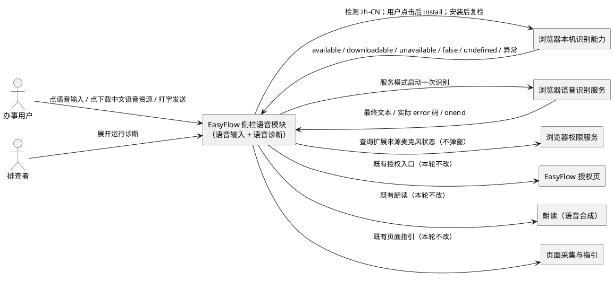
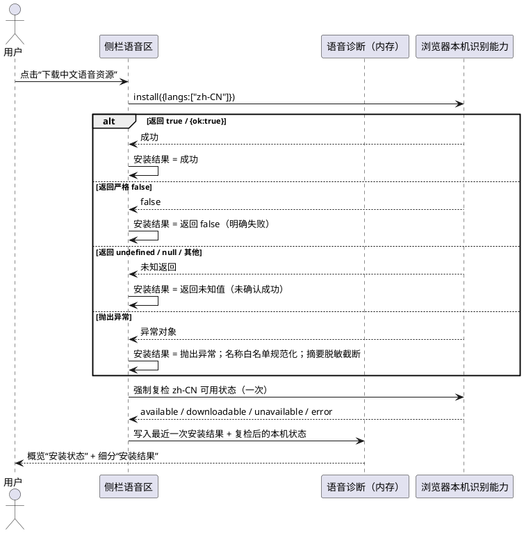
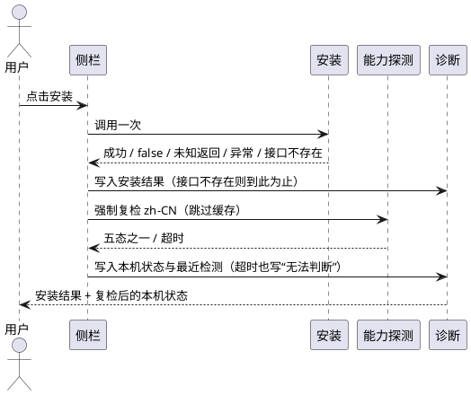
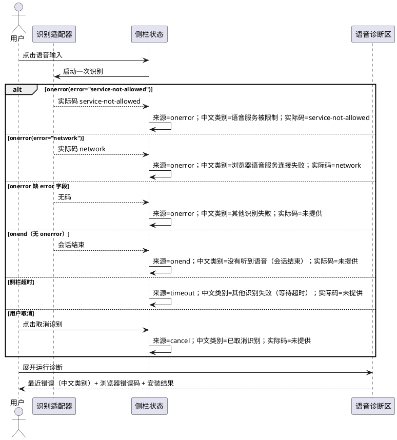
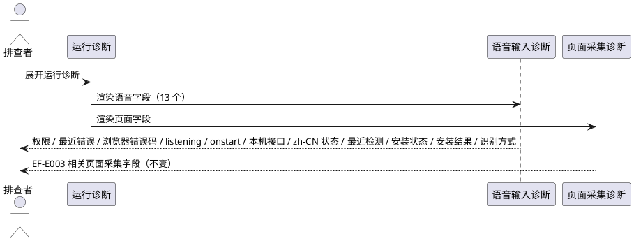
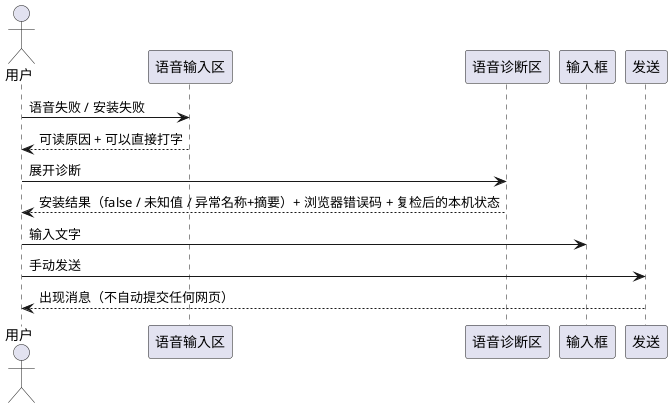

# EasyFlow 语音输入诊断细化：安装结果两分、异常安全摘要与浏览器实际错误码需求规格（第八轮增量·重试版 v2）

> **版本说明**
>
> - v1（2026-11-16 首次生成）：建立 R-336—R-372，提出“安装返回 false / 抛出异常”两分、安装后强制复检、诊断显示浏览器实际错误码。
> - **v2（本次重试）**：不改变用户目标，修正 v1 的 15 类缺口与自相矛盾（G-01—G-15）：摘要禁词与 AT-81 断言冲突、`onend` 中文类别仍写 `no-speech`、取消场景“保留上一次码”与“未提供”冲突、复检失败时间/按钮规则不完整、`false` 与“未知返回”混为一类、AT-81 键列表“命名待设计阶段核定”不可测、人工验收“允许记录摘要”与“不抄全文”冲突、修复门槛缺少组合分支等。v2 保留原需求编号，新增 R-373—R-382 作为修正项，并在附录 B 逐条列出差异。
>
> 本文件是 `easyflow_page_guide` 特性的第八轮增量规格，不替代 `spec.md`、`iteration2-spec.md` 至 `iteration7-spec.md`。
>
> 本轮只解决一件事：**让语音输入诊断能如实回答“安装到底是哪一种失败”“浏览器到底返回了哪个错误码”“安装结束后本机状态是否变化”**，并保证诊断只读、只存内存、不记录音频与识别内容。
>
> 验收条件沿用前七轮写法：EARS 触发词（When / If / While / Where）+ 中文正文 + 可验证的验收条件。本文件只描述“要什么、怎么算做到”，不描述类结构、函数签名、文件划分与打包实现细节；涉及既有模块的内容只写外部可观察结果。
>
> **本阶段声明**：只产出需求规格。未修改任何源码、未修改 `public/manifest.json`、未修改 `scripts/`、未修改前七轮文档，未运行 `npm run typecheck` / `npm run build` / `npm run selftest` / `npm run verify`，未创建或覆盖 `codearts_proof` 实绩日志，未调用真实麦克风、真实语音识别、真实语音合成、真实 `SpeechRecognition.available` / `install`，未访问网络。

---

## 0. 背景与现状盘点

### 0.1 本轮用户目标（范围封顶）

1. **只诊断语音输入，不改导办流程**：不改步骤卡、页面定位/高亮、详情分层、成功页、`EF-E003` 页面采集判定与文案。
2. **安装结果必须两分**：用户点击“下载中文语音资源”后，分别记录 `SpeechRecognition.install()`：
   - 返回 `false`（明确失败）；
   - 抛出异常；若抛异常，显示**错误名称**与**简短信息**。
   两者不得合并为同一个“准备失败”，也不得把“接口不存在”混入。
3. **安装结束后重新检测**中文本机识别状态：成功、返回 `false`、抛出异常、返回未知值，均须复检一次；接口不存在或未点击不复检。
4. **浏览器服务识别失败时显示实际错误码**：诊断区显示 `onerror.error` 的真实码值（白名单内原码，未映射值只显示“其他（未映射）”）。
5. **诊断中不记录音频或识别内容**：不录音、不保存音频、识别原文、中间结果、设备名/ID、网页 URL/标题、授权页查询串、完整错误 `message`、异常堆栈、异常对象序列化。
6. **根据诊断结果再修复**：修复前保持打字可用；不得把语音输入标为“已完成/已可用/语音可用”。
7. **边界**：不改麦克风首次授权流程；不新增权限/外部接口/密钥/代理；不自动重试/自动发送/自动提交。
8. **真实设备行为待人工验收**：自动测试通过不等于语音可用，不得写“已可用”。

### 0.2 已核实基线（2026-11-16 只读核查，主工程 `D:\hwproject\translator`）

| 核查项 | 实际结果（文件与行为） | 对本轮规格的约束 |
|---|---|---|
| 安装结果纯映射 | `src/shared/speech/localCapability.ts`：`true`→`succeeded`；`{ok:true}`→`succeeded`；**其余（含 `false`、`null`、`undefined`、未知对象）一律 `failed`** | `false` 与“未知返回”被合并；抛异常根本不进入该映射 |
| 安装适配器 | `src/sidepanel/speech/localCapability.ts` 的 `createLocalInstaller`：`api === null` 或无 `install` → `unsupported`；抛错时读 `error.name`，`NotAllowedError`/`SecurityError` → `denied`，其余 → `failed`；**永不 reject** | 异常被折叠成 `failed`/`denied` 两个枚举；`error.name` 只用于分支判断，**没有留存**；`message` 完全未读取 |
| 安装状态枚举 | `INSTALL_STATES = idle / requesting / succeeded / failed / denied / unsupported`；`INSTALL_STATE_LABEL` = 未开始 / 正在准备 / 已准备 / 准备失败 / 被拒绝 / 不支持 | 现有枚举没有“明确返回 false”与“抛出异常”的区分位；用户看到同一个“准备失败”或“被拒绝” |
| 安装后复检 | `VoiceController.requestLocalInstall()`：仅在 `installed === "succeeded"` 时 `await this.ensureLocalCapability(true)`；`failed` / `denied` / `unsupported` **不复检** | 失败后诊断的 `zh-CN` 状态可能停留在旧的 `downloadable`，与“准备失败”并列，无法判断浏览器是否真的仍需下载 |
| 安装按钮可见性 | `installButtonVisible = localAvailability === "downloadable" \|\| installState === "requesting"`；进行中禁用 | 失败后若状态仍 `downloadable`，按钮仍可见，允许用户手动再点；不得自动重试 |
| 安装失败文案 | `SPEECH_LOCAL_TEXTS.installFailed = "本机识别暂不可用，可以直接打字。"`；`localNoticeOf` 对 `failed` / `denied` / `unsupported` **返回同一句** | 用户文案层面也把三种失败混为一句；本轮需区分 `false` / `throw` / `unsupported` |
| 语音诊断字段 | `SpeechDiagnosticsView` 现有 11 个文本字段：权限、权限时间、最近错误、错误时间、侧栏正在听、浏览器 onstart、本机接口、`zh-CN` 状态、最近检测、安装状态、识别方式 | 无“浏览器错误码”字段；无“安装细分结果/异常名称/摘要”字段；诊断无法回答本轮两个问题 |
| 诊断面板行数 | `DiagnosticsPanel.tsx` 语音区实际渲染 9 行（权限行含 2 值、最近错误行含 2 值；`listening`、`onstart`、本机接口、`zh-CN` 状态、最近检测、安装状态、识别方式各 1 行），展开后依次为“语音输入诊断”→“页面采集诊断”→“朗读状态”→运行记录 | 新增行只能进入语音区；页面采集区与 `EF-E003` 保持原样 |
| 原始错误归并 | `src/shared/speech/policy.ts`：`mapRawErrorKind` 把 `no-speech`/`bad-grammar` 归 `no-speech`，`network`/`not-allowed`/`service-not-allowed`/`audio-capture` 各归一类，**其余一律 `other`** | 诊断只显示六类中文名；`other` 丢失实际码；无法确认“浏览器到底返回了什么” |
| 会话结束兜底 | `src/sidepanel/speech/recognition.ts`：`onend` 且未收到结果时先发 `error{kind:"no-speech"}` 再发 `ended`；状态机据此记录 `lastRawErrorKind=no-speech` | **浏览器并未返回 `no-speech` 时，诊断也会显示“没有听到语音”**；这正是“实际错误码”要求要修正的误导 |
| 超时 | 8 秒无结果由侧栏定时器触发 `timeout`，诊断记 `lastRawErrorKind="other"` + “等待超时” | 超时不是浏览器错误码；新增字段必须能表达“未提供码” |
| 适配器错误事件 | `RecognitionEvent.error` 携带 `kind` 与可选 `raw`（六类枚举）；`RecognitionErrorLike.error?: string` 在适配器内部被消费后丢弃，`message` 从未读取 | 要显示实际码，必须在错误回调处保留白名单码值；不得保留识别 `message` |
| 诊断分区 | `DiagnosticsPanel.tsx`：语音区有“重新检测本机识别”按钮；页面采集区有“重新读取页面”按钮 | 语音区按钮数量不得增加；页面采集区按钮保持不变 |
| 折叠行为 | `details` 受控 `open`，`open===false` 时不渲染分区内容 | 新增敏感度极低的字段仍遵守“折叠不渲染” |
| 打字可用 | `ChatComposer.tsx`：`textarea` 不因语音状态禁用；发送按钮仅按 `disabled \|\| text.trim().length === 0` 判定 | “失败仍可打字”由既有机制保证，本轮只加断言 |
| 隐私红线 | 第七轮 R-256/R-326—R-335：诊断禁止音频、识别文本、设备名、网页 URL、完整错误 `message`、异常对象、查询串；只存内存 | 本轮新增“安装异常名称/安全摘要”是**受控例外**，必须同时给出白名单、长度上限、脱敏与禁入位置 |
| 测试基线 | `codearts_proof/iteration7-selftest.log` 末行 `pass 87 / fail 0`；AT-81—AT-96 位于 `scripts/selftest.mjs` | 87 项全部为回归红线；仅允许按 7.2 列出的最小范围改写 |
| AT-81 断言形态 | `assert.deepEqual(Object.keys(d).sort(), [11 个键])` 为**精确列表**；另有 `assert.ok(!/http\|url\|audio\|message\|device\|transcript/i.test(JSON.stringify(d)))` | 新增键会触发键列表失败；**新增值 `audio-capture` 会触发 `audio` 禁止正则失败**——这是 v1 漏掉的关键冲突 |
| AT-90 断言形态 | 只断言成功路径 `localOptionVisible`、失败路径 `localNoticeText !== null`、30 秒内 `installCalls` 不增长；未检查失败路径的复检次数 | 现有断言无法区分 `false` 与抛异常，需要新增用例而不是改旧语义 |
| 留痕现状 | `codearts_proof/26-iteration7-implementation.md`：真实设备“中文本机识别是否可用尚待人工验收”；复测现象为“先未识别到语音，随后网络或语音服务暂不可用” | 本轮不得把自动测试通过写成“语音可用”；真实 Chrome 仍需一次人工检查 |
| 权限与门禁 | `manifest.permissions = ["activeTab","scripting","sidePanel","storage"]`；`verify-manifest.mjs` 只允许授权页两处 `getUserMedia` 例外 | 本轮权限集合逐项不变；不得新增 `tabs`/`host_permissions`/`content_scripts`/`web_accessible_resources` |
| 禁止项门禁 | `MediaRecorder`、`fetch(`、语音目录 `chrome.storage` 在自测中已被检索禁止 | 新增字段不得引入网络、存储或录音路径 |

### 0.3 上一版（v1）缺口与本次修正点

| 编号 | v1 缺口/歧义/冲突 | v2 修正 |
|---|---|---|
| G-01 | AT-81 的禁止正则含 `audio`，而本轮要求显示实际码 `audio-capture`；v1 只提“键列表改写”，未提该正则冲突 | 7.2 明确改写 AT-81：全局禁词收窄为 `http/url/message/device/transcript`，音频数据禁词改为 `audioData/audioBlob/audioBase64/audioBuffer/audioUrl/录音/音频数据`，并显式允许白名单值 `audio-capture`；6.3 摘要同时删除这些词 |
| G-02 | v1 写“视图只新增 2 个键，具体命名由设计阶段核定”；命名未定 → 测试无法预写，等于不可测 | 6.2 固定 13 个视图键名与精确列表；7.2 给出 AT-81 改写后的完整 13 键有序列表；设计阶段不得再改键名，若要改必须回到本规格 |
| G-03 | v1 R-356 要求 `onend` 中文类别显示“会话结束”，但 6.4 表仍写 `lastRawErrorKind = no-speech（会话结束）`，实现者会继续记 `no-speech`，与“实际码只来自 onerror”混淆 | 新增 `lastErrorSource = onerror / onend / timeout / cancel / none`；`onend` 时 `lastErrorText = 没有听到语音（会话结束）`、`lastRawErrorCode = null`；显式 `onerror(no-speech)` 才显示 `no-speech` 并记实际码 |
| G-04 | v1 5.3.3-3 写“取消识别 → 不记错误码；保留上一次码”，与用户“取消/onend/超时显示未提供”冲突；且会掩盖本次会话无码 | R-375 明确：取消不新增码；本次会话取消前无 `onerror` → 错误码“未提供”；取消前已有 `onerror` → 该次码（会话已结算，取消不覆盖）；从未失败 → “暂无（本次侧栏会话）” |
| G-05 | v1 R-350 只说复检失败保留安装结论，未说“最近检测时间是否刷新”；旧时间会让用户误以为复检未发生 | R-350 补充：复检超时/抛错也必须把“最近检测”刷新到本次复检时刻，本机状态“无法判断”；安装结果/名称/摘要保留 |
| G-06 | v1 T8-09 只说复检仍 `downloadable` 时保留按钮；未说复检 `error` 时按钮是否消失 | R-377：复检 `error`/超时 → 安装按钮隐藏，仅保留“重新检测本机识别”；不得沿用旧 `downloadable` 静默保留按钮 |
| G-07 | v1 5.1.3 把 `undefined`/`null`/未知对象归“返回 false（明确失败）”，把“明确 false”与“未确认返回”混在一起 | R-373：严格 `false` → “返回 false（明确失败）”；`undefined`/`null`/其他非成功值 → “返回未知值（未确认成功）”；两者都与 `throw` 不同 |
| G-08 | v1 R-342 写“换一段更长 message 不改变序列化长度”，但短 message 与 40 字截断后的长度本来就不同；且“序列化 ≤200 字符”与 13 字段可能冲突 | 6.3/7.1 改为：摘要 ≤40 code point（省略号另计）；序列化总长 ≤480 字符；message 超过 40 字符后长度不再增长；≤40 时差值 ≤40 |
| G-09 | v1 6.3 摘要脱敏规则“删除以 `/`、`\` 开头的文件路径片段”会误删正常中文/斜杠表达，且不可测 | 6.3 改为精确替换：`scheme://非空片段`、`[A-Za-z]:\\非空片段`、`[a-p]{32}` 扩展 ID、`[A-Za-z0-9_.\-]{20,}` ASCII 长串、`\d{6,}` 长数字；按顺序执行并给出示例 |
| G-10 | v1 6.6.4 允许人工验收记录“安全摘要（若与隐私不冲突）”，7.3 又说“摘要只记录是否为空/是否被截断，不抄全文”，两条冲突 | R-380/6.6：人工验收与门禁日志**只允许**记录异常名称、摘要长度区间（0 / 1—40 / 41）、是否为空、是否截断；**禁止抄录摘要原文** |
| G-11 | v1 6.5 修复门槛缺“安装结果 × 复检结果”的组合分支，也缺“证据不足”的判定与“修复后复测”要求 | 6.5 改为两张组合表（安装结果 × 复检结果；识别码 × 权限），并新增“证据不足 → 只补诊断”“修复后必须复测同一路径并更新断言” |
| G-12 | v1 5.4.2 时序图仍列 11 个字段，漏了新增 2 个；R-345 写“诊断区按钮仅既有重新检测”，但页面采集区还有“重新读取页面” | 时序图改为 13 个字段；R-345 改为“语音区按钮数量不增加；页面采集区按钮不变” |
| G-13 | v1 4.1 写“展开诊断 ≤200ms”，但展开会触发既有 `available` 探测（最长 1.5 秒），该指标不可测 | 4.1 改为：展开先渲染旧值/“检测中”，`available` 探测异步进行；展开动作本身不得启动识别、安装、`getUserMedia`、网络；新增行渲染不新增超过 4 行 |
| G-14 | v1 7.2 未明确 `FakeLocalCapability` 夹具允许扩展项，也未明确其余 85 项零改动 | 7.2 明确：只允许扩展假对象的返回值/异常名称/message/延迟；87 项中仅 AT-81、AT-90 允许最小改写，其余 85 项零改动；新增 AT-97—AT-105 共 9 项，总计 96 项 |
| G-15 | v1 7.1 只有 7 项新增用例，`onend`/取消/超时未提供、复检失败保留结论混在 AT-99/AT-100 中，断言不够独立 | 7.1 拆为 AT-97—AT-105 共 9 项：两分、摘要、复检、复检失败、错误码、未提供、字段矩阵、打字、回归 |

### 0.4 为什么“准备失败”不够区分（根因判断，只读分析，未实测确认）

| 现象 | 现有证据 | 无法回答的问题 | 本轮落点 |
|---|---|---|---|
| 用户看到“准备失败”，但不知道是浏览器明确拒绝还是调用出错 | `mapInstallResult` 把 `false`/`null`/未知对象归 `failed`；`createLocalInstaller` 把非拒绝类异常也归 `failed` | 是“浏览器返回 false（明确未完成）”还是“调用抛异常（参数/安全/实现差异）”？ | 5.1、6.1、6.3 |
| 抛异常时只显示“被拒绝”或“准备失败” | `denied` 只由 `NotAllowedError`/`SecurityError` 推导，`name` 未留存；`message` 未读取 | 具体是哪种错误？是否可恢复？该改配置还是只需换路径？ | 5.1、6.3 |
| 失败后诊断仍显示“可下载” | 复检只在 `succeeded` 分支执行 | 安装失败后 `zh-CN` 到底变成什么状态？是否仍可再试？ | 5.2 |
| 诊断只有中文错误类别，没有实际码 | `mapRawErrorKind` 把未知值统一 `other`，原串未保存 | 浏览器实际返回的是 `service-not-allowed` 还是未映射值？ | 5.3、6.4 |
| `onend` 兜底被记成 `no-speech` | 适配器在 `onend` 无结果时主动发 `no-speech` 错误 | 浏览器是否真的返回过 `no-speech`？还是只是会话结束？ | 5.3、6.4 |
| 失败后用户不知道该修哪一层 | 安装、权限、服务识别、本机能力混在同一句“暂不可用” | 后续修复应落在安装参数、文案、能力探测还是服务识别？ | 5.5、6.5 |

**结论口径**：本轮不判断真实 Chrome 的底层原因，也不承诺修复后语音可用；只要求诊断**如实记录**安装结果的两分、异常名称与安全摘要、浏览器实际错误码，并在安装结束后强制复检。真实根因必须由用户在真实 Chrome 上按 7.3 记录一次后再决定修复分支。

### 0.5 与“页面采集失败”“麦克风授权”“朗读”的边界（继续保持）

1. `EF-E003` 表示“未获得当前网页访问授权”，属于 `activeTab` 采集链路；修复动作是“点一下扩展图标”。本轮零改动。
2. 语音诊断的权限对象是扩展来源麦克风权限。安装异常名称（如 `NotAllowedError`）**不是**网页访问授权，也不是麦克风首次授权失败。
3. 诊断严禁把 `EF-E003`、页面 URL、页面标题写入语音区；也严禁把语音安装异常写入页面采集条目。
4. 聊天历史里的旧“页面访问许可”消息不参与语音诊断；诊断不读取聊天内容。
5. 朗读链路（入口、白名单、中文优先、语速、同一句不重复、个人信息跳过、停止、生命周期）本轮零改动；语音失败不得阻断朗读。
6. 麦克风首次授权页（`getUserMedia({audio:true})`、获准立即停轨、回页重试、去重）本轮零改动；不得因安装异常引导用户重开授权页。

---

## 1. 组件定位

### 1.1 核心职责

本组件负责把“安装失败属于哪一种、浏览器返回了哪个错误码、安装后本机状态是否变化”如实展示给用户，同时保证任何失败下都能继续打字、不夸大可用性。

### 1.2 核心输入

1. **侧栏用户操作**：点击“语音输入”“取消识别”“开启麦克风”、展开“运行诊断”、切换识别方式、点击“下载中文语音资源”、点击“重新检测本机识别”、手动发送。
2. **浏览器安装结果**：`install({langs:["zh-CN"]})` 的返回值（`true` / `false` / `undefined` / `null` / 其他）或抛出的异常对象（只取名称与安全摘要）。
3. **浏览器识别错误**：识别实例 `onerror` 回调中的 `error` 字符串（只取白名单码值，不取 `message`）。
4. **识别会话事件**：侧栏进入听、浏览器 `onstart`、最终文本、`onend`、侧栏超时、用户取消。
5. **本机能力结果**：API 是否存在；`zh-CN + processLocally` 在安装前后的可用状态。
6. **权限状态**：扩展来源麦克风五态（只读引用，本轮不改授权流程）。

### 1.3 核心输出

1. **语音输入区状态**：权限说明、识别方式、安装入口、安装结果说明（用户可读、不含技术细节）、失败后的下一步。
2. **语音诊断区字段**：在既有 11 个文本字段基础上，新增“浏览器错误码”和“安装结果（含异常名称与安全摘要）”，视图共 13 个文本字段。
3. **识别结果**：仍只写入可编辑输入框，由用户手动发送。
4. **对浏览器的请求**：仅用户点击后启动一次识别；仅用户点击后安装一次；安装结束后自动复检一次（不自动安装、不自动识别）。

### 1.4 职责边界

1. **不负责**修复浏览器语音服务、网络、代理、系统音频或语言包分发。
2. **不负责**自动重试安装/识别、自动重开授权页、自动切回服务识别。
3. **不负责**新增权限、语音 SDK、外部语音接口、密钥或代理。
4. **不负责**录音、保存音频、识别原文、中间结果、设备名/ID。
5. **不负责**修改网页采集、`EF-E003` 判定与文案、页面定位/高亮/步骤卡。
6. **不负责**修改朗读链路与麦克风首次授权页。
7. **不负责**自动发送、自动点击网页、自动提交或创建真实预约。
8. **不负责**根据 Chrome 版本号、地区或错误名称推断“一定可用/一定不可用”。

---

## 2. 领域术语

**安装明确失败（Install Returned False）**
: 指 `install()` 正常返回且返回值严格为 `false`。它表示调用完成但浏览器没有完成资源准备，**不包括**抛出异常，也不包括 `undefined`/`null`/其他对象。

**安装未知返回（Install Returned Unknown）**
: 指 `install()` 正常返回但返回值既不是 `true`/`{ok:true}`，也不是严格 `false`（例如 `undefined`、`null`、`{ok:false}`、其他对象）。它表示“未确认成功”，与“明确 false”分开记录。

**安装异常（Install Threw）**
: 指 `install()` 抛出异常。它表示调用未正常完成；规格只允许记录异常名称与安全摘要，不记录异常对象本身、堆栈或完整 `message`。

**异常名称（Install Error Name）**
: 指异常对象的 `name` 字段，经白名单与字符集规范化后的结果。非白名单名称一律显示为“未知错误”。

**安装安全摘要（Install Error Brief）**
: 指对异常 `message` 做脱敏、折叠与截断后的结果，长度上限 40 个字符（按 Unicode code point 计，省略号另计）；不得包含 URL、协议、文件路径、扩展 ID、长标识串、长数字串、音频或识别文本、AT-81 禁词。为空时以固定短句替代。

**浏览器错误码（Browser Recognition Error Code）**
: 指识别实例 `onerror` 回调中 `error` 字段的原始值，经白名单归类后的有限枚举。它**只来自 `onerror`**；`onend` 兜底、侧栏超时、用户取消不得伪造该值。

**未提供码（Not Provided）**
: 指本次失败没有浏览器 `onerror` 码可供记录（例如会话结束无结果、侧栏超时、`onerror` 缺少 `error` 字段）。界面必须明确“未提供”，不得补一个 `no-speech` 充当实际码。

**错误来源（Error Source）**
: 指“最近错误”行的数据来源：`onerror`（浏览器明确错误）、`onend`（会话结束无结果）、`timeout`（侧栏等待超时）、`cancel`（用户取消）、`none`（本次侧栏会话尚无失败）。来源决定中文类别与实际码是否“未提供”。

**安装结果（Install Outcome）**
: 指安装调用的结算类别：成功 / 返回 false（明确失败）/ 返回未知值（未确认成功）/ 抛出异常 / 接口不支持 / 未开始或进行中。它与既有“安装状态”概览并存，用于细分失败。

**诊断不明确（Inconclusive Diagnosis）**
: 指现有证据不足以把失败归入某个可执行的修复分支（例如权限未知 + 未映射错误 + 无安装异常名称 + 复检无法判断）。此时系统只允许保持现状与补充诊断，不得改权限、不得标“可用”。

---

## 3. 角色与边界

### 3.1 核心角色

1. **办事用户**：点击语音输入或安装；失败后决定继续尝试还是打字。
2. **排查者（用户本人或支持人员）**：需要在不接触音频与识别原文的前提下，确认安装结果类型、异常名称、浏览器错误码与安装后本机状态。

### 3.2 外部系统

1. **浏览器本机识别能力**：提供 `available` 与 `install`；`install` 可能返回 `false`、`undefined`、其他值、抛异常或不存在。
2. **浏览器语音识别服务**：提供 `service` 模式的中文单次识别；失败时可能返回 `error` 码。
3. **浏览器权限服务**：提供扩展来源麦克风状态查询；本轮不改变其使用方式。
4. **EasyFlow 授权页**：既有麦克风授权入口；本轮零改动。
5. **朗读与页面采集链路**：既有能力；本轮零改动，只要求诊断分区隔离。

### 3.3 交互上下文



图中不展示侧栏内部组件、数据库、缓存与具体接口参数。

---

## 4. DFX 约束

### 4.1 性能

1. 展开“运行诊断”时，**先渲染已有诊断值**；既有“本机识别接口/`zh-CN` 状态”的 `available` 探测可异步进行，最长 1.5 秒，期间显示“检测中…”，不得阻塞展开。
2. 展开动作本身不得启动识别、安装、`getUserMedia` 或网络请求；`available` 探测是既有诊断行为，不属于安装。
3. 安装结果与异常摘要进入可见状态：安装 Promise 结算后不超过 **300 毫秒**。
4. 安装结束后的强制复检：沿用既有单次探测上限 **1.5 秒**；超时按“无法判断”显示，不无限等待。
5. 复检进行中不得阻塞输入框编辑与发送；安装按钮保持禁用直到复检结算（防止叠加），但安装结果文本已可见。
6. 新增字段在 320px 宽度与 200% 缩放下不得横向溢出；异常摘要必须可换行。
7. 语音区新增行数最多 **2 行**（浏览器错误码、安装结果），不得把诊断区扩成表格或长列表。

### 4.2 可靠性

1. 安装返回 `false`、返回未知值、抛异常、复检失败、错误码缺失，均不得使侧栏不可用；打字、发送、朗读、页面指引继续可用。
2. 同一时刻最多 1 次安装调用、最多 1 个识别会话；重复点击幂等。
3. 安装结束后必须发生且只发生 1 次强制复检（以实际发起的安装调用为前提）；接口不存在或用户未点击 → 0 次。
4. 安装异常名称与摘要不得因复检失败被清空；复检结果与安装结果分别展示，互不覆盖。
5. 取消识别、侧栏关闭、切换任务后到达的识别错误/结果必须丢弃，不得覆盖诊断“最近一次”。
6. 新增诊断字段不得使既有 87 项断言语义变松；若字段列表变化，只允许按 7.2 精确更新键集合与禁词。
7. 复检进行中用户关闭侧栏 → 丢弃复检结果；重开后从“未检测”开始。

### 4.3 安全性

1. **只允许**新增字段：浏览器错误码（白名单枚举）、安装结果类别、异常名称（白名单）、异常安全摘要（≤40 code point）。
2. **禁止**记录/展示：音频、识别原文、中间结果、设备名/ID、网页 URL/标题、授权页查询串、完整 `message`、异常堆栈、异常对象序列化、外部服务响应体。
3. 异常摘要必须脱敏：去除 URL/协议/盘符路径、`[a-p]{32}` 扩展 ID、20 字符以上 ASCII 标识串、6 位以上连续数字、AT-81 禁词（`http/url/audio/message/device/transcript`，大小写不敏感）。
4. 安装与复检不得采集音频、不得启动识别、不得请求麦克风权限、不得访问网络。
5. 不得新增 `tabs`、`host_permissions`、`<all_urls>`、`content_scripts`、`web_accessible_resources`；不得使用 `MediaRecorder`。
6. 新增诊断字段不得写入 `chrome.storage`（含既有 UI 模式键）、消息队列、聊天消息、运行日志条目或页面采集诊断；只存侧栏内存。
7. 安装按钮必须由用户手势触发；安装结束后的复检是诊断动作，不得触发新一轮安装。
8. 摘要只允许出现在语音诊断区；不得复制到剪贴板、聊天、朗读、页面采集、日志或测试日志。

### 4.4 可维护性

1. 浏览器错误码、安装结果、异常名称白名单、摘要长度上限、AT-81 禁词必须为命名常量/单一枚举表，不得散落魔法值。
2. 所有用户可见文案（含“返回 false”“返回未知值”“抛出异常”“浏览器错误码”“未提供”“暂无”）必须来自单一来源；组件与测试共用。
3. 诊断字段必须能按 6.2 的“字段—来源—是否落盘—显示格式—禁止内容—长度上限”矩阵逐项审阅。
4. 自测必须使用可注入的假安装与假识别；不得依赖真实设备、真实语言包或真实网络。
5. 异常名称白名单、摘要脱敏函数、错误码映射必须是可单测的纯逻辑，不依赖浏览器全局对象。

### 4.5 兼容性

1. 目标环境：Chrome / Chromium MV3，`minimum_chrome_version` 保持 **116**。
2. 既有 87 项自测必须继续通过；仅允许 7.2 列出的最小改写。
3. `install()` 返回非布尔对象、`undefined`、`null` 时统一归“返回未知值（未确认成功）”，不得抛错到界面。
4. 异常 `name` 缺失、非字符串、超长或含非安全字符时显示“未知错误”，不得崩溃；读取 `name`/`message` 抛错时同样降级，不得让读取动作再次抛出。
5. 浏览器未提供 `onerror.error` 时显示“未提供”，不得沿用上一次码值冒充本次。
6. 朗读按钮、页面步骤卡、定位/高亮、阅读模式与关怀 token 不得回退。
7. `availability` 返回 `downloading` 仍归 `downloadable`（沿用第七轮 T7-08）；不得把“正在下载”当成“可用”。
8. `{ok:true}` 仍视为安装成功；`{ok:false}` 归“返回未知值（未确认成功）”。

---

## 5. 核心能力

## 5.1 安装结果两分：返回 false、返回未知值、抛出异常

### 5.1.1 业务规则

1. **R-336 明确失败独立记录**：When 用户点击“下载中文语音资源”且安装调用正常返回严格 `false`，the system shall 把安装结果记为“返回 false（明确失败）”，不得记为“抛出异常”或“返回未知值”。
   a. 验收条件：假安装返回 `false` → 诊断“安装结果”为“返回 false（明确失败）”；异常名称与异常摘要均为“无”。
2. **R-337 异常独立记录**：If 安装调用抛出异常，the system shall 把安装结果记为“抛出异常”，并同时显示规范化后的异常名称与安全摘要。
   a. 验收条件：假安装抛出 `NotAllowedError` → 安装结果为“抛出异常 · NotAllowedError · <摘要或固定短句>”；名称与摘要均非“无”。
3. **R-338 各类不得合并**：The system shall 使“返回 false”“返回未知值”“抛出异常”“接口不支持”在诊断结果、语音区用户文案与后续建议上两两不同。
   a. 验收条件：四类分别注入 → 诊断结果文本两两不同；语音区说明文本两两不同；文案集合大小 = 4（不得只差标点）。
   b. 验收条件：接口不支持的语音区文案为“这台浏览器没有提供中文本机语音资源安装能力，可以直接打字。”；不得复用 false/未知/throw 任一句。
4. **R-339 异常名称白名单**：The system shall 只显示以下异常名称之一：`NotAllowedError`、`SecurityError`、`NotSupportedError`、`NetworkError`、`AbortError`、`InvalidStateError`、`UnknownError`、`TypeError`、`RangeError`、`Error`；其他名称一律显示“未知错误”。
   a. 验收条件：注入 `{name:"WeirdError"}` → 显示“未知错误”；注入空名称/非字符串/`notallowederror`（小写）→ “未知错误”；白名单名称**精确大小写**原样显示（仅 ASCII，长度 ≤40）。
   b. 验收条件：注入 `{name:"Error"}` → 显示“Error”（允许通用名，但不得据此推断原因）。
5. **R-340 摘要脱敏与截断**：When 异常带有字符串 `message`，the system shall 生成不超过 **40 个字符**（Unicode code point，省略号另计，总长 ≤41）的安全摘要：折叠连续空白为单空格、按 6.3 顺序替换敏感片段、去除首尾空白；超长截断并追加省略号。
   a. 验收条件：注入含 `https://example.com/x`、`chrome-extension://abcd/...`、`C:\Users\x\a.log`、32 位 `[a-p]` 扩展 ID、连续 30 字符 ASCII 标识、10 位数字的 message → 摘要不含上述任一片段；长度 ≤40（省略号不计）。
   b. 验收条件：注入含 `http`、`url`、`audio`、`message`、`device`、`transcript`（大小写不敏感）的 message → 摘要不含这些词；若清洗后为空 → 固定短句。
6. **R-341 摘要为空的可读替代**：If 清洗后摘要为空或异常没有字符串 `message`，the system shall 用固定短句“没有可显示的错误信息”，不得显示空白或原始对象。
   a. 验收条件：抛出不带 message 的异常 → 摘要为该固定短句；界面无 `[object Object]`、无堆栈、无 `undefined`。
7. **R-342 不记录完整 message 与对象**：The system shall 禁止在诊断、日志、聊天、存储、消息中出现完整 `message`、异常堆栈、异常对象序列化、音频或识别文本。
   a. 验收条件：诊断序列化文本长度 ≤ **480 字符**；message 超过 40 字符后，序列化长度不再随原始 message 增长；message ≤40 时，长度差 ≤40。
   b. 验收条件：源码与渲染文本检索无 `stack`、`[object Object]`、音频字段、识别原文。
8. **R-343 安装结果只存内存且保留最近一次**：The system shall 把安装结果、异常名称与摘要只保存在本次侧栏会话内存中，关闭侧栏即丢弃；连续多次安装只保留最近一次。
   a. 验收条件：连续安装 3 次 → 诊断只显示最后一次；重开侧栏 → 安装结果回到“未开始”；`chrome.storage` 无新增键，既有 UI 模式键内容不变。
9. **R-344 用户文案不含技术细节**：While 安装失败或抛异常，the system shall 在语音输入区使用可读中文说明，不在主状态句暴露异常名称、英文码或摘要。
   a. 验收条件：语音区主状态句不含 `NotAllowedError`、`SecurityError`、`false`、`message`、`undefined`；技术细节只出现在诊断区。
10. **R-345 安装结果行不改诊断只读性**：The system shall 只在语音诊断区显示安装结果；语音区不得新增“下载/安装/重试”按钮，页面采集区按钮保持不变。
    a. 验收条件：语音区按钮数量不增加（仅既有“重新检测本机识别”）；页面采集区仍只有既有“重新读取页面”；安装按钮只在语音输入区。
11. **R-373 返回未知值单独记录**：When 安装调用正常返回 `undefined`、`null`、`{ok:false}` 或其他非成功对象，the system shall 记为“返回未知值（未确认成功）”，不得记为“返回 false（明确失败）”，也不得记为“抛出异常”。
    a. 验收条件：依次注入 `undefined`、`null`、`{ok:false}`、`{status:"x"}` → 四者都显示“返回未知值（未确认成功）”；严格 `false` 仍显示“返回 false（明确失败）”；两类文本不同。
    b. 验收条件：安装结果为“返回未知值”时，异常名称与摘要均为“无”；不得显示 `[object Object]` 或原始对象。

### 5.1.2 交互流程



### 5.1.3 异常场景

1. **安装返回未知对象**
   a. 触发条件：返回 `{status:"x"}`、`undefined`、`null`。
   b. 系统行为：归“返回未知值（未确认成功）”，不抛错、不标成功；仍执行一次复检。
   c. 用户感知：诊断显示“返回未知值（未确认成功）”，可再点一次；语音区说明与 false/throw 不同。
2. **安装抛出非标准异常**
   a. 触发条件：抛出字符串、`Error` 子类、无 `name` 的对象、`name` 为 getter 且读取抛错。
   b. 系统行为：名称归“未知错误”；有安全摘要则显示，否则固定短句；读取动作本身不得再抛出。
   c. 用户感知：看到“抛出异常 · 未知错误”，不看到堆栈、原始字符串或对象。
3. **安装抛错后复检仍可下载**
   a. 触发条件：抛异常 + 复检 `downloadable`。
   b. 系统行为：安装结果保留“抛出异常”；本机状态显示“可下载”；安装按钮仍可见。
   c. 用户感知：知道调用失败且资源仍缺，可主动再点，不自动重试。
4. **安装抛错后复检不可用**
   a. 触发条件：抛异常 + 复检 `unavailable`/`unsupported-not-called`。
   b. 系统行为：安装结果与复检结果并列；不出现本机选项；安装按钮隐藏。
   c. 用户感知：不再把“可下载”与“准备失败”并列误读。
5. **安装抛错后复检无法判断**
   a. 触发条件：抛异常 + 复检 `error`/超时。
   b. 系统行为：安装结果保留“抛出异常 · 名称 · 摘要”；本机状态“无法判断”；最近检测时间刷新；安装按钮隐藏；保留“重新检测本机识别”按钮。
   c. 用户感知：知道安装调用出错，且本机状态暂时无法判断；可手动重新检测。

---

## 5.2 安装结束后强制复检

### 5.2.1 业务规则

1. **R-346 一律复检**：When 一次实际发起的安装调用结束（成功、返回 false、返回未知值或抛出异常），the system shall 在本次安装流程内强制重新检测一次 `zh-CN` 本机识别状态。
   a. 验收条件：四条路径各注入 → 每次复检调用次数 +1；复检参数仍只含 `zh-CN` 与 `processLocally`。
2. **R-347 复检结果必须覆盖旧值**：The system shall 用复检结果更新诊断的“中文（zh-CN）本机状态”和“最近检测”时间，不得沿用安装前的旧状态。
   a. 验收条件：安装前 `downloadable`、复检返回 `unavailable` → 诊断显示“暂不支持中文”；显示时间刷新。
3. **R-348 只有 available 才出现本机选项**：When 复检返回 `available`，the system shall 出现“使用本机识别”选项，但不得自动选中。
   a. 验收条件：复检 `available` → 选项可见、模式仍为“浏览器服务识别”；不自动启动识别。
4. **R-349 复检不可用时不标可用**：If 复检返回 `downloadable`、`unavailable`、`unsupported-not-called` 或 `error`，the system shall 保持本机识别不可用，并显示对应说明。
   a. 验收条件：四类结果 → 无“可用/已可用/已完成”字样；服务识别仍可启动。
5. **R-350 复检失败不丢安装结论**：If 复检超时或抛错，the system shall 把本机状态记为“无法判断”，把“最近检测”刷新到本次复检时刻，并保留刚记录的安装结果与异常名称/摘要。
   a. 验收条件：复检抛错 → 本机状态“无法判断”；最近检测时间更新；安装结果仍为“抛出异常 · NotAllowedError · <摘要>”。
6. **R-351 未发起调用不复检**：Where 安装接口不存在或用户未点击“下载中文语音资源”，the system shall 不发起复检，也不发起安装。
   a. 验收条件：无 `install` → 安装结果“接口不支持”；安装路径触发的 `available` 探测 0 次；页面加载 0 次安装；用户手动点“重新检测本机识别”仍可探测 1 次。
7. **R-352 复检不触发其他动作**：When 复检完成，the system shall 不自动启动识别、不自动切换识别方式、不自动发送、不自动再次安装。
   a. 验收条件：复检后等待 30 秒 → 识别启动 0 次、安装调用不增长、消息数不变、输入框不变。
8. **R-353 复检频次与其他入口不冲突**：The system shall 让“手动重新检测本机识别”仍可用；安装后的强制复检不得被 5 分钟缓存短路。
   a. 验收条件：安装前刚探测过 → 安装结束后仍发生 1 次复检（强制刷新）；点击“重新检测”再 +1 次。
9. **R-376 复检期间的状态展示与防叠加**：While 安装结束后的复检进行中，the system shall 立即显示安装结果文本，保持安装按钮禁用以防叠加，并允许用户继续编辑输入框。
   a. 验收条件：复检延迟 200 毫秒 → 安装结果已可见；按钮禁用；输入框可输入；复检结束后按钮按 5.2.1-10 规则恢复或隐藏。
10. **R-377 复检无法判断时隐藏安装按钮**：If 复检返回 `error` 或超时，the system shall 隐藏“下载中文语音资源”按钮，只保留“重新检测本机识别”入口；不得沿用安装前的 `downloadable` 静默保留按钮。
    a. 验收条件：安装前 `downloadable`、复检 `error` → 安装按钮不可见；本机状态“无法判断”；手动重新检测后若返回 `downloadable`，按钮重新可见。

### 5.2.2 交互流程



### 5.2.3 异常场景

1. **复检期间关闭侧栏**
   a. 触发条件：安装结束、复检进行中关闭侧栏。
   b. 系统行为：丢弃结果；重开后重新检测。
   c. 用户感知：状态从“未检测”开始，不残留上一次结论。
2. **复检结果与安装成功矛盾**
   a. 触发条件：安装返回成功但复检仍 `downloadable`。
   b. 系统行为：安装结果显示“成功”，本机状态显示“可下载”；不出现本机选项；安装按钮保留（允许手动再点）。
   c. 用户感知：知道“安装被接受但资源仍未就绪”。
3. **连续安装并发**
   a. 触发条件：一次安装未结束又点击。
   b. 系统行为：按钮禁用；最多 1 次调用；结束后只复检 1 次。
   c. 用户感知：不会出现两次复检叠加。
4. **接口不存在**
   a. 触发条件：浏览器未提供 `SpeechRecognition.install`。
   b. 系统行为：安装结果“接口不支持”；不复检；不显示安装按钮（或按钮不可用）。
   c. 用户感知：诊断说明接口不存在；仍可打字、服务识别、手动重新检测。

---

## 5.3 诊断显示浏览器实际错误码

### 5.3.1 业务规则

1. **R-354 新增“浏览器错误码”字段**：The system shall 在语音诊断区显示最近一次浏览器识别错误的实际码值，取值为 `no-speech | network | not-allowed | service-not-allowed | audio-capture | language-not-supported | aborted | 其他（未映射） | 未提供 | 暂无（本次侧栏会话）`。
   a. 验收条件：逐类注入 → 显示值各自可读且互不相同；无失败时显示“暂无（本次侧栏会话）”；失败但无码时显示“未提供”。
2. **R-355 只来自 onerror**：The system shall 只把识别实例 `onerror` 回调中的 `error` 字段计入“浏览器错误码”。
   a. 验收条件：仅触发 `onend`（无结果）→ 错误码为“未提供”，不得显示 `no-speech`；仅侧栏超时 → 同样“未提供”；仅取消 → “未提供”或“暂无”。
3. **R-356 会话结束不得伪造码**：While 会话因 `onend`、取消或超时结束且没有 `onerror`，the system shall 不把“没有听到”写成实际码，只保留中文类别“没有听到语音（会话结束）”或“其他识别失败（等待超时）”或“已取消识别”。
   a. 验收条件：`onend` 兜底路径 → 诊断“最近错误”为“没有听到语音（会话结束）”；错误码“未提供”；主提示仍为“没有听到可识别内容，可以再说一次。”
   b. 验收条件：超时路径 → 诊断“最近错误”为“其他识别失败（等待超时）”；错误码“未提供”。
   c. 验收条件：显式 `onerror(error="no-speech")` → 诊断“最近错误”为“没有听到语音”；错误码 `no-speech`；两行与 onend 路径不同。
4. **R-357 未映射值可辨识**：If `onerror.error` 不在白名单内，the system shall 显示“其他（未映射）”并保留内部“其他识别失败”类别；不得显示原始任意字符串。
   a. 验收条件：注入 `"weird-code"` → 错误码“其他（未映射）”；界面无 `weird-code`；主提示仍为“识别失败，可以再试或直接打字。”
5. **R-358 实际码只在诊断区**：The system shall 禁止把 `no-speech`、`network`、`not-allowed`、`service-not-allowed`、`audio-capture`、`language-not-supported`、`aborted` 等原码显示在语音主状态句、聊天消息、步骤卡、朗读说明或页面采集区。
   a. 验收条件：主状态句与聊天检索 → 0 命中；诊断区命中且仅限“浏览器错误码”行。
6. **R-359 不读取识别 message**：The system shall 不读取、不保存、不显示识别错误的 `message`；识别错误只取 `error` 码。
   a. 验收条件：注入带长 message 的错误 → 诊断文本不随 message 变化；无 URL/长文本；识别 message 不进入语音区、诊断、聊天、日志。
7. **R-360 中文类别与码值并存**：The system shall 保留既有“最近错误”中文类别行，并新增“浏览器错误码”行，两者不得互相替代。
   a. 验收条件：`network` → “最近错误：浏览器语音服务连接失败”；“浏览器错误码：network”；两行文本不同。
8. **R-361 最近一次的覆盖顺序**：When 新错误到达，the system shall 同时更新中文类别与实际码；若新事件没有码（会话结束/超时/取消），实际码必须改为“未提供”，不得保留上一次码。
   a. 验收条件：先 `network` 后 `onend` → 实际码为“未提供”，中文类别为会话结束；再 `not-allowed` → 实际码更新为 `not-allowed`。
9. **R-374 错误来源显式化**：The system shall 为“最近错误”记录来源 `onerror | onend | timeout | cancel | none`，并保证来源与错误码的一致性：
   - `onerror` → 错误码必为白名单值或“其他（未映射）”；
   - `onend` / `timeout` / `cancel` → 错误码必为“未提供”（若此前无失败）或“暂无”（若从未失败）；
   - `none` → 错误码“暂无（本次侧栏会话）”。
   a. 验收条件：逐来源注入 → 来源与错误码组合符合上表；不存在“来源 onend + 错误码 no-speech”的组合。
10. **R-375 取消/超时不得沿用上一次码**：When 用户取消识别或侧栏超时，the system shall 不把上一次会话的实际码当作本次码；本次会话没有 `onerror` 时，诊断必须显示“未提供”，并在“最近错误”说明取消/超时。
    a. 验收条件：先 `network` 失败，再开始新会话并取消 → 本次错误码“未提供”；“最近错误”显示“已取消识别”；不得继续显示 `network` 作为本次码。
    b. 验收条件：先 `network` 失败，再开始新会话并超时 → 本次错误码“未提供”；“最近错误”显示“其他识别失败（等待超时）”；不得继续显示 `network` 作为本次码。
11. **R-382 用户取消的 aborted 处理**：If 用户主动取消且随后收到 `onerror(error="aborted")`，the system shall 把本次会话归为“已取消识别”、错误码“未提供”；If 浏览器在用户未取消时自发上报 `aborted`，the system shall 显示错误码 `aborted` 与“识别已中断”说明，不作为权限或网络失败。
    a. 验收条件：`cancelledByUser=true` + `onerror(aborted)` → 错误码“未提供”；`cancelledByUser=false` + `onerror(aborted)` → 错误码 `aborted`；两者主提示不同。

### 5.3.2 交互流程



### 5.3.3 异常场景

1. **onerror 缺 error 字段**
   a. 触发条件：错误事件无 `error` 或 `error` 非字符串。
   b. 系统行为：来源 `onerror`；实际码“未提供”；中文类别“其他识别失败”。
   c. 用户感知：不再误以为浏览器说了 `no-speech`。
2. **同一会话先错误后结束**
   a. 触发条件：`onerror` 后紧跟 `onend`。
   b. 系统行为：只结算一次；实际码保留该次错误，不被结束事件覆盖为“未提供”。
   c. 用户感知：诊断与主提示一致。
3. **取消识别**
   a. 触发条件：用户点“取消识别”。
   b. 系统行为：来源 `cancel`；本次错误码“未提供”；语言状态为“已取消识别”；不记 `aborted`；不覆盖此前会话的失败码，但也不把它当作本次码。
   c. 用户感知：不会把取消当成网络/权限失败。
4. **未映射码**
   a. 触发条件：`onerror.error="weird-code"`。
   b. 系统行为：实际码“其他（未映射）”；中文类别“其他识别失败”；不显示原串。
   c. 用户感知：知道浏览器返回了未识别码，但看不到任意字符串。

---

## 5.4 诊断分区、字段矩阵与隐私

### 5.4.1 业务规则

1. **R-362 新增字段只进语音区**：The system shall 把“浏览器错误码”“安装结果（含异常名称与摘要）”只在“语音输入诊断”分区显示。
   a. 验收条件：页面采集区与朗读区不出现上述标签；`EF-E003` 仍只在页面采集区。
2. **R-363 分区标题不变**：The system shall 保留“语音输入诊断”“页面采集诊断”“朗读状态”三个独立标题。
   a. 验收条件：展开诊断 → 三标题同时存在；无字段跨区。
3. **R-364 字段矩阵外字段禁止**：The system shall 只允许显示 6.2 矩阵列出的 13 个视图字段；矩阵外字段视为违规。
   a. 验收条件：诊断视图键集合与矩阵一一对应；新增键必须先改矩阵与本规格。
4. **R-365 禁止内容**：The system shall 禁止在语音诊断区出现音频、识别原文、中间结果、设备名/ID、网页 URL/标题、授权页查询串、完整错误 `message`、堆栈、异常对象序列化。
   a. 验收条件：源码与渲染文本检索 → 上述内容 0 命中；诊断 JSON 长度不随识别文本长度增长。
5. **R-366 折叠不渲染**：While 诊断折叠，the system shall 不渲染新增字段的值。
   a. 验收条件：折叠状态下 DOM 无“浏览器错误码”“安装结果”文本节点；展开后才渲染。
6. **R-367 可访问性**：The system shall 让新增字段以中文标签 + 值的形式被读屏读出，状态不只靠颜色，长摘要可换行且可完整读出。
   a. 验收条件：键盘可展开；读屏可读标签与摘要；200% 缩放无横向溢出。
7. **R-378 摘要禁词与诊断禁词同源**：The system shall 使安全摘要的禁词表与 AT-81 的诊断禁词表来自同一常量；摘要不得含 `http`、`url`、`audio`、`message`、`device`、`transcript`（大小写不敏感）；整个诊断视图中唯一允许出现 `audio` 的字符串是白名单码值 `audio-capture`，且只出现在“浏览器错误码”行。
   a. 验收条件：注入含上述禁词的 message → 摘要不含这些词；注入 `onerror(error="audio-capture")` → 诊断仅“浏览器错误码”行出现 `audio-capture`，摘要不含 `audio`；AT-81 的音频数据禁词断言不命中 `audio-capture`。
8. **R-379 视图键固定为 13 个**：The system shall 使语音诊断视图恰好包含以下 13 个文本字段：`permissionText`、`permissionCheckedAgo`、`lastErrorText`、`lastErrorAgo`、`listeningText`、`onstartText`、`localApiText`、`localAvailabilityText`、`localCheckedAgo`、`installStateText`、`installOutcomeText`、`modeText`、`rawErrorCodeText`。
   a. 验收条件：视图键列表排序后与 7.2 的精确列表一致；内部字段（异常名称、摘要、来源、安装时刻等）不得进入视图键。
9. **R-380 人工验收不得抄录摘要原文**：The system shall 使人工验收与门禁日志只记录异常名称、摘要长度区间（0 / 1—40 / 41）、是否为空、是否截断；禁止抄录摘要原文、识别文本、音频、设备名、网页 URL。
   a. 验收条件：留痕模板检查 → 无摘要原文；若出现原文，视为隐私违规。

### 5.4.2 交互流程



### 5.4.3 异常场景

1. **诊断字段过多**
   a. 触发条件：小屏 + 长摘要。
   b. 系统行为：诊断区滚动；摘要换行；不挤压输入框。
   c. 用户感知：仍可打字与朗读。
2. **旧会话错误与新安装结果并存**
   a. 触发条件：先识别失败，再安装失败。
   b. 系统行为：两组字段独立展示，互不覆盖。
   c. 用户感知：能分别判断“识别失败码”和“安装失败原因”。
3. **摘要含禁词**
   a. 触发条件：异常 message 含 `audio device unavailable` 或 URL。
   b. 系统行为：按 6.3 删除/替换禁词与 URL；为空则固定短句。
   c. 用户感知：诊断不出现 `audio`、`http`、原始路径；AT-81 禁词断言通过。

---

## 5.5 失败下打字可用、不得标完成、按证据修复

### 5.5.1 业务规则

1. **R-368 打字始终可用**：While 处于识别失败、安装返回 false、安装返回未知值、安装抛异常、复检不可用或诊断不明确，the system shall 保持输入框可编辑、发送按钮按既有判空规则可用。
   a. 验收条件：逐一注入失败态 → 输入文字后可发送并产生消息；`textarea` 未被语音状态禁用。
2. **R-369 不得标“已完成/已可用”**：The system shall 禁止对语音输入整体显示“已完成”“已可用”“语音可用”“语音识别已完成”等结论；只有本机能力字段允许显示“可用”作为 `zh-CN` 状态值，且不得推导为语音输入可用。
   a. 验收条件：**语音输入区与语音诊断区**的失败态文案检索 → 0 命中“已完成/已可用/语音可用”；`zh-CN 可用` 仅作为状态值出现。页面采集区既有的“已完成”状态不属于本断言范围。
3. **R-370 诊断不明确时保持现状**：If 诊断证据不足以归入某个修复分支，the system shall 只补充诊断字段与可读说明，不修改权限、不自动重试、不自动安装、不扩大接口范围。
   a. 验收条件：未知错误 + 权限未知 + 无安装异常 + 复检无法判断 → 无新增权限/调用；打字可用；界面无“已修复”类表述。
4. **R-371 不自动重试/发送/提交**：The system shall 禁止在安装失败、识别失败或诊断后自动重试安装、自动重启识别、自动发送消息、自动点击网页或自动提交表单。
   a. 验收条件：失败后等待 60 秒 → 安装/识别启动次数不增长；消息数不变；无预约创建。
5. **R-372 修复分支受证据约束**：When 用户提供了诊断证据（安装结果类型、异常名称、实际错误码、安装后本机状态），the system shall 只允许按 6.5 决策门槛进入对应修复分支；证据不足时不得跳到“改权限”或“换服务”类修复。
   a. 验收条件：逐条核对 6.5 → 每条证据有唯一允许分支；无证据时仅允许“补诊断/改文案”。
6. **R-381 修复后必须复测同一路径**：When 修复进入实现阶段并完成后，the system shall 用同一诊断路径重新验证（自动测试 + 真实 Chrome 同一操作），并在留痕中引用“哪条证据支持该改动”；未复测不得写“已修复/可用”。
   a. 验收条件：修复留痕每一条包含证据字段值、改动类型、复测结果；缺任一项视为未完成。

### 5.5.2 交互流程



### 5.5.3 异常场景

1. **安装异常与识别错误同时存在**
   a. 触发条件：服务识别失败后安装也失败。
   b. 系统行为：两组诊断独立保留最近一次；主提示只给一个下一步。
   c. 用户感知：不出现互相矛盾的建议。
2. **诊断证据自相矛盾**
   a. 触发条件：权限 `granted` + `not-allowed`。
   b. 系统行为：按既有“麦克风已授权但浏览器拒绝本次识别”解释；不推重授。
   c. 用户感知：可直接再试或打字。
3. **安装返回 false 但复检 available**
   a. 触发条件：`false` + 复检 `available`。
   b. 系统行为：安装结果保留“返回 false（明确失败）”；本机状态“可用”；本机选项出现但不自动选中；不宣称“安装成功/语音可用”。
   c. 用户感知：诊断如实并列两条事实，可自行选择本机识别或继续服务识别。

---

## 6. 数据约束

### 6.1 语音诊断状态模型（新增与修订）

1. **permissionState**：枚举 `unknown | granted | prompt | denied | unsupported`；只存内存（不变）。
2. **lastRawErrorKind**：既有六类中文类别来源；只存内存（不变）。
3. **lastRawErrorCode（新增）**：枚举 `null | no-speech | network | not-allowed | service-not-allowed | audio-capture | language-not-supported | aborted | unmapped`；`null` 表示本次失败没有 `onerror` 码；`unmapped` 表示收到但不在白名单。
4. **lastErrorSource（新增）**：枚举 `none | onerror | onend | timeout | cancel`；表示“最近错误”的来源。`lastErrorSource=onerror` 时 `lastRawErrorCode` 必不为 `null`；其余来源必须为 `null`。
5. **lastRawErrorCodeProvided（派生）**：布尔；`lastErrorSource === "onerror"` 且 `lastRawErrorCode !== null`。不单独成行。
6. **installState**：既有六态 `idle | requesting | succeeded | failed | denied | unsupported`；只存内存（不变，用于概览）。
7. **installOutcome（新增）**：枚举 `none | requesting | succeeded | returned-false | returned-unknown | threw | unsupported`；`none` 表示未开始；`returned-false` 表示严格 `false`；`returned-unknown` 表示其他非成功返回；`threw` 表示异常。
8. **installErrorName（新增）**：白名单名称之一或“未知错误”；仅当 `installOutcome === "threw"` 时有值，其余为 `null`。
9. **installErrorBrief（新增）**：≤40 code point 安全摘要或固定替代短句；仅当 `installOutcome === "threw"` 时有值，其余为 `null`。
10. **installResultAt（新增，内部）**：安装结算时刻；只用于内部排序/相对时间计算，不进入视图键，不落盘。
11. **localAvailability / localCheckedAt**：沿用既有五态与时间；安装结束后必须由强制复检刷新；复检超时/抛错时 `localAvailability="error"` 且 `localCheckedAt` 刷新。
12. **browserOnstart / listening / mode**：沿用既有语义（不变）。
13. **禁止字段**：音频、视频、音频片段、识别原文、中间文本、设备 ID/名称、网页 URL/标题、完整错误 `message`、异常堆栈、异常对象、授权页查询串、任何外部服务响应体。

### 6.2 诊断字段最小化矩阵

#### 表 A：视图字段（进入 `SpeechDiagnosticsView`，共 13 个）

| 字段 | 业务含义 | 来源 | 是否落盘 | 显示格式 | 禁止内容 | 长度上限 |
|---|---|---|---|---|---|---|
| permissionText | 麦克风权限五态 | 权限查询/授权页枚举 | 否（仅内存） | 已授权/待询问/已拒绝/未知/当前环境无法查询 | 原始权限字符串、站点设置 | 20 |
| permissionCheckedAgo | 最近权限查询时间 | 侧栏时钟 | 否 | 刚刚/N 分钟前/较早/未检测 | 绝对时间戳、日期、时区 | 16 |
| lastErrorText | 最近一次失败中文类别（含来源） | `onerror`/`onend`/超时/取消 | 否 | 浏览器语音服务连接失败/没有听到语音（会话结束）/其他识别失败（等待超时）/已取消识别/暂无（本次侧栏会话） | 原始码、message、识别文本 | 40 |
| lastErrorAgo | 最近失败时间 | 侧栏时钟 | 否 | 刚刚/N 分钟前/较早/未检测 | 绝对时间戳 | 16 |
| listeningText | 侧栏是否正在听 | 侧栏状态机 | 否 | 是/否 | — | 2 |
| onstartText | 浏览器 onstart 是否到达 | 浏览器回调 | 否 | 是/否（未开始）/否（会话已结束） | — | 16 |
| localApiText | 本机识别接口是否存在 | 运行时能力 | 否 | 存在/不存在/未检测 | — | 8 |
| localAvailabilityText | `zh-CN` 本机状态 | `available(...)` | 否 | 可用/可下载（或正在下载）/暂不支持中文/未调用（不支持）/无法判断/检测中… | “语音可用”“已完成” | 20 |
| localCheckedAgo | 最近检测时间 | 侧栏时钟 | 否 | 刚刚/N 分钟前/较早/未检测 | 绝对时间戳 | 16 |
| installStateText | 安装概览六态 | install 生命周期 | 否 | 未开始/正在准备/已准备/准备失败/被拒绝/不支持 | 原始返回值、异常对象 | 12 |
| installOutcomeText | 安装细分结果 + 异常名称 + 安全摘要 | resolve/throw | 否 | 未开始/正在准备…/成功/返回 false（明确失败）/返回未知值（未确认成功）/抛出异常 · 名称 · 摘要/接口不支持 | 原始对象、堆栈、完整 message、URL/路径/扩展 ID/长串/长数字、AT-81 禁词 | 120 |
| modeText | 当前识别方式 | 用户选择 | 否 | 浏览器服务识别/使用本机识别 | — | 20 |
| rawErrorCodeText | 浏览器实际错误码 | **仅** `onerror.error` | 否 | `no-speech`/`network`/`not-allowed`/`service-not-allowed`/`audio-capture`/`language-not-supported`/`aborted`/其他（未映射）/未提供/暂无（本次侧栏会话） | 未映射原串、message、堆栈 | 32 |

#### 表 B：内部字段（不进入视图键）

| 字段 | 业务含义 | 来源 | 是否落盘 | 是否显示 |
|---|---|---|---|---|
| lastRawErrorCode | 错误码枚举 | `onerror.error` 白名单归类 | 否 | 否（由 rawErrorCodeText 派生） |
| lastErrorSource | 错误来源 | `onerror`/`onend`/超时/取消 | 否 | 否（由 lastErrorText/rawErrorCodeText 派生） |
| lastRawErrorCodeProvided | 是否带码 | 派生 | 否 | 否 |
| installOutcome | 安装结算类别 | resolve/throw | 否 | 否（由 installOutcomeText 派生） |
| installErrorName | 异常名称 | `error.name` 白名单 | 否 | 否（并入 installOutcomeText） |
| installErrorBrief | 安全摘要 | `error.message` 脱敏截断 | 否 | 否（并入 installOutcomeText） |
| installResultAt | 安装结算时刻 | 侧栏时钟 | 否 | 否 |
| installAttempts | 安装调用次数 | 侧栏计数 | 否 | 否 |

#### 表 C：受影响既有字段

| 字段 | 本轮变化 | 是否落盘 | 显示格式 |
|---|---|---|---|
| installStateText | 保留概览语义；不再作为失败分类的唯一入口 | 否 | 六态中文（沿用） |
| localAvailabilityText | 必须由安装后强制复检刷新；复检失败显示“无法判断” | 否 | 五态中文（沿用） |
| localCheckedAgo | 必须由安装后强制复检刷新；失败也刷新 | 否 | 相对时间（沿用） |
| lastErrorText | 增加“会话结束/等待超时/已取消”来源说明；不再把 `onend` 写成 `no-speech` | 否 | 中文类别（沿用 + 来源） |

#### 矩阵规则

1. “是否落盘”为“否”的字段在侧栏关闭后必须消失；不得通过 `chrome.storage`、URL 参数、消息广播、聊天消息、运行日志或页面采集诊断恢复。
2. 任何新增诊断字段必须先进入本矩阵；矩阵外字段视为违规。
3. 诊断视图序列化长度 ≤ **480 字符**，且不得随识别文本长度、message 原始长度（超过摘要上限后）、设备数量或网页内容增长。
4. 异常名称与摘要只允许出现在诊断区；语音主状态句、聊天消息、页面采集区、朗读说明均禁止。
5. 安装结果与识别错误码不得互相覆盖；各自只保留最近一次。
6. 视图键名不得包含 `message`、`url`、`audio`、`device`、`transcript` 等禁词；值中的 `audio-capture` 是唯一允许出现 `audio` 的字符串。
7. 诊断视图对象只含字符串与现有字段；不得加入数组、对象、`undefined` 或异常实例。
8. 折叠时不渲染表 A 的值；展开后才从内存读取。

### 6.3 异常名称与安全摘要的规范化规则

#### 异常名称规范化

| 输入 | 输出 |
|---|---|
| `name` 精确等于 R-339 白名单之一 | 原样显示（仅 ASCII，长度 ≤40） |
| `name` 缺失、空串、非字符串 | `未知错误` |
| `name` 大小写不精确匹配（如 `notallowederror`） | `未知错误` |
| `name` 超长或含非 `[A-Za-z]` 字符 | `未知错误` |
| 输入是字符串（如 `throw "failed"`） | `未知错误`（不显示字符串内容） |
| 读取 `name` 时 getter 抛错 | `未知错误`（读取动作不得再次抛出） |

#### 安全摘要规范化（按顺序执行）

1. **只接受字符串**：`message` 非字符串、空串或读取抛错 → 固定短句“没有可显示的错误信息”。
2. **折叠空白**：连续空格、换行、制表符折叠为单个空格。
3. **删除 URL/协议片段**：匹配 `[A-Za-z][A-Za-z0-9+.-]*://\S+`（含 `http://`、`https://`、`chrome-extension://`、`file://`、`data:`、`blob:`）替换为空。
4. **删除盘符路径**：匹配 `[A-Za-z]:\\\S+` 替换为空。
5. **删除扩展 ID**：匹配 `\b[a-p]{32}\b` 替换为空（Chrome 扩展 ID 为 32 位 `a-p`）。
6. **删除 ASCII 长标识串**：匹配 `\b[A-Za-z0-9_.\-]{20,}\b` 替换为空；不得删除中文句子。
7. **删除长数字串**：匹配 `\d{6,}` 替换为空。
8. **删除 AT-81 禁词**：匹配 `http|url|audio|message|device|transcript`（大小写不敏感）替换为 `…`；若因此产生连续 `…`，折叠为一个。
9. **去除首尾空白**；若结果为空或仅剩标点/省略号 → 固定短句“没有可显示的错误信息”。
10. **截断到 40 个 Unicode code point**；超长时追加“…”（总长 ≤41）。不得在代理对中间截断。
11. **不得反向拼回原始 `message`**；不得保存原始值用于后续比较；不得把摘要写入日志/聊天/存储。
12. **禁止内容**：音频相关词（`audio` 已替换）、识别原文、设备名/ID、网页 URL/标题、授权页查询串、`[object Object]`、堆栈。

#### 常量要求

- 摘要长度上限必须为命名常量（建议 `INSTALL_ERROR_BRIEF_MAX_CHARS = 40`）。
- 名称白名单必须为单一常量集合；新增名称先改白名单再改测试。
- 固定替代短句必须来自文案单源，不得在组件内硬编码。
- AT-81 禁词表必须与摘要禁词表同源，避免“摘要通过、测试失败”。

### 6.4 浏览器错误码映射与来源表（唯一判定口径）

| 事件/`onerror.error` | `lastErrorSource` | `rawErrorCodeText` | `lastErrorText` | 主提示（权限 granted） | 备注 |
|---|---|---|---|---|---|
| `no-speech` | `onerror` | `no-speech` | 没有听到语音 | “没有听到可识别内容，可以再说一次。” | 真实浏览器码 |
| `network` | `onerror` | `network` | 浏览器语音服务连接失败 | 第七轮 network 文案 | 真实浏览器码 |
| `not-allowed` | `onerror` | `not-allowed` | 浏览器拒绝本次识别 | 第七轮拒绝文案 | 真实浏览器码 |
| `service-not-allowed` | `onerror` | `service-not-allowed` | 语音服务被限制 | “语音服务不可用或被浏览器限制，可以打字。” | 真实浏览器码 |
| `audio-capture` | `onerror` | `audio-capture` | 未检测到麦克风 | “没有检测到可用的麦克风，可以直接打字。” | **AT-81 允许的唯一 `audio` 值** |
| `language-not-supported` | `onerror` | `language-not-supported` | 其他识别失败 | “识别失败，可以再试或直接打字。” | 内部类别 `other` |
| `bad-grammar` | `onerror` | 其他（未映射） | 没有听到语音 | 按 `no-speech` 文案 | 实际码不显示 `bad-grammar`，避免冒充白名单 |
| `aborted`（用户取消） | `cancel` | 未提供 | 已取消识别 | “已取消识别。” | 不记码 |
| `aborted`（浏览器自发） | `onerror` | `aborted` | 识别已中断 | “识别已中断，可以再试或直接打字。” | 不归权限/网络 |
| 未映射字符串 | `onerror` | 其他（未映射） | 其他识别失败 | “识别失败，可以再试或直接打字。” | 不显示原串 |
| 缺失/非字符串 `error` | `onerror` | 未提供 | 其他识别失败 | “识别失败，可以再试或直接打字。” | 不沿用上一次码 |
| `onend` 无结果 | `onend` | 未提供 | 没有听到语音（会话结束） | “没有听到可识别内容，可以再说一次。” | 不伪造码 |
| 侧栏 8 秒超时 | `timeout` | 未提供 | 其他识别失败（等待超时） | 未听到说明 + 等待超时修饰 | 不伪造码 |
| 用户取消（无 onerror） | `cancel` | 未提供 | 已取消识别 | “已取消识别。” | 不伪造码 |
| 从未失败 | `none` | 暂无（本次侧栏会话） | 暂无（本次侧栏会话） | 无 | 不是失败 |

映射规则：

1. 一个 `onerror` 只允许对应一个诊断码值；未映射统一“其他（未映射）”。
2. `onend`、取消、超时不得写入任何浏览器码值；错误码必须为“未提供”（若此前无失败）或“暂无”（若从未失败）。
3. 中文类别与诊断码值同时更新；码值缺失时中文类别可保留会话结束/等待超时/已取消说明。
4. 主提示仍按第七轮“先看权限真实状态，再看中文类别”的顺序生成；新增码值不参与主提示拼接。
5. 用户可见文案不得拼接原始码值以外的任何浏览器字符串。
6. `bad-grammar` 虽在内部归 `no-speech`，但实际码不得显示 `bad-grammar`；否则会与“白名单原码”混淆。
7. 同一会话已有 `onerror` 后，`onend` 只结算一次，不得把码改为“未提供”。

### 6.5 修复决策门槛（证据 → 分支 → 禁止动作）

#### 表 1：安装结果 × 复检结果

| 安装结果 | 复检结果 | 允许的结论/后续动作 | 明确禁止 |
|---|---|---|---|
| 成功 | `available` | 出现本机选项但不自动选中；仍不宣称“语音可用”；允许用户手动切换 | 自动切换、自动开始识别、写“已可用” |
| 成功 | `downloadable` | “安装被接受但资源仍未就绪”；安装按钮保留，允许用户手动再点一次 | 自动循环安装、自动重试 |
| 成功 | `unavailable` / `unsupported-not-called` | “这台浏览器暂不支持中文本机识别”；保留服务识别与打字；停止安装 | 反复安装、改权限、改 manifest |
| 成功 | `error` / 超时 | “无法判断”；保留“成功”结论；最近检测已刷新；允许手动重新检测 | 把“无法判断”说成“不可用/可用”；自动重试 |
| 返回 false | `available` | 并列显示“返回 false”和“可用”；本机选项出现但不自动选中；不得改写为“安装成功” | 自动切换、宣称安装成功 |
| 返回 false | `downloadable` | “浏览器没有完成资源准备”；安装按钮保留；允许手动再点一次 | 自动重试、改权限 |
| 返回 false | `unavailable` / `unsupported-not-called` | “暂不支持中文本机识别”；停止安装；保留服务识别与打字 | 反复安装、改权限 |
| 返回 false | `error` / 超时 | “无法判断”；保留 false 结论；最近检测已刷新；安装按钮隐藏 | 盲目再装、宣称不可用 |
| 返回未知值 | 任意 | 与“返回 false”同分支，但结论写“未确认成功”；不得说成“安装成功” | 猜测返回值含义、序列化对象 |
| 抛出 `NotAllowedError` / `SecurityError` | 任意 | 归“浏览器安全策略/拒绝安装”；只改文案与诊断说明；提示可稍后再试或打字 | 引导重开授权页、改站点设置、扩权、重复 `getUserMedia` |
| 抛出 `NotSupportedError` / `TypeError` / `RangeError` / `InvalidStateError` | 任意 | 归“调用形态或能力不支持”；核对调用参数（仍只 `zh-CN`）与实例获取方式；必要时显示“这台浏览器暂不支持” | 新增权限、polyfill/SDK、改 manifest |
| 抛出 `NetworkError` / `AbortError` | 任意 | 归“网络/中断”；提示稍后再试；保留打字 | 自动重试、代理、外部下载地址 |
| 抛出 `UnknownError` / `Error` / “未知错误” | 任意 | 归“证据不足”；只补诊断（例如增加“安装是否有返回”的可观察项），保持现状 | 任何行为改动、任何“已修复/可用”结论 |
| 接口不支持 | 不复检 | 显示“接口不支持”；允许手动重新检测；保留打字 | 伪造安装结果、改权限、改 manifest |

#### 表 2：识别码 × 权限状态

| 证据 | 允许的结论/后续动作 | 明确禁止 |
|---|---|---|
| 码 `network`，权限 `granted` | 保留第七轮文案；提示可检查本机识别；允许用户手动切换 | 引导重授、自动切换本机、改网络/代理 |
| 码 `no-speech` | 只提示再说一次 | 归为网络/权限、自动重试 |
| 码 `not-allowed` 且权限 `granted` | 说明“已授权但浏览器拒绝本次识别”；允许再试一次或本机识别 | 推回授权页、重复 `getUserMedia` |
| 码 `service-not-allowed` | 说明服务受限；保留打字 | 改权限、改代理 |
| 码 `audio-capture` | 说明无可用麦克风/设备被占用；建议检查系统声音设置 | 显示“权限未开启”、重开授权页 |
| 码 `language-not-supported` | 说明识别语言不受支持；保留打字 | 改权限、换外部服务 |
| 码 `aborted`（浏览器自发） | 说明识别中断；允许再试或打字 | 归为权限/网络 |
| 码“其他（未映射）”或“未提供” | 归“证据不足”；只补诊断，不改行为 | 猜测根因、写“已修复” |
| 来源 `onend` / `timeout` / `cancel`，码“未提供” | 按会话结束/超时/取消文案解释；不推重授 | 伪造 `no-speech`、自动重试 |
| 权限 `unknown` + 任意码 | 按既有权限优先顺序解释；先解决权限可见性 | 断言“权限已授权” |

#### 门槛规则

1. 进入修复分支的前提是：证据能被记录到诊断字段，且用户能在同一界面复现。
2. 一次只允许进入一个分支；不得同时改安装、权限、服务识别、朗读或页面采集。
3. 允许的修复动作白名单：**文案、诊断只读字段、安装调用形态（参数仍只 `zh-CN`）、探测时机、错误处理不吞异常**。
4. 禁止的修复动作：新增权限、修改 `getUserMedia`、修改 manifest、新增存储键、接入外部语音服务/SDK/密钥/代理、自动重试/自动发送/自动提交。
5. 未满足门槛时，默认动作是“补诊断 + 保持打字可用”，不是“改代码猜原因”。
6. 修复后必须能回答“哪条证据支持这个改动”；无法回答则视为越界。
7. 修复后必须在真实 Chrome 同一路径复测一次；未复测不得写“已修复/可用”。

### 6.6 存储、日志与留痕

1. 新增字段只存侧栏内存；关闭侧栏即丢弃。
2. 不得写入 `chrome.storage`（含既有 UI 模式键）、消息队列、聊天消息、运行日志条目或页面采集诊断。
3. 实现阶段门禁日志只记录命令、退出码、用例数与失败摘要；不得记录异常摘要原文、识别文本、音频、设备名、网页 URL。
4. 人工验收允许记录：安装结果类别、异常名称、摘要长度区间（0 / 1—40 / 41）、是否为空、是否截断、浏览器错误码、安装后 `zh-CN` 状态、权限五态、Chrome 版本与平台。
5. 人工验收**禁止**记录：摘要原文、识别原文、中间结果、音频、设备名/ID、网页 URL/标题、授权页查询串、完整 `message`、堆栈、异常对象。
6. 真实设备结论必须写明“自动测试通过不等于语音可用；真实设备中文本机识别是否可用尚待人工验收”。
7. `codearts_proof` 留痕文件属于仓库文档，不属于扩展存储；但同样受第 5 条约束。

---

## 7. 验收标准

### 7.1 自动化自测用例矩阵（假安装/假识别，不使用真实设备与网络）

| 编号 | 场景 | 断言要点 | 对应需求 |
|---|---|---|---|
| AT-97 | 安装 false / 未知值 / 异常三分与文案 | `false` → “返回 false（明确失败）”，名称/摘要“无”；`undefined`/`null`/`{ok:false}` → “返回未知值（未确认成功）”；抛 `NotAllowedError` → “抛出异常 · NotAllowedError · 摘要”；四类诊断文本与语音区文案两两不同；语音区主状态句不含技术名 | R-336—R-338、R-344、R-373 |
| AT-98 | 异常名称白名单与摘要脱敏/截断/禁词 | 非白名单/小写/空/非字符串 → “未知错误”；白名单精确显示；含 URL、盘符路径、32 位扩展 ID、30 字符 ASCII 标识、10 位数字、`audio/http/url/message/device/transcript` 的 message → 摘要不含这些片段；≤40 code point（省略号另计，总 ≤41）；空 message → 固定短句；`[object Object]`/堆栈 0 命中 | R-339—R-342、6.3 |
| AT-99 | 安装后强制复检四路径 | `true` / `false` / `undefined` / 抛异常各一次 → `available` 调用各 +1；复检参数只含 `zh-CN` 与 `processLocally`；复检结果覆盖旧状态；`available` 才出现本机项且不自动选中；复检不启动识别/不自动安装；接口不存在 → 0 次复检 | R-346—R-349、R-351—R-353 |
| AT-100 | 复检失败保留安装结论 | 复检抛错/超时 → 本机状态“无法判断”；最近检测时间刷新；安装结果/名称/摘要保留；安装按钮隐藏；“重新检测本机识别”仍可用；手动重新检测返回 `downloadable` 后按钮恢复 | R-350、R-376、R-377 |
| AT-101 | 诊断显示实际浏览器错误码 | 七类白名单码逐一注入可区分；未映射 → “其他（未映射）”；缺失/非字符串 → “未提供”；无失败 → “暂无”；中文类别与码值并存；`onerror` 后 `onend` 不改变码；主状态句/聊天/页面采集区无原码 | R-354—R-361、6.4 |
| AT-102 | `onend`/取消/超时不伪造码、不沿用上次 | 仅 `onend` → 来源 `onend`、类别“没有听到语音（会话结束）”、码“未提供”；超时 → 来源 `timeout`、码“未提供”；取消 → 来源 `cancel`、码“未提供”；先 `network` 再取消/超时 → 本次码“未提供”，不得继续显示 `network`；用户取消的 `aborted` 不记码，浏览器自发 `aborted` 记 `aborted` | R-355、R-356、R-374、R-375、R-382 |
| AT-103 | 诊断分区、13 键矩阵、折叠与隐私 | 视图键恰好 13 个且与 6.2 表 A 一致；新增字段只在语音区；`EF-E003` 只在页面采集区；折叠不渲染；无音频/识别文本/设备/URL/完整 message/堆栈；序列化 ≤480 字符；`audio-capture` 是唯一允许的 `audio` 值；`final` 后视图不变 | R-362—R-367、R-379、6.2 |
| AT-104 | 失败态打字可用、不标完成、不自动 | 安装 false/未知/throw、复检不可用/无法判断、错误码各类 → 输入框可编辑、可发送；**语音输入区与语音诊断区**文案无“已完成/已可用/语音可用”；60 秒内无自动重试/自动发送/自动安装；一次只进一个修复分支的留痕检查 | R-368—R-372 |
| AT-105 | 回归与边界 | 既有 87 项全通过（仅 AT-81/AT-90 允许 7.2 改写）；权限四项不变；语音目录无 `chrome.storage`/`fetch(`/`MediaRecorder`；朗读 1 次并可停止；`EF-E003` 文案不变；授权页 `getUserMedia` 两条例外不变；控制台/日志无摘要原文 | R-362、4.3、4.5、8.1、R-380 |

用例设计约束：

1. 假安装必须支持：返回 `true`、严格 `false`、`undefined`、`null`、`{ok:true}`、`{ok:false}`、未知对象、抛白名单异常、抛非白名单异常、抛无 message 的异常、抛 message 含禁词/URL/长串的异常、延迟 resolve、并发点击。
2. 假识别必须能分别触发 `onerror`（带/不带 `error`、白名单/未映射、`aborted`、带长 message）、`onend`（无结果）、侧栏超时、用户取消，并记录实际码与来源。
3. 断言必须同时检查“有正确字段”与“无禁止字段”；“两两不同”必须显式断言集合大小。
4. 异常摘要断言必须包含长度上限与敏感片段否定；不得只断言“非空”。
5. 不得删除既有 87 项；仅允许按 7.2 改写键集合、AT-81 禁词与新增断言。
6. 不得在测试中写入真实 URL、真实设备名、真实识别原文、真实语言包或真实 Chrome 版本。
7. 测试日志只写用例编号、通过/失败、断言摘要；不得写摘要原文。

### 7.2 既有 87 项回归与允许改写范围（精确）

1. **基线**：`codearts_proof/iteration7-selftest.log` 记录的 87 项（`pass 87 / fail 0`）必须全部继续通过；新增 AT-97—AT-105 共 9 项，总计 **96 项**。
2. **唯一必须改写的既有断言：AT-81**。允许改写范围仅以下四项，不得借机放松其他断言：
   - **键列表**：从现有 11 键改为以下 13 键（`sort()` 后）：
     ```
     installOutcomeText
     installStateText
     lastErrorAgo
     lastErrorText
     listeningText
     localApiText
     localAvailabilityText
     localCheckedAgo
     modeText
     onstartText
     permissionCheckedAgo
     permissionText
     rawErrorCodeText
     ```
   - **禁词正则**：原 `!/http|url|audio|message|device|transcript/i.test(serialized)` 改为：
     ```
     !/http|url|message|device|transcript/i.test(serialized)
     ```
     并新增音频数据禁词断言：
     ```
     !/audioData|audioBlob|audioBase64|audioBuffer|audioUrl|录音|音频数据/i.test(serialized)
     ```
     同时显式允许白名单值 `audio-capture`（即上述音频数据禁词不得匹配 `audio-capture`）。
   - **长度上限**：新增 `assert.ok(serialized.length <= 480)`。
   - **新增断言**：`adapter-final` 注入 100 字符后，13 键视图 JSON 与注入前一致；折叠状态下不渲染新增标签；新增标签只出现在语音区源码。
3. **AT-90 允许新增断言但不改原语义**：
   - 保留原断言：成功路径 `localOptionVisible === true`、失败/异常路径 `localOptionVisible === false`、`localNoticeText !== null`、30 秒内 `installCalls` 不增长。
   - 新增：`false` 与 `throw` 的 `installOutcomeText` 不同；`false` 后 `availableCalls` 比安装前 +1；`throw` 后 `availableCalls` +1；`throw` 的 `installErrorName === "NotAllowedError"`；`false` 的 `installErrorName === null`。
4. **测试夹具允许扩展**：`FakeLocalCapability` 可增加 `installResult`（含 `undefined`/`null`/对象）、`installThrowName`、`installThrowMessage`、`installDelayMs`；不得删除既有 `throwMode`/`installThrowMode`/`delayMs`/`availableCalls`/`installCalls`。
5. **其余 85 项零改动**：不得删除、跳过、放松；特别是：
   - AT-82/AT-83（权限优先、网络文案不引导重授）；
   - AT-84/AT-85（`no-speech` 独立、六类文案两两不同、用户文案不含原始码）；
   - AT-86—AT-89（本机 API 缺失、五态、安装仅点击、幂等）；
   - AT-91—AT-96（本机 unavailable/抛错、双模式、只入框、失败可打字、朗读与页面不受影响）。
6. **AT-85 的“用户文案不含 `no-speech`/`network` 等”断言范围不得扩大**到诊断字段；诊断“浏览器错误码”行允许白名单码值（见 R-358）。
7. **AT-96 的“语音目录无 `chrome.storage`”与“权限四项”断言继续有效**；新增字段不得引入新的存储读取。
8. **AT-81 的 13 键名不得在实现阶段再改**；若设计阶段认为必须改名，先回到本规格修订 6.2 与 7.2，再改测试。

### 7.3 真实 Chrome 一次检查（用户只做一次）

> 以下步骤由用户执行一次；未执行时留痕写“人工验收待用户执行”。自动测试通过不得写成“语音可用”。只记录诊断值，不截图音频/识别原文，不抄录摘要原文。

1. **重新加载扩展**：扩展管理页重新加载 EasyFlow → 关闭并重新打开侧栏。
2. **展开“运行诊断”并记录基线**：
   - 麦克风权限五态；
   - “最近错误”中文类别；
   - **“浏览器错误码”**（初始应为“暂无（本次侧栏会话）”或“未提供”）；
   - 本机接口存在性、`zh-CN` 状态、最近检测；
   - “安装状态”与“安装结果”（若本轮点了安装）。
3. **若状态为 `downloadable`**：只点一次“下载中文语音资源”，等待结算后记录：
   - 安装结果是“返回 false”“返回未知值”“抛出异常”还是“成功”；
   - 若是异常：异常名称；摘要只记录**长度区间（0 / 1—40 / 41）、是否为空、是否截断**，不抄原文；
   - 安装后复检的 `zh-CN` 状态与“最近检测”是否刷新（成功/false/未知/异常都要检查）；
   - 若复检为 `error`/超时：是否显示“无法判断”、安装按钮是否隐藏、安装结论是否保留；
   - 期间是否出现任何自动重试/自动识别/自动发送。
   - **若本轮只出现 false 或只出现 throw，记录实际发生的那一类即可；另一类由 AT-97/AT-98 覆盖，禁止伪造。**
4. **服务识别失败时**：记录“浏览器错误码”原值与“最近错误”中文类别，确认二者不混用、主提示没有出现原码；若会话结束但无 `onerror`，记录错误码“未提供”和类别“没有听到语音（会话结束）”。
5. **取消一次识别**：记录“最近错误”说明与“浏览器错误码”是否为“未提供”；确认没有把取消显示成 `aborted` 或 `no-speech`。
6. **失败后**：在输入框打字并手动发送，确认可发送；确认语音输入区与语音诊断区没有“已完成/已可用/语音可用”（页面采集区既有“已完成”状态不计）。
7. **边界回归**：朗读一次并停止；页面采集诊断与 `EF-E003` 文案不变；权限四项不变；授权页未出现新的权限请求。

**不通过判定（任一命中即不通过）**

- `false`、未知返回与抛异常仍显示同一“准备失败”，或无法看到异常名称；
- 异常摘要包含 URL、路径、扩展 ID、长标识串、长数字串、`audio/http/url/message/device/transcript`，或长度超过 40 code point（省略号另计，总长超过 41）；
- 安装结束（成功/false/未知/异常）后 `zh-CN` 状态没有刷新，或复检沿用旧值；
- 复检失败时“最近检测”没有刷新，或安装结论被清空，或“无法判断”被说成“不可用/可用”；
- 复检 `error` 时安装按钮仍沿用旧 `downloadable` 可见；
- 诊断没有“浏览器错误码”，或 `onend`/超时/取消被显示成 `no-speech`，或沿用上一次码冒充本次；
- 主状态句、聊天、页面采集区出现 `no-speech`/`network`/`not-allowed` 等原码；
- 语音诊断出现音频、识别原文、设备名、网页 URL、完整 message、堆栈或摘要原文；
- 语音错误与 `EF-E003` 混在同一分区；
- 失败后不能打字、自动重试、自动发送或自动提交；
- **语音输入区或语音诊断区**出现“已完成/已可用/语音可用”结论（页面采集区既有“已完成”状态不计）；
- 朗读、页面指引、麦克风首次授权页行为回退。

### 7.4 门禁与执行留痕

1. 实现阶段按顺序执行并分别保存（**不得覆盖 v1 日志**）：
   - `npm run typecheck` → `codearts_proof/iteration8-retry-typecheck.log`
   - `npm run build` → `codearts_proof/iteration8-retry-build.log`
   - `npm run selftest` → `codearts_proof/iteration8-retry-selftest.log`
   - `npm run verify` → `codearts_proof/iteration8-retry-verify.log`
2. 新增 `codearts_proof/28-iteration8-retry-implementation.md`，至少包含：
   - 需求摘要与修改文件清单；
   - 96 项回归结果（87 + 9），逐项列出 AT-97—AT-105；
   - AT-81 的 13 键改写与禁词改写记录；
   - 异常名称白名单与摘要上限的实际取值；
   - 真实 Chrome“已执行/待用户执行”分栏与诊断值记录（不含摘要原文）；
   - 修复分支证据 → 改动 → 复测结果的对应表；
   - 已知限制与失败记录（如有）。
3. 必须写明：“自动测试通过不等于语音可用；真实设备中文本机识别是否可用尚待人工验收。”
4. 失败日志保留，不得覆盖或编造；修复后另存。
5. `iteration8-retry-verify.log` 必须包含：权限四项、无敏感字段、无新增外部接口、无 `MediaRecorder`、无新增 `chrome.storage`、既有 `getUserMedia` 两条例外不变。
6. 留痕不得包含：摘要原文、识别原文、音频、设备名/ID、网页 URL/标题、授权页查询串、完整 message、堆栈。

### 7.5 本轮通过判定

1. R-336—R-382 均有实现证据（行为 + AT-97—AT-105 或人工记录）。
2. `typecheck` / `build` / `selftest` / `verify` 全绿；87 项不退化（仅允许 7.2 的改写）；新增 9 项通过。
3. 自动测试证明：
   - `false`、未知返回、抛异常、接口不支持可区分，异常名称白名单与摘要脱敏生效；
   - 安装结束必复检、复检结果覆盖旧值、复检失败保留结论并刷新时间、只有 `available` 出现本机项、复检 `error` 隐藏安装按钮；
   - 诊断显示白名单实际码；`onend`/超时/取消不伪造码、不沿用上次；用户取消的 `aborted` 不记码；
   - 新增字段只在语音区、无禁止内容、13 键固定、序列化 ≤480；
   - 失败下可打字、可发送、不自动重试、不标完成。
4. 权限清单仍为四项；无外部语音接口、密钥、代理；无新增存储键。
5. 真实 Chrome 行为已执行或明确标注“人工验收待用户执行”；未执行不得宣称通过。
6. 不保存音频、识别原文、设备信息、网页 URL、完整 message、摘要原文；朗读、页面指引、阅读模式未回退。
7. 修复分支有证据对应表；无“猜原因”式改动。

---

## 8. 现有能力保留与非目标

### 8.1 必须保留的现有能力

1. **语音输入基本行为**：点击才启动、一次一个会话、取消、超时、迟到结果丢弃、长度上限、结果只入框、不自动发送。
2. **权限五态与授权页**：扩展来源判断、五态展示、未授权先入口、点击后才请求、获准立即停轨、回页重试、去重；`getUserMedia` 两条例外不变。
3. **错误分类与文案**：拒绝、服务受限、无设备、系统禁用/占用、网络、未识别、取消、未知的可区分性；`network` 含“麦克风已授权”；`no-speech` 独立。
4. **本机识别五态**：`available | downloadable | unavailable | unsupported-not-called | error`；只有 `available` 出现本机选项。
5. **安装入口**：只在语音输入区、只在 `downloadable` 出现、只在用户点击后调用一次、幂等、不自动重试。
6. **双模式与 `processLocally`**：服务模式不设本机标志；本机模式每次新建实例；切换不自动开始。
7. **朗读**：入口、白名单、中文优先、同一句不重复、个人信息跳过、停止与生命周期。
8. **页面能力**：当前步骤短句、指给我看、定位/高亮、详情分层、旧卡与成功页、`EF-E003` 判定与文案。
9. **阅读模式与关怀 token**：字号、对比度、焦点、`prefers-reduced-motion`、200% 缩放、44px/48px 基线。
10. **权限与构建边界**：四项 manifest 权限、无内容脚本、无网站通配、`getUserMedia` 两条例外。

### 8.2 非目标

1. 不新建网站、不新建独立 Web 应用、不改队友工程。
2. 不修改第三方网页、不注入可见内容、不打开或修改第三方站点设置。
3. 不新增权限、不申请 `tabs`、不申请 `<all_urls>`、不申请麦克风 manifest 权限。
4. 不接入第三方语音服务、语音 SDK、在线模型、密钥或代理；不发送音频或识别文本。
5. 不录音、不使用 `MediaRecorder`、不保存音频/识别原文/设备信息/网页 URL/完整 message/摘要原文。
6. 不做常驻监听、唤醒词、连续多轮语音对话、语音控制网页。
7. 不自动发送、不自动点击、不自动提交、不创建真实预约。
8. 不自动重试识别、不自动重开授权页、不自动安装语言资源、不自动切回服务识别。
9. 不做语音设备选择器、不做音量可视化、不做语音设置面板。
10. 不根据 Chrome 版本号、地区或错误名称猜测语言包是否存在。
11. 不修改前七轮文档；本阶段不改源码、不运行构建、不调用真实麦克风或真实本机识别 API。
12. 不把“诊断显示更详细”扩大为“语音能力增强”；本轮不新增识别模式、不改变识别路径。
13. 不修改导办流程、步骤卡、页面定位/高亮、`EF-E003`、麦克风首次授权页、朗读链路。
14. 不新增 `chrome.storage` 键、消息类型、外部接口或网络请求。

---

## 9. 需用户拍板的取舍点与默认选择

| 编号 | 取舍点 | 默认选择 | 理由与影响 | 需要用户确认的问题 |
|---|---|---|---|---|
| T8-01 | “返回 false”“返回未知值”“抛出异常”“接口不支持”的用户文案是否区分 | **区分四句**：false → “浏览器没有完成中文本机语音资源的准备，可以稍后再试或直接打字。”；未知值 → “安装没有返回明确结果，可以稍后再试或直接打字。”；异常 → “准备中文本机语音资源时出现问题，可以直接打字或稍后再试。”；接口不支持 → “这台浏览器没有提供中文本机语音资源安装能力，可以直接打字。” | 用户明确不得混为同一个“准备失败”；四句都不含技术细节，诊断再给出名称/摘要 | 是否接受语音区也分四句？ |
| T8-02 | 是否允许显示异常 `message` | **允许，但只显示脱敏截断后的安全摘要（≤40 code point）** | 满足“简短信息”要求；已去除 URL/路径/长串/长数字/禁词，风险可控 | 是否改为完全禁止 message、只用固定短句？ |
| T8-03 | 安全摘要长度上限 | **40 个 Unicode code point**（省略号另计，总 ≤41） | 足够区分常见错误，又不携带长文本；与 320px 宽度兼容 | 是否改为 24/60 字符？ |
| T8-04 | 诊断是否新增“安装结果”行 | **新增**，并保留既有“安装状态”概览行（两行：概览 + 细分） | 不改既有枚举语义；又能区分 false/未知/throw；符合 87 项回归最小改动 | 是否合并为一行？ |
| T8-05 | 安装结果是否缓存/跨会话 | **只在侧栏内存保留最近一次，关闭即丢弃；不缓存跨会话** | 与第七轮“最近一次/不落盘”一致；避免旧结论误导 | 是否希望保留历史？ |
| T8-06 | 未映射错误码是否显示原串 | **不显示原串**，只显示“其他（未映射）”；未映射码的原始值不保存 | 满足“实际码”的可辨识性，又不让任意字符串进界面 | 是否允许显示经 `[a-z-]{1,32}` 过滤的未映射码？ |
| T8-07 | 与第七轮“用户可见位置禁止原码”冲突如何裁决 | **收窄禁止范围**：主状态句、聊天、步骤卡、朗读、页面采集区仍禁止原码；仅“语音输入诊断”分区允许白名单原码 | 既满足本轮诊断需求，又不让用户在正常操作路径看到技术码 | 是否同意该裁决？ |
| T8-08 | 安装后复检的触发范围 | **对所有实际发起的安装调用结果（成功/false/未知/throw）各复检 1 次，强制刷新；接口不存在或未点击不复检** | 用户要求“安装结束后必须重新检测”；避免无调用时空转 | 是否接受“接口不存在不复检”？ |
| T8-09 | 复检仍 `downloadable` 时安装按钮是否保留 | **保留且可再点**（每次点击最多 1 次调用，不自动重试） | 尊重用户主动重试；与第七轮 T7-13 一致 | 是否希望限制总次数？ |
| T8-10 | 安装失败是否并入“最近错误” | **不并入**；安装结果独立行，识别错误码独立行 | 两类失败来源不同，合并会再次混淆 | 是否希望合并成一条“最近问题”？ |
| T8-11 | 异常名称是否允许显示英文 | **允许显示白名单英文名**（如 `NotAllowedError`），但只在诊断区 | 名称是排查关键；主提示已中文化 | 是否改为中文映射（如“拒绝/安全限制”）？ |
| T8-12 | `onend`/超时/取消的中文类别如何表述 | `onend` → “没有听到语音（会话结束）”；超时 → “其他识别失败（等待超时）”；取消 → “已取消识别”；实际码均为“未提供”（从未失败则“暂无”） | 明确“浏览器没给码”，不再伪造 `no-speech` | 是否接受“会话结束”措辞？ |
| T8-13 | `undefined`/`null`/未知对象是否与严格 `false` 分开 | **分开**：严格 `false` → “返回 false（明确失败）”；其他 → “返回未知值（未确认成功）” | 更诚实；避免把“没返回值”误判为“浏览器明确 false” | 是否接受三分？ |
| T8-14 | 取消是否清空“最近错误” | **不清空上一次失败**，但取消不新增码；本次错误码显示“未提供”；“最近错误”显示“已取消识别”（仅本次会话） | 与“最近一次失败”语义兼容；同时满足“取消不得伪造码” | 是否希望取消时清空全部最近错误？ |
| T8-15 | AT-81 的 `audio` 禁词如何处理 | **收窄为音频数据禁词**（`audioData/audioBlob/audioBase64/audioBuffer/audioUrl/录音/音频数据`），允许白名单值 `audio-capture` | 否则显示实际码 `audio-capture` 与既有断言直接冲突 | 是否同意改写该断言？ |
| T8-16 | 新增自动化用例数量 | **9 项（AT-97—AT-105），总计 96 项** | 每个关键分支独立可测；避免把 `onend`/复检失败混在大用例里 | 是否接受 96 项？ |
| T8-17 | 复检 `error` 时安装按钮 | **隐藏**，只保留“重新检测本机识别” | 避免在“无法判断”时盲目再装；手动重检返回 `downloadable` 后恢复 | 是否希望保留按钮？ |
| T8-18 | 诊断序列化长度上限 | **480 字符** | 13 个中文字段 + 摘要 40 + 名称 17 的合理上限；与 AT-81 长度断言兼容 | 是否改为 360/600？ |

---

## 附录 A：用户验收目标追踪

| 用户目标 | 对应需求 | 验收场景 |
|---|---|---|
| 1. 安装返回 false 与抛异常分开记录 | R-336—R-338、R-373、6.1 | AT-97、7.3 步骤 3 |
| 2. 异常显示名称与简短信息、脱敏/截断 | R-339—R-342、6.3 | AT-98 |
| 3. 安装结束必须复检 `zh-CN` | R-346—R-353、R-376、R-377 | AT-99、AT-100、7.3 步骤 3 |
| 4. 诊断显示实际浏览器错误码 | R-354—R-361、6.4 | AT-101、7.3 步骤 4 |
| 5. `onend`/取消/超时显示“未提供”且不伪造 | R-355、R-356、R-374、R-375、R-382 | AT-102、7.3 步骤 4—5 |
| 6. 诊断与页面采集分区、13 键矩阵 | R-362—R-367、R-379、6.2 | AT-103、7.3 步骤 7 |
| 7. 不记录音频/识别内容/设备/URL/完整 message | R-342、R-365、R-380、6.2、6.6 | AT-98、AT-103、AT-105 |
| 8. 打字可用 | R-368 | AT-104、7.3 步骤 6 |
| 9. 不得标“已完成/已可用” | R-369 | AT-104、7.3 步骤 6 |
| 10. 按诊断证据决定修复分支 | R-370—R-372、R-381、6.5 | 7.3 记录 + 实现阶段留痕 |
| 11. 87 项回归与留痕 | 7.2、7.4 | `iteration8-retry-*.log`、`28-iteration8-retry-implementation.md` |
| 12. 真实设备待人工验收 | 7.3、7.4、7.5 | 人工记录“已执行/待用户执行” |

## 附录 B：与既有规格/上一版 v1 的冲突裁决与一致性说明

1. **与第六轮 R-204 / 第七轮 R-276 的冲突**：原规则“任何用户可见位置禁止出现 `no-speech`/`network`/`not-allowed` 等原码”在本轮**显式收窄**为“语音主状态句、聊天消息、步骤卡、朗读说明、页面采集区禁止；语音诊断区允许白名单原码”。不改原规则在正常操作路径上的约束力。
2. **与第七轮 R-249 的关系**：R-249 的“中文类别名”继续保留；本轮新增“浏览器错误码”行，两者并存、不得互相替代。
3. **与第七轮 R-258 的关系**：R-258 禁止在诊断直接显示原始字符串；本轮允许白名单原码，但未映射值仍只显示“其他（未映射）”，不显示原串。
4. **与第七轮 R-330 的关系**：原规则“只保存六类类别枚举，不保存 message”在本轮出现**受控例外**：安装异常的 `name`（白名单）与 `message` 的脱敏截断摘要可显示/存内存；识别错误的 `message` 仍完全禁止。例外必须同时满足 6.3 的白名单、长度、脱敏三条。
5. **与第七轮 R-296 的关系**：安装失败的用户回退语义保留（仍含“可以直接打字”），但把“同一句回退”细分为 false/未知/throw 三句（默认 T8-01），诊断再给出技术细分。
6. **与第七轮 R-295 的关系**：原规则“安装成功后复检”在本轮扩展为“安装结束后一律复检（实际调用）”；这是加强，不是削弱。
7. **与第七轮 R-277 的关系**：主提示仍只产生一次“没有听到”提示；诊断“最近错误”与“浏览器错误码”分别显示会话结束与“未提供”，不改变主提示。
8. **与第七轮 R-257/R-299 的关系**：仍然只保留最近一次、只存内存、不落盘、不形成历史。
9. **与第五轮 R-166 / 第六轮 6.2 的关系**：内部错误类别与主提示选择顺序不变；本轮新增字段只服务诊断，不改变主提示生成逻辑。
10. **与 `EF-E003` 的关系**：`EF-E003` 属于页面采集链路，本轮零改动；新增诊断字段不得引用其文案、码值或页面 URL。
11. **与 `VoiceState`/会话状态的关系**：语音诊断仍是侧栏临时 UI 状态，不写入会话状态机，不进入聊天消息与运行日志。
12. **与测试基线的关系**：87 项为回归红线；AT-81 的键列表、`audio` 禁词、长度断言与 AT-90 的新增断言是唯一允许改写项；其余 85 项零改动。
13. **与 v1 的差异**：v1 的 R-336—R-372 保留编号；v2 新增 R-373（未知返回）、R-374（错误来源）、R-375（取消/超时不沿用上次）、R-376（复检期间展示）、R-377（复检 error 隐藏按钮）、R-378（摘要禁词与诊断禁词同源）、R-379（13 键固定）、R-380（人工验收不抄摘要）、R-381（修复后复测）、R-382（aborted 用户取消处理）。G-01—G-15 为本轮修正清单。
14. **与 v1 T8 表的差异**：T8-01 由两句改为三句；新增 T8-13（未知返回细分）、T8-15（AT-81 禁词）、T8-16（9 项用例）、T8-17（复检 error 隐藏按钮）、T8-18（480 字符上限）。

## 附录 C：本阶段声明与下一步

1. 本阶段只生成 `iteration8-spec.md`（v2）；未修改 `src/`、`scripts/`、`public/`、`dist/`，未修改第一至第七轮文档，未运行 `npm run typecheck` / `build` / `selftest` / `verify`，未创建或覆盖 `codearts_proof` 实绩文件，未调用真实麦克风、真实语音识别、真实语音合成、真实 `available/install`，未访问网络。
2. 需求确认后，下一步进入设计阶段（由 `spec-design-agent` 产出 `iteration8-design.md` 或 `iteration8-retry-design.md`），再进入任务规划与实现；实现阶段才允许改代码、跑门禁、补日志与真实 Chrome 人工验收记录。
3. 设计阶段需重点回答：
   - 安装结果枚举（`none/requesting/succeeded/returned-false/returned-unknown/threw/unsupported`）与既有 `installState` 的派生关系；
   - 异常名称白名单、摘要脱敏算法、禁词表与常量落位；
   - 安装后强制复检的时序、并发、复检 error 时的按钮与时间刷新策略；复检进行中如何驱动安装按钮禁用（可复用/扩展语音区 `installInProgress` 或新增内部标记，但不得增加诊断 13 键）；
   - `lastErrorSource` 与 `lastRawErrorCode` 的状态机迁移，确保 `onend`/取消/超时不伪造码；
   - 诊断 13 键视图与 AT-81 的精确改写；
   - 语音区 false/未知/throw 三句文案的单源与两两不同断言；
   - AT-97—AT-105 的假对象扩展与 96 项回归执行清单；
   - 6.5 修复门槛的组合分支如何在实现留痕中逐条对应。
4. 实现阶段必须遵守：自动测试不访问真实麦克风/网络；真实 Chrome 未执行时写“人工验收待用户执行”；不得声称中文本机识别已可用；失败记录只含枚举、名称、摘要长度区间与版本/平台，不含音频、原文、设备名、网页 URL、完整 message、摘要原文。