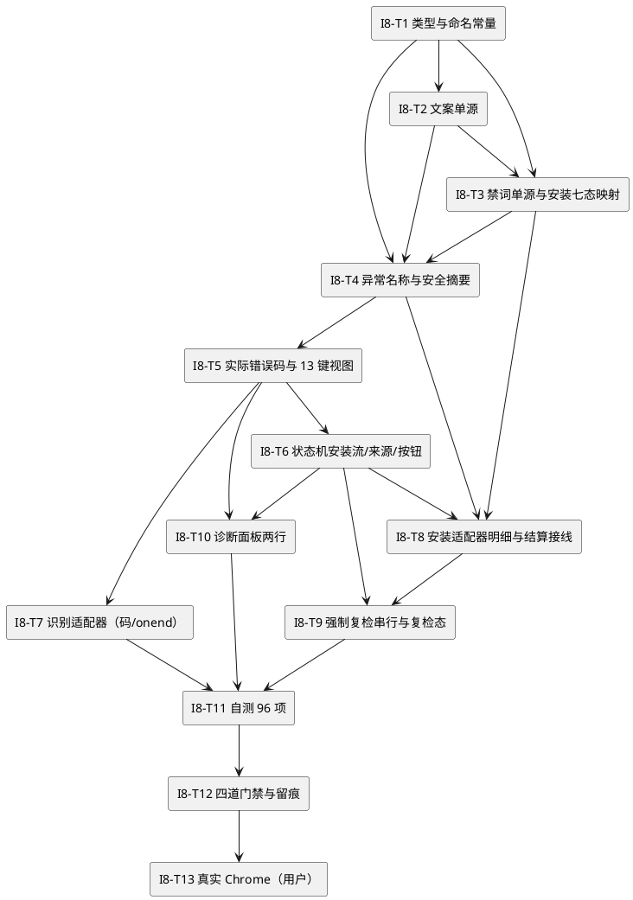

# EasyFlow 语音输入诊断细化（第八轮·重试版 v2）— 编码任务清单

**输入依据**

- `.codeartsdoer/specs/easyflow_page_guide/iteration8-spec.md`（v2 重试版：R-336—R-382、T8-01—T8-18、AT-97—AT-105、6.1—6.6、7.1—7.5，共 96 项）
- `.codeartsdoer/specs/easyflow_page_guide/iteration8-design.md`（重点：1.1 需求—存量对比、1.2 存量分析、2.1 实现模型（含 2.1.3-1—6）、2.2 接口 A—J、2.3 数据模型、2.4 文案与错误映射、2.5 UI、2.6 逐文件清单、2.7 数据流、2.8 修复门槛、2.9 测试计划、2.10 风险、2.11 取舍（T8-01—T8-18、D-08-01—07））
- `iteration7-spec.md`、`iteration7-design.md`、`iteration7-tasks.md`（87 项基线、假对象结构、门禁顺序与留痕口径）
- `iteration6-*`、`iteration5-*`、`iteration4-*`、`iteration3-*`、`spec.md`、`design.md`、`tasks.md`（任务编号、依赖图、追踪矩阵、人工验收口径）
- 现有实现（2026-11-16 只读核对）：
  - `src/shared/speech/{types,constants,copy,policy,localCapability,voiceMachine,diagnostics}.ts`
  - `src/sidepanel/speech/{localCapability,recognition,voiceController}.ts`
  - `src/sidepanel/components/chat/{DiagnosticsPanel,VoiceInputControl,ChatComposer}.tsx`
  - `src/sidepanel/App.tsx`、`src/sidepanel/hooks/useVoiceInput.ts`、`src/sidepanel/styles/sidepanel.css`
  - `scripts/selftest.mjs`（AT-81/AT-90、`FakeLocalCapability`、`FakeRecognition`、`localController`、导出清单）、`scripts/verify-manifest.mjs`、`public/manifest.json`、`package.json`、`tsconfig.json`

**阶段声明**

- 本文件只是第八轮**编码任务规划**：未修改任何源码、`public/manifest.json`、`scripts/**`、`src/sidepanel/styles/sidepanel.css`、前七轮文档与本轮 `iteration8-spec.md` / `iteration8-design.md`。
- 编写本文件时**未执行** `npm run typecheck` / `npm run build` / `npm run selftest` / `npm run verify`，未创建或覆盖 `codearts_proof/iteration8-*` 实绩日志，**未调用真实麦克风、真实语音识别、真实语音合成、真实 `SpeechRecognition.available` / `install`，未访问网络**。
- 实现阶段自动测试**一律使用假权限、假识别、假本机能力、假安装**；不得出现真实 `navigator.mediaDevices.getUserMedia`、真实麦克风、真实 `SpeechRecognition`、真实 `speechSynthesis`、真实语言包与真实域名。
- 真实设备行为一律标“**人工验收待用户执行 / 真实设备中文本机识别未验证**”，不得写“语音可用”“已可用”“已完成”。

---

## 0. 使用说明与全局约束

### 0.1 基线事实（2026-11-16 只读核对）

| 核查项 | 只读结论（文件:位置） | 对任务的要求 |
|---|---|---|
| 安装返回纯映射 | `src/shared/speech/localCapability.ts:49-59`：`true`/`{ok:true}` → `succeeded`；`false`/`null`/`undefined`/未知对象一律 `failed` | 必须新增 `mapInstallOutcome`，把严格 `false` 与“未知返回”拆开；`mapInstallResult` 原实现保留不动 |
| 安装状态枚举 | `localCapability.ts:11-20`：`idle/requesting/succeeded/failed/denied/unsupported`；`diagnostics.ts:63-70` 六个中文值 | 不删除、不改中文；新增独立 `InstallOutcome` 细分，概览仍六态 |
| 安装适配器 | `src/sidepanel/speech/localCapability.ts:96-115`：`api===null` 或无 `install` → `unsupported`；`catch` 只读 `name` 判 `NotAllowedError`/`SecurityError` → `denied`，其余 `failed`；**永不 reject**；`message` 未读取 | 改为返回 `InstallOutcomeDetail`；读取 `name`/`message` 不得再抛；不落盘；不改 `{langs:["zh-CN"]}` |
| 安装后复检 | `voiceController.ts:262-288`：仅 `installed==="succeeded"` 时 `ensureLocalCapability(true)` | 改为成功/false/未知/throw 各复检 1 次；`unsupported` 或未点击 0 次 |
| 复检锁与缓存 | `voiceController.ts:219-256`：`checkingLocal` 布尔锁；非 `force` 受 `LOCAL_CAPABILITY_CACHE_MS=300000` 短路；probe 内部 catch → `"error"` | 强制复检绕过缓存；与展开诊断并发时串行，至多追加 1 次 force |
| 安装按钮 | `voiceMachine.ts:410-412`：`localAvailability==="downloadable" \|\| installState==="requesting"`；`VoiceInputControl.tsx:82-91` 用 `installInProgress` 禁用 | 新增 `installFlow: idle/installing/rechecking`；`installInProgress = flow!=="idle"`；复检 `error` 后按钮隐藏 |
| 安装失败文案 | `copy.ts:65` `installFailed`；`voiceMachine.ts:331-337` 对 `failed/denied/unsupported` 返回同一句 | 新增四句（false/未知/throw/unsupported）；保留 `installFailed` 导出但不再由 `localNoticeOf` 使用 |
| 诊断输入/视图 | `diagnostics.ts:9-36` 输入 11 字段、视图 11 键；`voiceMachine.ts:369-385` 组装输入 | 视图固定 13 键；新增 5 个输入字段；内部字段不进视图 |
| 诊断面板 | `DiagnosticsPanel.tsx:88-135` 语音区 9 行 + 1 按钮；`137-271` 页面采集区 + 1 按钮；`273-281` 朗读状态；`88` 受控 `open`，折叠不渲染 | 语音区仅新增 2 行；按钮数量不增；页面采集区按钮与顺序不变 |
| 原始错误归并 | `policy.ts:120-136` `mapRawErrorKind` 六类，其余 `other`；`diagnostics.ts:46-53` 六类中文 | 新增 `mapRawErrorCode`（7 白名单 + `unmapped` + `null`）；不改 `mapRawErrorKind` |
| `onend` 伪造码 | `recognition.ts:106-115`：未 settled 时先 `emit error{kind:"no-speech"}` 再 `ended` | **删除 onend 的 error**，只发 `ended`；来源 `onend` 表达“会话结束、无码” |
| 适配器错误事件 | `types.ts:31-36` `error` 只带 `kind`/可选 `raw`；`recognition.ts:95-105` 原串消费后丢弃 | 新增可选 `code` 与 `errorSource`；未映射只记 `unmapped`，不保留原串；不读 `message` |
| 取消/超时 | `voiceController.ts:333-343` 只发 `cancel-requested`；`437-449` 发 `timeout`；`voiceMachine.ts:224-243` 不写诊断码 | 取消/超时/`onend` 把码置 `null`（显示“未提供”），不沿用上一次码 |
| 会话结算 | `voiceController.ts:384-435` `settledSessionId`；`recognition.ts:99` 错误后 `settled=true` | 保留；`onerror` 后 `onend` 不得改码 |
| 打字可用 | `ChatComposer.tsx:39-70`：`textarea` 不因语音禁用；发送只看 `disabled \|\| text.trim().length===0` | 零改动，只加断言（AT-95/AT-104） |
| 权限清单 | `public/manifest.json`：`["activeTab","scripting","sidePanel","storage"]` | 四项逐项不变 |
| 门禁 | `verify-manifest.mjs:36-45` 权限/禁字段；`110-127` 禁 `fetch(`/`XMLHttpRequest`/`sendBeacon`/`WebSocket`/`MediaRecorder`/密钥；`129-142` 两条 `getUserMedia` 例外；`200-211` 全量扫描 | 不新增网络/存储/录音/权限；例外不扩 |
| 自测基线 | `codearts_proof/iteration7-selftest.log` 末行 `# pass 87 / # fail 0`；`selftest.mjs:14-61` 导出清单；`1561-1600` `FakeLocalCapability`；`1602-1621` `localController`；`2686-2723` `FakeRecognition` | 87 项为回归红线；只允许 AT-81/AT-90 最小改写；新增 AT-97—AT-105 共 9 项，总计 96 |
| AT-81 形态 | `selftest.mjs:1657-1669` 11 键**精确列表**；`1671` 禁词正则含 `audio`；`1672-1677` `adapter-final` 后不变；`1686-1693` 分区与源码断言 | 13 键精确改写；`audio` 收窄为音频数据词；新增 ≤480 断言；新增“初始安装结果”断言 |
| AT-90 形态 | `selftest.mjs:1842-1873` 只断言成功/失败/异常三路径的 `localOptionVisible`、`localNoticeText!==null`、30 秒内 `installCalls` 不增长 | 新增 `installOutcomeText` 区分与 `availableCalls +1`，不改原语义 |
| AT-85 形态 | `selftest.mjs:1756-1771` 对 **6 个文案常量** 做两两不同与“不含原码”断言 | 范围不得扩大到诊断字段；诊断“浏览器错误码”行允许白名单原码 |
| 严格类型 | `tsconfig.json`：`strict`、`noUncheckedIndexedAccess`、`exactOptionalPropertyTypes`、`noImplicitOverride` | 不用 `any`/`@ts-ignore`/`@ts-expect-error`；可选属性不得显式赋 `undefined`，用条件展开 |
| 构建脚本 | `package.json`：`typecheck=tsc --noEmit`；`build=tsc --noEmit && node scripts/build.mjs && node scripts/verify-manifest.mjs`；`selftest=node scripts/selftest.mjs`；`verify=node scripts/verify-manifest.mjs` | 门禁顺序固定；本轮规划阶段不执行 |

> 行号仅作定位参考，实现以函数名、props 名与 CSS 选择器为准。

### 0.2 全局硬约束（每个任务都必须遵守）

1. **只改主工程**：只改 `D:\hwproject\translator`；不新建网站、不使用 `apps/extension`、不运行 `pnpm dev:web`。
2. **不动首次授权流程**：`getUserMedia` 字面量仍只允许出现在 `src/mic-permission/request.ts` 与产物 `dist/mic-permission.js`；侧栏、后台、内容脚本一律禁止；不自动打开授权页。
3. **权限不变**：`permissions` 恰为四项；不新增 `tabs`、`host_permissions`、`<all_urls>`、`content_scripts`、`web_accessible_resources`、`externally_connectable`。
4. **不接外部语音**：无第三方语音服务/SDK/密钥/代理；无 `fetch(`/`XMLHttpRequest`/`sendBeacon`/`WebSocket`；不上传音频或文本。
5. **不录音不保存**：无 `MediaRecorder`；不保存音频、识别原文、中间结果、设备名/ID、网页 URL/标题、授权页查询串、完整识别 `message`。
6. **安装异常是受控例外**：只允许白名单 `name` 与 ≤40 code point 脱敏摘要进入语音诊断区；不进入日志、聊天、`chrome.storage`、消息队列、页面采集诊断、朗读说明。
7. **只入框不发送**：识别结果只写入 `pendingText`（可编辑输入框），不自动发送、不自动回车、不自动聚焦、不自动提交。
8. **失败不自动重试**：不自动重启识别、不自动重开授权页、不自动安装语言资源、不自动切换识别模式；只由用户手动操作。
9. **朗读/页面指引/授权页零改动**：`synthesis.ts`、`speechController.ts`、`speakMachine.ts`、`StepCard*.tsx`、`EF-E003` 判定与文案、`src/mic-permission/**` 不改。
10. **文案单源**：新增中文文案只在 `src/shared/speech/copy.ts`；组件、诊断、测试只引用常量或 `describeSpeechDiagnostics` / `describeInstallOutcomeText` 派生结果。
11. **常量化**：`INSTALL_ERROR_BRIEF_MAX_CHARS`、`INSTALL_ERROR_INPUT_MAX_CHARS`、`DIAGNOSTICS_SERIALIZED_MAX_CHARS`、语言参数、安装/错误码枚举均为命名常量；不散落魔法值。
12. **修复门槛**：只允许改“文案、诊断只读字段、安装调用形态（参数仍只 `zh-CN`）、探测时机、错误处理不吞异常”；禁止扩权、改 `getUserMedia`、改 manifest、新增存储键、接外部服务、自动重试/发送/提交。
13. **证据留痕**：修复分支必须能回答“哪条证据支持这个改动”；未在真实 Chrome 同一路径复测不得写“已修复/可用”。
14. **如实留痕**：未执行的命令与人工验收必须单列；失败日志保留、不覆盖、不编造。
15. **本阶段边界**：本文件只做任务规划；不得修改源码、不得运行四道门禁、不得调用真实麦克风/网络/真实 `available`/`install`。

### 0.3 明确“不改文件”清单

以下文件本轮**不得修改**（逐项核对，改动即视为越界）：

- `src/sidepanel/components/chat/VoiceInputControl.tsx`
- `src/sidepanel/components/chat/ChatComposer.tsx`
- `src/sidepanel/App.tsx`
- `src/sidepanel/hooks/useVoiceInput.ts`
- `src/sidepanel/styles/sidepanel.css`
- `src/shared/speech/permission.ts`
- `src/sidepanel/speech/microphone.ts`
- `src/sidepanel/speech/micPage.ts`
- `src/sidepanel/speech/micMessages.ts`
- `src/sidepanel/speech/synthesis.ts`
- `src/sidepanel/speech/speechController.ts`
- `src/shared/speech/speakMachine.ts`
- `src/sidepanel/components/chat/StepCard.tsx`、`StepCardSpeech.tsx`、`StepDetails.tsx`、`stepCardCopy.ts`、`stepCardModel.ts`、`messageText.ts`、`MessageList.tsx`、`AboutPanel.tsx`
- `src/mic-permission/**`、`public/mic-permission.html`
- `src/background/**`
- `src/content/**`、`src/sidepanel/guide/**`、`src/sidepanel/dialogue/**`、`src/sidepanel/match/**`、`src/shared/privacy/**`
- `src/shared/messages.ts`
- `src/shared/errors.ts`
- `src/sidepanel/hooks/useConversation.ts`、`src/sidepanel/state/conversationReducer.ts`
- `src/shared/constants.ts`、`src/shared/types.ts`（注意：与 `src/shared/speech/types.ts` 不是同一文件）
- `public/manifest.json`
- `scripts/build.mjs`、`scripts/verify-manifest.mjs`
- `package.json`、`tsconfig.json`
- 第一至第七轮规格/设计/任务文档与本轮 `iteration8-spec.md`、`iteration8-design.md`

### 0.4 允许新增/修改清单

**新增（2 个文件）**

- `src/shared/speech/installReport.ts`
- `src/shared/speech/forbidden.ts`

**修改（12 个文件）**

- `src/shared/speech/types.ts`
- `src/shared/speech/constants.ts`
- `src/shared/speech/localCapability.ts`
- `src/shared/speech/policy.ts`
- `src/shared/speech/copy.ts`
- `src/shared/speech/diagnostics.ts`
- `src/shared/speech/voiceMachine.ts`
- `src/sidepanel/speech/localCapability.ts`
- `src/sidepanel/speech/recognition.ts`
- `src/sidepanel/speech/voiceController.ts`
- `src/sidepanel/components/chat/DiagnosticsPanel.tsx`
- `scripts/selftest.mjs`

**留痕（新增，不改旧文件）**

- `codearts_proof/iteration8-typecheck.log`
- `codearts_proof/iteration8-build.log`
- `codearts_proof/iteration8-selftest.log`
- `codearts_proof/iteration8-verify.log`
- `codearts_proof/27-iteration8-implementation.md`

> `VoiceInputControl.tsx`、`ChatComposer.tsx`、`App.tsx`、`useVoiceInput.ts` **零改动**：四句安装文案经既有 `view.localNoticeText` 渲染，`installInProgress` 语义扩展到“安装中 + 复检中”后既有 `disabled={view.installInProgress}` 自动生效，`diagnostics` 是既有 prop。若实现阶段发现必须加 `aria-busy`，只允许在 `VoiceInputControl` 增加属性、不增加按钮——但默认仍视为“不改”，需先回改本清单。

### 0.5 任务编号与追溯约定

- 本轮编码任务编号为 **`I8-T1`—`I8-T13`**；需求/设计阶段的取舍点仍写 `T8-01`—`T8-18` 与 `D-08-01`—`D-08-07`，两套编号不混用。
- 测试用例沿用 `AT-xx`；本轮新增 `AT-97`—`AT-105`（9 项），既有 87 项保留，总数 **96**。
- “设计 2.x”指 `iteration8-design.md` 的对应小节；“spec 5.x/6.x/7.x”指 `iteration8-spec.md`。
- **字段口径**：设计 2.2.2 接口 F 给出 `VoiceInputState` 新增 7 字段（`lastRawErrorCode`、`lastErrorSource`、`installOutcome`、`installErrorName`、`installErrorBrief`、`installFlow`、`installResultAt`）与 2 类新事件；`installAttempts` 保留既有内部计数。视图键固定 13 个，内部字段不进入视图。
- **错误来源两个概念不得混用**：
  - 状态机 `ErrorSource = "none" | "onerror" | "onend" | "timeout" | "cancel"`；
  - 识别事件来源 `errorSource?: "onerror" | "adapter"`，仅用于区分“浏览器 onerror”与“适配器本地启动失败”。
- 每个任务的自验命令在**实现阶段**执行；本文件编写阶段不执行任何命令。
- “临时断言”指用 esbuild 打包目标模块后直接 `node` 运行的一次性脚本，放系统临时目录、不提交主工程；正式断言统一进 `I8-T11` 的 `selftest.mjs`。
- 合并/拆分说明：`I8-T8` 与 `I8-T9` 分属“安装结算接线”与“复检并发/状态编排”，前者保证 `LocalInstaller` 返回类型变更后 `typecheck` 仍为 0，后者补齐串行与按钮规则；`I8-T10` 只改一个组件，可与 `I8-T9` 并行但必须在 `I8-T5`+`I8-T6` 之后。

### 0.6 执行顺序总览

| 顺序 | 编号 | 标题 | 依赖 | 主要产物 | 构建检查点 |
|---|---|---|---|---|---|
| 1 | I8-T1 | 错误码/来源类型与命名常量 | 无 | `shared/speech/{types,constants}.ts` | `typecheck` |
| 2 | I8-T2 | 安装四句文案、诊断标签与结果短名单源 | I8-T1 | `shared/speech/copy.ts` | `typecheck`；纯常量断言 |
| 3 | I8-T3 | 禁词单源与安装结果七态纯映射 | I8-T1、I8-T2 | `shared/speech/forbidden.ts`（新）、`shared/speech/localCapability.ts` | `typecheck`；纯函数断言 |
| 4 | I8-T4 | 异常名称白名单与安全摘要 | I8-T1—I8-T3 | `shared/speech/installReport.ts`（新） | `typecheck`；AT-98 逻辑预演 |
| 5 | I8-T5 | 实际错误码映射与 13 键诊断视图 | I8-T1—I8-T4 | `shared/speech/{policy,diagnostics}.ts` | `typecheck`；13 键/长度断言 |
| 6 | I8-T6 | 状态机安装流/错误来源/按钮派生 | I8-T1—I8-T5 | `shared/speech/voiceMachine.ts` | `typecheck`；视图/文案断言 |
| 7 | I8-T7 | 识别适配器保留白名单码、`onend` 不伪造 | I8-T1、I8-T5 | `sidepanel/speech/recognition.ts` | `typecheck`；假构造器断言 |
| 8 | I8-T8 | 安装适配器明细与控制器结算接线 | I8-T3、I8-T4、I8-T6 | `sidepanel/speech/localCapability.ts`、`voiceController.ts` | `typecheck`；四路径各复检 1 次 |
| 9 | I8-T9 | 强制复检串行、缓存绕过与复检态 UI | I8-T6—I8-T8 | `sidepanel/speech/voiceController.ts` | `typecheck`；并发/按钮断言 |
| 10 | I8-T10 | 诊断面板新增两行与不改文件核对 | I8-T5、I8-T6 | `DiagnosticsPanel.tsx` | `typecheck` + `build` |
| 11 | I8-T11 | 夹具扩展、AT-81/AT-90 最小改写与 AT-97—AT-105 | I8-T1—I8-T10 | `scripts/selftest.mjs` | `npm run selftest`；`pass 96 / fail 0` |
| 12 | I8-T12 | 四道门禁、清洁检索与实现留痕 | I8-T11 | `codearts_proof/iteration8-*.log`、`27-iteration8-implementation.md` | 四命令全绿 |
| 13 | I8-T13 | 真实 Chrome 一次人工验收（用户执行） | I8-T12 | `27-iteration8-implementation.md` 人工分栏 | “人工验收待用户执行” |

### 0.7 依赖图

```text
I8-T1 ──> I8-T2 ──> I8-T3 ──> I8-T4 ──> I8-T5 ──> I8-T6 ──┬──> I8-T8 ──> I8-T9 ──┐
                                  │                        │                      │
                                  └──> I8-T7 ──────────────┘                      ├──> I8-T11 ──> I8-T12 ──> I8-T13
                                                                                   │
                                             I8-T5 + I8-T6 ──> I8-T10 ────────────┘
```



**硬性顺序**

1. `I8-T1` 必须最先：`RawErrorCode`/`ErrorSource`/可选事件字段与 40/480/2000 常量是全部后续模块的编译基础。
2. `I8-T2` 只依赖 `I8-T1`；`I8-T3` 依赖 `I8-T2`（`installStateOf` 的白名单名称降级文案）与 `I8-T1`；`I8-T4` 依赖前三者（长度常量、结果短名、禁词表）。
3. `I8-T5` 依赖 `I8-T2`（“未提供/未映射/会话结束/等待超时/已取消/识别已中断”常量）与 `I8-T4`（`describeInstallOutcomeText`）；此任务之后 13 键契约定死，后续不得改名。
4. `I8-T6` 依赖 `I8-T5`（诊断输入/视图）与 `I8-T4`（`installStateOf` 由 `shared/localCapability` 提供）；此任务之后 `describeVoiceInput` 输出 13 键与四句文案。
5. `I8-T7` 只依赖 `I8-T1`、`I8-T5`（`mapRawErrorCode`）；但**语义验证**必须在 `I8-T6` 之后（`adapter-ended` 已能写来源/码）。
6. `I8-T8` 依赖 `I8-T3`/`I8-T4`/`I8-T6`；`LocalInstaller.install()` 返回类型变更必须在同一步改掉唯一调用方（`voiceController.ts:277`）与夹具消费点，否则 `typecheck` 失败（R8-10）。
7. `I8-T9` 必须在 `I8-T8` 之后：串行模型、缓存绕过、复检态按钮都建立在 `installFlow` 与明细已写入之上。
8. `I8-T10` 可与 `I8-T9` 并行（不同文件、不同断言），但不得早于 `I8-T5`+`I8-T6`。
9. `I8-T11` 必须在全部实现之后；`I8-T12` 在 `I8-T11` 全绿之后；`I8-T13` 只在用户真实执行后记录。

### 0.8 阶段门禁与留痕

| 时点 | 命令/检查 | 通过标准 | 留痕 |
|---|---|---|---|
| I8-T1—I8-T10 | `npm run typecheck` | 退出码 0、0 error；无 `any`/`@ts-ignore`/`@ts-expect-error` | 汇总到 `codearts_proof/iteration8-typecheck.log` |
| I8-T10 | `npm run build` | 退出码 0；产物清单不新增入口 | 汇总到 `codearts_proof/iteration8-build.log` |
| I8-T11 | `npm run selftest` | `# pass 96` / `# fail 0`；87 项不回退 | `codearts_proof/iteration8-selftest.log` |
| I8-T12 | `npm run typecheck` → `npm run build` → `npm run selftest` → `npm run verify` | 四条独立执行、分别留痕；`verify` 不得由 `build` 内含检查替代 | `iteration8-{typecheck,build,selftest,verify}.log` |
| I8-T12 | 清洁检索 | `SpeechRecognition.available/install` 访问只在 `sidepanel/speech/localCapability.ts`；`processLocally` 赋值只在 `recognition.ts`；语音目录无 `chrome.storage`/`fetch(`/`MediaRecorder`；`getUserMedia` 仍 2 条例外 | `iteration8-verify.log` + 检索记录 |
| I8-T13 | 真实 Chrome 7 步（spec 7.3） | 逐项记录或“人工验收待用户执行”；真实设备中文本机识别未验证 | `27-iteration8-implementation.md` |

> 日志名以用户本轮指令为准（`iteration8-*.log`、`27-iteration8-implementation.md`）；spec 7.4 写 `iteration8-retry-*` / `28-iteration8-retry-implementation.md`，差异列入 `D-08-06` 待用户确认（默认采用用户指令）。

### 0.9 “每步可构建”的精确含义（避免误判）

1. `I8-T1`—`I8-T10` 每步结束时 **`npm run typecheck` 必须 0 error；`I8-T10` 结束时 `npm run build` 必须通过**（`build` 不含 `selftest`）。
2. `I8-T5` 一旦把视图从 11 键扩到 13 键，**AT-81 的精确键列表会失败，直到 `I8-T11` 改写**。这是计划内、唯一允许的中间态失败；`I8-T11` 之前运行 `npm run selftest` 必须能看到“仅 AT-81 失败，其余 86 项通过”。若出现其他失败，视为实现缺陷，不得等到 T11 再改。
3. `I8-T8` 修改 `LocalInstaller.install()` 返回类型时，必须同步改 `voiceController.ts` 与 `localController` 夹具消费点；不得保留两套返回类型。
4. `I8-T9` 完成前不得把 `installFlow="rechecking"` 期间的按钮隐藏；`I8-T10` 完成前不得在诊断面板引用尚不存在的键（先 T5/T6 再 T10）。

### 0.10 可勾选任务总表（两级，执行时逐项勾选）

- [ ] **I8-T1 错误码/来源类型与命名常量**
  - [ ] `types.ts` 增 `RawErrorCode`/`ErrorSource` 与可选 `code`/`errorSource`
  - [ ] `constants.ts` 增 40/2000/480 三个命名常量
  - [ ] `npm run typecheck` 0 error
- [ ] **I8-T2 安装四句文案、诊断标签与结果短名单源**
  - [ ] `copy.ts` 增四句安装文案、两标签、`notProvided/unmapped` 与来源文本
  - [ ] 增 `INSTALL_OUTCOME_TEXTS`/`INSTALL_ERROR_TEXTS`
  - [ ] 四句 `Set.size===4` 且无技术词
- [ ] **I8-T3 禁词单源与安装结果七态纯映射**
  - [ ] 新增 `forbidden.ts` 四组常量
  - [ ] `mapInstallOutcome`/`installStateOf` 落位，`mapInstallResult` 不改
  - [ ] `false` 与 `undefined/null/{ok:false}` 分离断言通过
- [ ] **I8-T4 异常名称白名单与安全摘要**
  - [ ] 新增 `installReport.ts`（10 名称、10 步脱敏、固定短句、三段式）
  - [ ] 读取 `name`/`message` 不抛错、不留原文
  - [ ] 摘要 ≤40 code point（总 ≤41）与 AT-98 预演通过
- [ ] **I8-T5 实际错误码映射与 13 键诊断视图**
  - [ ] `mapRawErrorCode` 白名单 7 + `unmapped` + `null`
  - [ ] `SpeechDiagnosticsView` 恰好 13 键，`installOutcomeText` 三段式
  - [ ] 逐来源“类别 + 码值”组合断言通过、序列化 ≤480
- [ ] **I8-T6 状态机安装流/错误来源/按钮派生**
  - [ ] 状态 +7 字段、事件 +2、`adapter-error` 可选码/来源
  - [ ] `adapter-ended`/`timeout`/`cancel` 写来源并把码置 `null`
  - [ ] 四句文案分支、`installFlow` 按钮公式、连续安装覆盖断言通过
- [ ] **I8-T7 识别适配器保留白名单码、`onend` 不伪造**
  - [ ] `onerror` 带白名单 `code`、不读 `message`
  - [ ] `onend` 只发 `ended`
  - [ ] 本地启动失败标 `errorSource:"adapter"`
- [ ] **I8-T8 安装适配器明细与控制器结算接线**
  - [ ] `LocalInstaller.install()` 返回 `InstallOutcomeDetail`
  - [ ] 控制器写 `install-settled`，成功/false/未知/throw 各复检 1 次
  - [ ] 无 `install` 不复检、诊断“接口不支持”、按钮隐藏
- [ ] **I8-T9 强制复检串行、缓存绕过与复检态 UI**
  - [ ] 单探测 Promise + 至多 1 次 `pendingForceCheck`
  - [ ] `force` 绕过 5 分钟缓存；复检失败刷新时间、保留结论
  - [ ] 复检中按钮可见禁用、`available` 不自动选中、无自动动作
- [ ] **I8-T10 诊断面板新增两行与不改文件核对**
  - [ ] 语音区新增“浏览器错误码”“安装结果”两行
  - [ ] 按钮数量不变、折叠不渲染、分区顺序不变
  - [ ] 不改文件哈希前后 0 差异、`npm run build` 通过
- [ ] **I8-T11 夹具扩展、AT-81/AT-90 最小改写与 AT-97—AT-105**
  - [ ] 导出清单与 `FakeLocalCapability`/`FakeRecognition` 只增不删
  - [ ] AT-81 改 13 键/音频数据禁词/480；AT-90 只加断言
  - [ ] 新增 9 项；`npm run selftest` → `pass 96 / fail 0`
- [ ] **I8-T12 四道门禁、清洁检索与实现留痕**
  - [ ] 依次保存 `iteration8-{typecheck,build,selftest,verify}.log`
  - [ ] 清洁检索（权限/隐私/外部接口/存储/录音）通过
  - [ ] `27-iteration8-implementation.md` 八项齐全、无摘要原文
- [ ] **I8-T13 真实 Chrome 一次人工验收（用户执行）**
  - [ ] 用户按 spec 7.3 七步执行并记录枚举/名称/长度区间
  - [ ] 未执行时写“人工验收待用户执行 / 真实设备中文本机识别未验证”
  - [ ] 不写“语音可用/已修复/已完成”

---

## 1. I8-T1 错误码/来源类型与命名常量

**编号与标题**：I8-T1 / 错误码/来源类型与命名常量。

**目标**：一次性落位本轮所需的错误码/来源契约与长度常量，使后续任务只依赖稳定契约；所有扩展“只增不改”，不破坏既有 87 项与 `exactOptionalPropertyTypes`。

**对应需求/设计条目**：R-340、R-342、R-354、R-374、R-379；设计 2.1.2（配置项）、2.2.1（接口 D/E）、2.2.2 接口 D、2.3.1、2.4.2、D-08-04。

**涉及文件与函数/类型/常量**

- 修改 `src/shared/speech/types.ts`：
  - 新增 `RawErrorCode = "no-speech" | "network" | "not-allowed" | "service-not-allowed" | "audio-capture" | "language-not-supported" | "aborted" | "unmapped"`。
  - 新增 `ErrorSource = "none" | "onerror" | "onend" | "timeout" | "cancel"`。
  - `RecognitionEvent` 的 `error` 分支扩展为：`{ type:"error"; kind: SpeechErrorKind; raw?: RawSpeechErrorKind; code?: RawErrorCode; errorSource?: "onerror" | "adapter" }`。
  - **保留**既有 `kind`/`raw` 语义与 `RecognitionErrorLike.message?` 类型（仅类型兼容；源码不得读取，注释写明）。
  - **不改** `SpeechErrorKind` 9 值、`RawSpeechErrorKind` 6 值、`RecognitionMode`、`SpeechStartOptions`、`Speak*` 类型。
- 修改 `src/shared/speech/constants.ts`（追加 3 个常量，不改既有 16 个）：
  - `INSTALL_ERROR_BRIEF_MAX_CHARS = 40`（摘要上限，code point）。
  - `INSTALL_ERROR_INPUT_MAX_CHARS = 2000`（D-08-04 输入预截断，防超长正则开销；本常量名由本任务定，设计未给名）。
  - `DIAGNOSTICS_SERIALIZED_MAX_CHARS = 480`（13 键序列化上限，供测试与审查）。

**实现要点与前置依赖**

1. 无可选字段显式赋 `undefined`；事件构造处一律用 `...(code === null ? {} : { code })` 形式（`exactOptionalPropertyTypes`）。
2. `ErrorSource` 只表达状态机“最近错误来源”，不得与识别事件的 `errorSource` 合并成一个枚举。
3. 常量必须是 `export const` 且以 `as const` 收窄数值不必要（数值型 `const` 即可）；不得在业务文件另写 `40`/`480`/`2000` 字面量。
4. 前置依赖：无。

**明确不做**

- 不新增视图键、不改 `fetch`/网络、不改 manifest/权限/存储。
- 不新增 `RawErrorCode` 的 `"bad-grammar"` 成员（`bad-grammar` 归 `unmapped`，见 T5）。
- 不把 `ErrorSource` 放进 `SpeechDiagnosticsView`。

**完成标准与自验**

- `npm run typecheck` 退出码 0、0 error。
- 临时断言：`RawErrorCode` 运行时无值（类型擦除不适用）；断言常量 `INSTALL_ERROR_BRIEF_MAX_CHARS === 40`、`DIAGNOSTICS_SERIALIZED_MAX_CHARS === 480`、`INSTALL_ERROR_INPUT_MAX_CHARS === 2000`。
- 源码检索：`src/shared/speech/constants.ts` 中新增三常量各出现 1 次；`types.ts` 中 `code?:` 与 `errorSource?:` 只在 `RecognitionEvent.error` 分支出现。

**风险与回滚点**

- 风险：可选字段在调用方被显式赋 `undefined` 导致 `typecheck` 失败；或把 `errorSource` 写成必填破坏 `FakeRecognition.emit({type:"error", kind, raw})` 既有用例。
- 缓解：新增字段全部可选；先改类型再改调用方。
- 回滚点：删除新增类型分支与三常量即可回到 87 项基线（后续任务未开始时）。

---

## 2. I8-T2 安装四句文案、诊断标签与结果短名单源

**编号与标题**：I8-T2 / 安装四句文案、诊断标签与结果短名单源。

**目标**：把本轮全部新增用户可见文本收敛到 `copy.ts` 单一来源，保证“四类安装失败两两不同”“技术细节只在诊断区”“码值/未提供/未映射文案可测”。

**对应需求/设计条目**：R-338、R-344、R-359、R-360、R-379、R-380；设计 2.1.3-2（四句表）、2.2.2 接口 J、2.4.1、2.4.2、2.9.4（AT-97/AT-101/AT-102 文案）。

**涉及文件与函数/常量**

- 修改 `src/shared/speech/copy.ts`（只增键，不改既有键值）：
  - `SPEECH_LOCAL_TEXTS` 新增：
    - `installReturnedFalse: "浏览器没有完成中文本机语音资源的准备，可以稍后再试或直接打字。"`
    - `installReturnedUnknown: "安装没有返回明确结果，可以稍后再试或直接打字。"`
    - `installThrew: "准备中文本机语音资源时出现问题，可以直接打字或稍后再试。"`
    - `installUnsupported: "这台浏览器没有提供中文本机语音资源安装能力，可以直接打字。"`
    - **保留** `installFailed`（不再由 `localNoticeOf` 使用）。
  - `SPEECH_DIAGNOSTICS_TEXTS` 新增：
    - `rawErrorCodeLabel: "浏览器错误码"`
    - `installOutcomeLabel: "安装结果"`
    - `notProvided: "未提供"`
    - `unmapped: "其他（未映射）"`
    - `sessionEnded: "没有听到语音（会话结束）"`
    - `timedOut: "其他识别失败（等待超时）"`
    - `cancelled: "已取消识别"`
    - `interrupted: "识别已中断"`
  - 新增 `INSTALL_OUTCOME_TEXTS`（7 值，键与 `InstallOutcome` 一一对应）：`none:"未开始"`、`requesting:"正在准备…"`、`succeeded:"成功"`、`"returned-false":"返回 false（明确失败）"`、`"returned-unknown":"返回未知值（未确认成功）"`、`threw:"抛出异常"`、`unsupported:"接口不支持"`。
  - 新增 `INSTALL_ERROR_TEXTS`：`unknownName:"未知错误"`、`emptyBrief:"没有可显示的错误信息"`、`noneValue:"无"`。
- **不改** `VOICE_STATUS_TEXT`、`VOICE_ISSUE_TEXT`、`SPEECH_NO_SPEECH_TEXT`、`MIC_PERMISSION_STATE_TEXT`、`SPEECH_MODE_TEXTS`、`SPEAK_*`、`VOICE_DISALLOWED_WORDS`。

**实现要点与前置依赖**

1. 四句必须 `new Set(...).size === 4`，且都不含 `NotAllowedError`/`SecurityError`/`false`/`message`/`undefined`/`no-speech`/`network`/`not-allowed`/`service-not-allowed`/`audio-capture`。
2. 四句都不含“已完成/已可用/语音可用/语音识别已完成”。
3. `sessionEnded`/`timedOut`/`cancelled`/`interrupted` 是设计 2.4.2 表格要求、设计接口 J 未枚举的 4 个必要常量；键名不得再改，否则 `I8-T5` 编译失败。
4. 文本长度：`installReturnedFalse` 等四句 ≤ 40 个汉字，保证 320px 下可换行；`INSTALL_OUTCOME_TEXTS` 短名 ≤ 12 个 code point（`returned-unknown` 为 10 汉字+2 括号）。
5. 前置依赖：`I8-T1`（类型不影响本文件，但 `INSTALL_OUTCOME_TEXTS` 的键要与 `I8-T3` 的 `InstallOutcome` 一致，先定文案再定枚举亦可；本任务先按设计定死键名）。

**明确不做**

- 不在组件、`diagnostics.ts`、`voiceMachine.ts` 内硬编码上述文本。
- 不删除 `installFailed`（避免破坏既有导出与可能的外部引用）。
- 不把异常名称示例（`NotAllowedError`）写入语音区文案。
- 不新增“重试/下载/安装”按钮文案。

**完成标准与自验**

- `npm run typecheck` 退出码 0。
- 临时断言：
  - 四句 `Set.size === 4`；四句逐个 `!/NotAllowedError|SecurityError|false|message|undefined/i.test(text)`。
  - `INSTALL_OUTCOME_TEXTS` 键集合排序等于 `["none","requesting","succeeded","returned-false","returned-unknown","threw","unsupported"]`。
  - `SPEECH_DIAGNOSTICS_TEXTS.notProvided === "未提供"`、`.unmapped === "其他（未映射）"`、`.rawErrorCodeLabel === "浏览器错误码"`、`.installOutcomeLabel === "安装结果"`。
- 源码检索：`src/shared/speech/copy.ts` 之外的新增文本 0 命中（除文档）。

**风险与回滚点**

- 风险：四句与既有 `installFailed` 相似导致 AT-97 集合大小失败；或诊断来源文本与 `RAW_ERROR_LABEL` 重复导致 AT-101“两行不同”失败。
- 缓解：四句句式分别以“浏览器没有完成…/安装没有返回…/准备…时出现问题/这台浏览器没有提供…”开头，确保首句不同。
- 回滚点：删除新增键（保留 `installFailed`）回到 87 项；但 T3 起依赖新增键，回滚必须同时停后续任务。

---

## 3. I8-T3 禁词单源与安装结果七态纯映射

**编号与标题**：I8-T3 / 禁词单源与安装结果七态纯映射。

**目标**：建立“摘要禁词与诊断禁词同源”的唯一常量表；把 `install()` 的返回值拆成 `succeeded / returned-false / returned-unknown`，并提供“明细 → 概览六态”的纯派生，兼容 `mapInstallResult` 与 AT-80/AT-90。

**对应需求/设计条目**：R-336、R-337、R-338、R-373、R-378；设计 2.1.3-1（判定表）、2.2.2 接口 A/C、2.3.2、2.4.3、R8-05、D-08-03。

**涉及文件与函数/常量**

- 新增 `src/shared/speech/forbidden.ts`（仅常量，无函数、无副作用）：
  - `DIAGNOSTIC_FORBIDDEN_WORDS = ["http","url","message","device","transcript"] as const`
  - `AUDIO_DATA_FORBIDDEN_WORDS = ["audioData","audioBlob","audioBase64","audioBuffer","audioUrl","录音","音频数据"] as const`
  - `INSTALL_BRIEF_FORBIDDEN_WORDS = [...DIAGNOSTIC_FORBIDDEN_WORDS, "audio"] as const`
  - `ALLOWED_DIAGNOSTIC_AUDIO_VALUE = "audio-capture" as const`
  - 注释写明：`INSTALL_BRIEF_FORBIDDEN_WORDS` 与 AT-81 的 `DIAGNOSTIC_FORBIDDEN_WORDS` 必须同源；`audio-capture` 是诊断视图中唯一允许的含 `audio` 值。
- 修改 `src/shared/speech/localCapability.ts`（追加，不改既有 `LOCAL_AVAILABILITY_STATES`/`mapLocalAvailability`/`mapInstallResult`）：
  - `INSTALL_OUTCOMES = ["none","requesting","succeeded","returned-false","returned-unknown","threw","unsupported"] as const`
  - `InstallOutcome = (typeof INSTALL_OUTCOMES)[number]`
  - `interface InstallOutcomeDetail { outcome: InstallOutcome; errorName: string | null; errorBrief: string | null }`
  - `mapInstallOutcome(raw: unknown): InstallOutcome`：
    - `raw === true` → `"succeeded"`
    - `typeof raw === "object" && raw !== null && (raw as {ok?:unknown}).ok === true` → `"succeeded"`
    - `raw === false` → `"returned-false"`
    - 其余（`undefined`/`null`/`{ok:false}`/其他对象/字符串/数字）→ `"returned-unknown"`
    - **不返回** `threw`/`unsupported`/`none`/`requesting`（由适配器与状态机给）。
  - `installStateOf(detail: InstallOutcomeDetail): InstallState`：
    - `succeeded` → `succeeded`
    - `returned-false`/`returned-unknown` → `failed`
    - `threw` 且 `errorName === "NotAllowedError" || errorName === "SecurityError"` → `denied`
    - `threw` 其他 → `failed`
    - `unsupported` → `unsupported`
    - `none` → `idle`；`requesting` → `requesting`
  - `mapInstallResult` **原实现逐行不动**（仅兼容旧导出与 AT-80/AT-90 语义）。
- 依赖类型：本文件不得 `import` `installReport.ts` 的值（避免值循环）；`threw` 分支只比较字符串常量，或从 `installReport` 以 `import type` 引入类型（不引入值）。

**实现要点与前置依赖**

1. 严格区分 `{ok:true}` 与 `{ok:false}`；后者必须 `returned-unknown`，不得 `returned-false`。
2. 任何读取 `raw.ok` 不得抛错：用可选属性读取 + 类型收窄，不调用 getter 之外的逻辑；若要读 getter 抛错的对象，`mapInstallOutcome` 需 `try/catch` 包裹 `ok` 读取并降级 `returned-unknown`（防 getter 抛错）。
3. `errorName` 为 `null` 时 `installStateOf` 一律 `failed`，不得因“名称为空”抛错。
4. 前置依赖：`I8-T1`（无类型依赖，但常量）、`I8-T2`（`INSTALL_ERROR_TEXTS` 不在本文件使用；`installStateOf` 只用字符串比较，故其实只依赖 T1）。`I8-T4` 会依赖本文件的 `InstallOutcomeDetail` 与 `forbidden.ts`。

**明确不做**

- 不改 `INSTALL_STATES` 六态、不改 `INSTALL_STATE_LABEL`（T3 不碰 `diagnostics.ts`）。
- 不把 `meta/status` 等未知对象序列化进诊断。
- 不在 `forbidden.ts` 写函数或正则（只导出常量数组；正则由使用方拼装）。
- 不删除 `mapInstallResult` 或把其实现改为调用 `mapInstallOutcome`（会被 AT-80/AT-90 观测语义）。

**完成标准与自验**

- `npm run typecheck` 退出码 0。
- 临时断言：
  - `mapInstallOutcome(true) === "succeeded"`、`mapInstallOutcome({ok:true}) === "succeeded"`。
  - `mapInstallOutcome(false) === "returned-false"`。
  - `mapInstallOutcome(undefined)` / `null` / `{ok:false}` / `{status:"x"}` 均为 `"returned-unknown"`。
  - `installStateOf({outcome:"threw",errorName:"NotAllowedError",errorBrief:"x"}) === "denied"`；`SecurityError` 同；`TypeError` → `failed`；`returned-false` → `failed`。
  - `mapInstallResult(false) === "failed"`、`mapInstallResult(true) === "succeeded"`（旧行为不变）。
  - `forbidden.ts`：`INSTALL_BRIEF_FORBIDDEN_WORDS` 包含 `DIAGNOSTIC_FORBIDDEN_WORDS` 全部 5 项 + `audio`；`AUDIO_DATA_FORBIDDEN_WORDS` 不包含 `audio-capture`。
- 源码检索：`forbidden.ts` 无 `function`/`=>`/`fetch(`。

**风险与回滚点**

- 风险 R8-05：`installStateOf` 丢失 `denied`，导致 AT-81/AT-90 概览回退。
- 风险：`forbidden.ts` 的 `http`/`url` 字面量被误用于“源码禁词扫描”导致自相矛盾。缓解：禁词断言只对**序列化视图**，不对 `forbidden.ts` 源码断言（写入 T11 约束）。
- 回滚点：保留 `mapInstallResult` 原实现即可退回“全 failed”概览；新增枚举可独立回滚（T4 起依赖，回滚需同步停）。

---

## 4. I8-T4 异常名称白名单与安全摘要

**编号与标题**：I8-T4 / 异常名称白名单与安全摘要。

**目标**：把安装异常结算为“白名单名称 + ≤40 code point 安全摘要”，任何读取失败都降级为“未知错误 + 固定短句”；不保留原始 `message`、不序列化异常对象、不落盘。

**对应需求/设计条目**：R-339、R-340、R-341、R-342、R-343、R-378、R-380；设计 2.2.2 接口 B（10 步顺序）、2.3.2、2.4.1、D-08-04、R8-03、R8-08。

**涉及文件与函数/常量**

- 新增 `src/shared/speech/installReport.ts`：
  - 依赖：`INSTALL_ERROR_BRIEF_MAX_CHARS`、`INSTALL_ERROR_INPUT_MAX_CHARS`（`constants.ts`）；`INSTALL_OUTCOME_TEXTS`、`INSTALL_ERROR_TEXTS`（`copy.ts`）；`INSTALL_BRIEF_FORBIDDEN_WORDS`（`forbidden.ts`）；`type InstallOutcomeDetail`（`localCapability.ts`）。
  - `INSTALL_ERROR_NAMES = ["NotAllowedError","SecurityError","NotSupportedError","NetworkError","AbortError","InvalidStateError","UnknownError","TypeError","RangeError","Error"] as const`
  - `type InstallErrorName = (typeof INSTALL_ERROR_NAMES)[number]`
  - `normalizeInstallErrorName(raw: unknown): string`：
    - 读取值本身若读取抛错 → `INSTALL_ERROR_TEXTS.unknownName`；
    - 仅接受 `typeof raw === "string"` 且精确等于白名单之一（区分大小写、仅 ASCII、长度 ≤40）→ 原样返回；
    - 其余（缺失/空串/非字符串/小写/超长/含非字母/抛字符串如 `"failed"`）→ `unknownName`。
  - `sanitizeInstallErrorBrief(rawMessage: unknown): string`（**严格按以下顺序，不得调整**）：
    1. 非字符串/空串/读取抛错 → `INSTALL_ERROR_TEXTS.emptyBrief`；
    2. 输入预截断到 `INSTALL_ERROR_INPUT_MAX_CHARS` code point（不切断代理对）；
    3. 折叠连续空白（空格、`\n`、`\t`、`\r`）为单空格；
    4. 删除 `scheme://非空片段`：`/[A-Za-z][A-Za-z0-9+.-]*:\/\/\S+/g` → `""`（不写死 `http` 字面量，避免源码禁词争议）；
    5. 删除盘符路径：`/[A-Za-z]:\\\S+/g` → `""`；
    6. 删除扩展 ID：`/\b[a-p]{32}\b/g` → `""`；
    7. 删除 ASCII 长标识串：`/\b[A-Za-z0-9_.\-]{20,}\b/g` → `""`（不得删除中文句子）；
    8. 删除长数字串：`/\d{6,}/g` → `""`；
    9. 把 `INSTALL_BRIEF_FORBIDDEN_WORDS`（大小写不敏感）替换为 `"…"`，并把连续 `…` 折叠为一个；
    10. 去首尾空白；若结果为空或仅剩标点/省略号 → `emptyBrief`；
    11. 按 code point 截断到 `INSTALL_ERROR_BRIEF_MAX_CHARS`，超长追加 `"…"`（总长 ≤41，不切断代理对）；
    12. 返回结果；**不得**保留或反向拼回原始 `message`。
  - `readInstallErrorDetail(error: unknown): { errorName: string; errorBrief: string }`：
    - 用两个独立 `try/catch` 分别读取 `name` 与 `message`（`typeof error === "object" && error !== null` 或 `typeof error === "string"` 时；字符串异常只作为 message 输入？——按规格“抛字符串 → 名称未知错误”，不得显示字符串内容；因此字符串异常 `errorName=unknownName`、`errorBrief=emptyBrief`，不把字符串当 message）；
    - 读取抛错 → 对应字段降级；
    - 任何路径不得再次抛出。
  - `describeInstallOutcomeText(detail: InstallOutcomeDetail): string`：
    - 非 `threw`/非 `none`/非 `requesting` 的 `errorName`/`errorBrief` 必为 `null` → 输出 `${INSTALL_OUTCOME_TEXTS[outcome]} · 无 · 无`；
    - `threw` → `${INSTALL_OUTCOME_TEXTS.threw} · ${errorName} · ${errorBrief}`；
    - 分隔符固定 `" · "`（中间点两侧各一个空格），供 AT-97 精确断言。
- 不修改 `copy.ts`/`forbidden.ts`/`localCapability.ts`（只消费）。

**实现要点与前置依赖**

1. 名称白名单必须精确大小写；不得用 `toLowerCase()` 比较（否则 `notallowederror` 会被接受，违反 R-339）。
2. 摘要第 4 步必须在第 9 步之前：否则 `https://example.test/x` 先被替换成 `…` 会留下 `//` 残片。
3. 第 10 步“仅剩标点/省略号”的判定：去掉空白后，若 `/^[\s….,;:!?\-–—·、，。；：！？（）()\[\]{}"']*$/u` 命中 → `emptyBrief`。
4. 第 11 步用 `Array.from(text)` 计数与切片；不得用 `slice(0, 40)`（会切断代理对）。
5. 不得在模块级缓存原始 message；不得写 `console.*`；不得 `JSON.stringify(error)`。
6. 前置依赖：`I8-T1`（常量）、`I8-T2`（文案）、`I8-T3`（`InstallOutcomeDetail` 类型与禁词常量）。

**明确不做**

- 不读取识别错误 `message`（本模块只处理安装 `catch` 值）。
- 不记录堆栈、不记录 `error.cause`、不记录对象键值、不拼接 `[object Object]`。
- 不把摘要写入 `chrome.storage`、消息、聊天、日志、页面采集诊断、朗读说明。
- 不把摘要原文写入测试日志或 `codearts_proof`。

**完成标准与自验**

- `npm run typecheck` 退出码 0。
- 临时断言（覆盖 AT-98 全部要点）：
  - `normalizeInstallErrorName("WeirdError")` / `""` / `42` / `"notallowederror"` / `"A".repeat(50)` → `"未知错误"`；10 个白名单逐个精确返回；`normalizeInstallErrorName("Error") === "Error"`。
  - `sanitizeInstallErrorBrief` 对含 `scheme://...`、`C:\Users\x\a.log`、32 位 `a-p`、30 位 ASCII、10 位数字的 message → 摘要不含这些片段；长度 ≤41；对含 `http/url/audio/message/device/transcript` 的 message → 摘要不含这些词。
  - 无 `message` / 非字符串 / 空串 → 固定短句。
  - 摘要与 `describeInstallOutcomeText` 结果不含 `[object Object]`、`stack`、`undefined`。
  - `describeInstallOutcomeText({outcome:"returned-false",errorName:null,errorBrief:null}) === "返回 false（明确失败） · 无 · 无"`；`threw` 文本含 `"抛出异常 · NotAllowedError · "`。
- 边界：`"a".repeat(1000)` 输入预截断后再清洗，耗时不得出现明显卡顿（临时计时 < 20ms）。

**风险与回滚点**

- 风险 R8-03：第 7 步长串正则误删正常英文/中文混排；缓解：只匹配 ASCII `{20,}`，中文不参与；清洗后为空才用固定短句。
- 风险 R8-08：摘要 + 名称导致 13 键序列化 >480；缓解：名称最长 17（`InvalidStateError`）、摘要 ≤41、结果短名 ≤12，其余 12 键 ≤ 约 150，总上界远低于 480；T11 用最长构造实测。
- 回滚点：保留白名单与 `describeInstallOutcomeText`，把 `sanitizeInstallErrorBrief` 恒返回 `emptyBrief`（更保守，但诊断信息减少；需回改 spec T8-02）。

---

## 5. I8-T5 实际错误码映射与 13 键诊断视图

**编号与标题**：I8-T5 / 实际错误码映射与 13 键诊断视图。

**目标**：把 `onerror.error` 的白名单归类独立于中文类别；把语音诊断视图固定为 13 个文本键，`lastErrorText` 按来源优先，`installOutcomeText` 三段式。

**对应需求/设计条目**：R-354—R-361、R-374、R-375、R-379、R-378；设计 2.1.3-5/6、2.2.2 接口 D/E、2.3.2（两条实现约束）、2.4.2、2.4.3、D-08-01、D-08-07。

**涉及文件与函数/常量**

- 修改 `src/shared/speech/policy.ts`（只追加）：
  - `mapRawErrorCode(raw: string | undefined): RawErrorCode | null`：
    - `"no-speech"`、`"network"`、`"not-allowed"`、`"service-not-allowed"`、`"audio-capture"`、`"language-not-supported"`、`"aborted"` → 原值；
    - 其他字符串（含 `"bad-grammar"`、`"weird-code"`）→ `"unmapped"`；
    - `undefined`/非字符串（运行时防御）→ `null`。
  - **不改** `mapRawErrorKind`（`bad-grammar` 仍归 `no-speech`）、`mapRecognitionError`、`resolveRecognitionFailure`、`rawKindOfSpeechError`。
- 修改 `src/shared/speech/diagnostics.ts`：
  - `SpeechDiagnosticsInput` 新增 5 个必填字段：`lastRawErrorCode: RawErrorCode | null`、`lastErrorSource: ErrorSource`、`installOutcome: InstallOutcome`、`installErrorName: string | null`、`installErrorBrief: string | null`。
  - `SpeechDiagnosticsView` 新增 2 个键：`installOutcomeText: string`、`rawErrorCodeText: string`（共 13 键，键名一次定死）。
  - 新增 `RAW_ERROR_CODE_LABEL: Record<RawErrorCode, string>`：7 个白名单码原样字符串（`"no-speech"` 等）+ `unmapped: "其他（未映射）"`。
  - `describeSpeechDiagnostics`：
    - `lastErrorText` 按 `lastErrorSource` 优先：
      - `none` → `SPEECH_DIAGNOSTICS_TEXTS.noError`
      - `onend` → `sessionEnded`
      - `timeout` → `timedOut`
      - `cancel` → `cancelled`
      - `onerror` → 若 `lastRawErrorCode === "aborted"` → `interrupted`；否则 `RAW_ERROR_LABEL[lastRawErrorKind ?? "other"]`
    - `rawErrorCodeText`：
      - `lastErrorSource === "none"` → `noError`
      - `lastRawErrorCode === null` → `notProvided`
      - `lastRawErrorCode === "unmapped"` → `unmapped`
      - 否则 `RAW_ERROR_CODE_LABEL[code]`
      - **不得**回退到上一次码；不得读取 `message`。
    - `installOutcomeText` → `describeInstallOutcomeText({outcome: installOutcome, errorName: installErrorName, errorBrief: installErrorBrief})`（从 `installReport.ts` 值导入；`diagnostics.ts` → `installReport.ts` 为单向）。
    - 其余 11 键逻辑不变（`permissionText`…`installStateText`、`modeText`）。
- 依赖顺序：`diagnostics.ts` 导入 `installReport.ts`；`installReport.ts` 只导入 `copy/forbidden/constants` 与 `type InstallOutcomeDetail`，不导入 `diagnostics.ts`，无循环。

**实现要点与前置依赖**

1. 13 键**恰好**为：`permissionText`、`permissionCheckedAgo`、`lastErrorText`、`lastErrorAgo`、`listeningText`、`onstartText`、`localApiText`、`localAvailabilityText`、`localCheckedAgo`、`installStateText`、`installOutcomeText`、`modeText`、`rawErrorCodeText`。
2. `lastErrorSource="onerror"` 且 `code=null`（缺 `error` 字段）必须显示“未提供”，不得显示 `no-speech`（D-08-07 裁决：以 spec 6.4 表为准）。
3. `bad-grammar`：`lastRawErrorKind` 走 `no-speech` → `lastErrorText="没有听到语音"`；`rawErrorCodeText="其他（未映射）"`；不得显示 `bad-grammar`。
4. `aborted`：非用户取消 → `interrupted` + `aborted`；用户取消 → 由 T6 写 `source="cancel"` → `cancelled` + `未提供`。
5. 视图值只允许字符串；不得含数组/对象/`undefined`；`installOutcomeText` 三段式确保 `errorName`/`errorBrief` 的 `null` 变“无”。
6. 前置依赖：`I8-T1`（`RawErrorCode`/`ErrorSource`）、`I8-T2`（所有文本）、`I8-T3`（`InstallOutcome`）、`I8-T4`（`describeInstallOutcomeText`）。

**明确不做**

- 不新增第 14 个键；不把 `lastRawErrorCode`/`lastErrorSource`/`installErrorName`/`installErrorBrief` 放进视图。
- 不把原码拼进 `statusText`、聊天、页面采集区、朗读。
- 不对视图做“硬截断到 480”（截断会产生错误文本；由字段上限与 T11 断言保证）。
- 不改 `formatRelativeTime`、`PERMISSION_DIAG_LABEL`、`LOCAL_AVAILABILITY_LABEL`、`INSTALL_STATE_LABEL`、`ONSTART_LABEL` 的既有值。

**完成标准与自验**

- `npm run typecheck` 退出码 0。
- 临时断言：
  - `Object.keys(view).sort()` 恰为 13 键（用 `describeSpeechDiagnostics` 构造全字段输入）。
  - `mapRawErrorCode`：7 白名单 + `bad-grammar`→`unmapped` + `"weird-code"`→`unmapped` + `undefined`→`null`。
  - 逐来源组合：`none`→“暂无…/暂无…”；`onend`→“没有听到语音（会话结束）/未提供”；`timeout`→“其他识别失败（等待超时）/未提供”；`cancel`→“已取消识别/未提供”；`onerror + network`→两行不同；`onerror + aborted`→“识别已中断/aborted”；`onerror + null`→“其他识别失败/未提供”。
  - 最长构造：`installOutcome:"threw"`、`errorName:"InvalidStateError"`、`errorBrief:"…"×41` → `JSON.stringify(view).length <= 480`。
  - 序列化含 `audio-capture` 时仅 `rawErrorCodeText` 含 `audio`（其余键不得含 `audio`）。
- 源码检索：`diagnostics.ts` 不含 `message` 读取、不含 `stack`、不含 `chrome.storage`、不含 `fetch(`。

**风险与回滚点**

- 风险 R8-02：13 键与 AT-81 精确列表不一致；键名一次定死，不得改名。
- 风险：`diagnostics.ts` 导入 `installReport.ts` 后若 `installReport` 反向导入 `localCapability` 值会形成值循环；缓解：只用 `import type`。
- 回滚点：回到 11 键并撤回面板 2 行（须回改 spec 6.2/7.2 与 AT-81），不推荐。

---

## 6. I8-T6 状态机安装流/错误来源/按钮派生

**编号与标题**：I8-T6 / 状态机安装流/错误来源/按钮派生。

**目标**：把安装“进行态”与“结算明细”分离；让 `adapter-error`/`adapter-ended`/`timeout`/`cancel-requested` 写出一致的 `lastErrorSource` 与 `lastRawErrorCode`；用 `installFlow` 派生按钮可见/禁用与四句文案。

**对应需求/设计条目**：R-336—R-338、R-343、R-346—R-353、R-355、R-356、R-361、R-369、R-374—R-377、R-382；设计 2.1.3-1/2/3/4/5/6、2.2.2 接口 F、2.7.3、R8-09。

**涉及文件与函数/类型/常量**

- 修改 `src/shared/speech/voiceMachine.ts`：
  - 新增 `export type InstallFlow = "idle" | "installing" | "rechecking"`。
  - `VoiceInputState` 新增 7 字段（全部必填）：
    - `lastRawErrorCode: RawErrorCode | null`
    - `lastErrorSource: ErrorSource`
    - `installOutcome: InstallOutcome`
    - `installErrorName: string | null`
    - `installErrorBrief: string | null`
    - `installFlow: InstallFlow`
    - `installResultAt: number | null`
  - `createVoiceInputState()` 初始值：`null`、`"none"`、`"none"`、`null`、`null`、`"idle"`、`null`。
  - `VoiceInputEvent` 新增：
    - `{ type:"install-flow-changed"; flow: InstallFlow }`
    - `{ type:"install-settled"; detail: InstallOutcomeDetail; at: number }`
  - `adapter-error` 事件新增可选 `code?: RawErrorCode`、`errorSource?: "onerror" | "adapter"`。
  - `adapter-ended` 事件新增可选 `at?: number`（设计未列；为保留 `lastErrorAgo` 语义，不得新增视图键）。
  - reducer 分支：
    - `adapter-error`（仍只在 `listening` 生效）：
      - 计算 `raw = event.raw ?? rawKindOfSpeechError(event.kind)`（既有）；
      - 若 `event.errorSource === "adapter"`：只写 `lastRawErrorKind=raw`、`lastRawErrorAt=event.at ?? …`、`lastRawErrorTimedOut=false`；**不改** `lastRawErrorCode`/`lastErrorSource`；phase/issue 走既有 `resolveRecognitionFailure`/aborted 分支；
      - 否则（`onerror` 或未标）：
        - 若 `event.kind === "aborted" && event.cancelledByUser` → `lastErrorSource="cancel"`、`lastRawErrorCode=null`；phase `cancelled`、issue `null`；
        - 否则 `lastErrorSource="onerror"`、`lastRawErrorCode = event.code ?? null`（`code` 未传即“未提供”）；
        - `kind` 仍按既有 `mapRecognitionError` 的 `SpeechErrorKind` 结果走 `resolveRecognitionFailure`（`aborted` 非用户取消 → `cancelled` + `issue="interrupted"`）。
    - `adapter-ended`（仍只在 `listening` 生效）：`lastErrorSource="onend"`、`lastRawErrorCode=null`、`lastRawErrorKind="no-speech"`、`lastRawErrorTimedOut=false`、`lastRawErrorAt=event.at ?? state.lastRawErrorAt`；phase `no-speech`；`browserOnstart` 既有规则。
    - `timeout`：`lastErrorSource="timeout"`、`lastRawErrorCode=null`、`lastRawErrorKind="other"`、`timedOut=true`、`at` 既有。
    - `cancel-requested`：`lastErrorSource="cancel"`、`lastRawErrorCode=null`；`lastRawErrorKind` 保持既有（不清空，显示层 source 优先）；phase `cancelled`。
    - `install-flow-changed`：写 `installFlow`；不改结果字段；`installAttempts` 不变（由既有 `install-state-changed(requesting)` 计数）。
    - `install-settled`：写 `installOutcome`/`installErrorName`/`installErrorBrief`/`installResultAt`；`installState=installStateOf(event.detail)`；`installFlow` 不变（由控制器随后发 flow）。
    - `invalidate`：保持既有，**不得清空**权限/本机/安装/诊断字段。
  - `localNoticeOf` 顺序（替换既有 `installFailed` 共用）：
    1. `installFlow === "installing"` → `SPEECH_LOCAL_TEXTS.installing`
    2. `mode === "local" && localAvailability !== "available"` → `modeUnavailable`
    3. `installOutcome === "returned-false"` → `installReturnedFalse`
    4. `installOutcome === "returned-unknown"` → `installReturnedUnknown`
    5. `installOutcome === "threw"` → `installThrew`
    6. `installOutcome === "unsupported"` → `installUnsupported`
    7. `installOutcome === "succeeded" && localAvailability === "downloadable"` → `stillDownloadable`
    8. `localAvailability === "downloadable"` → `downloadable`
    9. `localAvailability === "unavailable" || "unsupported-not-called"` → `unavailable`
    10. `localAvailability === "error"` → `error`
    11. 否则 `null`
  - `describeVoiceInput`：
    - `installInProgress = state.installFlow !== "idle"`
    - `installButtonVisible = installFlow !== "idle" ? installOutcome !== "unsupported" : (localAvailability === "downloadable" && installOutcome !== "unsupported")`
      - 第二项 `installOutcome !== "unsupported"` 用于覆盖“`api.available` 存在但 `api.install` 不存在、availability 仍 `downloadable`”的组合（R8-13 / T8-19）：接口不存在时不得再显示安装入口。
    - `localOptionVisible` 保持：`localApiPresent===true && localAvailability==="available"`（**不自动选中**，`mode` 不变）
    - `diagnostics` 输入追加 5 字段（`lastRawErrorCode`、`lastErrorSource`、`installOutcome`、`installErrorName`、`installErrorBrief`）
  - **不变**：`statusText` 生成顺序、`buttonLabel`、`canStart`、`canCancel`、`showMicEntry`、`micEntryPurpose`、`settingHelpText`、`pageOpened`、`micPageFailed`、`showModeSelector`、`revision`。
- 依赖：`installStateOf` 从 `shared/speech/localCapability` 值导入；`InstallOutcomeDetail` 类型导入；`describeInstallOutcomeText` 由 `diagnostics` 内部使用，不在本文件重复。

**实现要点与前置依赖**

1. `adapter-error` 的“同会话只结算一次”由控制器 `settledSessionId` 保证；reducer 仍只在 `listening` 生效，保持 AT-84 的“第二次 error 返回原引用”。
2. `aborted` 用户取消：控制器 `cancel()` 已把 `cancelRequested=true` 并通过 `cancel-requested` 写 `source=cancel`；若随后仍收到 `adapter-error(aborted)`（测试直接 emit 或未来适配器行为变化），reducer 必须保持 `source=cancel`、`code=null`（R-382）。
3. `install-settled` 必须同时派生概览 `installState`（否则 `installStateText` 停留在 `requesting`）；`install-state-changed` 继续保留，用于既有 AT-81 与计数。
4. `installButtonVisible` 公式必须满足六个组合：
   - flow=idle + availability=downloadable → 可见；
   - flow=idle + error/unavailable/available → 隐藏；
   - flow=installing + outcome≠unsupported → 可见（禁用）；
   - flow=rechecking + outcome≠unsupported → 可见（禁用）；
   - flow=installing/rechecking + outcome=unsupported → 隐藏；
   - flow=idle + outcome=unsupported + availability=downloadable（异常组合）→ 可见（按公式 flow=idle 只看 availability）；但正常流程不会出现，测试不得构造。
5. `install-settled` 覆盖式写入：连续多次安装只保留最近一次，`installOutcome`/`installErrorName`/`installErrorBrief`/`installResultAt` 同时覆盖；不得追加历史数组、历史条数或“上一次结果”字段，也不得让旧名称/旧摘要残留在新结果中（非 `threw` 时必须把名称/摘要置 `null`）。
6. 前置依赖：`I8-T5`（诊断输入/视图）、`I8-T3`（`installStateOf`）、`I8-T2`（四句）。

**明确不做**

- 不把 `installOutcome`/`installErrorName`/`installErrorBrief` 加进 `VoiceInputView` 的顶层字段（只经 `diagnostics` 暴露）。
- 不在 reducer 里生成中文文本（除既有 `localNoticeOf` 使用 copy 常量）。
- 不自动切换 `mode`、不自动 `start()`、不自动安装。
- 不在 `invalidate` 清空安装结论/本机状态/诊断来源。

**完成标准与自验**

- `npm run typecheck` 退出码 0。
- 临时断言（reducer 级）：
  - 初始 `describeVoiceInput(createVoiceInputState()).diagnostics.installOutcomeText === "未开始 · 无 · 无"`、`rawErrorCodeText === "暂无（本次侧栏会话）"`。
  - `adapter-ended` 后：`lastErrorSource==="onend"`、`lastRawErrorCode===null`、`lastErrorText==="没有听到语音（会话结束）"`、`rawErrorCodeText==="未提供"`。
  - `timeout` 后：source `timeout`、码 `null`、类别含“等待超时”。
  - `cancel-requested` 后：source `cancel`、码 `null`、类别“已取消识别”。
  - `adapter-error{kind:"network",raw:"network",code:"network"}` 后：source `onerror`、码 `network`。
  - `adapter-error{kind:"aborted",raw:"other",code:"aborted",cancelledByUser:true}` → source `cancel`、码 `null`。
  - 四类 `install-settled` 后 `localNoticeText` 集合大小 4；`installStateText` 分别为 `已准备/准备失败/准备失败/被拒绝（NotAllowedError）/不支持`。
  - `install-flow-changed rechecking` 时 `installButtonVisible===true && installInProgress===true`；`install-settled unsupported` 后 `installButtonVisible===false`。
  - 连续安装覆盖：先 `install-settled{returned-false,null,null}` 再 `install-settled{threw,"NotAllowedError","x"}` → `installOutcomeText` 只含“抛出异常 · NotAllowedError · x”，**不得**残留“返回 false”；再 `install-settled{returned-unknown,null,null}` → 名称/摘要回到“无 · 无”，`installErrorName`/`installErrorBrief` 均为 `null`。
- 源码检索：`voiceMachine.ts` 不含 `chrome.storage`、`message` 字段读取、`stack`、安装历史数组。

**风险与回滚点**

- 风险 R8-01：删除 `onend→error(no-speech)` 后主提示路径改变；缓解：`adapter-ended` 仍置 `phase="no-speech"`，主提示仍 `SPEECH_NO_SPEECH_TEXT`，只诊断类别加“（会话结束）”。
- 风险 R8-06：取消/超时把码置 `null` 与“最近错误”旧值冲突；缓解：类别行按来源显示“已取消识别/等待超时”，码行如实“未提供”。
- 风险 R8-09：复检中按钮消失；缓解：`installFlow!=="idle"` 时按钮可见且禁用。
- 回滚点：恢复 `installButtonVisible` 旧公式与 `installState==="requesting"` 禁用；但会违反 R-376/R-377（不推荐）。

---

## 7. I8-T7 识别适配器保留白名单码、`onend` 不伪造

**编号与标题**：I8-T7 / 识别适配器保留白名单码、`onend` 不伪造。

**目标**：`onerror` 只保留白名单码值（不保留原串、不读 `message`）；`onend` 不再发 `error{no-speech}`，只发 `ended`；适配器本地启动失败标记 `errorSource:"adapter"`，不冒充浏览器码。

**对应需求/设计条目**：R-354—R-359、R-374、R-382、R-359；设计 1.2.3、2.2.2 接口 D、2.7.2、D-08-02、R8-07。

**涉及文件与函数**

- 修改 `src/sidepanel/speech/recognition.ts`：
  - `import { mapRawErrorCode, mapRawErrorKind, mapRecognitionError } from "../../shared/speech/policy";`
  - `instance.onerror`：
    - 保持 `disposed/token/settled` 守卫；
    - 置 `settled=true`；
    - `const code = mapRawErrorCode(event.error);`
    - `emit({ type:"error", kind: mapRecognitionError(event.error), raw: mapRawErrorKind(event.error), errorSource:"onerror", ...(code === null ? {} : { code }) })`；
    - **不读取** `event.message`（不得出现 `event.message` 字面量）。
  - `instance.onend`：
    - 保持 `disposed/token` 守卫；
    - **删除** `if (!this.settled) { this.settled = true; this.emit({type:"error",kind:"no-speech"}); }`；
    - 只 `this.settled = true; this.emit({ type:"ended" })`。
  - 三处本地失败（`readCtor` 返回 `null`、`new ctor()` 抛错、`instance.start()` 抛错）：
    - `emit error` 时追加 `errorSource:"adapter"`；
    - 不携带 `code`（不写浏览器码）；
    - 仍先 `error` 后 `ended`（保持既有“启动失败即结束”语义）。
  - **不改** `firstFinalText`、`cancel()`、`dispose()`、`detach()`、`token`/`settled` 规则、`emit` 实现。
- 不修改 `types.ts`（T1 已加字段）。

**实现要点与前置依赖**

1. `code === null` 时用条件展开省略 `code`，保持 `exactOptionalPropertyTypes`；`errorSource:"onerror"` 必须显式传，便于与 adapter 区分。
2. `onend` 删除 error 后，`FakeRecognition` 既有用例（直接 `emit({type:"ended"})`）与真实路径一致；控制器由 T6 的 `adapter-ended` 分支写来源/码。
3. `cancel()` 仍在 `settled` 时直接返回；用户取消的 `onerror(aborted)` 若在 `abort()` 之前已排队，可能被 `settled=true` 过滤——这是既有行为，保持；R-382 由 reducer 兜底。
4. 前置依赖：`I8-T1`（事件字段）、`I8-T5`（`mapRawErrorCode`）；语义验证依赖 `I8-T6`（`adapter-ended`/`adapter-error` 写来源）。

**明确不做**

- 不保留 `event.error` 原串（`weird-code` 不得出现在任何状态/文本）。
- 不读 `event.message`、不记录 `message`、不记录 `error` 对象。
- 不改 `start()` 参数（`lang/singleShot/interimResults/processLocally`）。
- 不新增 `onend` 的兜底错误、不自动重启识别。
- 不改 `SpeechRecognition` 构造/实例获取方式。

**完成标准与自验**

- `npm run typecheck` 退出码 0。
- 临时断言（用可控假构造器/假实例）：
  - 触发 `onend`（未 settled、无 onerror）→ 订阅只收到 `{type:"ended"}`，**不得**收到 `{type:"error"}`。
  - 触发 `onerror({error:"network"})` → 收到 `error{kind:"network",raw:"network",code:"network",errorSource:"onerror"}`。
  - 触发 `onerror({error:"weird-code"})` → `code:"unmapped"`，事件/序列化不含 `weird-code`。
  - 触发 `onerror({})` → 无 `code` 属性（或 `code===undefined`），`errorSource:"onerror"`。
  - 触发 `onerror({error:"network", message:"x".repeat(500)})` → 事件对象不含 `message`。
  - `readCtor` 返回 `null` / 构造抛错 / `start` 抛错 → `errorSource:"adapter"` 且无 `code`。
- 源码检索：`recognition.ts` 不含 `event.message`、不含 `JSON.stringify`、不含 `chrome.storage`、不含 `fetch(`。
- 回归观察：实现阶段运行 `npm run selftest`，AT-51—AT-63 仍通过（`onend` 后主提示仍“没有听到可识别内容”）。

**风险与回滚点**

- 风险：某些浏览器 `onend` 后依赖“no-speech 错误”驱动后续状态；缓解：reducer `adapter-ended` 已写 `phase="no-speech"` 与类别，行为等价。
- 风险 R8-07：适配器本地失败被记为浏览器码；缓解：`errorSource:"adapter"` + 不传 `code`。
- 回滚点：恢复 `onend` 的 `emit error` 一行，但诊断码会再次失真（不推荐）。

---

## 8. I8-T8 安装适配器明细与控制器结算接线

**编号与标题**：I8-T8 / 安装适配器明细与控制器结算接线。

**目标**：`LocalInstaller.install()` 返回 `InstallOutcomeDetail`；控制器把明细写入状态机并发起“每条实际安装路径各 1 次”的强制复检（本任务先用 `ensureLocalCapability(true)` 朴素实现），保证类型变更后仍可构建。

**对应需求/设计条目**：R-336、R-337、R-343、R-346、R-347、R-351、R-373；设计 1.2.1、2.2.2 接口 G/H、2.7.1、R8-10。

**涉及文件与函数**

- 修改 `src/sidepanel/speech/localCapability.ts`：
  - `import { mapInstallOutcome } from "../../shared/speech/localCapability";`
  - `import type { InstallOutcomeDetail } from "../../shared/speech/localCapability";`
  - `import { readInstallErrorDetail } from "../../shared/speech/installReport";`
  - `LocalInstaller.install(): Promise<InstallOutcomeDetail>`
  - `createLocalInstaller(api)`：
    - `api === null || api.install === undefined` → `{ outcome:"unsupported", errorName:null, errorBrief:null }`
    - `const raw = await install.call(api, { langs: LOCAL_INSTALL_LANGS });` → `{ outcome: mapInstallOutcome(raw), errorName:null, errorBrief:null }`
    - `catch (error)` → `const d = readInstallErrorDetail(error); return { outcome:"threw", errorName:d.errorName, errorBrief:d.errorBrief };`
    - **永不 reject**；不改参数；不重试；不写存储/日志。
  - **不改** `readLocalRecognitionApi`、`createLocalCapabilityProbe`。
- 修改 `src/sidepanel/speech/voiceController.ts`（本任务的“接线”范围）：
  - 导入 `InstallOutcomeDetail`、`installStateOf` 类型/函数。
  - `requestLocalInstall()`：
    - 进入条件保持：`disposed`/`installing`/`localAvailability!=="downloadable"` 直接返回；
    - `installing=true`；
    - 若 `localInstaller === undefined`：`apply({type:"install-settled", detail:{outcome:"unsupported",errorName:null,errorBrief:null}, at: now})`；`apply({type:"install-flow-changed", flow:"idle"})`；**不复检**；return。
    - 否则：
      - `apply({type:"install-state-changed", state:"requesting"})`（保留概览与 `installAttempts` 计数）；
      - `apply({type:"install-flow-changed", flow:"installing"})`；
      - `const detail = await this.localInstaller.install();`
      - `if (this.disposed) return;`
      - `apply({type:"install-settled", detail, at: this.now()});`
      - `apply({type:"install-state-changed", state: installStateOf(detail)})`（若 `install-settled` 已派生概览，则此事件仅为兼容旧语义；**不得**重复 `requesting` 计数）；
      - 若 `detail.outcome !== "unsupported"`：`apply({type:"install-flow-changed", flow:"rechecking"})`；`await this.ensureLocalCapability(true)`；`if (!this.disposed) apply({type:"install-flow-changed", flow:"idle"})`；
      - `unsupported` 不进入 `rechecking`。
    - `finally { this.installing = false }`。
  - **不改** `ensureLocalCapability` 的既有实现（串行/排队在 T9）；不改 `start/cancel/invalidate/dispose`（T9 再追加）。
- 说明：本任务完成时 `installOutcomeText` 已能区分四类；复检是“朴素 force 调用”，T9 再补串行与“至多一次排队”。

**实现要点与前置依赖**

1. 返回类型变更必须同步改唯一调用方；`localController` 夹具使用真实 `createLocalInstaller`，测试无需改（T11 再扩展字段）。
2. `installStateOf` 与 `install-state-changed` 的次序：先 `install-settled`（派生概览）再发 `install-state-changed` 同值事件会被 reducer 写同值，不影响；但不得发 `requesting`（会重复计数）。
3. `unsupported` 结果：`install-flow-changed idle`，**不复检**；T6 的 `installButtonVisible` 公式已包含 `installOutcome !== "unsupported"` 条件，因此“api 无 `install` 但 `available` 返回 `downloadable`”时按钮隐藏（R8-13 / T8-19）。T8 只保证该路径不进入 `rechecking`、诊断显示“接口不支持”、按钮不可见；若实测公式未生效，回到 T6 修公式，不得在本任务另写一套按钮判断。
4. 前置依赖：`I8-T3`（`mapInstallOutcome`/`installStateOf`）、`I8-T4`（`readInstallErrorDetail`）、`I8-T6`（`install-settled`/`install-flow-changed` 事件）。

**明确不做**

- 不在适配器里 `mapInstallResult`（旧函数只作旧概览兼容，不被新代码用于细分）。
- 不把异常对象/原始返回值写进状态；不 `JSON.stringify(error)`。
- 不自动重试、不自动切换模式、不自动识别。
- 不把复检结果与安装结果合并成一条。
- 不在本任务实现串行/缓存绕过（T9）。

**完成标准与自验**

- `npm run typecheck` 退出码 0。
- 临时断言（假 api）：
  - `install()` 返回 `{outcome:"succeeded"}`（`true`/`{ok:true}`）。
  - `false` → `returned-false`，`undefined/null/{ok:false}/{status:"x"}` → `returned-unknown`。
  - 抛 `{name:"NotAllowedError", message:"x"}` → `threw` + `NotAllowedError` + 摘要。
  - 抛字符串 `"failed"` → `threw` + `未知错误` + 固定短句。
  - 无 `install` → `unsupported`。
  - `lastInstallOptions` 仍为 `{langs:["zh-CN"]}`。
- 控制器级：`requestLocalInstall` 对 `true`/`false`/`undefined`/`throw` 各使 `availableCalls` 相对基线 +1；无 `install` → +0；`installCalls===1`。
- `npm run selftest`：除 AT-81（13 键未改写）外其余 86 项通过；AT-90 原断言仍通过。

**风险与回滚点**

- 风险 R8-10：返回类型变更遗漏调用方 → `typecheck` 失败；缓解：先改接口再同批改控制器。
- 风险：`install-settled` 后再发 `install-state-changed requesting` 导致 `installAttempts` 双计；缓解：本任务明确只发一次 `requesting`。
- 回滚点：保留旧 `install(): Promise<InstallState>`，另加 `installDetailed()`（会引入重复调用风险，需用户确认）。

---

## 9. I8-T9 强制复检串行、缓存绕过与复检态 UI

**编号与标题**：I8-T9 / 强制复检串行、缓存绕过与复检态 UI。

**目标**：安装结算后的强制复检“必发生、只 1 次、不被 5 分钟缓存短路、与展开诊断探测串行、至多排队 1 次”；复检失败刷新时间、保留安装结论、隐藏安装按钮；复检期间按钮可见禁用、输入框可编辑；`available` 不自动选中。

**对应需求/设计条目**：R-346—R-353、R-376、R-377、R-348、R-349、R-351、R-352、R-371；设计 2.1.3-3（并发规则）、2.1.3-4（结果表与公式）、2.7.1、2.10 R8-04/R8-09。

**涉及文件与函数**

- 修改 `src/sidepanel/speech/voiceController.ts`：
  - 字段：
    - 删除/替换 `private checkingLocal = false` 为 `private localCheckPromise: Promise<void> | null = null;`
    - 新增 `private pendingForceCheck = false;`
  - `ensureLocalCapability(force = false)`：
    - `if (this.disposed) return;`
    - 非 force 且 `localCheckedAt` 在 `LOCAL_CAPABILITY_CACHE_MS` 内 → return（保持）。
    - 若 `localCheckPromise !== null`：
      - `force === false` → `return this.localCheckPromise`（复用，不新增调用）；
      - `force === true` → `this.pendingForceCheck = true; return this.localCheckPromise;`
    - `this.localCheckPromise = (async () => { ... })()`：
      - 内部：`apply({type:"local-capability-checking"})`；`const availability = await this.localCapability.check()`；`if (this.disposed) return;`；`apply({type:"local-capability-checked", apiPresent:true, availability, at:this.now()})`；
      - `localCapability === undefined` → `apiPresent:false, availability:"unsupported-not-called", at:now`；
      - `finally`：`this.localCheckPromise = null; const pending = this.pendingForceCheck; this.pendingForceCheck=false; if (pending && !this.disposed) void this.ensureLocalCapability(true);`
      - 注意：`finally` 中的补跑必须在当前 Promise 结算后异步启动，不得递归同步死循环；用 `queueMicrotask` 或 `void Promise.resolve().then(() => this.ensureLocalCapability(true))`。
    - `recheckLocalCapability()` 仍 `await this.ensureLocalCapability(true)`（手动重检每次点击最多 1 次探测；若与安装后复检重叠，按 force 排队规则至多补 1 次）。
  - `requestLocalInstall()`（在 T8 基础上补齐）：
    - 入口条件增加：`this.state.installFlow !== "idle"` 时直接返回（防安装/复检期间叠加）。
    - 安装结算后：
      - `apply({type:"install-settled", detail, at: this.now()})`
      - `apply({type:"install-state-changed", state: installStateOf(detail)})`（同值事件可省；不得 `requesting`）
      - `unsupported` → `apply({type:"install-flow-changed", flow:"idle"})`，**不**复检；
      - 其他 → `apply({type:"install-flow-changed", flow:"rechecking"})`；`await this.ensureLocalCapability(true)`（force 必绕过缓存）；`if (!this.disposed) apply({type:"install-flow-changed", flow:"idle"})`。
    - `finally { this.installing = false }`；`disposed` 后不得再 apply（`apply` 已有 guard）。
  - `cancel()`：保持 `cancelRequested=true`、`settledSessionId`、`apply({type:"cancel-requested"})`；T6 已写 `source=cancel`/码 `null`。
  - `onTimeout()`：保持既有；T6 已写 `source=timeout`/码 `null`。
  - `onAdapterEvent`：
    - `error` 分支：把 `event.code`、`event.errorSource` 传到 `adapter-error`（条件展开，避免 `undefined`）；
    - `ended` 分支：传 `at: this.now()` 到 `adapter-ended`；
    - 保持 `settledSessionId`/`token` 守卫（`onerror` 后 `onend` 不覆盖码）。
  - `dispose()`：`localCheckPromise = null`、`pendingForceCheck=false`；`disposed=true` 后复检结果丢弃。
  - **按钮公式复核（不改公式）**：
    - T6 已把 `installButtonVisible` 定义为 `flow !== "idle" ? outcome !== "unsupported" : (localAvailability === "downloadable" && outcome !== "unsupported")`；本任务只验证该公式在“接口不存在且 availability 仍 downloadable”时隐藏按钮（R8-13 / T8-19），**不得再改公式**。
    - 若用户不接受“unsupported 后即使手动重检仍不可再安装”，可在任务执行前拍板（默认接受：接口不存在本就不该再装）。
  - 复检失败：
    - `createLocalCapabilityProbe.check()` 已把异常/超时转为 `"error"`；控制器写 `localAvailability="error"`、`localCheckedAt=this.now()`；安装结果/名称/摘要不变（T6 的 `install-settled` 不被触碰）。
    - 复检 `downloadable` → 按钮由 flow idle + availability downloadable + outcome≠unsupported → 可见。
  - 复检不触发：不调用 `adapter.start()`、不改 `mode`、不 `install()`、不发送。
- 说明：本任务不修改 UI 文件；`voiceMachine.ts` 只做只读复核（T6 已定公式），不改公式。

**实现要点与前置依赖**

1. `localCheckPromise` 必须覆盖整个 `check()`（含 1.5s 超时），不能只包住 `await` 前段；否则并发会漏。
2. `pendingForceCheck` 只允许布尔，不得计数；多次 force 合并为 1 次补跑。
3. `force=true` 必须完全跳过 `LOCAL_CAPABILITY_CACHE_MS` 判断；不得用 `localCheckedAt` 再判一次。
4. 复检进行中 `localAvailability="checking"`（T6 reducer）；按钮由 flow `rechecking` 保持可见禁用（R-376）；`installOutcomeText` 已由 `install-settled` 写入。
5. `disposed` 后到达的 Promise 不得写状态；`dispose()` 清空 pending。
6. 前置依赖：`I8-T6`（`installFlow`/事件）、`I8-T8`（明细与结算）。

**明确不做**

- 不把复检结果写入 `installOutcome`（两套结论独立）。
- 不复检 `unsupported`；不自动安装；不自动识别；不改 `mode`；不发送。
- 不新增诊断键（复检态经既有 `localAvailabilityText` 显示“检测中…”/“无法判断”）。
- 不修改 `LOCAL_CAPABILITY_TIMEOUT_MS`/`LOCAL_CAPABILITY_CACHE_MS` 常量值。

**完成标准与自验**

- `npm run typecheck` 退出码 0。
- 临时断言（假能力 + 延迟）：
  - 四条路径（`true`/`false`/`undefined`/`throw`）安装后，`availableCalls` 相对安装前各 +1；`lastAvailableOptions` 仍 `{langs:["zh-CN"],processLocally:true}`。
  - 无 `install` → `availableCalls` +0、`installCalls` 0、`installOutcomeText` 含“接口不支持”、`installButtonVisible=false`。
  - 安装前 `localCheckedAt` 刚刷新（缓存未过期）→ 安装后仍 +1（force 绕过）。
  - 并发：复检进行中（`delayMs=200`）再调 `ensureLocalCapability(true)` 两次 → 总探测次数比基线至多 +2（当前 1 次 + 补跑 1 次），不得 +3。
  - 复检 `throwMode` → `localAvailabilityText==="无法判断"`、`localCheckedAgo==="刚刚"`（`now` 前移）、`installOutcomeText` 仍含 `NotAllowedError` 与摘要、`installButtonVisible=false`；关闭 `throwMode` 后 `recheckLocalCapability()` 返回 `downloadable` → 按钮恢复。
  - 复检延迟 200ms：`installInProgress===true`、`installButtonVisible===true`、`installOutcomeText` 已可见；`view.pendingText` 不因复检被清空。
  - 复检 `available` → `localOptionVisible===true`、`mode==="service"`、`adapter.startCalls` 不变。
  - 复检后等待 30 秒（测试可用 `now` 与计数）→ `installCalls`/`startCalls` 不增长。
- 源码检索：`voiceController.ts` 无 `fetch(`/`chrome.storage`/`MediaRecorder`；`setTimeout` 只保留既有 8 秒超时与探测 1.5 秒（无新增自动定时器）。

**风险与回滚点**

- 风险 R8-04：并发导致 2 次探测或漏复检；缓解：单 Promise + 单布尔排队；断言总数。
- 风险 R8-09：复检中按钮消失；缓解：flow 非 idle 时可见禁用。
- 风险：`finally` 中补跑递归导致重复；缓解：先清 `pendingForceCheck` 再异步补跑。
- 回滚点：退化为“安装期间禁止展开诊断探测”（需用户确认），或移除排队只保留单 Promise（会漏 force，不推荐）。

---

## 10. I8-T10 诊断面板新增两行与不改文件核对

**编号与标题**：I8-T10 / 诊断面板新增两行与不改文件核对。

**目标**：在“语音输入诊断”分区内新增“浏览器错误码”“安装结果”两行只读文本；保持分区标题、按钮数量、折叠不渲染；核对所有“不改文件”确未改动。

**对应需求/设计条目**：R-345、R-362—R-367、R-369；设计 2.1.3-6（渲染顺序）、2.5.1、2.5.2、2.5.3、2.6.3。

**涉及文件与 props**

- 修改 `src/sidepanel/components/chat/DiagnosticsPanel.tsx`：
  - 语音区 `.ef-speech-diag-grid` 顺序调整为：
    1. 权限（值 + 时间）
    2. 最近错误（值 + 时间）
    3. **新增** `SPEECH_DIAGNOSTICS_TEXTS.rawErrorCodeLabel`：`speechDiagnostics.rawErrorCodeText`
    4. 侧栏正在听
    5. 浏览器开始识别
    6. 本机识别接口
    7. 中文（zh-CN）本机状态
    8. 最近检测
    9. 安装状态（概览）
    10. **新增** `SPEECH_DIAGNOSTICS_TEXTS.installOutcomeLabel`：`speechDiagnostics.installOutcomeText`
    11. 识别方式
  - 两行均为 `<span>标签：值</span>`；不得加 `title`、`onClick`、`className` 颜色类、`dangerouslySetInnerHTML`。
  - 保持 `<details open={open} onToggle=...>` 与 `{open ? (...) : null}`；新增行必须在 `open` 分支内。
  - 保持语音区唯一按钮“重新检测本机识别”（`onRecheckLocal`）；页面采集区唯一按钮“重新读取页面”（`onRefresh`）及其位置/顺序；朗读状态区不变。
  - 保持 `aria-labelledby`（`ef-speech-diag-title`）与三个标题常量引用顺序（title → pageTitle → speakTitle）。
- 只读核对（**不得修改**）：`VoiceInputControl.tsx`、`ChatComposer.tsx`、`App.tsx`、`useVoiceInput.ts`、`sidepanel.css`、`permission.ts`、`microphone.ts`、`micPage.ts`、`micMessages.ts`、`synthesis.ts`、`speechController.ts`、`speakMachine.ts`、`StepCard*.tsx`、`src/mic-permission/**`、`public/mic-permission.html`、`background/**`、`src/shared/messages.ts`、`public/manifest.json`、`scripts/build.mjs`、`scripts/verify-manifest.mjs`、`package.json`、`tsconfig.json`。
  - 实现阶段建议：开始前用 `Get-FileHash` 记录上述文件哈希到临时文件（不入仓库），完成后比对；差异 0 视为满足。

**实现要点与前置依赖**

1. 行数从 9 行增至 11 行（新增 2 行），符合 spec 4.1-7“最多 2 行”。
2. 标签必须来自 `SPEECH_DIAGNOSTICS_TEXTS`，值必须来自 13 键视图；组件不得自行判断 `installOutcome`/码值。
3. 长摘要依赖既有 `.ef-speech-diag` 的 `overflow-wrap:anywhere`；320px 与 200% 缩放下不得横向溢出；若实测溢出，**只允许**在既有 `.ef-speech-diag`/`.ef-speech-diag-grid` 选择器内补充 `overflow-wrap`/`word-break`（须用户确认 D-08-05；默认不改 CSS）。
4. 折叠（`open===false`）时整个 `<>…</>` 不渲染，DOM 无“浏览器错误码”“安装结果”文本节点。
5. 前置依赖：`I8-T5`（视图键）、`I8-T6`（`describeVoiceInput` 输出 13 键）。

**明确不做**

- 不新增按钮、不新增回调、不加 `aria-busy`（除非回改“不改文件”清单）。
- 不把 `installErrorName`/`installErrorBrief` 单独成行（仍三段式一行）。
- 不把码值/安装结果显示在语音输入区、聊天、页面采集区、朗读区。
- 不改三标题、不改 `EF-E003`、不改页面采集字段。
- 不改 CSS、不改 `App.tsx`（`speechDiagnostics` 与 `onRecheckLocal` 已接线）。

**完成标准与自验**

- `npm run typecheck` 退出码 0；`npm run build` 退出码 0。
- 源码断言：
  - `DiagnosticsPanel.tsx` 含 `SPEECH_DIAGNOSTICS_TEXTS.rawErrorCodeLabel` 与 `.installOutcomeLabel` 各 1 次；
  - 两标签索引位于 `SPEECH_DIAGNOSTICS_TEXTS.title` 与 `.pageTitle` 之间；
  - 语音区 `<button` 数量为 1（`onRecheckLocal`），页面区 `<button` 数量为 1（`onRefresh`）；
  - 不含 `EF-E003`、`页面访问许可`、`下载中文语音资源`、`title=`、`dangerouslySetInnerHTML`；
  - 含受控 `open={open}` 与 `{open ? (` 条件渲染。
- 不改文件核对：`Get-FileHash` 前后比对 0 差异；`sidepanel.css` 未新增类/颜色/尺寸。
- 临时渲染（无 DOM 依赖时用源码断言替代）：折叠状态不出现两标签；展开状态出现两标签。

**风险与回滚点**

- 风险：长摘要导致 320px 溢出；缓解：既有 `overflow-wrap:anywhere`；若仍溢出则按 D-08-05 补充换行（需确认）。
- 风险：误把两行放到页面采集区；缓解：用索引断言锁定 title—pageTitle 区间。
- 回滚点：删除两行并回到 11 键（须回改 spec/AT-81）。

---

## 11. I8-T11 夹具扩展、AT-81/AT-90 最小改写与 AT-97—AT-105

**编号与标题**：I8-T11 / 夹具扩展、AT-81/AT-90 最小改写与 AT-97—AT-105。

**目标**：在 `scripts/selftest.mjs` 中扩展假对象、精确改写 AT-81 与 AT-90，并新增 AT-97—AT-105 共 9 项，使总数 96、`pass 96 / fail 0`；其余 85 项零改动。

**对应需求/设计条目**：spec 7.1、7.2、R-380、R-381；设计 2.9.1—2.9.4、6.2 表 A、6.3、6.4；AT-97—AT-105。

**涉及文件与函数/类**

- 修改 `scripts/selftest.mjs` 的 esbuild 导出清单（`selftest.mjs:14-61`），追加：
  - `export { INSTALL_OUTCOMES, mapInstallOutcome, installStateOf } from "./src/shared/speech/localCapability.ts";`
  - `export { INSTALL_ERROR_NAMES, normalizeInstallErrorName, sanitizeInstallErrorBrief, readInstallErrorDetail, describeInstallOutcomeText } from "./src/shared/speech/installReport.ts";`
  - `export { DIAGNOSTIC_FORBIDDEN_WORDS, AUDIO_DATA_FORBIDDEN_WORDS, INSTALL_BRIEF_FORBIDDEN_WORDS, ALLOWED_DIAGNOSTIC_AUDIO_VALUE } from "./src/shared/speech/forbidden.ts";`
  - `export { mapRawErrorCode } from "./src/shared/speech/policy.ts";`
  - `export { RAW_ERROR_CODE_LABEL } from "./src/shared/speech/diagnostics.ts";`
  - `export { INSTALL_OUTCOME_TEXTS, INSTALL_ERROR_TEXTS } from "./src/shared/speech/copy.ts";`
  - `export { INSTALL_ERROR_BRIEF_MAX_CHARS, INSTALL_ERROR_INPUT_MAX_CHARS, DIAGNOSTICS_SERIALIZED_MAX_CHARS } from "./src/shared/speech/constants.ts";`
  - 保留既有全部导出（含 `mapInstallResult`）。
- `FakeLocalCapability`（`selftest.mjs:1561-1600`）**只增不删**：
  - 新增 `this.installThrowName = "NotAllowedError"`、`this.installThrowMessage = undefined`、`this.installDelayMs = 0`、`this.availableDelays = null`（可选）。
  - `install()`：若 `installThrowMode` → `throw { name: this.installThrowName, ...(this.installThrowMessage === undefined ? {} : { message: this.installThrowMessage }) }`；延迟用 `installDelayMs > 0 ? installDelayMs : delayMs`。
  - `available()`：若 `availableDelays` 为数组，按调用序号取延迟（用于“复检/并发”场景）；否则沿用 `delayMs`。
  - **保留** `result`、`installResult`、`availableCalls`、`installCalls`、`lastAvailableOptions`、`lastInstallOptions`、`throwMode`、`installThrowMode`、`delayMs`，以及 `installResult===true && result==="downloadable"` → `result="available"` 的既有行为（AT-90 依赖）。
- `FakeRecognition`（`selftest.mjs:2686-2723`）**只增**：
  - `emitError({ kind, raw, code })`：`this.emit({ type:"error", kind, raw, ...(code === undefined ? {} : { code }), errorSource:"onerror" })`。
  - `emitEnd()`：`this.emit({ type:"ended" })`。
  - `emitAborted(code)`：`this.emit({ type:"error", kind:"aborted", raw:"other", ...(code === undefined ? {} : { code }), errorSource:"onerror" })`。
  - **不改** `emit(event)` 语义、`start/cancel/subscribe/dispose`、`startCalls/cancelCalls/lastOptions/listener/disposed`。
- `localController`（`:1602-1621`）**不改结构**（仍用真实 `createLocalCapabilityProbe/createLocalInstaller` 包 fake）；仅在需要时新增局部选项 `now`（已有）。
- AT-81 改写（`selftest.mjs:1641-1694`，仅允许以下四项）：
  1. **键列表**改为 13 键 `sort()` 后精确列表：
     `installOutcomeText`、`installStateText`、`lastErrorAgo`、`lastErrorText`、`listeningText`、`localApiText`、`localAvailabilityText`、`localCheckedAgo`、`modeText`、`onstartText`、`permissionCheckedAgo`、`permissionText`、`rawErrorCodeText`。
  2. **禁词正则**：`!/http|url|message|device|transcript/i.test(serialized)`；删除原 `audio`；新增 `!new RegExp(ef.AUDIO_DATA_FORBIDDEN_WORDS.join("|"), "i").test(serialized)`；新增显式断言 `new RegExp(ef.AUDIO_DATA_FORBIDDEN_WORDS.join("|"), "i").test("audio-capture") === false`。
  3. **长度**：新增 `assert.ok(serialized.length <= ef.DIAGNOSTICS_SERIALIZED_MAX_CHARS)`（480）。
  4. **新增断言**：`installOutcomeText === "未开始 · 无 · 无"`；`adapter-final` 注入 100 字符后 13 键 JSON 不变（保留原断言）；折叠/分区源码断言保留；新增标签只在语音区（索引区间）。
  - 保留：`d.lastErrorText === SPEECH_DIAGNOSTICS_TEXTS.noError`、三标题、不含 `EF-E003`/“页面访问许可”/“下载中文语音资源”、`adapter-final` 后不变。
- AT-90 改写（`selftest.mjs:1842-1873`，只加断言）：
  - 保留：成功 `localOptionVisible===true`；失败/异常 `localOptionVisible===false`；`localNoticeText!==null`；30 秒内 `installCalls` 不增长；`mode==="service"`。
  - 新增：
    - `failedFake.availableCalls` 相对安装前 +1。
    - `deniedFake.availableCalls` 相对安装前 +1。
    - `failed.controller.getDiagnostics().installOutcomeText` 含“返回 false（明确失败）”与 `" · 无 · 无"`。
    - `denied.controller.getDiagnostics().installOutcomeText` 含“抛出异常 · NotAllowedError · ”。
    - 两者 `installOutcomeText` 不同。
- AT-97—AT-105（按设计 2.9.4 表逐项）：
  - **AT-97**：false/未知/异常三分与四句文案；`Set.size===4`（诊断文本、语音区文案各一次）；主状态句不含 `NotAllowedError/SecurityError/false/message/undefined`。
  - **AT-98**：10 个白名单精确；非白名单/小写/空/非字符串 → 未知错误；URL/盘符/32 位 ID/30 位 ASCII/10 位数字/禁词 message → 摘要不含；长度 ≤41；空 message → 固定短句；无 `[object Object]`/`stack`；`INSTALL_BRIEF_FORBIDDEN_WORDS` 与 `DIAGNOSTIC_FORBIDDEN_WORDS` 同源。
  - **AT-99**：`true/false/undefined/throw` 各 +1 复检；参数只 `zh-CN`+`processLocally`；复检 `unavailable` 覆盖旧 `downloadable`；`available` 时选项出现且 `mode==="service"`；复检后 `adapter.startCalls` 不变、`installCalls` 不增长；无 `install` → 0 次复检、`installOutcomeText` 含“接口不支持”。
  - **AT-100**：复检 `throwMode` → “无法判断”+时间刷新+安装结论保留+按钮隐藏；关闭 `throwMode` 手动重检返回 `downloadable` → 按钮恢复；复检延迟 200ms → 按钮可见且 `installInProgress`、安装结果已可见。
  - **AT-101**：7 白名单码两两不同；`weird-code` → “其他（未映射）”且序列化不含 `weird-code`；缺 `error` → “未提供”；无失败 → “暂无”；`network` 时两行不同；`onerror` 后 `onend` 不改码；主状态句/聊天/页面采集源码无 7 原码（只查文案常量与面板源码，不查 `forbidden.ts`）。
  - **AT-102**：仅 `ended` → `onend` + “没有听到语音（会话结束）” + “未提供”；`timeout` → `timeout` + “未提供” + “等待超时”；`cancel()` → `cancel` + “已取消识别” + “未提供”；先 `network` 再新会话取消/超时 → 码“未提供”且序列化不含该次 `network`（注意：历史 `lastRawErrorKind` 可保留，断言只看 `rawErrorCodeText`）；用户取消 `aborted` → “未提供”；浏览器自发 `aborted` → `aborted`；不存在 `onend + no-speech` 组合。
  - **AT-103**：13 键恰好；两标签只在语音区（索引区间）；`EF-E003` 不在面板；序列化 ≤480；`audio-capture` 只出现在 `rawErrorCodeText`；`adapter-final` 注入 100 字符后 13 键 JSON 不变；折叠结构断言（源码 `open ?` 内含两标签）。
  - **AT-104**：失败态 `ChatComposer` 仍含 `disabled={disabled || text.trim().length === 0}` 且 `textarea` 无语音禁用；`VOICE_STATUS_TEXT`/`VOICE_ISSUE_TEXT`/`SPEECH_LOCAL_TEXTS`/`statusText`/`localNoticeText` 无“已完成/已可用/语音可用/语音识别已完成”；失败后等待 60 秒（用假时钟或缩短断言）`installCalls/startCalls` 不增长、消息数不变；修复留痕证据字段人工检查。
  - **AT-105**：87 项全通过（仅 AT-81/AT-90 改写）；`manifest.permissions` 四项；语音目录无 `chrome.storage`/`fetch(`/`MediaRecorder`；朗读 `speakCalls=1`/`stopCalls=1`；`EF-E003` 文案不变；`verify-manifest.mjs` 例外 2 条；控制台/日志/留痕无摘要原文与识别原文。

**实现要点与约束**

1. **只允许** AT-81、AT-90 改写；其余 85 项不得删除、跳过、放松；不得改 `AT-85` 的适用范围到诊断字段。
2. 断言“两两不同”必须 `Set.size`；“无禁止字段”必须显式否定；摘要断言必须含长度上限与敏感片段否定，不得只断言“非空”。
3. 禁词断言只对**序列化视图/渲染文本**，不得对 `forbidden.ts` 源码断言（该文件按设计必须含 `http/url/audio` 常量，否则无法同源）。
4. 测试数据只用虚构值：`example.test`、`fixture-*`、`x` 重复；不得写真实 URL、设备名、识别原文、真实 Chrome 版本、真实语言包。
5. 测试日志只写用例编号、通过/失败、断言摘要；不得写摘要原文；`assert` 消息不得包含摘要全文。
6. `AT-102` 的“先 network 再取消/超时”必须开新会话（第二次 `start()`），避免同一会话 `settledSessionId` 过滤；取消路径可在 reducer 级验证 `cancel-requested`，控制器级验证 `cancel()` 不清空安装结论。
7. `AT-99` 的复检计数基线取“安装前 `availableCalls`”，不得用固定数字；避免与 `ensureLocalCapability()` 首次探测混淆。
8. `AT-100` 的“60 秒/30 秒”不要真实等待：用 `now()` 推进 + 计数不变；仅 AT-89/AT-90 既有 20/30ms 延迟保留。
9. 前置依赖：`I8-T1`—`I8-T10` 全部完成。

**明确不做**

- 不新增真实设备/真实网络/真实 `SpeechRecognition` 调用；不 `require("chrome")`；不访问 `dist` 之外的浏览器 API。
- 不删除 `FakeLocalCapability.throwMode`/`installThrowMode`/`delayMs` 等既有字段；不改 `localController` 组装方式。
- 不改 `AT-51`—`AT-80`、`AT-82`—`AT-89`、`AT-91`—`AT-96`。
- 不把摘要原文写进 `assert` 失败消息。
- 不新增测试框架/依赖。

**完成标准与自验**

- `npm run selftest` 输出 `# pass 96`、`# fail 0`、`# cancelled 0`、`# skipped 0`。
- 逐项核对：AT-97—AT-105 各 1 项；AT-81/AT-90 改写范围与 spec 7.2 完全一致；其余 85 项标题与断言未变（可用 `Select-String` 对比标题清单）。
- 清洁断言：`JSON.stringify(view).length <= 480`；`audio-capture` 只出现在 `rawErrorCodeText`；诊断序列化不含 `http/url/message/device/transcript` 与音频数据词。
- 失败日志保留（若有）；修复后另存，不覆盖。

**风险与回滚点**

- 风险：AT-81 的 `audio` 收窄后仍有其他断言对 `audio` 全禁（如 AT-85 文案联合断言）→ 失败；缓解：AT-85 只查 6 个文案常量，不含 `audio-capture`。
- 风险：`FakeLocalCapability` 扩展破坏 AT-90 的 `installResult===true` 行为；缓解：该分支原样保留。
- 风险：AT-102 断言“序列化不含 network”被历史 `lastErrorText`（旧类别）触发；缓解：只断言 `rawErrorCodeText`，或断言 `diagnostics.rawErrorCodeText==="未提供"`。
- 回滚点：删除 AT-97—AT-105 与新增夹具字段，恢复 AT-81/AT-90 原文；回到 87 项（但实现已改，行为不对应）。

---

## 12. I8-T12 四道门禁、清洁检索与实现留痕

**编号与标题**：I8-T12 / 四道门禁、清洁检索与实现留痕。

**目标**：按固定顺序执行四道门禁并分别留痕；完成清洁检索（权限、隐私、外部接口、存储、录音、摘要原文）；产出 `27-iteration8-implementation.md`。

**对应需求/设计条目**：spec 7.4、7.5、R-380、R-381；设计 2.9.5、2.9.6、D-08-06、R8-12。

**涉及文件与命令**

- 依次执行并分别保存（**不覆盖第七轮日志**）：
  1. `npm run typecheck` → `codearts_proof/iteration8-typecheck.log`
  2. `npm run build` → `codearts_proof/iteration8-build.log`
  3. `npm run selftest` → `codearts_proof/iteration8-selftest.log`
  4. `npm run verify` → `codearts_proof/iteration8-verify.log`
- 新增 `codearts_proof/27-iteration8-implementation.md`，至少包含：
  1. 需求摘要与逐文件修改清单（对照设计 2.6）；
  2. 96 项结果（87 + 9），逐项列出 AT-97—AT-105；
  3. AT-81 的 13 键与禁词改写记录；
  4. 异常名称白名单（10 项）与摘要上限（40 code point / 输入 2000）实际取值；
  5. 真实 Chrome“已执行/待用户执行”分栏与诊断值（只记名称、长度区间 0/1—40/41、是否为空/截断）；
  6. 修复分支“证据 → 改动 → 复测结果”对应表（若本轮无修复分支，写“本轮只补诊断，未进入修复分支”）；
  7. 已知限制与失败记录（如有）；
  8. 固定声明：“自动测试通过不等于语音可用；真实设备中文本机识别是否可用尚待人工验收。”
- 清洁检索（记录到留痕或命令输出）：
  - `SpeechRecognition.available`/`install(` 访问只在 `src/sidepanel/speech/localCapability.ts`（`src/shared/speech` 不得直接访问浏览器全局）。
  - `processLocally` 赋值只在 `src/sidepanel/speech/recognition.ts`。
  - `src/shared/speech`、`src/sidepanel/speech` 无 `chrome.storage`、`fetch(`、`MediaRecorder`、`XMLHttpRequest`、`sendBeacon`、`WebSocket`。
  - `public/manifest.json` 权限四项；无 `host_permissions`/`content_scripts`/`web_accessible_resources`。
  - `getUserMedia` 仍只 2 条例外（`src/mic-permission/request.ts`、`dist/mic-permission.js`）。
  - 诊断/留痕/日志无摘要原文（用“不含 `NotAllowedError` 之外的 message 片段”人工核对；不得用 grep 输出摘要原文）。
  - `EF-E003` 只在页面采集区；`src/shared/errors.ts` 未改。

**实现要点与约束**

1. 门禁顺序固定 `typecheck → build → selftest → verify`；不得以 `build` 内含的 `verify` 代替单独 `verify`（必须单独再跑并单独留痕）。
2. 每条日志保留完整输出（含 `# pass 96` 与 `[verify] ...` 行）；失败日志不得删除/改写，修复后另存 `iteration8-*-retryN.log`（不覆盖首次失败）。
3. 留痕不得包含：摘要原文、识别原文、音频、设备名/ID、网页 URL/标题、授权页查询串、完整 `message`、堆栈。
4. 若 `verify` 因新增文件命中禁用词（`fetch(` 等）失败：先改代码，不得改 `verify-manifest.mjs`、不得加例外。
5. `D-08-06` 留痕编号：默认采用用户指令 `27-iteration8-implementation.md` 与 `iteration8-*.log`；在留痕中注明与 spec 7.4 的编号差异（spec 写 `28-...retry...`）。
6. 前置依赖：`I8-T11` 全绿。

**明确不做**

- 不修改 `scripts/verify-manifest.mjs`、`package.json`、`tsconfig.json`、`public/manifest.json`。
- 不为了让门禁通过而放宽任何断言或删除用例。
- 不在留痕中粘贴摘要原文/识别原文/网页 URL/设备名。
- 不写“语音可用/已修复/已完成”结论。

**完成标准与自验**

- 四份日志存在且末行/关键行符合：
  - typecheck：0 error；
  - build：产物生成 + `[verify] 清单与产物校验通过`；
  - selftest：`# pass 96`/`# fail 0`；
  - verify：`[verify] 清单与产物校验通过`，例外清单 2 条。
- 留痕 8 项齐全；固定声明存在；人工分栏写“人工验收待用户执行 / 真实设备中文本机识别未验证”。
- 隐私核对：留痕中无摘要原文（人工逐段核对），无 `message:` 长文本，无 `http`/`chrome-extension://`/盘符路径/32 位 ID。

**风险与回滚点**

- 风险 R8-12：编号与 spec 7.4 冲突；缓解：留痕注明，默认用户指令。
- 风险：`build` 失败于 CSS/产物；缓解：T10 已先跑一次 build。
- 回滚点：保留失败日志；修复后另存；不得覆盖。

---

## 13. I8-T13 真实 Chrome 一次人工验收（用户执行）

**编号与标题**：I8-T13 / 真实 Chrome 一次人工验收（用户执行）。

**目标**：由用户在真实 Chrome 上按 spec 7.3 执行一次检查，记录安装结果、异常名称、摘要长度区间、复检状态、错误码、取消语义、打字可用与边界回归；未执行时如实标注。

**对应需求/设计条目**：spec 7.3、7.5、R-369、R-372、R-380、R-381；设计 2.9.6。

**执行步骤（用户）**

1. 扩展管理页重新加载 EasyFlow → 关闭并重新打开侧栏。
2. 展开“运行诊断”记录基线：权限五态、最近错误类别、**浏览器错误码**（初始应为“暂无（本次侧栏会话）”或“未提供”）、本机接口、`zh-CN` 状态、最近检测、安装状态/安装结果（若点了安装）。
3. 若 `downloadable`：只点一次“下载中文语音资源”，等待结算后记录：
   - 安装结果类别（成功 / 返回 false / 返回未知值 / 抛出异常）；
   - 若异常：异常名称；摘要**只记**长度区间（0 / 1—40 / 41）、是否为空、是否截断，**不抄原文**；
   - 复检后的 `zh-CN` 状态与“最近检测”是否刷新（成功/false/未知/异常都要查）；
   - 复检 `error`/超时：是否“无法判断”、安装按钮是否隐藏、安装结论是否保留；
   - 期间是否出现自动重试/自动识别/自动发送。
   - **只记录实际发生的那一类**；未发生的类别由 AT-97/AT-98 覆盖，禁止伪造。
4. 服务识别失败时：记录“浏览器错误码”原值与“最近错误”类别，确认二者不混用、主提示无原码；`onend` 无 `onerror` 时记录“未提供 + 没有听到语音（会话结束）”。
5. 取消一次识别：记录类别“已取消识别”、码“未提供”；确认未显示 `aborted`/`no-speech`。
6. 失败后在输入框打字并手动发送，确认可发送；确认语音输入区/诊断区无“已完成/已可用/语音可用”（页面采集区既有“已完成”不计）。
7. 边界回归：朗读一次并停止；页面采集诊断与 `EF-E003` 文案不变；权限四项不变；授权页无新权限请求。

**记录口径**

- 允许记录：安装结果类别、异常名称、摘要长度区间（0 / 1—40 / 41）、是否为空、是否截断、浏览器错误码、复检后 `zh-CN` 状态、权限五态、Chrome 版本与平台。
- 禁止记录：摘要原文、识别原文、中间结果、音频、设备名/ID、网页 URL/标题、授权页查询串、完整 `message`、堆栈、异常对象。
- 未执行：写“人工验收待用户执行 / 真实设备中文本机识别未验证”；不得写“语音可用”。
- 任一项命中 spec 7.3“不通过判定”即记“人工验收未通过”，不得改写成“语音可用”。

**明确不做**

- 不调用真实麦克风/识别/install 进行自动测试（真实 `install` 只在用户第 3 步手势点击时发生一次）。
- 不截图音频/识别原文；不把摘要原文贴进留痕。
- 不因未通过而擅自改代码；先按 spec 6.5 证据门槛判断分支，再进入下一轮修复（本任务不修复）。

**完成标准与自验**

- `27-iteration8-implementation.md` 有“已执行/待用户执行”分栏；每步有结果或“未执行”。
- 若已执行：记录字段完整、无摘要原文；结论只写“诊断值如实显示/未如实显示”，不写“语音可用”。
- 若未执行：固定短句存在，且 `I8-T12` 的自动测试结论未被表述为真实设备可用。

**风险与回滚点**

- 风险：用户未执行 → 只能保持“人工验收待用户执行”，不得推进“已修复”。
- 风险：真实 Chrome 行为与假对象不一致 → 按留痕记录差异，回到 spec 6.5 决定是否进入修复分支；不得直接改权限或扩权。

---

## 14. 风险汇总与回滚点

### 14.1 风险汇总

| # | 风险 | 影响 | 缓解 | 覆盖任务/用例 | 回滚点 |
|---|---|---|---|---|---|
| R8-01 | 删除 `onend → error(no-speech)` 后主提示路径改变 | 用户看到“会话结束”而非“没有听到语音” | 只改诊断类别；主提示仍 `SPEECH_NO_SPEECH_TEXT` | I8-T6、I8-T7；AT-55、AT-102 | 恢复 `emit error` 一行（诊断码再失真，不推荐） |
| R8-02 | 13 键视图与 AT-81 精确列表不一致 | selftest 失败 | 键名一次定死；T5 后不改名 | I8-T5、I8-T10、I8-T11；AT-81、AT-103 | 回到 11 键并撤回 2 行（须回改 spec） |
| R8-03 | 摘要第 7 步正则误删正常英文/中文 | 摘要不可读 | 只删 ASCII `{20,}`；中文保留；空才固定短句 | I8-T4；AT-98 | 收窄第 7 条正则（保留 ≥20 英文词） |
| R8-04 | 复检与展开诊断并发 → 2 次探测或漏复检 | 频次超标/状态过期 | 单 Promise + 至多 1 次 pendingForceCheck | I8-T9；AT-99、AT-100 | 退化为“安装期间禁止展开探测”（需确认） |
| R8-05 | `installState` 概览丢失“被拒绝” | 第七轮回退 | `installStateOf` 对两个安全错误名保留 `denied` | I8-T3、I8-T6；AT-81、AT-90 | 全部映射 `failed`（更差） |
| R8-06 | 取消/超时把码改为“未提供”与旧显示冲突 | 用户以为丢失上次错误 | 类别行显示取消/超时；码行“未提供” | I8-T5、I8-T6；AT-102 | 取消不写诊断（违反 R-375） |
| R8-07 | 适配器本地启动失败被记为浏览器码 | 诊断误导 | `errorSource:"adapter"` 不写码/来源 | I8-T7；人工检查 | 归 `onend`（语义更差） |
| R8-08 | 摘要 + 名称导致序列化 >480 | AT-81/AT-103 失败 | 40 + 17 + 12 + 其余字段；实测断言 | I8-T4、I8-T11；AT-81、AT-103 | 上限降到 24（需回改 T8-03） |
| R8-09 | 复检 `checking` 时安装按钮消失 | 违反 R-376 | `installFlow!=="idle"` 时可见且禁用 | I8-T6、I8-T9；AT-100 | 回旧公式（不可接受） |
| R8-10 | `LocalInstaller` 返回类型变更遗漏调用方 | typecheck 失败 | 同批改 `voiceController` 与夹具消费点 | I8-T8；typecheck | 另加 `installDetailed()`（重复调用风险） |
| R8-11 | 测试写入真实 URL/设备名/原文 | 隐私违规 | 只用 `example.test`/`x` 重复 | I8-T11；AT-105 | 删除违规用例并重写 |
| R8-12 | 留痕编号 27 与 spec 28 冲突 | 审查歧义 | 默认用户指令 27 并在留痕注明 | I8-T12 | 改用 28（需确认） |
| R8-13 | `unsupported` 但 availability 仍 `downloadable` 时按钮可见 | 接口不存在仍显示安装入口 | T6 公式 idle 分支也要求 `installOutcome!=="unsupported"` | I8-T6、I8-T9、I8-T11；AT-99 | 放宽公式（违反 R-351/5.1.3-4） |
| R8-14 | 中间态 AT-81 预期失败被误判为实现缺陷 | 误改断言/返工 | 0.9 明确“仅 AT-81 失败” | I8-T5—I8-T10；T11 前全量跑 | 先完成 T11 再判断 |
| R8-15 | 摘要原文被写入 `assert` 失败消息/日志 | 隐私违规 | 断言只用长度/包含枚举；不打印摘要 | I8-T11、I8-T12 | 删除日志重跑，不回退代码 |
| R8-16 | `bad-grammar` 被当作白名单原码显示 | 与 R-357 冲突 | `mapRawErrorCode("bad-grammar")==="unmapped"` | I8-T5；AT-101 | 显示 `bad-grammar`（违反 T8-06） |

### 14.2 回滚点

1. **T1—T4 回滚**：删除新增文件/导出即可回到 87 项基线（无调用方）。
2. **T5 回滚**：`diagnostics.ts` 恢复 11 键（须回改 AT-81 与 spec）；`policy.ts` 保留 `mapRawErrorCode` 不影响旧逻辑。
3. **T6 回滚**：恢复 `installButtonVisible`/`installInProgress` 旧公式与 `localNoticeOf` 的 `installFailed` 分支；新增字段可保留但视图不引用（会留下死字段，不推荐）。
4. **T7 回滚**：恢复 `onend` 的 `emit error` 一行；保留 `code` 字段不影响旧行为（但诊断码失真）。
5. **T8—T9 回滚**：恢复 `LocalInstaller.install(): Promise<InstallState>` 与“仅成功复检”；删除 `localCheckPromise`/`pendingForceCheck`；诊断仍可显示 `installOutcome`（若 T6 保留），但复检语义回退。
6. **T10 回滚**：删除两行，保留 13 键视图（组件少显示两键，AT-81 仍通过但 R-362 不满足）。
7. **T11 回滚**：删除新增用例与夹具字段，恢复 AT-81/AT-90 原文（回到 87 项，但实现行为与断言不对应）。
8. **T12 回滚**：不删除日志；在留痕中标注失败/未完成，回到对应实现任务修复后另存新日志。

---

## 15. 需用户拍板的任务级取舍（对齐 T8-01—T8-18、D-08-01—D-08-07）

| 编号 | 取舍点 | 任务默认 | 影响任务 | 需用户确认 |
|---|---|---|---|---|
| T8-01 | 四类安装文案是否区分 | **区分四句** | I8-T2、I8-T6、I8-T11 | 是否接受语音区四句？ |
| T8-02 | 是否允许显示异常 `message` | **只显示 ≤40 code point 脱敏摘要** | I8-T4 | 是否改为只用固定短句？ |
| T8-03 | 摘要长度上限 | **40 code point（总 ≤41）** | I8-T4、I8-T11 | 是否改为 24/60？ |
| T8-04 | 是否新增“安装结果”行 | **新增，保留“安装状态”概览** | I8-T5、I8-T6、I8-T10 | 是否合并为一行？ |
| T8-05 | 安装结果是否跨会话缓存 | **只在侧栏内存、关闭即丢弃** | I8-T6 | 是否保留历史？ |
| T8-06 | 未映射码是否显示原串 | **不显示，只显示“其他（未映射）”** | I8-T5、I8-T7 | 是否允许过滤后的短码？ |
| T8-07 | 与第七轮“禁止原码”冲突 | **收窄：主状态句/聊天/步骤卡/朗读/页面采集禁止；诊断允许白名单码** | I8-T5、I8-T10 | 是否同意？ |
| T8-08 | 复检触发范围 | **成功/false/未知/throw 各 1 次；接口不存在/未点击 0 次** | I8-T8、I8-T9 | 是否接受“接口不存在不复检”？ |
| T8-09 | 复检仍 `downloadable` 时按钮 | **保留且可再点（每次 ≤1 次调用）** | I8-T9 | 是否限制总次数？ |
| T8-10 | 安装失败是否并入“最近错误” | **不并入，独立行** | I8-T5、I8-T10 | 是否合并？ |
| T8-11 | 异常名称是否显示英文 | **白名单英文名，只在诊断区** | I8-T4、I8-T10 | 是否改中文映射？ |
| T8-12 | `onend`/超时/取消措辞 | **“没有听到语音（会话结束）”/“其他识别失败（等待超时）”/“已取消识别”；码“未提供”** | I8-T2、I8-T5 | 是否接受措辞？ |
| T8-13 | `undefined`/`null` 是否与严格 `false` 分开 | **分开（`returned-unknown`）** | I8-T3 | 是否接受三分？ |
| T8-14 | 取消是否清空最近错误 | **不清空上一次失败，但本次码“未提供”、类别“已取消识别”** | I8-T6 | 是否希望取消时清空？ |
| T8-15 | AT-81 的 `audio` 禁词 | **收窄为音频数据禁词，允许 `audio-capture`** | I8-T3、I8-T11 | 是否同意改写？ |
| T8-16 | 新增用例数量 | **9 项（AT-97—AT-105），总计 96** | I8-T11 | 是否接受 96？ |
| T8-17 | 复检 `error` 时安装按钮 | **隐藏，只留“重新检测本机识别”** | I8-T9 | 是否希望保留？ |
| T8-18 | 诊断序列化上限 | **480 字符** | I8-T5、I8-T11 | 是否改为 360/600？ |
| D-08-01 | `installOutcomeText` 是否三段式 | **三段式**（非异常 `· 无 · 无`） | I8-T4、I8-T5、I8-T10 | 是否接受？ |
| D-08-02 | 适配器本地启动失败来源 | **`errorSource:"adapter"`，不改写最近错误/码** | I8-T7 | 是否接受？ |
| D-08-03 | `installState` 是否保留 `denied` | **保留** | I8-T3 | 是否保留？ |
| D-08-04 | 摘要清洗是否先截断输入 | **先按 2000 code point 截断** | I8-T1、I8-T4 | 是否接受？ |
| D-08-05 | 样式是否改动 | **零改动**（必要时只在既有选择器补换行） | I8-T10 | 是否接受不改 CSS？ |
| D-08-06 | 留痕编号 | **`27-iteration8-implementation.md` + `iteration8-*.log`** | I8-T12 | 采用哪个编号？ |
| D-08-07 | `onerror` 缺 `error` 时的来源/码 | **来源 `onerror`、码“未提供”（以 spec 6.4 表为准）** | I8-T5、I8-T7 | 是否同意？ |
| **T8-19（新增）** | `installButtonVisible` 在 `installOutcome==="unsupported"` 且 `localAvailability==="downloadable"` 时 | **隐藏**（接口不存在不显示安装入口） | I8-T6、I8-T9、I8-T11 | 是否接受（R8-13）？ |

---

## 16. 需求—任务—用例追踪

### 16.1 关键验收点（本轮必须同时成立）

1. **安装四类可区分**：`false` / `undefined|null|{ok:false}|未知对象` / `throw` / 接口不支持，诊断文本与语音区文案各 `Set.size===4`；异常名称白名单精确大小写；摘要 ≤40 code point（总 ≤41）。
2. **强制复检**：成功/false/未知/throw 各 1 次；`unsupported`/未点击 0 次；绕过 5 分钟缓存；复检结果覆盖旧状态；复检失败刷新 `localCheckedAt`、保留安装结论、隐藏按钮；复检中按钮可见禁用；`available` 只出现选项、不自动选中。
3. **实际错误码**：`onerror` 白名单码两两不同；未映射只显示“其他（未映射）”；缺 `error` 显示“未提供”；无失败“暂无”；`onend`/超时/取消“未提供”且不沿用上次；用户取消 `aborted` 不记码；原码只在诊断区。
4. **13 键固定**：`installOutcomeText`、`rawErrorCodeText` 存在；内部字段不进视图；折叠不渲染；序列化 ≤480；`audio-capture` 是唯一含 `audio` 值。
5. **失败仍可打字**：`ChatComposer` 判空规则不变；输入框不因语音禁用；不自动重试/发送/安装；语音区与诊断区无“已完成/已可用/语音可用”。
6. **门禁与留痕**：96 项全绿；权限四项；无 `chrome.storage`/`fetch(`/`MediaRecorder`；真实 Chrome 未执行写“人工验收待用户执行”。

### 16.2 必须保持不变的既有口径

1. `mapInstallResult` 原实现与 `INSTALL_STATES` 六态、`INSTALL_STATE_LABEL` 六中文值不变。
2. `mapRawErrorKind` 六类归并、`RAW_ERROR_LABEL` 六中文类别、`resolveRecognitionFailure` 权限优先顺序不变。
3. `mapLocalAvailability` 五态（含 `downloading→downloadable`）不变；`LOCAL_CAPABILITY_TIMEOUT_MS=1500`、`LOCAL_CAPABILITY_CACHE_MS=300000` 不变。
4. `install()` 参数永远 `{ langs: ["zh-CN"] }`；`available()` 永远 `{ langs:["zh-CN"], processLocally:true }`。
5. 一次识别最多 1 会话、一次安装最多 1 调用、安装后最多 1 次复检；不自动重试/切换/发送/提交。
6. `EF-E003` 只在页面采集区；麦克风首次授权页、朗读链路、步骤卡/高亮、阅读模式零改动。
7. 权限四项、无 `host_permissions`/`content_scripts`/`web_accessible_resources`、`getUserMedia` 两条例外不变。
8. 识别错误 `message` 永久不读取；安装异常 `message` 只经脱敏摘要进语音诊断区。
9. 所有新增字段只存侧栏内存；不进 `chrome.storage`、消息队列、聊天、运行日志、页面采集诊断。
10. 用户可见文案单源在 `copy.ts`；组件不硬编码技术词。

### 16.3 任务—需求—用例矩阵

| 任务 | 主要需求 | 主要设计 | 用例/检查 |
|---|---|---|---|
| I8-T1 | R-340、R-342、R-354、R-374、R-379 | 2.2.2 接口 D/E、2.1.2 | typecheck；常量断言 |
| I8-T2 | R-338、R-344、R-359、R-360、R-380 | 2.1.3-2、2.2.2 接口 J、2.4.1 | AT-97、AT-101、AT-104 |
| I8-T3 | R-336、R-337、R-373、R-378 | 2.1.3-1、2.2.2 接口 A/C | AT-97、AT-98、AT-103 |
| I8-T4 | R-339—R-343、R-378、R-380 | 2.2.2 接口 B、6.3 | AT-98 |
| I8-T5 | R-354—R-361、R-374、R-375、R-379 | 2.2.2 接口 D/E、2.4.2 | AT-101、AT-103 |
| I8-T6 | R-336—R-338、R-346—R-353、R-355、R-356、R-361、R-369、R-374—R-377、R-382 | 2.1.3-1—6、2.2.2 接口 F | AT-97、AT-99、AT-100、AT-102、AT-104 |
| I8-T7 | R-355—R-359、R-374、R-382 | 1.2.3、2.7.2、D-08-02 | AT-101、AT-102 |
| I8-T8 | R-336、R-337、R-343、R-346、R-347、R-351、R-373 | 1.2.1、2.2.2 接口 G/H | AT-97、AT-99、AT-90 |
| I8-T9 | R-346—R-353、R-376、R-377、R-348、R-349、R-351、R-352、R-371 | 2.1.3-3/4、2.7.1 | AT-99、AT-100 |
| I8-T10 | R-345、R-362—R-367、R-369 | 2.1.3-6、2.5.1—2.5.3 | AT-81、AT-103 |
| I8-T11 | 7.1、7.2、R-380 | 2.9.1—2.9.4 | AT-81、AT-90、AT-97—AT-105 |
| I8-T12 | 7.4、7.5、R-380、R-381 | 2.9.5 | 四道门禁、清洁检索 |
| I8-T13 | 7.3、7.5、R-369、R-372、R-381 | 2.9.6 | 人工验收记录 |

---

## 17. 下一步

1. 本文件确认后，进入**任务执行阶段**：由实现代理按 `I8-T1 → I8-T13` 顺序改代码、跑门禁、补日志。
2. 执行阶段必须遵守 `0.2` 全局硬约束与 `0.3` 不改文件清单；任何越界先停止并回到用户确认。
3. `I8-T5` 后 AT-81 的预期失败属计划内；`I8-T11` 必须收口为 `pass 96 / fail 0`。
4. 真实 Chrome 检查由用户执行一次；未执行时留痕写“人工验收待用户执行 / 真实设备中文本机识别未验证”，不得写“语音可用”。
5. 若用户在 `第 15 节` 改变任一默认取舍，先回改本文件对应任务的“实现要点/完成标准”，再进入执行阶段。