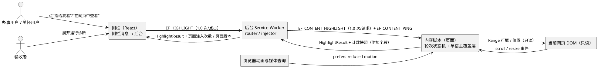
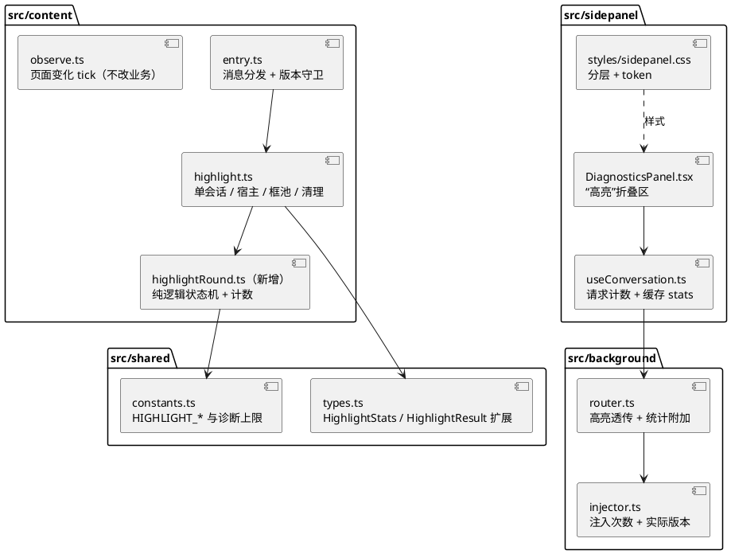
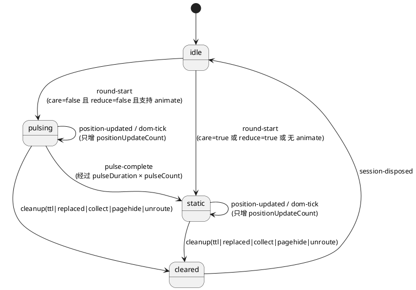
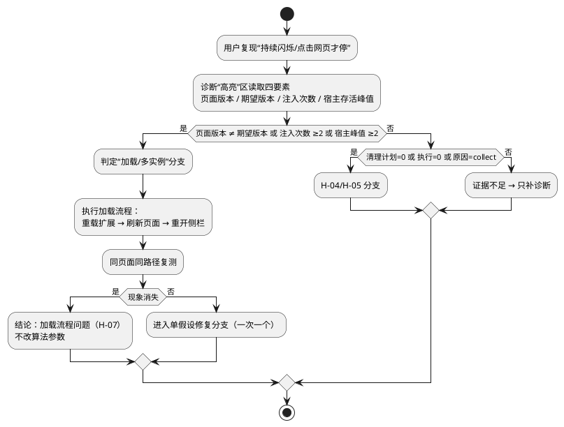
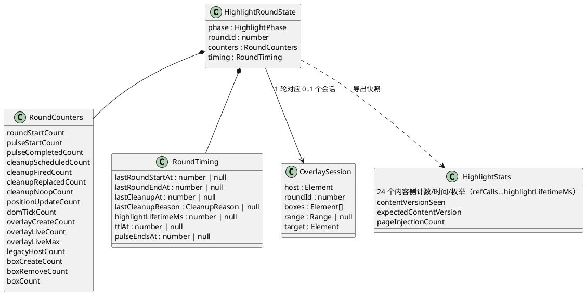
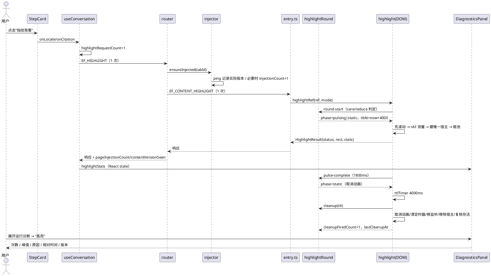

# EasyFlow 高亮停止与侧栏视觉升级（第九轮）— 实现方案

> **文档定位**：本文件是 `easyflow_page_guide` 的第九轮增量设计，承接 `iteration9-spec.md`（R-383—R-427、AT-106—AT-114），不替代 `spec.md`、`iteration2-design.md` 至 `iteration8-design.md`。
>
> **本阶段声明**：本阶段只产出设计方案。未修改 `src/`、`public/`、`scripts/`、`dist/` 任何文件；未运行 `npm run typecheck` / `build` / `selftest` / `verify`；未打开真实 Chrome、未访问真实网页、未调用真实麦克风/语音识别/语音合成、未访问网络；未创建或覆盖 `codearts_proof/` 实绩文件。
>
> **结论口径**：O-01（持续闪烁）、O-02（点击网页才停）在本文件中始终是**待验现象**；H-01—H-08 始终是**待验证假设**。本文件只做两件事：说明「现有代码能解释什么、不能解释什么」，并把「用哪条证据区分哪个假设」写成可执行方案。本文件不含"根因已确认""已修复"。
>
> **两类改动必须分开记账**：A 类是**规格硬约束驱动**（例如 R-384 要求单轮强调 ≤2000ms，而现状 750×3=2250ms，属规格冲突，必须改常量）；B 类是**证据驱动**（例如单宿主缺陷、首帧错位），无证据只允许补诊断，不允许改时长/次数/定位算法。

---

# 一、需求与存量功能关系分析

## 1.0 分析前提（只读核查，2026-11-16）

| 核查项 | 只读核查结果 | 对设计的约束 |
|---|---|---|
| 工程形态 | `D:\hwproject\translator` 单工程；`package.json` 脚本为 `typecheck` / `build` / `selftest` / `verify`；`build` = `tsc --noEmit` + `scripts/build.mjs` + `scripts/verify-manifest.mjs` | 不新建工程、不改构建入口、不引入 CSS 框架 |
| 内容脚本打包 | `scripts/build.mjs:32-45`：`src/content/entry.ts` → `dist/content.js`，`format: "iife"`，`minify: false` | 每次 `executeScript` 会**重新执行整段 bundle**，模块作用域变量重置 |
| 侧栏打包 | `scripts/build.mjs:47-62`：`src/sidepanel/main.tsx` → `dist/sidepanel.js`，`minify: true`，`loader: {".css": "css"}` | `src/sidepanel/styles/sidepanel.css` 被 esbuild 压缩进 `dist/sidepanel.css`（20086 字节），**注释在产物中消失**；CSS 结构断言只能在 `src` 上做 |
| 产物新鲜度 | `dist/*` 时间 2026-11-16 14:42；`dist/content.js` 含 `750`、`iterations`、`2147483647`、`__EASYFLOW_CONTENT__`、`attachShadow` 各 1—2 次 | 可排除"产物里没有新参数"；**不能**证明用户浏览器加载的是这一份产物（H-07） |
| 源码/产物一致性 | 抽取 `dist/content.js` 中 `cleanupHighlight` / `highlightRef` 片段，与 `src/content/highlight.ts:397-459` 逐行一致 | 现有矛盾不来自"源码改过但没构建"；而是来自运行期实例/时序 |
| 权限 | `public/manifest.json:7`：`["activeTab","scripting","sidePanel","storage"]`；`scripts/verify-manifest.mjs:36-43` 精确断言四项 | 本轮不得新增权限；不得新增 `content_scripts` / `host_permissions` |
| 禁词扫描 | `scripts/verify-manifest.mjs:110-127`：`src/**/*.{ts,tsx}` 禁 `fetch(`、`XMLHttpRequest`、`sendBeacon`、`WebSocket`、`MediaRecorder`、`apiKey`、`API_KEY`、`Authorization`、`host_permissions`、`<all_urls>`、`content_scripts`、`dangerouslySetInnerHTML`、`innerHTML` | 新增诊断代码不得出现这些字面量（含注释） |
| 自测加载方式 | `scripts/selftest.mjs:14-77`：esbuild 把一组**具名导出**打成 ESM，在 Node 里 `import`；无 DOM | 高亮生命周期必须抽出**无 DOM 的纯逻辑模块**才能被 Node 断言 |
| 自测基线 | `codearts_proof/iteration8-selftest.log` 为 96 项通过（`# pass 96` / `# fail 0`）；本轮新增 9 项后应为 105 | 96 项为回归红线，只允许 AT-50/AT-63 最小改写 |
| 现有高亮参数 | `src/shared/constants.ts:13-15`：`HIGHLIGHT_TTL_MS = 4000`、`HIGHLIGHT_PULSE_DURATION_MS = 750`、`HIGHLIGHT_PULSE_COUNT = 3` | 750×3=2250ms，与 R-384（≤2000ms）**冲突**，属 A 类必须改 |
| 现有侧栏 CSS | `src/sidepanel/styles/sidepanel.css` 共 1475 行；`@media (max-width: 360px)` 出现在 `:519`、`:881`；`420px` 在 `:1231`、`:1396`；`320px` 在 `:1246`、`:1406` | 断点分散；本轮统一到 420/320 两层，保留 360 的必要项并入 |
| 现有页面变化链 | `src/content/observe.ts:37-47` 观察 `document.documentElement`（`childList/subtree/attributes`）；`src/content/entry.ts:69-78` 在 `CONTENT_COLLECT` 里先 `cleanupHighlight()` | 高亮宿主的 append/remove **会**被计为页面变化；采集会清理高亮 |
| 现有 readpage 节流 | `src/shared/constants.ts:30-32`：`MAX_AUTO_RECHECK_PER_STEP=3`、`WATCH_DEBOUNCE_MS=600`、`RECHECK_MIN_INTERVAL_MS=1200` | "两次页面变化之间 ≥1200ms 才会自动复读"，影响 O-02 的观测窗口 |
| 现有模式读取 | `src/sidepanel/main.tsx:6-7` 首帧写 `data-ui-mode="normal"`；`src/sidepanel/hooks/useUiMode.ts:24` 写 `documentElement.dataset.uiMode` | 关怀模式只靠 `html[data-ui-mode="care"]` 覆盖变量，本轮保持该机制 |

## 1.1 需求功能与存量功能对比

### 1.1.1 已实现功能（可直接复用，不改语义）

| 需求功能 | 存量功能 | 代码位置 | 匹配度 |
|---|---|---|---|
| R-396 按文字范围逐行定位（短标题只框文字） | `selectNodeContents` + `getClientRects` + 行框合并 + `MAX_HIGHLIGHT_BOXES=60` | `src/content/highlight.ts:133-159`、`:161-172`、`:203-219` | 100% |
| R-397 找不到文字时降级 | 行框为空 → `fallbackPageBox`；元素不可见/失联 → `folded` / `stale` | `src/content/highlight.ts:87-112`、`:221-227`、`:435-444` | 100% |
| R-395 不拦截、不改页面节点 | 宿主 `pointer-events:none`、`z-index` 最大、只 append 一个宿主、`closed` shadow | `src/content/highlight.ts:372-382`、`:250` | 100% |
| R-391/R-392 关怀与减少动态不播放动画 | `care || prefersReducedMotion() || 无 animate` → 静态样式 | `src/content/highlight.ts:229-244`、`:256-263` | 100% |
| R-398/R-399 滚动/缩放跟随 | `scroll`(capture) + `resize` → rAF 合并 → 只重算位置 `animate=false` | `src/content/highlight.ts:326-364`、`:392-393` | 75% |
| R-417/R-420 焦点可见 | 全局 `:focus-visible` + `--ef-focus-width` 2px/3px + offset 2px | `sidepanel.css:1226-1229`、`:901`、`:923` | 75% |
| R-424 关怀尺寸基线 | `--ef-font-body 18px`、`--ef-font-current 22px`、`--ef-primary-min-h 48px`、`--ef-tap-min 44px` | `sidepanel.css:913-933` | 100%（token 层） |
| R-423 双模式共享变量 | 关怀模式只覆盖变量值 + 少量组件覆盖块 | `sidepanel.css:913-933`、`:973-1077`、`:1079-1125` | 50% |
| R-411 当前卡内唯一主按钮 | `.ef-step-actions-line` 内只有 `指给我看`（`ef-step-primary`），次操作在 `details` 内 | `StepCard.tsx:99-116`、`:125-157` | 100% |
| R-413 依据/诊断默认折叠且不挤压输入区 | `details.ef-evidence`、`details.ef-diagnostics`（受控 `open`）、主区 `overflow-y:auto`、诊断 `max-height:var(--ef-diag-max-h)` | `EvidencePanel.tsx:43-49`、`DiagnosticsPanel.tsx:76-87`、`sidepanel.css:1176-1205` | 75% |
| R-426 语义与可访问名称 | `aria-labelledby`、`aria-live`、`role="switch"`、`role="status"`、`radiogroup` | `StepCard.tsx:85-95`、`ModeToggle.tsx:14-20`、`MessageList.tsx:191`、`VoiceInputControl.tsx:48-100` | 100% |
| R-414 语音不可用时“下载资源”不突出 | `.ef-speech-install-btn` 为白底描边次按钮，位于语音区末尾 | `sidepanel.css:1433-1443`、`VoiceInputControl.tsx:82-91` | 75%（样式为次按钮，但未与“当前步骤”拉开层级） |
| R-400 清除后无残留监听/定时器 | `cleanupHighlight()` 清 timer、rAF、scroll/resize、宿主 | `src/content/highlight.ts:397-417` | 75%（无"移除后自检"证据） |

### 1.1.2 需要扩展的功能（部分匹配，需在既有基础上改造）

| 需求功能 | 存量功能 | 差异说明 | 扩展方向 |
|---|---|---|---|
| R-383/R-385/R-390 单次点击只跑一轮、次数有限、只在新轮启动 | `highlightRef()` 每次新建宿主并 `positionBoxes(initialBoxes, true)` | 单实例内是"一轮"；但**无轮次对象、无脉冲完成计数、无宿主存活计数**，无法证明"没跑第二轮" | 抽出轮次状态机（`idle→pulsing→static→cleared`）+ 计数；`pulseStartCount` 只在 `round-start` 增 1 |
| R-384 强调总时长 ≤2000ms | 750ms × 3 = 2250ms | **规格与常量直接冲突**（A 类） | `HIGHLIGHT_PULSE_DURATION_MS` 750 → 600（600×3 = 1800ms，留 200ms 余量） |
| R-386 强调结束后静态、不再改亮度 | 动画 `iterations:3` 结束后回到内联静态样式 | 无"结束时刻"记录，无法证明 2000—4000ms 区间没有新的动画/样式抖动 | 显式 `pulse-complete` 事件 → 静态样式一次写入；记录 `lastRoundEndAt` |
| R-387 4000—5000ms 自动清除、不依赖点击网页 | `setTimeout(cleanupHighlight, 4000)` | 存在"其它路径提前/延后清理"的可能（采集清理、重复点击取代）；无清理原因记录 | 单一 TTL 持有 + `cleanupReason` 枚举 + `cleanupFiredCount` 与 DOM 实测一致 |
| R-388 重复点击不叠框、`overlayLiveMax ≤1` | 开头 `cleanupHighlight()` 再建 | 只有内存引用，无宿主标识；`closed` shadow 导致外部不可枚举 | 宿主加 `data-ef-highlight`/`data-ef-round`；创建/清理后遍历 `documentElement` 的**直接子元素**复核存活数（不遍历全页） |
| R-389 滚动/缩放/失焦/DOM 变化不重启、不延长 | 位置更新 `animate=false`；无 DOM 监听 | 位置更新时会 `ensureBoxes()` **增删框元素**；新元素只有静态样式，与动画当前帧不一致（观感差） | 框元素改为池化 + `display` 切换；位置更新只改几何；TTL 只在轮次开始设定 |
| R-401 先核对构建与加载状态 | 无 `injectionCount`、无"页面实际 content 版本" | `injector.ts:41` 的 `ping` 只返回**布尔**（版本是否相等），后台拿不到实际版本 | `ping` 返回实际 `contentVersion`；`ensureInjected` 记录 `contentVersionSeen`；新增 per-tab `injectionCount` |
| R-405/R-406 单一 token 源、同一选择器只 1 处、禁止末尾覆盖 | 两处 `:root`（`:1`、`:891`）、两段 `Iteration N` 注释块（`:890`、`:1278`）、`#root` 2 处、`.ef-header` 3 处、`.ef-step-card` 3 处、`.ef-step-primary` 3 处 | 现状即"末尾追加覆盖"；重复声明块让"哪个值生效"依赖文件顺序 | 按层重排为「变量 → 基础/布局 → 组件 → 模式覆盖 → 媒体 → 减少动态」；合并同类选择器；末尾不再追加 |
| R-407 去大面积紫渐变 | `.ef-header:60` 三色紫渐变 + 重阴影；`.ef-bubble-user:620` 紫渐变；`.ef-btn-primary:216` 紫渐变 | 与用户要求直接冲突 | 头部改冷白/极浅靛蓝单色底；用户气泡改低饱和靛蓝浅底；主按钮改实色靛蓝 |
| R-412/R-415/R-416 气泡不抢层级、头部弱化、旧卡降级 | 助手气泡白底细边框（已合规）；旧卡 `dashed` + 灰底 | 头部层级过高；旧卡与当前卡仅靠颜色区分（灰度下弱） | 头部降饱和 + 1px 边框；旧卡加强"虚线 + 灰底 + 无主按钮 + 无完成条件 + 状态文字"四重区分 |
| R-419 提示文字对比 ≥4.5:1 | `.ef-footer:509` 为 `#9ca3af`；`.ef-message-role:606` 原 `#9ca3af`，后于 `:1214-1217` 改为 `--ef-faint` | `#9ca3af` 在冷白上约 2.5:1，不达标 | 全部提示/次要文字改用 `--ef-muted`/`--ef-faint`（≥4.5:1）；删除 `#9ca3af` 字面量 |
| R-422 400px/200% 可达 | `420px` 与 `320px` 两组断点分散、重复出现；`.ef-step-more-actions` 420 下变 1 列 | 无 400px 专门检查点；200% 缩放依赖 400px（等效 200% 下侧栏视口约 300—360px） | 合并为 420 / 320 两层；统一 `min-width:0`、`overflow-wrap:anywhere`、容器内滚动；400px 与 200% 各列为验收项 |
| R-410 层级优先级 | 步骤卡在气泡内部（`StepCard` 渲染在 `.ef-bubble` 内） | 卡片被气泡包裹，视觉权重受限 | 允许最小包裹层调整：给当前卡增加独立容器类（不改 props、不改渲染条件），提升边界与留白 |
| R-427 视觉验收留痕 | 无任何高亮/视觉留痕 | 自动测试不能证明观感 | 留痕模板 + "待验"状态口径 |

### 1.1.3 需要新增的功能或接口

**A. 高亮轮次逻辑（新文件，纯逻辑）**

| 功能点 | 输入 | 输出 | 核心逻辑 | 依赖 |
|---|---|---|---|---|
| 轮次状态推进 | `RoundInput{now, care, reducedMotion, pulseDurationMs, pulseCount, ttlMs}` + 事件 | `HighlightRoundState`（phase、计数、相对时间） | `idle→pulsing→static→cleared`；care/reduce 直接 `static`；任何位置更新事件不改 `ttlAt` | 无（不碰 DOM） |
| 计数不变量 | 事件流 | 计数快照 | `roundStartCount` 每轮 +1；`pulseStartCount` 仅在普通模式非 reduce 时 +1；`cleanupScheduledCount` 每轮 +1；`cleanupFiredCount` 仅真正移除宿主时 +1 | 无 |

**B. 高亮 DOM 会话（扩展 `highlight.ts`）**

| 功能点 | 输入 | 输出 | 核心逻辑 | 依赖 |
|---|---|---|---|---|
| 单宿主会话 | `ElementRef` + `mode` | `HighlightResult & { stats }` | 先结束旧会话（`replaced`），再定位、测量、建**唯一**宿主 | 轮次逻辑、registry、Range |
| 宿主标识与存活复核 | 无 | `overlayLiveCount` | 宿主带 `data-ef-highlight="v1"` + `data-ef-round="<n>"`；创建/清理后遍历 `documentElement` 直接子元素计数（O(子元素数)，不遍历全页） | DOM |
| 框池 | 行框数组 | 更新的框几何 | 池内元素只切 `display`；不足时新建并按**当前相位**初始化，不启动动画；超额才移除 | 轮次逻辑 |
| 清理原因 | 触发点 | `cleanupReason` | `ttl` / `replaced` / `collect` / `pagehide` / `unroute` / `noop` | 轮次逻辑 |

**C. 证据上报（扩展消息与后台）**

| 功能点 | 输入 | 输出 | 核心逻辑 | 依赖 |
|---|---|---|---|---|
| 内容侧统计快照 | 内存计数 | `HighlightStats` | O(1) 读取，不遍历页面节点、不读文本 | 轮次逻辑 |
| 后台注入计数与实际版本 | `tabId` | `pageInjectionCount`、`contentVersionSeen` | `ping` 改为返回实际版本；`executeScript` 成功一次 +1 | injector |
| 侧栏缓存与展示 | 高亮响应 | `highlightStats` | 仅存 React 局部 state（内存）；诊断面板新增“高亮”折叠区（默认折叠） | 诊断面板 |

**D. 视觉设计系统（不新增文件）**

| 功能点 | 输入 | 输出 | 核心逻辑 | 依赖 |
|---|---|---|---|---|
| 单一 token 源 | 无 | `:root` + `html[data-ui-mode="care"]` 变量 | 颜色/字号/行高/间距/圆角/边框/阴影/焦点/状态/触控/动效全部命名 | 既有 `data-ui-mode` |
| 组件层 | token | 组件规则 | 气泡/卡片/按钮/输入/诊断/语音按统一阶梯书写 | token |
| 响应与减少动态 | 视口 / 媒体查询 | 布局与动效调整 | 420/320 两层；`reduce` 置于文件末尾关闭新增过渡 | token |

## 1.2 存量功能详细分析

### 1.2.1 `highlight.ts` 的接口契约与约束

| 维度 | 现状 | 设计必须遵守 |
|---|---|---|
| 入参 | `highlightRef(ref: ElementRef, mode: "normal" \| "care" = "normal")`（`:419-422`） | 签名不变；`mode` 缺省仍为 `normal` |
| 出参 | `HighlightResult`：`{status:"highlighted", rect}` / `{status:"folded"}` / `{status:"stale"}`（`:426-458`）；`partial` 由 `LocateStatus` 定义但此函数不产出（`types.ts:144-151`） | 只允许**附加可选** `stats` 字段；`status` 语义与现有文案分支不得变（`useConversation.ts:1078-1089` 依赖三态） |
| 副作用 | 追加/移除一个宿主；注册/移除 `scroll`(capture)/`resize`；一个 `setTimeout`；一个 rAF；调用一次 `scrollIntoView` | 不修改网页节点/属性/文本；不改页面滚动行为以外的任何状态 |
| 全局状态 | 7 个模块级变量（`:47-54`）：`overlayHost`、`overlayShadow`、`overlayBoxes`、`activeRange`、`targetElement`、`cleanupTimer`、`frameRequest`、`activeCareMode` | 本轮改为"单一会话对象 + 轮次状态"；**必须保留** `cleanupHighlight` 导出名与"幂等清理"语义（`entry.ts:6`、`:70` 依赖） |
| 共同入口 | `cleanupHighlight()` 被 `highlightRef` 开头（`:423`）与 `CONTENT_COLLECT`（`entry.ts:70`）调用 | 清理必须可被外部（采集）调用，且不得抛错 |
| 定位优先级 | 元素 ID（registry）→ DOM 路径 + 文本哈希（`:87-112`） | 不得新增模糊匹配；不得改变 `stale`/`folded` 判定 |
| 动画契约 | `box.animate(keyframes, {duration, iterations, easing})`（`:264-287`），关键帧为 `fillBase→fillPeak→fillBase` | 只允许改**常量与启动次数**；不得改成 `infinite`；不得删除动画能力（R-385 只限次数） |
| 静态样式契约 | `care`：4px 边框 + 22% 靛蓝底 + 双层外描边（`:31-33`、`:229-238`）；普通静态：`fillStatic .30` + `glowStatic`（`:239-243`） | 静态样式必须覆盖"整个静态期"，不得被位置更新改回 `fillBase` |

**约束与依赖（不得违反）**

1. `cleanupHighlight()` 必须同时清：TTL 定时器、rAF、两个监听器、宿主、会话引用。
2. `positionBoxes(..., false)` 不得启动或重启动画（现状已满足，`:318-320`）。
3. 位置更新不得改变 `cleanupTimer`（现状已满足）。
4. `closed` shadow 内节点不可从主文档枚举；**只能**通过宿主属性或内存计数观测。
5. `document.documentElement.appendChild(host)` 会进入 `observe.ts` 的 MutationObserver 计数。

### 1.2.2 消息链与注入链契约

| 环节 | 现状 | 约束 |
|---|---|---|
| 侧栏请求 | `useConversation.ts:1060-1090`：一次 `highlight()` 只发 **1 条** `MSG.HIGHLIGHT`；`locateControl`（`:1099-1151`）可能先 `readPage("recheck")` 再 `highlight()` 1 次 | 不得在侧栏做"请求合并"（R-388 要求连点每次重启）；只允许记录 `highlightRequestCount` |
| 后台透传 | `router.ts:199-238`：`handleHighlight` 每次 `ensureInjected()` 后 `sendToContent` **1 次**；超时 `LOCATE_TIMEOUT_MS=1000`（`constants.ts:11`） | 后台不得去重（否则 R-388 连点失效）；只允许附加计数 |
| 注入判定 | `injector.ts:64-72`：`injectedTabs.has(tabId) && await ping(tabId)` 成功才跳过注入；`ping` 超时 300ms（`:23-45`） | 页面繁忙时 ping 超时 → 会重复 `executeScript`；这是 H-02 的候选路径，需计数而非直接改逻辑 |
| 注入锁 | `injector.ts:95-115`：同 tab 并发 `ensureInjected` 共享同一 Promise | 保留；不得改成"每次强制注入" |
| 版本守卫 | `entry.ts:100-107`：`existing === undefined || existing.version !== CONTENT_VERSION` 才注册**新** listener；版本相同则**不注册新 listener**，但 bundle 已被重新执行（模块状态重置） | 版本守卫必须保留；本轮必须**升级 `CONTENT_VERSION`** 才能让"旧实例"被替换（H-07 的流程修复） |
| 采集清理 | `entry.ts:69-78`：`CONTENT_COLLECT` → `cleanupHighlight()` → `collectPage()` | 保留；但需记录 `cleanupReason="collect"`，以便把"点击网页后停止"与 TTL 到点区分开 |
| 实际版本可见性 | `injector.ts:41` 只比较布尔；返回 `{contentVersion: CONTENT_VERSION}`（期望值，非实际值） | 设计改为记录 page 实际版本 |

### 1.2.3 页面变化链路（关键：高亮自身也会进入这条链）

```
高亮 append 宿主
  → observe.ts:37-41 MutationObserver +1
  → 600ms 去抖（WATCH_DEBOUNCE_MS）
  → chrome.runtime.sendMessage(WATCH_TICK)
  → background/index.ts:55-64 广播 WATCH_TICK
  → useConversation.ts:989-1007：plan 为 active 且距上次 ≥1200ms、未超 3 次
  → readPage("recheck") → MSG.COLLECT → router.handleCollect
  → entry.ts:69-78 cleanupHighlight() → collectPage()
```

由此可得三条**静态可证**的事实（不是根因结论）：

1. **高亮会被自己的宿主插入/移除触发一次"页面已变化"的判定**；在导办/预约计划处于 `active` 时，可能触发一次自动复读，而复读入口会 `cleanupHighlight()`。
2. 该链路有上限（每步 3 次）与最小间隔（1200ms），因此**不会无限循环**；但会造成"高亮提前消失"或"点击网页后高亮立刻消失"。
3. 要让"点击网页才停"与"TTL 到点自然停"可区分，必须记录清理原因与清理时刻，而现有代码没有这两个字段。

### 1.2.4 侧栏 CSS 现状（重复、覆盖、低对比、断点）

| 类别 | 事实（行号） | 影响 |
|---|---|---|
| `:root` 重复 | `:1-13`（旧 token）与 `:891-911`（Iteration 4 token） | 同名 `--ef-muted` 被后段覆盖，`#6b7280` → `#4b5563`；阅读时需跨 900 行 |
| `#root` 重复 | `:528-530` 与 `:1147-1151` | 后者增加 `100dvh`、`min-height:0` |
| `.ef-chat-app` 重复 | `:532-536` 与 `:1153-1158` | 后者覆盖高度单位 |
| `.ef-app` 重复 | `:44-48`（`min-height:100vh`）与 `:1160-1162`（`min-height:0`） | 同一元素两处相反声明 |
| `.ef-header` 重复 | `:50-62`（渐变 + 阴影）、`:1164-1168`（`flex:none/flex-wrap`）、`:1232-1234` 与 `:1247-1249`（媒体查询内） | 主题与布局分散在三处 |
| `.ef-step-card` 重复 | `:721-727`、`:973-975`、`:1065-1071` | 基础块 + 两处覆盖（边框宽度、过期/结束态） |
| `.ef-step-primary` 重复 | `:753-762`（与 `.ef-step-action` 并列）、`:764-769`（实色）、`:990-1001`（尺寸/圆角）、`:1349-1353`（行为线内） | 主按钮样式由 4 处叠加决定 |
| `.ef-bubble` 重复 | `:609-616` 与 `:958-964` | 后者改字号/行高 |
| `.ef-chat-main` 重复 | `:563-570` 与 `:1176-1181` | 后者补 `overscroll-behavior` |
| `.ef-diagnostics` 重复 | `:847-853`、`:1019-1024`、`:1201-1205` | 尺寸与换行分散 |
| `.ef-inline-link` 重复 | `:709-719` 与 `:1207-1212` | 后者改 `inline-flex` + 最小高度 |
| `.ef-message-role` / `.ef-composer-hint` 重复 | `:603-607`/`:825-829` 与 `:1214-1217` | 后者改颜色为 `--ef-faint` |
| 末尾追加覆盖 | `:890` 注释 `/* Iteration 4: ... */` 起至 `:1277`；`:1278` 注释 `/* Iteration 5: ... */` 起至文件末 | 违反 R-406；本轮禁止继续这种方式 |
| 紫渐变 | `:60`（三色 135°）、`:216-219`（主按钮）、`:620-622`（用户气泡） | 违反 R-407 |
| 低对比 | `:509` `#9ca3af`（footer）、`:605` `#9ca3af`（role 初值）、`:556`/`:560` 状态点仅靠颜色 | 违反 R-419、R-418 |
| 断点分散 | `360px`（`:519`、`:881`）、`420px`（`:1231`、`:1396`）、`320px`（`:1246`、`:1406`）、`max-height:520px`（`:1257-1265`） | 需合并为 420 / 320 / 高度三类 |
| 关怀覆盖范围 | `:913-933` 仅覆盖变量；`:973-1077`、`:1079-1125` 有**组件级**覆盖块 | 与 R-423"只覆盖变量值"有偏差，需收进"模式结构性微调"并显式标注 |

### 1.2.5 侧栏组件与可访问性现状

| 组件 | 现状 | 设计约束 |
|---|---|---|
| `App.tsx` | 结构固定：`header → 页面状态 → 慢提示 → main（消息+说明）→ composer → diagnostics` | 不改顺序、不改 props；只允许在 `StepCard` 外层加最小包裹类 |
| `ChatHeader.tsx` | `ef-header ef-chat-header`，品牌 + 模式开关 | 不改结构；改配色/间距/边框 |
| `MessageList.tsx` | 助手气泡内可含 `StepCard`；`aria-live="polite"` 在列表上 | 不拆气泡与卡片的语义；只调类名与样式 |
| `StepCard.tsx` | 当前卡：标签 + 目标 + 行为行（主按钮 + 朗读）+ 详情 + 更多操作；历史/结束卡：标签 + 提示 | 不改 props、不改 `stepCardModel` 判定、不改按钮数量 |
| `ChatComposer.tsx` | `textarea` + 提示 + 发送；`disabled` 只由 `busy` 与空文本决定 | 不改逻辑；改聚焦样式与尺寸 |
| `VoiceInputControl.tsx` | 主语音按钮、授权入口、模式单选、安装按钮、状态、说明 | 不改可用性判定；安装按钮保持次按钮与末尾位置 |
| `DiagnosticsPanel.tsx` | 外层 `details` 受控 `open`；语音 11 键 + 页面采集 + 运行记录 | 新增内部“高亮”折叠区；不得把高亮字段混入语音 13 键 |
| `EvidencePanel.tsx`/`StepDetails.tsx` | 依据与详情均 `details` 默认折叠 | 不改默认展开状态 |
| `ModeToggle.tsx` | `role="switch"`、`aria-checked`、禁用直到 `modeReady` | 保留语义；改配色与触控尺寸 |

### 1.2.6 自测结构与既有断言（必须保留的具体片段）

| 断言 | 位置 | 本轮处理 |
|---|---|---|
| CSS 必含 `html[data-ui-mode="care"]`、`--ef-font-body: 18px`、`--ef-font-current: 22px`、`--ef-primary-min-h: 48px`、`--ef-tap-min: 44px`、`prefers-reduced-motion: reduce`、`max-height: 40vh`、`100dvh`、`:focus-visible` | `selftest.mjs:3099-3111` | 全部保留字面形式（**不得**改成 `1.125rem` 等） |
| `highlight.ts` 含 `HIGHLIGHT_CARE_BORDER_WIDTH` | `selftest.mjs:3135-3136` | 保留该常量与字面出现 |
| `messages.ts` 含 `mode?: "normal" \| "care"` | `selftest.mjs:3134` | 保留该可选字段写法 |
| 源码无 `02:00|02:15|03:00` 字面量 | `selftest.mjs:3138-3142` | 新增诊断/常量不得引入这些时刻 |
| `.ef-speech-open-btn { ... min-height: var(--ef-tap-min) }` | `selftest.mjs:2934` | **保留独立声明块**（不得合并成逗号选择器） |
| `.ef-speech-btn`、`.ef-speak-btn`、`.ef-step-actions-line > .ef-step-primary` 各自含 `min-height` 变量 | `selftest.mjs:3622-3631` | 三处均须保留独立块与相同变量 |
| 不含 `ef-voice-btn`/`ef-mode-notice` | `selftest.mjs:3112`、`:3632-3633` | 新类名不得撞名 |
| 权限四项、无 `MediaRecorder`/`fetch(`、getUserMedia 2 条例外 | `selftest.mjs:2885-2909`、`verify-manifest.mjs:36-43`、`:110-142` | 不改 |

### 1.2.7 存量约束清单（设计不得违反）

1. `src/content/collect.ts`、`semantic.ts`、`controls.ts`、`registry.ts` 的采集语义与 `EF-E003` 一律不动。
2. `src/sidepanel/dialogue/**`、`guide/**`、`state/**`、`match/**`、`shared/speech/**`、`sidepanel/speech/**`、`mic-permission/**` 不动。
3. `public/manifest.json`、`public/*.html`、`scripts/build.mjs`、`scripts/verify-manifest.mjs` 不动。
4. 不新增 `chrome.storage` 键；诊断只存内存。
5. 不新增网络请求、不引入 SDK/代理/密钥。
6. 不改 `HighlightResult.status` 三态与 `folded`/`stale` 文案（`useConversation.ts:1078-1089`）。
7. 不改 `StepCard` 的按钮集合、判定函数与文案；不改 `DiagnosticsPanel` 的语音 13 键结构。
8. 不把 `prefers-reduced-motion` 的 `!important` 规则删除（`sidepanel.css:1267-1277`）。

## 1.3 八个候选假设与可区分证据

> 证据字段名称按 `iteration9-spec.md` 0.5，本设计补充的字段以 `*` 标注（均为"次数/枚举/相对时间"，符合隐私口径）。

| 假设 | 若成立应观察到的证据 | 目前有无证据 | 区分方法（具体判定） | 允许改法 | 禁止 |
|---|---|---|---|---|---|
| H-01 单次点击触发多次高亮请求 | `highlightRequestCount` 连续 >1（同一 500ms 窗口）；`highlightRefCalls` >1；`overlayCreateCount` >1 | 无（无计数） | 诊断“高亮”区按轮显示 `requestCount` 与 `refCalls`；若 `refCalls > requestCount` 则指向后台重复透传或双 listener | 收敛触发点（不改 TTL） | 调大 TTL 掩盖 |
| H-02 多宿主并存（重复注入/旧实例残留/清理遗漏） | `overlayLiveMax ≥2`；`*legacyHostCount ≥1`；`injectionCount ≥2`；`contentVersionSeen` 与 `CONTENT_VERSION` 不等 | 无；静态上"单实例代码只有 1 个宿主"，但无标识无法枚举 | 宿主 `data-ef-highlight` 计数 + `documentElement` 末级"宿主特征节点"（`position:absolute`+`z-index:2147483647`+`pointer-events:none`+尺寸为 0）计数；两者相加 >1 即并存 | 保证单宿主、清理所有本实例宿主；必要时升级版本触发重注入 | 删除 `cleanupHighlight` 既有语义；强行移除他人节点 |
| H-03 动画被反复重启 | `pulseStartCount` 在 `lastRoundEndAt` 之后仍增长；`roundStartCount` 不变但 `pulseStartCount` 增长 | 无 | 轮次状态机把 `pulseStartCount` 与 `roundStartCount` 分开；位置更新只增 `positionUpdateCount` | 只在 `round-start` 启动一次 | 改为"永不启动脉冲"掩盖 |
| H-04 清理定时器未执行/被覆盖 | `cleanupScheduledCount ≥1` 但 `cleanupFiredCount = 0`；或 `cleanupReplacedCount` 持续增长且 `*cleanupNoopCount` 增长 | 无 | `cleanupReason` + `lastCleanupAt - lastRoundStartAt` 区间（0—500/500—2000/2000—5000/>5000） | 单一 TTL 持有、幂等清理 | 无证据改时长 |
| H-05 页面高频 DOM 变化被误判 | `*domTickCount` 高频（存活期内 ≥1/秒）但 `pulseStartCount` 不增长；`cleanupReason="collect"` 且 `cleanupFiredAt - roundStartAt < 2000` | 无；静态可证"高亮自身会产生 2 次 mutation" | 比较 `cleanupReason`：`collect` 表示被复读清理；`ttl` 表示自然到点 | 过滤高亮自身宿主产生的 mutation（observer 侧忽略带 `data-ef-highlight` 的目标） | 关闭整个页面变化监听 |
| H-06 多行 box 相位差/框元素重建造成闪烁 | 单轮 `pulseStartCount=1`，但 `*boxCreateCount`/`*boxRemoveCount` 在存活期内持续增长；`*boxCount` 在 2—4 之间抖动 | 无；静态可证 `ensureBoxes` 会 `appendChild`/`remove` | 框池改为 `display` 切换后，`boxCreateCount` 在单轮内应为 1 次批量（仅首次） | 框池化 + 同一帧对齐 `startTime` | 改成整块矩形高亮 |
| H-07 用户加载的是旧构建/别的页面效果 | `contentVersionSeen ≠ CONTENT_VERSION`；`injectionCount ≥2`；`dist` 时间与扩展重载时间不符；禁用其它扩展后现象消失 | 部分：`dist` 14:42 新于源码改动，但**无页面实际版本**证据 | 后台 `ping` 改为返回实际版本；诊断显示"页面版本 / 期望版本"；重载扩展 + 刷新页面后复测 | 只修加载/验收流程 + 升级 `CONTENT_VERSION` | 为此改动画参数/定位算法 |
| H-08 `prefers-reduced-motion` 页面侧未生效 | `reducedMotionAtRequest=false` 而系统已开启减少动态；`uiModeAtRequest="care"` 时 `pulseStartCount` 增长 | 无 | 诊断同时显示"模式"与"减少动态:是/否"；care/reduce 下 `pulseStartCount` 应为 0 | 只增加可见性 | 改系统设置/改网站样式 |

**证据不足时的唯一允许动作**：只补诊断（计数/枚举/相对时间）与展示，不改 `HIGHLIGHT_*` 数值、不改定位算法（R-403）。

## 1.4 静态可读已发现的时序缺口（行为缺口，不等同根因）

> 以下三条是"读源码即可确认的行为"，但**是否就是 O-01/O-02 的成因，必须由 2.2 的计数验证**。设计的处理方式是"先记录，再按证据决定是否修"。

| 编号 | 缺口 | 代码位置 | 可观察后果 | 归属 |
|---|---|---|---|---|
| G-01 | 行框在 `scrollIntoView` **之前**测量，建宿主时用旧坐标 | `highlight.ts:434-441` 先 `buildTextHighlight`，`:448-452` 再滚动，`:453` 用旧 `initialBoxes` 建宿主 | 首帧框与文字错位；随后 rAF 位置更新把框"跳"到正确位置 | B 类（证据驱动，但静态确定） |
| G-02 | 位置更新时按行框数量增删 DOM | `highlight.ts:290-303` `appendChild`/`remove` | 新元素为静态样式，与正在动画的旧元素亮度不同 → 交替明暗 | B 类（H-06 的直接候选） |
| G-03 | 高亮自身宿主 append/remove 进入页面变化链 | `observe.ts:37-47` + `entry.ts:69-78` + `useConversation.ts:989-1007` | 高亮可能导致一次自动复读，而复读会清理高亮（`cleanupReason="collect"`） | B 类（H-05 的直接候选） |

> 说明：G-01—G-03 的解释力有限——它们能解释"错位/抖动/提前消失"，但不能单独解释"持续闪烁直到点击网页"。因此设计**不把它们当作 O-01 的根因**，而是作为"必须先消除的干扰源"，避免后续证据被噪声污染。
---

# 二、增量设计方案

## 2.1 实现模型

### 2.1.1 上下文视图



通信均为 `chrome.runtime` / `chrome.tabs` 消息，无网络、无外部接口。频率：一次点击 = 1 次侧栏请求 + 1 次内容请求 + 最多 1 次 ping；诊断读取不产生周期性请求（只在点击响应里附带，或面板展开时读取已缓存值）。

### 2.1.2 服务/组件总体架构



依赖方向：`content → shared`、`sidepanel → shared`、`background → shared`；**不存在** `content` 依赖 `sidepanel`、`sidepanel` 依赖 `content` 的直接引用（只通过消息类型）。

### 2.1.3 实现设计

#### （1）高亮轮次状态机（新增纯逻辑）



**状态与字段**

| 状态 | 含义 | 允许的动画 | `ttlAt` |
|---|---|---|---|
| `idle` | 无会话 | 无 | `null` |
| `pulsing` | 本轮强调进行中（≤1800ms） | 每个框 1 个动画实例 | 轮次开始 + 4000ms |
| `static` | 强调已结束，静态描边保持 | 无（已有动画必须 `cancel()`） | 同上（不变） |
| `cleared` | 宿主已移除、监听已移除 | 无 | `null` |

**事件表**

| 事件 | 触发点 | 计数影响 | 禁止 |
|---|---|---|---|
| `round-start` | `highlightRef()` 定位成功、宿主创建前 | `roundStartCount+1`、`cleanupScheduledCount+1`、`overlayCreateCount+1`、`overlayLiveCount=1`（并刷新 `overlayLiveMax`）、普通模式 `pulseStartCount+1`、`lastRoundStartAt=now` | 不得重置上一轮计数 |
| `pulse-complete` | `animation.finished`（Promise）到达；`cleanup` 的 `cancel()` 使其 reject 并捕获，不新增独立脉冲定时器 | `pulseCompletedCount+1`、`lastRoundEndAt=now` | 不得在 `static` 后再发；不得用第二个 `setTimeout` 计时脉冲 |
| `position-updated` | rAF 位置更新 | `positionUpdateCount+1` | 不得改 `ttlAt`、不得发 `round-start` |
| `dom-tick` | `setChangeListener` 回调（只读页面自身变化计数） | `domTickCount+1`（不改其它计数） | 不得驱动任何动画 |
| `cleanup` | 见（4） | 见（4） | 不得修改 `ttlAt` 后再清理 |
| `round-replaced` | 新一轮开始前结束旧轮 | `cleanupReplacedCount+1` | 不得把"被取代"计入 `cleanupFired` |

**不变式（可断言）**

1. `pulseStartCount ≤ roundStartCount`。
2. `care === true` 或 `reducedMotion === true` 时，`pulseStartCount` 不因该轮增长。
3. `ttlAt` 在 `round-start` 之后、`cleanup` 之前**恒定**。
4. `pulseCompletedCount ≤ pulseStartCount`。
5. 同一 `roundId` 内 `round-start` 至多 1 次。

**常量（A 类，规格硬约束）**

| 常量 | 现值 | 设计值 | 依据 |
|---|---|---|---|
| `HIGHLIGHT_PULSE_DURATION_MS` | 750 | **600** | R-384：单轮 ≤2000ms；600×3=1800ms |
| `HIGHLIGHT_PULSE_COUNT` | 3 | **3**（不变） | R-385：次数 ≤3，保留脉冲（D9-02 默认） |
| `HIGHLIGHT_TTL_MS` | 4000 | **4000**（不变） | D9-03/D9-08 默认；R-387 要求 4000—5000ms |
| `HIGHLIGHT_STATIC_MIN_MS`（新增） | — | `1600`（下限守卫；实际 4000 - 1800 = 2200） | R-386：静态期不得短于 2.0s；`TTL >= pulseTotal + 该值` 用于 AT-108 断言（命名常量，非魔法数） |
| `HIGHLIGHT_BOX_POOL_MAX`（新增） | — | `60`（与 `MAX_HIGHLIGHT_BOXES` 同值） | 不改变现有多行上限 |
| `HIGHLIGHT_HOST_ATTR`（新增） | — | `"data-ef-highlight"` | 宿主可枚举标识 |
| `HIGHLIGHT_ROUND_ATTR`（新增） | — | `"data-ef-round"` | 轮次编号，便于区分旧宿主 |

#### （2）单宿主与框池

```plantuml
@startuml
start
:highlightRef(ref, mode);
:若存在旧会话 → endRound("replaced")\n（取消动画/清定时器/移监听/移除宿主）
:locate(ref) → found / folded / stale;
if (folded 或 stale) then (是)
  :返回原状态（不建宿主）;
  stop
endif
:scrollIntoView(目标)\n（care/reduce → auto）;
:requestAnimationFrame 后测量行框\n（避免首帧错位，G-01）
if (行框为空) then (是)
  :元素边界降级;
endif
if (仍为空) then (是)
  :返回 stale（原语义）;
  stop
endif
:创建唯一宿主（带 data-ef-highlight / data-ef-round）
:框池 ensure(count)\n（不足→显示/新建并套当前相位；多余→隐藏）
:phase = pulsing 或 static\n（care/reduce/无 animate → static）
if (pulsing) then (是)
  :同一帧内为所有框创建 1 个动画\n并对齐 startTime
endif
:ttlTimer = now + 4000\ncleanupScheduledCount++
:注册 scroll(capture) / resize
stop
@enduml
```

**规则**

1. **单宿主保证**：宿主创建前后各遍历一次 `documentElement` 的**直接子元素**，按 `HIGHLIGHT_HOST_ATTR` 计数；若发现 >1，记录 `overlayLiveMax` 与 `legacyHostCount`，但**只移除本实例创建的宿主**（不删除无法确认来源的节点）。不使用 `querySelectorAll`（避免全文档遍历）。
2. **框池**：池内元素按索引复用；`count` 变小 → `display:none`（不 `remove`）；变大 → 优先复用隐藏元素，不足才 `createElement`，新元素立即套用**当前相位**样式（pulsing 时套 `fillBase` 并加入本帧动画批量，static 时套静态样式）。这样 `boxCreateCount` 在单轮内最多增长一次批量。
3. **动画对齐**：先取 `document.timeline.currentTime` 作为 `startTime`，再对每个框 `animation.startTime = startTime`，保证多行同相（H-06）。若环境不支持 `startTime` 赋值，退化为"同一同步循环内创建"。
4. **`pointer-events:none`** 同时写在宿主与每个框上；不改原节点属性/文本。
5. **不做整块矩形**：行框来自 `range.getClientRects()` + 现有合并规则；短标题仍只框文字。

#### （3）位置更新与 TTL 不变式

| 触发 | 处理 | 计数 | 不做什么 |
|---|---|---|---|
| `scroll`（capture，passive） | rAF 合并 → 重算行框 → 更新几何 | `positionUpdateCount+1` | 不重启脉冲、不改 `ttlAt`、不改 `cleanupTimer` |
| `resize` | 同上 | `positionUpdateCount+1` | 同上 |
| 目标元素脱离文档 | `cleanup("unroute")` | `cleanupFiredCount+1` | 不追到新页面元素 |
| 行框变空但元素可见 | 元素边界降级 | 同上 | 不返回 `stale`（与现有语义一致） |
| 行框为空且元素不可见 | `cleanup("unroute")` | 同上 | 不改 `folded` 判定 |
| 页面变化（`observe.ts` 回调，经 `setChangeListener` 送入状态机） | 只更新 `domTickCount` | 仅计数 | **不**重算位置（避免与滚动逻辑重复），**不**重启、**不**延长 |
| 焦点变化 | 无动作 | — | 不因失焦延长/清理（清除只依赖 TTL） |

**禁止**：任何位置更新路径调用 `restartPulse` 或重新 `animate()`；任何路径在 `round-start` 之后重设 `cleanupTimer`。

#### （4）清理路径与幂等

| 清理原因 | 触发点 | 是否计入 `cleanupFiredCount` | 说明 |
|---|---|---|---|
| `ttl` | `ttlTimer`（4000ms） | 是 | 唯一自然清除路径 |
| `replaced` | 新一轮 `highlightRef` 开头结束旧轮 | 否（计入 `cleanupReplacedCount`） | 旧宿主必须已移除 |
| `collect` | `CONTENT_COLLECT`（`entry.ts:70`） | 是 | **保留既有语义**，但记录原因，便于区分"点击网页后停止" |
| `pagehide` / `beforeunload` | 页面卸载 | 是 | 防 BFCache 残留 |
| `unroute` | 目标脱离/无法定位 | 是 | 防御性清理 |
| `noop` | 无会话时被调用 | 否（计入 `cleanupNoopCount`） | 幂等，不抛错 |

**DOM 与计数一致性保证**

1. `cleanup` 顺序固定：`cancelAnimation` → `clearTimeout` → `cancelAnimationFrame` → `removeEventListener` → `host.remove()` → 清空会话引用 → 遍历 `documentElement` 直接子元素复核本版本宿主数。
2. 复核结果应为 0；若 >0 则说明本实例残留（`legacyHostCount` 记 0，`overlayLiveCount` 记实测值并显示"本实例残留"）。另按"宿主特征"（`position:absolute` + `z-index:2147483647` + `pointer-events:none` + 宽高为 0 + **无** `HIGHLIGHT_HOST_ATTR`）统计 `legacyHostCount`，用于 H-02/H-07；不强行删除任何非本实例节点。
3. `lastCleanupAt = now`，`highlightLifetimeMs = lastCleanupAt - lastRoundStartAt`（派生，仅保留最近一次）。
4. `cleanupFiredCount` 只在**实际移除了本实例宿主**时 +1；因此"计数为 0 但页面无框"即说明"框不是本实例创建的"（H-02/H-07 的直接证据）。
5. `closed` shadow 残留的判定改为"宿主是否还在"（宿主可枚举），不再依赖 shadow 内容。

#### （5）证据采集点与上报链

**采集点（全部 O(1)，不读页面文本）**

| 字段 | 采集位置 | 形态 | 说明 |
|---|---|---|---|
| `highlightRequestCount` | `useConversation.ts` 的 `highlight()` 发送前 | 整数（侧栏内存，按 tab 会话） | 与 `refCalls` 对比判断 H-01 |
| `highlightRefCalls` | `highlight.ts` 入口 | 整数 | 内容脚本每处理 1 次请求 +1 |
| `roundStartCount`（*） | 轮次 `round-start` | 整数 | 区分"轮次"与"脉冲" |
| `pulseStartCount` / `pulseCompletedCount` | 轮次事件 | 整数 | H-03 |
| `overlayCreateCount` | 宿主创建 | 整数 | H-02 |
| `overlayLiveCount` / `overlayLiveMax` | 创建/清理后实测 | 0/1/2+ / 峰值 | H-02 |
| `legacyHostCount`（*） | 清理/创建后按"宿主特征且无标识"统计 `documentElement` 直接子元素 | 整数 | 未标识（旧实例）宿主 |
| `cleanupScheduledCount` / `cleanupFiredCount` / `cleanupReplacedCount` / `cleanupNoopCount`（*） | 清理路径 | 整数 | H-04 |
| `cleanupReason`（*） | 清理路径 | 枚举 | H-05/区分 O-02 |
| `positionUpdateCount` | rAF 更新 | 整数 | H-03 |
| `domTickCount` | `observe.ts` 回调 → `setChangeListener` → 状态机 `dom-tick`（只读计数，不参与导办判定） | 整数 | H-05 |
| `boxCreateCount` / `boxRemoveCount` / `boxCount`（*） | `ensureBoxes` | 整数 | H-06 |
| `injectionCount` | `injector.executeScript` 成功 | 整数（按 tab） | H-02/H-07 |
| `contentVersionSeen` | `ping` 实际返回 | 版本字符串 | H-07 |
| `uiModeAtRequest` | 侧栏请求 | `normal`/`care` | 模式一致性 |
| `reducedMotionAtRequest` | 内容脚本 | 是/否 | H-08 |
| `lastRoundStartAt` / `lastRoundEndAt` / `lastCleanupAt` / `highlightLifetimeMs` | 轮次/清理 | 相对毫秒（自页面加载） | R-427 留痕口径 |

**上报方式（零新增消息类型）**

1. `CONTENT_HIGHLIGHT` 的响应 data 由 `HighlightResult` 扩展为 `HighlightResult & { stats?: ContentHighlightStats }`（可选字段，向后兼容）。
2. `router.handleHighlight` 在返回前附加 `pageInjectionCount`、`contentVersionSeen`（来自 `injector`）。
3. 侧栏 `highlight()` 把 `stats` 存入 `useConversation` 的局部 `useState`（**不进 `conversationReducer`**，避免影响问答/导办状态机），`App` 透传给 `DiagnosticsPanel`。
4. `DiagnosticsPanel` 新增内部 `<details className="ef-highlight-diag">`，默认折叠，标题"高亮"，显示：请求/处理次数、宿主存活峰值、轮次/脉冲/完成、清理计划/执行/被取代/空清理、最近清理原因与时刻、位置更新/页面变化、框创建/移除、页面注入次数、页面版本 vs 期望版本、模式、减少动态、最近一轮时长。
5. 面板只在 `entries` 已展开（外层 `open`）时渲染；未点击过高亮时显示"尚无高亮记录"。

**隐私边界**

- 只存整数、毫秒、枚举、版本字符串。
- 不存网页标题/域名/路径/查询串/正文/表单值/输入/引用/聊天。
- 不写 `chrome.storage`、不进聊天消息、不进 `diagnostics` 条目（`conversationReducer` 诊断数组）、不进 `console` 结构化日志。
- 关闭侧栏刷新页面即丢失（内存）。

#### （6）旧构建识别与加载流程分支



**加载流程修复（不改算法）的具体内容**

1. `CONTENT_VERSION` 由 `0.3.0` → `0.4.0`（A 类必要改动，理由：版本守卫只在版本不同时移除旧 listener；不升级则旧实例无法被替换）。
2. 诊断中显示"页面版本 / 期望版本"，不一致时在侧栏以既有系统提示样式提示"请刷新当前网页后重试"（一行，不新增常驻按钮、不新增消息类型）。
3. 留痕写明三个时间点：`dist/content.js` 时间戳、扩展重载时间、页面刷新时间。

**禁止**：把"重载/刷新后现象消失"写成"高亮算法已修复"；为 H-07 改 `HIGHLIGHT_*` 数值。

#### （7）CSS 分层与合并策略

**文件结构（单文件，从上到下 6 层，不新增文件，D9-05 默认）**

| 层 | 内容 | 规则 |
|---|---|---|
| L0 变量 | `:root`（普通全量 token）+ `html[data-ui-mode="care"]`（只覆盖变量值） | 全文件**只有这 2 个变量块**；`care` 块内不得写组件选择器 |
| L1 基础/布局 | `*`、`html,body`、`#root`、`.ef-app`、`.ef-chat-app`、`.ef-header`、`.ef-page-status`、`.ef-chat-main`、`.ef-composer`、`.ef-diagnostics` | 固定区/滚动区在这里定死；同一选择器 1 处 |
| L2 组件 | 品牌/标题/模式开关、气泡、向导卡、证据、输入/发送、语音、诊断、说明 | 只用 token，不写字面量颜色 |
| L3 模式结构性微调 | 仅 `html[data-ui-mode="care"]` 下的**布局微调**（如次按钮单列、诊断高度） | 必须写注释"仅变量无法表达的结构差异"；不得复制整套组件样式 |
| L4 媒体查询 | `max-width:420px`、`max-width:320px`、`max-height:520px` | 只放布局/尺寸，不放主题色 |
| L5 减少动态 | `@media (prefers-reduced-motion: reduce)` | 文件**末尾**；`transition/animation: none !important`；`--ef-motion-*: 0ms` |

**重复规则合并映射（逐条）**

| 选择器 | 现状位置 | 合并后唯一位置 | 保留哪条/如何合并 |
|---|---|---|---|
| `:root` | `:1`、`:891` | L0 | 旧块中的 `--ef-accent/--ef-danger*` 等并入；`--ef-muted` 取深值（`#475569`） |
| `#root` | `:528`、`:1147` | L1 | 保留 `height:100vh; height:100dvh; min-height:0` |
| `.ef-chat-app` | `:532`、`:1153` | L1 | 保留 `100dvh` 与 `overflow:hidden` |
| `.ef-app` | `:44`、`:1160` | L1 | `flex column; min-height:0` |
| `.ef-header` | `:50`、`:1164` | L1 | 新底色 + `flex:none/flex-wrap` |
| `.ef-chat-main` | `:563`、`:1176` | L1 | `flex:1; min-height:0; overflow-y:auto; overscroll-behavior:contain` |
| `.ef-bubble` | `:609`、`:958` | L2 | 字号走 `--ef-font-body` |
| `.ef-bubble-user` | `:618`、`:620` | L2 | 低饱和靛蓝浅底 + 深蓝灰字 |
| `.ef-message-role` | `:603`、`:1214` | L2 | 颜色 `--ef-faint`（≥4.5:1） |
| `.ef-composer-hint` | `:825`、`:1214` | L2 | 颜色 `--ef-faint` |
| `.ef-step-card` | `:721`、`:973`、`:1065` | L2 | 基础块 + 两个修饰类（`-current`、`-expired/-ended`） |
| `.ef-step-primary` | `:753`、`:764`、`:990`、`:1349` | L2 | 基础块（与 `.ef-step-action` 的共享部分）→ `.ef-step-primary` 独立块 → 行为线内尺寸块；**共 3 个独立块，可接受**（不是"同一选择器重复声明同一属性"） |
| `.ef-diagnostics` | `:847`、`:1019`、`:1201` | L1 + L2 | L1 布局（`flex:none`），L2 内滚动与换行 |
| `.ef-inline-link` | `:709`、`:1207` | L2 | `inline-flex` + 最小触控高度一次写全 |
| 末尾覆盖块 | `:890` 起、`:1278` 起 | 删除注释块标题，规则分流到 L1—L5 | 禁止再出现 `Iteration N` 结尾覆盖 |

**硬约束（避免自测回退）**

1. `.ef-speech-open-btn`、`.ef-speech-btn`、`.ef-speak-btn`、`.ef-step-actions-line > .ef-step-primary` 必须各自保留**独立**声明块，且各自含 `min-height: var(--ef-tap-min)` / `var(--ef-primary-min-h)` 的原文（`selftest.mjs:2934`、`:3622-3631`）。
2. `--ef-font-body: 18px`、`--ef-font-current: 22px`、`--ef-primary-min-h: 48px`、`--ef-tap-min: 44px`、`max-height: 40vh`、`100dvh`、`:focus-visible`、`html[data-ui-mode="care"]` 必须**字面**出现（`selftest.mjs:3099-3111`）。
3. 组件层不得出现 `#9ca3af`、`#7c3aed`、`#a855f7`、`linear-gradient(135deg, #4f46e5` 等一次性色值。
4. `@media (prefers-reduced-motion: reduce)` 保持 `!important` 关闭，且在文件最后。

#### （8）400px / 200% / 关怀 三组布局策略

| 场景 | 等效视口 | 策略 | 验收点 |
|---|---|---|---|
| 侧栏 400px | 400px | 双列更多操作（`repeat(2, minmax(0,1fr))`）；主按钮整行；诊断内部滚动 | 无横向滚动、无遮挡、四类目标可点 |
| 200% 缩放 | 约 300—360px（820/2.5 或 1280/2） | 降到 420 层：更多操作 1 列；`320` 层：头部纵向、隐藏次要提示 | 同上 |
| 关怀模式 | 400px 或 200% | `--ef-tap-min 44px`、`--ef-primary-min-h 48px`、`--ef-font-body 18px`、`--ef-font-current 22px`；主按钮换行仍整行 | 实测尺寸（AT-113 + 人工测量） |

**固定区/滚动区**

```
#root (100dvh, min-height 0)
└ .ef-app.ef-chat-app (flex column, overflow hidden)
  ├ .ef-header (flex:none)
  ├ .ef-page-status (flex:none)
  ├ .ef-slow-hint (flex:none，可选)
  ├ .ef-chat-main (flex:1, min-height:0, overflow-y:auto)
  ├ .ef-composer (flex:none, max-height:40vh, overflow-y:auto)
  └ .ef-diagnostics (flex:none, max-height:var(--ef-diag-max-h), overflow-y:auto)
```

**无横向裁切**：所有 flex 子项 `min-width:0`；文本容器 `overflow-wrap:anywhere`；不使用 `white-space:nowrap`（`ef-mode-badge`、`ef-mode-inline` 的 `nowrap` 仅用于短标签，宽度受 `flex:none` 约束）。

## 2.2 接口设计

### 2.2.1 总体设计

| # | 接口 | 文件 | 稳定性 | 变更类型 |
|---|---|---|---|---|
| A | 高亮常量与宿主标识 | `src/shared/constants.ts` | 稳定 | 修改（新增 4 个常量） |
| B | 轮次状态机与计数 | `src/content/highlightRound.ts`（新增） | 稳定（内部） | 新增 |
| C | 高亮 DOM 会话 | `src/content/highlight.ts` | 稳定（对外签名不变） | 修改（内部重构） |
| D | 统计类型 | `src/shared/types.ts` | 实验（内部诊断） | 新增 `CleanupReason`、`HighlightStats` 与可选 `stats` |
| E | 消息透传扩展 | `src/background/router.ts` | 稳定 | 修改（响应附加字段） |
| F | 注入计数与实际版本 | `src/background/injector.ts` | 稳定 | 修改（新增导出，`ping` 内部返回版本） |
| G | 诊断展示 | `src/sidepanel/components/chat/DiagnosticsPanel.tsx` | 稳定 | 修改（新增折叠区 + 1 个 props） |
| H | CSS token 契约 | `src/sidepanel/styles/sidepanel.css` | 稳定 | 修改（分层重排） |

版本策略：`CONTENT_VERSION` 从 `0.3.0` 升到 `0.4.0`（破坏性：页面内旧实例必须被替换）；消息 `v: 1` 不变；`HighlightResult` 只增可选字段，属向后兼容。

### 2.2.2 接口清单

#### 接口 A：高亮常量（`src/shared/constants.ts`）

```ts
export const CONTENT_VERSION: string;              // "0.4.0"
export const HIGHLIGHT_TTL_MS: number;             // 4000
export const HIGHLIGHT_PULSE_DURATION_MS: number;  // 600
export const HIGHLIGHT_PULSE_COUNT: number;        // 3
export const HIGHLIGHT_STATIC_MIN_MS: number;      // 1600
export const HIGHLIGHT_BOX_POOL_MAX: number;       // 60
export const HIGHLIGHT_HOST_ATTR: string;          // "data-ef-highlight"
export const HIGHLIGHT_ROUND_ATTR: string;         // "data-ef-round"
```

- 业务说明：单一来源，禁止在 `highlight.ts` 内写 750/4000/3 等字面量。
- 前置条件：无。
- 后置条件：`HIGHLIGHT_PULSE_DURATION_MS × HIGHLIGHT_PULSE_COUNT ≤ 2000`（AT-107 断言）。
- 异常映射：无（常量）。
- 调用示例：`import { HIGHLIGHT_PULSE_DURATION_MS } from "../shared/constants";`

#### 接口 B：轮次状态机（`src/content/highlightRound.ts`，纯逻辑、无 DOM）

```ts
// CleanupReason 定义在 src/shared/types.ts（shared 不反向依赖 content），本模块 re-export
export type { CleanupReason } from "../shared/types";
export type HighlightPhase = "idle" | "pulsing" | "static" | "cleared";

export interface RoundConfig {
  pulseDurationMs: number;
  pulseCount: number;
  ttlMs: number;
  care: boolean;
  reducedMotion: boolean;
  supportsAnimate: boolean;
}

export interface RoundCounters {
  roundStartCount: number;
  pulseStartCount: number;
  pulseCompletedCount: number;
  cleanupScheduledCount: number;
  cleanupFiredCount: number;
  cleanupReplacedCount: number;
  cleanupNoopCount: number;
  positionUpdateCount: number;
  domTickCount: number;
  overlayCreateCount: number;
  overlayLiveCount: number;
  overlayLiveMax: number;
  legacyHostCount: number;
  boxCreateCount: number;
  boxRemoveCount: number;
  boxCount: number;
}

export interface RoundTiming {
  lastRoundStartAt: number | null;
  lastRoundEndAt: number | null;
  lastCleanupAt: number | null;
  lastCleanupReason: CleanupReason | null;
  highlightLifetimeMs: number | null;
  ttlAt: number | null;
  pulseEndsAt: number | null;
}

export interface HighlightRoundState {
  phase: HighlightPhase;
  roundId: number;
  counters: RoundCounters;
  timing: RoundTiming;
}

export type RoundEvent =
  | { type: "round-start"; now: number; config: RoundConfig }
  | { type: "pulse-complete"; now: number }
  | { type: "position-updated"; now: number }
  | { type: "dom-tick"; now: number }
  | { type: "cleanup"; now: number; reason: CleanupReason };

export function createRoundState(): HighlightRoundState;
export function reduceRound(state: HighlightRoundState, event: RoundEvent): HighlightRoundState;
export function isPulsing(config: RoundConfig): boolean;
export function pulseTotalMs(config: RoundConfig): number;
```

- 业务说明：把"只跑一轮、次数有限、TTL 不延长、清理原因可辨"变成可断言的纯函数。
- 前置条件：`now` 单调不减（测试用假时钟）；生产实现取 `performance.now()`（相对页面加载的毫秒），**不写绝对日期/时区**。
- 后置条件：见 2.1.3(1) 的 5 条不变式；`reduceRound` 不修改传入对象（返回新对象）。
- 异常映射：未知事件 → 原样返回（不抛错）。
- 调用示例（伪调用，不含实现）：`reduceRound(state, { type: "round-start", now: 0, config })` → `phase === "pulsing"`；`reduceRound(state, { type: "position-updated", now: 1500 })` → `timing.ttlAt` 仍为 `0 + 4000`。

#### 接口 C：高亮 DOM 会话（`src/content/highlight.ts`）

```ts
export function highlightRef(
  ref: ElementRef,
  mode?: "normal" | "care",
): HighlightResult;

export function cleanupHighlight(): void;

export function mergeLineBoxes(boxes: PageBox[]): PageBox[];   // 既有导出，保持不变

export interface PageBox { left: number; top: number; width: number; height: number; } // 既有导出
```

- 业务说明：对外仍只有"开始一轮"与"清理"两个入口；`mergeLineBoxes` 与 `PageBox` 的导出保持原样（`selftest.mjs:23` 已导出，AT-31 等依赖）。
- 前置条件：`highlightRef` 只在内容脚本内调用；`cleanupHighlight` 可被 `CONTENT_COLLECT` 调用。
- 后置条件：成功后页面最多 1 个带 `HIGHLIGHT_HOST_ATTR` 的宿主；`cleanupHighlight` 后本实例宿主为 0、监听为 0、定时器为 0；返回对象可附加 `stats`。
- 异常映射：定位失败 → `{status:"stale"}`（不抛错）；元素不可见 → `{status:"folded"}`；`animate` 不可用 → 静态（不抛错）。
- 调用示例：`const r = highlightRef(targetRef, "care"); if (r.status === "highlighted" && r.stats !== undefined) { /* 展示计数 */ }`

#### 接口 D：统计类型（`src/shared/types.ts`）

```ts
export type CleanupReason =
  | "ttl"
  | "replaced"
  | "collect"
  | "pagehide"
  | "unroute"
  | "noop";

export interface HighlightStats {
  refCalls: number;
  roundStartCount: number;
  pulseStartCount: number;
  pulseCompletedCount: number;
  overlayCreateCount: number;
  overlayLiveCount: number;
  overlayLiveMax: number;
  legacyHostCount: number;
  cleanupScheduledCount: number;
  cleanupFiredCount: number;
  cleanupReplacedCount: number;
  cleanupNoopCount: number;
  cleanupReason: CleanupReason | null;
  positionUpdateCount: number;
  domTickCount: number;
  boxCreateCount: number;
  boxRemoveCount: number;
  boxCount: number;
  uiModeAtRequest: "normal" | "care";
  reducedMotionAtRequest: boolean;
  lastRoundStartAt: number | null;
  lastRoundEndAt: number | null;
  lastCleanupAt: number | null;
  highlightLifetimeMs: number | null;
  contentVersionSeen: string;
  expectedContentVersion: string;
  pageInjectionCount: number;
}

// HighlightResult 增加可选字段（不改既有字段）
// stats?: HighlightStats;
```

- 业务说明：内容脚本产出的纯计数快照；后台补 `contentVersionSeen`、`expectedContentVersion`、`pageInjectionCount`。
- 前置条件：无；全部字段为数字/枚举/版本字符串。
- 后置条件：`JSON.stringify(stats)` 不含网页文本/URL/输入（AT-111 断言）。
- 异常映射：字段缺失时展示"暂无"，不猜值。
- 调用示例：`const text = \`高亮 请求 ${stats.refCalls} 次 · 宿主峰值 ${stats.overlayLiveMax}\`;`

#### 接口 E：后台透传（`src/background/router.ts`）

```ts
// 既有：handleHighlight(request) → EfResponse<HighlightData>
// 变更：返回前把注入信息并入 data.stats（HighlightData 是 messages.ts:201 的既有别名，自动携带可选 stats，不改 messages.ts）
type HighlightData = HighlightResult;   // 既有别名，无需改文件
```

- 业务说明：一次 `EF_HIGHLIGHT` 仍只 `sendToContent` 1 次；只附加统计，不做去重。
- 前置条件：`ELEMENT_ID_PATTERN` 通过（`:203-205`）。
- 后置条件：`data.stats.contentVersionSeen` 为页面实际版本；`pageInjectionCount` 为本 tab 累计注入次数。
- 异常映射：注入失败 → 原有 `EF-E00x`（`:207-210`），不因统计改变错误码。
- 调用示例：`const data = await sendToContent<HighlightData>(...); return ok(requestId, { ...data, stats });`

#### 接口 F：注入计数与实际版本（`src/background/injector.ts`）

```ts
export function getPageInjectionCount(tabId: number): number;
export function getSeenContentVersion(tabId: number): string | null;
// 内部：ping 返回 { ok: boolean; version: string | null } 而不是 boolean
```

- 业务说明：`ping` 必须把页面返回的 `contentVersion` 原样带出，才能判断 H-07（`0.3.0` 页面 vs `0.4.0` 期望）。
- 前置条件：`tabId` 正整数。
- 后置条件：`executeScript` 成功一次 `injectionCount+1`；`getSeenContentVersion` 记录**最近一次** ping 实际版本（可能为旧版本）。
- 异常映射：ping 超时 → `version=null`，不视为注入失败本身。
- 调用示例：`const version = getSeenContentVersion(tabId);` → `"0.3.0"` 表示页面仍是旧实例。

#### 接口 G：诊断展示（`src/sidepanel/components/chat/DiagnosticsPanel.tsx`）

```ts
interface DiagnosticsPanelProps {
  // ...既有无改动
  highlightStats: HighlightStats | null;   // 新增
}
```

- 业务说明：在既有"运行诊断"内新增 `<details>` 子区，默认折叠；不改外层受控 `open` 逻辑，不改语音 13 键。
- 前置条件：`entries` 已展开（外层 `open === true`）才渲染子区。
- 后置条件：无高亮记录时显示"尚无高亮记录"；不产生任何请求。
- 异常映射：`stats === null` → 占位文案。
- 调用示例：`<DiagnosticsPanel ... highlightStats={highlightStats} />`

#### 接口 H：CSS token 契约（`src/sidepanel/styles/sidepanel.css`）

```css
/* L0 唯一变量块（普通） */
:root { /* 见 2.4.1 全量 token */ }
/* L0 模式覆盖（只改值） */
html[data-ui-mode="care"] { /* 见 2.4.1 关怀列 */ }
```

- 业务说明：全部组件只引用 `var(--ef-*)`；新增 token 必须有角色名（不是 `--ef-color-1`）。
- 前置条件：`data-ui-mode` 由 `useUiMode` 写入 `documentElement`。
- 后置条件：AT-112 可断言"`--ef-*` 定义唯一、组件区无一次性色值、末尾无 Iteration 覆盖块"。
- 异常映射：变量缺失 → 组件回退到继承值（不写死第二套色）。
- 调用示例：`.ef-step-primary { background: var(--ef-primary); color: var(--ef-on-primary); }`（仅示意属性，不含完整规则）

## 2.3 数据模型

### 2.3.1 设计目标

1. 支撑"一次点击 = 一轮会话"的生命周期与清理可追责。
2. 支撑 H-01—H-08 的区分（次数、峰值、原因、版本）。
3. 与 `spec.md` 术语一致：强调轮次、静态描边、自动清除、单宿主、诊断证据、设计变量、视觉层级、待验。
4. 与存量兼容：`HighlightResult` 只增可选字段；`conversationReducer` 零改动；诊断只存内存。
5. 容量：单 tab 会话 ≤30 个整数 + 1 个版本串；O(1) 读写；不随时间增长（覆盖式，不追加）。

### 2.3.2 模型实现



**生命周期**

| 阶段 | 对象 | 创建 | 销毁 |
|---|---|---|---|
| 内容脚本加载 | `HighlightRoundState`（单例） | 模块初始化 | 页面卸载 |
| 一轮高亮 | `OverlaySession` | `round-start` 后建宿主 | `cleanup` 时移除宿主并置 `null` |
| 快照 | `HighlightStats` | 每次 `highlightRef` 返回时派生 | 调用方（后台响应）持有，不缓存 |

**存储策略**：仅内存（内容脚本模块作用域 + 侧栏 React state）。不写 `chrome.storage`、不写 URL、不写日志条目。

**派生规则**

1. `overlayLiveCount` 由遍历 `documentElement` 的**直接子元素**（按 `HIGHLIGHT_HOST_ATTR`）实测，不用"我以为有几个"；不使用 `querySelectorAll`。
2. `overlayLiveMax = max(overlayLiveMax, overlayLiveCount)`。
3. `highlightLifetimeMs = lastCleanupAt - lastRoundStartAt`（仅在两者均非空时）。
4. `boxCount = 当前可见框数`；`boxCreateCount` 只在新 DOM 元素创建时 +1，`display` 切换不计数。

## 2.4 视觉设计规范

### 2.4.1 设计变量全量（L0 唯一变量块）

| 角色 | 变量 | 普通 | 关怀 | 用途 |
|---|---|---|---|---|
| 背景底色 | `--ef-bg` | `#f4f6fa` | `#eef1f7` | 侧栏主背景（冷白，不偏紫） |
| 卡片表面 | `--ef-surface` | `#ffffff` | `#ffffff` | 卡片/气泡底 |
| 次级表面 | `--ef-surface-subtle` | `#f7f9fc` | `#f1f4fa` | 内嵌区块/引用底 |
| 正文墨色 | `--ef-ink` | `#16213a` | `#0f172a` | 主文字（深蓝灰） |
| 强调墨色 | `--ef-ink-strong` | `#0b1324` | `#060b18` | 标题/当前步骤 |
| 次要文字 | `--ef-muted` | `#475569` | `#334155` | 提示/说明 |
| 更弱文字 | `--ef-faint` | `#64748b` | `#475569` | 时间/角色行 |
| 边框 | `--ef-border` | `#e2e8f2` | `#cbd5e1` | 卡片/输入框 |
| 强边框 | `--ef-border-strong` | `#cbd5e1` | `#94a3b8` | 当前卡/聚焦前 |
| 主色 | `--ef-primary` | `#3b4fd8` | `#2f3fb0` | 主按钮/关键强调（克制靛蓝） |
| 主色深 | `--ef-primary-strong` | `#2f3fb0` | `#25339a` | hover/active |
| 主色浅底 | `--ef-primary-soft` | `#eef1fc` | `#e3e8fb` | 选中/提示底 |
| 主色文字 | `--ef-on-primary` | `#ffffff` | `#ffffff` | 主按钮文字 |
| 主色墨 | `--ef-primary-ink` | `#2b3bb8` | `#232f8c` | 链接/标签文字 |
| 成功 | `--ef-success` | `#0f766e` | `#115e59` | 成功/已完成（青绿） |
| 成功浅底 | `--ef-success-soft` | `#ecfdf5` | `#dcfce7` | 成功提示底 |
| 错误 | `--ef-danger` | `#b42318` | `#8f1d14` | 错误文字（红） |
| 错误浅底 | `--ef-danger-soft` | `#fef3f2` | `#fde8e6` | 错误提示底 |
| 错误边框 | `--ef-danger-border` | `#fecdca` | `#f5b5b0` | 错误边框 |
| 警告 | `--ef-warning` | `#b45309` | `#92400e` | 等待/超时（小面积） |
| 禁用底 | `--ef-disabled-bg` | `#eef0f4` | `#e5e8ee` | 禁用按钮底 |
| 禁用字 | `--ef-disabled-ink` | `#94a3b8` | `#7c8899` | 禁用文字 |
| 焦点环 | `--ef-focus` | `#1d4ed8` | `#1e40af` | 焦点主色 |
| 焦点外圈 | `--ef-focus-ring` | `rgba(29,78,216,0.20)` | `rgba(30,64,175,0.26)` | 输入框外圈 |
| 阴影 1 | `--ef-shadow-1` | `0 1px 2px rgba(16,24,40,0.05)` | 同左 | 卡片轻阴影 |
| 阴影 2 | `--ef-shadow-2` | `0 2px 6px rgba(16,24,40,0.07)` | 同左 | 浮层/粘性头 |
| 头部底 | `--ef-header-bg` | `#ffffff` | `#ffffff` | 否紫渐变 |
| 头部浅底 | `--ef-header-soft` | `#f3f6fe` | `#e9eefb` | 头部可选单色底 |
| 用户气泡底 | `--ef-user-bubble-bg` | `#e8ecfa` | `#dde4f8` | 低饱和靛蓝（非渐变） |
| 用户气泡字 | `--ef-user-bubble-ink` | `#16213a` | `#0f172a` | 白底/浅底上深字 |
| 标题字号 | `--ef-font-title` | `17px` | `22px` | 品牌标题 |
| 当前步骤字号 | `--ef-font-current` | `15px` | `22px` | 当前卡目标 |
| 正文字号 | `--ef-font-body` | `13px` | `18px` | 气泡/按钮/输入 |
| 小字 | `--ef-font-small` | `11px` | `14px` | 标签/说明 |
| 极小字 | `--ef-font-meta` | `10px` | `13px` | 角色行/时间 |
| 行高 | `--ef-line-tight` / `--ef-line-body` | `1.35` / `1.55` | `1.45` / `1.6` | 标题/正文 |
| 间距 1—5 | `--ef-space-1..5` | `4/6/8/12/16px` | `6/8/10/16/20px` | 唯一间距阶梯 |
| 圆角 | `--ef-radius-sm/md/lg/pill` | `6/10/14/999px` | 同左 | 按钮/输入/卡片/胶囊 |
| 边框宽 | `--ef-border-width` | `1px` | `2px` | 卡片/输入 |
| 当前卡左边框 | `--ef-step-accent-width` | `3px` | `6px` | 当前卡左条 |
| 步骤卡文字 | `--ef-step-ink` | `#16213a` | `#0f172a` | 当前卡目标文字 |
| 步骤卡强调色 | `--ef-step-accent` | `#2f3fb0` | `#232f8c` | 当前卡左条/状态标签/折叠 summary |
| 当前卡底 | `--ef-step-surface` | `#f6f8fe` | `#eef2ff` | 当前卡背景 |
| 过期卡底 | `--ef-step-surface-expired` | `#f3f4f7` | `#e5e8ee` | 历史/结束卡背景 |
| 骨架屏底 | `--ef-skeleton-base` | `#eef0f7` | `#e8ebf2` | 加载占位主色 |
| 骨架屏亮部 | `--ef-skeleton-sheen` | `#f7f8fc` | `#f3f5fa` | 加载占位高光 |
| 焦点宽 | `--ef-focus-width` | `2px` | `3px` | `:focus-visible` |
| 触控最小 | `--ef-tap-min` | `28px` | `44px` | summary/次按钮 |
| 主按钮最小高 | `--ef-primary-min-h` | `32px` | `48px` | 主按钮/发送 |
| 动效时长 | `--ef-motion-fast` / `--ef-motion-base` | `120ms` / `160ms` | 同左 | 过渡；reduce 时为 `0ms` |
| 诊断最大高 | `--ef-diag-max-h` | `42vh` | `36vh` | 内滚动 |
| 输入区最大高 | `--ef-composer-max-h` | `40vh` | `40vh` | 内滚动 |

**旧 token 合并映射（一次完成，不留长期双写）**

| 旧名 | 现状位置 | 处理后 |
|---|---|---|
| `--ef-accent` | `:2`、`:126`、`:324` | 合并为 `--ef-primary`（语义等同） |
| `--ef-accent-soft` | `:7`、`:149`、`:233`、`:323` | 合并为 `--ef-primary-soft` |
| `--ef-info-border` | `:12`、`:232` | 合并为 `--ef-border-strong`（`.ef-banner` 边框） |
| `--ef-danger-bg` | `:10`、`:238` | 合并为 `--ef-danger-soft` |
| `--ef-danger-border` | `:11`、`:237` | 保留原名（错误边框语义独立） |
| `--ef-step-surface` / `--ef-step-surface-expired` | `:907-908`、`:929-930` | 保留原名（在 2.4.1 重定义取值） |
| `--ef-step-ink` / `--ef-step-accent` | `:905-906`、`:927-928` | 保留原名（在 2.4.1 重定义取值） |
| `--ef-tap-min` / `--ef-primary-min-h` | `:899-900`、`:921-922` | 保留（自测断言依赖字面值） |

**媒体查询不得重写 `:root`**：现状 `:1257-1265` 在 `@media (max-height:520px)` 内改 `--ef-diag-max-h`。本轮改为在媒体层直接对 `.ef-diagnostics`、`.ef-composer` 写 `max-height`，避免出现第二个 `:root`（AT-112 ②）。

### 2.4.2 组件规范

| 组件 | 规则 | 验收 |
|---|---|---|
| 头部 `.ef-header` | `--ef-header-bg` 单色 + 底部 `1px var(--ef-border)` + `--ef-shadow-1`；标题 `--ef-ink-strong`；副标题 `--ef-faint`；模式开关白底描边（不再是半透明白） | 无三色紫渐变；标题/副标题对比达标 |
| 助手气泡 `.ef-bubble-assistant` | 白底 + `1px --ef-border` + `--ef-shadow-1`，圆角 `--ef-radius-lg`，左下沉角 `--ef-radius-sm` | 灰阶下靠边框可辨 |
| 用户气泡 `.ef-bubble-user` | `--ef-user-bubble-bg` 实色（非渐变）+ `--ef-user-bubble-ink`，同圆角阶梯 | 无大面积紫渐变；正文对比 ≥4.5:1 |
| 系统提示 `.ef-system-notice` | `--ef-surface-subtle` + `--ef-muted` 胶囊 | 对比达标 |
| 当前步骤卡 `.ef-step-card-current` | 白底 + `--ef-step-accent` 左边条（`--ef-step-accent-width`）+ 其余三边 `1px`；`--ef-shadow-1`；内边距 `--ef-space-4` | 首屏第一眼；与历史卡灰度可分 |
| 历史/结束卡 `.ef-step-card-expired/-ended` | `dashed` 边框 + `--ef-step-surface-expired` + 无主按钮 + 无完成条件 + 状态文字 | 四重区分（形状/底/结构/文字） |
| 主按钮 `.ef-step-primary` | `--ef-primary` 实色 + `--ef-on-primary` + `--ef-radius-md` + `min-height: var(--ef-primary-min-h)`；**当前卡内唯一** | 实色主按钮计数 =1 |
| 次按钮 `.ef-step-action` | 白底 + `1px --ef-border-strong` + `--ef-primary-ink`；`min-height: var(--ef-tap-min)` | 与主按钮层级明显 |
| 文字按钮 `.ef-inline-link` | 无色底 + `--ef-primary-ink` + 下划线；`min-height: var(--ef-tap-min)` | 键盘可达 |
| 更多操作 `.ef-step-more > summary` | `--ef-step-accent` 文字 + 虚线分隔 + `min-height: var(--ef-tap-min)` | 默认折叠 |
| 详情 `.ef-step-details` | 同上；原始文本 `--ef-ink` + `--ef-font-body` | 默认折叠 |
| 输入框 `.ef-composer-input` | 白底 + `1px --ef-border` + 聚焦 `--ef-primary` 边框 + `0 0 0 3px var(--ef-focus-ring)`；`min-height: max(32px, var(--ef-tap-min))` | 聚焦描边+外圈双重视觉 |
| 发送按钮 `.ef-send-btn` | 同主按钮色，`min-height: var(--ef-primary-min-h)`；禁用时 `--ef-disabled-bg/ink` + `cursor:not-allowed` | 禁用与可用明显不同 |
| 诊断区 `.ef-diagnostics` | `flex:none` + `max-height: var(--ef-diag-max-h)` + 内滚动；`summary` 用 `--ef-muted` | 展开不挤压输入区 |
| 语音区 `.ef-speech-btn` / `.ef-speak-btn` / `.ef-speech-open-btn` / `.ef-speech-install-btn` | 全部次按钮样式（白底描边），`min-height: var(--ef-tap-min)`；安装按钮排在语音区**末尾**、字号 `--ef-font-small`、无主色实底 | 语音不可用时首屏最强仍是当前步骤 |
| 依据 `.ef-evidence` | 虚线分隔 + `--ef-primary-ink` summary；引用块 `--ef-surface-subtle` | 默认折叠 |
| 说明 `.ef-about` | `--ef-muted` + 顶部细线 | 最弱层级 |

### 2.4.3 对比度目标（设计值，实测由人工记录）

| 组合 | 计算对比度 | 目标 | 结论 |
|---|---|---|---|
| `--ef-ink #16213a` on `--ef-bg #f4f6fa` | ≈ 13.6:1 | ≥4.5:1 | 达标 |
| `--ef-muted #475569` on `#f4f6fa` | ≈ 7.0:1 | ≥4.5:1 | 达标 |
| `--ef-faint #64748b` on `#ffffff` | ≈ 4.76:1 | ≥4.5:1 | 达标（小字下限） |
| `--ef-on-primary #ffffff` on `--ef-primary #3b4fd8` | ≈ 6.4:1 | ≥4.5:1 | 达标 |
| `--ef-danger #b42318` on `#ffffff` | ≈ 6.6:1 | ≥4.5:1 | 达标 |
| `--ef-success #0f766e` on `#ffffff` | ≈ 5.5:1 | ≥4.5:1 | 达标 |
| `--ef-disabled-ink #94a3b8` on `--ef-disabled-bg #eef0f4` | ≈ 2.3:1 | 不适用（禁用态可低于 4.5，但必须另有形状/文字提示） | 需配"不可用"文字或斜线 |

> 说明：以上为按 sRGB 相对亮度公式的**设计估算**，不是实测值；R-419 的实测记录由 7.3 人工步骤产出（2.8.5）。

### 2.4.4 禁用/错误/成功三态（不只靠颜色）

| 状态 | 颜色 | 形状/文字（第二维度） |
|---|---|---|
| 禁用 | `--ef-disabled-bg` + `--ef-disabled-ink` | `cursor:not-allowed` + `aria-disabled` + 文本保持原意（"等待中…"） |
| 错误 | `--ef-danger` 文字 + `--ef-danger-soft` 底 + `--ef-danger-border` | 左侧 3px 竖条 + `role="status"` 文本 |
| 成功 | `--ef-success` 文字 + `--ef-success-soft` 底 | 文本前缀"已完成"/"已看到"（既有文案不改） |

### 2.4.5 焦点、语义与减少动态

1. `:focus-visible` 统一：`outline: var(--ef-focus-width) solid var(--ef-focus); outline-offset: 2px;`（保留 `selftest.mjs:3108` 字面）。
2. `summary`、按钮、输入框、单选框、链接全部可键盘到达；不新增 `tabindex` 顺序，不加焦点陷阱。
3. 语义保留：`role="switch"`+`aria-checked`、`aria-live="polite"`、`role="status"`、`role="radiogroup"`、`aria-labelledby` 原样；新折叠区只用 `<details><summary>`。
4. `reduce`：末尾 `@media (prefers-reduced-motion: reduce)` 关闭新增 `transition/animation`；`--ef-motion-fast/base: 0ms`；网页侧高亮仍由 `prefersReducedMotion()` 直接静态（既有 `highlight.ts:56-61`）。

### 2.4.6 断点与固定/滚动区

| 断点 | 规则 |
|---|---|
| `max-width: 420px` | 头部 `align-items:flex-start`；模式开关整行；`.ef-step-more-actions` 1 列；`.ef-step-actions-line` 允许换行 |
| `max-width: 320px` | 头部纵向；隐藏 `--ef-font-meta` 级别的角色行；语音按钮整行 |
| `max-height: 520px` | `.ef-diagnostics { max-height: 32vh }`；`.ef-composer { max-height: 32vh }`（不重写 `:root`） |
| `prefers-reduced-motion: reduce` | 文件末尾，关闭动效 |

固定/滚动区见 2.1.3(8)；所有容器 `min-width:0`、`min-height:0`。

### 2.4.7 视觉验收的执行方与留痕

| 项目 | 执行方 | 无法执行时的写法 |
|---|---|---|
| 普通/关怀截图各 1 张 | 用户本人 | "真实视觉验收待用户执行" |
| 400px 与 200% 截图各 1 张 | 用户本人 | 同上 |
| 高亮逐秒记录（0.5/1/1.8/2/3/4/5/6s）+ 录屏 | 用户本人（D9-04 默认） | 同上 |
| 对比度取色实测 | 用户本人或实现者协助（仍需用户确认） | "对比度为设计估算，未实测" |
| 留痕落盘 | 实现阶段写入 `codearts_proof/28-iteration9-implementation.md` | 不得代填"符合" |

> 实现者**不得**自行填写"视觉符合/已修复"；只能写"自动测试通过 + 真实视觉待验"。
## 2.5 逐文件改动清单

### 2.5.1 新增文件（1）

| 文件 | 内容 | 行数预估 | 依赖 |
|---|---|---|---|
| `src/content/highlightRound.ts` | `HighlightPhase`、`CleanupReason`（re-export）、`RoundConfig`、`RoundCounters`、`RoundTiming`、`HighlightRoundState`、`RoundEvent`、`createRoundState`、`reduceRound`、`isPulsing`、`pulseTotalMs` | 160—220 | `src/shared/constants.ts`、`src/shared/types.ts` |

> 不新增 CSS 文件（D9-05 默认）；不新增消息类型；不新增 `chrome.storage` 键。

### 2.5.2 修改文件（12）

| # | 文件 | 改动点 | 风险 | 回滚点 |
|---|---|---|---|---|
| M1 | `src/shared/constants.ts` | `CONTENT_VERSION` → `0.4.0`；`HIGHLIGHT_PULSE_DURATION_MS` 750→600；新增 `HIGHLIGHT_STATIC_MIN_MS`、`HIGHLIGHT_BOX_POOL_MAX`、`HIGHLIGHT_HOST_ATTR`、`HIGHLIGHT_ROUND_ATTR` | 低（算子）；版本升级触发一次重注入（预期） | 恢复 750 与 `0.3.0`（但 R-384 将不满足） |
| M2 | `src/shared/types.ts` | 新增 `CleanupReason`、`HighlightStats`；`HighlightResult` 增可选 `stats?: HighlightStats` | 低（可选字段） | 删除可选字段与新类型（诊断区退化为占位） |
| M3 | `src/content/highlight.ts` | 单会话 + 轮次状态机接线；宿主标识；框池；先滚动后测量；`cleanupReason`；计数快照；`pagehide` 清理；`cleanupHighlight` 语义保持 | **高**（本轮核心） | 保留旧实现于分支/标签；按 M3 单文件回退 |
| M4 | `src/content/observe.ts` | 过滤"高亮宿主自身"的 mutation（仅当记录目标或增删节点带 `HIGHLIGHT_HOST_ATTR`）；新增 `setChangeListener(fn)`（只把"页面自身变化"的计数回调给高亮，不参与业务判定）；不关闭监听 | 中（影响导办复读触发频次） | 移除过滤与监听器（回到现状，但 G-03 仍在） |
| M5 | `src/content/entry.ts` | 版本守卫保留；`CONTENT_HIGHLIGHT` 响应带 `stats`；`CONTENT_COLLECT` 清理传 `reason:"collect"`；模块卸载时 `cleanup("pagehide")` | 中（消息响应结构） | 响应去掉 `stats`（诊断退化为占位） |
| M6 | `src/background/injector.ts` | `ping` 内部返回实际版本；`injectionCounts` per tab；导出 `getPageInjectionCount`、`getSeenContentVersion`；`resetInjected` 同步清理计数 | 中（注入判定） | 恢复布尔 ping（H-07 证据丢失） |
| M7 | `src/background/router.ts` | `handleHighlight` 把注入计数与页面版本并入 `data.stats`；不改去重与超时 | 低 | 去掉合并字段 |
| M8 | `src/sidepanel/hooks/useConversation.ts` | 新增 `highlightRequestCount`；`highlight()` 缓存 `stats` 到局部 `useState`；`highlightStats` 加入返回值 | 低（不碰 runTurn/plan/reducer） | 移除缓存与返回值（面板占位） |
| M9 | `src/sidepanel/components/chat/DiagnosticsPanel.tsx` | 新增 `highlightStats` prop；新增“高亮”折叠区（默认折叠，仅外层展开时渲染） | 低（纯展示） | 移除子区 |
| M10 | `src/sidepanel/App.tsx` | 透传 `highlightStats` 给 `DiagnosticsPanel` | 低 | 移除一行 props |
| M11 | `src/sidepanel/styles/sidepanel.css` | 按 6 层重排；合并重复；全量 token；去紫渐变；低对比修正；断点统一；末尾不再追加 | **高**（视觉回归面最大） | 保留旧文件副本/按层回滚；自测断言护住关键片段 |
| M12 | `scripts/selftest.mjs` | 导出 `highlightRound` 与新增常量；新增 AT-106—AT-114；AT-50/AT-63 最小改写（见 2.8.3） | **高**（105 项门禁） | 回退新增用例与改写，保留 96 项 |

> 计数：新增 1 + 修改 12 = 13 个文件（含测试）。其中"业务链路零改动"的文件见 2.5.3。

### 2.5.3 明确不改文件

`src/content/collect.ts`、`src/content/semantic.ts`、`src/content/controls.ts`、`src/content/registry.ts`、`src/content/normalize.ts`、`src/sidepanel/dialogue/**`、`src/sidepanel/guide/**`、`src/sidepanel/state/**`、`src/sidepanel/match/**`、`src/sidepanel/components/chat/{StepCard,StepCardSpeech,StepDetails,EvidencePanel,MessageList,ChatComposer,ChatHeader,ModeToggle,PageStatusLine,AboutPanel,VoiceInputControl,stepCardCopy,stepCardModel,messageText}.tsx|ts`、`src/sidepanel/speech/**`、`src/shared/speech/**`、`src/mic-permission/**`、`src/shared/messages.ts`、`src/shared/errors.ts`、`src/shared/privacy/**`、`public/manifest.json`、`public/*.html`、`scripts/build.mjs`、`scripts/verify-manifest.mjs`、`scripts/gen-icons.mjs`、`package.json`、`tsconfig.json`、`dist/**`（实现阶段仅由 `npm run build` 重建）、第三方网页。

**特别说明（避免误改）**

1. `src/shared/messages.ts` **不改**：`HighlightData = HighlightResult` 的类型别名会自动带上可选 `stats`；这样也不必动 `AT-50` 对 `mode?: "normal" | "care"` 的断言。
2. `MessageList.tsx` / `StepCard.tsx` **不改**：R-410 的"卡片独立容器"通过 CSS 在既有结构上实现（`.ef-bubble-assistant` 内的 `.ef-step-card-current` 已有独立边界）；若实现阶段发现遮挡，只允许加 `className`，不改 props/渲染条件（D9-10）。
3. `ChatComposer.tsx` **不改**：输入框聚焦样式与尺寸全部由 CSS token 驱动。
4. `src/shared/errors.ts` **不改**：`EF-E003` 的文案与判定零改动；`EF-E001`—`EF-E010` 的错误码语义不变（`useConversation.ts:222-233` 的文案分支依赖）。
5. 业务边界零改动：问答（`dialogue/**`）、导办（`guide/**`）、预约与动态时段（`stepPlanner.ts`/`reconcileBookingPlan`）、本人填写/提交（既有链路）、语音/朗读（`speech/**`）、授权页（`mic-permission/**`）、内容采集语义（`collect.ts`/`semantic.ts`）、第三方网页样式——全部不碰。
6. `public/manifest.json` 的权限四项、CSP、`side_panel` 配置不变。

## 2.6 状态与数据流



**数据流约束**

1. `stats` 只从内容脚本 → 后台 → 侧栏单向流动；侧栏不回写内容脚本（除既有 `EF_HIGHLIGHT`）。
2. 诊断快照不进入 `conversationReducer`、不进入 `diagnostics[]`、不进入聊天消息。
3. `cleanupReason` 是唯一能区分"自然清除 vs 被采集清理"的字段；因此 `CONTENT_COLLECT` 必须显式传原因。
4. 页面版本不一致时只做"提示 + 留痕"，不自动重注入循环（避免反复注入）。

## 2.7 证据门槛与修复分支矩阵

| 分支 | 进入门槛（必须同时满足） | 允许动作 | 复测要求 | 禁止 |
|---|---|---|---|---|
| B0 只补诊断 | 七项基础计数（`highlightRefCalls`、`overlayCreateCount`、`overlayLiveMax`、`pulseStartCount`、`pulseCompletedCount`、`cleanupScheduledCount`、`cleanupFiredCount`）缺任一项 | 只加计数与展示 | 无（不改行为） | 改 `HIGHLIGHT_*`、改定位算法 |
| B1 加载/多实例（H-02/H-07） | `contentVersionSeen ≠ expected` 或 `pageInjectionCount ≥2` 或 `overlayLiveMax ≥2` 或 `legacyHostCount ≥1` | 升级 `CONTENT_VERSION`；修加载/验收流程与提示；保证单宿主与清理覆盖本实例 | 同页面、同路径：重载扩展 → 刷新页面 → 重开侧栏 → 复测 | 为此改时长/次数/TTL/定位 |
| B2 重复触发（H-01） | `highlightRequestCount` 与 `refCalls` 在同一 500ms 窗口 >1，或 `refCalls > requestCount` | 收敛触发点（按钮/回调去重）；不改内容脚本时长 | 连点 3 次，`overlayLiveMax ≤1` | 调大 TTL 掩盖 |
| B3 动画重启（H-03） | `pulseStartCount` 在 `lastRoundEndAt` 之后仍增长 | 只在 `round-start` 启动；位置更新路径禁止 `animate` | 滚动 3 次 + 缩放 2 次后 `pulseStartCount` 不变 | 改为"永不脉冲" |
| B4 清理失败（H-04） | `cleanupScheduledCount ≥1` 且 `cleanupFiredCount = 0`，或 `cleanupNoopCount` 异常增长 | 单一 TTL 持有、幂等清理、清理后复核宿主 | 6s 后 `overlayLiveCount=0` 且 `cleanupFiredCount+1` | 无证据改时长 |
| B5 页面变化误判（H-05） | `cleanupReason="collect"` 且 `lastCleanupAt - lastRoundStartAt < 2000` | 过滤高亮自身 mutation；**不关闭**监听 | 高亮存活期内页面自身变化仍产生 tick；高亮不再触发自身 tick | 关闭 `observe`、改导办复审 |
| B6 相位/重建（H-06） | `pulseStartCount=1` 但 `boxCreateCount`/`boxRemoveCount` 在存活期内增长 | 框池化 + 同帧对齐 `startTime` | 滚动/缩放后框数变化但 `boxCreateCount` 不增 | 改整块矩形 |
| B7 reduce 未生效（H-08） | `reducedMotionAtRequest=false` 与系统设置不符 | 只增加诊断可见性 | 诊断显示"减少动态：否"，并与实际行为一致 | 改系统设置/网站样式 |

**一次只改一个分支**：每次改动留痕写"分支编号 + 支撑证据 + 复测结果"（R-404）；缺一项视为未完成。

## 2.8 测试与验证计划（实现阶段执行，本阶段不执行）

### 2.8.1 自动测试能与不能

| 能证明 | 不能证明 |
|---|---|
| 常量关系（`600×3 ≤ 2000`、`TTL ∈ [4000,5000]`）；无 `infinite` | 真实 Chrome 中是否只闪一轮、是否 2 秒内停 |
| 轮次状态机的不变式（`pulseStartCount ≤ roundStartCount`、`ttlAt` 不被位置更新改写、`care/reduce` 不增 `pulseStartCount`） | 真实定时器调度（页面繁忙、后台节流） |
| 计数口径与清理原因枚举；`overlayLiveMax` 由状态机维护 ≤1 | 真实 DOM 是否真的只有 1 个宿主（`closed` shadow 下需真实页面计数） |
| 源码静态断言：宿主标识、单宿主 guard、`cleanupHighlight` 幂等路径、`pagehide` 清理 | 视觉观感（闪烁、错位、相位一致） |
| CSS token 存在、基础选择器唯一、末尾无覆盖块、无三色紫渐变、无 `#9ca3af` | 颜色对比度实测、灰度可辨、字号实测 |
| 隐私：`stats` 序列化只含数字/枚举/版本，不含文本/URL/查询串/输入 | 用户浏览器加载的是否最新构建 |
| 权限四项、无新增网络/存储/录音、`getUserMedia` 例外 2 条 | 200% 缩放是否真的无横向滚动 |

### 2.8.2 AT-106—AT-114 断言清单（9 项）

| 编号 | 场景 | 具体断言（全部用假时钟 + 纯逻辑 + 源码/产物静态检查） | 对应 |
|---|---|---|---|
| AT-106 | 单次点击单轮强调与单宿主 | ① 1 次 `round-start` → `roundStartCount=1`、普通模式 `pulseStartCount=1`、`overlayCreateCount=1`、`cleanupScheduledCount=1`、`ttlAt=start+4000`；② 连续 3 次 `round-start`（期间不清理）→ 每次先 `replaced`，`overlayLiveMax≤1`、`roundStartCount=3`、`cleanupReplacedCount=2`；③ `cleanup(ttl)` 后 `overlayLiveCount=0`、`cleanupFiredCount=1`、`ttlAt=null`；④ 源码含 `HIGHLIGHT_HOST_ATTR` 的**直接子元素**存活复核与 `overlayLiveMax` 更新，且不含全文档查询标识；⑤ 允许在 `dist/content.js` 断言 `data-ef-highlight` 字符串存在（只证明产物含标识，不证明真实宿主数） | R-383、R-388、R-390 |
| AT-107 | 强调时长与次数上限 | ① `HIGHLIGHT_PULSE_DURATION_MS × HIGHLIGHT_PULSE_COUNT ≤ 2000`（600×3=1800）；② `HIGHLIGHT_PULSE_COUNT` 为 1—3 的整数；③ `pulseTotalMs(config)` 等于乘积；④ 源码/`dist/content.js` 不含 `infinite`、不含 `setInterval`、不含 `while` 重播；⑤ `pulse-complete` 在 `now ≥ pulseEndsAt` 时到达 → `phase="static"`、`pulseCompletedCount=1` | R-384、R-385 |
| AT-108 | 静态保持与自动清除 | ① `pulse-complete` 后到 `cleanup` 之间无任何事件能改 `phase`；② `HIGHLIGHT_STATIC_MIN_MS ≥ 1600` 且 `HIGHLIGHT_TTL_MS ≥ pulseTotalMs + HIGHLIGHT_STATIC_MIN_MS`；③ `cleanup(ttl)` 在 `now = start+4000` 到达 → `phase="cleared"`、`lastCleanupAt=start+4000`、`highlightLifetimeMs=4000`；④ `cleanup("noop")` → `cleanupNoopCount+1`、`cleanupFiredCount` 不变、不抛错 | R-386、R-387 |
| AT-109 | 滚动/缩放/失焦/页面变化不重启不延长 | ① 连续 3 次 `position-updated` → `positionUpdateCount=3`、`ttlAt` 不变、`pulseStartCount` 不变、`cleanupScheduledCount` 不变；② `dom-tick` 3 次 → 仅计数；③ 位置更新后再 `cleanup(ttl)`，`highlightLifetimeMs` 仍为 4000；④ 源码静态断言：`positionBoxes` 的 `animate` 参数在更新路径为 `false`；`restartPulse` 只被 `round-start` 路径调用 | R-389、R-398、R-399 |
| AT-110 | 关怀与 reduce 静态 | ① `config.care=true` → `phase="static"`、`pulseStartCount=0`、`roundStartCount=1`；② `config.reducedMotion=true` → 同上；③ `supportsAnimate=false` → 同上；④ 三者 `cleanup(ttl)` 仍 `cleanupFiredCount+1`、`highlightLifetimeMs=4000`；⑤ 源码静态断言：`restartPulse` 在 `care || prefersReducedMotion() || typeof animate !== "function"` 时早返回（沿用既有分支） | R-391—R-394 |
| AT-111 | 诊断字段与隐私 | ① `HighlightStats` 键集合与 2.3.2 一致（内容侧 24 项 + 后台补 3 项 = 27 项）；② 所有值为 `number`/`boolean`/枚举/版本串，无嵌套对象与数组；③ 序列化不含 `http`、`https`、`url`、`title`、`domain`、`text`、`transcript`、`audio`、`input`、`@`、`\u4e00-\u9fff`；④ 长度 ≤ 640；⑤ 源码断言 `stats` 不写入 `chrome.storage`、不进 `conversationReducer`、不进 `console` | R-401、6.1、6.4 |
| AT-112 | 设计变量与重复规则 | ① 必备 token 存在（`--ef-primary`、`--ef-ink`、`--ef-muted`、`--ef-faint`、`--ef-danger`、`--ef-success`、`--ef-focus`、`--ef-step-accent`、`--ef-radius-md`、`--ef-space-4`、`--ef-shadow-1`、`--ef-skeleton-base`）；② 顶层 `:root {` 恰好 1 次、顶层 `html[data-ui-mode="care"] {` 恰好 1 次（L3 的后代选择器不计），且 `@media` 内不出现 `:root`；③ `#root`、`.ef-app`、`.ef-chat-app`、`.ef-header`、`.ef-chat-main`、`.ef-bubble`、`.ef-step-card`、`.ef-diagnostics`、`.ef-inline-link`、`.ef-message-role` 的基础声明块各 1 处，`@media` 内只允许布局/尺寸声明；④ 源文件末尾 120 行内无 `Iteration 4`/`Iteration 5` 注释块；⑤ 不含 `#7c3aed`、`#a855f7`、`linear-gradient(135deg`、`#9ca3af`；⑥ **L0 之外**无 `#rrggbb`/`rgb(`/`rgba(` 颜色字面量（白/黑/`transparent` 例外；`rgba(255,255,255,…)` 允许） | R-405—R-408、R-415 |
| AT-113 | 状态/焦点/断点/关怀尺寸 | ① `:focus-visible` 含 `var(--ef-focus-width)` 与 `outline-offset`；② `--ef-disabled-bg/ink`、`--ef-danger-soft`、`--ef-success-soft` 存在；③ `@media (max-width:420px)`、`(max-width:320px)`、`(max-height:520px)`、`(prefers-reduced-motion: reduce)` 各 1 处；④ `--ef-font-body: 18px`、`--ef-font-current: 22px`、`--ef-primary-min-h: 48px`、`--ef-tap-min: 44px` 字面存在；⑤ `.ef-step-primary` 规则含 `min-height: var(--ef-primary-min-h)`；⑥ `.ef-step-actions-line > .ef-step-primary` 独立块仍含该变量（AT-63 兼容） | R-417—R-424 |
| AT-114 | 回归与边界 | ① 既有 96 项全通过（仅 AT-50/AT-63 改写）；② `manifest.permissions` 仍四项；③ `src`/`dist` 无 `MediaRecorder`/`fetch(`/`XMLHttpRequest`/`sendBeacon`/`WebSocket`；④ `getUserMedia` 例外仍 2 条；⑤ `src` 无新增 `chrome.storage` 键（`GOAL_STORAGE_KEY`、`UI_MODE_STORAGE_KEY` 之外）；⑥ `HighlightResult` 三态与 `useConversation` 的 `folded/stale` 分支字面仍在；⑦ `StepCard`/`stepCardModel` 的按钮集合断言不变；⑧ 语音 13 键视图键集合不变；⑨ `stats` 相关源码不含中文文案以外的网页内容拼接 | R-425、4.3、4.5、8.1 |

**新增测试合计 9 项 → 105 项**（96 + 9）。若某条无法在 Node 断言，必须拆成"静态断言 + 人工待验"，不得写成"自动测试通过"。

### 2.8.3 AT-50 / AT-63 / AT-80 最小改写（精确）

**AT-50（`selftest.mjs:3094-3143`）**

1. 保留全部现有 `needle`（含 `--ef-font-body: 18px` 等九项），**不删除任何一项**。
2. 新增 `needle`（只增）：`--ef-primary`、`--ef-ink`、`--ef-faint`、`--ef-focus`、`--ef-radius-md`、`--ef-space-4`、`--ef-shadow-1`。
3. `highlight.ts` 断言保留 `HIGHLIGHT_CARE_BORDER_WIDTH`，新增 `HIGHLIGHT_HOST_ATTR` 与"直接子元素存活复核"的字符断言。
4. 新增断言：`HIGHLIGHT_PULSE_DURATION_MS` 导入自 `constants`，且 `highlight.ts` 内不含 `750` 字面量。
5. 不得把 `assert.ok(css.includes(...))` 放宽为"任一关键词"。

**AT-63（`selftest.mjs:3617-3654`）**

1. 保留 `.ef-speech-btn`、`.ef-speak-btn`、`.ef-step-actions-line > .ef-step-primary` 三条正则与 `.ef-step-actions-line` 存在断言。
2. 新增：`.ef-speech-install-btn` 独立块含 `min-height: var(--ef-tap-min)`，且不含 `background: var(--ef-primary)`（R-414）。
3. 新增：`.ef-step-card-expired`/`-ended` 含 `dashed`。
4. 新增：`.ef-header` 不含 `linear-gradient`。
5. 保留 `!css.includes("ef-voice-btn")` 与 `!css.includes("ef-mode-notice")`。

**AT-80（`selftest.mjs:2911-2943`）**

1. 现有 `.ef-speech-open-btn` 正则与 `min-height: var(--ef-tap-min)` 保留（因此该选择器必须保留独立声明块）。
2. `MIC_PERMISSION_STATE_TEXT` 5 项、`messages` 体积断言、`mic-permission` 目录无 `getUserMedia` 等断言全部保留。
3. 不改 `AT-80` 的断言意图；若 CSS 分层导致正则不匹配，只允许在新位置"重新满足同一正则"，不得改正则放宽。

> 若实现阶段出现"必须放宽断言才能通过"的情形，视为设计失败，需回到本节与 2.4.1 调整类名策略（保留独立块），而不是改测试。

### 2.8.4 门禁顺序与留痕

| 顺序 | 命令 | 日志 |
|---|---|---|
| 1 | `npm run typecheck` | `codearts_proof/iteration9-typecheck.log` |
| 2 | `npm run build` | `codearts_proof/iteration9-build.log` |
| 3 | `npm run selftest` | `codearts_proof/iteration9-selftest.log` |
| 4 | `npm run verify` | `codearts_proof/iteration9-verify.log` |

**期望**：`# pass 105` / `# fail 0`；`verify` 输出权限四项、无新增网络/录音、`getUserMedia` 例外 2 条。

**留痕文件**：`codearts_proof/28-iteration9-implementation.md`（编号接续 27；`iteration9-spec.md` 7.4 建议名为 `28-iteration9-highlight-visual.md`，与本轮用户指令冲突，**以本文件名为准**，并在留痕首段注明该差异）。必须包含：

1. 逐文件改动对照 2.5；
2. 105 项结果与 AT-106—AT-114 逐项摘要；
3. **分支记录**：分支编号（B0—B7）、支撑证据（字段名 + 数值区间）、改动内容、同路径复测结果；
4. `dist` 时间戳、`CONTENT_VERSION`、`contentVersionSeen`（只记版本号）；
5. 真实视觉验收状态（"已执行/待用户执行"），以及 0.5/2/4/5/6 秒的记录结果（只记"符合/不符合/待复测"）；
6. 固定声明："自动测试通过不等于真实视觉已修复；真实视觉验收待用户执行。"
7. 禁止：网页文本、URL/查询串、用户输入、音频、识别文本、完整错误 `message`、异常堆栈、个人信息。

### 2.8.5 真实 Chrome 视觉验收（由用户执行，D9-04 默认）

**准备**

1. 记录三个时间点：`dist/content.js` 时间戳、扩展重载时间、页面刷新时间。
2. `chrome://extensions` → 重新加载 EasyFlow → 关闭并重开侧栏 → 展开“运行诊断 → 高亮”。
3. 刷新政务指南页；确认 `页面版本 = 0.4.0`、`注入次数 ≥1`。

**A. 政务指南页“办理条件”**

4. 点击“指给我看”一次；记录 `refCalls`、`overlayCreateCount`、`pulseStartCount`、`cleanupScheduledCount`。
5. 鼠标停在侧栏、不点网页；逐秒记录 0.5/1/1.8/2/3/4/5/6s 的可见性（只写"在/不在"，不抄页面文字）。
6. 6s 后确认 `overlayLiveCount = 0`、`cleanupFiredCount+1`、`cleanupReason="ttl"`。
7. 连点 3 次（间隔 ≥1s）：`overlayLiveMax ≤1`、`cleanupReplacedCount=2`、视觉只有一组框。
8. 高亮期间滚动 3 次、缩放 100→125→100、切窗口：`pulseStartCount` 不变、`cleanupScheduledCount` 不变、`highlightLifetimeMs` 仍 ≈4000。
9. 重复步骤 4—8（关怀模式）。
10. 开启系统"减少动态"或 DevTools `prefers-reduced-motion: reduce`：`pulseStartCount=0`、`reducedMotionAtRequest=是`、框仍可见且按时清除。

**B. Cal.com 可用时段**

11. 点当前时段“指给我看”，重复步骤 5—8（含时段区域内滚动）：框跟随、不重启、按时消失。
12. 若 `cleanupReason="collect"`（被复读清理），记录该事实并转 B5 分支判断，不写"已修复"。

**C. 侧栏视觉**

13. 普通/关怀截图各 1 张；400px 截图 1 张；200% 截图 1 张。
14. 检查：无三色紫渐变；提示文字清晰；当前步骤与“指给我看”最显眼；语音不可用时“下载资源”不突出；禁用/错误/成功可区分；键盘焦点可见。

**D. 留痕**

15. 建议每次录屏 10 秒（点击→消失），保存到 `codearts_proof/`；含个人信息先遮蔽。
16. 只写：时间点、模式、页面类型、次数、毫秒区间、结论（符合/不符合/待复测）。

**不通过判定（任一即失败）**：>2s 仍在闪；6s 仍可见；需点网页才停；连点叠框；滚动/缩放/失焦后重新闪；关怀/reduce 下闪；高亮挡住点击；400px 或 200% 下四类目标不可达。

## 2.9 风险与回滚点

| # | 风险 | 影响 | 缓解 | 覆盖用例 | 回滚点 |
|---|---|---|---|---|---|
| R9-01 | `CONTENT_VERSION` 升级后页面仍运行旧实例 | 现象不消失，误判为"算法问题" | 诊断显示页面/期望版本；`ping` 记录实际版本；提示刷新 | AT-111、AT-114 | 保持 `0.3.0`（但 H-07 无法排除） |
| R9-02 | 抽 `highlightRound` 时漏接某个事件，导致计数与 DOM 不一致 | 诊断误导 | 计数只在纯逻辑内改；DOM 层不自行加计数；AT-106/108 覆盖 | AT-106、AT-108 | 回退 M3+M1，保留诊断只读（B0） |
| R9-03 | 框池化后行数变化时出现"隐藏框残留"（`display:none` 但动画继续） | 性能与观感 | 隐藏时 `cancel()` 该框动画；框数上限 60 | AT-106（`boxCount`） | 回到"增删 DOM"（G-02 回归） |
| R9-04 | `observe.ts` 过滤过宽，漏掉页面自身变化 | 导办复审退化（违反 8.1） | 只过滤"节点带 `HIGHLIGHT_HOST_ATTR`"的记录；页面自身变化仍计数 | AT-114 + 人工步骤 B | 移除过滤（保持现状） |
| R9-05 | 先滚动后测量引入额外一帧延迟 | 高亮出现 >500ms | 只在 `scrollIntoView` 后单帧测量；不等待滚动结束；保留初始框兜底 | 人工步骤 4（0.5s 内出现） | 回到"先测量后滚动"（G-01 回归） |
| R9-06 | CSS 合并导致 AT-50/AT-63/AT-80 正则不匹配 | 门禁失败 | 保留独立声明块与字面值（2.4.1 硬约束）；逐条对照 2.8.3 | AT-50、AT-63、AT-80 | 按层回滚该选择器 |
| R9-07 | 去紫渐变后层级变平（头部与正文无区分） | 观感回退 | 用边框 + 单色浅底 + 字号/字重建立层级；灰度检查 | 人工步骤 14 | 保留一条窄的低饱和渐变条（D9-06 备选） |
| R9-08 | 关怀模式组件级覆盖仍存在，违反"只覆盖变量" | R-423 部分不达标 | 把结构性差异（单列、纵向头部）明确列入 L3 并注释；其余移入变量 | AT-112、AT-113 | 全部移入变量（可能无法单列） |
| R9-09 | 诊断面板展开后挤压输入区 | R-413 不达标 | 诊断 `flex:none + max-height + 内部滚动`；外层 `open` 不变 | AT-113 + 人工步骤 13 | 降低 `--ef-diag-max-h` |
| R9-10 | 测试中写入真实 URL/页面文本 | 隐私违规 | 只用 `example.test` 等虚构值；AT-111 检索 | AT-111、AT-114 | 删除违规用例并重写 |
| R9-11 | 留痕编号与规格差异 | 审查歧义 | 采用 `28-`（接续 27），并在留痕中注明规格表述 | 人工审查 | 改用规格编号（需确认） |
| R9-12 | 诊断字段过多导致面板过长 | 可读性 | 默认折叠 + 分组（轮次/清理/位置/构建）+ 单行枚举 | 人工步骤 3 | 只显示核心 7 项，其余留内存 |

## 2.10 需用户拍板的设计取舍

### 2.10.1 对齐规格第 9 章默认项

| 编号 | 取舍点 | 本设计采用（= 规格默认） | 影响 | 需确认 |
|---|---|---|---|---|
| D9-01 | 单轮强调时长 | **600ms × 3 = 1800ms（≤1.8s）** | 辨识度略降，但不超 2s 红线 | 是否接受 600×3？ |
| D9-02 | 是否保留脉冲 | **保留 3 次，收紧到 ≤2s** | 保留"指给我看"的提示感 | 是否改为一次性淡入？ |
| D9-03 | 静态保持与消失 | **TTL 4000ms 不变，静态保持 ≥1.6s（实际约 2.2s）** | 不触动既有 4 秒口径 | 是否改 4500ms？ |
| D9-04 | 视觉验收执行方 | **用户本人执行并留痕** | 未执行则状态"待验" | 是否接受？ |
| D9-05 | 是否新增 CSS 文件 | **不新增，单文件 6 层** | 审查面不扩大 | 是否改为 `tokens.css`？ |
| D9-06 | 头部紫色渐变 | **取消，改冷白单色 + 1px 边框** | 层级靠边框与字重 | 是否保留一条窄渐变条？ |
| D9-07 | 高亮诊断位置 | **“运行诊断”内新增“高亮”折叠区（默认折叠）** | 便于排查 | 是否只留内存不展示？ |
| D9-08 | 是否改 `HIGHLIGHT_TTL_MS` | **不改（4000）** | 与既有 AT/文档一致 | 是否改 4500？ |
| D9-09 | 关怀清除时限 | **与普通一致（4000—5000ms）** | 可预期 | 是否延长到 5s？ |
| D9-10 | 是否允许类名/包裹层调整 | **允许最小 className 调整；不改 props/状态** | 便于层级实现 | 是否完全不动 DOM？ |

### 2.10.2 设计新增的取舍点（需用户确认）

| 编号 | 取舍点 | 设计默认 | 备选 | 影响 |
|---|---|---|---|---|
| D9-11 | 首帧测量时序（G-01） | **先 `scrollIntoView`，再单帧测量后建宿主**（保留平滑滚动） | 改为 `behavior:"auto"` 即时跳转 | 平滑滚动保留观感；即时跳转更稳但"跳一下" |
| D9-12 | 是否过滤高亮自身 mutation（G-03） | **过滤**（只忽略带 `HIGHLIGHT_HOST_ATTR` 的记录） | 不过滤，只计数 | 过滤消除"高亮触发自动复读"；不过滤则 O-02 噪声仍在 |
| D9-13 | 是否升级 `CONTENT_VERSION` | **升到 `0.4.0`** | 保持 `0.3.0` | 升级后旧实例可被替换；不升级则 H-07 无法排除 |
| D9-14 | 诊断上报方式 | **复用 `EF_HIGHLIGHT` 响应附带 `stats`（零新增消息）** | 新增 `EF_GET_HIGHLIGHT_STATS` 消息，面板展开时主动拉取 | 复用的缺点是"没点过就没有数据" |
| D9-15 | 框池化范围 | **池上限 = 60（与 `MAX_HIGHLIGHT_BOXES` 一致）** | 池上限 12，超额仍增删 | 大段落多行时池更大但更稳 |
| D9-16 | 是否保留 `HIGHLIGHT_STATIC_MIN_MS` 常量 | **保留**，用于 AT-108 与文档口径 | 不新增，只在测试内算差值 | 新增常量更清晰（符合"命名常量"偏好） |

> 默认项在用户确认后生效；若改选备选，需同步修订对应 R 条目与验收条件，再进入任务规划。

## 2.11 需求—设计—用例追踪

| 需求 | 设计落点 | 自动用例 | 人工步骤 |
|---|---|---|---|
| R-383、R-388、R-390 | 2.1.3(1)(2)、2.2.2 接口 B/C、2.3.2 | AT-106 | A-4、A-7 |
| R-384、R-385 | 2.1.3(1) 常量表、2.2.2 接口 A | AT-107 | A-5、A-6 |
| R-386、R-387 | 2.1.3(1)(4)、2.2.2 接口 B | AT-108 | A-5、A-6 |
| R-389、R-398、R-399 | 2.1.3(3)、2.2.2 接口 C | AT-109 | A-8、B-11 |
| R-391—R-395 | 2.1.3(1)、1.2.1 静态契约 | AT-110 | A-9、A-10 |
| R-396、R-397、R-400 | 2.1.3(2)(4)、1.1.1 | AT-106、AT-114 | A-6、B-11 |
| R-401—R-404 | 2.1.3(6)、2.7 | AT-111 | 准备 1—3、A-3 |
| R-405—R-409 | 2.1.3(7)、2.4.1、2.4.2 | AT-112 | C-13、C-14 |
| R-410—R-416 | 2.4.2、2.4.6 | AT-112、AT-114 | C-14 |
| R-417—R-421 | 2.4.4、2.4.5 | AT-113 | C-14 |
| R-422—R-424 | 2.1.3(8)、2.4.1 | AT-113 | C-13 |
| R-425、R-426、R-427 | 2.5.3、2.8.5 | AT-114 | 全步骤 + D-15/16 |
| 隐私与权限边界 | 2.1.3(5)(6)、2.3.2、2.5.3 | AT-111、AT-114 | D-16 |

## 2.12 下一步

1. 本设计确认后，交由任务规划阶段（`spec-task-agent`）产出 `iteration9-tasks.md`；本阶段不写任务、不改代码。
2. 实现阶段才允许：修改 2.5 列出的文件、扩展 `scripts/selftest.mjs`、执行四道门禁、重建 `dist/`、创建 `codearts_proof/iteration9-*.log` 与 `28-iteration9-implementation.md`。
3. 实现阶段第一件事是"补诊断并跑一轮真实复现"，**不是**先改动画；只有拿到 2.7 表格的门槛证据，才允许进入 B1—B7 的单一分支。
4. 真实 Chrome 视觉验收由用户执行；未执行时，整体状态只能写"实现完成，视觉待验"。

## 附录：本设计与既有文档的裁决点

| 冲突 | 既有口径 | 本设计口径 | 理由 |
|---|---|---|---|
| 单轮强调总时长 | 第四轮"2—3 秒"、现状 750×3=2250ms | **600×3=1800ms** | 本轮 R-384 收紧为 ≤2000ms，属明确修订 |
| 末尾覆盖式 CSS | `Iteration 4` / `Iteration 5` 追加块 | **禁止，改为 6 层单文件** | R-406 |
| 诊断字段位置 | 语音 13 键在 `DiagnosticsPanel` 语音区 | **高亮字段独立折叠区，不并入 13 键** | 6.1 与 AT-114（13 键不变） |
| 高亮宿主可观测性 | `closed` shadow，外部不可枚举 | **宿主属性标识 + 存活复核** | R-401/R-402 需要证据 |
| 页面变化监听 | 观察整个 `documentElement` | **保留监听，仅过滤高亮宿主自身** | R-389 + 8.1（不退化导办复审） |