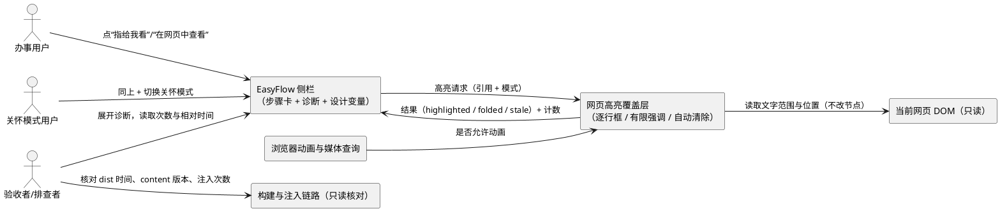
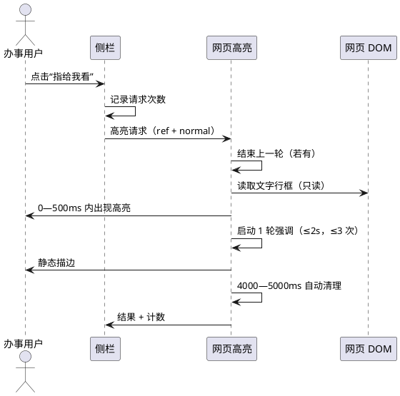
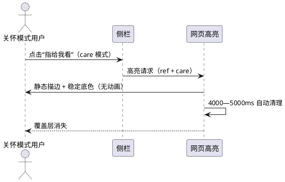
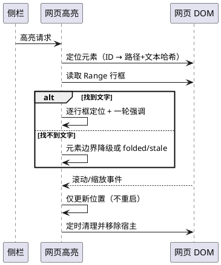
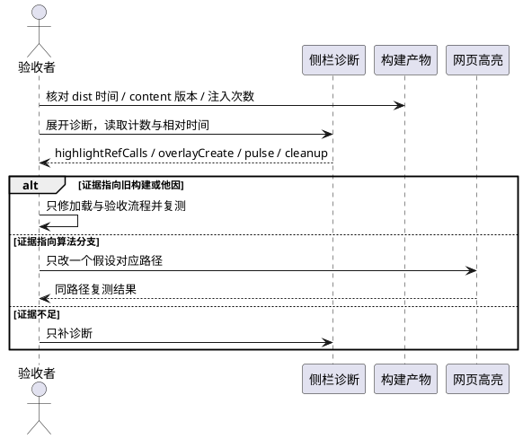
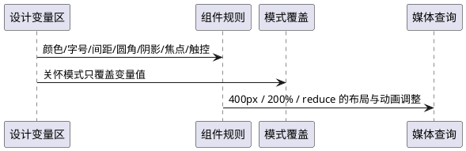
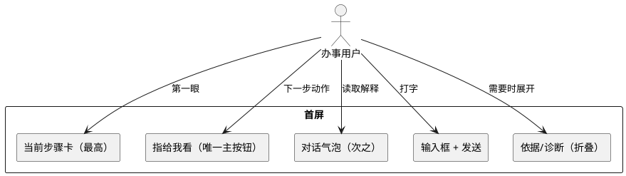
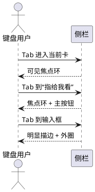
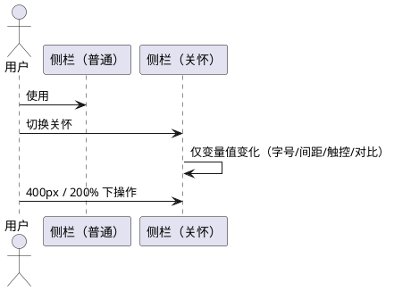

# EasyFlow 高亮停止与侧栏视觉升级需求规格（第九轮增量）

> **版本说明**
>
> - 本文件是 `easyflow_page_guide` 特性的第九轮增量规格，不替代 `spec.md`、`iteration2-spec.md` 至 `iteration8-spec.md`。
> - 本轮只解决两件事：① **让网页高亮按“短暂强调一次 → 静态描边 → 自动消失”运行，并在真实 Chrome 中先拿到证据、再决定改什么**；② **把侧栏视觉整理成可维护的设计变量体系，提升层级、对比与可达性**。
> - 验收条件沿用前八轮写法：EARS 触发词（When / If / While / Where）+ 中文正文 + 可验证的验收条件。本文件只描述“要什么、怎么算做到”，不描述类结构、函数签名与打包实现细节。
>
> **本阶段声明**：只产出需求规格。未修改任何源码（`src/`）、未修改 `public/manifest.json`、未修改 `scripts/**`、未修改 `dist/`、未修改前八轮文档；未运行 `npm run typecheck` / `npm run build` / `npm run selftest` / `npm run verify`；未创建或覆盖 `codearts_proof/` 实绩文件；未调用真实麦克风、真实语音识别、真实语音合成；未访问网络。本文所有“已观察”“已核实”“待验证”均按下述口径使用，不含“根因已确认”或“已修复”结论。

---

## 0. 根因证据（已观察 / 已核实 / 待验证）与拟改文件

> 本章放在需求之前，用于回答“运行代码与实际现象为什么不一致”。**本章不给出根因结论**，只登记证据、矛盾点与必须补齐的观测项；在证据不足前不得改动高亮算法参数。

### 0.1 用户真实观察（事实登记，不作因果解释）

| 编号 | 观察（用户原述，事实） | 已测 | 未测 |
|---|---|---|---|
| O-01 | 真实网页点击“指给我看”后，高亮**持续闪烁** | 有闪烁现象 | 闪烁次数、单次时长、总时长、是否重启 |
| O-02 | 看起来只有**点击网页任意位置**才停止 | 存在“点击网页后停止”的关联 | 是否点击本身导致停止、是否时间到点恰好停止、是否失焦导致停止 |

> 这两条是“现象”，不是“根因”。任何“因为 X 所以一直闪”的表述，在 0.5 证据补齐前都不得写进实现说明或验收结论。

### 0.2 只读核查基线（2026-11-16，主工程 `D:\hwproject\translator`）

| 核查项 | 实际结果（文件与行为） | 对本轮规格的约束 |
|---|---|---|
| 脉冲参数 | `src/shared/constants.ts:13-15`：`HIGHLIGHT_TTL_MS = 4000`、`HIGHLIGHT_PULSE_DURATION_MS = 750`、`HIGHLIGHT_PULSE_COUNT = 3` | 源码写的是“750ms × 3 + 4 秒清理”；与 O-01/O-02 矛盾，必须先用证据解释 |
| 动画启动点 | `src/content/highlight.ts:305-324`：`positionBoxes(boxes, true)` 才调用 `restartPulse`；`highlightRef()` 只在 `createOverlay()`（`:390`）里传 `true` | 静态看“只有新建覆盖层会启动脉冲”；滚动路径 `updateOverlayPositions()`（`:326-354`）传 `false`，不重启 |
| 重复点击清理 | `highlight.ts:419-423`：`highlightRef()` 开头先 `cleanupHighlight()`；`:397-417` 清理宿主、监听器、定时器与 rAF | 源码意图是“单宿主、重复点击替换”；若有并存宿主，说明清理未覆盖到实际实例 |
| 覆盖层形态 | `highlight.ts:366-395`：`position: absolute` 宿主 + `zIndex 2147483647` + `pointerEvents: none` + **closed** ShadowRoot + `scroll/resize` 监听 + `setTimeout(cleanup, 4000)` | 宿主无诊断标识、shadow 为 closed，**当前无法从外部枚举“有几个宿主”**——这是证据缺口 |
| 静态 / 关怀 / reduce | `highlight.ts:229-244、256-288`：`care` 或 `prefersReducedMotion()` 时不调用 `animate()`，使用静态样式；`:35-45` 颜色集中命名 | 关怀与 reduce 的“不闪烁”在源码层面成立；仍需真实 Chrome 视觉验收 |
| Range 定位 | `highlight.ts:161-172、203-219、221-227`：`selectNodeContents` + `getClientRects` + 行框合并 + 元素边界兜底 | 定位能力不得回退；短标题只框文字 |
| 消息链 | `src/sidepanel/hooks/useConversation.ts:1060-1090`：一次点击回调只发一次 `MSG.HIGHLIGHT`；`1099-1151` `locateControl` 可能先 `readPage("recheck")` 再 `highlight()` 一次 | 源码看“一次点击一次请求”；是否被重复触发需计数验证 |
| 后台透传 | `src/background/router.ts:199-238`：每次 `handleHighlight` 都 `ensureInjected()` 后 `sendToContent` 一次，超时 `LOCATE_TIMEOUT_MS=1000` | 后台无去重；重复请求只能靠侧栏或内容脚本侧证据确认 |
| 注入与版本 | `src/background/injector.ts:7-8、64-93`：`injectedTabs` 为内存 Set；`ping` 超时 `PING_TIMEOUT_MS=300`；未通过则重新 `executeScript` | MV3 Service Worker 休眠/页面繁忙可能重复注入；需记录注入次数与 content 版本 |
| 内容脚本版本守卫 | `src/content/entry.ts:100-107`：`CONTENT_VERSION="0.3.0"`；版本相同则**不重新注册 listener、也不移除旧 listener** | 重复注入时可能出现“旧实例持有状态、新实例未接管”，宿主数量需实测 |
| 页面变化监听 | `src/content/observe.ts:37-47`：`MutationObserver` 监听 `document.documentElement`（`childList/subtree/attributes`） | 高亮宿主的 append/remove 会被计为“页面变化”；需区分“页面自身变化”与“高亮自身变化” |
| 侧栏根节点 | `src/sidepanel/main.tsx:11-15`：`<StrictMode>` 包裹 `<App/>`；`:6-7` 首帧 `data-ui-mode="normal"` | StrictMode 在开发构建下会双执行 effect；不得据此直接推断点击会双触发 |
| 构建产物 | `dist/content.js` 实测含 `HIGHLIGHT_PULSE_DURATION_MS = 750`、`HIGHLIGHT_PULSE_COUNT = 3`、`iterations: HIGHLIGHT_PULSE_COUNT`、`zIndex "2147483647"`；`dist` 文件时间 2026-11-16 14:42 | 可以排除“产物根本没有新参数”；但仍需确认用户浏览器实际加载的是哪次构建 |
| 自测断言 | `scripts/selftest.mjs:3094-3143`（AT-50）：断言 CSS 必含关怀 token、`prefers-reduced-motion`、`100dvh`、`:focus-visible`；`3135-3136` 只断言 `highlight.ts` 含 `HIGHLIGHT_CARE_BORDER_WIDTH`；`3617-3654`（AT-63）：断言触控 token、`.ef-step-actions-line`、权限四项 | 现有自动测试**只断言源码字符串与 CSS 关键词**，不验证动画时长、宿主数量、真实视觉；自动测试通过不能证明 O-01 已消失 |
| 侧栏 CSS 结构 | `src/sidepanel/styles/sidepanel.css` 共 1475 行：`:root` 出现 2 次（`:1`、`:891`），`#root` 2 次（`:528`、`:1147`），`.ef-chat-app` 2 次（`:532`、`:1153`），`.ef-header` 3 次（`:50`、`:1164`），`.ef-step-card` 3 次（`:721`、`:973`、`:1065`），`.ef-step-primary` 3 次（`:753`、`:764`、`:990`） | 现状即“末尾追加覆盖 + 重复规则”；本轮要求整理为单一 token 源与组件区，不再追加覆盖块 |
| 紫渐变面积 | `.ef-header`（`:60`）`linear-gradient(135deg,#4f46e5,#7c3aed,#a855f7)` + 大面积 shadow；`.ef-bubble-user`（`:620`）紫渐变；`.ef-btn-primary`（`:216`）紫渐变 | 与用户“减少大面积高饱和紫色渐变”直接冲突，属必改项 |
| 低对比提示字 | `.ef-footer`（`:509`）`#9ca3af`；`.ef-message-role`（`:606`）`#9ca3af`（后于 `:1216` 改为 `--ef-faint`，但 footer 未覆盖）；`.ef-system-notice`（`:642-651`） | 提示文字对比不足需统一到 `--ef-muted/--ef-faint` 并实测 |
| 视觉层级现状 | 当前卡 `.ef-step-card-current`（`:977-983`）有粗左边框与浅底，但主按钮与历史按钮共用 `.ef-step-primary/.ef-step-action` 基础样式；语音区 `.ef-speech-install-btn`（`:1433-1444`）使用与 `.ef-speak-btn` 相同的描边按钮样式 | 需要明确“当前步骤 + 指给我看最显眼；下载资源按钮不突出” |
| 断点现状 | `@media (max-width: 360px)`（`:519`、`:881`）、`420px`（`:1231`、`:1396`）、`320px`（`:1246`、`:1406`）多组共存且规则分散 | 400px + 200% 缩放需可达；断点需要统一与验证 |

### 0.3 源码描述与真实现象的矛盾清单（只列差异，不判因果）

| 编号 | 源码/文档描述 | 用户观察 | 差异性质 |
|---|---|---|---|
| C-01 | 3 次脉冲 = 750ms × 3 = 2250ms，之后停止 | 持续闪烁 | 时长/次数不一致，原因未知 |
| C-02 | `HIGHLIGHT_TTL_MS=4000` 后 `cleanupHighlight()` 自动移除宿主 | 需要点击网页才停止 | 清理是否执行/是否被续期未知 |
| C-03 | `highlightRef()` 开头清理旧宿主，理论上只有 1 个覆盖层 | 视觉上疑似“叠框/反复闪” | 宿主数量未知（closed shadow 无法枚举） |
| C-04 | 滚动/缩放只更新位置（`animate=false`） | 不确定滚动后是否“重新开始” | 需计数确认 |
| C-05 | 关怀模式与 reduce 不调用 `animate()` | 未在真实 Chrome 观察 | 需真实视觉验收 |
| C-06 | 第八轮留痕写“96 项通过”，第七轮写“87 项通过” | 不代表高亮视觉正确 | 自动测试边界需在文档中写清 |

### 0.4 根因假设（**待验证**，禁止当作结论写进实现说明）

| 假设 | 若成立，应观察到的证据 | 若成立，允许的改法 | 明确禁止 |
|---|---|---|---|
| H-01 单次点击触发多次 `EF_HIGHLIGHT` | 侧栏请求计数 >1/次；content 侧 `highlightRef` 计数 >1/次；宿主创建计数 >1 | 收敛触发点（防重复点击/防重复回调） | 不得只调大 TTL 掩盖 |
| H-02 多个覆盖层宿主并存（重复注入 / 旧实例残留 / 清理遗漏） | 注入次数 >1；宿主存活计数 >1；旧构建版本号不同 | 保证单宿主；清理覆盖所有实例；版本守卫升级 | 不得删除 `cleanupHighlight` 的既有语义 |
| H-03 动画被反复重启（某路径传入 `animate=true` 或重复创建） | 脉冲启动计数在强调结束后仍增长 | 只在“新一轮强调开始”时启动一次 | 不得改成“永不启动脉冲”以掩盖 |
| H-04 清理定时器未执行或被覆盖 | 清理计划计数 ≤1，但执行计数 =0；或计划计数持续增长 | 清理定时器单一持有、可重入安全 | 不得在没有计数证据时改时长 |
| H-05 页面高频 DOM 变化被误判为“需要重新高亮” | DOM tick 计数高频，但脉冲启动计数同时增长 | 过滤高亮自身宿主变化；区分“位置更新”与“强调重启” | 不得关闭整个页面变化监听（会影响导办复审） |
| H-06 多行 box 相位差造成“持续闪烁”观感 | 单轮脉冲计数=1，但行框数量多；录像显示各行不同步 | 同步启动/收敛为统一节奏 | 不得改成整块矩形高亮 |
| H-07 用户实际加载的是旧构建或别的页面效果（其他扩展/站点动画） | `dist` 时间与扩展重载时间不符；禁用其他扩展后现象消失 | 只修加载/验收流程与提示 | 不得因此改算法 |
| H-08 `prefers-reduced-motion` 在网页侧未生效 | 系统已开启减少动态，但页面侧 `matchMedia` 为 false | 增加诊断可见性（只读） | 不得改系统设置或网站样式 |

### 0.5 诊断证据字段（只记录次数与时间；不记录网页文本/URL 查询串/用户输入）

> 这些是**需求层要求采集的可观察量**，不是数据结构设计。所有字段只存内存、只用于判断 H-01—H-08，关闭侧栏或刷新网页即丢弃。

| 字段（含义） | 采集位置 | 取值形态 | 用途 | 禁止 |
|---|---|---|---|---|
| `highlightRequestCount` | 侧栏发送高亮请求处 | 整数计数 | 判断 H-01 | 不记录 ref 文本 |
| `highlightRefCalls` | 内容脚本处理高亮请求处 | 整数计数 | 判断 H-01 | 不记录网页片段 |
| `overlayCreateCount` | 内容脚本创建覆盖层处 | 整数计数 | 判断 H-02/H-03 | 不记录宿主内容 |
| `overlayLiveCount` | 内容脚本清理/创建后 | 0/1/2+ | 判断 H-02 | — |
| `overlayLiveMax` | 会话内峰值 | 整数 | 判断 H-02 | — |
| `pulseStartCount` | 每次启动强调 | 整数计数 | 判断 H-03/H-05 | — |
| `pulseCompletedCount` | 强调自然结束 | 整数计数 | 判断“是否真的只跑一轮” | — |
| `cleanupScheduledCount` | 每次安排清理 | 整数计数 | 判断 H-04 | — |
| `cleanupFiredCount` | 清理实际执行 | 整数计数 | 判断 H-04 | — |
| `cleanupReplacedCount` | 旧清理被新一轮取代 | 整数计数 | 判断 H-04 | — |
| `positionUpdateCount` | 滚动/缩放导致的更新 | 整数计数 | 判断 H-03 | — |
| `domTickCount`（高亮存活期内） | 内容脚本 | 整数计数 | 判断 H-05 | 不记录变化内容 |
| `injectionCount`（本页） | 后台注入处 | 整数计数 | 判断 H-02/H-07 | 不记录 URL |
| `contentVersionSeen` | 内容脚本 PING/响应 | 版本字符串（如 `0.3.0`） | 判断 H-07 | 不记录页面地址 |
| `uiModeAtRequest` | 侧栏请求 | `normal` / `care` | 判断模式是否符合预期 | — |
| `reducedMotionAtRequest` | 内容脚本 | 是 / 否 | 判断 H-08 | — |
| `lastRoundStartAt` / `lastRoundEndAt` | 内容脚本 | 相对毫秒 | 判断“强调总时长” | 不记录绝对日期/时区 |
| `lastCleanupAt` | 内容脚本 | 相对毫秒 | 判断 TTL 是否被延长 | — |
| `highlightLifetimeMs` | 内容脚本派生 | 毫秒 | 判断 4—5 秒清除 | — |

**证据记录口径**

1. 一次复现只记录“点击后 0—6 秒”的计数与相对时间；不抄录任何网页文字、按钮名称、URL 查询串、表单值或用户输入。
2. 允许记录：次数、毫秒、毫秒区间（0—500 / 500—2000 / 2000—5000 / >5000）、`normal|care`、是/否、版本号。
3. 禁止记录：网页标题、域名、路径、查询串、页面片段、引用原文、聊天内容、音频、识别文本、设备名/ID。
4. 证据不足（例如无法确认宿主数量）时，结论只能写“证据不足”，不得写“根因已定位”。

### 0.6 拟改文件范围（文件级，待设计阶段核定）

| 文件 | 本轮可能改动 | 是否触碰业务逻辑 |
|---|---|---|
| `src/content/highlight.ts` | 强调轮次/静态保持/清理的状态收敛；诊断计数；宿主标识；单宿主保证 | 否（只影响高亮表现与自诊断） |
| `src/shared/constants.ts` | `HIGHLIGHT_*` 时长/次数/TTL 常量（是否改值见第 9 章拍板项） | 否 |
| `src/content/entry.ts` | 若需上报 content 版本/高亮计数或升级版本号触发重注入 | 否 |
| `src/background/injector.ts` / `router.ts` | 若需统计注入次数、请求次数 | 否 |
| `src/sidepanel/hooks/useConversation.ts` | 若需记录请求次数/传递模式（不改问答与导办判定） | 否 |
| `src/sidepanel/components/chat/DiagnosticsPanel.tsx` | 新增“高亮”折叠诊断区（仅开发诊断，默认折叠） | 否 |
| `src/sidepanel/styles/sidepanel.css` | 设计变量整理、重复规则消除、视觉层级与状态样式 | 否 |
| `scripts/selftest.mjs` | 新增 AT-106—AT-114；AT-50 / AT-63 仅允许最小改写 | 否（只改测试） |
| `dist/` | 实现阶段重新构建（本轮不构建） | 否 |

**明确不改**：`src/content/collect.ts`、`src/content/semantic.ts`、`src/content/controls.ts`、`src/content/registry.ts`、`src/sidepanel/dialogue/**`、`src/sidepanel/guide/**`、`src/sidepanel/state/**`、`src/sidepanel/match/**`、`src/shared/speech/**`、`src/sidepanel/speech/**`、`src/mic-permission/**`、`public/manifest.json`、`public/*.html`、`scripts/build.mjs`、`scripts/verify-manifest.mjs`、第三方网页。

### 0.7 何时可以从“证据”进入“改代码”

1. 0.5 字段中至少 `highlightRefCalls`、`overlayCreateCount`、`overlayLiveMax`、`pulseStartCount`、`pulseCompletedCount`、`cleanupScheduledCount`、`cleanupFiredCount` 七项有一轮完整记录。
2. 能用一句话回答“哪条证据支持这次改动”；回答不了则只允许补诊断。
3. 若证据指向 H-07（旧构建/别的页面效果），只允许修正加载与验收流程，不得改高亮算法。
4. 任何改动完成后必须在同一真实页面、同一操作路径复测一次；未复测不得写“已修复”。

---

## 1. 组件定位

### 1.1 核心职责

本组件负责把“网页目标在哪”用**有限、可停止、可自动清除**的高亮表达出来，并把侧栏视觉整理成**统一设计变量驱动、层级清晰、对比可读、400px 与 200% 缩放下可达**的界面。

### 1.2 核心输入

1. **侧栏用户操作**：点击“指给我看”、点击“在网页中查看”、切换普通/关怀模式、展开“运行诊断”、展开“网页依据”、滚动或缩放页面、窗口失焦/聚焦。
2. **高亮请求**：目标元素引用（元素 ID / DOM 路径 / 文本哈希，只读）与模式（`normal` / `care`）。
3. **网页环境**：当前页面 DOM 与文字范围、滚动容器、窗口尺寸与缩放、`prefers-reduced-motion` 媒体查询结果。
4. **页面变化信号**：既有页面变化监听产生的 tick（只用于导办复审；本轮只统计，不改其业务判定）。
5. **构建与加载状态**：`dist` 产物版本、内容脚本版本、注入次数。

### 1.3 核心输出

1. **网页高亮**：逐行文字框 + 有限强调 + 静态描边 + 自动清除；不拦截鼠标、不修改原网页节点。
2. **侧栏视觉**：设计变量驱动的颜色、字号、间距、圆角、阴影、焦点环与状态样式；普通与关怀共用一套体系。
3. **高亮诊断**：折叠区内的次数与相对时间（仅开发诊断，只存内存）。
4. **验收留痕输入**：可被逐秒记录/录屏核对的计数与时间区间。

### 1.4 职责边界

1. **不负责**改变问答、导办步骤生成、预约流程、动态时段重排、本人填写/提交逻辑。
2. **不负责**修改第三方网页布局、文案、样式、站点设置或交互。
3. **不负责**新增权限、网络请求、语音 SDK、模型接口、密钥、代理或存储键。
4. **不负责**修复浏览器语音识别、麦克风授权、朗读链路。
5. **不负责**把“自动测试通过”表述为“真实视觉已修复”。
6. **不负责**像素级重设计、替换组件库、引入样式框架或 CSS-in-JS。
7. **不负责**通过隐藏/关闭页面变化监听来“让高亮看起来正常”（会回退导办复审能力）。

---

## 2. 领域术语

**强调轮次（Emphasis Round）**
: 指一次点击所对应的一组有限明暗变化。一轮强调从首帧开始、到最后一帧结束，只允许发生一次，不得自重启。

**静态描边（Static Outline）**
: 指强调结束后保留的固定边框与稳定底色。静态描边不得闪烁、不得渐变、不得因滚动或页面变化重新开始强调。

**自动清除（Auto Cleanup）**
: 指高亮覆盖层在有限时间内由系统自行移除，不依赖用户点击网页、点击侧栏或切换窗口。

**单宿主（Single Overlay Host）**
: 指同一时刻页面上最多只有一个 EasyFlow 高亮覆盖层宿主；新一轮高亮必须先结束上一轮。

**诊断证据（Highlight Evidence）**
: 指用于判断“高亮为何未按预期停止”的次数与相对时间记录；不含网页文字、URL、查询串与用户输入。

**设计变量（Design Token）**
: 指在单一变量区集中定义、被组件规则引用的颜色、字号、间距、圆角、阴影、焦点环与触控尺寸命名值。

**视觉层级（Visual Hierarchy）**
: 指同一屏内元素的注意力排序：当前步骤与“指给我看”最高，对话次之，依据与诊断按需展开且最弱。

**待验（Pending Visual Verification）**
: 指自动测试已通过但尚未在真实 Chrome 中完成视觉确认的状态；该状态下不得写“已修复”。

---

## 3. 角色与边界

### 3.1 核心角色

1. **办事用户**：点击“指给我看”或“在网页中查看”，需要在 2 秒内看懂目标位置，并在 4—5 秒后看到高亮自行消失。
2. **关怀模式用户**：需要大字、高对比、大点击目标，且高亮始终静止、醒目、不闪烁。
3. **验收者 / 排查者（用户本人或支持人员）**：需要在不记录网页文字与用户输入的前提下，记录次数与时间，判断是否旧构建、是否多宿主、是否重复触发。

### 3.2 外部系统

1. **当前网页 DOM**：提供目标元素与文字范围；本轮只读，不修改其节点、属性与文本。
2. **浏览器动画与媒体查询**：提供 Web Animations 与 `prefers-reduced-motion` 结果，决定是否播放强调。
3. **侧栏运行时**：提供模式（普通/关怀）、诊断折叠区与请求链路。
4. **构建与注入链路**：提供 `dist` 产物、内容脚本版本与注入次数（只读核对）。
5. **既有导办与问答链路**：本轮零改动，只要求高亮不阻断、不复用其判定结果做视觉决策。

### 3.3 交互上下文

图中不展示侧栏内部组件、数据库、缓存与具体接口参数。

---

## 4. DFX 约束

### 4.1 性能

1. 点击“指给我看/在网页中查看”后，滚动与高亮可见必须在 **500 毫秒**内出现（沿用既有红线）。
2. 普通模式单轮强调总时长必须 **≤ 2000 毫秒**（含首帧到末帧）。
3. 高亮覆盖层必须在强调开始后 **4000—5000 毫秒**内自动清除。
4. 高亮存活期间不得使用 `setInterval` 轮询；位置更新必须由滚动/缩放事件按帧合并，单个事件最多触发一次位置更新。
5. 诊断计数对每次操作的开销必须为 O(1)，不得因计数读取页面文本或遍历全页节点。
6. 视觉升级不得增加首屏渲染阻塞：侧栏首帧仍按既有方式渲染，模式值读取完成前不得出现明显跳变。

### 4.2 可靠性

1. 同一时刻页面上最多 **1 个**高亮覆盖层宿主；重复点击必须替换而不是叠加。
2. 清理必须幂等：重复调用清理不得报错、不得残留监听器或定时器。
3. 高亮创建、强调、清理任一环节异常，不得使页面不可交互、不得使侧栏报错、不得阻断导办与问答。
4. 高亮期间的滚动、缩放、失焦、页面变化必须不延长清除时间、不重启强调。
5. 覆盖层移除后，页面节点数量、属性与文本必须与高亮前一致（除宿主的临时增删）。
6. 视觉样式调整不得导致当前步骤卡、输入框、发送键在 400px 与 200% 缩放下不可达。

### 4.3 安全性（含隐私）

1. 高亮诊断只允许记录 **次数** 与 **相对时间**（毫秒或毫秒区间）。
2. **禁止**记录或展示：网页正文、标题、URL/查询串、表单值、用户输入、引用原文、聊天内容、音频、识别文本、设备名/ID、完整错误 `message`、异常堆栈。
3. 诊断字段只存侧栏/内容脚本内存；关闭侧栏或刷新网页即丢弃；不得写入 `chrome.storage`、消息队列、聊天消息或运行日志条目。
4. 不得新增 `tabs`、`host_permissions`、`<all_urls>`、静态 `content_scripts`、`web_accessible_resources`、网络请求、`MediaRecorder`。
5. 不得为了视觉或诊断读取页面输入值、不得 `click`/`focus`/`submit`/`dispatchEvent` 网页元素。
6. 录屏与截图若含个人信息，必须先遮蔽；留痕只记录页面类型与模式，不记录完整 URL。

### 4.4 可维护性

1. 颜色、字号、间距、圆角、阴影、焦点环、触控尺寸必须由单一命名变量区定义；组件规则不得写一次性颜色字面量（例外：`transparent`、纯白/纯黑、1px 宽度、百分比与 `calc`）。
2. 同一选择器的基础声明块只允许出现一次；不得在文件末尾追加“第 N 轮覆盖块”来实现主题。
3. 高亮时长、次数、TTL、静态保持时长必须为命名常量；不得散落魔法数。
4. 诊断字段必须集中在折叠诊断区；不得出现在聊天正文、步骤卡、页面采集诊断或朗读说明中。
5. CSS 分层必须可读：变量区 → 基础/布局 → 组件 → 模式覆盖 → 媒体查询 → 减少动态；新增样式只能写入对应层。

### 4.5 兼容性

1. 构建目标保持 `chrome116` 及以上（沿用 `scripts/build.mjs`）。
2. 内容脚本版本守卫必须继续存在；版本变化时旧实例必须被正确替换，不得出现双实例同时处理请求。
3. `prefers-reduced-motion: reduce` 在网页侧与侧栏侧都必须生效（网页侧不播放强调，侧栏侧关闭新增过渡/动画）。
4. 400px 宽、200% 浏览器缩放、关怀模式三种情形必须可读、可点、可达。
5. 高亮定位降级（`folded` / `stale`）语义必须与既有实现一致，不得因视觉改动改变判定结果。

---

## 5. 核心能力

### 5.1 普通模式：一轮强调后停止

#### 5.1.1 业务规则

1. **R-383 单次点击只启动一轮强调**：When 用户点击一次“指给我看”或“在网页中查看”，the system shall 只在页面中启动一轮强调；本次点击结束后不得自动启动第二轮。
   a. 验收条件：一次点击 → `highlightRefCalls +1`、`pulseStartCount +1`；等待 10 秒且不操作 → `pulseStartCount` 不再增长。
2. **R-384 强调总时长上限 2 秒**：While 普通模式，the system shall 使单轮强调从首帧到末帧不超过 2000 毫秒。
   a. 验收条件：逐秒/录屏记录或假时钟推进 → `lastRoundEndAt - lastRoundStartAt ≤ 2000ms`；超过 2000ms 仍有明暗变化视为失败。
3. **R-385 强调次数有限且无无限循环**：The system shall 使单轮强调的明暗变化次数不超过 3 次；禁止无限重复、禁止自重启。
   a. 验收条件：代码常量 `iterations` 为有限正整数，且不存在 `infinite`；录像中明暗变化次数 ≤3。
4. **R-386 强调结束后转为静态描边**：When 一轮强调结束，the system shall 保留静态描边与稳定底色，不再改变亮度、颜色或外发光。
   a. 验收条件：强调结束后到清除前（≥2000ms）画面无可感知闪烁；静态框仍清晰可见。
5. **R-387 不点击网页也自动清除**：The system shall 在强调开始后 4000—5000 毫秒内自动清除覆盖层，不依赖点击网页、点击侧栏或切换窗口。
   a. 验收条件：鼠标停在侧栏、不点击网页，6 秒后 `overlayLiveCount = 0`、`cleanupFiredCount +1`，页面无残留宿主。
6. **R-388 重复点击不叠框**：When 用户连续点击同一目标或不同目标，the system shall 先结束上一轮，再开始新一轮；同一时刻最多 1 个宿主。
   a. 验收条件：连续 3 次点击 → `overlayLiveMax ≤ 1`；`overlayCreateCount +3` 且每次新建前旧宿主已移除；视觉上只有一组框。
7. **R-389 外部事件不重启强调、不延长清除**：While 高亮存活期间，If 用户滚动、缩放、切换窗口焦点或页面发生 DOM 变化，the system shall 只允许更新位置或保持不动，不得重启强调、不得延长清除时间。
   a. 验收条件：滚动 3 次 + 缩放 2 次 + 失焦 1 次 → `pulseStartCount` 不增长、`cleanupScheduledCount` 不增长；清除时刻相对强调开始仍 ≤5000ms。
8. **R-390 强调只从“新一轮开始”启动**：The system shall 只在新建一轮强调时启动动画；位置更新、清理、诊断读取均不得启动动画。
   a. 验收条件：单次点击后只出现 1 次 `pulseStartCount` 增长；`positionUpdateCount` 增长与动画启动无相关性。
9. **禁止项**：禁止把 TTL 设为“无穷大/直到点击网页”；禁止在没有证据时通过延长 TTL 掩盖重复启动。
   a. 验收条件：代码与产物中不存在无限 TTL、`setInterval` 轮询、`while` 重播。

#### 5.1.2 交互流程

#### 5.1.3 异常场景

1. **一轮强调过程中再次点击**
   a. 触发条件：强调未结束、静态保持期或清除前再次点击。
   b. 系统行为：结束上一轮并移除旧宿主，再开始新一轮；不叠加。
   c. 用户感知：目标处只出现一组框，明暗变化从第一帧重新开始。
2. **清理定时器被新一轮取代**
   a. 触发条件：上一轮清理尚未触发时开始新一轮。
   b. 系统行为：旧清理被取消并计入“被取代”，新清理按新一轮起点计时。
   c. 用户感知：高亮不会提前消失，也不会因旧定时器提前清掉新一轮。
3. **页面在强调期间持续变化**
   a. 触发条件：滚动容器自动刷新、列表重排、站点动画。
   b. 系统行为：只更新位置或保持不动；不启动新强调、不延长清除。
   c. 用户感知：高亮不抖动、不闪烁，按原定时间消失。
4. **目标元素在强调期间被移除/折叠**
   a. 触发条件：页面重排导致目标消失。
   b. 系统行为：安全结束高亮并清理宿主；沿用既有 `folded` / `stale` 语义。
   c. 用户感知：高亮消失，侧栏按既有文案说明“折叠/已不在页面上”，不指向错误位置。
5. **元素无法播放动画（能力缺失）**
   a. 触发条件：`Element.animate` 不可用。
   b. 系统行为：直接使用静态描边，保证可见与自动清除。
   c. 用户感知：无闪烁，目标清晰。

### 5.2 关怀模式与减少动态：始终静态

#### 5.2.1 业务规则

1. **R-391 关怀模式始终静态**：While 关怀模式，the system shall 只显示静态醒目描边，不播放任何脉冲、闪烁、位移动画。
   a. 验收条件：关怀模式点击 → 录屏 6 秒内无可感知明暗变化；静态框在清除前始终可见。
2. **R-392 减少动态始终静态**：Where 系统或浏览器声明 `prefers-reduced-motion: reduce`，the system shall 在普通与关怀两种模式下都不播放强调动画，只保留静态高亮，且不使用平滑滚动。
   a. 验收条件：模拟 reduce → 无动画调用；滚动使用即时定位；框可见直至自动清除。
3. **R-393 静态样式足够醒目且文字可读**：The system shall 使静态高亮包含 ≥3px 清晰边框、稳定半透明底色与静态外描边；底色不得导致文字不可读。
   a. 验收条件：灰度或关闭动画后仍能看出目标范围；文字在底色上可辨认。
4. **R-394 静态高亮同样自动清除**：The system shall 使关怀模式与减少动态下的高亮也在 4000—5000 毫秒内清除，不得永久保留。
   a. 验收条件：等待 6 秒 → 宿主消失；`cleanupFiredCount +1`。
5. **R-395 静态高亮不拦截、不改页面、仍按文字范围**：The system shall 使覆盖层 `pointer-events: none`，不拦截鼠标、不修改网页节点、仍按文字行框定位。
   a. 验收条件：高亮期间可在网页点击/滚动/输入；页面 DOM 结构未被改写；短标题只框文字附近。

#### 5.2.2 交互流程

#### 5.2.3 异常场景

1. **模式切换发生在高亮期间**
   a. 触发条件：高亮存活时从普通切到关怀（或反向）。
   b. 系统行为：不得在旧高亮上“就地改动画”；只允许让当前轮按原模式结束并按原 TTL 清除，下一次点击使用新模式。
   c. 用户感知：当前高亮不会突然开始闪/突然停止闪；下一次点击符合新模式。
2. **系统减少动态在页面侧未生效**
   a. 触发条件：用户已开启减少动态，但网页侧媒体查询返回否。
   b. 系统行为：如实记录“是/否”到诊断，不修改系统设置；仍按媒体查询实际结果执行。
   c. 用户感知：诊断可看到“减少动态：否”；高亮行为与诊断一致，不出现“诊断说静态、实际在闪”。

### 5.3 定位保真与清理可逆

#### 5.3.1 业务规则

1. **R-396 按文字范围逐行定位**：The system shall 使用文字范围的实际行框绘制高亮；短标题只框文字附近，不得回退到整行容器或大块矩形。
   a. 验收条件：“办理条件：”这类短标题的高亮宽度接近文字宽度；多行正文按行分框。
2. **R-397 找不到文字时安全降级**：If 无法取得文字行框，the system shall 只在元素边界可见时降级为元素框；元素也不可见时按既有 `folded` / `stale` 处理，不得高亮错误位置。
   a. 验收条件：移除目标文字 → 返回 `stale` 或 `folded`，页面无高亮。
3. **R-398 滚动与缩放跟随不漂移**：While 高亮存活，When 页面滚动或窗口缩放，the system shall 在下一帧内更新框位置，不产生明显漂移。
   a. 验收条件：滚动 3 次、缩放 100%→125%→100% → 框贴合文字，无重启强调。
4. **R-399 内部滚动容器同样跟随**：When 高亮目标位于页面内部滚动容器中，the system shall 同样跟随其滚动，不新建宿主。
   a. 验收条件：Cal.com 时段区域滚动 → 框跟随，`overlayCreateCount` 不增长。
5. **R-400 清除后无残留**：When 高亮清除，the system shall 移除宿主与全部监听器；页面节点数量、属性与文本与高亮前一致。
   a. 验收条件：点击前后对比 DOM 节点数（允许临时宿主增删）与属性无差异；滚动/缩放不再触发高亮逻辑。

#### 5.3.2 交互流程

#### 5.3.3 异常场景

1. **高亮期间页面被整体替换（SPA 路由切换）**
   a. 触发条件：目标元素脱离文档。
   b. 系统行为：结束高亮并清理；不追踪新页面元素。
   c. 用户感知：高亮消失；侧栏按既有文案提示重新读取。
2. **同一文字在多处出现**
   a. 触发条件：元素 ID 失效、路径命中的元素文本哈希一致但位置不同。
   b. 系统行为：沿用既有“ID → 路径 + 文本哈希”顺序；不新增模糊匹配策略。
   c. 用户感知：高亮落在最近一次采集的位置；找不到时如实说明。

### 5.4 旧构建与旧页面效果的识别（不做无根据改动）

#### 5.4.1 业务规则

1. **R-401 先核对构建与加载状态**：If 真实 Chrome 复现“持续闪烁”或“必须点击网页才停止”，the system shall 先记录 `dist` 时间戳、`contentVersionSeen`、`injectionCount`、`overlayLiveMax` 四项，再判断是否旧构建/多实例。
   a. 验收条件：留痕中四项齐全；缺任一项视为证据不足。
2. **R-402 旧构建或他因只修流程**：If 证据显示现象来自旧构建、旧内容脚本残留或页面自身/其他扩展效果，the system shall 只修正“重载扩展 → 刷新页面 → 重开侧栏”的加载与验收流程及提示，不得为此改动高亮时长、次数或定位算法。
   a. 验收条件：同一加载流程重测后现象变化有记录；只有“仍复现”才允许进入算法修复分支。
3. **R-403 证据不足只补诊断**：If 0.5 字段不足以区分 H-01—H-08，the system shall 只补充诊断计数与展示，不得改时长/次数/TTL、不得改定位算法。
   a. 验收条件：无证据时的代码差异只出现在诊断计数/展示与文案，不出现 `HIGHLIGHT_*` 数值变化。
4. **R-404 一次只改一个分支**：When 进入修复，the system shall 一次只处理一个假设（H-01—H-08 之一），并在同路径复测。
   a. 验收条件：每次改动的留痕写明“假设编号 + 支撑证据 + 复测结果”；缺一项视为未完成。

#### 5.4.2 交互流程

#### 5.4.3 异常场景

1. **扩展已重载但页面未刷新**
   a. 触发条件：`dist` 已更新，页面仍运行旧内容脚本。
   b. 系统行为：诊断显示 content 版本与注入次数；验收流程要求刷新页面后再测。
   c. 用户感知：侧栏提示“请刷新当前网页后重试”（不新增常驻按钮）。
2. **同名扩展或其他脚本修改页面**
   a. 触发条件：关闭其他扩展后现象消失。
   b. 系统行为：不针对第三方脚本做兼容性改造；记录“关闭其他扩展后不再复现”。
   c. 用户感知：如实说明限制，不承诺消除他因。

### 5.5 侧栏设计系统与重复规则治理

#### 5.5.1 业务规则

1. **R-405 设计变量单一来源**：The system shall 使颜色、字号、行高、间距、圆角、阴影、焦点环与触控尺寸由单一命名变量区定义；组件规则不得出现一次性颜色字面量（例外：`transparent`、纯白/纯黑、1px 宽度、百分比与 `calc`）。
   a. 验收条件：变量区之外的颜色字面量仅剩允许例外；新增 token 有清晰角色名。
2. **R-406 重复规则消除，不再末尾覆盖**：The system shall 使同一选择器的基础声明块只出现一次；不得在文件末尾以“Iteration N 覆盖块”追加主题规则。
   a. 验收条件：`:root`、`#root`、`.ef-chat-app`、`.ef-header`、`.ef-step-card`、`.ef-step-primary`、`.ef-bubble`、`.ef-chat-main`、`.ef-diagnostics`、`.ef-inline-link` 的基础规则各只 1 处；文件末尾不存在新增覆盖块。
3. **R-407 冷白 / 深蓝灰 / 克制靛蓝 / 少量青绿**：The system shall 使用冷白背景、深蓝灰正文、克制的靛蓝主色与少量青绿状态色；大面积高饱和紫色渐变不得出现在头部、用户气泡与主按钮上。
   a. 验收条件：头部不再使用三色高饱和紫渐变；用户气泡与主按钮不用大面积紫渐变；状态色仅用于成功/提示等小面积。
4. **R-408 圆角与间距统一**：The system shall 使用统一圆角阶梯与间距阶梯；同一层级组件（卡片/气泡/输入框/按钮）圆角一致。
   a. 验收条件：卡片圆角一致、按钮圆角一致、输入框圆角一致；间距取自命名阶梯，不出现 7/9/11px 等散落值。
5. **R-409 边界优先于阴影**：The system shall 使卡片与气泡采用细边框 + 轻柔阴影；不得用重阴影代替边界，不得只靠阴影区分层级。
   a. 验收条件：关闭阴影后仍能通过边框分辨卡片；阴影不产生“浮起压字”的观感。

#### 5.5.2 交互流程

#### 5.5.3 异常场景

1. **整理过程中出现观感回退**
   a. 触发条件：合并重复规则后某组件视觉变化。
   b. 系统行为：以“普通模式 + 关怀模式 + 400px + 200%”四组截图对照；回退则回滚该条合并。
   c. 用户感知：界面不出现字号突变、按钮错位、文字被裁切。
2. **变量命名冲突**
   a. 触发条件：新旧变量同义不同名（如两套 muted）。
   b. 系统行为：保留一个语义名，其余别名删除或标注为“仅过渡”；不得长期双写。
   c. 用户感知：无视觉变化。

### 5.6 视觉层级与组件规范

#### 5.6.1 业务规则

1. **R-410 层级优先级**：The system shall 使视觉权重顺序为“当前步骤卡与指给我看 > 对话气泡 > 依据/诊断（按需展开）”；不得让诊断或依据在首屏压过当前步骤。
   a. 验收条件：首屏第一眼落在当前步骤卡与主按钮；诊断默认折叠；依据默认折叠。
2. **R-411 当前卡内只有一个主按钮**：The system shall 使当前步骤卡内只有 1 个实色主按钮“指给我看”；其余操作均为次按钮或文字按钮。
   a. 验收条件：当前卡内实色主按钮计数 =1；“我找不到/我点错了/我已完成/换一个任务”位于“遇到问题 / 更多操作”折叠内且为次按钮。
3. **R-412 对话气泡不再抢层级**：The system shall 使用中性白底细边框的助手气泡与低饱和用户气泡；气泡圆角与间距统一，正文对比达标。
   a. 验收条件：助手气泡不使用高饱和背景；用户气泡不使用大面积紫渐变；正文字号与行高符合既有模式 token。
4. **R-413 依据与诊断按需展开且不挤压输入区**：The system shall 使依据与诊断默认折叠；展开后在其内部滚动，不把输入框与发送键挤出可达区域。
   a. 验收条件：展开诊断后输入框与发送键仍可见可点；诊断内部可滚到底。
5. **R-414 语音不可用不突出“下载资源”**：If 语音输入不可用或需要下载资源，the system shall 使“下载中文语音资源”保持次按钮样式与次要位置，不得使用主色实心、不得排在当前步骤之前、不得放大字号。
   a. 验收条件：语音不可用时首屏最强元素仍是当前步骤；“下载资源”按钮无主色实底、无放大、无抢眼外发光。
6. **R-415 头部弱化**：The system shall 使顶部区域使用冷白/浅靛蓝的低饱和底、深蓝灰文字，去掉大面积高饱和紫渐变与重投影。
   a. 验收条件：头部与正文对比达标；头部不使用三色高饱和渐变；标题与副标题均清晰可读。
7. **R-416 旧步骤卡明确降级**：The system shall 使历史/过期步骤卡保持灰化、虚线边框、无主按钮、无完成条件，不与当前卡争夺注意力。
   a. 验收条件：历史卡不可点、无主按钮；与当前卡在灰度下仍可区分（形状 + 文字，不只靠颜色）。

#### 5.6.2 交互流程

#### 5.6.3 异常场景

1. **窄宽下主按钮与次按钮挤压**
   a. 触发条件：400px 或 200% 缩放。
   b. 系统行为：主按钮换行但保持整行可达；次按钮单列；不缩小字号。
   c. 用户感知：不出现按钮文字被裁切或点击区重叠。
2. **诊断展开后无空间**
   a. 触发条件：短视口 + 展开诊断。
   b. 系统行为：诊断内部滚动，输入区保持可达。
   c. 用户感知：可以滚到底查看诊断，也能立刻回来打字。

### 5.7 状态、焦点与可读性

#### 5.7.1 业务规则

1. **R-417 输入框聚焦必须明显**：The system shall 使输入框聚焦时出现明确描边与外圈（不得只靠阴影），并与禁用态明显不同。
   a. 验收条件：Tab 或点击聚焦 → 描边 + 外圈可见；禁用态无聚焦环。
2. **R-418 禁用 / 错误 / 成功易区分**：The system shall 使用“颜色 + 形状/文字/左侧条”中至少两项区分禁用、错误与成功；不得只靠颜色。
   a. 验收条件：灰度或色弱模拟下仍能区分三种状态。
3. **R-419 提示文字对比达标**：The system shall 使所有提示、次要说明、时间行文字在冷白背景上的对比度 ≥4.5:1（小字），大字 ≥3:1。
   a. 验收条件：取色实测并记录；`#9ca3af` 一类低对比不得作为小字提示色。
4. **R-420 焦点环统一且键盘可达**：The system shall 保留并统一 `:focus-visible` 焦点环（普通 2px、关怀 3px，含 offset）；折叠 summary、按钮、输入框均可键盘到达。
   a. 验收条件：全键盘走查 → 每个可操作元素都有可见焦点；无焦点陷阱。
5. **R-421 减少动态时关闭新增动画**：Where `prefers-reduced-motion: reduce`，the system shall 关闭本轮新增的过渡与动画（骨架 shimmer 仍按既有规则关闭）。
   a. 验收条件：模拟 reduce → 无新增动画；交互仍可用。

#### 5.7.2 交互流程

#### 5.7.3 异常场景

1. **高对比/色弱环境**
   a. 触发条件：系统高对比或色弱模拟。
   b. 系统行为：边框、文字、形状仍可区分状态。
   c. 用户感知：不依赖“红/绿”单色判断。

### 5.8 可达性与双模式共享

#### 5.8.1 业务规则

1. **R-422 400px 与 200% 缩放可达**：While 侧栏宽度为 400px 或浏览器缩放为 200%，the system shall 使当前步骤卡、“指给我看”、输入框、发送键均可滚动到达且不被裁切或遮挡。
   a. 验收条件：400px 与 200% 各检查一次 → 无横向滚动、无遮挡、四类目标可点。
2. **R-423 双模式共享同一设计系统**：The system shall 使普通与关怀模式共用同一套变量与组件规则；关怀模式只覆盖变量值（字号/间距/触控/对比），不得复制一套独立组件样式。
   a. 验收条件：关怀模式不新增独立选择器树；切换模式不出现布局错位。
3. **R-424 关怀尺寸基线**：While 关怀模式，the system shall 保持正文 ≥18px、当前步骤 ≥22px、主按钮 ≥48px 高、可点目标 ≥44×44。
   a. 验收条件：测量当前卡主按钮、输入框、发送键、折叠 summary、模式开关的实际尺寸。
4. **R-425 视觉改动不改业务**：The system shall 使视觉升级只影响样式与类名组织，不改变 props、状态机、文案语义、请求链路与判定结果。
   a. 验收条件：问答、导办、预约、动态时段、本人填写/提交、语音、朗读的行为与第八轮一致。
5. **R-426 语义与可访问名称保留**：The system shall 保留既有语义标签、`aria-*`、`role`、按钮文本与 `aria-live` 区域；视觉整理不得删除可访问名称。
   a. 验收条件：屏幕阅读器/无障碍树检查：主按钮仍读作“指给我看”，诊断仍为折叠区。
6. **R-427 视觉验收必须留痕且可复核**：The system shall 要求真实视觉检查以逐秒记录或录屏留痕；无留痕时状态只能写“待验”。
   a. 验收条件：留痕含时间点（0.5s/2s/4s/5s/6s）、模式、页面类型；不含个人信息与完整 URL。

#### 5.8.2 交互流程

#### 5.8.3 异常场景

1. **200% 缩放下横向溢出**
   a. 触发条件：长标签、长引用、长提示。
   b. 系统行为：文本换行、容器 `min-width: 0`、内部滚动；不得用横向滚动条解决。
   c. 用户感知：可以上下滚动读完，不左右拖动。
2. **模式切换时布局跳动**
   a. 触发条件：普通 ↔ 关怀。
   b. 系统行为：只改变变量值，保持结构；不重新读取页面。
   c. 用户感知：一次平滑切换，不闪白、不掉滚动位置。

---

## 6. 数据约束

### 6.1 高亮诊断（内部字段，仅内存）

1. **highlightRequestCount**：≥0 整数；每次侧栏发送高亮请求 +1。
2. **highlightRefCalls**：≥0 整数；内容脚本每处理一次高亮请求 +1。
3. **overlayCreateCount**：≥0 整数；每新建一个覆盖层宿主 +1。
4. **overlayLiveCount / overlayLiveMax**：0 或正整数；会话内峰值不超过 1 才算通过。
5. **pulseStartCount / pulseCompletedCount**：≥0 整数；同一轮应各 +1。
6. **cleanupScheduledCount / cleanupFiredCount / cleanupReplacedCount**：≥0 整数。
7. **positionUpdateCount / domTickCount**：≥0 整数；只计数，不记录变化内容。
8. **injectionCount / contentVersionSeen**：整数与版本字符串；不记录页面地址。
9. **uiModeAtRequest / reducedMotionAtRequest**：枚举与布尔。
10. **lastRoundStartAt / lastRoundEndAt / lastCleanupAt / highlightLifetimeMs**：相对毫秒或毫秒区间。
11. **约束**：以上字段不得进入聊天消息、步骤卡、页面采集诊断、朗读说明、`chrome.storage`、URL 参数或运行日志条目；关闭侧栏/刷新页面即丢弃。

### 6.2 设计变量（需求要求的角色清单）

| 角色 | 用途 | 普通模式 | 关怀模式 | 约束 |
|---|---|---|---|---|
| 背景底色 | 侧栏主背景 | 冷白 | 冷白（可略提高对比） | 不得偏紫 |
| 卡片表面 | 卡片/气泡底 | 纯白 | 纯白 | 与底色可区分 |
| 正文墨色 | 主文字 | 深蓝灰 | 更深的深蓝灰 | 对比 ≥4.5:1 |
| 次要文字 | 提示/时间 | 中深灰 | 更深灰 | 对比 ≥4.5:1 |
| 主色 | 主按钮/关键强调 | 克制靛蓝 | 同色系更深 | 面积受控 |
| 主色浅底 | 选中/提示底 | 极浅靛蓝 | 略深浅靛蓝 | 文字仍可读 |
| 状态成功 | 成功/已完成 | 青绿 | 更深青绿 | 小面积 |
| 状态错误 | 错误/失败 | 红 | 更深红 | 配文字/左侧条 |
| 边框 | 卡片/输入框 | 浅蓝灰 | 更深边框 | 不得用阴影替代 |
| 焦点环 | 键盘焦点 | 2px | 3px | 含 offset |
| 圆角阶梯 | 卡片/气泡/输入框/按钮 | 3 档 | 同 3 档 | 同层级一致 |
| 间距阶梯 | 组件内外间距 | 4 档 | 同 4 档（可放大） | 不出现散落值 |
| 触控尺寸 | 可点目标 | 既有基线 | ≥44×44 | 主按钮 ≥48px |

### 6.3 时长与次数常量

1. 强调单次时长、次数、TTL、静态保持时长必须为命名常量（沿用 `HIGHLIGHT_*` 命名风格）。
2. 约束：强调总时长 = 单次时长 × 次数 ≤ 2000ms；TTL ∈ [4000, 5000]ms。
3. 不得出现未命名魔法数；不得出现无限循环参数。

### 6.4 禁止字段与禁止记录

1. 网页正文、标题、URL、查询串、表单值、用户输入、引用原文、聊天内容。
2. 音频、音频片段、识别原文、中间结果、设备名/ID。
3. 完整错误 `message`、异常堆栈、异常对象序列化。
4. `chrome.storage` 中的任何新增键。

---

## 7. 验收标准

### 7.1 自动测试（新增 AT-106—AT-114）

| 编号 | 名称 | 覆盖点 | 对应需求 |
|---|---|---|---|
| AT-106 | 单次点击单轮强调与单宿主 | 一次请求只产生 1 次强调启动；连续点击后 `overlayLiveMax ≤1`；清理后计数归零 | R-383、R-388、R-390 |
| AT-107 | 强调时长与次数上限 | 用假时钟推进：强调总时长 ≤2000ms；次数 ≤3；无 `infinite` | R-384、R-385 |
| AT-108 | 静态保持与自动清除 | 强调结束后无新动画；4000—5000ms 内清理执行；不点击网页也清理 | R-386、R-387 |
| AT-109 | 滚动/缩放/失焦/页面变化不重启 | 位置更新计数增长、强调启动计数不增长、清理计划计数不增长 | R-389、R-398、R-399 |
| AT-110 | 关怀模式与 reduce 静态 | `care` 与 reduce 下不调用动画；静态样式存在；同样按时清理 | R-391—R-394 |
| AT-111 | 诊断证据字段与隐私 | 字段为计数/时间/枚举；序列化不含网页文本、URL、查询串、输入、音频、识别文本 | R-401、6.1、6.4 |
| AT-112 | 设计变量与重复规则 | 必备 token 存在；同名基础选择器只出现一次；文件末尾无新增覆盖块；无三色高饱和紫渐变关键词 | R-405—R-408、R-415 |
| AT-113 | 状态/焦点/断点/关怀尺寸 | `:focus-visible` 存在；禁用/错误/成功 token 存在；400/320/420 断点规则存在；关怀尺寸 token 与主按钮高度生效 | R-417—R-424 |
| AT-114 | 回归与边界 | 既有 96 项（仅 AT-50/AT-63 允许最小改写）通过；权限四项不变；语音/朗读/导办关键路径无行为变化；无新增网络/存储/录音 | R-425、4.3、4.5 |

**测试改写边界**

1. 本轮新增 9 项，合计 **105** 项。
2. 仅允许对 `AT-50`、`AT-63` 做“保留原断言意图”的最小改写（例如新增 token 名称、断点、必要选择器断言）；不得删除原断言、不得放宽到“只要包含某关键词即可”。
3. 新增用例一律使用假时钟、假元素矩形、假动画对象；不得依赖真实网页、真实截图或真实浏览器动画。
4. 若某视觉点无法在 Node 环境断言（对比度观感、脉冲相位、真实渲染），不得写成自动测试通过；必须在 7.3 标记“待验”。

### 7.2 自动测试的边界（明确不可证明项）

自动测试通过**不能**证明以下任何一项，不得据此写“已修复”：

1. 真实 Chrome 中高亮是否真的只闪一轮、是否 2 秒内停止。
2. 是否真的 4—5 秒消失（真实定时器与页面繁忙情况）。
3. 是否视觉上“不再闪”。
4. 关怀模式与系统减少动态下的真实观感。
5. 颜色对比度实测、灰度可辨、字号测量、200% 缩放是否真的无横向滚动。
6. 录制证据是否存在、是否被遮蔽个人信息。
7. 用户浏览器加载的是否为最新构建。

### 7.3 真实 Chrome 视觉验收（由用户执行）

> 以下步骤为必做项；未执行时，留痕与最终回复只能写“真实视觉验收待用户执行”，**不得写“已修复/已解决”**。

**准备**

1. 确认最新构建：记录 `dist/content.js` 时间戳、`contentVersion`、扩展重载时间（三个时间点写入留痕）。
2. 打开 `chrome://extensions` → 重新加载 EasyFlow → 关闭并重新打开侧栏。
3. 刷新目标网页（政务指南页）；确认侧栏能读取当前页。

**A. 政务指南页“办理条件”**

4. 打开包含“办理条件：”的步骤，点击“指给我看”一次。
5. 鼠标移到侧栏、**不点击网页**，逐秒记录：0.5s（是否出现）/1s/1.8s/2s（强调是否已停）/3s/4s/5s/6s（是否已消失）。
6. 记录页面是否残留任何框；记录诊断区的次数与相对时间。
7. 连续点击 3 次（每次间隔 ≥1 秒）：每次是否从第一帧重新开始；是否只出现一组框；最后一次是否 4—5 秒后消失。
8. 高亮期间滚动页面 3 次、缩放 100%→125%→100%、切换窗口焦点一次：强调是否重启、消失时间是否被延长。
9. 切换关怀模式，重复步骤 4—8：是否始终静止、是否醒目、是否 4—5 秒消失。
10. 系统开启“减少动态效果”（或 DevTools Rendering → Emulate `prefers-reduced-motion: reduce`），重复步骤 4—8。

**B. Cal.com 可用时段**

11. 打开可用时段页，点击当前时段的“指给我看”一次；重复步骤 5—8（含时段区域内部滚动）：框是否跟随、是否不重启、是否按时消失。

**C. 侧栏视觉**

12. 普通模式截图 1 张；关怀模式截图 1 张。
13. 400px 宽截图 1 张；200% 缩放截图 1 张；确认当前步骤、输入框、发送键可达，无横向滚动、无遮挡。
14. 检查：大面积紫色渐变是否已去除；提示文字是否清晰；当前步骤与“指给我看”是否最显眼；语音不可用时“下载资源”是否不突出；禁用/错误/成功是否易区分；键盘焦点是否可见。

**D. 留痕**

15. 建议录屏 10 秒/次（含点击到消失全过程），保存到 `codearts_proof/`；截图/录像如含账号、预约信息，先遮蔽。
16. 留痕只写：时间点、模式、页面类型（政务指南/预约时段）、次数、毫秒区间、结论“符合/不符合/待复测”；不写完整 URL、不抄网页文字、不抄用户输入。

**不通过判定（任一即失败）**

- 强调超过 2 秒仍在闪；
- 6 秒后仍能看到高亮；
- 需要点击网页才停；
- 连续点击出现叠框；
- 滚动/缩放/失焦后重新开始闪；
- 关怀模式或减少动态下出现闪烁；
- 高亮挡住网页点击；
- 400px 或 200% 下当前步骤/输入框/发送键不可达。

### 7.4 四道门禁与留痕（实现阶段执行，本阶段不执行）

1. 顺序固定：`npm run typecheck` → `npm run build` → `npm run selftest` → `npm run verify`。
2. 日志分别保存，不得覆盖旧日志：
   - `codearts_proof/iteration9-typecheck.log`
   - `codearts_proof/iteration9-build.log`
   - `codearts_proof/iteration9-selftest.log`
   - `codearts_proof/iteration9-verify.log`
3. `build` 后必须核对 `dist` 时间戳已更新，并确认 `dist/content.js` 与源码常量一致。
4. `selftest` 期望 **105 项通过 / 0 失败**；若失败，保留失败输出，不得删改用例规避。
5. `verify` 必须确认：权限仍为 `["activeTab","scripting","sidePanel","storage"]`；无新增网络接口；无 `MediaRecorder`；无新增 `chrome.storage`；授权页 `getUserMedia` 例外仍为 2 条。
6. 实现留痕建议：`codearts_proof/28-iteration9-highlight-visual.md`（编号接续 27），含：假设编号、支撑证据、改动文件、门禁结果、真实视觉验收状态（已执行/待用户执行）。
7. 门禁日志与实现留痕不得包含：网页文本、URL/查询串、用户输入、音频、识别文本、完整错误 `message`、异常堆栈、个人信息。

### 7.5 本轮通过判定

1. R-383—R-427 均有证据（自动测试 + 真实视觉记录）。
2. 真实 Chrome 视觉验收未执行时，整体状态只能写“实现完成，视觉待验”，不得写“已修复”。
3. 若证据显示为旧构建/他因，按 R-401—R-404 处理，并在留痕中明确“未改算法”的原因。
4. 视觉验收不通过项必须逐条列出“现象 + 时间点 + 复测结果”，不得隐藏。

---

## 8. 现有能力保留与非目标

### 8.1 必须保留的现有能力

1. **导办与问答**：一次只给一个下一步、四类响应、依据折叠、引用校验、动态时段重排、成功页与旧卡降级。
2. **预约与本人填写提交**：既有链路与判定零改动。
3. **定位与高亮基础**：元素 ID → DOM 路径 + 文本哈希降级、Range 逐行框、`pointer-events: none`、不修改页面节点、`folded` / `stale` 语义。
4. **语音与朗读**：语音输入、语音诊断 13 键、安装四类、朗读白名单与停止行为。
5. **权限与构建边界**：四项 manifest 权限、无内容脚本通配、`getUserMedia` 两条例外、构建与自测脚本。
6. **既有可访问性**：`prefers-reduced-motion`、`:focus-visible`、关怀 token、44px/48px 基线、200% 缩放可达目标。

### 8.2 非目标

1. 不新建网站、不新建独立 Web 应用、不改其他工程、不重建项目。
2. 不修改第三方网页布局、文案、样式、站点设置或交互。
3. 不修改问答、导办、预约、动态时段、本人填写/提交的业务逻辑与文案语义。
4. 不新增权限、不新增网络请求、不接入语音/模型 SDK、不写密钥、不新增存储键。
5. 不引入 CSS 框架、组件库、CSS-in-JS 或设计系统工具链。
6. 不重构页面采集、匹配、对话引擎、状态机、语音与朗读模块。
7. 不做像素级重设计、不改变信息架构、不替换图标体系。
8. 不把“自动测试通过”当成“真实视觉已修复”。
9. 不在本轮实现阶段之外（本阶段）改源码、跑门禁或创建留痕。

---

## 9. 需拍板取舍与默认

| 编号 | 取舍点 | 默认（推荐） | 备选 | 影响 |
|---|---|---|---|---|
| D9-01 | 普通模式单轮强调时长 | **≤1.8 秒（600ms × 3）** | 1.5 秒（500ms × 3）/ 2.0 秒上限 | 越短越“不烦”，但辨识度略降 |
| D9-02 | 是否保留脉冲 | **保留 3 次，但收紧到 ≤2 秒** | 取消脉冲，改为一次性淡入降亮 + 静态描边 | 取消更稳，但可能弱化“指给我看”的提示感 |
| D9-03 | 静态保持与消失时间 | **TTL 保持 4000ms（既有），静态保持 ≥2.0 秒** | 调到 4500ms（更接近“4—5 秒”上沿） | 改常量会影响既有 AT 与文档表述 |
| D9-04 | 真实视觉验收由谁执行 | **用户本人执行并录屏/逐秒记录；实现者不得代填结论** | 用户提供环境后由实现者协助记录（仍需用户确认） | 无执行则整体状态“待验” |
| D9-05 | 是否允许新增 CSS 文件 | **不新增；全部在 `src/sidepanel/styles/sidepanel.css` 内分层** | 新增 `tokens.css` 并调整构建入口 | 新增文件会扩大构建与审查面 |
| D9-06 | 头部紫色渐变 | **取消大面积三色紫渐变，改冷白/极浅靛蓝底** | 保留一条窄的低饱和渐变条 | 取消最符合“减少大面积高饱和紫” |
| D9-07 | 高亮诊断展示位置 | **`运行诊断` 内新增“高亮”折叠区（默认折叠）** | 仅内存不展示，只用于留痕 | 展示便于排查，但增加面板内容 |
| D9-08 | 是否改 `HIGHLIGHT_TTL_MS` | **默认不改 4000ms** | 改为 4500ms | 需同步 AT 与文档 |
| D9-09 | 关怀模式清除时限是否与普通一致 | **一致（4000—5000ms）** | 关怀模式延长到 5 秒 | 一致性更可预期 |
| D9-10 | 是否允许调整类名/包裹层 | **允许最小调整（className/包裹层），不改 props 与状态** | 完全不动 DOM 结构，只改 CSS | 完全不动会让部分层级难以实现 |

> 默认项在用户确认后生效；若用户改选备选，需回到本规格修订对应 R 条目与验收条件，再进入设计阶段。

---

## 10. 追踪矩阵

| 需求 | 覆盖点 | 验证方式 |
|---|---|---|
| R-383—R-390 普通模式单轮强调 | 5.1、6.3 | AT-106—AT-109 + 7.3 步骤 4—8 |
| R-391—R-395 关怀与减少动态 | 5.2 | AT-110 + 7.3 步骤 9—10 |
| R-396—R-400 定位保真与清理 | 5.3 | AT-106、AT-109 + 7.3 步骤 8、11 |
| R-401—R-404 旧构建与证据门槛 | 0.5、0.7、5.4 | AT-111 + 留痕核对 |
| R-405—R-409 设计系统与重复规则 | 5.5、6.2 | AT-112 + 7.3 步骤 12—14 |
| R-410—R-416 视觉层级 | 5.6 | AT-112、AT-113 + 7.3 步骤 14 |
| R-417—R-421 状态/焦点/可读性 | 5.7 | AT-113 + 7.3 步骤 14 |
| R-422—R-427 可达性与双模式 | 5.8 | AT-113、AT-114 + 7.3 步骤 13 |
| 隐私与权限边界 | 4.3、6.4 | AT-111、AT-114、`verify` |

---

## 附录 A：与既有规格的关系、冲突裁决与下一步

### A.1 与既有规格的关系

1. 第三轮/第二轮“Range 逐行、4 秒清理、不修改页面、折叠/失效降级”继续有效；本轮只收紧强调时长与清理证据。
2. 第四轮 R-50—R-55（关怀稳态、普通有限脉冲、减少动态、不只靠颜色、不拦截、TTL 清除）继续有效；本轮把 R-51 的“2—3 秒”收紧为“≤2 秒”，属于**明确修订**，需在设计阶段同步更新引用。
3. 第四轮 R-37—R-49（字号、对比、触控、焦点、窄栏、200% 可达）继续有效；本轮在此基础上补设计变量治理与层级。
4. 第五至第八轮的语音、朗读、诊断、安装与 `EF-E003` 边界零改动。
5. `selftest.mjs` 对 `HighlightRequest.mode`、`HIGHLIGHT_CARE_BORDER_WIDTH`、CSS token 的断言继续有效；本轮新增断言不得删除其意图。

### A.2 冲突裁决

| 冲突 | 既有口径 | 本轮口径 | 裁决理由 |
|---|---|---|---|
| 强调总时长 | 3 次 × 750ms = 2250ms（第四轮 R-51 “2—3 秒”） | ≤2000ms | 用户真实观察要求“只短暂强调一次”；2—3 秒与“≤约 2 秒”不一致，本轮取更严 |
| TTL | 4000ms | 4000—5000ms，默认 4000ms | 与“约 4—5 秒自行消失”兼容，默认不动常量降低回归 |
| 脉冲是否保留 | 保留 3 次 | 默认保留但收紧；可拍板取消 | 用户列为拍板项；两种都满足“不无限闪” |
| CSS 组织 | 末尾追加 `Iteration 4/5` 覆盖块 | 单一变量区 + 组件区，禁止末尾覆盖 | 用户明确要求“不得只在末尾叠加覆盖” |
| 头部渐变 | 三色高饱和紫 | 冷白/极浅靛蓝 | 用户要求减少大面积高饱和紫渐变 |

### A.3 阶段声明与下一步

1. 本阶段只生成 `iteration9-spec.md`；未修改 `src/`、`scripts/`、`public/`、`dist/`，未修改前八轮文档，未运行四道门禁，未创建留痕，未调用真实麦克风/识别/合成，未访问网络。
2. 本文件不包含“已修复/已解决”结论；O-01/O-02 仍为**待验现象**，H-01—H-08 仍为**待验证假设**。
3. 用户确认本规格（含第 9 章默认项）后，下一步进入设计阶段（由 `spec-design-agent` 产出 `iteration9-design.md`），再进入任务规划与实现；实现阶段才允许改代码、跑门禁、录屏与留痕。
4. 设计阶段需重点回答：
   - 单宿主与清理状态如何收敛（计划/执行/被取代的计数口径）；
   - 强调时长与次数常量取值（按 D9-01/D9-02/D9-03）；
   - 诊断计数如何在不穿透 shadow 的前提下被观测（宿主标识、计数上报）；
   - 高亮自身引起的页面变化如何与被过滤（不影响导办复审）；
   - CSS 分层与重复规则消除的具体边界（哪些别名合并、哪些选择器保留）；
   - 400px/200%/关怀三组布局的验证点与截图清单。
5. 实现阶段硬约束：自动测试不访问真实网页/真实麦克风/网络；真实 Chrome 未执行时写“真实视觉验收待用户执行”；不得声称已修复；留痕只写次数、时间区间、模式与页面类型。