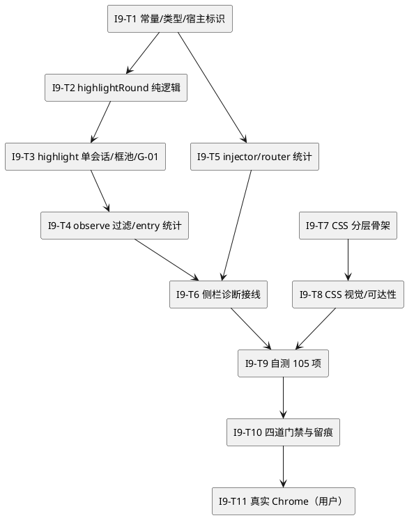

# EasyFlow 高亮停止与侧栏视觉升级（第九轮）— 编码任务清单

**输入依据**

- `.codeartsdoer/specs/easyflow_page_guide/iteration9-spec.md`（R-383—R-427、AT-106—AT-114、0.5 证据字段、第 9 章 D9-01—D9-10）
- `.codeartsdoer/specs/easyflow_page_guide/iteration9-design.md`（重点：A/B 类改动、2.1.3(1)—(8)、2.2.2 接口 A—H、2.3 数据模型、2.4 视觉设计、2.5 逐文件清单、2.7 分支矩阵、2.8 测试计划、2.9 风险、2.10 D9-11—D9-16）
- `iteration8-spec.md`、`iteration8-design.md`、`iteration8-tasks.md`（96 项基线、I8-T1—I8-T13 任务写法、四道门禁与留痕口径）
- `iteration7-*`、`iteration6-*`、`iteration5-*`、`iteration4-*`、`iteration3-*`、`spec.md`、`design.md`、`tasks.md`（任务编号、依赖图、追踪矩阵、人工验收口径）
- 2026-11-16 只读核对：
  - `src/content/{highlight,observe,entry}.ts`
  - `src/background/{injector,router}.ts`
  - `src/shared/{constants,types,messages,errors}.ts`
  - `src/sidepanel/hooks/useConversation.ts`、`App.tsx`、`components/chat/DiagnosticsPanel.tsx`
  - `src/sidepanel/styles/sidepanel.css`
  - `scripts/selftest.mjs`（AT-50/AT-63/AT-80）、`scripts/verify-manifest.mjs`、`public/manifest.json`

**阶段声明**

- 本文件只是第九轮**编码任务规划**：未修改任何源码、`public/manifest.json`、`scripts/**`、`src/sidepanel/styles/sidepanel.css`、`dist/**`，未修改前八轮规格/设计/任务文档，未修改本轮 `iteration9-spec.md` / `iteration9-design.md`。
- 编写本文件时**未执行** `npm run typecheck` / `npm run build` / `npm run selftest` / `npm run verify`，未创建或覆盖 `codearts_proof/iteration9-*` 日志与 `28-iteration9-implementation.md`，**未访问真实网页、未打开真实 Chrome、未调用真实麦克风/语音识别/语音合成、未访问网络**。
- O-01（持续闪烁）、O-02（需点击网页才停）在本文件中仍是**待验现象**；H-01—H-08 仍是**待验证假设**。本文件不写“根因已确认”“已修复”。
- 自动测试通过**不能**证明真实 Chrome 视觉正确；真实视觉一律标“**人工验收待用户执行 / 真实视觉待验**”。

---

## 0. 使用说明与全局约束

### 0.1 基线事实（2026-11-16 只读核对）

| 核查项 | 只读结论（文件:位置） | 对任务的要求 |
|---|---|---|
| 高亮常量 | `src/shared/constants.ts:1` `CONTENT_VERSION="0.3.0"`；`:13-15` `HIGHLIGHT_TTL_MS=4000`、`HIGHLIGHT_PULSE_DURATION_MS=750`、`HIGHLIGHT_PULSE_COUNT=3` | 750×3=2250ms，与 R-384（≤2000ms）冲突，属 **A 类必须改**；TTL 默认不改（D9-03/D9-08） |
| 高亮模块 | `src/content/highlight.ts` 共 459 行；8 个模块级变量（`:47-54`）；`restartPulse()` `:256-288`；`ensureBoxes()` `:290-303`；`positionBoxes()` `:305-324`；`updateOverlayPositions()` `:326-354`；`createOverlay()` `:366-395`；`cleanupHighlight()` `:397-417`；`highlightRef()` `:419-459` | 需收敛为“单会话 + 轮次状态”；保留 `cleanupHighlight` 导出名与幂等语义；保留 `mergeLineBoxes` / `PageBox` 导出 |
| 首帧时序（G-01） | `highlightRef()` `:434-441` 先 `buildTextHighlight()` 测量，`:448-452` 再 `scrollIntoView()`，`:453` 用旧 `initialBoxes` 建宿主 | B 类已静态确认的行为缺口；任务 T3 必须“先滚动、再测量、后建宿主” |
| 位置更新重建框（G-02） | `ensureBoxes()` 在行数变化时 `appendChild` / `remove`；新框只有静态样式，与动画当前帧不一致 | 任务 T3 改为框池 + `display` 切换 + 同帧相位对齐 |
| 页面变化监听（G-03） | `src/content/observe.ts:37-47` 观察 `document.documentElement`（`childList/subtree/attributes`）；高亮宿主 append/remove 会被计为页面变化 | 任务 T4 只过滤“带高亮宿主标识”的 mutation，**不得关闭监听** |
| 采集清理 | `src/content/entry.ts:69-78` `CONTENT_COLLECT` 先 `cleanupHighlight()` 再 `collectPage()` | 任务 T4 改为 `cleanupHighlight("collect")` 并记录原因 |
| 版本守卫 | `entry.ts:100-107`：版本不同才移除旧 listener；版本相同不注册新 listener但 bundle 已重跑 | 任务 T1 升 `CONTENT_VERSION` 到 `0.4.0`；守卫逻辑保留 |
| 后台注入 | `src/background/injector.ts:7` `injectedTabs` 内存 Set；`:23-45` `ping()` 只返回布尔；`:64-93` `executeScript` + 最多 2 次 ping；`:95-115` 注入锁 | 任务 T5 让 ping 返回实际版本、补 per-tab 注入计数；不改注入锁与判定 |
| 后台透传 | `src/background/router.ts:199-238` 每次 `handleHighlight` 只 `sendToContent` 1 次，超时 `LOCATE_TIMEOUT_MS=1000`；无去重 | 任务 T5 只附加统计，**不合并、不去重、不改超时** |
| 消息契约 | `src/shared/messages.ts:201` `HighlightData = HighlightResult`；`:85-91`、`:129-134` `mode?: "normal" \| "care"` | 任务 T1 只给 `HighlightResult` 加可选 `stats`，**不改 messages.ts** |
| 结果三态 | `src/shared/types.ts:144-151` `LocateStatus` / `HighlightResult` 无 `stats` | 加可选 `stats?: HighlightStats`；`highlighted/folded/stale` 语义不变 |
| 侧栏高亮链 | `useConversation.ts:1060-1090` 一次 `highlight()` 只发 1 条 `EF_HIGHLIGHT`；`:1099-1151` `locateControl` 可能先 `readPage("recheck")` 再 `highlight()` 1 次；无请求计数、无 stats 缓存 | 任务 T6 加 `highlightRequestCount` 与局部 `highlightStats`；不碰 `runTurn/plan/reducer` |
| 侧栏根结构 | `App.tsx:65-117`：`ChatHeader → PageStatusLine → 慢提示 → main → composer → diagnostics`；`DiagnosticsPanel` 11 个 props；`useState(open)` 在面板内部 | 任务 T6 只加两个 props 与一个内部折叠区；不改外层受控 `open`、不改语音 13 键 |
| CSS 规模 | `sidepanel.css` 1475 行；`:root` 在 `:1`、`:891`；`#root` 在 `:528`、`:1147`；`.ef-chat-app` 在 `:532`、`:1153`；`.ef-header` 在 `:50`、`:1164`（另 `:1232`、`:1247` 媒体内）；`.ef-step-card` 在 `:721`、`:973`、`:1065`；`.ef-step-primary` 在 `:753`、`:764`、`:990`、`:1349` | 任务 T7/T8 必须按 6 层重排并消除重复；禁止末尾追加 `Iteration N` 覆盖块 |
| 紫渐变 / 低对比 | `.ef-header` `:60` 三色紫渐变；`.ef-btn-primary` `:216` 紫渐变；`.ef-bubble-user` `:620` 紫渐变；`.ef-footer` `:509` `#9ca3af`；`.ef-message-role` `:605` `#9ca3af` | 任务 T7/T8 必改；`#9ca3af` 不得作为小字提示色 |
| 断点分散 | `360px`：`:519`、`:881`；`420px`：`:1231`、`:1396`；`320px`：`:1246`、`:1406`；`max-height:520px`：`:1257-1265`（内含 `:root`） | 任务 T7 合并为 420 / 320 / 高度三层；媒体层**不得重写 `:root`** |
| 自测基线 | `scripts/selftest.mjs` 3654 行；`codearts_proof/iteration8-selftest.log` 末行 `# pass 96 / # fail 0` | 96 项为回归红线；本轮新增 9 项 → **105** |
| AT-50 形态 | `selftest.mjs:3094-3143`：9 个 CSS `needle`（含 `max-height: 40vh`、`100dvh`、`:focus-visible`、care 尺寸）；`highlight.ts` 只断言 `HIGHLIGHT_CARE_BORDER_WIDTH` | 只能**只增不减**改写；新增 token/宿主标识/直接子元素复核断言 |
| AT-63 形态 | `selftest.mjs:3617-3654`：`.ef-speech-btn`、`.ef-speak-btn`、`.ef-step-actions-line > .ef-step-primary` 三条独立块正则；禁 `ef-voice-btn` / `ef-mode-notice`；权限四项 | 保留三条正则与禁词；新增安装按钮/过期卡/头部无渐变断言 |
| AT-80 形态 | `selftest.mjs:2911-2945`：`.ef-speech-open-btn { ... min-height: var(--ef-tap-min) }`；语音目录无 `chrome.storage` | 必须保留 `.ef-speech-open-btn` 独立声明块与原文 |
| 门禁边界 | `verify-manifest.mjs:36-43` 权限四项；`:110-127` 禁 `fetch(`/`XMLHttpRequest`/`sendBeacon`/`WebSocket`/`MediaRecorder`/密钥、`host_permissions`/`<all_urls>`/`content_scripts`/`innerHTML`；`:129-142` `getUserMedia` 两条例外 | 新增源码与注释不得出现上述禁词；不新增权限/网络/存储/录音 |
| 构建产物 | `dist/*` 时间 2026-11-16 14:42；`dist/sidepanel.css` 20086 字节（CSS 注释在产物中消失） | 实现阶段由 `npm run build` 重建；CSS 结构断言只对 `src` 做 |
| 严格类型 | `tsconfig.json`：`strict`、`noUncheckedIndexedAccess`、`exactOptionalPropertyTypes`、`noImplicitOverride` | 不用 `any`/`@ts-ignore`/`@ts-expect-error`；可选属性不得显式赋 `undefined`，用条件展开 |

> 行号仅作定位参考，实现以函数名、props 名、常量名与 CSS 选择器为准。

### 0.2 全局硬约束（每个任务都必须遵守）

1. **只改主工程**：只改 `D:\hwproject\translator`；不新建网站、不新建独立 Web 应用、不使用 `apps/extension`、不运行 `pnpm dev:web`。
2. **不改业务逻辑**：问答、导办步骤生成、预约流程、动态时段重排、本人填写/提交、语音输入、朗读链路一律不改；只改高亮生命周期、诊断计数/展示、侧栏样式与测试。
3. **不改第三方网页**：只读目标元素与文字范围；不修改第三方网页布局、文案、样式、站点设置或交互；不 `click`/`focus`/`submit`/`dispatchEvent` 网页元素。
4. **权限不变**：`permissions` 仍为 `["activeTab","scripting","sidePanel","storage"]`；不新增 `tabs`、`host_permissions`、`<all_urls>`、静态 `content_scripts`、`web_accessible_resources`、`externally_connectable`。
5. **无网络/无录音/无外部服务**：不新增 `fetch(`/`XMLHttpRequest`/`sendBeacon`/`WebSocket`/`MediaRecorder`；不接入语音/模型 SDK、代理、密钥；不上传音频或文本。
6. **存储不变**：不新增 `chrome.storage` 键；诊断计数只存内存；关闭侧栏或刷新页面即丢弃。
7. **消息类型不变**：不新增消息类型；`HighlightResult` 只增可选 `stats`；`messages.ts` 不改。
8. **三态语义不变**：`highlighted` / `folded` / `stale` 与 `useConversation` 文案分支不变；定位优先级“元素 ID → DOM 路径 + 文本哈希”不变。
9. **高亮定位不回退**：Range 逐行框、短标题只框文字、`pointer-events:none`、不修改原节点、元素边界兜底、`folded`/`stale` 降级全部保留。
10. **常量化**：时长、次数、TTL、静态保持、框池上限、宿主属性、序列化上限必须命名常量；不写 750/4000/3/60 等散落魔法数。
11. **隐私口径**：诊断只记录次数、毫秒、枚举、版本字符串；禁止网页正文/标题/URL/查询串/表单值/输入/引用/聊天/音频/识别文本/设备名/ID/完整错误 `message`/异常堆栈。
12. **证据门槛**：A 类（规格硬约束）可直接改；B 类（G-01/G-02/G-03、单宿主、框池）必须先有静态缺口说明或真实计数证据；任何改动留痕写“分支编号 + 支撑证据 + 复测结果”。
13. **两类改动分开记账**：A 类 = 规格冲突（`600ms×3`、`CONTENT_VERSION 0.4.0`、统计字段、CSS 分层/去重/去紫）；B 类 = 证据驱动（单宿主复核、框池、先滚动后测量、mutation 过滤）。
14. **不得以“调大 TTL”掩盖问题**：TTL 默认 4000ms；没有证据不得改时长/次数/定位算法。
15. **不得以“关闭监听”换取高亮安静**：`observe.ts` 必须继续观察页面自身变化，只过滤高亮宿主自身 mutation。
16. **本阶段边界**：本文件只做任务规划；不得修改源码、不得运行四道门禁、不得访问真实网页/真实麦克风/网络。

### 0.3 明确“不改文件”清单

以下文件本轮**不得修改**（逐项核对，改动即视为越界）：

- `src/content/collect.ts`、`src/content/semantic.ts`、`src/content/controls.ts`、`src/content/registry.ts`、`src/content/normalize.ts`
- `src/sidepanel/dialogue/**`
- `src/sidepanel/guide/**`（含 `stepPlanner.ts`、`bookingSuccess.ts`、`completion.ts`）
- `src/sidepanel/state/**`（含 `conversationReducer.ts`、`sessionReducer.ts`、`initialState.ts`）
- `src/sidepanel/match/**`
- `src/shared/speech/**`、`src/sidepanel/speech/**`
- `src/mic-permission/**`
- `src/shared/messages.ts`
- `src/shared/errors.ts`
- `src/shared/privacy/**`
- `src/shared/domPath.ts`
- `src/shared/uiMode.ts`
- `src/background/index.ts`、`src/background/tabContext.ts`
- `src/sidepanel/components/chat/StepCard.tsx`、`StepCardSpeech.tsx`、`StepDetails.tsx`、`EvidencePanel.tsx`、`MessageList.tsx`、`ChatComposer.tsx`、`ChatHeader.tsx`、`ModeToggle.tsx`、`PageStatusLine.tsx`、`AboutPanel.tsx`、`VoiceInputControl.tsx`、`stepCardCopy.ts`、`stepCardModel.ts`、`messageText.ts`
  - **props 与结构不改**；允许在 `MessageList.tsx` 外层类名不变的前提下由 CSS 处理 `.ef-bubble-card-only`，但不得改 JSX 结构。
- `src/sidepanel/components/{Card,CardList,GoalForm,PageInfo,StatusBanner}.tsx`、`src/sidepanel/diagnostics/RunLog.tsx`
- `public/manifest.json`、`public/*.html`
- `scripts/build.mjs`、`scripts/verify-manifest.mjs`、`scripts/gen-icons.mjs`
- `package.json`、`tsconfig.json`
- `dist/**`（实现阶段仅由 `npm run build` 重建，不手工改）
- 第一至第八轮规格/设计/任务文档与本轮 `iteration9-spec.md`、`iteration9-design.md`
- 第三方网页（政府指南页、Cal.com 等）

### 0.4 允许新增 / 修改清单

**新增（1 个源码文件）**

- `src/content/highlightRound.ts`（纯逻辑、无 DOM）

**修改（12 个源码/测试文件）**

- `src/shared/constants.ts`
- `src/shared/types.ts`
- `src/content/highlight.ts`
- `src/content/observe.ts`
- `src/content/entry.ts`
- `src/background/injector.ts`
- `src/background/router.ts`
- `src/sidepanel/hooks/useConversation.ts`
- `src/sidepanel/components/chat/DiagnosticsPanel.tsx`
- `src/sidepanel/App.tsx`
- `src/sidepanel/styles/sidepanel.css`
- `scripts/selftest.mjs`

**留痕（新增，不改旧文件）**

- `codearts_proof/iteration9-typecheck.log`
- `codearts_proof/iteration9-build.log`
- `codearts_proof/iteration9-selftest.log`
- `codearts_proof/iteration9-verify.log`
- `codearts_proof/28-iteration9-implementation.md`

> 计数：新增 1 + 修改 12 = **13 个文件**（含测试）。其中 `messages.ts`、`errors.ts`、`manifest.json`、`build.mjs`、`verify-manifest.mjs` 零改动。

### 0.5 任务编号与追溯约定

- 本轮编码任务编号为 **`I9-T1`—`I9-T11`**；需求/设计取舍点仍写 `D9-01`—`D9-16`，本文件新增的任务级取舍写 `D9-17`—`D9-20`，两套编号不混用。
- 测试用例沿用 `AT-xx`；本轮新增 `AT-106`—`AT-114`（9 项），既有 96 项保留，总数 **105**。
- “设计 2.x”指 `iteration9-design.md` 的对应小节；“spec 5.x/6.x/7.x”指 `iteration9-spec.md`。
- **A 类改动**（规格硬约束，可直接实施）：`HIGHLIGHT_PULSE_DURATION_MS 750→600`、`CONTENT_VERSION 0.3.0→0.4.0`、`HighlightStats` 与宿主标识、CSS 6 层/去重/去紫/低对比修正、诊断展示。
- **B 类改动**（证据/静态缺口驱动，需留痕）：G-01 先滚动后测量、G-02 框池化 + 同帧对齐、G-03 高亮自身 mutation 过滤、单宿主存活复核、清理原因。B 类不得被写成“O-01 根因已定位”。
- 每个任务的自验命令在**实现阶段**执行；本文件编写阶段不执行任何命令。
- “临时断言”指用 esbuild 把目标模块打到系统临时目录后直接 `node` 运行的一次性脚本，放系统临时目录、不提交主工程；正式断言统一进 `I9-T9` 的 `selftest.mjs`。
- 合并/拆分说明：`I9-T7`（CSS 分层骨架）与 `I9-T8`（视觉层级/状态/断点）分两步，避免一次重排后无法定位回归；`I9-T3`（高亮 DOM 会话）与 `I9-T4`（observe/entry）分开，便于用 G-01/G-02 与 G-03 的证据分别复测。

### 0.6 执行顺序总览

| 顺序 | 编号 | 标题 | 依赖 | 主要产物 | 构建检查点 |
|---|---|---|---|---|---|
| 1 | I9-T1 | 高亮常量、统计类型与宿主标识契约 | 无 | `shared/{constants,types}.ts` | `npm run typecheck` |
| 2 | I9-T2 | `highlightRound` 纯逻辑状态机与计数不变量 | I9-T1 | `content/highlightRound.ts`（新） | `typecheck`；纯函数临时断言 |
| 3 | I9-T3 | `highlight` 单会话、单宿主复核、框池、清理原因与 G-01 | I9-T1、I9-T2 | `content/highlight.ts` | `typecheck` + `build` |
| 4 | I9-T4 | 页面变化过滤（G-03）与 entry 统计/清理原因 | I9-T3 | `content/{observe,entry}.ts` | `typecheck` + `build` |
| 5 | I9-T5 | 后台注入计数、页面实际版本与响应合并 stats | I9-T1 | `background/{injector,router}.ts` | `typecheck` + `build` |
| 6 | I9-T6 | 侧栏请求计数、stats 局部状态与“高亮”折叠诊断区 | I9-T1、I9-T4、I9-T5 | `useConversation.ts`、`App.tsx`、`DiagnosticsPanel.tsx` | `typecheck` + `build` |
| 7 | I9-T7 | CSS 六层骨架、单一 token 源与重复规则消除 | 无（可与 T1—T6 并行，但不得早于 T6 的类名定稿） | `sidepanel.css` | `typecheck` + `build` |
| 8 | I9-T8 | 视觉层级、去紫渐变、状态/焦点、420/320/200% 与关怀微调 | I9-T7 | `sidepanel.css` | `typecheck` + `build` |
| 9 | I9-T9 | AT-106—AT-114 与 AT-50/63/80 最小改写（105 项） | I9-T1—I9-T8 | `scripts/selftest.mjs` | `npm run selftest`；`pass 105 / fail 0` |
| 10 | I9-T10 | 四道门禁、清洁检索与实现留痕 | I9-T9 | `codearts_proof/iteration9-*.log`、`28-iteration9-implementation.md` | 四命令全绿 |
| 11 | I9-T11 | 真实 Chrome 视觉验收（用户执行） | I9-T10 | `28-iteration9-implementation.md` 人工分栏 | “人工验收待用户执行” |

### 0.7 依赖图

```text
I9-T1 ──> I9-T2 ──> I9-T3 ──> I9-T4 ──┐
  │                                     ├──> I9-T6 ──┐
  └──────────> I9-T5 ──────────────────┘             │
I9-T7 ──> I9-T8 ─────────────────────────────────────┴──> I9-T9 ──> I9-T10 ──> I9-T11
```



**硬性顺序**

1. `I9-T1` 必须最先：常量与类型是全部后续模块的编译基础；`HighlightResult.stats` 与 `HighlightStats` 一旦定稿，后续不得改名。
2. `I9-T2` 只依赖 `I9-T1`；状态机必须先于 DOM 会话，否则 `highlight.ts` 无法接线。
3. `I9-T3` 依赖 `I9-T1`+`I9-T2`；此任务完成前不得改 `observe.ts`/`entry.ts`，避免“高亮未收敛 + 页面变化过滤”同时引入难以归因的噪声。
4. `I9-T4` 依赖 `I9-T3`（需要 `HIGHLIGHT_HOST_ATTR` 与宿主创建点）；`I9-T5` 只依赖 `I9-T1`，可与 `I9-T4` 并行。
5. `I9-T6` 依赖 `I9-T4`（响应里有 `stats`）与 `I9-T5`（后台补三项）；不得早于两者。
6. `I9-T7`/`I9-T8` 只改 CSS，可在 `I9-T1`—`I9-T6` 期间并行；但 `I9-T8` 不得早于 `I9-T7`，且 `I9-T9` 不得早于 `I9-T8`。
7. `I9-T9` 必须在全部源码改动之后；`I9-T10` 在 `I9-T9` 全绿之后；`I9-T11` 只在用户真实执行后记录。
8. `I9-T3`/`I9-T4`/`I9-T5` 完成后必须各跑一次 `npm run typecheck` + `npm run build`；`I9-T2` 只跑 `typecheck`；`I9-T7`/`I9-T8` 各跑 `build`。

### 0.8 阶段门禁与留痕

| 时点 | 命令/检查 | 通过标准 | 留痕 |
|---|---|---|---|
| I9-T1—I9-T2 | `npm run typecheck` | 退出码 0、0 error；无 `any`/`@ts-ignore`/`@ts-expect-error` | 汇总到 `codearts_proof/iteration9-typecheck.log` |
| I9-T3—I9-T8 | `npm run typecheck` + `npm run build` | 均退出码 0；产物清单不新增入口；`dist` 时间戳更新 | 汇总到 `iteration9-{typecheck,build}.log` |
| I9-T9 | `npm run selftest` | `# pass 105` / `# fail 0`；96 项不回退 | `codearts_proof/iteration9-selftest.log` |
| I9-T10 | `npm run typecheck` → `npm run build` → `npm run selftest` → `npm run verify` | 四条独立执行、分别留痕；`verify` 不得由 `build` 内含检查替代 | `iteration9-{typecheck,build,selftest,verify}.log` |
| I9-T10 | 产物/清洁检索 | `dist/content.js` 含 `data-ef-highlight`、`600`、`0.4.0`；权限四项；无新增网络/录音/存储；`getUserMedia` 仍 2 条例外 | `iteration9-verify.log` + 检索记录 |
| I9-T11 | 真实 Chrome 视觉验收（spec 7.3 / 设计 2.8.5） | 逐项记录或“人工验收待用户执行”；未执行不得写“已修复” | `28-iteration9-implementation.md` 人工分栏 |

> 日志名以用户本轮指令为准：`iteration9-*.log`、`28-iteration9-implementation.md`。`iteration9-spec.md` 7.4 建议名为 `28-iteration9-highlight-visual.md`，与用户指令冲突，**以 `28-iteration9-implementation.md` 为准**，并在留痕首段注明该差异（D9-20）。

### 0.9 “每步可构建”的精确含义

1. `I9-T1` 结束时 `npm run typecheck` 0 error；`I9-T2` 结束时 `typecheck` 0 error。
2. `I9-T3` 起每步结束必须 `npm run typecheck` + `npm run build` 均通过；`build` 会重写 `dist`，属预期。
3. `I9-T2` 的状态机先于 DOM 接线；`I9-T3` 完成前，`highlight.ts` 仍可编译（只改内部实现，不改导出签名）。
4. `I9-T4` 修改 `observe.ts` 时，`startWatching()`/`stopWatching()` 的导出签名不得变；`setChangeListener` 只增。
5. `I9-T5` 修改 `ping()` 为内部函数，`ensureInjected()` 的返回类型不变（仍 `EfResult<{contentVersion:string}>`）。
6. `I9-T6` 新增的诊断 props 必须先于 `DiagnosticsPanel` 的 JSX 使用；`App` 的传参必须与 hook 返回值同步，避免 `typecheck` 失败。
7. `I9-T7` 必须保留 AT-50/AT-63/AT-80 依赖的字面值与独立声明块；若某条正则不匹配，先修 CSS 结构，不得改测试放宽。
8. `I9-T8` 完成前不得删除 `.ef-speech-open-btn`、`.ef-speech-btn`、`.ef-speak-btn`、`.ef-step-actions-line > .ef-step-primary` 的独立块。
9. `I9-T9` 之前运行 `npm run selftest` 允许出现“仅新增用例尚不存在”的中间态，但不得出现既有 96 项失败；若出现，视为实现缺陷，不得留到 T9。
10. `I9-T10` 的四道门禁必须按顺序独立执行；`build` 内含的 `verify-manifest` 不能替代 `npm run verify` 的独立留痕。

### 0.10 可勾选任务总表（两级，执行时逐项勾选）

- [ ] **I9-T1 高亮常量、统计类型与宿主标识契约**
  - [ ] `constants.ts`：`0.4.0`、`600`、`1600`、`60`、两个宿主属性、序列化上限
  - [ ] `types.ts`：`CleanupReason`、`HighlightStats`（27 项）、`HighlightResult.stats?`
  - [ ] `npm run typecheck` 0 error
- [ ] **I9-T2 `highlightRound` 纯逻辑状态机与计数不变量**
  - [ ] `idle→pulsing/static→cleared`、5 条不变式、`hosts-measured`/`boxes-synced`
  - [ ] 纯函数临时断言全绿
- [ ] **I9-T3 `highlight` 单会话、单宿主复核、框池、清理原因与 G-01**
  - [ ] 先结束旧轮、取消动画、清定时器/监听/宿主
  - [ ] 先滚动后测量、宿主标识、直接子元素复核、框池同帧对齐
  - [ ] `ttl 4000`、`static`、`pagehide/unroute/collect/replaced/noop`
- [ ] **I9-T4 页面变化过滤（G-03）与 entry 统计/清理原因**
  - [ ] `observe` 只过滤带 `data-ef-highlight` 的 mutation，不关闭监听
  - [ ] `CONTENT_COLLECT` 传 `collect`；`CONTENT_HIGHLIGHT` 返回 `stats`
- [ ] **I9-T5 后台注入计数、页面实际版本与响应合并 stats**
  - [ ] `ping` 返回实际版本；`getPageInjectionCount`/`getSeenContentVersion`
  - [ ] `router` 只合并，不去重、不改超时
- [ ] **I9-T6 侧栏请求计数、stats 局部状态与“高亮”折叠诊断区**
  - [ ] `useConversation` 局部 state；`App` 透传；面板默认折叠
  - [ ] 无新请求、无 storage、无 reducer
- [ ] **I9-T7 CSS 六层骨架、单一 token 源与重复规则消除**
  - [ ] L0—L5；唯一 `:root`/care 块；合并重复选择器；删末尾覆盖
  - [ ] 保留 AT-50/63/80 字面值与独立块
- [ ] **I9-T8 视觉层级、去紫渐变、状态/焦点、420/320/200% 与关怀微调**
  - [ ] 头部/气泡/卡片/按钮/输入/诊断/语音；状态三态；焦点环；断点；reduce
  - [ ] 400px / 200% 仅做静态断言，真实截图待用户
- [ ] **I9-T9 AT-106—AT-114 与 AT-50/63/80 最小改写（105 项）**
  - [ ] 9 项新用例；既有 96 项不回退；不放宽 AT-50/63/80
- [ ] **I9-T10 四道门禁、清洁检索与实现留痕**
  - [ ] `typecheck`→`build`→`selftest`→`verify` 独立留痕；`pass 105/fail 0`
- [ ] **I9-T11 真实 Chrome 视觉验收（用户执行）**
  - [ ] 未执行写“人工验收待用户执行 / 真实视觉待验”

### 0.11 A/B 类改动、证据门槛与分支映射

| 分支 | 进入门槛 | 允许动作 | 本任务清单的落点 | 禁止 |
|---|---|---|---|---|
| B0 只补诊断 | 七项基础计数缺任一项 | 只加计数与展示 | I9-T1/T2/T5/T6 | 改 `HIGHLIGHT_*`、改定位算法 |
| B1 加载/多实例（H-02/H-07） | `contentVersionSeen ≠ expected` 或 `pageInjectionCount ≥2` 或 `overlayLiveMax ≥2` 或 `legacyHostCount ≥1` | 升 `CONTENT_VERSION`；单宿主复核；加载流程提示 | I9-T1/T3/T5 | 为此改时长/次数/TTL/定位 |
| B2 重复触发（H-01） | `highlightRequestCount` 与 `refCalls` 同 500ms 窗口 >1 | 记录请求计数，定位触发点 | I9-T6 | 调大 TTL 掩盖 |
| B3 动画重启（H-03） | `pulseStartCount` 在 `lastRoundEndAt` 后仍增长 | 只在 `round-start` 启动；位置更新禁止 `animate` | I9-T2/T3 | 改为“永不脉冲” |
| B4 清理失败（H-04） | `cleanupScheduledCount ≥1` 且 `cleanupFiredCount=0` | 单一 TTL 持有、幂等清理、清理后复核 | I9-T2/T3 | 无证据改时长 |
| B5 页面变化误判（H-05） | `cleanupReason="collect"` 且清理早于 2000ms | 过滤高亮自身 mutation，不关闭监听 | I9-T4 | 关闭 `observe`、改导办复审 |
| B6 相位/重建（H-06） | `pulseStartCount=1` 但 `boxCreateCount/boxRemoveCount` 增长 | 框池 + 同帧 `startTime` 对齐 | I9-T2/T3 | 改整块矩形 |
| B7 reduce 未生效（H-08） | `reducedMotionAtRequest=false` 与系统不符 | 只增加诊断可见性 | I9-T6 | 改系统设置/网站样式 |

> 实现阶段第一件事是“补诊断并跑一轮真实复现”，**不是**先改动画；A 类常量与 CSS 结构可按规格直接改，B 类改动必须写“支撑证据 + 复测结果”。

---

## 1. I9-T1 高亮常量、统计类型与宿主标识契约

**编号与标题**：I9-T1 / 高亮常量、统计类型与宿主标识契约。

**目标**：一次性落位本轮所需的时长/次数/TTL/静态保持/框池/宿主标识常量与 `HighlightStats` 契约，使后续任务只依赖稳定契约；所有扩展“只增不改”，不破坏既有 96 项与 `exactOptionalPropertyTypes`。

**对应需求/设计条目**：R-384、R-385、R-387、R-401、R-405、R-406；设计 2.1.3(1) 常量表、2.2.1 接口 A/D、2.2.2 接口 A/D、2.3.2、D9-01、D9-02、D9-03、D9-08、D9-15、D9-16。

**涉及文件与函数/类型/常量**

- 修改 `src/shared/constants.ts`（只增/只改下列项，不改既有采集、匹配、语音、UI 常量）：
  - `CONTENT_VERSION`：`"0.3.0"` → `"0.4.0"`。
  - `HIGHLIGHT_PULSE_DURATION_MS`：`750` → `600`。
  - `HIGHLIGHT_PULSE_COUNT`：保持 `3`。
  - `HIGHLIGHT_TTL_MS`：保持 `4000`（D9-03/D9-08 默认）。
  - 新增 `HIGHLIGHT_STATIC_MIN_MS = 1600`（AT-108 下限守卫；实际静态期 4000-1800=2200ms）。
  - 新增 `HIGHLIGHT_BOX_POOL_MAX = 60`（与既有 `MAX_HIGHLIGHT_BOXES` 同值；`highlight.ts` 内部改用它，不再写 60 字面量）。
  - 新增 `HIGHLIGHT_HOST_ATTR = "data-ef-highlight"`。
  - 新增 `HIGHLIGHT_ROUND_ATTR = "data-ef-round"`。
  - 新增 `HIGHLIGHT_STATS_SERIALIZED_MAX_CHARS = 1024`（AT-111 用；见 D9-18，设计原写 640，与实际 27 字段键名长度冲突）。
- 修改 `src/shared/types.ts`：
  - 新增 `CleanupReason = "ttl" | "replaced" | "collect" | "pagehide" | "unroute" | "noop"`。
  - 新增 `HighlightStats`，字段固定 27 项（内容侧 24 + 后台补 3）：
    - `refCalls`、`roundStartCount`、`pulseStartCount`、`pulseCompletedCount`
    - `overlayCreateCount`、`overlayLiveCount`、`overlayLiveMax`、`legacyHostCount`
    - `cleanupScheduledCount`、`cleanupFiredCount`、`cleanupReplacedCount`、`cleanupNoopCount`、`cleanupReason`
    - `positionUpdateCount`、`domTickCount`
    - `boxCreateCount`、`boxRemoveCount`、`boxCount`
    - `uiModeAtRequest`、`reducedMotionAtRequest`
    - `lastRoundStartAt`、`lastRoundEndAt`、`lastCleanupAt`、`highlightLifetimeMs`
    - `contentVersionSeen`、`expectedContentVersion`、`pageInjectionCount`
  - `HighlightResult` 增可选 `stats?: HighlightStats`；**不改** `status`、`rect`、`locatedElementIds`、`missingElementIds`。
  - 时间字段类型为 `number | null`；`cleanupReason` 为 `CleanupReason | null`；`uiModeAtRequest` 为 `"normal" | "care"`；`reducedMotionAtRequest` 为 `boolean`；版本字段为 `string`；计数为 `number`。
- **不改** `src/shared/messages.ts`：`HighlightData = HighlightResult` 自动携带可选 `stats`；不新增消息类型。
- **不改** `src/shared/errors.ts`：`EF-E001`—`EF-E010` 语义不变。

**实现要点与前置依赖**

1. 常量必须以 `export const` 导出，命名与上表一致；不得在 `highlight.ts` 写 `750`/`4000`/`3`/`60` 字面量。
2. `HIGHLIGHT_PULSE_DURATION_MS × HIGHLIGHT_PULSE_COUNT = 1800 ≤ 2000`（AT-107 断言）。
3. `HIGHLIGHT_TTL_MS ≥ pulseTotal + HIGHLIGHT_STATIC_MIN_MS`：`4000 ≥ 1800 + 1600`，成立。
4. `HighlightStats` 不包含 `highlightRequestCount`；请求计数是侧栏局部 state（D9-17）。
5. 可选 `stats` 不得在构造时显式赋 `undefined`；用条件展开或仅在成功路径附带。
6. `CONTENT_VERSION` 升级是 B1 的加载流程修复；升级后页面旧实例会在下次注入时被替换，但旧宿主可能残留到其原 TTL，属已知风险（R9-18）。
7. 前置依赖：无。

**明确不做**

- 不改 `MAX_ITEMS`、`MAX_TEXT_LENGTH`、`WATCH_DEBOUNCE_MS`、`RECHECK_MIN_INTERVAL_MS`、`MAX_AUTO_RECHECK_PER_STEP` 等既有常量。
- 不改 `Scope`/`PageSnapshot`/`PageControl`/`Evidence`/`Speech` 类型。
- 不新增 `chrome.storage` 键、不新增消息类型、不改 manifest/权限。
- 不把高亮统计字段塞进 `ConversationDiagnostics` 或 `EngineDiagnostics`。
- 不引入“TTL 无穷大”“注释掉 TTL”等反向改法。

**完成标准与自验方式**

- `npm run typecheck` 退出码 0、0 error。
- 临时断言（esbuild 打包 `constants.ts`/`types.ts` 到系统临时目录后 `node` 运行，不提交）：
  - `CONTENT_VERSION === "0.4.0"`。
  - `HIGHLIGHT_PULSE_DURATION_MS === 600`、`HIGHLIGHT_PULSE_COUNT === 3`、`HIGHLIGHT_TTL_MS === 4000`。
  - `HIGHLIGHT_PULSE_DURATION_MS * HIGHLIGHT_PULSE_COUNT === 1800`、`1800 <= 2000`。
  - `HIGHLIGHT_TTL_MS >= 1800 + HIGHLIGHT_STATIC_MIN_MS`。
  - `HIGHLIGHT_HOST_ATTR === "data-ef-highlight"`、`HIGHLIGHT_ROUND_ATTR === "data-ef-round"`。
  - `HIGHLIGHT_BOX_POOL_MAX === 60`、`HIGHLIGHT_STATS_SERIALIZED_MAX_CHARS === 1024`。
- 源码检索：`highlight.ts` 内不得出现 `750`、`4000`、`iterations: 3` 字面量；`constants.ts` 中新增常量各出现 1 次。
- 源码检索：`messages.ts` 的 `HighlightData = HighlightResult` 与 `mode?: "normal" | "care"` 原样保留（AT-50 依赖）。

**风险与回滚点**

- 风险：`exactOptionalPropertyTypes` 下 `HighlightResult.stats?: HighlightStats` 被调用方显式赋 `undefined` 导致 `typecheck` 失败；缓解：只在 `stats !== undefined` 时条件展开。
- 风险：`CONTENT_VERSION` 升级触发一次重注入；页面未刷新时旧 listener 被移除、新 listener 接管，属预期；若用户未刷新，诊断显示页面版本不一致。
- 风险：`HIGHLIGHT_STATS_SERIALIZED_MAX_CHARS=1024` 与设计 AT-111 的 640 不一致；见 D9-18，需用户确认。
- 回滚点：把 `CONTENT_VERSION` 恢复 `0.3.0`、`HIGHLIGHT_PULSE_DURATION_MS` 恢复 `750`，删除新增常量与 `HighlightStats`/`stats` 字段，即可回到第八轮基线（但 R-384 不满足）。

---

## 2. I9-T2 `highlightRound` 纯逻辑状态机与计数不变量

**编号与标题**：I9-T2 / `highlightRound` 纯逻辑状态机与计数不变量。

**目标**：把“只跑一轮、次数有限、TTL 不延长、清理原因可辨、单宿主可证”变成无 DOM 的纯函数，供 Node 自测直接断言；DOM 层只负责派发事件与执行副作用。

**对应需求/设计条目**：R-383—R-390、R-391—R-394、R-401—R-404；设计 2.1.3(1)、2.2.2 接口 B、2.3.2、2.7、2.8.2、D9-01、D9-02、D9-03、D9-15、D9-16。

**涉及文件与函数/类型/常量**

- 新增 `src/content/highlightRound.ts`（纯逻辑，无 DOM、无 `window`、无 `performance.now()` 调用；`now` 由调用方传入）：
  - `export type { CleanupReason } from "../shared/types";`
  - `HighlightPhase = "idle" | "pulsing" | "static" | "cleared"`
  - `RoundConfig { pulseDurationMs; pulseCount; ttlMs; care; reducedMotion; supportsAnimate }`
  - `RoundCounters`（与 `HighlightStats` 内容侧 24 项同名字段；`refCalls` 不在其中，由 `highlight.ts` 入口单独计数）
  - `RoundTiming { lastRoundStartAt; lastRoundEndAt; lastCleanupAt; lastCleanupReason; highlightLifetimeMs; ttlAt; pulseEndsAt }`
  - `HighlightRoundState { phase; roundId; counters; timing }`
  - `RoundEvent`：
    - `round-start`（`now`、`config`）
    - `pulse-complete`（`now`）
    - `position-updated`（`now`）
    - `dom-tick`（`now`）
    - `hosts-measured`（`now`、`live`、`legacy`）
    - `boxes-synced`（`now`、`created`、`removed`、`visible`）
    - `cleanup`（`now`、`reason`）
  - `createRoundState(): HighlightRoundState`
  - `reduceRound(state, event): HighlightRoundState`（不修改入参，返回新对象）
  - `isPulsing(config): boolean` = `!care && !reducedMotion && supportsAnimate`
  - `pulseTotalMs(config): number` = `pulseDurationMs * pulseCount`
- 说明：`hosts-measured`/`boxes-synced` 是任务级补充事件（D9-20）。设计 2.1.3(1) 的事件表未列这两项，但 `RoundCounters` 含 `overlayLiveCount`/`overlayLiveMax`/`legacyHostCount`/`boxCreateCount`/`boxRemoveCount`/`boxCount`，若不让纯逻辑接收实测值，计数只能由 DOM 层私自改，违反“计数只在纯逻辑内改”（R9-02）。

**实现要点与前置依赖**

1. `createRoundState()`：`phase="idle"`、`roundId=0`、全部计数 0、全部时间 `null`。
2. `round-start`：
   - 若 `isPulsing(config)` → `phase="pulsing"`，`pulseStartCount+1`，`pulseEndsAt=now+pulseTotalMs(config)`；否则 `phase="static"`，`pulseStartCount` 不变，`pulseEndsAt=null`。
   - `roundId+1`、`roundStartCount+1`、`cleanupScheduledCount+1`、`overlayCreateCount+1`、`overlayLiveCount=1`、`overlayLiveMax=max(...,1)`。
   - `lastRoundStartAt=now`、`ttlAt=now+ttlMs`。
   - 若从 `pulsing/static` 直接收到 `round-start`（调用方未先 `cleanup replaced`），不自动补 `cleanupReplacedCount`；DOM 层必须先 `cleanup("replaced")`，否则视为调用缺陷（AT-106 显式覆盖正确顺序）。
3. `pulse-complete`：
   - 仅当 `phase="pulsing"` 且 `pulseEndsAt !== null` 且 `now >= pulseEndsAt` 时生效：`phase="static"`、`pulseCompletedCount+1`、`lastRoundEndAt=now`、`pulseEndsAt=null`。
   - 早到事件（`now < pulseEndsAt`）一律忽略，不改变任何计数/相位。
4. `position-updated`：`positionUpdateCount+1`；**不得**改 `ttlAt`、`pulseStartCount`、`cleanupScheduledCount`、`phase`。
5. `dom-tick`：`domTickCount+1`；不改其它计数。
6. `hosts-measured`：`overlayLiveCount=live`、`overlayLiveMax=max(...,live)`、`legacyHostCount=legacy`；不改 `ttlAt`。
7. `boxes-synced`：`boxCreateCount+=created`、`boxRemoveCount+=removed`、`boxCount=visible`。
8. `cleanup`：
   - 若 `phase="idle"` 或 `phase="cleared"`：`cleanupNoopCount+1`；**不改** `lastCleanupAt`/`lastCleanupReason`/`highlightLifetimeMs`/`ttlAt`。
   - 若 `reason="replaced"`：`cleanupReplacedCount+1`；若其它原因：`cleanupFiredCount+1`。
   - `phase="cleared"`、`overlayLiveCount=0`、`boxCount=0`、`ttlAt=null`、`pulseEndsAt=null`、`lastCleanupAt=now`、`lastCleanupReason=reason`。
   - `highlightLifetimeMs = lastRoundStartAt === null ? null : now - lastRoundStartAt`。
9. `clear` 后允许直接 `round-start`（新轮开始），无需额外 `session-disposed` 事件；`roundId` 继续递增。
10. 不变式（AT-106/107/108/109/110 直接断言）：
    - `pulseStartCount ≤ roundStartCount`
    - `care || reducedMotion || !supportsAnimate` 时该轮 `pulseStartCount` 不增长
    - `ttlAt` 在 `round-start` 后、`cleanup` 前恒定
    - `pulseCompletedCount ≤ pulseStartCount`
    - 同一 `roundId` 内 `round-start` 至多 1 次（由调用方保证；状态机不再重复计数）
11. 前置依赖：I9-T1。

**明确不做**

- 不碰 DOM、不读网页文本、不调用 `performance.now()`、不调用 `setTimeout`/`requestAnimationFrame`。
- 不实现动画对象；不决定 `care/reduce` 的样式，只决定相位。
- 不把 `refCalls`、`contentVersionSeen`、`pageInjectionCount` 放进 `RoundCounters`（分别由入口/后台补）。
- 不引入 `infinite`、`setInterval`、无限 `while`。
- 不改变 `cleanupHighlight` 的导出名与幂等语义（由 I9-T3 接线）。

**完成标准与自验方式**

- `npm run typecheck` 退出码 0。
- 临时断言（esbuild 打包 `highlightRound.ts` 到系统临时目录后 `node` 运行）：
  - 初始：`phase="idle"`、`roundId=0`、`ttlAt=null`。
  - 普通 `round-start` @1000：`phase="pulsing"`、`roundStartCount=1`、`pulseStartCount=1`、`cleanupScheduledCount=1`、`overlayCreateCount=1`、`overlayLiveCount=1`、`ttlAt=5000`、`pulseEndsAt=2800`。
  - 3 次 `position-updated`：`positionUpdateCount=3`、`ttlAt` 仍 `5000`、`pulseStartCount=1`。
  - 3 次 `dom-tick`：`domTickCount=3`，其他不变。
  - `pulse-complete` @2800：`phase="static"`、`pulseCompletedCount=1`、`lastRoundEndAt=2800`。
  - `pulse-complete` @2000（早到）：相位/计数不变。
  - `cleanup ttl` @5000：`phase="cleared"`、`cleanupFiredCount=1`、`overlayLiveCount=0`、`boxCount=0`、`highlightLifetimeMs=4000`、`ttlAt=null`。
  - `cleanup noop`：`cleanupNoopCount=1`、`cleanupFiredCount` 不变、`lastCleanupAt` 不变。
  - 连续 3 轮（每轮先 `cleanup replaced`）：`roundStartCount=3`、`cleanupReplacedCount=2`、`overlayLiveMax=1`。
  - `care=true` / `reducedMotion=true` / `supportsAnimate=false`：`phase="static"`、`pulseStartCount=0`、`roundStartCount=1`。
  - `hosts-measured live=0 legacy=1`：`overlayLiveCount=0`、`legacyHostCount=1`、`overlayLiveMax` 保持。
  - `boxes-synced created=3 visible=3` 后 `created=0 removed=0 visible=2`：`boxCreateCount=3`、`boxRemoveCount=0`、`boxCount=2`。
- 源码检索：`highlightRound.ts` 无 `document`、`window`、`setTimeout`、`setInterval`、`requestAnimationFrame`、`infinite`、`while (true)`。

**风险与回滚点**

- 风险 R9-02：DOM 层漏派发某个事件，导致计数与 DOM 不一致；缓解：所有计数只在 reducer 内改，DOM 层只派发 `round-start`/`pulse-complete`/`position-updated`/`dom-tick`/`hosts-measured`/`boxes-synced`/`cleanup`。
- 风险：`round-start` 未先 `cleanup replaced`，导致 `cleanupReplacedCount` 偏小；缓解：I9-T3 的 `highlightRef` 开头强制 `endRound("replaced")`，AT-106 覆盖连点顺序。
- 风险：`pulse-complete` 早到被忽略，若动画实际提前结束，计数会少 1；缓解：动画使用 `iterations:3` + `duration:600`，`finished` 在 1800ms 后才 resolve；早到只可能是测试假时钟误用。
- 回滚点：删除 `highlightRound.ts` 与 `HighlightStats` 接线，`highlight.ts` 回到旧的 8 个模块变量实现；但 R-383—R-390 的证据链将丢失。

---

## 3. I9-T3 `highlight` 单会话、单宿主复核、框池、清理原因与 G-01

**编号与标题**：I9-T3 / `highlight` 单会话、单宿主复核、框池、清理原因与 G-01。

**目标**：把 `highlight.ts` 从“8 个散落模块变量 + 每次重建框”收敛为“单一会话 + 轮次状态机 + 宿主标识 + 框池”，保证一次点击只启动一轮强调、重复点击先结束旧轮、滚动/缩放只更新位置、TTL 到点自动清除、清除后无残留；同时修掉 G-01（先测量后滚动）与 G-02（位置更新重建框）。

**对应需求/设计条目**：R-383—R-400、R-427；设计 1.2.1、1.4、2.1.3(2)(3)(4)、2.2.2 接口 C、2.3.2、2.8.2、2.9（R9-03/R9-05）、D9-01、D9-02、D9-03、D9-08、D9-10、D9-11、D9-15。

**涉及文件与函数/常量**

- 修改 `src/content/highlight.ts`：
  - 保留导出：`highlightRef(ref, mode?)`、`cleanupHighlight()`、`mergeLineBoxes(boxes)`、`PageBox`。
  - 新增内部会话对象 `OverlaySession { host; shadow; boxes; range; target; roundId; care; animations }`；模块级只保留 `session`、`roundState`、`refCalls`、`frameRequest`、`sequence`（连点串行化）。
  - 新增内部函数（名称可调整，语义固定）：
    - `startRound(ref, mode)` / `endRound(reason)` / `finish(reason)`
    - `measureBoxes(element)`（先 `scrollIntoView`，再 `buildTextHighlight`/`fallbackPageBox`）
    - `createSessionHost(roundId, care)`（设置 `data-ef-highlight` / `data-ef-round`）
    - `syncOverlayLiveCount()`（只遍历 `document.documentElement` 直接子元素）
    - `countLegacyHosts()`（按“宿主特征且无 `HIGHLIGHT_HOST_ATTR`”统计）
    - `ensureBoxPool(count, phase)` / `positionBoxes(boxes, animate)`
    - `startPulse(boxes)` / `applyStaticStyle(boxes)` / `snapshotStats()`
  - `cleanupHighlight` 改为 `cleanupHighlight(reason: CleanupReason = "noop"): void`（向后兼容；`entry.ts` 显式传 `"collect"`）。
  - `highlightRef` 返回 `HighlightResult`（**保持同步**；采用 D9-11 备选 B：`behavior:"auto"` 即时滚动 + 同帧测量，不引入异步 API）。
  - `highlightRef` 成功后附带 `stats: snapshotStats()`；`folded`/`stale` 不附带或附带当前快照均可，但不得改变三态。
- **不改** `src/content/entry.ts`：`CONTENT_HIGHLIGHT` 仍 `ok(request.requestId, highlightRef(...))`，因 `HighlightResult` 已带可选 `stats` 而自动透出；listener 保持同步。`CONTENT_COLLECT` 的 `cleanupHighlight("collect")` 在 I9-T4 完成。
- 不改 `src/content/registry.ts`、`collect.ts`、`semantic.ts`、`controls.ts`、`normalize.ts`。

**实现要点与前置依赖**

1. **单轮先结束旧轮**：`highlightRef` 第一件事是 `endRound("replaced")`（若 `session !== null`）。`endRound` 顺序固定：
   `cancelAnimations → clearTimeout(ttlTimer) → cancelAnimationFrame → removeEventListener(scroll/resize/pagehide) → host.remove() → session=null → dispatch cleanup("replaced") → syncOverlayLiveCount() → dispatch hosts-measured`。
2. **取消动画**：清理时对 `session.animations` 逐个 `animation.cancel()`；`animation.finished` 的 reject 必须 `catch`，且用 `roundId` 守卫，避免旧轮的 `pulse-complete` 改到新轮。
3. **先滚动后测量（G-01）**：
   - `const behavior = care || reduced ? "auto" : "auto"`（D9-11 备选 B：即时滚动；若用户坚持平滑，改为 `"smooth"` + 异步单帧测量，见 D9-11）。
   - `element.scrollIntoView({ block:"center", inline:"nearest", behavior })` 后**同步**调用 `buildTextHighlight(element)`；`getClientRects()` 会刷新布局，因此测量在滚动生效后的同一帧完成。
   - 行框为空 → `fallbackPageBox(element)`；仍为空 → 返回 `{status:"stale"}`（不建宿主）。
   - 保留初始框兜底；不得回退到整块矩形。
4. **单宿主与宿主标识**：
   - 建宿主前先 `endRound("replaced")`；建宿主后 `host.setAttribute(HIGHLIGHT_HOST_ATTR, "v1")`、`host.setAttribute(HIGHLIGHT_ROUND_ATTR, String(roundId))`。
   - `syncOverlayLiveCount()` 只做 `for (const child of Array.from(document.documentElement.children))`，统计 `child.hasAttribute(HIGHLIGHT_HOST_ATTR)`；**禁止** `querySelectorAll`、禁止遍历全页。
   - `countLegacyHosts()` 同样只遍历直接子元素；判定“`position:absolute` + `z-index:2147483647` + `pointer-events:none` + 宽高为 0 + 无 `HIGHLIGHT_HOST_ATTR`”；只计数，**不删除**非本实例节点。
   - 创建后派发 `hosts-measured(live, legacy)`；清理后再次派发（期望 `live=0`）。
5. **框池（G-02）**：
   - 池元素按索引复用；可见数变小 → `display="none"`，不 `remove`；变大 → 优先复用隐藏元素，不足才 `createElement`。
   - 新元素在 `pulsing` 相位立即套 `fillBase` 并加入本帧动画批量；`static` 相位立即套静态样式。
   - 池上限 `HIGHLIGHT_BOX_POOL_MAX=60`；超过上限才移除多余元素（`boxRemoveCount`）。
   - `display` 切换不计 `boxCreateCount`；只有 `createElement`/`remove` 计数。
   - 每次 `ensureBoxPool` 后派发 `boxes-synced(created, removed, visible)`。
6. **同帧相位对齐**：
   - `startPulse(boxes)`：先取 `const startTime = document.timeline.currentTime`，对每个框 `const animation = box.animate(keyframes, { duration:HIGHLIGHT_PULSE_DURATION_MS, iterations:HIGHLIGHT_PULSE_COUNT, easing:"ease-in-out" })`；若支持，`animation.startTime = startTime`；不支持则同一同步循环内创建。
   - 关键帧保持 `fillBase → fillPeak → fillBase`；**不得** `iterations:"infinite"`。
   - `pulse-complete`：`Promise.allSettled(boxes.map(b => b.getAnimations()[0]?.finished))`（或收集 `Animation.finished`），全部完成后且 `roundId` 未变、`now >= pulseEndsAt` 时派发 `pulse-complete`；随后 `applyStaticStyle(boxes)` 一次写入。
7. **TTL 不变式**：
   - 只在 `round-start` 设 `ttlAt = now + HIGHLIGHT_TTL_MS`，并 `setTimeout(() => finish("ttl"), HIGHLIGHT_TTL_MS)`。
   - 位置更新路径**不得**重设 `cleanupTimer`/`ttlAt`；不得在 `pulse-complete` 后延长 TTL。
8. **位置更新**：
   - `scroll`（capture、passive）与 `resize` → `scheduleOverlayUpdate()` → rAF 合并 → `updateOverlayPositions()`。
   - `updateOverlayPositions` 只重算行框并 `positionBoxes(boxes, false)`；不调用 `startPulse`/`restartPulse`；不重设 TTL。
   - 派发 `position-updated`（每次 rAF 一次）。
   - 目标脱离文档 / 行框为空且元素不可见 → `finish("unroute")`；元素可见但行框为空 → 元素边界降级（不返回 `stale`）。
9. **失焦/DOM 变化**：
   - 不注册 `focus`/`blur` 监听；失焦不延长、不清理（清除只依赖 TTL）。
   - `observe.ts` 的 `dom-tick` 由 I9-T4 接入；`highlight.ts` 只派发 `dom-tick`，不重算位置。
10. **清理原因**：
    - `ttl`：TTL 定时器；计入 `cleanupFiredCount`。
    - `replaced`：新一轮开头；计入 `cleanupReplacedCount`，不计 fired。
    - `collect`：`entry.ts` 的 `CONTENT_COLLECT`；计入 fired。
    - `pagehide`：会话创建时 `window.addEventListener("pagehide", onPageHide)`；清理时移除；计入 fired。
    - `unroute`：目标脱离/无法定位；计入 fired。
    - `noop`：无会话时调用；只计 `cleanupNoopCount`，不改 `lastCleanupAt`/`lastCleanupReason`。
11. **统计快照**：`snapshotStats()` 从 `roundState.counters`/`timing` + `refCalls` + `care/reduced` + `CONTENT_VERSION` 组装 27 项；`contentVersionSeen` 暂填 `""`、`pageInjectionCount` 暂填 `0`，由后台覆盖（I9-T5）。
12. **不改定位算法**：`locate()` 的顺序、`textHash` 校验、`isElementVisible`、`resolveTextElement`、`mergeLineBoxes` 全部保留；只是“测量时机”与“框元素生命周期”改变。
13. 前置依赖：I9-T1、I9-T2。

**明确不做**

- 不新增动画类型、不换成 CSS 动画、不改关键帧颜色/边框/圆角/发光值。
- 不删除 `HIGHLIGHT_CARE_BORDER_WIDTH`（AT-50 断言）；关怀 4px / 普通 3px 边框保留。
- 不把高亮改为整块矩形；短标题仍只框文字。
- 不修改网页节点属性/文本；不 `appendChild` 到目标元素内部，只 append 宿主到 `document.documentElement`。
- 不注册 `focus`/`blur`；不因失焦清理/延长。
- 不在 `updateOverlayPositions` 调用 `startPulse`/`restartPulse`；不得用 `setInterval`。
- 不把 `cleanupHighlight` 改成异步或抛错。
- 不删除 `mergeLineBoxes`/`PageBox` 导出（AT-31 等依赖）。

**完成标准与自验方式**

- `npm run typecheck` 退出码 0；`npm run build` 退出码 0。
- 源码静态断言（可用 `node` 读文件 + 正则；实现阶段执行）：
  - `highlight.ts` 含 `HIGHLIGHT_HOST_ATTR`、`HIGHLIGHT_ROUND_ATTR`、`documentElement`、`children`、`overlayLiveMax`、`legacyHostCount`、`cleanupReplacedCount`、`cleanupNoopCount`、`pagehide`。
  - `highlight.ts` **不含** `querySelectorAll`；**不含** `750`、`4_000`、`iterations: 3` 字面量；**不含** `setInterval`、`infinite`、`while (true)`。
  - `updateOverlayPositions` 函数体内出现 `positionBoxes(boxes, false)`，且不出现 `startPulse`/`restartPulse`（用花括号配对截取函数体后断言）。
  - `highlightRef` 函数体内 `scrollIntoView` 出现在 `buildTextHighlight` 之前（用字符串索引比较）。
  - `cleanupHighlight` 函数体按“cancel → clearTimeout → cancelAnimationFrame → removeEventListener → remove → dispatch → measure”顺序出现关键调用。
- 临时 DOM 断言（可选，不访问真实网页）：用 `happy-dom`/`jsdom` 不在依赖内，**不新增依赖**；因此本轮不在 Node 模拟 DOM，运行时证据交给 I9-T9 的纯逻辑 + I9-T11 的真实 Chrome。
- 源码检索：`messages.ts` 未改；`HighlightResult` 三态字面仍在。

**风险与回滚点**

- 风险 R9-03：框池隐藏框的动画未 `cancel`，导致 `display:none` 后仍占用动画；缓解：隐藏时 `box.getAnimations().forEach(a => a.cancel())`。
- 风险 R9-05：即时滚动（D9-11 B）改变“平滑滚动”观感；缓解：若用户要求平滑，改用异步单帧测量（T3 需改 `highlightRef` 为 `Promise`，T4 listener 需 `return true` 并异步 `sendResponse`；见 D9-11）。
- 风险：`document.documentElement.children` 只覆盖直接子元素；若未来把宿主挂到 `body`，复核会漏；缓解：本轮固定挂 `documentElement`，并在 `createSessionHost` 注释写明。
- 风险：`legacyHostCount` 的特征判定可能把别的扩展的零尺寸遮罩误计；缓解：只计数、不删除，并在诊断区标“未标识宿主”。
- 回滚点：实现前把原 `highlight.ts` 复制到系统临时目录（**不提交主工程**）；回滚时单文件恢复，并保留 `HighlightStats`/宿主标识只读（B0 只补诊断）。

---

## 4. I9-T4 页面变化过滤（G-03）与 entry 统计/清理原因

**编号与标题**：I9-T4 / 页面变化过滤（G-03）与 entry 统计/清理原因。

**目标**：让高亮宿主自身的插入/移除不再触发“页面已变化 → 自动复读 → 清理高亮”的链路，同时**不关闭**页面变化监听、不影响导办复审；并让 `entry.ts` 在采集清理时记录 `cleanupReason="collect"`、在高亮响应中返回 `stats`。

**对应需求/设计条目**：R-389、R-398、R-399、R-400、R-401、R-403；设计 1.2.3、2.1.3(2)(5)、2.2.2 接口 E（entry 部分）、2.7 B5、G-03、D9-12、D9-13。

**涉及文件与函数/常量**

- 修改 `src/content/observe.ts`：
  - 新增 `export function setChangeListener(listener: (() => void) | null): void`（模块级 `changeListener`；`stopWatching` 不改签名，只清理 debounce/observer）。
  - 修改 `MutationObserver` 回调：
    - 只把“页面自身变化”计入 `changeCount` 与 `lastChangeAt`；带 `HIGHLIGHT_HOST_ATTR` 的宿主插入/移除不计。
    - 过滤规则：对 `record.type === "childList"`，若 `record.target` 是 `document.documentElement` 或 `body`，且 `addedNodes`/`removedNodes` **全部**是带 `HIGHLIGHT_HOST_ATTR` 的元素 → 跳过该 record；混合变化（既有宿主又有页面节点）按页面变化计 1 次。
    - `record.type === "attributes"` 不因 `HIGHLIGHT_HOST_ATTR` 过滤（shadow 内属性不可见；宿主自身属性变化不在 `subtree` 观察范围内，因为 `closed` shadow 不被观察）。
    - 一次 observer 回调内只要有至少 1 条“页面自身变化”，`changeCount += 1`、`lastChangeAt = Date.now()`、`scheduleTick()`、`changeListener?.()`；若全部被过滤，则不 `scheduleTick`、不回调。
    - 保持 `observer.observe(document.documentElement, { childList:true, subtree:true, attributes:true })` 不变。
    - **不得** `observer.disconnect()`、不得把 `subtree` 设为 `false`。
  - `stopWatching()` 仍返回 `WatchData`，仍清 debounce/observer；新增 `changeListener` 在 stop 时置 `null`。
- 修改 `src/content/entry.ts`：
  - `entry.ts` 不注册 `setChangeListener`；由 `highlight.ts` 在 `startRound` 时 `setChangeListener(() => noteDomTick())`，`finish` 时 `setChangeListener(null)`。高亮存活期才需要 dom-tick，避免常驻回调；`observe.ts` 自身的 `changeCount`/`WATCH_TICK` 不受影响。
  - 为避免 content 模块循环依赖：`setChangeListener` 从 `observe.ts` 导出，`highlight.ts` 单向导入 `observe.ts`；`observe.ts` 不导入 `highlight.ts`，只通过 `HIGHLIGHT_HOST_ATTR` 常量判断宿主。
  - `CONTENT_COLLECT`：`cleanupHighlight("collect")`（原 `cleanupHighlight()`）。
  - `CONTENT_HIGHLIGHT`：`highlightRef(...)` 返回值已带 `stats`（I9-T3），原样 `ok(requestId, result)`；不改消息类型。
  - 版本守卫 `existing === undefined || existing.version !== CONTENT_VERSION` 保留；`window.__EASYFLOW_CONTENT__` 结构不变。
  - `CONTENT_PING` 仍返回 `{ ready:true, contentVersion: CONTENT_VERSION }`（I9-T5 后台读取实际版本靠它）。
- 不改 `collect.ts` 的采集语义、`EF-E003` 判定与文案。

**实现要点与前置依赖**

1. 过滤器必须“窄”：只忽略**全部**是带 `HIGHLIGHT_HOST_ATTR` 的 childList 增删；不得按 `position:absolute`/`z-index` 等特征过滤页面自身节点。
2. 高亮自身 mutation 被过滤后，`WATCH_TICK` 不再因高亮 append/remove 产生；页面自身变化仍产生 tick，导办复审能力不回退。
3. `dom-tickCount` 由 `highlight.ts` 在 `changeListener` 回调里派发；只计数，不重算位置（设计 2.1.3(3)）。
4. `cleanupReason="collect"` 是区分“点击网页后停止”与“TTL 到点”的唯一字段；必须显式传，不得省略。
5. `pagehide` 清理在 `highlight.ts` 会话内注册/移除，不在 `entry.ts` 重复注册；若实现选择 entry 注册，必须按模块实例去重，避免多次注入叠加 pagehide listener（D9-20）。
6. 前置依赖：I9-T3（需要 `HIGHLIGHT_HOST_ATTR`、`noteDomTick`、`cleanupHighlight(reason)`）。

**明确不做**

- 不关闭 `MutationObserver`、不减少 `subtree/attributes` 观察项、不改 `WATCH_DEBOUNCE_MS`。
- 不改 `startWatching()`/`stopWatching()` 的返回结构与调用方（`useConversation` 的 `startWatch/stopWatch` 不动）。
- 不改 `CONTENT_COLLECT` 的采集参数、`collectPage`、`EF-E003`。
- 不在 `observe.ts` 读取网页文本/URL/标题。
- 不新增消息类型、不改 `WATCH_TICK` 字段。
- 不把高亮统计写进 `WatchData`。

**完成标准与自验方式**

- `npm run typecheck` + `npm run build` 退出码 0。
- 源码静态断言：
  - `observe.ts` 仍含 `observer.observe(document.documentElement`、`childList: true`、`subtree: true`、`attributes: true`。
  - `observe.ts` 含 `HIGHLIGHT_HOST_ATTR` 过滤与 `setChangeListener` 导出。
  - `observe.ts` 回调内无 `observer.disconnect()`（`stopWatching` 内允许）。
  - `entry.ts` 含 `cleanupHighlight("collect")`；仍含 `existing.version !== CONTENT_VERSION`。
  - `messages.ts` 未改；`CONTENT_HIGHLIGHT` 响应类型仍 `EfResponse<HighlightResult>`。
- 纯逻辑预演（不访问网页）：构造伪 `MutationRecord` 数组（普通对象）交给一个可导出的纯过滤函数 `isPageChangeRecord(record)`，断言：
  - 宿主 append 记录 → `false`；
  - 页面 `<div>` append 记录 → `true`；
  - 宿主 + 页面节点混合 → `true`；
  - `attributes` 记录（非宿主）→ `true`。
  - 该纯函数可放在 `observe.ts` 导出，或放在 `highlightRound.ts` 旁；若放 `observe.ts`，导出不改变 `startWatching` 签名。
- 运行时验证：I9-T11 的 Cal.com 内部滚动与政务页步骤；若诊断出现 `cleanupReason="collect"` 且早于 2000ms，记录并转 B5 分支判断。

**风险与回滚点**

- 风险 R9-04：过滤过宽，漏掉页面自身变化；缓解：只过滤“全部节点带 `HIGHLIGHT_HOST_ATTR`”的 childList 记录，混合记录按页面变化计。
- 风险：`setChangeListener` 单监听被高亮覆盖/清空，影响后续高亮；缓解：`highlight.ts` 在 `startRound` 设置、`finish` 置 `null`，并在 `endRound` 后重新绑定新轮。
- 风险：`pagehide` 监听重复注册；缓解：固定在 `highlight.ts` 会话内注册/移除。
- 回滚点：移除过滤与 `setChangeListener`，恢复 `observe.ts` 原 70 行实现；`entry.ts` 的 `cleanupHighlight("collect")` 可保留（只多一个原因字段），或一并恢复无参调用。

---

## 5. I9-T5 后台注入计数、页面实际版本与响应合并 stats

**编号与标题**：I9-T5 / 后台注入计数、页面实际版本与响应合并 stats。

**目标**：让后台能回答“这个页面注入过几次、页面里实际跑的是哪个 content 版本”，并把这两项与期望版本合并进 `EF_HIGHLIGHT` 响应的 `stats`，用于区分 H-02（多宿主/重复注入）与 H-07（旧构建）；不改变请求次数、去重、超时与错误码。

**对应需求/设计条目**：R-401、R-402、R-404；设计 2.1.3(5)(6)、2.2.2 接口 E/F、2.5.2 M6/M7、2.7 B1、D9-13、D9-14。

**涉及文件与函数/常量**

- 修改 `src/background/injector.ts`：
  - `ping(tabId): Promise<{ ok: boolean; version: string | null }>`（内部函数；成功响应时 `seenContentVersions.set(tabId, response.data.contentVersion)`；`ok = version === CONTENT_VERSION`）。
  - 新增 `const injectionCounts = new Map<number, number>()`、`const seenContentVersions = new Map<number, string>()`。
  - `executeScript` 成功后 `injectionCounts.set(tabId, (get ?? 0) + 1)`；跳过注入（已在 `injectedTabs` 且 ping 成功）不增加。
  - 新增导出：
    - `getPageInjectionCount(tabId: number): number`（默认 0）
    - `getSeenContentVersion(tabId: number): string | null`
  - `resetInjected(tabId)` 同步删除 `injectedTabs`、`lastInjectionErrors`、`injectionCounts`、`seenContentVersions`。
  - `ensureInjected` 返回类型不变（`EfResult<{ contentVersion: string }>`）；`primeInjection`/`getLastInjectionError` 不变。
- 修改 `src/background/router.ts`：
  - 在 `handleHighlight` 的 `sendToContent<HighlightData>` 成功后：
    - 若 `data.stats !== undefined`，返回
      `ok(request.requestId, { ...data, stats: { ...data.stats, pageInjectionCount: getPageInjectionCount(tabId), contentVersionSeen: getSeenContentVersion(tabId) ?? "", expectedContentVersion: CONTENT_VERSION } })`。
    - 若 `data.stats === undefined`（旧内容脚本），原样返回；不得伪造完整 `HighlightStats`。
  - 不改变 `ensureInjected` 调用次数、不合并并发请求、不去重、不改 `LOCATE_TIMEOUT_MS`、不改错误码。
- 不改 `src/shared/messages.ts`：`HighlightData = HighlightResult` 自动携带可选 `stats`。

**实现要点与前置依赖**

1. `ping` 超时 → `{ ok:false, version:null }`；不覆盖 `seenContentVersions` 的上一次有效值。
2. `ping` 收到合法响应但版本不等 → `ok=false`、`version` 记录实际值；`doEnsureInjected` 会重新 `executeScript`，`injectionCounts` +1；这正是 H-02/H-07 的证据。
3. `handleHighlight` 仍只 `sendToContent` 1 次；`HIGHLIGHT` 连点 3 次 → 3 条侧栏请求 → 3 次内容请求（R-388 要求每次重启，不得后台去重）。
4. `contentVersionSeen` 为空字符串表示“未知/未 ping 到”；诊断面板显示“暂无”，不得显示假版本。
5. `expectedContentVersion` 固定为 `CONTENT_VERSION`（0.4.0）；与页面实际版本不一致时，诊断显示“不一致”，提示刷新页面。
6. 前置依赖：I9-T1（`HighlightStats`/`CONTENT_VERSION`）。

**明确不做**

- 不新增 `tabs` 权限、不读 `tab.url`/`tab.title`、不记录查询串。
- 不把 `injectionCount` 写 `chrome.storage`、不写日志条目、不进聊天消息。
- 不把 `ensureInjected` 改成“每次强制注入”；不删除注入锁。
- 不改 `EF-E002`/`EF-E005`/`EF-E006`/`EF-E007`/`EF-E008`/`EF-E010` 的触发条件与文案。
- 不新增 `EF_GET_HIGHLIGHT_STATS` 消息（D9-14 默认复用响应）。

**完成标准与自验方式**

- `npm run typecheck` + `npm run build` 退出码 0。
- 源码静态断言：
  - `injector.ts` 含 `injectionCounts`、`seenContentVersions`、`getPageInjectionCount`、`getSeenContentVersion`；`resetInjected` 删除四个 Map/Set 项。
  - `ping` 返回值含 `{ ok, version }`，且 `resolve(response.data.contentVersion === CONTENT_VERSION)` 改为构造对象。
  - `router.ts` 的 `handleHighlight` 仍只有 1 次 `sendToContent<HighlightData>`；合并逻辑在 `data.stats !== undefined` 分支内。
  - `messages.ts` 未改。
- 临时纯逻辑预演（不调用 chrome API）：把 `mergeHighlightStats(dataStats, injectionCount, seenVersion)` 抽成可导出的纯函数（可放 `router.ts` 导出，或 `shared` 纯函数），断言：
  - `dataStats` 有值 → 三项被覆盖/补齐；
  - `dataStats` 为 `undefined` → 返回原 `data`，不新增 `stats`；
  - `seenVersion=null` → `contentVersionSeen=""`。
- 门禁核对：`npm run verify` 仍输出权限四项、无新增网络/录音。

**风险与回滚点**

- 风险 R9-01：`CONTENT_VERSION` 升级后页面仍运行旧实例，`contentVersionSeen` 可能为 `0.3.0`；缓解：诊断显示版本对比，提示用户刷新页面；不得因此改算法。
- 风险：`ping` 超时 300ms 时会重复注入，`injectionCount` 增长；这是证据而非缺陷，不得为了“计数好看”改注入逻辑。
- 风险：`getSeenContentVersion` 记录的是最近一次 ping 的版本；若页面在两次 ping 之间被替换，可能短暂显示旧版本；可接受。
- 回滚点：恢复 `ping` 返回布尔、删除两个 Map 与导出、移除 router 合并分支；H-07 证据链丢失，但既有行为不变。

---

## 6. I9-T6 侧栏请求计数、stats 局部状态与“高亮”折叠诊断区

**编号与标题**：I9-T6 / 侧栏请求计数、stats 局部状态与“高亮”折叠诊断区。

**目标**：在侧栏记录“每次点击发送了几次高亮请求”，缓存内容脚本返回的 `stats`，并在既有“运行诊断”内新增默认折叠的“高亮”区，用于对照 H-01—H-08；不进入 `conversationReducer`、不改问答/导办、不新增请求。

**对应需求/设计条目**：R-401、R-403、R-410、R-413、R-427；设计 2.1.3(5)、2.2.2 接口 G、2.3.2、2.8.2 AT-111、D9-07、D9-14、D9-17。

**涉及文件与函数/类型/props**

- 修改 `src/sidepanel/hooks/useConversation.ts`：
  - 从 React 引入 `useState`。
  - 新增局部 state：`const [highlightRequestCount, setHighlightRequestCount] = useState(0)`、`const [highlightStats, setHighlightStats] = useState<HighlightStats | null>(null)`。
  - 在 `highlight()` 发送 `MSG.HIGHLIGHT` 前 `setHighlightRequestCount((count) => count + 1)`。
  - 成功后 `setHighlightStats(response.data.stats ?? null)`；失败不改上次 stats（或置 `null`？统一为“本次响应无 stats → `null`”，便于诊断显示“页面未返回统计”）。
  - 在 `state.tabId` 变化时重置两项（`useEffect`；不进入 reducer）。
  - 返回值新增 `highlightRequestCount`、`highlightStats`；**不改** `highlight` 的三态分支、`locateControl`、`locateCitation`、`runTurn`、`plan`。
  - 类型导入：`HighlightStats` 从 `../../shared/types`。
- 修改 `src/sidepanel/App.tsx`：
  - 从 `useConversation` 解构 `highlightRequestCount`、`highlightStats`。
  - 传给 `DiagnosticsPanel` 两个新 props；其余 props 不变。
- 修改 `src/sidepanel/components/chat/DiagnosticsPanel.tsx`：
  - props 新增 `highlightStats: HighlightStats | null`、`highlightRequestCount: number`（D9-17：设计接口 G 只写一个 prop，但面板需同时显示“请求/处理次数”，故拆两个 props）。
  - 在 `open ? <> ... </>` 内新增：
    - `<details className="ef-highlight-diag">`
    - `<summary>高亮</summary>`
    - `<div className="ef-highlight-diag-grid">` 分组显示：
      - 请求/处理：`highlightRequestCount`、`stats.refCalls`
      - 轮次/脉冲：`roundStartCount`、`pulseStartCount`、`pulseCompletedCount`
      - 宿主：`overlayCreateCount`、`overlayLiveCount`、`overlayLiveMax`、`legacyHostCount`
      - 清理：`cleanupScheduledCount`、`cleanupFiredCount`、`cleanupReplacedCount`、`cleanupNoopCount`、`cleanupReason`、`lastCleanupAt`
      - 位置/页面/框：`positionUpdateCount`、`domTickCount`、`boxCreateCount`、`boxRemoveCount`、`boxCount`
      - 构建：`pageInjectionCount`、`contentVersionSeen`、`expectedContentVersion`
      - 模式：`uiModeAtRequest`、`reducedMotionAtRequest`
      - 时长：`lastRoundStartAt`、`lastRoundEndAt`、`highlightLifetimeMs`
    - `null` 显示“暂无”；数字原样；毫秒不带单位后缀（或统一 `ms`，测试只断言数值文本存在）。
  - 若 `highlightRequestCount > 0 && highlightStats === null`，显示一行“页面未返回高亮统计（可能是旧版内容脚本，请刷新页面后重试）”。
  - 若 `contentVersionSeen !== ""`，显示“页面版本 / 期望版本”，不一致时追加“（不一致）”。
  - 空状态：`highlightRequestCount === 0 && highlightStats === null` → “尚无高亮记录”。
  - 不新增按钮、不发请求、不改语音 13 键、不改外层 `details` 的受控 `open`。
- 不改 `src/sidepanel/state/**`、`src/sidepanel/dialogue/**`、`src/sidepanel/guide/**`、`src/shared/speech/**`、`DiagnosticsPanel` 的语音区结构。
- CSS 类名 `ef-highlight-diag`/`ef-highlight-diag-grid` 在 I9-T7/T8 中样式化。

**实现要点与前置依赖**

1. `highlightRequestCount` 必须在 `callBackground` 之前 +1；即使请求失败也计数（H-01 关心“发出去了几次”）。
2. `highlightStats` 只存在 React state（内存）；不写 `chrome.storage`、不进 `conversationReducer`、不进 `diagnostics[]`、不进聊天消息。
3. 面板只在 `open === true` 时渲染子区；子区自身默认折叠（`<details>` 不带 `open`）。
4. 字段只显示计数/毫秒/枚举/版本；不得拼接网页文本、URL、标题、引用原文。
5. 面板不发起任何新请求；展开子区不触发 `onExpand`（外层已展开）。
6. `App` 传参顺序不影响结构；不新增包裹层。
7. 前置依赖：I9-T1（`HighlightStats`）、I9-T4（响应带 `stats`）、I9-T5（后台补三项）。

**明确不做**

- 不改 `conversationReducer`、`initialState`、`sessionReducer`；不新增 `diagnostics` 条目。
- 不改 `StepCard`/`MessageList`/`ChatComposer` props 与结构；不改语音 13 键。
- 不在侧栏做“请求合并/防抖”；R-388 要求连点每次重启。
- 不把 stats 写入 `chrome.storage`、URL、`console` 结构化日志。
- 不新增 `EF_GET_HIGHLIGHT_STATS` 消息。
- 不在面板里显示完整错误 `message`/异常堆栈。

**完成标准与自验方式**

- `npm run typecheck` + `npm run build` 退出码 0。
- 源码静态断言：
  - `useConversation.ts` 含 `useState`、`highlightRequestCount`、`highlightStats`，且 `highlight()` 内 `setHighlightRequestCount` 在 `callBackground` 之前。
  - `App.tsx` 把两个 props 传给 `DiagnosticsPanel`。
  - `DiagnosticsPanel.tsx` 含 `className="ef-highlight-diag"` 与 `<summary>高亮</summary>`；不含 `chrome.runtime`/`chrome.storage`；语音区 11 行键不变。
  - `conversationReducer.ts` 未出现 `highlightStats`/`highlightRequestCount`。
- 临时渲染断言（可选，需 React 测试库；本轮不新增依赖）：不新增测试库；由 I9-T9 的源码断言 + I9-T11 的真实侧栏检查覆盖。
- 隐私断言预演：把 `HighlightStats` 样例 `JSON.stringify`，断言不含 `http`/`https`/`url`/`title`/`domain`/`text`/`transcript`/`audio`/`input`/`@`/中文（由 I9-T9 正式化）。

**风险与回滚点**

- 风险 R9-12：诊断字段过多导致面板过长；缓解：默认折叠 + 8 组分组 + `ef-highlight-diag-grid` 两列/自适应；外层诊断已有 `max-height` 内滚动。
- 风险：`highlightStats` 在旧内容脚本下为 `null`，用户误以为“没有高亮”；缓解：`requestCount > 0 && stats === null` 时显示“页面未返回高亮统计”。
- 风险：`useState` 重置时机与 `tabId` 异步变化不一致；缓解：用 `const tabId = state.tabId; useEffect(..., [tabId])`，不依赖整个 `state` 对象。
- 回滚点：删除两个 props 与子区、删除 hook 的两项 state/返回值；保留 I9-T1—T5 的纯逻辑与后台统计（B0 只补诊断仍成立）。

---

## 7. I9-T7 CSS 六层骨架、单一 token 源与重复规则消除

**编号与标题**：I9-T7 / CSS 六层骨架、单一 token 源与重复规则消除。

**目标**：把 `sidepanel.css` 从“两处 `:root` + 末尾 Iteration 覆盖 + 重复选择器”重排为单文件 6 层：L0 变量 → L1 基础/布局 → L2 组件 → L3 模式结构性微调 → L4 媒体查询 → L5 减少动态；同一选择器的基础声明块只出现 1 次；所有颜色/字号/间距/圆角/阴影/焦点/触控走命名 token。

**对应需求/设计条目**：R-405、R-406、R-407、R-408、R-409、R-415、R-419；设计 1.2.4、2.1.3(7)、2.4.1、2.5.2 M11、2.8.3 AT-50/63/80、D9-05、D9-06、D9-08。

**涉及文件与 CSS 选择器**

- 修改 `src/sidepanel/styles/sidepanel.css`（唯一 CSS 文件；D9-05 默认不新增 `tokens.css`）。
- **L0 变量**：
  - 唯一 `:root { ... }`：普通模式全量 token。
  - 唯一 `html[data-ui-mode="care"] { ... }`：只覆盖变量值，不写组件选择器。
  - token 至少包含（命名与设计 2.4.1 一致）：
    - 背景/表面：`--ef-bg`、`--ef-surface`、`--ef-surface-subtle`
    - 文字：`--ef-ink`、`--ef-ink-strong`、`--ef-muted`、`--ef-faint`
    - 边框：`--ef-border`、`--ef-border-strong`、`--ef-border-width`
    - 主色：`--ef-primary`、`--ef-primary-strong`、`--ef-primary-soft`、`--ef-on-primary`、`--ef-primary-ink`
    - 状态：`--ef-success`、`--ef-success-soft`、`--ef-danger`、`--ef-danger-soft`、`--ef-danger-border`、`--ef-warning`、`--ef-disabled-bg`、`--ef-disabled-ink`
    - 头部/气泡：`--ef-header-bg`、`--ef-header-soft`、`--ef-logo-bg`、`--ef-logo-ink`、`--ef-user-bubble-bg`、`--ef-user-bubble-ink`
    - 步骤卡：`--ef-step-ink`、`--ef-step-accent`、`--ef-step-surface`、`--ef-step-surface-expired`、`--ef-step-accent-width`
    - 字号/行高：`--ef-font-title`、`--ef-font-current`、`--ef-font-body`、`--ef-font-small`、`--ef-font-meta`、`--ef-line-tight`、`--ef-line-body`
    - 间距：`--ef-space-1`—`--ef-space-5`（普通 4/6/8/12/16px；关怀 6/8/10/16/20px）
    - 圆角：`--ef-radius-sm`、`--ef-radius-md`、`--ef-radius-lg`、`--ef-radius-pill`（6/10/14/999px）
    - 阴影：`--ef-shadow-1`、`--ef-shadow-2`
    - 焦点：`--ef-focus`、`--ef-focus-ring`、`--ef-focus-width`（普通 2px；关怀 3px）
    - 触控：`--ef-tap-min`（普通 28px；关怀 44px）、`--ef-primary-min-h`（普通 32px；关怀 48px）
    - 动效：`--ef-motion-fast`、`--ef-motion-base`（120/160ms）
    - 骨架：`--ef-skeleton-base`、`--ef-skeleton-sheen`
    - 诊断/输入：`--ef-diag-max-h`（普通 42vh；关怀 36vh）、`--ef-composer-max-h`（40vh）
- **L1 基础/布局**（各 1 个顶层声明块）：
  - `*`、`html, body`、`body`、`button, textarea`、`code`
  - `#root`（`height:100vh; height:100dvh; min-height:0`）
  - `.ef-app`（`display:flex; flex-direction:column; min-height:0`）
  - `.ef-chat-app`（`height:100vh; height:100dvh; min-height:0; overflow:hidden`）
  - `.ef-header`、`.ef-page-status`、`.ef-slow-hint`
  - `.ef-chat-main`（`flex:1; min-height:0; overflow-y:auto; overscroll-behavior:contain`）
  - `.ef-composer`（`flex:none; max-height:40vh; max-height:var(--ef-composer-max-h); overflow-y:auto`，保留 `max-height: 40vh` 字面量）
  - `.ef-diagnostics`（`flex:none; max-height:var(--ef-diag-max-h); overflow-y:auto`）
- **L2 组件**（按现有类名迁移，各基础块 1 处）：
  - 头部/品牌：`.ef-brand`、`.ef-logo`、`.ef-title`、`.ef-subtitle`、`.ef-mode-badge`、`.ef-mode-toggle`、`.ef-mode-toggle-track`、`.ef-mode-toggle-thumb`
  - 页面状态：`.ef-page-domain`、`.ef-page-title`、`.ef-page-hints`、`.ef-hint`、`.ef-status-dot`、`.ef-status-dot-error`
  - 气泡：`.ef-message`、`.ef-message-user`、`.ef-message-assistant`、`.ef-message-role`、`.ef-bubble`、`.ef-bubble-user`、`.ef-bubble-assistant`、`.ef-bubble-card-only`、`.ef-assistant-text`、`.ef-welcome`、`.ef-system-notice`
  - 卡片/步骤：`.ef-step-card`、`.ef-step-card-current`、`.ef-step-card-expired`、`.ef-step-card-ended`、`.ef-step-label`、`.ef-step-goal`、`.ef-step-condition`、`.ef-step-state`、`.ef-step-state-tag`、`.ef-step-actions`、`.ef-step-actions-line`、`.ef-step-primary`、`.ef-step-action`、`.ef-step-more`、`.ef-step-more-actions`、`.ef-step-details`、`.ef-step-raw`、`.ef-step-raw-truncated`、`.ef-step-citations`、`.ef-step-history-hint`
  - 依据/链接：`.ef-evidence`、`.ef-evidence-list`、`.ef-citation`、`.ef-citation-text`、`.ef-citation-stale`、`.ef-inline-link`
  - 输入/发送：`.ef-composer-input`、`.ef-composer-row`、`.ef-composer-hint`、`.ef-send-btn`
  - 诊断：`.ef-diagnostics summary`、`.ef-diag-list`、`.ef-diag-item`、`.ef-diag-error`、`.ef-diag-section-title`、`.ef-speech-diag`、`.ef-speech-diag-grid`、`.ef-page-diag-title`、`.ef-page-diag-grid`、`.ef-date-candidates`、`.ef-date-candidate`、`.ef-date-candidate-label`
  - 语音：`.ef-speech-row`、`.ef-speech-btn`、`.ef-speech-open-btn`、`.ef-speak-btn`、`.ef-speech-install-btn`、`.ef-speech-mode`、`.ef-speech-mic-purpose`、`.ef-speech-setting-help`、`.ef-speech-status`、`.ef-speech-disclosure`、`.ef-speech-local-note`、`.ef-speak-unavailable`、`.ef-speak-note`
  - 说明/旧组件：`.ef-about`、`.ef-about-note`、`.ef-panel`、`.ef-card`、`.ef-card-head`、`.ef-card-meta`、`.ef-empty`、`.ef-empty-title`、`.ef-empty-hint`、`.ef-btn`、`.ef-btn-primary`、`.ef-btn-link`、`.ef-banner`、`.ef-banner-error`、`.ef-banner-body`、`.ef-banner-main`、`.ef-banner-action`、`.ef-banner-detail`、`.ef-banner-close`、`.ef-runlog`、`.ef-runlog-body`、`.ef-runlog-list`、`.ef-runlog-item`、`.ef-runlog-id`、`.ef-runlog-grid`、`.ef-skeleton`、`@keyframes ef-shimmer`
  - 高亮诊断：`.ef-highlight-diag`、`.ef-highlight-diag-grid`（供 I9-T6 使用）
- **L3 模式结构性微调**：仅允许 `html[data-ui-mode="care"]` 下的布局差异（如 `.ef-step-more-actions` 单列、头部纵向、语音按钮整行）；每条必须注释“仅变量无法表达的结构差异”；不得复制整套组件样式。
- **L4 媒体查询**（各 1 处）：
  - `@media (max-width: 420px)`：头部 `align-items:flex-start`；模式开关整行；`.ef-step-more-actions` 1 列；`.ef-step-actions-line` 允许换行。
  - `@media (max-width: 320px)`：头部纵向；隐藏 `.ef-message-role`/`.ef-composer-hint`；语音按钮整行。
  - `@media (max-height: 520px)`：`.ef-diagnostics { max-height:32vh }`、`.ef-composer { max-height:32vh }`；**不得**写 `:root`。
- **L5 减少动态**：`@media (prefers-reduced-motion: reduce)` 放文件末尾；`.ef-skeleton { animation:none }`；`.ef-app *, .ef-mode-toggle-thumb { transition:none !important; animation:none !important }`；如需把动效 token 归零，用 `html { --ef-motion-fast:0ms; --ef-motion-base:0ms }`（**不得**在媒体内写 `:root`）。

**重复规则合并映射（必须逐条核对）**

| 选择器 | 现状位置 | 合并后 | 保留/合并方式 |
|---|---|---|---|
| `:root` | `:1`、`:891` | L0 | 唯一普通 token 块；旧 `--ef-accent*` 合并为 `--ef-primary*`，`--ef-info-border` → `--ef-border-strong`，`--ef-danger-bg` → `--ef-danger-soft` |
| `html[data-ui-mode="care"]` | `:913` | L0 | 唯一 care token 块；只改值 |
| `#root` | `:528`、`:1147` | L1 | `100vh` + `100dvh` + `min-height:0` |
| `.ef-app` | `:44`、`:1160` | L1 | `flex column; min-height:0` |
| `.ef-chat-app` | `:532`、`:1153` | L1 | `100dvh` + `overflow:hidden` |
| `.ef-header` | `:50`、`:1164` | L1 | 新底色/边框/阴影 + `flex:none; flex-wrap:wrap; min-width:0` |
| `.ef-chat-main` | `:563`、`:1176` | L1 | `flex:1; min-height:0; overflow-y:auto; overscroll-behavior:contain` |
| `.ef-bubble` | `:609`、`:958` | L2 | 字号/行高走 token |
| `.ef-bubble-user` | `:618-622` | L2 | 低饱和靛蓝实色底 + 深蓝灰字 |
| `.ef-message-role` | `:603-607`、`:1214-1217` | L2 | 颜色 `--ef-muted`（在 `--ef-bg` 上保证 ≥4.5:1） |
| `.ef-composer-hint` | `:825-829`、`:1214-1217` | L2 | 颜色 `--ef-faint`（白底） |
| `.ef-step-card` | `:721-727`、`:973-975`、`:1065-1071` | L2 | 基础块 + `-current`/`-expired`/`-ended` 修饰块；不得重复基础属性 |
| `.ef-step-primary` | `:753-762`、`:764-769`、`:990-1001`、`:1349-1353` | L2 | 允许 3 个独立块：基础共享块、主按钮实色/尺寸块、行为线内尺寸块；不得同一块重复声明同一属性 |
| `.ef-diagnostics` | `:847-853`、`:1019-1024`、`:1201-1205` | L1 | 布局 `flex:none` + 内滚动 + `max-height` |
| `.ef-inline-link` | `:709-719`、`:1207-1212` | L2 | `inline-flex` + `min-height: var(--ef-tap-min)` 一次写全 |
| `.ef-speech-open-btn` | `:1299-1309` | L2 | 保留独立声明块与 `min-height: var(--ef-tap-min)`（AT-80） |
| `.ef-speech-btn` | `:1287-1297` | L2 | 保留独立块与 `min-height`（AT-63） |
| `.ef-speak-btn` | `:1355-1365` | L2 | 保留独立块与 `min-height`（AT-63） |
| `.ef-step-actions-line > .ef-step-primary` | `:1349-1353` | L2 | 保留独立块与 `min-height: var(--ef-primary-min-h)`（AT-63） |
| 末尾覆盖块 | `:890` 起、`:1278` 起 | 删除 | 规则分流到 L1—L5；文件中不再出现 `Iteration 4`/`Iteration 5` 注释块 |

**实现要点与前置依赖**

1. **先备份**：实现前把原 `sidepanel.css` 复制到系统临时目录（不提交主工程），用于按层回滚。
2. **顶层格式**：L0—L3 顶层选择器从第 0 列开始；L4/L5 内选择器缩进 2 空格。AT-112 的“基础选择器各 1 处”用 `^selector\s*\{` 统计，媒体内缩进不会误计。
3. **CSS 注释**：可以保留分层注释（`/* L0 tokens */` 等），但**不得**出现 `Iteration 4`/`Iteration 5` 字样；注释在 `dist/sidepanel.css` 会被 esbuild 移除，断言只对 `src` 做。
4. **字面值硬约束（AT-50/63/80）**：
   - `html[data-ui-mode="care"]`、`--ef-font-body: 18px`、`--ef-font-current: 22px`、`--ef-primary-min-h: 48px`、`--ef-tap-min: 44px`、`prefers-reduced-motion: reduce`、`max-height: 40vh`、`100dvh`、`:focus-visible` 必须字面出现。
   - `.ef-speech-open-btn`、`.ef-speech-btn`、`.ef-speak-btn`、`.ef-step-actions-line > .ef-step-primary` 各自保留**独立**声明块，且含对应 `min-height: var(...)`。
5. **颜色字面量**：L0 之外不得出现 `#rrggbb`/`rgb(`/`rgba(`（白/黑/`transparent` 例外；建议连白/黑也用 token）；不得出现 `#9ca3af`、`#7c3aed`、`#a855f7`、`linear-gradient(135deg`。
6. **旧别名一次清理**：`--ef-accent` → `--ef-primary`、`--ef-accent-soft` → `--ef-primary-soft`、`--ef-info-border` → `--ef-border-strong`、`--ef-danger-bg` → `--ef-danger-soft`；不得长期双写。
7. **旧组件保留**：`Card/CardList/GoalForm/PageInfo/StatusBanner/RunLog` 虽未接入 `App`，但类名保留并 token 化；不得删除其样式（避免未来接入时无样式）。
8. **媒体不重写 `:root`**：`max-height:520px` 直接写 `.ef-diagnostics`/`.ef-composer` 的 `max-height`；reduce 的 token 归零用 `html` 选择器。
9. **不改 JSX**：所有层级调整通过既有类名 + CSS 完成；`StepCard/MessageList/ChatComposer` 的 props 与结构零改动。
10. 前置依赖：无（但 `ef-highlight-diag` 类名需与 I9-T6 定稿一致；若 T6 改名，T7 同步）。

**明确不做**

- 不新增 CSS 文件、不引入 Tailwind/CSS-in-JS/组件库/设计系统工具链。
- 不改 `src/sidepanel/main.tsx` 的 `data-ui-mode` 写入机制。
- 不改任何组件 JSX、props、文案、`aria-*`。
- 不删除 `@media (prefers-reduced-motion: reduce)` 的 `!important` 规则。
- 不在媒体查询内写 `:root`；不写第二个 `:root`。
- 不做像素级重设计、不改变信息架构、不替换图标体系。
- 不删除旧组件类样式、不删除 AT 依赖的独立声明块。

**完成标准与自验方式**

- `npm run typecheck` + `npm run build` 退出码 0。
- 静态 CSS 断言（可写成一次性 Node 脚本；正式化在 I9-T9）：
  - 顶层 `:root {` 与 `^html\[data-ui-mode="care"\]\s*\{` 各 1 次；`@media` 文本块内无 `:root`。
  - `#root`、`.ef-app`、`.ef-chat-app`、`.ef-header`、`.ef-chat-main`、`.ef-bubble`、`.ef-step-card`、`.ef-diagnostics`、`.ef-inline-link`、`.ef-message-role` 顶层基础块各 1 次。
  - 文件中无 `Iteration 4`/`Iteration 5`；无 `#9ca3af`、`#7c3aed`、`#a855f7`、`linear-gradient(135deg`。
  - AT-50 的 9 个 needle 全部存在；AT-63/AT-80 的 4 个独立块正则全部匹配。
  - L0 care 块结束后文本中无 `#[0-9a-fA-F]{3,8}`、无 `rgb(`/`rgba(`（白/黑例外）。
- `npm run build` 后 `dist/sidepanel.css` 体积变化记录到留痕（仅记录字节数，不作通过标准）。
- 真实视觉：I9-T11 用户截图；本任务不写“已修复”。

**风险与回滚点**

- 风险 R9-06：合并重复规则导致 AT-50/63/80 正则不匹配；缓解：先保留独立块与字面值，再合并其它；逐条对照 `selftest.mjs:2911-2945`、`:3094-3143`、`:3617-3654`。
- 风险 R9-07：去紫渐变后层级变平；缓解：用 1px 边框 + 单色浅底 + 字号/字重建立层级；I9-T8 处理；灰度检查由用户执行。
- 风险：`--ef-faint` 在 `--ef-bg` 上对比不足；缓解：`--ef-bg` 上的小字用 `--ef-muted`，`--ef-faint` 只用于白底/卡片。
- 风险：旧 360px 的 `.ef-actions` 列布局在 420/320 下丢失；缓解：`GoalForm` 当前未接入 `App`，不属于首屏；如未来接入，在 320 层补 `.ef-actions { flex-direction:column }`。
- 回滚点：用系统临时目录的原文件整体替换；或按层回滚（L0 token 先回滚，再 L1/L2）。

---

## 8. I9-T8 视觉层级、去紫渐变、状态/焦点、420/320/200% 与关怀微调

**编号与标题**：I9-T8 / 视觉层级、去紫渐变、状态/焦点、420/320/200% 与关怀微调。

**目标**：在 I9-T7 的分层骨架上落实设计 2.4.2—2.4.6：头部弱化、气泡不抢层级、当前卡唯一主按钮、历史卡四重降级、输入框聚焦明显、禁用/错误/成功不只靠颜色、语音不可用时下载按钮不突出、400px/200%/关怀可达。

**对应需求/设计条目**：R-407—R-424、R-425、R-426；设计 2.4.2、2.4.3、2.4.4、2.4.5、2.4.6、2.1.3(8)、D9-06、D9-10、D9-11。

**涉及文件与 CSS 选择器**

- 修改 `src/sidepanel/styles/sidepanel.css`（仅 L0 值微调 + L1/L2/L3/L4/L5 规则；不新增文件）。
- 关键选择器与规则：
  - **头部** `.ef-header`：`background: var(--ef-header-bg)` 单色（白/极浅靛蓝），`border-bottom: 1px solid var(--ef-border)`，`box-shadow: var(--ef-shadow-1)`；`color: var(--ef-ink)`；标题 `.ef-title` `color: var(--ef-ink-strong)`；副标题 `.ef-subtitle` `color: var(--ef-faint)`；`.ef-logo` 用 `--ef-logo-bg`/`--ef-logo-ink`/`--ef-border`；`.ef-mode-toggle` 白底 + `1px var(--ef-border-strong)` + `--ef-ink`，thumb 用 `--ef-primary`；无 `linear-gradient`。
  - **助手气泡** `.ef-bubble-assistant`：白底 + `1px var(--ef-border)` + `var(--ef-shadow-1)` + `--ef-radius-lg`，左下 `--ef-radius-sm`。
  - **用户气泡** `.ef-bubble-user`：`var(--ef-user-bubble-bg)` 实色 + `var(--ef-user-bubble-ink)`，无渐变。
  - **系统提示** `.ef-system-notice`：`var(--ef-surface-subtle)` + `var(--ef-muted)`。
  - **卡片只承载步骤卡** `.ef-bubble-card-only`：去气泡底色/边框/阴影/内边距（`background:transparent; border:none; box-shadow:none; padding:0`），让 `.ef-step-card-current` 成为首屏焦点；不改 JSX。
  - **当前卡** `.ef-step-card-current`：白底/`--ef-step-surface` + 左边 `var(--ef-step-accent-width) solid var(--ef-step-accent)` + 其余 `1px var(--ef-border-strong)` + `var(--ef-shadow-1)` + `padding: var(--ef-space-4)`。
  - **历史/结束卡** `.ef-step-card-expired` / `.ef-step-card-ended`：`border-style:dashed` + `var(--ef-step-surface-expired)` + `.ef-step-goal` `var(--ef-muted)` + `.ef-step-primary { display:none }`（防御性；StepCard 本身不渲染）+ 状态标签。
  - **主按钮** `.ef-step-primary`：`background: var(--ef-primary)` + `color: var(--ef-on-primary)` + `border-radius: var(--ef-radius-md)` + `min-height: var(--ef-primary-min-h)`；当前卡内唯一实色主按钮。
  - **次按钮** `.ef-step-action`：白底 + `1px var(--ef-border-strong)` + `var(--ef-primary-ink)` + `min-height: var(--ef-tap-min)`。
  - **文字按钮** `.ef-inline-link`：无底色 + `var(--ef-primary-ink)` + 下划线 + `min-height: var(--ef-tap-min)`。
  - **更多操作/详情** `.ef-step-more > summary`、`.ef-step-details > summary`：`var(--ef-step-accent)` + `min-height: var(--ef-tap-min)` + 虚线分隔；默认折叠由 JSX 保证。
  - **输入框** `.ef-composer-input`：白底 + `1px var(--ef-border)` + 聚焦 `border-color: var(--ef-primary)` + `box-shadow: 0 0 0 3px var(--ef-focus-ring)`；`min-height: max(32px, var(--ef-tap-min))`；`:focus` 与 `:focus-visible` 双重视觉。
  - **发送按钮** `.ef-send-btn`：`var(--ef-primary)`/`var(--ef-on-primary)` + `min-height: var(--ef-primary-min-h)`；禁用 `var(--ef-disabled-bg)`/`var(--ef-disabled-ink)` + `cursor:not-allowed`，文案仍由组件给“等待中…”。
  - **诊断** `.ef-diagnostics`：`flex:none` + `max-height: var(--ef-diag-max-h)` + `overflow-y:auto`；`summary` `var(--ef-muted)`；内部 `.ef-highlight-diag` 用 `margin-top: var(--ef-space-3)`、`.ef-highlight-diag-grid` `display:grid; grid-template-columns: repeat(auto-fit, minmax(140px, 1fr)); gap: var(--ef-space-1) var(--ef-space-3)`。
  - **语音区** `.ef-speech-btn`、`.ef-speak-btn`、`.ef-speech-open-btn`、`.ef-speech-install-btn`：全部白底描边次按钮 + `min-height: var(--ef-tap-min)`；`.ef-speech-install-btn` 排在语音区末尾、`font-size: var(--ef-font-small)`、**不得** `background: var(--ef-primary)`、不得放大/发光。
  - **依据** `.ef-evidence`：虚线分隔 + `var(--ef-primary-ink)` summary；`.ef-citation` 用 `var(--ef-surface-subtle)`。
  - **说明** `.ef-about`：`var(--ef-muted)` + 顶部细线，最弱层级。
  - **状态三态**：禁用 `--ef-disabled-bg/ink` + `not-allowed` + 文本；错误 `--ef-danger` + `--ef-danger-soft` + `--ef-danger-border` + 左侧 3px 竖条 + `role="status"`；成功 `--ef-success` + `--ef-success-soft` + 文本“已完成/已看到”（既有文案不改）。
  - **焦点** `:focus-visible { outline: var(--ef-focus-width) solid var(--ef-focus); outline-offset: 2px; }`；普通 2px、关怀 3px。
  - **420 层**：`.ef-header { align-items:flex-start }`；`.ef-mode-toggle { width:100%; justify-content:space-between }`；`.ef-step-more-actions { grid-template-columns:1fr }`；`.ef-step-actions-line { flex-wrap:wrap }`。
  - **320 层**：`.ef-header { flex-direction:column }`；`.ef-composer-hint`、`.ef-message-role` 隐藏；`.ef-speech-btn`/`.ef-speech-open-btn`/`.ef-speak-btn` 整行。
  - **高度层**：`.ef-diagnostics { max-height:32vh }`、`.ef-composer { max-height:32vh }`。
  - **减少动态**：`@media (prefers-reduced-motion: reduce)` 放末尾；关闭 skeleton 与新增加过渡/动画；如用 token 归零，用 `html` 不用 `:root`。
  - **200% / 400px 可达**：所有 flex 子项 `min-width:0`；文本容器 `overflow-wrap:anywhere`；除短标签（`.ef-mode-badge`/`.ef-mode-inline`）外不用 `white-space:nowrap`；不产生横向滚动。

**实现要点与前置依赖**

1. **层级顺序**：当前步骤卡与“指给我看”最强；对话气泡次之；依据/诊断默认折叠最弱。`.ef-bubble-card-only` 去气泡壳是实现 R-410 的关键，不改 JSX。
2. **唯一主按钮**：CSS 只强化 `.ef-step-primary`；`.ef-step-action`/`.ef-speech-*`/`.ef-speech-install-btn` 全部次按钮；不得给安装按钮主色。
3. **去紫**：头部、用户气泡、主按钮、发送按钮、hint、rank、inline-link 全部改 token；不得残留 `#7c3aed`/`#a855f7`/`linear-gradient(135deg`。
4. **对比度**：`--ef-bg` 上的小字用 `--ef-muted`（约 7.0:1），白底小字可用 `--ef-faint`（约 4.76:1）；不得用 `#9ca3af`。
5. **状态不只靠颜色**：错误左侧 3px 竖条 + 文本；禁用 `not-allowed` + 文本；成功文本前缀。**不改文案语义**。
6. **语音不可用**：`VoiceInputControl` 结构不改；安装按钮 `min-height`/字号/位置由 CSS 控制；首屏最强仍是当前卡。
7. **关怀模式**：只覆盖变量值 + L3 结构性微调；不得新增独立组件选择器树；正文 18px、当前步骤 22px、主按钮 48px、可点 44px 必须由 token 生效。
8. **200%**：依赖 420/320 层；320 层隐藏角色行/提示，但 `aria-label`/`aria-describedby` 仍在；不得删除可访问名称。
9. **不改组件**：所有规则只引用既有类名；若必须加类名，只允许 `className` 最小调整（D9-10），不改 props/渲染条件；默认零 JSX 改动。
10. 前置依赖：I9-T7。

**明确不做**

- 不改 `StepCard`/`MessageList`/`ChatComposer`/`VoiceInputControl`/`ModeToggle` 的 JSX、props、文案、`aria-*`。
- 不改 `DiagnosticsPanel` 的语音 13 键与页面采集区顺序（I9-T6 只加高亮子区）。
- 不改业务状态、请求链路、导办/预约判定。
- 不新增 CSS 文件、不引入框架、不做像素级重设计。
- 不为了 200% 使用横向滚动条；不用 `transform: scale()` 缩小内容。
- 不删除 `prefers-reduced-motion` 的 `!important`。
- 不把“自动测试通过”写成“视觉已修复”。

**完成标准与自验方式**

- `npm run typecheck` + `npm run build` 退出码 0。
- 静态断言（I9-T9 正式化）：
  - `.ef-header` 顶层块不含 `linear-gradient`；全文件不含 `#7c3aed`/`#a855f7`/`#9ca3af`。
  - `.ef-bubble-user` 含 `var(--ef-user-bubble-bg)` 且不含 `linear-gradient`。
  - `.ef-step-primary` 含 `background: var(--ef-primary)` 与 `min-height: var(--ef-primary-min-h)`。
  - `.ef-step-card-expired`/`-ended` 含 `dashed`。
  - `.ef-speech-install-btn` 独立块含 `min-height: var(--ef-tap-min)`，且不含 `background: var(--ef-primary)`。
  - `:focus-visible` 含 `var(--ef-focus-width)` 与 `outline-offset`。
  - `--ef-disabled-bg`、`--ef-disabled-ink`、`--ef-danger-soft`、`--ef-success-soft` 存在。
  - `@media (max-width: 420px)`、`(max-width: 320px)`、`(max-height: 520px)`、`(prefers-reduced-motion: reduce)` 各 1 处。
  - `--ef-font-body: 18px`、`--ef-font-current: 22px`、`--ef-primary-min-h: 48px`、`--ef-tap-min: 44px` 字面存在（AT-50）。
- 人工视觉（I9-T11，用户执行）：
  - 普通/关怀截图各 1 张；400px/200% 截图各 1 张；当前步骤、输入框、发送键可达；无横向滚动、无遮挡；无大面积紫渐变；提示文字清晰；安装按钮不突出；禁用/错误/成功可区分；键盘焦点可见。
- 本任务完成时只能写“静态样式已落地，真实视觉待用户验收”。

**风险与回滚点**

- 风险 R9-07：去紫后头部与正文层级变平；缓解：`--ef-header-bg` 白/极浅靛蓝 + 1px 边框 + `--ef-shadow-1` + 标题字重；灰度检查由用户执行。
- 风险 R9-08：关怀模式仍有组件级覆盖；缓解：把结构差异限定在 L3 并注释；其余全部变量。
- 风险 R9-09：诊断展开挤压输入区；缓解：`flex:none + max-height + 内部滚动`；外层 `open` 不变。
- 风险：`min-width:0` 遗漏导致 200% 横向滚动；缓解：所有 flex 子项逐一核对，文本 `overflow-wrap:anywhere`。
- 风险：`.ef-bubble-card-only` 去壳后，`StepCard` 与 `ef-message-role` 间距过小；缓解：用 `gap`/`margin` token，不新增包裹层。
- 回滚点：按选择器回滚（先回滚 `.ef-header`/`.ef-bubble-*`/`.ef-step-card*`，再回滚断点/焦点）；L0 token 值可单独回滚到 I9-T7 版本。

---

## 9. I9-T9 AT-106—AT-114 与 AT-50/63/80 最小改写（105 项）

**编号与标题**：I9-T9 / AT-106—AT-114 与 AT-50/63/80 最小改写（105 项）。

**目标**：用 Node 假时钟 + 纯逻辑 + 源码/CSS 静态断言证明“计数关系、常量关系、状态机、单宿主复核、清理原因、CSS token 唯一、隐私边界”；不证明真实视觉；不放松 AT-50/63/80。

**对应需求/设计条目**：R-383—R-427；设计 2.8.1、2.8.2、2.8.3、2.8.4、2.3.2、2.7；D9-01、D9-02、D9-03、D9-08、D9-15、D9-16、D9-18。

**涉及文件与函数/常量**

- 修改 `scripts/selftest.mjs`：
  - 在 esbuild 入口字符串中新增导出：
    - `export { createRoundState, reduceRound, isPulsing, pulseTotalMs } from "./src/content/highlightRound.ts";`
    - `export { CONTENT_VERSION, HIGHLIGHT_TTL_MS, HIGHLIGHT_PULSE_DURATION_MS, HIGHLIGHT_PULSE_COUNT, HIGHLIGHT_STATIC_MIN_MS, HIGHLIGHT_BOX_POOL_MAX, HIGHLIGHT_HOST_ATTR, HIGHLIGHT_ROUND_ATTR, HIGHLIGHT_STATS_SERIALIZED_MAX_CHARS } from "./src/shared/constants.ts";`
    - `export { isPageChangeRecord } from "./src/content/observe.ts";`（若 I9-T4 导出该纯函数）
  - 新增 9 个 `test()`：AT-106—AT-114。
  - AT-50/AT-63 只做“保留原断言意图”的最小改写；AT-80 不改断言意图。
- 不改 `package.json` 的 `selftest` 命令；不新增依赖。

**AT-106—AT-114 断言清单（实现时必须逐项落地）**

| 编号 | 场景 | 断言要点 | 对应 |
|---|---|---|---|
| AT-106 | 单次点击单轮强调与单宿主 | ① 1 次 `round-start` → `roundStartCount=1`、普通 `pulseStartCount=1`、`overlayCreateCount=1`、`cleanupScheduledCount=1`、`ttlAt=start+4000`；② 连续 3 轮（每轮先 `cleanup replaced`）→ `roundStartCount=3`、`cleanupReplacedCount=2`、`overlayLiveMax≤1`；③ `cleanup(ttl)` → `cleanupFiredCount=1`、`overlayLiveCount=0`、`ttlAt=null`；④ `highlight.ts` 含 `HIGHLIGHT_HOST_ATTR`、`documentElement`、直接子元素循环、`overlayLiveMax`，且不含 `querySelectorAll`；⑤ `legacyHostCount` 字段存在 | R-383、R-388、R-390 |
| AT-107 | 强调时长与次数上限 | ① `600×3=1800 ≤ 2000`；② `HIGHLIGHT_PULSE_COUNT` 为 1—3 整数；③ `pulseTotalMs(config)===1800`；④ `highlight.ts`/`highlightRound.ts` 不含 `setInterval`、`infinite`、`while (true)`；⑤ `pulse-complete` 在 `now ≥ pulseEndsAt` 时 → `phase="static"`、`pulseCompletedCount=1`；早到不变 | R-384、R-385 |
| AT-108 | 静态保持与自动清除 | ① `pulse-complete` 后 `position-updated`/`dom-tick`/`hosts-measured` 不改 `phase`；② `HIGHLIGHT_STATIC_MIN_MS ≥ 1600` 且 `HIGHLIGHT_TTL_MS ≥ 1800+1600`；③ `cleanup(ttl)` @start+4000 → `phase="cleared"`、`lastCleanupAt=start+4000`、`highlightLifetimeMs=4000`；④ `cleanup(noop)` → `cleanupNoopCount+1`、`cleanupFiredCount` 不变、`lastCleanupAt` 不变、不抛错 | R-386、R-387 |
| AT-109 | 滚动/缩放/失焦/页面变化不重启不延长 | ① 3 次 `position-updated` → `positionUpdateCount=3`、`ttlAt` 不变、`pulseStartCount` 不变、`cleanupScheduledCount` 不变；② 3 次 `dom-tick` → 仅 `domTickCount` 增长；③ 位置更新后 `cleanup(ttl)` 的 `highlightLifetimeMs=4000`；④ `updateOverlayPositions` 函数体含 `positionBoxes(boxes, false)`，不含 `startPulse`/`restartPulse`；⑤ `highlight.ts` 无 `addEventListener("focus"/"blur"` | R-389、R-398、R-399 |
| AT-110 | 关怀与 reduce 静态 | ① `care=true` → `phase="static"`、`pulseStartCount=0`、`roundStartCount=1`；② `reducedMotion=true` 同上；③ `supportsAnimate=false` 同上；④ 三者 `cleanup(ttl)` 仍 `cleanupFiredCount+1`、`highlightLifetimeMs=4000`；⑤ `highlight.ts` 的 `startPulse`/`applyBoxStyle` 仍含 `care || prefersReducedMotion() || typeof ...animate` 条件 | R-391—R-394 |
| AT-111 | 诊断证据字段与隐私 | ① `HighlightStats` 键集合恰为 27 项；② 值为 `number`/`boolean`/枚举/ASCII 字符串/`null`（仅时间与原因字段允许 `null`），无嵌套对象/数组；③ `JSON.stringify(sample)` 不含 `http`/`https`/`url`/`title`/`domain`/`text`/`transcript`/`audio`/`input`/`@`/`\u4e00-\u9fff`；④ 长度 ≤ `HIGHLIGHT_STATS_SERIALIZED_MAX_CHARS`（默认 1024，见 D9-18）；⑤ 源码断言 `stats` 不写 `chrome.storage`、不进 `conversationReducer`、不进 `console` | R-401、6.1、6.4 |
| AT-112 | 设计变量与重复规则 | ① 必备 token 存在（`--ef-primary`、`--ef-ink`、`--ef-muted`、`--ef-faint`、`--ef-danger`、`--ef-success`、`--ef-focus`、`--ef-step-accent`、`--ef-radius-md`、`--ef-space-4`、`--ef-shadow-1`、`--ef-skeleton-base`）；② 顶层 `:root {` 1 次、`html[data-ui-mode="care"] {` 1 次，`@media` 内无 `:root`；③ 10 个基础选择器各 1 处；④ 无 `Iteration 4`/`Iteration 5`；⑤ 无 `#7c3aed`/`#a855f7`/`linear-gradient(135deg`/`#9ca3af`；⑥ L0 之外无颜色字面量（白/黑/`transparent` 例外） | R-405—R-408、R-415 |
| AT-113 | 状态/焦点/断点/关怀尺寸 | ① `:focus-visible` 含 `var(--ef-focus-width)` 与 `outline-offset`；② `--ef-disabled-bg/ink`、`--ef-danger-soft`、`--ef-success-soft` 存在；③ 4 个媒体查询各 1 处；④ care 4 个字面值存在；⑤ `.ef-step-primary` 含 `min-height: var(--ef-primary-min-h)`；⑥ `.ef-step-actions-line > .ef-step-primary` 独立块仍含该变量 | R-417—R-424 |
| AT-114 | 回归与边界 | ① `manifest.permissions` 仍四项；② `src`/`dist` 无 `MediaRecorder`/`fetch(`/`XMLHttpRequest`/`sendBeacon`/`WebSocket`；③ `getUserMedia` 仅授权页两条例外；④ 无新增 `chrome.storage` 键（`GOAL_STORAGE_KEY`/`UI_MODE_STORAGE_KEY` 之外）；⑤ `HighlightResult` 三态与 `useConversation` 的 `folded/stale` 字面仍在；⑥ `StepCard`/`stepCardModel` 的按钮集合断言不变（由既有用例覆盖）；⑦ 语音 13 键视图不变（由既有 AT-81 覆盖）；⑧ `stats` 源码不含网页内容拼接 | R-425、4.3、4.5、8.1 |

**AT-50 / AT-63 / AT-80 最小改写（精确边界）**

- **AT-50（`selftest.mjs:3094-3143`）**
  - 保留全部现有 9 个 `needle`，一项不删。
  - 新增 `needle`（只增）：`--ef-primary`、`--ef-ink`、`--ef-faint`、`--ef-focus`、`--ef-radius-md`、`--ef-space-4`、`--ef-shadow-1`。
  - `highlight.ts` 断言保留 `HIGHLIGHT_CARE_BORDER_WIDTH`；新增 `HIGHLIGHT_HOST_ATTR`、`documentElement`、`overlayLiveMax` 字符断言。
  - 新增：`highlight.ts` 不含 `750` 字面量，`HIGHLIGHT_PULSE_DURATION_MS` 来自常量导入。
  - 不得把 `assert.ok(css.includes(...))` 放宽为“任一关键词”。
- **AT-63（`selftest.mjs:3617-3654`）**
  - 保留 `.ef-speech-btn`、`.ef-speak-btn`、`.ef-step-actions-line > .ef-step-primary` 三条正则与 `.ef-step-actions-line` 存在断言。
  - 新增：`.ef-speech-install-btn` 独立块含 `min-height: var(--ef-tap-min)`，且不含 `background: var(--ef-primary)`。
  - 新增：`.ef-step-card-expired`/`-ended` 含 `dashed`。
  - 新增：`.ef-header` 不含 `linear-gradient`。
  - 保留 `!css.includes("ef-voice-btn")` 与 `!css.includes("ef-mode-notice")`。
- **AT-80（`selftest.mjs:2911-2945`）**
  - 现有 `.ef-speech-open-btn` 正则与 `min-height: var(--ef-tap-min)` 原样保留（因此该选择器必须保留独立声明块）。
  - `MIC_PERMISSION_STATE_TEXT` 5 项、`messages` 体积断言、语音目录无 `chrome.storage` 等断言全部保留。
  - 不改 AT-80 意图；若 CSS 分层导致正则不匹配，只允许在新位置“重新满足同一正则”，不得放宽。

**实现要点与前置依赖**

1. 9 项新用例全部使用假时钟（`now` 为普通整数）、假配置、纯逻辑；不得依赖真实网页、真实截图、真实浏览器动画。
2. 计数断言必须覆盖 `hosts-measured`/`boxes-synced` 补充事件；否则 `overlayLiveCount`/`boxCreateCount` 无法被证明。
3. `AT-111` 的 27 键必须与 `HighlightStats` 逐字一致；字段顺序不敏感，用 `Object.keys(sample).sort()` 比较。
4. `AT-111` 允许 `null` 仅限 `cleanupReason`、`lastRoundStartAt`、`lastRoundEndAt`、`lastCleanupAt`、`highlightLifetimeMs`；其余字段不得为 `null`。
5. `AT-112` 的 CSS 断言只对 `src/sidepanel/styles/sidepanel.css` 做；`dist/sidepanel.css` 注释被压缩，不作结构断言。
6. `AT-106` 的“直接子元素复核”用源码字符串断言：`documentElement`、`children`、`HIGHLIGHT_HOST_ATTR` 三者同一函数体内出现；不要求真实 DOM。
7. `AT-107` 的 `while` 断言只禁 `while (true)`，不禁有界 `while`（框池循环允许）。
8. `AT-112` 的“L0 之外无颜色字面量”用“care 块结束位置”之后切片；确保切片不包含 L0 的 `rgba` shadow。
9. `AT-113` 的媒体查询计数用正则 `@media\s*\(max-width:\s*420px\)` 等；CSS 中只能各 1 处。
10. 前置依赖：I9-T1—I9-T8 全部完成。

**明确不做**

- 不删除既有 96 项；不放宽 AT-50/63/80；不把“包含关键词”改成“任一关键词”。
- 不引入 jsdom/happy-dom/Playwright/Puppeteer 等新依赖。
- 不访问真实网页、不截图、不录屏、不调用真实麦克风。
- 不把无法在 Node 证明的视觉点写成“自动测试通过”；必须留给 I9-T11。
- 不为了让 CSS 断言通过而改测试正则；只能改 CSS 结构。
- 不在测试中写真实 URL/网页文本/个人信息；只用 `example.test` 等虚构值。

**完成标准与自验方式**

- `npm run selftest`：`# pass 105`、`# fail 0`；`# tests 105`。
- 既有 96 项逐项通过；若失败，保留失败输出，不得删改用例规避。
- 新增 9 项各自独立可读；AT-106—AT-114 标题与 spec 一致。
- 源码检索：`selftest.mjs` 不含真实域名/真实网页文本/`MediaRecorder`/`fetch(`。
- CSS 断言失败时只修 CSS，不改正则放宽（R9-06）。

**风险与回滚点**

- 风险 R9-06：CSS 合并导致 AT-50/63/80 正则不匹配；缓解：保留独立块与字面值，先跑 AT-50/63/80 再跑新增用例。
- 风险 R9-10：测试写入真实 URL/页面文本；缓解：只用虚构值，`AT-111` 检索禁词。
- 风险 D9-18：`JSON.stringify(stats)` 长度 640 无法满足；缓解：默认 1024 并在留痕说明；若用户坚持 640，需减少字段（与 R-401 证据冲突）或改断言口径。
- 风险：`AT-112` 的“顶层选择器计数”被 CSS 注释/分组选择器干扰；缓解：格式化约定 + 切片；必要时用简单的花括号配对解析，不引入依赖。
- 回滚点：删除新增 9 项与 AT-50/63 新增断言，保留 96 项基线；但 105 项目标不达成。

---

## 10. I9-T10 四道门禁、清洁检索与实现留痕

**编号与标题**：I9-T10 / 四道门禁、清洁检索与实现留痕。

**目标**：按固定顺序执行四道门禁，分别留痕；核对产物与权限/隐私边界；写 `28-iteration9-implementation.md`，明确“自动测试通过 ≠ 真实视觉已修复”。

**对应需求/设计条目**：spec 7.4、7.5；设计 2.8.4、2.9、R-427；D9-04、D9-20。

**涉及文件与命令**

- 执行并留痕（不得覆盖旧日志）：
  1. `npm run typecheck` → `codearts_proof/iteration9-typecheck.log`
  2. `npm run build` → `codearts_proof/iteration9-build.log`
  3. `npm run selftest` → `codearts_proof/iteration9-selftest.log`（期望 `pass 105 / fail 0`）
  4. `npm run verify` → `codearts_proof/iteration9-verify.log`
- 产物核对：
  - `dist/content.js` 含 `data-ef-highlight`、`data-ef-round`、`600`、`0.4.0`；时间戳晚于实现开始时间。
  - `dist/sidepanel.css` 时间戳更新；体积变化记录。
  - `dist/background.js` 含 `pageInjectionCount`/`contentVersionSeen` 字符串（只证明产物含字段）。
- 清洁检索：
  - `src`/`dist` 无 `MediaRecorder`、`fetch(`、`XMLHttpRequest`、`sendBeacon`、`WebSocket`。
  - `public/manifest.json` 权限仍四项；无 `host_permissions`/`content_scripts`/`<all_urls>`/`web_accessible_resources`/`externally_connectable`。
  - `getUserMedia` 仅 `src/mic-permission/request.ts` 与 `dist/mic-permission.js` 两条例外。
  - `chrome.storage` 仅既有 `GOAL_STORAGE_KEY`/`UI_MODE_STORAGE_KEY` 使用；高亮/诊断模块无 `chrome.storage`。
  - `StepCard`/`stepCardModel`/`MessageList`/`ChatComposer` 零改动（可用文件差异/修改时间核对）。
- 实现留痕 `codearts_proof/28-iteration9-implementation.md`，必须包含：
  1. 逐文件改动对照设计 2.5（1 新增 + 12 修改）；
  2. 105 项结果与 AT-106—AT-114 逐项摘要；
  3. 分支记录：B0—B7 中实际进入的分支编号、支撑证据（字段名 + 数值区间）、改动内容、同路径复测结果；
  4. `dist/content.js` 时间戳、`CONTENT_VERSION`、`contentVersionSeen`（只记版本号）；
  5. 真实视觉验收状态（“已执行/待用户执行”），以及 0.5/2/4/5/6 秒记录（只写“符合/不符合/待复测”）；
  6. 固定声明：“自动测试通过不等于真实视觉已修复；真实视觉验收待用户执行。”
  7. 说明 `iteration9-spec.md` 7.4 建议文件名 `28-iteration9-highlight-visual.md` 与本轮用户指令 `28-iteration9-implementation.md` 的差异（D9-20）。
- 不改旧日志、不改 `iteration8-*`、不改 `27-iteration8-implementation.md`。

**实现要点与前置依赖**

1. 四道门禁必须独立执行；`build` 内含 `verify-manifest` 不能替代 `npm run verify` 的独立留痕。
2. `selftest` 若失败，保留失败输出；不得删改用例规避。
3. 留痕只写次数、毫秒区间、模式、页面类型、版本号；不得写网页文本、URL/查询串、用户输入、音频、识别文本、完整错误 `message`、异常堆栈、个人信息。
4. 真实视觉未执行时，整体状态只能写“实现完成，视觉待验”；不得写“已修复/已解决”。
5. 若证据指向旧构建/他因（B1），留痕写“只修加载流程与提示，未改算法参数”，并附同路径复测结果。
6. 前置依赖：I9-T9 全绿。

**明确不做**

- 不跳步、不合并日志、不覆盖旧日志。
- 不手工修改 `dist/**`；只由 `npm run build` 生成。
- 不把 `verify` 的权限/禁词检查写成“已通过”而不附日志。
- 不代填真实视觉结论；不伪造截图/录像/逐秒结果。
- 不在留痕中写完整 URL/网页正文/用户输入。

**完成标准与自验方式**

- 四个日志文件存在且非空；`iteration9-selftest.log` 末行 `# pass 105` / `# fail 0`。
- `iteration9-verify.log` 含权限四项、无新增网络/录音、`getUserMedia` 例外 2 条。
- `dist/content.js` 核对命令（PowerShell/Node 均可）输出包含 `data-ef-highlight`、`600`、`0.4.0`。
- `28-iteration9-implementation.md` 七项内容齐全，首段有“视觉待验”声明。
- 文件改动清单与 0.4 一致；不改文件清单逐项核对无改动。

**风险与回滚点**

- 风险 R9-11：留痕编号与规格差异；缓解：采用 `28-` 并在首段注明。
- 风险：`build` 后 `dist` 时间戳未更新（增量构建/缓存）；缓解：记录时间戳；必要时清理 `dist` 后重建（不手工改产物内容）。
- 风险：`verify` 因新增注释含禁词失败；缓解：源码注释避免 `host_permissions`/`content_scripts`/`<all_urls>`/`fetch(` 等字面量；失败时改注释/命名，不改检查。
- 回滚点：门禁失败时保留日志，按文件回滚对应任务；不删除失败日志。

---

## 11. I9-T11 真实 Chrome 视觉验收（用户执行）

**编号与标题**：I9-T11 / 真实 Chrome 视觉验收（用户执行）。

**目标**：由用户本人在真实 Chrome 中按同一路径逐秒/录屏验收高亮与侧栏视觉；实现者只提供步骤与留痕模板，不代填结论。

**对应需求/设计条目**：spec 7.3、7.5；设计 2.8.5、2.4.7；R-427、D9-04。

**执行步骤（人工验收待用户执行 / 真实视觉待验）**

**准备**

1. 记录三个时间点：`dist/content.js` 时间戳、扩展重载时间、页面刷新时间（写入留痕，不写完整 URL）。
2. `chrome://extensions` → 重新加载 EasyFlow → 关闭并重新打开侧栏。
3. 刷新政务指南页；展开“运行诊断 → 高亮”，确认“页面版本 = 0.4.0”“注入次数 ≥1”。

**A. 政务指南页“办理条件”**

4. 点击“指给我看”一次；记录 `refCalls`、`overlayCreateCount`、`pulseStartCount`、`cleanupScheduledCount`。
5. 鼠标停在侧栏、**不点击网页**；逐秒记录 0.5/1/1.8/2/3/4/5/6s 的可见性（只写“在/不在”）。
6. 6s 后确认 `overlayLiveCount=0`、`cleanupFiredCount+1`、`cleanupReason="ttl"`。
7. 连点 3 次（间隔 ≥1s）：`overlayLiveMax≤1`、`cleanupReplacedCount=2`、视觉只有一组框；最后一次 4—5s 后消失。
8. 高亮期间滚动 3 次、缩放 100%→125%→100%、切换窗口焦点一次：`pulseStartCount` 不变、`cleanupScheduledCount` 不变、`highlightLifetimeMs` 仍约 4000。
9. 切换关怀模式重复 4—8：始终静止、醒目、4—5s 消失。
10. 系统“减少动态”或 DevTools `prefers-reduced-motion: reduce` 重复 4—8：`pulseStartCount=0`、`reducedMotionAtRequest=是`、框仍可见且按时清除。

**B. Cal.com 可用时段**

11. 点当前时段“指给我看”，重复步骤 5—8（含时段区域内部滚动）：框跟随、不重启、按时消失。
12. 若 `cleanupReason="collect"`（被复读清理），记录该事实并转 B5 判断，不写“已修复”。

**C. 侧栏视觉**

13. 普通/关怀截图各 1 张；400px 截图 1 张；200% 缩放截图 1 张。
14. 检查：无三色紫渐变；提示文字清晰；当前步骤与“指给我看”最显眼；语音不可用时“下载资源”不突出；禁用/错误/成功可区分；键盘焦点可见；400px/200% 无横向滚动、无遮挡。

**D. 留痕**

15. 建议每次录屏 10 秒（点击→消失），保存到 `codearts_proof/`；含账号/预约信息先遮蔽。
16. 只写时间点、模式、页面类型（政务指南/预约时段）、次数、毫秒区间、结论（符合/不符合/待复测）；不写完整 URL、网页文字、用户输入。

**不通过判定（任一即失败）**

- 强调超过 2s 仍在闪；
- 6s 后仍能看到高亮；
- 需要点击网页才停；
- 连续点击叠框；
- 滚动/缩放/失焦后重新闪；
- 关怀/reduce 下闪；
- 高亮挡住点击；
- 400px 或 200% 下当前步骤/输入框/发送键不可达。

**涉及文件/产物**

- `codearts_proof/28-iteration9-implementation.md` 的“真实视觉验收”分栏。
- 可选截图/录像（含个人信息先遮蔽）；不得伪造。

**实现要点与前置依赖**

1. 只有 I9-T10 全绿后才执行；未执行时整体状态“实现完成，视觉待验”。
2. 逐秒记录只写“在/不在”，不抄页面文字；录屏不含个人信息。
3. 若某项不通过，逐条列“现象 + 时间点 + 复测结果”，不得隐藏。
4. 若证据指向 B1（旧构建/多实例），按加载流程重载/刷新/重开侧栏后同路径复测；仍不通过才进入单假设修复分支。
5. 前置依赖：I9-T10。

**明确不做**

- 不由实现者代填“符合/已修复”；不伪造截图/录像/逐秒结果。
- 不访问真实麦克风/语音识别/语音合成；不产生真实预约；不提交表单。
- 不修改第三方网页；不隐藏/关闭页面变化监听。
- 不在留痕中写完整 URL/网页正文/用户输入/个人信息。

**完成标准与自验方式**

- 用户完成步骤 1—16 并填写留痕；或明确写“人工验收待用户执行 / 真实视觉待验”。
- 留痕含 0.5/2/4/5/6s、模式、页面类型、次数/毫秒区间、结论。
- 不通过项逐条列出；无“已修复”字样（未执行时）。

**风险与回滚点**

- 风险：用户浏览器加载旧构建；先核对页面版本/注入次数，必要时重载扩展 + 刷新页面 + 重开侧栏。
- 风险：页面繁忙导致真实定时器延迟；记录毫秒区间，不把延迟直接判为算法缺陷。
- 风险：截图/录像含个人信息；先遮蔽。
- 回滚点：无自动回滚；不通过项按 B0—B7 单分支处理，一次只改一个分支。

---

## 12. 风险汇总与回滚点

### 12.1 风险汇总

| # | 风险 | 影响 | 缓解 | 覆盖用例/步骤 | 回滚点 |
|---|---|---|---|---|---|
| R9-01 | `CONTENT_VERSION` 升级后页面仍运行旧实例 | 现象不消失，误判“算法问题” | 诊断显示页面/期望版本；提示刷新；`ping` 记录实际版本 | AT-111、AT-114、T11 准备 3 | 保持 `0.3.0`（H-07 无法排除） |
| R9-02 | 抽 `highlightRound` 漏接事件，计数与 DOM 不一致 | 诊断误导 | 计数只在 reducer 改；DOM 只派发事件；AT-106/108 覆盖 | AT-106、AT-108 | 回退 T2+T3，保留 B0 只读诊断 |
| R9-03 | 框池隐藏框动画未 cancel | 性能/观感 | 隐藏时 `cancel()`；池上限 60 | AT-106、AT-109 | 回到增删 DOM（G-02 回归） |
| R9-04 | `observe` 过滤过宽，漏页面自身变化 | 导办复审退化 | 只过滤“全部节点带宿主标识”的 childList；混合记录计页面变化 | AT-114、T11-B11 | 移除过滤（G-03 回归） |
| R9-05 | 即时滚动改变平滑观感 | 用户感知“跳一下” | D9-11 备选 B 默认；若用户选平滑，改异步单帧测量 | T11-A4、B11 | 回到“先测量后滚动”（G-01 回归） |
| R9-06 | CSS 合并导致 AT-50/63/80 正则不匹配 | 门禁失败 | 保留独立块与字面值；逐条对照 2.8.3 | AT-50、AT-63、AT-80 | 按层回滚该选择器 |
| R9-07 | 去紫渐变后层级变平 | 观感回退 | 边框 + 单色浅底 + 字号/字重；灰度检查 | T11-C14 | 保留一条窄的低饱和渐变条（D9-06 备选） |
| R9-08 | 关怀模式仍有组件级覆盖 | R-423 部分不达标 | 结构差异限定 L3 并注释；其余变量 | AT-112、AT-113 | 全部移入变量（可能无法单列） |
| R9-09 | 诊断展开挤压输入区 | R-413 不达标 | `flex:none + max-height + 内部滚动` | AT-113、T11-C13 | 降低 `--ef-diag-max-h` |
| R9-10 | 测试写入真实 URL/页面文本 | 隐私违规 | 只用虚构值；AT-111 检索 | AT-111、AT-114 | 删除违规用例并重写 |
| R9-11 | 留痕编号与规格差异 | 审查歧义 | 采用 `28-` 并在首段注明 | T10 | 改用规格编号（需确认） |
| R9-12 | 诊断字段过多导致面板过长 | 可读性 | 默认折叠 + 8 组 + 网格 + 内滚动 | T11-C13 | 只显示核心 7 项，其余留内存 |
| R9-13 | `HighlightStats` 27 字段 JSON 超过设计 640 | AT-111 失败 | D9-18 默认 1024；断言键数 + 禁词 + 长度上限 | AT-111 | 改断言为键数/禁词（需确认） |
| R9-14 | 旧内容脚本不返回 `stats` | 面板显示“无统计” | `requestCount>0 && stats===null` 提示旧版本 | AT-111、T11 准备 3 | 只显示请求计数（B0） |
| R9-15 | `documentElement` 直接子元素复核漏掉非直接宿主 | 单宿主证据不足 | 本轮固定 append 到 `documentElement`；留痕写明 | AT-106 | 改为 `body` 直接子元素（需同步） |
| R9-16 | `pagehide` 监听重复注册 | 计数噪声 | 固定在 `highlight.ts` 会话内注册/移除 | AT-108、T10 | 移到 `entry.ts` 并按模块去重 |
| R9-17 | 旧 360px 规则并入 420/320 后局部布局变化 | 未接入组件不影响首屏 | 保留 `.ef-actions` 在 320 的单列规则（如接入） | T11-C13 | 恢复 360px 媒体块（但违反断点统一） |
| R9-18 | 升级版本后旧宿主残留到原 TTL | 短暂多宿主 | 诊断显示 `legacyHostCount`；提示刷新；旧实例自身 TTL 会移除 | AT-106、T11 准备 3 | 保持 `0.3.0`（H-07 无法排除） |

### 12.2 回滚点

1. **按任务回滚**：T1 常量/类型 → T2 纯逻辑 → T3 DOM 会话 → T4 observe/entry → T5 后台 → T6 侧栏 → T7/T8 CSS → T9 测试。每个任务的文件边界独立，可单独回退。
2. **CSS 按层回滚**：先恢复 L0 token，再恢复 L1/L2 组件块，最后恢复 L4/L5；不得只回滚一半 token 导致组件引用缺失。
3. **保留证据**：回滚不删除 `codearts_proof/iteration9-*.log` 与失败输出；留痕写“回滚原因 + 复测结果”。
4. **不得回滚到“调大 TTL/关闭监听/整块矩形”**：这些是规格禁止的掩盖手段。

---

## 13. 需用户拍板的任务级取舍

> 默认项在用户确认后生效；若改选备选，需先修订 `iteration9-spec.md`/`iteration9-design.md` 对应条目，再执行任务。本文件不擅自改规格。

| 编号 | 取舍点 | 本任务清单默认 | 备选 | 影响/需确认 |
|---|---|---|---|---|
| D9-01 | 普通模式单轮强调时长 | **600ms × 3 = 1800ms（≤1.8s）** | 500ms × 3 / 750ms × 3（2250ms 不满足 R-384） | 越短越“不烦”，辨识度略降；请确认 600×3 |
| D9-02 | 是否保留脉冲 | **保留 3 次，收紧到 ≤2s** | 取消脉冲，改一次性淡入降亮 + 静态描边 | 保留“指给我看”提示感；取消更稳 |
| D9-03 | 静态保持与消失 | **TTL 4000ms 不变；静态保持 ≥1600ms（实际约 2200ms）** | TTL 4500ms | 不改常量降低回归；改 4500 需同步 AT/文档 |
| D9-08 | 是否改 `HIGHLIGHT_TTL_MS` | **不改（4000）** | 4500 | 与 D9-03 联动 |
| D9-11 | 首帧测量时序 | **即时滚动 + 同帧测量（备选 B）** | 平滑滚动 + 异步单帧测量（设计默认 A） | B 更稳、无异步 API 改动；A 保留平滑但需 `highlightRef` 异步与排队/超时处理。**本清单建议 B，需确认** |
| D9-12 | 是否过滤高亮自身 mutation | **过滤（仅忽略全部带 `HIGHLIGHT_HOST_ATTR` 的 childList 记录）** | 不过滤，只计数 | 过滤消除“高亮触发自动复读”；不过滤则 O-02 噪声仍在 |
| D9-13 | 是否升级 `CONTENT_VERSION` | **升到 `0.4.0`** | 保持 `0.3.0` | 升级后旧实例可被替换；不升级则 H-07 无法排除 |
| D9-04 | 真实视觉验收执行方 | **用户本人执行并留痕** | 用户提供环境后实现者协助记录（仍需用户确认） | 未执行则整体状态“待验” |
| D9-05 | 是否新增 CSS 文件 | **不新增；单文件 6 层** | 新增 `tokens.css` 并改构建入口 | 新增文件会扩大构建/审查面 |
| D9-06 | 头部紫色渐变 | **取消，冷白/极浅靛蓝单色 + 1px 边框** | 保留一条窄的低饱和渐变条 | 取消最符合“减少大面积高饱和紫” |
| D9-07 | 高亮诊断位置 | **“运行诊断”内新增“高亮”折叠区（默认折叠）** | 仅内存不展示 | 展示便于排查，但增加面板内容 |
| D9-09 | 关怀清除时限 | **与普通一致（4000—5000ms）** | 关怀延长到 5s | 一致性更可预期 |
| D9-10 | 是否允许类名/包裹层调整 | **允许最小 `className` 调整；不改 props/状态** | 完全不动 DOM | 本清单默认**零 JSX 改动**，用既有类名 + CSS 实现 |
| D9-14 | 诊断上报方式 | **复用 `EF_HIGHLIGHT` 响应附带 `stats`** | 新增 `EF_GET_HIGHLIGHT_STATS` 消息 | 复用零新增消息；没点过就没有数据 |
| D9-15 | 框池上限 | **60（与 `MAX_HIGHLIGHT_BOXES` 同值）** | 池上限 12，超额仍增删 | 大段落多行更稳 |
| D9-16 | 是否保留 `HIGHLIGHT_STATIC_MIN_MS` | **保留（1600）** | 不新增，只在测试算差值 | 命名常量更清晰 |
| **D9-17** | `DiagnosticsPanel` props 数量 | **新增两个 props：`highlightStats` + `highlightRequestCount`** | 只加 `highlightStats`，把请求计数并入 stats | 设计接口 G 只写一个 prop，但面板需同时显示“请求/处理次数”；并入 stats 会改变 27 字段契约。**需确认两 props 方案** |
| **D9-18** | AT-111 序列化长度上限 | **`HIGHLIGHT_STATS_SERIALIZED_MAX_CHARS=1024`** | 坚持设计 640（需减少字段或改断言口径） | 27 个键名 JSON 估算约 700+ 字符，640 不可达；建议 1024 + 键数 27 + 禁词三重断言。**需确认** |
| **D9-19** | `hosts-measured`/`boxes-synced` 事件 | **新增两个纯逻辑事件** | 让 DOM 层直接改 counters / 在 `position-updated` 里携带计数 | 设计接口 B 未列这两事件，但 `RoundCounters` 需要实测值；新增事件最符合“计数只在纯逻辑内改”。**需确认** |
| **D9-20** | `pagehide` 监听位置与留痕文件名 | **会话内注册（`highlight.ts`）；留痕用 `28-iteration9-implementation.md`** | `entry.ts` 模块级注册（需按实例去重）；留痕用 spec 建议的 `28-iteration9-highlight-visual.md` | 会话内注册无重复；用户指令文件名优先。**需确认** |

---

## 14. 需求—任务—用例追踪

### 14.1 任务—需求—用例矩阵

| 需求 | 任务 | 自动用例 | 人工步骤 |
|---|---|---|---|
| R-383、R-388、R-390 | I9-T2、I9-T3、I9-T9 | AT-106 | A-4、A-7 |
| R-384、R-385 | I9-T1、I9-T2、I9-T9 | AT-107 | A-5、A-6 |
| R-386、R-387 | I9-T1、I9-T2、I9-T3、I9-T9 | AT-108 | A-5、A-6 |
| R-389、R-398、R-399 | I9-T2、I9-T3、I9-T4、I9-T9 | AT-109 | A-8、B-11 |
| R-391—R-395 | I9-T2、I9-T3、I9-T9 | AT-110 | A-9、A-10 |
| R-396、R-397、R-400 | I9-T2、I9-T3、I9-T9 | AT-106、AT-114 | A-6、B-11 |
| R-401—R-404 | I9-T1、I9-T4、I9-T5、I9-T6、I9-T9 | AT-111 | 准备 1—3、A-3 |
| R-405—R-409 | I9-T7、I9-T8、I9-T9 | AT-112 | C-13、C-14 |
| R-410—R-416 | I9-T8、I9-T9 | AT-112、AT-114 | C-14 |
| R-417—R-421 | I9-T8、I9-T9 | AT-113 | C-14 |
| R-422—R-424 | I9-T8、I9-T9 | AT-113 | C-13 |
| R-425、R-426、R-427 | I9-T8、I9-T9、I9-T10、I9-T11 | AT-114 | 全步骤 + D-15/16 |
| 隐私与权限边界 | I9-T1、I9-T5、I9-T9、I9-T10 | AT-111、AT-114 | D-16 |

### 14.2 关键验收点（本轮必须同时成立）

1. **单轮**：一次点击只 1 次 `roundStartCount` / `pulseStartCount`；10 秒不操作不再增长。
2. **时长**：`600×3=1800ms ≤ 2000ms`；无 `infinite`、无 `setInterval`。
3. **自动清除**：TTL 4000ms，`cleanupReason="ttl"`，不依赖点击网页；6 秒后 `overlayLiveCount=0`。
4. **单宿主**：连点 3 次 `overlayCreateCount=3`、`cleanupReplacedCount=2`、`overlayLiveMax≤1`；`legacyHostCount` 单独可见。
5. **不重启/不延长**：滚动/缩放/失焦/DOM 变化只增 `positionUpdateCount`/`domTickCount`，`pulseStartCount` 与 `cleanupScheduledCount` 不变，`highlightLifetimeMs≈4000`。
6. **静态**：`pulse-complete` 后 `phase="static"`，无新动画；`HIGHLIGHT_TTL_MS ≥ 1800+1600`。
7. **关怀/reduce**：`pulseStartCount=0`、`phase="static"`、仍按时清除。
8. **定位**：Range 逐行框、短标题只框文字；`folded`/`stale` 三态不变；`pointer-events:none`、不改原节点。
9. **G-01/G-02/G-03**：先滚动后测量、框池只切 `display`、只过滤高亮自身 mutation 且不关闭监听。
10. **诊断/隐私**：27 字段只含计数/毫秒/枚举/版本；`JSON.stringify` 无网页文本/URL/输入；只存内存；面板默认折叠。
11. **CSS**：唯一 `:root`/care 块；10 个基础选择器各 1 处；无末尾 `Iteration` 覆盖；无三色紫渐变/`#9ca3af`；token 唯一。
12. **可达性**：`:focus-visible` 2px/3px + offset；禁用/错误/成功不只靠颜色；400px/200% 目标可点（真实截图待用户）。
13. **回归**：既有 96 项通过；权限四项；无新增网络/存储/录音；语音 13 键、导办/预约/提交链路无行为变化。
14. **留痕**：`iteration9-*.log` + `28-iteration9-implementation.md`；真实视觉未执行时写“待验”。

### 14.3 必须保持不变的既有口径

1. `HighlightRequest.mode?: "normal" | "care"` 字面写法（AT-50）。
2. `HIGHLIGHT_CARE_BORDER_WIDTH` 常量（AT-50）。
3. `--ef-font-body: 18px`、`--ef-font-current: 22px`、`--ef-primary-min-h: 48px`、`--ef-tap-min: 44px`、`max-height: 40vh`、`100dvh`、`:focus-visible`、`html[data-ui-mode="care"]` 字面（AT-50）。
4. `.ef-speech-open-btn` 独立块 + `min-height: var(--ef-tap-min)`（AT-80）。
5. `.ef-speech-btn`、`.ef-speak-btn`、`.ef-step-actions-line > .ef-step-primary` 独立块 + 对应 `min-height`（AT-63）。
6. 权限四项、`getUserMedia` 两条例外、无 `MediaRecorder`/`fetch(`/`XMLHttpRequest`/`sendBeacon`/`WebSocket`（AT-114/verify）。
7. `StepCard`/`MessageList`/`ChatComposer` props 与结构、`VoiceInputControl` 结构、语音 13 键视图、`EF-E003` 文案与判定。

---

## 15. 下一步

1. 用户先确认本任务清单与第 13 章取舍（尤其 D9-01、D9-02、D9-03、D9-08、D9-11、D9-12、D9-13、D9-17、D9-18、D9-19、D9-20）。
2. 确认后进入**任务执行阶段**（由实现代理按 I9-T1—I9-T11 顺序执行）；本文件不写代码、不跑门禁。
3. 实现阶段第一件事是“补诊断并跑一轮真实复现”，不是先改动画；A 类常量/CSS 可按规格先落地，B 类必须留“支撑证据 + 复测结果”。
4. 真实 Chrome 视觉验收由用户执行；未执行时整体状态只能写“实现完成，视觉待验”，不得写“已修复/已解决”。