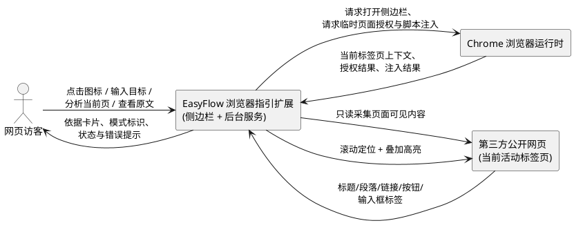
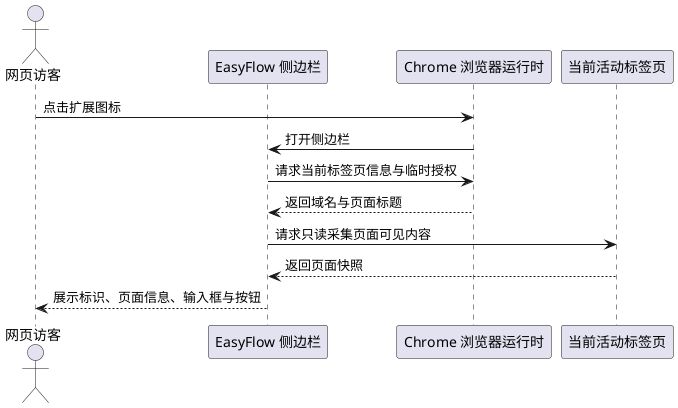
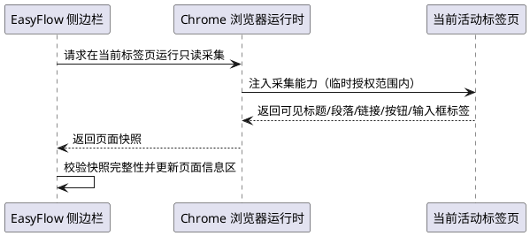
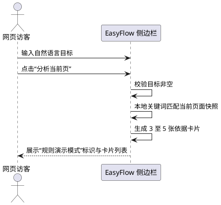
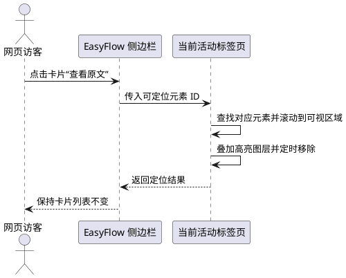
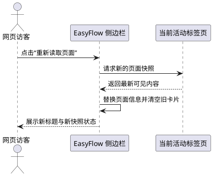
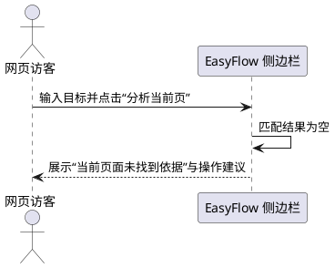
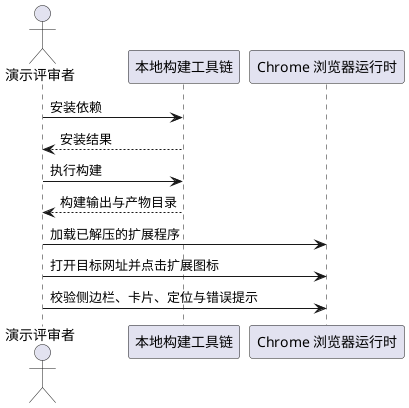

# **1. 组件定位**

## **1.1 核心职责**

本组件负责在用户主动打开的第三方网页上采集可见页面信息、按用户目标做本地关键词匹配并给出可定位的依据卡片，实现“看懂当前页、指出依据在哪”的浏览器指引能力。

## **1.2 核心输入**

1. **用户操作指令**：来自侧边栏的人类用户操作，包括点击扩展图标、输入自然语言目标、点击“分析当前页”、点击“重新读取页面”、点击某张卡片的“查看原文”。
2. **当前活动标签页**：来自 Chrome 浏览器的当前标签页上下文，包含页面 URL、域名、页面标题与页面可见内容（标题、段落、链接、按钮、输入框标签）。
3. **注入授权结果**：来自 Chrome 扩展运行时对当前标签页的临时授权结果，用于判定本次采集是否被允许。
4. **上一次会话状态**（可选）：来自扩展本地存储的上一次用户输入目标，用于侧边栏重新打开时恢复输入框内容。

## **1.3 核心输出**

1. **侧边栏界面**：返回给用户的可视界面，包含 EasyFlow 标识、当前网站与页面标题、目标输入框、操作按钮、模式标识、依据卡片列表、状态与错误提示。
2. **依据卡片**：返回给用户的指引结果，每张卡片包含极短摘要、原文片段、可定位元素 ID 与“查看原文”操作入口。
3. **页面定位与高亮指令**：发送给当前第三方网页的只读定位指令，使页面滚动至目标元素并以叠加图层方式临时高亮。
4. **明确的状态结论**：返回给用户的“规则演示模式”标识、加载状态、注入失败原因、以及“当前页面未找到依据”的结论文本。

## **1.4 职责边界**

1. 本组件**禁止**自建报名网站、校园或社区信息站、机构官网首页，**禁止**产出静态设计稿或落地页演示页面。
2. 本组件**禁止**将目标网站的政策正文、条文要点、办理流程等业务内容写死在源码或配置中；卡片内容必须实时来自当前页面内容。
3. 本组件**禁止**针对第三方网页写入、删除、修改、重排任何原有节点及其文本与属性，**禁止**注入会改变页面视觉样式的持久样式规则；仅允许叠加独立的高亮图层。
4. 本组件**禁止**代替用户填写输入框、勾选复选框、点击提交类按钮、上传文件或完成任何表单交互。
5. 本组件**禁止**申请 `<all_urls>` 等永久全站访问权限；未获得当前标签页临时授权时不得读取页面内容。
6. 本组件**禁止**将“规则演示模式”表述为人工智能模型规划、智能体推理或大模型分析；本轮不存在运行时模型调用。
7. 本组件不负责登录、账号、付费 API 调用、页面内容抓取存档、跨会话的页面历史留存。
8. 本组件不负责判断第三方页面内容的政策时效性与法律正确性，仅做原文定位呈现。

# **2. 领域术语**

**页面快照**
: 对当前标签页在某一时刻可见内容的只读结构化描述，包含页面地址、域名、页面标题与元素条目集合。

**元素条目**
: 页面快照中的最小记录单元，描述一个可见的标题、段落、链接、按钮或输入框标签，并携带可定位元素 ID、文本内容与该元素在页面中的位置标识。

**可定位元素 ID**
: 由本组件在采集阶段为每个元素条目分配的会话内唯一标识，用于把卡片与其在页面中的真实节点一一对应，并在定位时找到该节点。

**依据卡片**
: 面向用户的指引结果单元，包含极短摘要、原文片段、可定位元素 ID 与“查看原文”操作入口，其内容必须摘自当前页面快照。

**用户目标**
: 用户以自然语言表达、希望在本页面获得解释或指引的诉求，例如“我想知道高龄津贴的申请条件和线下办理方式”。

**规则演示模式**
: 本轮使用的本地关键词匹配定位方式，按词面重合度从页面快照中挑选候选片段，不涉及任何模型推理、意图泛化或生成式回答。

**规则演示标识**
: 在侧边栏中始终可见的模式说明，用于告知用户当前结论来自本地关键词匹配而非人工智能模型。

**临时页面授权**
: 用户主动点击扩展图标后，浏览器仅对当前活动标签页授予的一次性访问许可，页面切换或授权结束后自动失效。

**无依据结论**
: 当页面快照中不存在与用户目标足够相关的片段时，本组件给出的明确否定结论“当前页面未找到依据”。

**注入失败**
: 浏览器拒绝或不支持在目标页面运行采集能力的情形，例如浏览器内部页面、扩展商店页面、部分受限地址或页面安全策略拒绝。

# **3. 角色与边界**

## **3.1 核心角色**

1. **网页访客**：在浏览器中浏览第三方公开网页、希望快速定位页面内关键依据的个人用户。其操作包括打开目标网页、点击扩展图标、输入目标、请求分析与定位。
2. **演示评审者**：在验收场景下按既定步骤验证采集准确性、卡片真实性、定位高亮效果与错误提示的用户，与网页访客的操作路径一致。

## **3.2 外部系统**

1. **Chrome 浏览器运行时**：提供侧边栏容器、扩展图标入口、临时页面授权、脚本注入能力与本地存储能力；向本组件提供当前标签页上下文与授权结果。
2. **第三方公开网页**：向本组件提供可见的页面标题、段落、链接、按钮与输入框标签；接收本组件的只读定位与高亮请求。
3. **本地构建工具链**：Node.js 20 与 npm 10，负责依赖安装与产物构建，产出可直接加载的扩展目录；本组件不得依赖任何需要付费或登录的远程接口。

## **3.3 交互上下文**

# **4. DFX约束**

## **4.1 性能**

1. 用户点击扩展图标后，侧边栏必须在 1.5 秒内呈现可见界面（含标识与加载态）。
2. 单个页面可见条目数不超过 3000 条时，一次页面采集必须在 1 秒内完成。
3. 一次“分析当前页”在本地关键词匹配阶段必须在 1 秒内完成并渲染卡片。
4. 点击“查看原文”后，页面滚动与高亮反馈必须在 500 毫秒内出现。
5. 侧边栏单次交互不得出现超过 2 秒的无反馈等待；超过 500 毫秒的操作必须展示加载状态。

## **4.2 可靠性**

1. 页面注入失败时，侧边栏必须保持可用并显示明确失败原因，禁止白屏或静默无反馈。
2. 目标网页结构异常（空标题、超长段落、动态加载、嵌入框架）不得导致侧边栏崩溃；采集必须跳过不可读条目并继续完成其余条目。
3. 卡片引用的元素在定位时若已从页面移除，本组件必须提示该依据已失效并建议重新读取页面，禁止滚动到错误位置。
4. 侧边栏关闭后重新打开，必须重新采集当前标签页内容，禁止展示上一次页面的陈旧卡片。
5. 同一页面内重复分析必须得到与当前页面内容一致的结果，不得累积重复卡片。

## **4.3 安全性**

1. 本组件必须采用最小权限：仅申请当前标签页临时授权、脚本注入、侧边栏与可选本地存储能力，禁止申请永久全站访问权限。
2. 本组件禁止在未获临时页面授权的标签页读取任何页面内容。
3. 本组件对第三方页面必须保持只读：禁止修改原有节点文本、属性、结构，禁止提交表单，禁止触发页面自身的提交类动作。
4. 采集内容仅在本机内存与本机存储中使用，禁止向任何远程服务上传页面内容或用户输入。
5. 高亮必须通过独立叠加图层实现，图层移除后页面视觉必须与注入前一致。
6. 用户输入目标与页面片段在界面渲染时必须按纯文本处理，禁止作为可执行内容解析。

## **4.4 可维护性**

1. 侧边栏必须始终展示“规则演示模式”标识，且不得出现“AI 模型”“大模型分析”“智能体规划”等表述。
2. 采集结果、匹配过程与定位结果必须可在本地运行日志中按一次分析运行区分，用于排障。
3. 关键词匹配规则必须集中维护、可单独替换，便于后续接入运行时模型与来源校验。
4. 构建产物必须输出到固定目录，且该目录可直接作为“加载已解压的扩展程序”的目录使用。
5. 项目必须提供说明文档，覆盖依赖安装、构建、产物位置、浏览器加载、目标网址、操作步骤、预期界面截图位置与常见错误。

## **4.5 兼容性**

1. 本组件必须在 Chrome 114 及以上版本可加载，侧边栏主动打开能力要求的版本不得低于 Chrome 116。
2. 本组件必须以 Manifest V3 与 TypeScript 构建，禁止使用 Manifest V2 或需要打包服务器的方式运行。
3. 页面采集必须兼容目标验收页及其同域页面，且不依赖任何登录态或付费接口。
4. 接口变更时，页面快照与卡片的数据结构必须向后兼容，新增字段不得破坏已有字段语义。

# **5. 核心能力**

## **5.1 侧边栏唤起**

### **5.1.1 业务规则**

1. **图标即入口**：用户点击扩展图标时，本组件必须打开浏览器侧边栏承载全部交互，禁止以弹窗或新标签页替代。
   a. 验收条件：用户点击扩展图标 → 侧边栏在当前窗口右侧出现，且不切换当前标签页。
2. **标识可见**：侧边栏顶部必须展示 EasyFlow 标识。
   a. 验收条件：侧边栏打开 → 首屏可见 EasyFlow 标识文本。
3. **当前页信息可见**：侧边栏必须展示当前网站域名与当前页面标题。
   a. 验收条件：侧边栏在验收页打开 → 展示 `www.bjsjs.gov.cn` 与该页标题。
4. **控件齐备**：侧边栏必须包含自然语言目标输入框、“分析当前页”按钮、“重新读取页面”按钮。
   a. 验收条件：侧边栏打开 → 三个控件均可见且可操作。
5. **输入示例可读**：输入框必须提供示例提示，允许用户输入“我想知道高龄津贴的申请条件和线下办理方式”这类目标。
   a. 验收条件：输入框为空时 → 展示该示例或等价提示文本。
6. **禁止项**：侧边栏禁止展示与网页指引无关的营销、报名、机构介绍内容。
   a. 验收条件：浏览侧边栏全部区域 → 不存在报名入口、机构导航或广告位。

### **5.1.2 交互流程**

### **5.1.3 异常场景**

1. **当前页不可注入**
   a. 触发条件：当前标签页为浏览器内部页面、扩展商店页面、本地文件或安全策略拒绝注入。
   b. 系统行为：中止采集，保留侧边栏界面，展示失败原因与建议（切换到普通公开网页后重试）。
   c. 用户感知：提示“当前页面不支持读取，请切换到普通公开网页后重试”，并提供“重新读取页面”入口。
2. **无活动标签页**
   a. 触发条件：点击图标时当前窗口不存在可访问的活动标签页。
   b. 系统行为：不发起注入，展示引导提示。
   c. 用户感知：提示“未检测到活动网页，请先打开目标网页”。
3. **页面标题缺失**
   a. 触发条件：页面无可读标题。
   b. 系统行为：以页面域名作为标题占位，继续采集。
   c. 用户感知：标题区展示域名，并标注“页面无标题”。

## **5.2 页面可见内容采集**

### **5.2.1 业务规则**

1. **只读采集**：本组件必须只读取当前页面的可见内容，禁止写入或改动页面。
   a. 验收条件：采集完成后 → 页面 DOM 原有节点文本与属性与采集前一致。
2. **采集范围完整**：采集必须覆盖页面可见标题、段落、链接、按钮与输入框标签五类条目。
   a. 验收条件：在验收页执行采集 → 快照中五类条目至少各存在一条（页面确有该类内容时）。
3. **仅可见内容**：采集必须排除隐藏条目，包括不可见、零尺寸、被隐藏属性标记的节点。
   a. 验收条件：页面存在隐藏节点 → 快照不包含该节点文本。
4. **元素 ID 唯一**：每个采集条目必须获得会话内唯一且稳定的可定位元素 ID，同一元素在多次采集中应获得一致 ID。
   a. 验收条件：连续两次采集同一页面 → 相同元素的 ID 一致，且无重复 ID。
5. **文本归一化**：采集文本必须去除首尾空白、合并连续空白，并限制单条文本长度上限，超长文本须截断并保留可定位能力。
   a. 验收条件：页面存在超长段落 → 快照中该条目文本被截断但元素 ID 仍可定位。
6. **跨框架与动态内容**：采集应当覆盖页面主文档可见内容；对动态加载内容，以采集时刻可见状态为准。
   a. 验收条件：页面内容在采集后新增 → 点击“重新读取页面”后快照包含新增内容。
7. **禁止项**：采集禁止修改页面、禁止触发页面链接跳转、禁止聚焦或勾选任何表单控件。
   a. 验收条件：执行采集 → 页面 URL 不变，表单控件状态不变。

### **5.2.2 交互流程**

### **5.2.3 异常场景**

1. **注入被拒**
   a. 触发条件：浏览器运行时拒绝注入。
   b. 系统行为：不重试注入，记录失败原因并停止本次分析。
   c. 用户感知：展示明确失败原因与重试指引。
2. **采集超时**
   a. 触发条件：采集在 3 秒内未返回。
   b. 系统行为：终止本次采集，保留上次成功快照的只读展示并标记为陈旧。
   c. 用户感知：提示“页面读取超时，请点击重新读取页面”。
3. **页面结构异常**
   a. 触发条件：页面主体为空或条目数量为 0。
   b. 系统行为：返回空快照并据此进入无依据分支。
   c. 用户感知：提示“当前页面未找到依据”，并说明页面可读内容过少。

## **5.3 目标匹配与依据卡片生成（规则演示模式）**

### **5.3.1 业务规则**

1. **目标驱动**：卡片必须由用户当前输入目标与当前页面快照共同决定。
   a. 验收条件：修改输入目标后点击“分析当前页” → 卡片集合随目标变化重新计算。
2. **本地匹配**：匹配必须在本地完成，禁止调用任何远程模型或远程接口。
   a. 验收条件：断开网络后执行分析 → 仍能生成卡片或明确无依据结论。
3. **卡片数量**：当页面存在足够相关片段时，本组件必须产出 3 至 5 张卡片，并按相关性从高到低排列。
   a. 验收条件：目标与验收页内容相关 → 卡片数为 3 至 5 张且顺序稳定。
4. **内容真实**：卡片原文片段必须逐字摘自当前页面快照，禁止改写、拼接、翻译或补写。
   a. 验收条件：任取一张卡片的原文片段 → 在页面中能定位到完全一致的文本。
5. **摘要简短**：卡片摘要必须为极短概述，长度不超过 40 个字符，且不得引入页面之外的事实。
   a. 验收条件：检查每张卡片 → 摘要长度符合上限且无外部事实。
6. **元素 ID 可见**：每张卡片必须展示其可定位元素 ID。
   a. 验收条件：查看卡片 → 可见元素 ID 文本。
7. **模式标识**：卡片区域必须展示“规则演示模式”标识，不得表述为模型分析。
   a. 验收条件：分析完成后 → 卡片区域顶部可见“规则演示模式”。
8. **禁止项**：禁止生成页面中不存在的办理方式、材料清单、办理地点、电话等具体信息。
   a. 验收条件：页面未出现某类信息 → 卡片中不出现该类信息。

### **5.3.2 交互流程**

### **5.3.3 异常场景**

1. **目标为空**
   a. 触发条件：用户未输入目标即点击“分析当前页”。
   b. 系统行为：不执行匹配。
   c. 用户感知：提示“请先输入你想了解的内容”，输入框获得焦点。
2. **目标无关**
   a. 触发条件：目标关键词与页面快照无有效重合。
   b. 系统行为：不生成卡片。
   c. 用户感知：展示“当前页面未找到依据”，并建议更换关键词或重新读取页面。
3. **相关性不足**
   a. 触发条件：命中片段少于 3 条。
   b. 系统行为：只展示实际命中片段，不补造卡片。
   c. 用户感知：展示已找到的少量卡片，并提示“仅找到少量相关片段”，同时保留无依据说明的适用性。

## **5.4 依据定位与高亮**

### **5.4.1 业务规则**

1. **精确定位**：点击“查看原文”必须使页面滚动到该卡片对应的真实元素位置。
   a. 验收条件：点击任一卡片“查看原文” → 该元素进入可视区域内。
2. **临时高亮**：目标元素必须以叠加图层方式高亮，且高亮在有限时长后自动消失。
   a. 验收条件：点击“查看原文” → 高亮出现，数秒后自动移除。
3. **不改动原页面**：高亮禁止修改原有节点文本、属性与结构，禁止改变页面排版。
   a. 验收条件：高亮前后对比 → 页面原有节点属性与文本无差异，移除后视觉恢复。
4. **侧边栏不遮挡主内容区**：侧边栏必须位于浏览器侧边区域，禁止覆盖或替换原网页内容。
   a. 验收条件：侧边栏打开 → 原网页仍可正常浏览与滚动。
5. **禁止项**：定位过程禁止触发页面自身的表单提交、勾选、跳转类动作。
   a. 验收条件：点击“查看原文” → 页面地址与表单状态不变。

### **5.4.2 交互流程**

### **5.4.3 异常场景**

1. **元素已失效**
   a. 触发条件：卡片对应元素已从页面移除或不可见。
   b. 系统行为：不执行滚动，标记该卡片失效。
   c. 用户感知：提示“该依据已不在页面中，请点击重新读取页面”。
2. **元素被遮挡**
   a. 触发条件：元素位于折叠区域或不可见容器内。
   b. 系统行为：使用页面原有展开能力之外的只读方式定位到最近可见祖先或提示展开。
   c. 用户感知：提示“目标内容被折叠，请展开后重试”。

## **5.5 重新读取与页面切换**

### **5.5.1 业务规则**

1. **重新读取即时生效**：点击“重新读取页面”必须重新采集当前标签页内容并刷新页面信息与快照。
   a. 验收条件：页面刷新后点击“重新读取页面” → 侧边栏标题与内容为新页面内容。
2. **同域切换可见**：用户切换到同域其他页面后点击“重新读取页面”，侧边栏必须反映新页面的标题与内容。
   a. 验收条件：从验收页跳转至同域其他页 → 标题更新，旧卡片被清空。
3. **陈旧结果清理**：重新读取成功后必须清空上一次分析的卡片，避免与新页面内容混淆。
   a. 验收条件：重新读取后 → 卡片列表为空或全部基于新快照重新生成。
4. **标签页切换感知**：当前标签页发生切换时，侧边栏必须提示页面已变化并引导重新读取。
   a. 验收条件：切换标签页 → 侧边栏出现“页面已切换，请重新读取”提示。

### **5.5.2 交互流程**

### **5.5.3 异常场景**

1. **页面已关闭**
   a. 触发条件：采集时标签页已被关闭。
   b. 系统行为：中止采集并清空页面信息。
   c. 用户感知：提示“当前标签页已关闭，请重新打开目标网页”。
2. **重新读取后仍无相关内容**
   a. 触发条件：新页面与当前目标不相关。
   b. 系统行为：不保留旧卡片。
   c. 用户感知：展示“当前页面未找到依据”。

## **5.6 无依据与信息真实性**

### **5.6.1 业务规则**

1. **无依据必须明说**：当页面快照中不存在相关片段时，本组件必须明确展示“当前页面未找到依据”。
   a. 验收条件：输入与页面完全无关的目标并分析 → 界面出现该结论文本。
2. **禁止编造**：本组件禁止在无依据时输出任何推测性办理方式、材料、条件或联系方式。
   a. 验收条件：出现无依据结论时 → 卡片数为 0。
3. **来源可回溯**：每张卡片必须可从原文片段回溯到真实页面元素。
   a. 验收条件：任取一张卡片点击“查看原文” → 页面确实存在对应内容。
4. **禁止项**：禁止缓存其他网站的卡片内容并跨站展示。
   a. 验收条件：切换域名后重新读取 → 不出现上一域名页面的卡片。

### **5.6.2 交互流程**

### **5.6.3 异常场景**

1. **快照为空**
   a. 触发条件：页面无任何可见可读内容。
   b. 系统行为：直接进入无依据分支。
   c. 用户感知：“当前页面未找到依据”，并提示页面内容可能未加载完成。
2. **目标仅含停用词**
   a. 触发条件：目标去除停用词后无有效关键词。
   b. 系统行为：不执行匹配。
   c. 用户感知：提示“请补充更具体的关键词，例如办理条件、办理方式”。

## **5.7 交付与验收留痕**

### **5.7.1 业务规则**

1. **可加载性**：构建产物必须能以“加载已解压的扩展程序”方式在 Chrome 中直接运行。
   a. 验收条件：构建完成后加载产物目录 → 扩展出现在扩展列表且无加载错误。
2. **构建真实执行**：交付必须在本地真实执行依赖安装与构建命令，并如实记录结果。
   a. 验收条件：交付说明中列出的构建命令与输出 → 与本地实际执行记录一致。
3. **失败必须修复**：构建失败必须修复并重新执行验证，禁止以“理论上可运行”的表述交付。
   a. 验收条件：构建失败案例 → 存在修复记录与复测成功记录。
4. **留痕完整**：项目必须保留阶段性记录目录，包含需求结论、文件修改清单、执行命令与实际输出。
   a. 验收条件：检查留痕目录 → 可见需求阶段记录与构建输出记录文件。
5. **说明文档完备**：项目说明文档必须覆盖依赖安装、构建、产物位置、浏览器加载、目标网址、操作步骤、预期界面展示位置与常见错误。
   a. 验收条件：按说明文档从零操作 → 可复现侧边栏与卡片结果。

### **5.7.2 交互流程**

### **5.7.3 异常场景**

1. **依赖安装失败**
   a. 触发条件：网络或包源不可用。
   b. 系统行为：保留错误输出并给出替代包源建议。
   c. 用户感知：说明文档中可见对应错误与处理办法。
2. **构建报错**
   a. 触发条件：类型错误或构建配置错误。
   b. 系统行为：修复后重新执行构建。
   c. 用户感知：留痕中可见修复前后两次构建输出。
3. **扩展加载报错**
   a. 触发条件：清单字段缺失或脚本路径错误。
   b. 系统行为：修正清单与产物路径。
   c. 用户感知：说明文档常见错误章节给出定位方法。

# **6. 数据约束**

## **6.1 页面快照**

1. **页面地址**：必须是当前标签页完整地址，非空。
2. **域名**：必须由页面地址解析得到，用于界面展示与同域判断。
3. **页面标题**：必须为页面可读标题；缺失时以域名占位并标记缺失。
4. **采集时刻**：必须记录采集发生的时间点，用于标识快照新旧。
5. **条目集合**：条目数量必须为非负整数；每条条目必须包含元素 ID、条目类型与文本。
6. **快照有效性**：同一快照内元素 ID 必须全局唯一。

## **6.2 元素条目**

1. **元素 ID**：必须为会话内唯一字符串，不得为空。
2. **条目类型**：必须为标题、段落、链接、按钮、输入框标签之一。
3. **文本内容**：必须为归一化后的可见文本，非空；长度不得超过设定上限，超长须截断标记。
4. **可见性**：必须仅收录采集时刻可见的条目。
5. **位置标识**：必须携带足以定位到页面真实元素的位置信息。

## **6.3 依据卡片**

1. **摘要**：必须非空，长度不超过 40 个字符，且不得包含页面之外的事实。
2. **原文片段**：必须逐字摘自对应元素条目文本，非空。
3. **元素 ID**：必须与页面快照中的某条条目元素 ID 完全一致。
4. **相关性顺序**：卡片在列表中必须按相关性降序排列，顺序在一次分析内稳定。
5. **卡片数量**：一次分析输出的卡片数量必须为 0 或 3 至 5；为 0 时必须同时输出无依据结论。

## **6.4 用户目标**

1. **内容**：必须为自然语言文本，去除首尾空白后非空。
2. **长度**：必须限制最大长度，超出时须提示并禁止提交。
3. **持久化范围**：仅可持久化目标文本本身，禁止持久化页面内容与卡片。

## **6.5 分析运行记录**

1. **运行标识**：每次分析必须生成唯一运行标识，用于日志与排障关联。
2. **模式标记**：每次运行必须标记为规则演示模式。
3. **结果状态**：必须为成功、无依据、注入失败、超时、无效目标之一。
4. **引用关系**：运行记录必须关联其使用的页面快照标识与产出的卡片集合。